# 🧠 Crypto Trading System

> **LLM-driven strategy generation. Deterministic execution. Zero lookahead.**


---

## 📑 Table of Contents

| # | Section | What you'll find |
|---|---------|------------------|
| **1** | [🔭 Project Overview](#1-project-overview) | What the system is, how the pipeline works, what has been built |
| **2** | [🪙 Coin Pages](#2-coin-pages) | Full walkthrough of a single coin's page — every panel and action |
| **3** | [💬 AI Chat](#3-ai-chat) | Conversational interface and the complete toolset the model can call |
| **4** | [📊 Backtesting](#4-backtesting) | Replaying a strategy over history — inputs, execution model, outputs |
| **5** | [🧪 Lab](#5-lab) | Research and optimization workspace — experiments, regimes, iteration |
| **6** | [🤖 Auto Trading](#6-auto-trading) | Live signals, risk controls, order execution, position tracking |

---

<a id="1-project-overview"></a>
## 1. 🔭 Project Overview

### 💡 What it is

An **autonomous crypto trading system for Bybit linear perpetuals**, written in Python, built around one central principle:

> *Let a large language model do the reasoning, but never let it touch the money directly.*

The LLM (DeepSeek) studies the market, writes trading rules in plain language, and — crucially — emits a **machine-readable strategy specification** in strict JSON. Everything that decides whether a trade happens or how it is closed is executed by a deterministic engine that only understands that JSON. **The model proposes; the engine disposes.**

This separation is what makes the system testable. A strategy invented by the model for XRP can be replayed over years of 15-minute candles in seconds, scored, rejected, rewritten, and re-scored — without a single order ever reaching the exchange.

---

### ⚙️ How it works

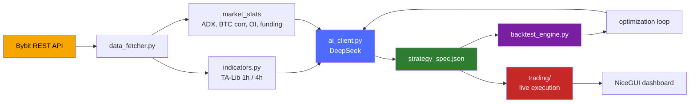

#### 1️⃣ Data Acquisition — `data_fetcher.py`

Fetches **15m and 1h klines** with paginated backfill and exponential-backoff retries, plus orderbook depth, aggregated public trades, open interest, funding rate, long/short ratio and the Fear & Greed index.

On top of raw candles it precomputes `market_stats`:

- 24h volume and price change
- Open-interest delta
- **Adaptive ADX threshold** derived from the last five days of 1h data (clamped to **12–30**)
- **BTC correlation** over 24h returns, with a 15-minute cache so six symbols don't hammer the API six times

Three package flavours exist:

| Package ↕▾ | Window ↕▾ | Purpose ↕▾ |
|---|---|---|
| −`morning_package` | Wide (2 days, up to 64×15m candles) | Full context analysis at the start of a session |
| −`intraday_package` | Tighter (8h, up to 30×15m candles) | Periodic re-evaluation during the day |
| −`intraday_light` | Minimal (2 candles + fresh stats) | Validating a pending setup or babysitting a position at a fraction of the token cost |
⚙

#### 2️⃣ Indicator Layer — `indicators.py` + engine

TA-Lib for SMA 20/50, RSI 14, ATR 14, Bollinger Bands, MACD, ADX. Daily-reset VWAP. Classic pivot levels computed from the **previous** day, never the current one.

1h candles are resampled from 15m and their features merged back with `merge_asof` — filtering strictly on `*_1h` columns, because merging the hourly OHLCV would silently freeze the 15m close inside each hour and corrupt every trailing stop.

A **4h layer** adds ATR, velocity in ATR units, close position and a candle-boundary flag.

Purpose-built series round it out:

- `low_32` / `high_32` — 32-bar breakout extremes (shifted to avoid lookahead)
- `drop_2_atr` — 2-candle momentum in ATR units
- `activity` — volume ratio × ATR ratio

#### 3️⃣ AI Layer — `ai_client.py`

| Method ↕▾ | Role ↕▾ |
|---|---|
| −`init_symbol` | Runs up to **5 iterations** in which the model may call a `web_search` tool to research a coin, then is forced to return JSON |
| −`analyze` | Requests structured JSON with `response_format`; auto-corrects any timeframe the model invented that isn't in the data |
| −`optimize_strategy` | Takes a TRAIN/TEST backtest summary and returns a revised spec — with hard guardrails injected into the prompt (see below) |
| −`revise_init_strategy` | Rebuilds a spec after a sanity backtest |
| −`chat_with_tools` | Multi-turn tool-calling loop for the interactive chat |
⚙

**Guardrails injected automatically:**

- If test profit factor already exceeds **1.1**, the entry logic is **frozen** — only filters, management and ATR multipliers may change
- If there are **fewer than 30 trades**, the model is required to build `entry_any` OR-groups instead of piling conditions onto a single entry

Every response passes through `_safe_json_loads` — a tolerant parser that strips markdown fences, comments and trailing commas before falling back to `json_repair`.

#### 4️⃣ Strategy Specification — `strategy_spec.py`

The **contract** between model and engine. Each side (`long` / `short`) declares:

| Field ↕▾ | Purpose ↕▾ |
|---|---|
| −`entry` or `entry_any` | A list of AND-groups (OR-combined) |
| −`stop_loss_atr_mult` / `take_profit_atr_mult` | ATR-based risk, with percentage fallbacks |
| −`management` | Breakeven trigger, ATR trailing, max hold candles, optional exits on level failure / trend loss / MACD flip |
| −`filters` | Global filters applied to both sides |
| −`risk_controls` | Cooldown after losing streaks |
⚙

**Six condition primitives:** `compare`, `cross`, `range`, `volume`, `slope`, `distance`.

Validation is **opinionated**: every entry group must contain a volume filter, a trend filter and a level-or-momentum confirmation, and both a stop and a take profit must exist — a model that forgets them gets its spec rejected outright and replaced by the default.

#### 5️⃣ Backtest Engine — `backtest_engine.py`

| Rule ↕▾ | Detail ↕▾ |
|---|---|
| −**Signal timing** | Signals are evaluated on the close of bar *i* and filled at the **open of bar *i+1*** — no same-bar cheating |
| −**Slippage** | **0.05%** against the trade on entry and on SL/TP fills; deliberately **not** on soft exits (which execute at an already-observed close) |
| −**Commission** | 0.055% per side |
| −**Position management** | Runs every bar; SL/TP checked intrabar by high/low |
⚙

**Outputs:** full trade list with entry snapshots (RSI, ADX, ATR, pivots at the moment of entry), equity curve, and stats — win rate, profit factor, expectancy, max drawdown, average win/loss, long/short split, cooldown activation counters.

#### 6️⃣ Live Execution — `trading/`

Signal detection, risk management, position management, order execution and trade journaling. Positions and risk state are persisted as JSON under `data/auto_trading/`.

Order routing and data sourcing are gated by **two independent flags**:

| Flag ↕▾ | Controls ↕▾ |
|---|---|
| −`BYBIT_TESTNET` | Where **orders** go |
| −`BYBIT_DATA_TESTNET` | Where **candles** come from |
⚙

This lets signals be validated on real mainnet history while orders still go to testnet.

---

### 🧩 Core components at a glance

| File ↕▾ | Lines ↕▾ | Responsibility ↕▾ |
|---|---|---|
| −`config.py` | ~110 | Paths, API keys, symbols, candle limits, slippage, testnet flags |
| −`data_fetcher.py` | ~775 | Bybit REST: klines, orderbook, trades, fundamentals, news, precomputed stats |
| −`indicators.py` | ~478 | TA-Lib wrappers, 1h/4h resampling, volume profile, pivots |
| −`ai_client.py` | ~856 | DeepSeek client: init, analyze, optimize, revise, chat |
| −`strategy_spec.py` | ~604 | Strategy DSL: evaluator, validator, defaults, explainer |
| −`backtest_engine.py` | ~865 | Deterministic simulation with slippage, commissions, management |
| −`data_loader.py` | ~226 | Offline CSV loader for `backtest_data/` |
| −`trading/` | — | Live execution: signals, risk, positions, orders, journal |
⚙

---

### ✅ What has been built

- 🪙 **Multi-symbol configuration** — 6 linear perpetuals, each with its own state, rules, journals and archives
- 📡 **Three data-package tiers** tuned for token economy, plus precomputed market statistics and adaptive thresholds
- 📜 **A validated, versionable strategy DSL** with mandatory risk filters and engine-side defaults that fill in whatever the model omits
- 🔁 **A full AI loop** — initialize → sanity backtest → revise → optimize → deploy — with anti-overfitting restrictions injected automatically
- ⏱️ **A lookahead-free backtest engine** with slippage, commissions, position management and loss-streak cooldown
- 💾 **An offline data path** reading yearly 15m CSVs (2023–2026) — enabling long-horizon research without touching the exchange
- 🖥️ **A NiceGUI dashboard** for monitoring, chatting with the model, running backtests and controlling auto-trading

---

### 🎯 Design principles

| Principle ↕▾ | Why it matters ↕▾ |
|---|---|
| −**Separation of reasoning and execution** | The LLM is creative but unreliable; the engine is dumb but exact. Each does what it's good at |
| −**Zero lookahead** | Every indicator is shifted, every pivot uses yesterday's data, every entry fills on the next bar. Backtest results mean something |
| −**Explicit risk contract** | No entry without a volume filter, a trend filter, a level confirmation, a stop and a take profit |
| −**Token economy** | Three package sizes, precomputed stats, trimmed context — so a real trading loop runs on a real API budget |
| −**Deterministic replay** | Same JSON + same data = same trades. Every time |
⚙

---

### 🔧 Technology stack

| Layer ↕▾ | Choice ↕▾ |
|---|---|
| −Language | **Python 3.10+** |
| −Exchange | **Bybit** (via `pybit`) |
| −LLM | **DeepSeek** (via `openai` SDK) |
| −Indicators | **TA-Lib** + **pandas** / **numpy** |
| −UI | **NiceGUI** |
| −Persistence | JSON files + CSV journals |
| −Backtest data | Yearly 15m CSVs in `backtest_data/` |
⚙

---

<a id="2-coin-pages"></a>
## 2. 🪙 Coin Pages

### 💡 What a coin page is

A coin page is the **cockpit for a single symbol** — every action the user can take on one asset lives here and nowhere else.

There are six of them by default, one per entry in `config.TRADING_PAIRS`:

```

XRPUSDT · HYPEUSDT · SOLUSDT · ETHUSDT · DOGEUSDT · ARBUSDT

```

Each one is completely independent. Its own state file, own rules, own trade journal, own archive, own auto-loop, own losses and cooldowns. If one coin is broken, the other five don't notice.

The page is organised around four questions:

| Question | Where it's answered |
|----------|---------------------|
| 🧭 **What is the market doing?** | Analysis card, indicators card, setup/signal card |
| 📜 **What is this coin's strategy?** | Rules tab, `strategy_spec` in state |
| 🎯 **Is there a position?** | Active trade card, entry card, position advice card |
| 📈 **What has happened?** | Archive tab, trade journal, day P&L |

---

### 🧭 Page layout

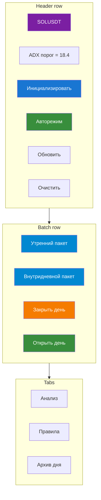

#### Header row

| Element | What it shows / does |
|---|---|
| **💰 {SYMBOL}** | Symbol name, always visible |
| **ADX порог = X.X** | Live adaptive ADX threshold from `state.market_stats.adx_threshold`; falls back to *"ADX порог = 20 (по умолч.)"* if absent |
| **🪄 Инициализировать** | Visible **only** when `is_initialized == false`. Runs the full AI initialization |
| **🚀 Авторежим / ⏹ Остановить** | Toggles the AutoMode loop for this symbol — the button text flips based on `AutoModeState.get_state(symbol).is_running` |
| **🔄 Обновить** | Forces `refresh()` — re-reads state from disk and re-renders every card |
| **🗑 Очистить** | Destructive reset (confirmation dialog required) — see Clear |

#### Batch row

Four day-cycle controls, described in Day lifecycle.

---

### 📊 Tab 1: Analysis

The default view. Six cards that update together on every refresh.

#### 📊 Analysis card

A key-value table rendered from `state.last_analysis`:

| Field ↕▾ | Source ↕▾ |
|---|---|
| −Время анализа | `analysis.timestamp_utc` |
| Цена | `analysis.current_price` |
| Изменение 24ч | `analysis.price_change_24h_pct` |
| Стакан | `analysis.orderbook_bias` |
| OI тренд | `analysis.oi_trend` |
| Funding rate | `analysis.funding_rate_status` |
| Fear & Greed | `analysis.fear_greed_state` |
| L/S Ratio | `analysis.long_short_ratio_signal` |
| Новости | `analysis.news_impact` |
⚙

Below the table, the model's own words: `📝 Сводка: {summary}`.

The card is **empty** until the first morning or intraday package has run.

#### 📐 Setup / Signal card

Shows the model's current thesis — but **only when there is no active trade** (an open position suppresses the setup card; its own advice lives in `position_advice_card`).

Priority order:

| Condition | What renders |
|---|---|
| `last_signal.confidence_pct > 0` | 🚨 **СИГНАЛ** — a live, actionable entry |
| `last_setup` exists (no active trade) | 📐 **СЕТАП** — a conditional watch |
| Neither | Card hidden |

Both views share a common shape:

| Row | Signal | Setup |
|---|---|---|
| Тип | 🚨 СИГНАЛ | 📐 СЕТАП |
| Направление | `direction` | `direction` |
| Уверенность | `confidence_pct`% | `confidence_pct`% |
| Вход | `entry_price` or *"По рынку"* | same |
| SL | `stop_loss` | `stop_loss` |
| TP | list of `take_profit[]` | same |
| Обоснование | `signal_rationale` | `rationale` |

Below the table, two lists:

- **Условия входа** — `entry_conditions[]` (signal) or `conditions[]` (setup)
- **Условия отмены** — `cancel_conditions[]`

Every setup and signal carries **cancellation conditions**. This is not decoration: the model is forbidden from producing a bare "buy now" without saying what would invalidate the idea.

#### 📈 Indicators card

Renders the last **5 values** of every numeric indicator series, plus the volume profile.

The columns are built dynamically from `state.indicators` keys — each series with a list value gets its own column. Pivot levels and other scalars appear as-is. Timestamps come from `state.indicator_timestamps`, aligned by index.

Below the table: **📊 Объёмный профиль (топ-5 уровней)** — the top five price levels by volume, each with (price, volume). This is what "where has the market actually traded" looks like as a table.

The card is hidden until the first package has been delivered.

#### 🔴 Active trade card

Appears only when `state.active_trade` exists. Shows:

| Field ↕▾ | Content ↕▾ |
|---|---|
| −Направление | `direction` (LONG/SHORT) |
| Цена входа | `entry_price` |
| Стоп-лосс | `stop_loss` |
| Тейк-профит | `take_profit[]` |
| Тип входа | `entry_type` (`manual` / `signal`) |
⚙

Two actions:

**✏️ Редактировать** → opens a dialog with new SL and TP fields. On save, it re-runs the AI analysis with `keep_history=False` so the model sees the *new* parameters as fact, not as a delta. The advice card updates accordingly.

**🔒 Закрыть позицию** — closes at a price you specify:

| Input | Options |
|---|---|
| Цена выхода | Pre-filled with current price (fetched fresh on refresh) |
| Причина | `manual` · `stop_loss` · `take_profit` |

On close:

1. `result_pct` computed from direction and prices
2. Trade appended to `trade_journal.csv`
3. `active_trade` cleared
4. **Post-close analysis** runs with `error_analysis=True` if `result_pct < 0`, so the model reviews its own mistake and may propose `new_rules`

That last step is subtle but important: the system deliberately learns from losses, not just from wins.

#### ➕ Entry card

The manual trade form. Appears when there is **no active position**.

| Field ↕▾ | Notes ↕▾ |
|---|---|
| −Направление | `long` / `short` |
| −Цена входа | must be > 0 |
| Стоп-лосс | direction-dependent validation |
| Тейк-профит | direction-dependent validation |
⚙

**Validation rules** (rejected with a toast if violated):

```
long:  stop_loss < entry_price  AND  take_profit > entry_price
short: stop_loss > entry_price  AND  take_profit < entry_price
```

On successful submit, three things happen in one action:

1. `active_trade` written to state
2. **AutoMode started in `position_only` mode** — no catch-up, no morning package, because a position already exists and doesn't need a fresh read of the chart from scratch
3. **Post-entry analysis** runs on an intraday package

So a manual entry is never a blind entry: the AI immediately gets asked *"what do you make of this position?"* and writes its answer into `position_advice_card`.

#### 📋 Position advice card

Populated when there is an active trade **and** either `last_position_update` exists or `last_analysis` exists. The model's live read on the open position:

| Field | Source |
|---|---|
| Рекомендация | `last_position_update.advice` (e.g. *"перенести SL"*, *"частично зафиксировать"*, *"закрыть"*) |
| Новый стоп-лосс | `last_position_update.new_stop_loss` (optional) |
| Частичная фиксация | `last_position_update.partial_take_profit_pct` (optional) |

Below: **Условия закрытия** — the `cancel_conditions[]` from the currently-active signal or setup, re-surfaced as a checklist.

---

### 📐 Tab 2: Rules

Two views of the same thing, synced on save.

#### Structured view

`rules_table` splits the rules text into rows:

| Column ↕▾ | Content ↕▾ |
|---|---|
| −№ | Sequential number |
| −Условие | Text before the first `:` (or `---`) |
| Описание | Text after |
⚙

Trading rules come first, then a divider row (`=== РИСК-МЕНЕДЖМЕНТ ===`), then risk rules.

If `state.trading_rules_list` and `state.risk_management_rules_list` are both empty but `trading_rules.md` exists, the page **parses the file** and populates both lists — so a hand-edited Markdown file becomes first-class structured data on the next refresh.

#### Markdown view

`rules_text_area` shows the full raw Markdown. Editable, with one button:

**💾 Сохранить правила** → on save:

1. `cm.update_rules(new_rules)` — writes `trading_rules.md`
2. `parse_rules_from_text()` splits into two lists
3. Both lists written to `state.json`

From that moment on, every analysis prompt includes the updated rules.

This is the human-in-the-loop override. The AI writes its own rules at initialization and via `optimize_strategy`, but a human can always rewrite them by hand and the AI will honour them on the next call.

---

### 📦 Tab 3: Archive

One row per archived day:

| Column ↕▾ | Content ↕▾ |
|---|---|
| −Дата | `YYYY-MM-DD` |
| −P&L | Sum of `result_pct` for that day's trades, formatted with sign |
| −Сделок | Trade count |
⚙

Clicking a row opens a modal:

```
📅 Архив SOLUSDT — 2026-11-01
P
```

Behind this: `load_archive_day(date)` pulls `state.json`, `trades.csv`, `morning_context.md`, `intraday_context.md` and `key_events.md` from the day folder.

The archive is intentionally **read-only**. To re-run a day, you open a new day — the archive is history.

---

### 🌅 Day lifecycle

Every coin lives inside a **24-hour day cycle**, tracked in `state.date` and gated by `state.day_closed`. Day boundaries are UTC.

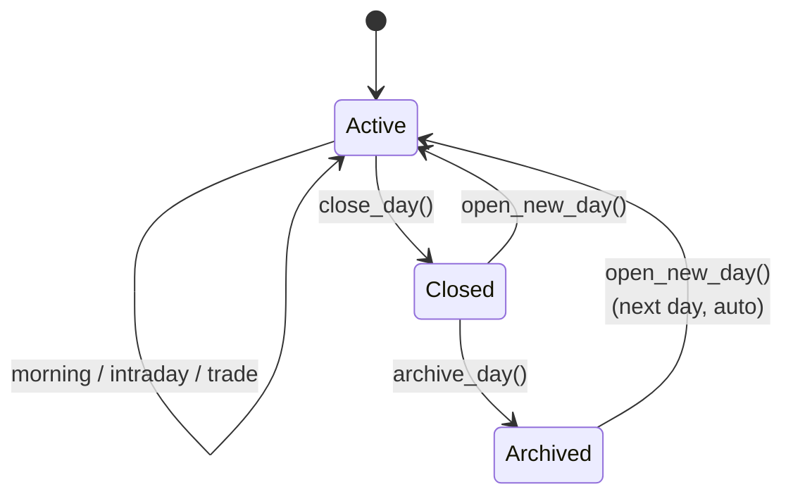

#### 🌅 Утренний пакет

Full-context analysis. On click:

1. Refuses if the day is closed
2. Refuses if `is_initialized == false`
3. Fetches a **morning package** (2 days of 1h candles, up to 64× 15m candles, fundamentals, orderbook, trades, news, market_stats)
4. Calls `ai_client.analyze(...)` with `is_initial=False`
5. `process_ai_response(...)` writes the result into state
6. Sets `last_morning_update_utc`
7. Schedules a UI refresh

This is what starts the day's thesis.

#### ⏱ Внутридневной пакет

Tighter context (30× 15m candles, 8h window). Same flow as morning, but passes `morning_context` and `intraday_context` so the model can *continue* a conversation rather than start fresh.

#### 🔒 Закрыть день

One-way switch:

- Stops `AutoModeState` for this symbol
- Archives the day (`archive_day()` — if a folder already exists for that date, this is skipped)
- Sets `state.day_closed = true`

Why this exists: **a halted day is different from a paused auto mode**. Pausing lets the loop resume; closing the day requires `open_day()` to trade again. It's an "I'm done for today" statement, not a "wait a bit."

If the day is closed, all three of these refuse to run:

- Morning package
- Intraday package
- Auto mode start

#### 🔓 Открыть день

Creates a new day. Triggers:

- `archive_day()` for the *old* date (if not already archived)
- Reset `day_closed = false`
- Clear **all** transient context: `active_trade`, `last_signal`, `last_setup`, `last_analysis`, `last_update_utc`, `last_morning_update_utc`, `last_candle_time`, `morning_context`, `intraday_context`, `last_key_events`, `indicators`, `indicator_timestamps`
- Set `state.date = today`

What is **preserved** across the day boundary:

- `trading_rules_list`, `risk_management_rules_list` — rules survive days
- `strategy_spec` — spec survives days
- `is_initialized` — the coin stays initialized
- The trade journal (`trade_journal.csv`) — history is permanent

So a new day is a *fresh analytical slate*, not a *wipe*.

---

### 🪄 Initialize

The one action that turns a blank coin into a tradeable one.

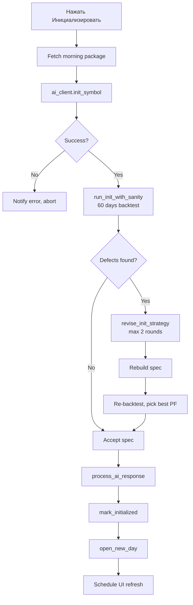

#### `run_init_with_sanity` — the 60-day reality check

Before the AI's spec is accepted as final, the code runs it over the **last 60 days of 15m history** and produces a numerical diagnosis.

Diagnostic checks:

| Check ↕▾ | Threshold ↕▾ | Failure message ↕▾ |
|---|---|---|
| −Trade frequency | `< 1.5 trades/week` | *"фильтры входа слишком жёсткие"* |
| −Edge | `PF < 1.0` **and** `expectancy < 0` | *"нет эджа"* |
| −Quick losses | `> 50% of losses` close in ≤ 3 candles | *"входы слишком поздние или стоп внутри шума"* |
⚙

If **any** of these triggers, the text is passed to `revise_init_strategy` with a specific remediation checklist:

> *"Ослабь объёмный/RSI-фильтры и/или добавь вторую OR-группу входа (ретест/откат); цель 2-5 сделок в неделю."*
> *"При доле быстрых убытков > 50% входи раньше (ретест, а не догон) и/или расширь стоп до 2.5-4.0 x ATR15m."*
> *"Если WR ниже безубыточного порока, подними take_profit_atr_mult до 3-5."*

The model gets **up to 2 revision rounds**. If a later revision has better PF than the previous best, that one is kept. If not, the earlier spec survives.

The result is remembered: `response.sanity_best_pf` — so you can see *"the model's spec passed with PF 1.32 on the sanity backtest"* immediately after initialization.

Then `_process_init_response` (in `ui/ai_handlers.py`):

1. `research` written to state
2. `strategy_spec` validated and enriched with `ensure_engine_defaults()`
3. `trading_rules_list` and `risk_management_rules_list` written
4. `new_rules` written to `trading_rules.md`
5. `is_initialized = true`
6. `open_new_day()` called

After this the coin is live-ready: it has a spec, rules, and a fresh day.

#### What if the model forgets `setup`?

`_ensure_safe_setup_fallback` in `ui/ai_handlers.py` catches the case where the model returns `ANALYSIS` without setup/signal/position_update and no active trade. Instead of leaving the UI blank, it inserts a **placeholder setup** with:

```
{
  "direction
```

Zero-confidence means no trade, but the structure is preserved — the UI doesn't crash, the next iteration can overwrite it, and the reason is documented.

---

### 🚀 Auto mode — the background loop

Toggled by **🚀 Авторежим** (becomes **⏹ Остановить** when running). This is **not** auto trading; it's an AI-driven analysis loop that keeps producing setups/signals but never places orders. Real orders are [Section 6](https://06-auto-trading/).

#### Two start modes

| Mode ↕▾ | Triggered by ↕▾ | What it does ↕▾ |
|---|---|---|
| −**`full`** | 🚀 Авторежим button | Catch-up + morning package (if needed) + loop |
| −**`position_only`** | `open_trade()` in the coin page | **Skips** catch-up and morning, because a manual entry is already in flight |
⚙

#### The full-mode bootstrap

On start, the loop:

1. **Archives yesterday** (if the date rolled over) and opens a new day
2. Refuses to start if the day is closed
3. **Catch-up fetch** — pulls the missed candles since `last_update_utc` (or `last_morning_update_utc`)

- If the gap is < 15 minutes, catch-up is skipped
- Otherwise it fetches 15m + 1h, computes indicators, builds an `intraday_update`-shaped package, and sends it to `analyze()` with fresh history
4. **Morning package** — if `last_morning_update_utc` is before today's UTC midnight

- Delivered through the full morning flow
- `last_morning_update_utc` stamped
5. Enters the **candle loop**

#### The candle loop

Waits for the **next 15-minute boundary** (minute 0, 15, 30, or 45), then:

| Condition ↕▾ | Package used ↕▾ |
|---|---|
| −`active_trade` exists **or** `last_setup` exists | `get_intraday_light_package()` — 2 candles, cheap |
| −Neither | `get_intraday_package()` — 30 candles, full |
⚙

Then `analyze()` → `process_ai_response()` → wait for the next boundary.

The `intraday_light` branch is the token-economy decision at work. When there's already a thesis in play, you don't need 30 candles to validate it — 2 candles plus fresh `market_stats` is enough.

#### What stops the loop

- `close_day()` — the day is closed
- `AutoModeState.stop(symbol)` — manual stop
- `day_closed == true` at any check

---

### 🗑 Clear — the nuclear option

A confirmation dialog guards the **🗑 Очистить** button. On confirm, `clear_coin_data(mode="all")` runs:

| Cleared ↕▾ | Kept ↕▾ |
|---|---|
| −`last_analysis`, `last_signal`, `last_setup` | `trade_journal.csv` |
| −All `last_*` timestamps | Archive folder history |
| `morning_context`, `intraday_context` |  |
| `indicators`, `indicator_timestamps` |  |
| `last_key_events` |  |
| `trading_rules.md` |  |
| `behavior_rules.md` |  |
| `active_trade` |  |
| `is_initialized` → false |  |
| `strategy_spec` → null |  |
| `trading_rules_list`, `risk_management_rules_list` |  |
| `research` |  |
⚙

Also stops auto mode for the symbol.

The UI toast reads **"Данные очищены (кроме журнала)."** — because the journal survives, so you can never accidentally lose your trade history, only the AI's current thesis.

After clearing, the coin is back to **uninitialized** state: **🪄 Инициализировать** button returns, auto mode refuses to start, and a fresh init is required before anything will trade.

---

### 📁 What lives on disk per symbol

```
data/
└── SOLUSDT/
    ├── state.json              # every state field listed above
    ├── trading_rules.md        # human-readable rules
```

Plus, at the `data/auto_trading/` level:

```
data
```

Every operation from the coin page writes to **its own slot** — nothing leaks across symbols.

---

### 🧠 The reasoning state machine

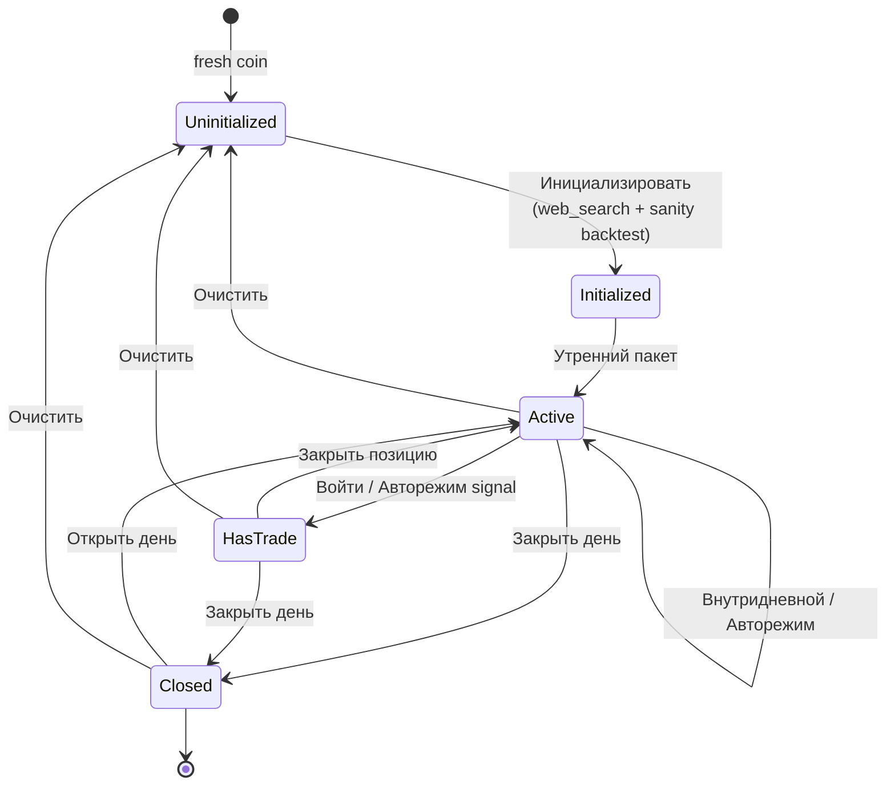

Every arrow is a page action. A coin never jumps straight from "the model wrote something" to "money at risk" — there is always an analysis, a sanity backtest, and (if auto trading is enabled) a strategy spec validated against history.

---

### 🛡️ Safety properties

| Property ↕▾ | Guarantee ↕▾ |
|---|---|
| −**Symbol isolation** | All state per-symbol; a corrupt SOLUSDT cannot affect XRPUSDT |
| −**Day discipline** | Closing a day requires `open_day` to resume — a hard "I'm done" gate |
| −**Journal is forever** | 🗑 Clear leaves `trade_journal.csv` untouched |
| −**Fallback setup** | Model failing to return a setup produces a zero-confidence placeholder, not a blank UI |
| −**Auto mode is not auto trading** | 🚀 Авторежим produces analysis, never orders — the two are deliberately separate |
| −**Manual entry is bounded** | SL/TP side validation prevents "long with stop above entry" from ever being submitted |
| −**Post-close analysis on losses** | Losing trades feed `error_analysis=True` — the model is asked to diagnose itself |
| −**Explicit cancellation** | Every setup and signal carries `cancel_conditions` — nothing is a forever-thesis |
⚙

---

### 🎯 What the user actually does on a coin page

In rough chronological order, over a coin's life:

| Moment ↕▾ | Action ↕▾ |
|---|---|
| −**New coin** | 🪄 Инициализировать → sanity backtest → accepted |
| −**Start of day** | 🔓 Открыть день (auto on first refresh) → 🌅 Утренний пакет |
| −**During day** | ⏱ Внутридневной пакет, or flip 🚀 Авторежим and let the loop drive |
| **Signal fires** | Model writes `last_signal` → 📐 Сетап / Сигнал card shows the setup → you decide to ➕ Войти |
| **Open position** | 🔴 Активная позиция card shows it → ✏️ Редактировать (adjust SL/TP) or 🔒 Закрыть (exit) |
| **End of day** | 🔒 Закрыть день → archived |
| **Next morning** | 🔓 Открыть день → fresh analysis slate |
| **Underperforming** | Tune rules in 📐 Правила, or clear + re-init |
| **Wanting a fresh start** | 🗑 Очистить (rules reset, journal preserved) → 🪄 Инициализировать |
⚙

The coin page is where the human decides *when* and *whether*; the AI decides *what*. Keeping those two decisions in separate hands is why the page has both a *stratégie editor* (Правила tab) and a *strategy executor* (Сетап card) sitting next to each other.

---

```

</


---

<a id="3-ai-chat"></a>
## 3. 💬 AI Chat

### 💡 What it is

The chat is a **conversational window into the same model that writes your strategies** — but with its hands untied.

Everywhere else the model is boxed in: it must return strict JSON, it gets one shot, and the engine decides what to do with the answer. In the chat it can reason across multiple turns, pull data with tools, and explain itself in prose. It's the one place where you can *ask the model what it thinks* without a schema standing in the way.

The distinction is deliberate:

| Concern | Analysis pipeline | Chat |
|---------|-------------------|------|
| **Output format** | Strict JSON (`response_format={"type": "json_object"}`) | Free-form prose |
| **Turns** | One request → one response | Up to **5** tool rounds |
| **History** | 7 messages trimmed, or fresh context | Rebuilt from scratch per call |
| **Tools** | Only `web_search`, only during `init_symbol` | **12 tools** via `ToolExecutor` |
| **Temperature** | 0.3 | **0.5** — more exploratory |
| **Failure mode** | Fallback JSON, logged | Error string returned to the user |

The temperature gap is not cosmetic. Analysis wants the most likely reading of the chart. Chat wants the model to actually *think out loud*.

---

### ⚙️ How a chat turn is assembled

Every message goes through `ChatPage.send_message()` → `DeepSeekClient.chat_with_tools()`. Along the way, a single large user message is built from labelled blocks:

```

=== ЧАТ ОТ ПОЛЬЗОВАТЕЛЯ ===
Пара: SOLUSDT
СООБЩЕНИЕ ПОЛЬЗОВАТЕЛЯ: <your text>
У тебя есть доступ к инструментам (tools). Отвечай на русском языке.

--- УТРЕННИЙ КОНТЕКСТ ---        ← optional
--- ПОСЛЕДНИЕ ВЫВОДЫ ---          ← optional (intraday context)
--- ПОСЛЕДНИЙ АНАЛИЗ ---          ← optional (JSON)
--- ПРАВИЛА ТОРГОВЛИ ---          ← optional (trading_rules.md)
--- ПОВЕДЕНЧЕСКИЕ ПРАВИЛА ---     ← optional (behavior_rules.md)
--- АКТИВНАЯ ПОЗИЦИЯ ---          ← optional (active_trade JSON)
--- ИНДИКАТОРЫ (JSON) ---         ← when available
--- НОВОСТИ ---                   ← optional (or cached)
--- ПРЕДВЫЧИСЛЕННЫЕ МЕТРИКИ ---   ← when available (market_stats)

```

The system prompt is the standard `SYSTEM_PROMPT`, the same one used for analysis. The chat model and the analysis model share the same worldview — they just have different output contracts.

---

### 🧭 Symbol detection

The chat is **per-symbol**, even though the page looks general. Before the model is called, `ChatPage.detect_symbol()` scans the message for any known symbol:

```python
for sym in self.memory.get_all_symbols():
    if re.search(r"\b" + re.escape(sym) + r"\b", message, re.IGNORECASE):
        return sym
```

Behaviour:

| Case ↕▾ | Result ↕▾ |
|---|---|
| −`"что думаешь про SOLUSDT?"` | Match → proceeds with SOLUSDT |
| `"sol"`, `"Sol"`, `"sOlUsDt"` | Match (case-insensitive) — but only if a symbol named exactly `SOL` exists in `TRADING_PAIRS`. `SOLUSDT` will **not** match `sol` — the boundary is on `\bSOLUSDT\b` |
| No symbol | Returns `None` → user sees `❓ Не удалось определить монету.` |
⚙

Then two guards:

| Guard ↕▾ | Message ↕▾ |
|---|---|
| −`cm.is_initialized() == False` | `⚠️ Монета {symbol} не инициализирована.` |
| Symbol not in `config.TRADING_PAIRS` | Silent return — should not happen |
⚙

If both pass, the chat fetches a fresh **intraday package** starting from `last_candle_time`, so the model has current data and doesn't re-read candles it already saw.

---

### 🔁 The tool-calling loop

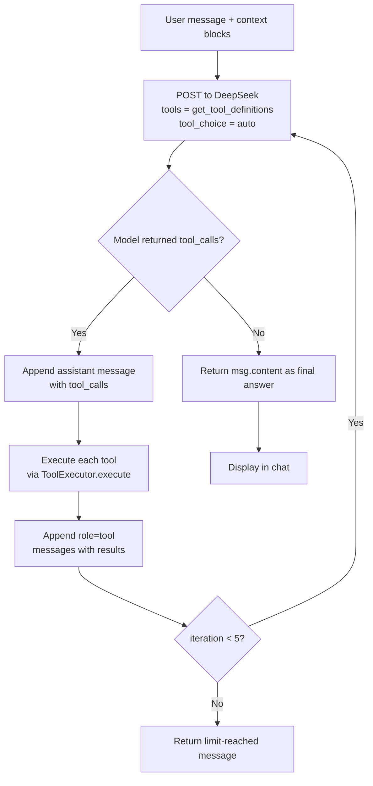

Properties of the loop (from `chat_with_tools`):

| Property ↕▾ | Value ↕▾ |
|---|---|
| −**Max iterations** | **5** (`max_iterations=5` passed by ChatPage) |
| **Tool choice** | `"auto"` — the model decides when to call, when to answer |
| **Temperature** | 0.5 |
| **Max tokens** | 2000 |
| **Missing executor** | Returns `"Обработчик не задан."` — the loop still completes |
| **Exception in call** | Caught, logged, returned as `"Ошибка: ..."` — chat does not hang |
| **Empty response** | Returns `"Модель не ответила."` |
| **Iteration limit** | Returns `"Достигнут лимит итераций инструментов."` |
⚙

Each tool result is appended as a proper `role: "tool"` message with the matching `tool_call_id` — so the model can chain calls: *read rules → read setup → suggest update → verify*. If a tool fails, the model sees the failure and can react.

---

### 🧰 The toolset — all 12

Declared in `tool_registry.get_tool_definitions()`, dispatched by `ToolExecutor.execute()`.

#### 📜 Rules

| Tool | Args | Returns |
|---|---|---|
| `get_current_rules` | — | Full `trading_rules.md` text, or *"Правила не созданы."* |
| `add_trading_rule` | `rule_text: str` | Appends to `trading_rules.md` **and** to `state.trading_rules_list` |
| `update_trading_rules` | `rules_text: str` | **Replaces** all rules. Also clears both lists in state (they'll be re-parsed on next read) |

`add_trading_rule` is the "additive" path: the model can propose a new rule without destroying what's there. `update_trading_rules` is the "rewrite" path: the model must first `get_current_rules`, then submit the full new text.

#### 🎯 Setup

| Tool ↕▾ | Args ↕▾ | Returns ↕▾ |
|---|---|---|
| −`get_current_setup` | — | Current signal (if `confidence_pct > 0`) or setup, or *"Сетап отсутствует."* |
| `update_setup` | `direction`, `entry_price`, `stop_loss`, `take_profit[]`, `conditions[]`, `cancel_conditions[]`, `rationale` | Writes a new `last_setup` into state with `confidence_pct = 0` |
⚙

`update_setup` deliberately sets `confidence_pct = 0`. A setup written from chat is a *sketch*, not a signal — the UI shows it as 📐 but the auto trading loop will never act on it. Only the analysis pipeline (morning/intraday/auto mode) can raise confidence above zero.

#### 🔴 Position & analysis

| Tool ↕▾ | Args ↕▾ | Returns ↕▾ |
|---|---|---|
| −`get_market_analysis` | — | Last analysis: price, 24h change, orderbook bias, OI trend, funding, F&G, news impact, summary |
| `get_active_trade` | — | Open position: direction, entry, SL, TP. Or *"Открытых позиций нет."* |
| `get_trade_stats` | — | Trade count, win rate, total P&L%, avg win%, avg loss% |
⚙

These three let the model reason about *"is my existing thesis working?"* without needing the full context blocks re-injected.

#### 📰 News

| Tool ↕▾ | Args ↕▾ | Returns ↕▾ |
|---|---|---|
| −`get_news` | — | Headlines over the last 24h, formatted |
| `get_news_analysis` | — | **Extended** news: sentiment impact (`positive`/`negative`/`neutral`), positive/negative counts, plus the formatted list |
⚙

Both are cached in the `ToolExecutor` instance:

```
self._news_cache_local      # for get_news
self._news_analysis_cache   # for get_news_analysis
```

So if the model calls `get_news` then `get_news_analysis`, RSS feeds are parsed **once** — the second call is free. This matters because a well-behaved model does exactly that: fetch, then analyse.

#### 🧠 Behaviour rules

| Tool | Args | Returns |
|---|---|---|
| `get_behavior_rules` | — | Full `behavior_rules.md`, or *"Поведенческие правила отсутствуют."* |
| `add_behavior_rule` | `rule_text: str` | Appends to `behavior_rules.md` with a UTC timestamp |

Behaviour rules are the "discipline layer" — separate from trading rules, and honoured on every subsequent analysis.

---

### 🧠 What "tool" actually means here

The tools **write to disk**. `add_trading_rule` is not a proposal — it immediately persists to `data/SOLUSDT/trading_rules.md`. `update_setup` writes to `state.json`. `add_behavior_rule` appends to `behavior_rules.md`.

This is the fundamental difference from the analysis pipeline: **in chat, the model has side effects**.

The trade-off was made consciously:

| Risk | Mitigation |
|---|---|
| Model hallucinates a bad rule | The user sees the rule in the chat response and can edit it in the 📐 Правила tab |
| Model overwrites rules | `update_trading_rules` is a **destructive** replace — used only after an explicit `get_current_rules` |
| Model sets a "good setup" from chat | `confidence_pct = 0` — no auto trade will trigger |
| Model corrupts state | `update_state()` only touches specific keys; other fields survive |

The design principle: **the chat can write analysis and rules, but it cannot write signals**. Only the analysis pipeline can raise confidence above zero, and only the analysis pipeline feeds auto trading.

---

### 🧵 Threading and UI

The chat runs in the **same background-thread pattern** as everything else in the app:

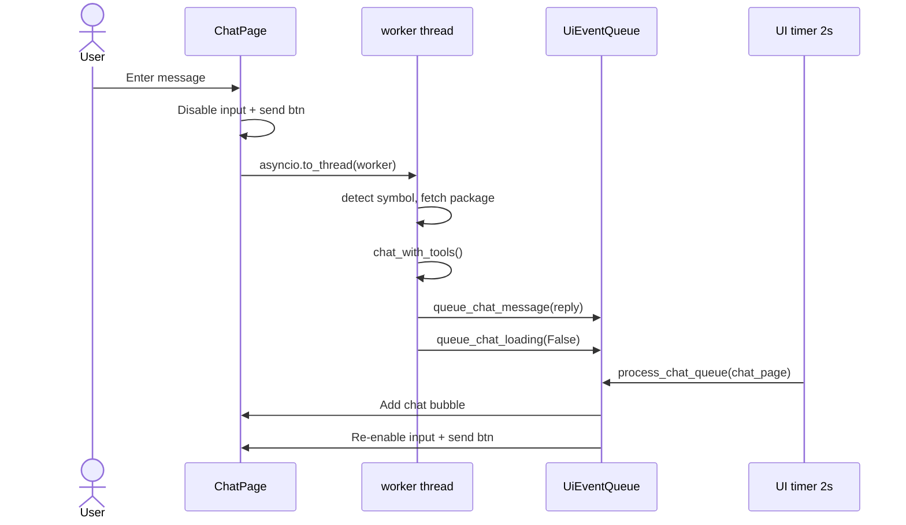

Nothing in the worker thread touches `ui.*` directly. All UI updates flow through `UiEventQueue`, which the main thread drains every 2 seconds via `ui.timer(2.0, check_updates)`. So a slow model response — or a crash mid-response — never freezes the UI.

The `_set_loading_ui(True)` state disables both the input field and the Send button. This is intentional: it prevents the user from queuing a second message while the first is still processing, which would race two `chat_with_tools` loops against the same state.

---

### 🗑 Clear chat

One button: **🗑 Очистить чат**. It:

1. Clears `self.messages` (the local message list)
2. Clears `chat_container` (the visual message bubbles)
3. Shows the toast *"Чат очищен."*

What it does **not** do:

- Does not touch `state.json`, `trading_rules.md`, or any trade data
- Does not clear `ai_client.conversation_history` — but that doesn't matter for chat, because `chat_with_tools` **always** rebuilds the message list from scratch (see below)

So clearing the chat is purely visual housekeeping. It's a "start a fresh visual session" action, not a state reset.

---

### 🧠 Conversation history — deliberately stateless

`chat_with_tools` **rebuilds `messages` from zero on every call**:

```
messages = [
    {"role": "system", "content": SYSTEM_PROMPT},
    {"role": "user", "content": chat_msg},
]
```

There is no `self.conversation_history[pair].append(...)` on the chat path. The only place history accumulates is `analyze()`, which trims to 7 messages.

Why: chat is meant to be **stateless and self-contained**. Context comes from the labelled blocks (rules, position, indicators, news), not from what was said two turns ago. This makes each call reproducible — the same input message + same state = same answer, regardless of what preceded it.

The trade-off: the model does **not** remember "what we discussed five minutes ago." If you want it to remember, put it in your message or update the rules.

The advantage: a chat session can never poison itself. A bad rule the model invented in turn 3 cannot sneak into turn 10 via history — it lands in `trading_rules.md` and shows up as explicit context, where you can see it.

---

### 🎯 What the chat is good for

| Use case | Why chat beats the pipeline |
|---|---|
| *"Почему модель отклонила этот сетап?"* | It can walk through its own reasoning and quote the exact conditions |
| *"Сравни RSI поведение SOL и ARB на прошлой неделе"* | Multi-step: fetch, compute, compare, explain |
| *"Сформулируй pullback-вариант текущего breakout-правила"* | Iterative refinement in prose before committing to JSON |
| *"Что сейчас говорит funding rate?"* | `get_market_analysis` → interpretation |
| *"Объясни эту strategy_spec"* | Renders `explain_conditions` output as narrative |
| *"Поищи новости по HYPE и скажи, меняет ли это тезис"* | `get_news_analysis` → sentiment reasoning |
| *"Добавь правило про запрет входа в первые 3 свечи после пробоя"* | `add_trading_rule` writes it permanently |

What it is **not** for: deciding to open a trade. That path always runs `strategy_spec` → `backtest_engine` → `trading/auto_trader.py`. The chat informs; it does not execute.

---

### 🛡️ Guardrails

| Guard | How |
|---|---|
| **No order execution** | Chat has no tool that touches `BybitExecutor`. Order placement lives only in `trading/` |
| **No signal injection** | `update_setup` sets `confidence_pct = 0` — auto trading never sees it |
| **No history bleed** | Messages rebuilt per call — no cross-turn contamination |
| **Bounded reasoning** | `max_iterations=5` caps the tool loop |
| **Language contract** | Prompt mandates Russian responses |
| **Error transparency** | Every failure path returns a visible string, never an empty bubble |
| **Explicit context** | Rules, position, indicators are passed as labelled blocks — the model cannot "remember" what it wasn't given |

The distinction matters. The **analysis** pipeline is safe by *format* (strict JSON, no tools). The **chat** pipeline is safe by *scope* — it can read everything and write analysis/rules, but the two write paths that could affect trading (`confidence_pct`, order execution) are structurally unreachable from here.

---

### 🔗 Relationship to the rest of the system

```
                 ┌─────────────────────────┐
                 │   Same DeepSeek model   │
                 └───────────┬─────────────┘
                             │
              ┌──────────────┴──────────────┐
              ▼                             ▼
    ┌──────────────────┐          ┌──────────────────┐
    │  Analysis / Init │          │       Chat       │
    │  strict JSON     │          │  tools + prose   │
    │  1 shot          │          │  5 tool rounds   │
    │  temp 0.3        │          │  temp 0.5        │
    │  no disk writes  │          │  writes rules    │
    └────────┬─────────┘          └────────┬─────────┘
             │                             │
             ▼                             ▼
      strategy_spec                  rules + setup
             │                             │
             ▼                             │
      backtest_engine                      │
             │                             │
             ▼                             ▼
        trading/  ◄────── feeds next analysis cycle
```

The chat **informs** the analysis pipeline: the rules you write via chat become context on the next `analyze()` call. But the chat never gets to *execute*. That boundary is enforced by file layout — the chat has no import path to `trading/executor.py`.

---

### 🧱 The constant that shapes behaviour

| Constant ↕▾ | Value ↕▾ | Why ↕▾ |
|---|---|---|
| −`max_iterations` | **5** | Below 5, complex tool chains fail; above 5, a single stuck query eats a lot of tokens |
| `temperature` | **0.5** | More exploratory than analysis (0.3), but not creative-fiction (0.8) |
| `max_tokens` | **2000** | Enough for a paragraph of reasoning plus a tool call, not enough to ramble |
| UI refresh | **2 s** | The main event loop for all UI queues — chat messages appear within 2 s of arrival |
| `hours_back` for news | **24 h** | Wide enough to catch a two-day-old FUD event still being priced in |
⚙

---

### ✅ What makes the chat trustworthy

| Property ↕▾ | How it's achieved ↕▾ |
|---|---|
| −**Stateless and reproducible** | Messages rebuilt per call — no hidden accumulation |
| **Bounded cost** | `max_iterations=5`, `max_tokens=2000`, tool results cached |
| **Visible side effects** | Every rule write lands in `trading_rules.md` — you can diff it |
| **Cannot move money** | No tool touches `BybitExecutor` |
| **Cannot fake a signal** | `update_setup` writes `confidence_pct = 0` |
| **Survives a slow model** | Background thread + `UiEventQueue` + main-thread drain |
| **Survives a broken model** | Every exception path returns a visible string |
⚙

The chat is, in a sentence: **the model's chance to reason freely, walled off from the model's chance to trade**.

---

<a id="3-ai-chat"></a>
## 3. 💬 AI Chat

### 💡 What it is

The chat is a **conversational window into the same model that writes your strategies** — but with its hands untied.

Everywhere else the model is boxed in: it must return strict JSON, it gets one shot, and the engine decides what to do with the answer. In the chat it can reason across multiple turns, pull data with tools, and explain itself in prose. It's the one place where you can *ask the model what it thinks* without a schema standing in the way.

The distinction is deliberate:

| Concern | Analysis pipeline | Chat |
|---------|-------------------|------|
| **Output format** | Strict JSON (`response_format={"type": "json_object"}`) | Free-form prose |
| **Turns** | One request → one response | Up to **5** tool rounds |
| **History** | 7 messages trimmed, or fresh context | Rebuilt from scratch per call |
| **Tools** | Only `web_search`, only during `init_symbol` | **12 tools** via `ToolExecutor` |
| **Temperature** | 0.3 | **0.5** — more exploratory |
| **Failure mode** | Fallback JSON, logged | Error string returned to the user |

The temperature gap is not cosmetic. Analysis wants the most likely reading of the chart. Chat wants the model to actually *think out loud*.

---

### ⚙️ How a chat turn is assembled

Every message goes through `ChatPage.send_message()` → `DeepSeekClient.chat_with_tools()`. Along the way, a single large user message is built from labelled blocks:

```

=== ЧАТ ОТ ПОЛЬЗОВАТЕЛЯ ===
Пара: SOLUSDT
СООБЩЕНИЕ ПОЛЬЗОВАТЕЛЯ: <your text>
У тебя есть доступ к инструментам (tools). Отвечай на русском языке.

--- УТРЕННИЙ КОНТЕКСТ ---        ← optional
--- ПОСЛЕДНИЕ ВЫВОДЫ ---          ← optional (intraday context)
--- ПОСЛЕДНИЙ АНАЛИЗ ---          ← optional (JSON)
--- ПРАВИЛА ТОРГОВЛИ ---          ← optional (trading_rules.md)
--- ПОВЕДЕНЧЕСКИЕ ПРАВИЛА ---     ← optional (behavior_rules.md)
--- АКТИВНАЯ ПОЗИЦИЯ ---          ← optional (active_trade JSON)
--- ИНДИКАТОРЫ (JSON) ---         ← when available
--- НОВОСТИ ---                   ← optional (or cached)
--- ПРЕДВЫЧИСЛЕННЫЕ МЕТРИКИ ---   ← when available (market_stats)

```

The system prompt is the standard `SYSTEM_PROMPT`, the same one used for analysis. The chat model and the analysis model share the same worldview — they just have different output contracts.

---

### 🧭 Symbol detection

The chat is **per-symbol**, even though the page looks general. Before the model is called, `ChatPage.detect_symbol()` scans the message for any known symbol:

```python
for sym in self.memory.get_all_symbols():
    if re.search(r"\b" + re.escape(sym) + r"\b", message, re.IGNORECASE):
        return sym
```

Behaviour:

| Case ↕▾ | Result ↕▾ |
|---|---|
| −`"что думаешь про SOLUSDT?"` | Match → proceeds with SOLUSDT |
| `"sol"`, `"Sol"`, `"sOlUsDt"` | Match (case-insensitive) — but only if a symbol named exactly `SOL` exists in `TRADING_PAIRS`. `SOLUSDT` will **not** match `sol` — the boundary is on `\bSOLUSDT\b` |
| No symbol | Returns `None` → user sees `❓ Не удалось определить монету.` |
⚙

Then two guards:

| Guard ↕▾ | Message ↕▾ |
|---|---|
| −`cm.is_initialized() == False` | `⚠️ Монета {symbol} не инициализирована.` |
| Symbol not in `config.TRADING_PAIRS` | Silent return — should not happen |
⚙

If both pass, the chat fetches a fresh **intraday package** starting from `last_candle_time`, so the model has current data and doesn't re-read candles it already saw.

---

### 🔁 The tool-calling loop
This diagram is empty.<svg id="mermaid-svg-14" width="100%" xmlns="http://www.w3.org/2000/svg" class="flowchart mermaid-svg" viewBox="-27.965887451171877 -27.965887451171877 615.2495239257812 1346.473522949219" role="graphics-document document" height="100%" style="max-width: 100%; display: block; transform-origin: 0px 0px; user-select: none;"><style>#mermaid-svg-14{font-family:"trebuchet ms",verdana,arial,sans-serif;font-size:16px;fill:#333;}@keyframes edge-animation-frame{from{stroke-dashoffset:0;}}@keyframes dash{to{stroke-dashoffset:0;}}#mermaid-svg-14 .edge-animation-slow{stroke-dasharray:9,5!important;stroke-dashoffset:900;animation:dash 50s linear infinite;stroke-linecap:round;}#mermaid-svg-14 .edge-animation-fast{stroke-dasharray:9,5!important;stroke-dashoffset:900;animation:dash 20s linear infinite;stroke-linecap:round;}#mermaid-svg-14 .error-icon{fill:#552222;}#mermaid-svg-14 .error-text{fill:#552222;stroke:#552222;}#mermaid-svg-14 .edge-thickness-normal{stroke-width:1px;}#mermaid-svg-14 .edge-thickness-thick{stroke-width:3.5px;}#mermaid-svg-14 .edge-pattern-solid{stroke-dasharray:0;}#mermaid-svg-14 .edge-thickness-invisible{stroke-width:0;fill:none;}#mermaid-svg-14 .edge-pattern-dashed{stroke-dasharray:3;}#mermaid-svg-14 .edge-pattern-dotted{stroke-dasharray:2;}#mermaid-svg-14 .marker{fill:#333333;stroke:#333333;}#mermaid-svg-14 .marker.cross{stroke:#333333;}#mermaid-svg-14 svg{font-family:"trebuchet ms",verdana,arial,sans-serif;font-size:16px;}#mermaid-svg-14 p{margin:0;}#mermaid-svg-14 .label{font-family:"trebuchet ms",verdana,arial,sans-serif;color:#333;}#mermaid-svg-14 .cluster-label text{fill:#333;}#mermaid-svg-14 .cluster-label span{color:#333;}#mermaid-svg-14 .cluster-label span p{background-color:transparent;}#mermaid-svg-14 .label text,#mermaid-svg-14 span{fill:#333;color:#333;}#mermaid-svg-14 .node rect,#mermaid-svg-14 .node circle,#mermaid-svg-14 .node ellipse,#mermaid-svg-14 .node polygon,#mermaid-svg-14 .node path{fill:#ECECFF;stroke:#9370DB;stroke-width:1px;}#mermaid-svg-14 .rough-node .label text,#mermaid-svg-14 .node .label text,#mermaid-svg-14 .image-shape .label,#mermaid-svg-14 .icon-shape .label{text-anchor:middle;}#mermaid-svg-14 .node .katex path{fill:#000;stroke:#000;stroke-width:1px;}#mermaid-svg-14 .rough-node .label,#mermaid-svg-14 .node .label,#mermaid-svg-14 .image-shape .label,#mermaid-svg-14 .icon-shape .label{text-align:center;}#mermaid-svg-14 .node.clickable{cursor:pointer;}#mermaid-svg-14 .root .anchor path{fill:#333333!important;stroke-width:0;stroke:#333333;}#mermaid-svg-14 .arrowheadPath{fill:#333333;}#mermaid-svg-14 .edgePath .path{stroke:#333333;stroke-width:2.0px;}#mermaid-svg-14 .flowchart-link{stroke:#333333;fill:none;}#mermaid-svg-14 .edgeLabel{background-color:rgba(232,232,232, 0.8);text-align:center;}#mermaid-svg-14 .edgeLabel p{background-color:rgba(232,232,232, 0.8);}#mermaid-svg-14 .edgeLabel rect{opacity:0.5;background-color:rgba(232,232,232, 0.8);fill:rgba(232,232,232, 0.8);}#mermaid-svg-14 .labelBkg{background-color:rgba(232, 232, 232, 0.5);}#mermaid-svg-14 .cluster rect{fill:#ffffde;stroke:#aaaa33;stroke-width:1px;}#mermaid-svg-14 .cluster text{fill:#333;}#mermaid-svg-14 .cluster span{color:#333;}#mermaid-svg-14 div.mermaidTooltip{position:absolute;text-align:center;max-width:200px;padding:2px;font-family:"trebuchet ms",verdana,arial,sans-serif;font-size:12px;background:hsl(80, 100%, 96.2745098039%);border:1px solid #aaaa33;border-radius:2px;pointer-events:none;z-index:100;}#mermaid-svg-14 .flowchartTitleText{text-anchor:middle;font-size:18px;fill:#333;}#mermaid-svg-14 rect.text{fill:none;stroke-width:0;}#mermaid-svg-14 .icon-shape,#mermaid-svg-14 .image-shape{background-color:rgba(232,232,232, 0.8);text-align:center;}#mermaid-svg-14 .icon-shape p,#mermaid-svg-14 .image-shape p{background-color:rgba(232,232,232, 0.8);padding:2px;}#mermaid-svg-14 .icon-shape rect,#mermaid-svg-14 .image-shape rect{opacity:0.5;background-color:rgba(232,232,232, 0.8);fill:rgba(232,232,232, 0.8);}#mermaid-svg-14 .label-icon{display:inline-block;height:1em;overflow:visible;vertical-align:-0.125em;}#mermaid-svg-14 .node .label-icon path{fill:currentColor;stroke:revert;stroke-width:revert;}#mermaid-svg-14 :root{--mermaid-font-family:"trebuchet ms",verdana,arial,sans-serif;}</style><g><marker id="mermaid-svg-14_flowchart-v2-pointEnd" class="marker flowchart-v2" viewBox="0 0 10 10" refX="5" refY="5" markerUnits="userSpaceOnUse" markerWidth="8" markerHeight="8" orient="auto"><path d="M 0 0 L 10 5 L 0 10 z" class="arrowMarkerPath" style="stroke-width: 1; stroke-dasharray: 1, 0;"></path></marker><marker id="mermaid-svg-14_flowchart-v2-pointStart" class="marker flowchart-v2" viewBox="0 0 10 10" refX="4.5" refY="5" markerUnits="userSpaceOnUse" markerWidth="8" markerHeight="8" orient="auto"><path d="M 0 5 L 10 10 L 10 0 z" class="arrowMarkerPath" style="stroke-width: 1; stroke-dasharray: 1, 0;"></path></marker><marker id="mermaid-svg-14_flowchart-v2-circleEnd" class="marker flowchart-v2" viewBox="0 0 10 10" refX="11" refY="5" markerUnits="userSpaceOnUse" markerWidth="11" markerHeight="11" orient="auto"><circle cx="5" cy="5" r="5" class="arrowMarkerPath" style="stroke-width: 1; stroke-dasharray: 1, 0;"></circle></marker><marker id="mermaid-svg-14_flowchart-v2-circleStart" class="marker flowchart-v2" viewBox="0 0 10 10" refX="-1" refY="5" markerUnits="userSpaceOnUse" markerWidth="11" markerHeight="11" orient="auto"><circle cx="5" cy="5" r="5" class="arrowMarkerPath" style="stroke-width: 1; stroke-dasharray: 1, 0;"></circle></marker><marker id="mermaid-svg-14_flowchart-v2-crossEnd" class="marker cross flowchart-v2" viewBox="0 0 11 11" refX="12" refY="5.2" markerUnits="userSpaceOnUse" markerWidth="11" markerHeight="11" orient="auto"><path d="M 1,1 l 9,9 M 10,1 l -9,9" class="arrowMarkerPath" style="stroke-width: 2; stroke-dasharray: 1, 0;"></path></marker><marker id="mermaid-svg-14_flowchart-v2-crossStart" class="marker cross flowchart-v2" viewBox="0 0 11 11" refX="-1" refY="5.2" markerUnits="userSpaceOnUse" markerWidth="11" markerHeight="11" orient="auto"><path d="M 1,1 l 9,9 M 10,1 l -9,9" class="arrowMarkerPath" style="stroke-width: 2; stroke-dasharray: 1, 0;"></path></marker><g class="root"><g class="clusters"></g><g class="edgePaths"><path d="M335.409,86L335.409,90.167C335.409,94.333,335.409,102.667,335.409,110.333C335.409,118,335.409,125,335.409,128.5L335.409,132" id="L_A_B_0" class="edge-thickness-normal edge-pattern-solid edge-thickness-normal edge-pattern-solid flowchart-link" style="" marker-end="url(#mermaid-svg-14_flowchart-v2-pointEnd)"></path><path d="M289.889,238L286.17,242.167C282.451,246.333,275.013,254.667,271.365,262.417C267.716,270.167,267.857,277.334,267.927,280.917L267.997,284.501" id="L_B_C_0" class="edge-thickness-normal edge-pattern-solid edge-thickness-normal edge-pattern-solid flowchart-link" style="" marker-end="url(#mermaid-svg-14_flowchart-v2-pointEnd)"></path><path d="M220.108,428.283L205.228,442.36C190.348,456.438,160.588,484.594,145.708,504.172C130.828,523.75,130.828,534.75,130.828,540.25L130.828,545.75" id="L_C_D_0" class="edge-thickness-normal edge-pattern-solid edge-thickness-normal edge-pattern-solid flowchart-link" style="" marker-end="url(#mermaid-svg-14_flowchart-v2-pointEnd)"></path><path d="M130.828,627.75L130.828,633.917C130.828,640.083,130.828,652.417,130.828,664.083C130.828,675.75,130.828,686.75,130.828,692.25L130.828,697.75" id="L_D_E_0" class="edge-thickness-normal edge-pattern-solid edge-thickness-normal edge-pattern-solid flowchart-link" style="" marker-end="url(#mermaid-svg-14_flowchart-v2-pointEnd)"></path><path d="M130.828,779.75L130.828,783.917C130.828,788.083,130.828,796.417,130.828,804.083C130.828,811.75,130.828,818.75,130.828,822.25L130.828,825.75" id="L_E_F_0" class="edge-thickness-normal edge-pattern-solid edge-thickness-normal edge-pattern-solid flowchart-link" style="" marker-end="url(#mermaid-svg-14_flowchart-v2-pointEnd)"></path><path d="M130.828,907.75L130.828,911.917C130.828,916.083,130.828,924.417,156.064,940.886C181.3,957.356,231.772,981.961,257.008,994.264L282.244,1006.567" id="L_F_G_0" class="edge-thickness-normal edge-pattern-solid edge-thickness-normal edge-pattern-solid flowchart-link" style="" marker-end="url(#mermaid-svg-14_flowchart-v2-pointEnd)"></path><path d="M385.978,1008.319L411.647,995.725C437.315,983.13,488.653,957.94,514.321,934.678C539.99,911.417,539.99,890.083,539.99,868.75C539.99,847.417,539.99,826.083,539.99,804.75C539.99,783.417,539.99,762.083,539.99,738.75C539.99,715.417,539.99,690.083,539.99,664.75C539.99,639.417,539.99,614.083,539.99,588.75C539.99,563.417,539.99,538.083,539.99,503.604C539.99,469.125,539.99,425.5,539.99,383.875C539.99,342.25,539.99,302.625,527.934,278.334C515.879,254.043,491.769,245.086,479.714,240.608L467.658,236.13" id="L_G_B_0" class="edge-thickness-normal edge-pattern-solid edge-thickness-normal edge-pattern-solid flowchart-link" style="" marker-end="url(#mermaid-svg-14_flowchart-v2-pointEnd)"></path><path d="M335.909,1107.042L335.826,1113.125C335.742,1119.208,335.576,1131.375,335.492,1142.958C335.409,1154.542,335.409,1165.542,335.409,1171.042L335.409,1176.542" id="L_G_H_0" class="edge-thickness-normal edge-pattern-solid edge-thickness-normal edge-pattern-solid flowchart-link" style="" marker-end="url(#mermaid-svg-14_flowchart-v2-pointEnd)"></path><path d="M316.043,428.283L330.756,442.36C345.47,456.438,374.896,484.594,389.61,504.172C404.323,523.75,404.323,534.75,404.323,540.25L404.323,545.75" id="L_C_I_0" class="edge-thickness-normal edge-pattern-solid edge-thickness-normal edge-pattern-solid flowchart-link" style="" marker-end="url(#mermaid-svg-14_flowchart-v2-pointEnd)"></path><path d="M404.323,627.75L404.323,633.917C404.323,640.083,404.323,652.417,404.323,666.083C404.323,679.75,404.323,694.75,404.323,702.25L404.323,709.75" id="L_I_J_0" class="edge-thickness-normal edge-pattern-solid edge-thickness-normal edge-pattern-solid flowchart-link" style="" marker-end="url(#mermaid-svg-14_flowchart-v2-pointEnd)"></path></g><g class="edgeLabels"><g class="edgeLabel"><g class="label" transform="translate(0, 0)"><foreignObject width="0" height="0"><div xmlns="http://www.w3.org/1999/xhtml" class="labelBkg" style="display: table-cell; white-space: nowrap; line-height: 1.5; max-width: 200px; text-align: center;"><span class="edgeLabel"></span></div></foreignObject></g></g><g class="edgeLabel"><g class="label" transform="translate(0, 0)"><foreignObject width="0" height="0"><div xmlns="http://www.w3.org/1999/xhtml" class="labelBkg" style="display: table-cell; white-space: nowrap; line-height: 1.5; max-width: 200px; text-align: center;"><span class="edgeLabel"></span></div></foreignObject></g></g><g class="edgeLabel" transform="translate(130.828125, 512.75)"><g class="label" transform="translate(-11.328125, -12)"><foreignObject width="22.65625" height="24"><div xmlns="http://www.w3.org/1999/xhtml" class="labelBkg" style="display: table-cell; white-space: nowrap; line-height: 1.5; max-width: 200px; text-align: center;"><span class="edgeLabel"><p>Yes</p></span></div></foreignObject></g></g><g class="edgeLabel"><g class="label" transform="translate(0, 0)"><foreignObject width="0" height="0"><div xmlns="http://www.w3.org/1999/xhtml" class="labelBkg" style="display: table-cell; white-space: nowrap; line-height: 1.5; max-width: 200px; text-align: center;"><span class="edgeLabel"></span></div></foreignObject></g></g><g class="edgeLabel"><g class="label" transform="translate(0, 0)"><foreignObject width="0" height="0"><div xmlns="http://www.w3.org/1999/xhtml" class="labelBkg" style="display: table-cell; white-space: nowrap; line-height: 1.5; max-width: 200px; text-align: center;"><span class="edgeLabel"></span></div></foreignObject></g></g><g class="edgeLabel"><g class="label" transform="translate(0, 0)"><foreignObject width="0" height="0"><div xmlns="http://www.w3.org/1999/xhtml" class="labelBkg" style="display: table-cell; white-space: nowrap; line-height: 1.5; max-width: 200px; text-align: center;"><span class="edgeLabel"></span></div></foreignObject></g></g><g class="edgeLabel" transform="translate(539.9895782470703, 664.75)"><g class="label" transform="translate(-11.328125, -12)"><foreignObject width="22.65625" height="24"><div xmlns="http://www.w3.org/1999/xhtml" class="labelBkg" style="display: table-cell; white-space: nowrap; line-height: 1.5; max-width: 200px; text-align: center;"><span class="edgeLabel"><p>Yes</p></span></div></foreignObject></g></g><g class="edgeLabel" transform="translate(335.40885162353516, 1143.5416717529297)"><g class="label" transform="translate(-9.401041984558105, -12)"><foreignObject width="18.80208396911621" height="24"><div xmlns="http://www.w3.org/1999/xhtml" class="labelBkg" style="display: table-cell; white-space: nowrap; line-height: 1.5; max-width: 200px; text-align: center;"><span class="edgeLabel"><p>No</p></span></div></foreignObject></g></g><g class="edgeLabel" transform="translate(404.32291412353516, 512.75)"><g class="label" transform="translate(-9.401041984558105, -12)"><foreignObject width="18.80208396911621" height="24"><div xmlns="http://www.w3.org/1999/xhtml" class="labelBkg" style="display: table-cell; white-space: nowrap; line-height: 1.5; max-width: 200px; text-align: center;"><span class="edgeLabel"><p>No</p></span></div></foreignObject></g></g><g class="edgeLabel"><g class="label" transform="translate(0, 0)"><foreignObject width="0" height="0"><div xmlns="http://www.w3.org/1999/xhtml" class="labelBkg" style="display: table-cell; white-space: nowrap; line-height: 1.5; max-width: 200px; text-align: center;"><span class="edgeLabel"></span></div></foreignObject></g></g></g><g class="nodes"><g class="node default" id="flowchart-A-0" transform="translate(335.40885162353516, 47)"><rect class="basic label-container" style="" x="-130" y="-39" width="260" height="78"></rect><g class="label" style="" transform="translate(-100, -24)"><rect></rect><foreignObject width="200" height="48"><div xmlns="http://www.w3.org/1999/xhtml" style="display: table; white-space: break-spaces; line-height: 1.5; max-width: 200px; text-align: center; width: 200px;"><span class="nodeLabel"><p>User message + context blocks</p></span></div></foreignObject></g></g><g class="node default" id="flowchart-B-1" transform="translate(335.40885162353516, 187)"><rect class="basic label-container" style="fill:#4D6BFE !important" x="-128.5" y="-51" width="257" height="102"></rect><g class="label" style="color:#fff !important" transform="translate(-98.5, -36)"><rect></rect><foreignObject width="197" height="72"><div style="color: rgb(255, 255, 255) !important; display: table-cell; white-space: nowrap; line-height: 1.5; max-width: 200px; text-align: center;" xmlns="http://www.w3.org/1999/xhtml"><span style="color:#fff !important" class="nodeLabel"><p>POST to DeepSeek<br>tools = get_tool_definitions<br>tool_choice = auto</p></span></div></foreignObject></g></g><g class="node default" id="flowchart-C-3" transform="translate(267.5755195617676, 381.875)"><polygon points="93.875,0 187.75,-93.875 93.875,-187.75 0,-93.875" class="label-container" transform="translate(-93.375, 93.875)"></polygon><g class="label" style="" transform="translate(-54.875, -24)"><rect></rect><foreignObject width="109.75" height="48"><div xmlns="http://www.w3.org/1999/xhtml" style="display: table-cell; white-space: nowrap; line-height: 1.5; max-width: 200px; text-align: center;"><span class="nodeLabel"><p>Model returned<br>tool_calls?</p></span></div></foreignObject></g></g><g class="node default" id="flowchart-D-5" transform="translate(130.828125, 588.75)"><rect class="basic label-container" style="" x="-122.828125" y="-39" width="245.65625" height="78"></rect><g class="label" style="" transform="translate(-92.828125, -24)"><rect></rect><foreignObject width="185.65625" height="48"><div xmlns="http://www.w3.org/1999/xhtml" style="display: table-cell; white-space: nowrap; line-height: 1.5; max-width: 200px; text-align: center;"><span class="nodeLabel"><p>Append assistant message<br>with tool_calls</p></span></div></foreignObject></g></g><g class="node default" id="flowchart-E-7" transform="translate(130.828125, 740.75)"><rect class="basic label-container" style="" x="-119.296875" y="-39" width="238.59375" height="78"></rect><g class="label" style="" transform="translate(-89.296875, -24)"><rect></rect><foreignObject width="178.59375" height="48"><div xmlns="http://www.w3.org/1999/xhtml" style="display: table-cell; white-space: nowrap; line-height: 1.5; max-width: 200px; text-align: center;"><span class="nodeLabel"><p>Execute each tool<br>via ToolExecutor.execute</p></span></div></foreignObject></g></g><g class="node default" id="flowchart-F-9" transform="translate(130.828125, 868.75)"><rect class="basic label-container" style="" x="-107.75" y="-39" width="215.5" height="78"></rect><g class="label" style="" transform="translate(-77.75, -24)"><rect></rect><foreignObject width="155.5" height="48"><div xmlns="http://www.w3.org/1999/xhtml" style="display: table-cell; white-space: nowrap; line-height: 1.5; max-width: 200px; text-align: center;"><span class="nodeLabel"><p>Append role=tool<br>messages with results</p></span></div></foreignObject></g></g><g class="node default" id="flowchart-G-11" transform="translate(335.40885162353516, 1032.1458358764648)"><polygon points="74.39583587646484,0 148.7916717529297,-74.39583587646484 74.39583587646484,-148.7916717529297 0,-74.39583587646484" class="label-container" transform="translate(-73.89583587646484, 74.39583587646484)"></polygon><g class="label" style="" transform="translate(-47.395835876464844, -12)"><rect></rect><foreignObject width="94.79167175292969" height="24"><div xmlns="http://www.w3.org/1999/xhtml" style="display: table-cell; white-space: nowrap; line-height: 1.5; max-width: 200px; text-align: center;"><span class="nodeLabel"><p>iteration &lt; 5?</p></span></div></foreignObject></g></g><g class="node default" id="flowchart-H-15" transform="translate(335.40885162353516, 1231.5416717529297)"><rect class="basic label-container" style="fill:#C62828 !important" x="-130" y="-51" width="260" height="102"></rect><g class="label" style="color:#fff !important" transform="translate(-100, -36)"><rect></rect><foreignObject width="200" height="72"><div style="color: rgb(255, 255, 255) !important; display: table; white-space: break-spaces; line-height: 1.5; max-width: 200px; text-align: center; width: 200px;" xmlns="http://www.w3.org/1999/xhtml"><span style="color:#fff !important" class="nodeLabel"><p>Return<br>'Достигнут лимит итераций инструментов.'</p></span></div></foreignObject></g></g><g class="node default" id="flowchart-I-17" transform="translate(404.32291412353516, 588.75)"><rect class="basic label-container" style="fill:#2E7D32 !important" x="-100.66667175292969" y="-39" width="201.33334350585938" height="78"></rect><g class="label" style="color:#fff !important" transform="translate(-70.66667175292969, -24)"><rect></rect><foreignObject width="141.33334350585938" height="48"><div style="color: rgb(255, 255, 255) !important; display: table-cell; white-space: nowrap; line-height: 1.5; max-width: 200px; text-align: center;" xmlns="http://www.w3.org/1999/xhtml"><span style="color:#fff !important" class="nodeLabel"><p>Return msg.content<br>as final answer</p></span></div></foreignObject></g></g><g class="node default" id="flowchart-J-19" transform="translate(404.32291412353516, 740.75)"><rect class="basic label-container" style="" x="-82.57291793823242" y="-27" width="165.14583587646484" height="54"></rect><g class="label" style="" transform="translate(-52.57291793823242, -12)"><rect></rect><foreignObject width="105.14583587646484" height="24"><div xmlns="http://www.w3.org/1999/xhtml" style="display: table-cell; white-space: nowrap; line-height: 1.5; max-width: 200px; text-align: center;"><span class="nodeLabel"><p>Display in chat</p></span></div></foreignObject></g></g></g></g></g></svg>
Properties of the loop (from `chat_with_tools`):

| Property ↕▾ | Value ↕▾ |
|---|---|
| −**Max iterations** | **5** (`max_iterations=5` passed by ChatPage) |
| **Tool choice** | `"auto"` — the model decides when to call, when to answer |
| **Temperature** | 0.5 |
| **Max tokens** | 2000 |
| **Missing executor** | Returns `"Обработчик не задан."` — the loop still completes |
| **Exception in call** | Caught, logged, returned as `"Ошибка: ..."` — chat does not hang |
| **Empty response** | Returns `"Модель не ответила."` |
| **Iteration limit** | Returns `"Достигнут лимит итераций инструментов."` |
⚙

Each tool result is appended as a proper `role: "tool"` message with the matching `tool_call_id` — so the model can chain calls: *read rules → read setup → suggest update → verify*. If a tool fails, the model sees the failure and can react.

---

### 🧰 The toolset — all 12

Declared in `tool_registry.get_tool_definitions()`, dispatched by `ToolExecutor.execute()`.

#### 📜 Rules

| Tool | Args | Returns |
|---|---|---|
| `get_current_rules` | — | Full `trading_rules.md` text, or *"Правила не созданы."* |
| `add_trading_rule` | `rule_text: str` | Appends to `trading_rules.md` **and** to `state.trading_rules_list` |
| `update_trading_rules` | `rules_text: str` | **Replaces** all rules. Also clears both lists in state (they'll be re-parsed on next read) |

`add_trading_rule` is the "additive" path: the model can propose a new rule without destroying what's there. `update_trading_rules` is the "rewrite" path: the model must first `get_current_rules`, then submit the full new text.

#### 🎯 Setup

| Tool ↕▾ | Args ↕▾ | Returns ↕▾ |
|---|---|---|
| −`get_current_setup` | — | Current signal (if `confidence_pct > 0`) or setup, or *"Сетап отсутствует."* |
| `update_setup` | `direction`, `entry_price`, `stop_loss`, `take_profit[]`, `conditions[]`, `cancel_conditions[]`, `rationale` | Writes a new `last_setup` into state with `confidence_pct = 0` |
⚙

`update_setup` deliberately sets `confidence_pct = 0`. A setup written from chat is a *sketch*, not a signal — the UI shows it as 📐 but the auto trading loop will never act on it. Only the analysis pipeline (morning/intraday/auto mode) can raise confidence above zero.

#### 🔴 Position & analysis

| Tool ↕▾ | Args ↕▾ | Returns ↕▾ |
|---|---|---|
| −`get_market_analysis` | — | Last analysis: price, 24h change, orderbook bias, OI trend, funding, F&G, news impact, summary |
| `get_active_trade` | — | Open position: direction, entry, SL, TP. Or *"Открытых позиций нет."* |
| `get_trade_stats` | — | Trade count, win rate, total P&L%, avg win%, avg loss% |
⚙

These three let the model reason about *"is my existing thesis working?"* without needing the full context blocks re-injected.

#### 📰 News

| Tool ↕▾ | Args ↕▾ | Returns ↕▾ |
|---|---|---|
| −`get_news` | — | Headlines over the last 24h, formatted |
| `get_news_analysis` | — | **Extended** news: sentiment impact (`positive`/`negative`/`neutral`), positive/negative counts, plus the formatted list |
⚙

Both are cached in the `ToolExecutor` instance:

```
self._news_cache_local      # for get_news
self._news_analysis_cache   # for get_news_analysis
```

So if the model calls `get_news` then `get_news_analysis`, RSS feeds are parsed **once** — the second call is free. This matters because a well-behaved model does exactly that: fetch, then analyse.

#### 🧠 Behaviour rules

| Tool | Args | Returns |
|---|---|---|
| `get_behavior_rules` | — | Full `behavior_rules.md`, or *"Поведенческие правила отсутствуют."* |
| `add_behavior_rule` | `rule_text: str` | Appends to `behavior_rules.md` with a UTC timestamp |

Behaviour rules are the "discipline layer" — separate from trading rules, and honoured on every subsequent analysis.

---

### 🧠 What "tool" actually means here

The tools **write to disk**. `add_trading_rule` is not a proposal — it immediately persists to `data/SOLUSDT/trading_rules.md`. `update_setup` writes to `state.json`. `add_behavior_rule` appends to `behavior_rules.md`.

This is the fundamental difference from the analysis pipeline: **in chat, the model has side effects**.

The trade-off was made consciously:

| Risk | Mitigation |
|---|---|
| Model hallucinates a bad rule | The user sees the rule in the chat response and can edit it in the 📐 Правила tab |
| Model overwrites rules | `update_trading_rules` is a **destructive** replace — used only after an explicit `get_current_rules` |
| Model sets a "good setup" from chat | `confidence_pct = 0` — no auto trade will trigger |
| Model corrupts state | `update_state()` only touches specific keys; other fields survive |

The design principle: **the chat can write analysis and rules, but it cannot write signals**. Only the analysis pipeline can raise confidence above zero, and only the analysis pipeline feeds auto trading.

---

### 🧵 Threading and UI

The chat runs in the **same background-thread pattern** as everything else in the app:
This diagram is empty.<svg id="mermaid-svg-19" width="100%" xmlns="http://www.w3.org/2000/svg" viewBox="-87.05000000000001 -47.050000000000004 1390.1 815.0999999999999" role="graphics-document document" height="100%" class="undefined mermaid-svg" style="max-width: 100%; display: block; transform-origin: 0px 0px; user-select: none;"><g><rect x="1066" y="655" fill="#eaeaea" stroke="#666" width="150" height="65" name="M" rx="3" ry="3" class="actor actor-bottom"></rect><text x="1141" y="687.5" dominant-baseline="central" alignment-baseline="central" class="actor actor-box" style="text-anchor: middle; font-size: 16px; font-weight: 400;"><tspan x="1141" dy="0">UI timer (2s)</tspan></text></g><g><rect x="751" y="655" fill="#eaeaea" stroke="#666" width="150" height="65" name="Q" rx="3" ry="3" class="actor actor-bottom"></rect><text x="826" y="687.5" dominant-baseline="central" alignment-baseline="central" class="actor actor-box" style="text-anchor: middle; font-size: 16px; font-weight: 400;"><tspan x="826" dy="0">UiEventQueue</tspan></text></g><g><rect x="468" y="655" fill="#eaeaea" stroke="#666" width="150" height="65" name="W" rx="3" ry="3" class="actor actor-bottom"></rect><text x="543" y="687.5" dominant-baseline="central" alignment-baseline="central" class="actor actor-box" style="text-anchor: middle; font-size: 16px; font-weight: 400;"><tspan x="543" dy="0">worker thread</tspan></text></g><g><rect x="200" y="655" fill="#eaeaea" stroke="#666" width="150" height="65" name="UI" rx="3" ry="3" class="actor actor-bottom"></rect><text x="275" y="687.5" dominant-baseline="central" alignment-baseline="central" class="actor actor-box" style="text-anchor: middle; font-size: 16px; font-weight: 400;"><tspan x="275" dy="0">ChatPage</tspan></text></g><g><rect x="0" y="655" fill="#eaeaea" stroke="#666" width="150" height="65" name="U" rx="3" ry="3" class="actor actor-bottom"></rect><text x="75" y="687.5" dominant-baseline="central" alignment-baseline="central" class="actor actor-box" style="text-anchor: middle; font-size: 16px; font-weight: 400;"><tspan x="75" dy="0">User</tspan></text></g><g><line id="actor22" x1="1141" y1="65" x2="1141" y2="655" class="actor-line 200" stroke-width="0.5px" stroke="#999" name="M"></line><g id="root-22"><rect x="1066" y="0" fill="#eaeaea" stroke="#666" width="150" height="65" name="M" rx="3" ry="3" class="actor actor-top"></rect><text x="1141" y="32.5" dominant-baseline="central" alignment-baseline="central" class="actor actor-box" style="text-anchor: middle; font-size: 16px; font-weight: 400;"><tspan x="1141" dy="0">UI timer (2s)</tspan></text></g></g><g><line id="actor21" x1="826" y1="65" x2="826" y2="655" class="actor-line 200" stroke-width="0.5px" stroke="#999" name="Q"></line><g id="root-21"><rect x="751" y="0" fill="#eaeaea" stroke="#666" width="150" height="65" name="Q" rx="3" ry="3" class="actor actor-top"></rect><text x="826" y="32.5" dominant-baseline="central" alignment-baseline="central" class="actor actor-box" style="text-anchor: middle; font-size: 16px; font-weight: 400;"><tspan x="826" dy="0">UiEventQueue</tspan></text></g></g><g><line id="actor20" x1="543" y1="65" x2="543" y2="655" class="actor-line 200" stroke-width="0.5px" stroke="#999" name="W"></line><g id="root-20"><rect x="468" y="0" fill="#eaeaea" stroke="#666" width="150" height="65" name="W" rx="3" ry="3" class="actor actor-top"></rect><text x="543" y="32.5" dominant-baseline="central" alignment-baseline="central" class="actor actor-box" style="text-anchor: middle; font-size: 16px; font-weight: 400;"><tspan x="543" dy="0">worker thread</tspan></text></g></g><g><line id="actor19" x1="275" y1="65" x2="275" y2="655" class="actor-line 200" stroke-width="0.5px" stroke="#999" name="UI"></line><g id="root-19"><rect x="200" y="0" fill="#eaeaea" stroke="#666" width="150" height="65" name="UI" rx="3" ry="3" class="actor actor-top"></rect><text x="275" y="32.5" dominant-baseline="central" alignment-baseline="central" class="actor actor-box" style="text-anchor: middle; font-size: 16px; font-weight: 400;"><tspan x="275" dy="0">ChatPage</tspan></text></g></g><g><line id="actor18" x1="75" y1="65" x2="75" y2="655" class="actor-line 200" stroke-width="0.5px" stroke="#999" name="U"></line><g id="root-18"><rect x="0" y="0" fill="#eaeaea" stroke="#666" width="150" height="65" name="U" rx="3" ry="3" class="actor actor-top"></rect><text x="75" y="32.5" dominant-baseline="central" alignment-baseline="central" class="actor actor-box" style="text-anchor: middle; font-size: 16px; font-weight: 400;"><tspan x="75" dy="0">User</tspan></text></g></g><style>#mermaid-svg-19{font-family:"trebuchet ms",verdana,arial,sans-serif;font-size:16px;fill:#333;}@keyframes edge-animation-frame{from{stroke-dashoffset:0;}}@keyframes dash{to{stroke-dashoffset:0;}}#mermaid-svg-19 .edge-animation-slow{stroke-dasharray:9,5!important;stroke-dashoffset:900;animation:dash 50s linear infinite;stroke-linecap:round;}#mermaid-svg-19 .edge-animation-fast{stroke-dasharray:9,5!important;stroke-dashoffset:900;animation:dash 20s linear infinite;stroke-linecap:round;}#mermaid-svg-19 .error-icon{fill:#552222;}#mermaid-svg-19 .error-text{fill:#552222;stroke:#552222;}#mermaid-svg-19 .edge-thickness-normal{stroke-width:1px;}#mermaid-svg-19 .edge-thickness-thick{stroke-width:3.5px;}#mermaid-svg-19 .edge-pattern-solid{stroke-dasharray:0;}#mermaid-svg-19 .edge-thickness-invisible{stroke-width:0;fill:none;}#mermaid-svg-19 .edge-pattern-dashed{stroke-dasharray:3;}#mermaid-svg-19 .edge-pattern-dotted{stroke-dasharray:2;}#mermaid-svg-19 .marker{fill:#333333;stroke:#333333;}#mermaid-svg-19 .marker.cross{stroke:#333333;}#mermaid-svg-19 svg{font-family:"trebuchet ms",verdana,arial,sans-serif;font-size:16px;}#mermaid-svg-19 p{margin:0;}#mermaid-svg-19 .actor{stroke:hsl(259.6261682243, 59.7765363128%, 87.9019607843%);fill:#ECECFF;}#mermaid-svg-19 text.actor&gt;tspan{fill:black;stroke:none;}#mermaid-svg-19 .actor-line{stroke:hsl(259.6261682243, 59.7765363128%, 87.9019607843%);}#mermaid-svg-19 .messageLine0{stroke-width:1.5;stroke-dasharray:none;stroke:#333;}#mermaid-svg-19 .messageLine1{stroke-width:1.5;stroke-dasharray:2,2;stroke:#333;}#mermaid-svg-19 #arrowhead path{fill:#333;stroke:#333;}#mermaid-svg-19 .sequenceNumber{fill:white;}#mermaid-svg-19 #sequencenumber{fill:#333;}#mermaid-svg-19 #crosshead path{fill:#333;stroke:#333;}#mermaid-svg-19 .messageText{fill:#333;stroke:none;}#mermaid-svg-19 .labelBox{stroke:hsl(259.6261682243, 59.7765363128%, 87.9019607843%);fill:#ECECFF;}#mermaid-svg-19 .labelText,#mermaid-svg-19 .labelText&gt;tspan{fill:black;stroke:none;}#mermaid-svg-19 .loopText,#mermaid-svg-19 .loopText&gt;tspan{fill:black;stroke:none;}#mermaid-svg-19 .loopLine{stroke-width:2px;stroke-dasharray:2,2;stroke:hsl(259.6261682243, 59.7765363128%, 87.9019607843%);fill:hsl(259.6261682243, 59.7765363128%, 87.9019607843%);}#mermaid-svg-19 .note{stroke:#aaaa33;fill:#fff5ad;}#mermaid-svg-19 .noteText,#mermaid-svg-19 .noteText&gt;tspan{fill:black;stroke:none;}#mermaid-svg-19 .activation0{fill:#f4f4f4;stroke:#666;}#mermaid-svg-19 .activation1{fill:#f4f4f4;stroke:#666;}#mermaid-svg-19 .activation2{fill:#f4f4f4;stroke:#666;}#mermaid-svg-19 .actorPopupMenu{position:absolute;}#mermaid-svg-19 .actorPopupMenuPanel{position:absolute;fill:#ECECFF;box-shadow:0px 8px 16px 0px rgba(0,0,0,0.2);filter:drop-shadow(3px 5px 2px rgb(0 0 0 / 0.4));}#mermaid-svg-19 .actor-man line{stroke:hsl(259.6261682243, 59.7765363128%, 87.9019607843%);fill:#ECECFF;}#mermaid-svg-19 .actor-man circle,#mermaid-svg-19 line{stroke:hsl(259.6261682243, 59.7765363128%, 87.9019607843%);fill:#ECECFF;stroke-width:2px;}#mermaid-svg-19 :root{--mermaid-font-family:"trebuchet ms",verdana,arial,sans-serif;}</style><g></g><defs><symbol id="computer" width="24" height="24"><path transform="scale(.5)" d="M2 2v13h20v-13h-20zm18 11h-16v-9h16v9zm-10.228 6l.466-1h3.524l.467 1h-4.457zm14.228 3h-24l2-6h2.104l-1.33 4h18.45l-1.297-4h2.073l2 6zm-5-10h-14v-7h14v7z"></path></symbol></defs><defs><symbol id="database" fill-rule="evenodd" clip-rule="evenodd"><path transform="scale(.5)" d="M12.258.001l.256.004.255.005.253.008.251.01.249.012.247.015.246.016.242.019.241.02.239.023.236.024.233.027.231.028.229.031.225.032.223.034.22.036.217.038.214.04.211.041.208.043.205.045.201.046.198.048.194.05.191.051.187.053.183.054.18.056.175.057.172.059.168.06.163.061.16.063.155.064.15.066.074.033.073.033.071.034.07.034.069.035.068.035.067.035.066.035.064.036.064.036.062.036.06.036.06.037.058.037.058.037.055.038.055.038.053.038.052.038.051.039.05.039.048.039.047.039.045.04.044.04.043.04.041.04.04.041.039.041.037.041.036.041.034.041.033.042.032.042.03.042.029.042.027.042.026.043.024.043.023.043.021.043.02.043.018.044.017.043.015.044.013.044.012.044.011.045.009.044.007.045.006.045.004.045.002.045.001.045v17l-.001.045-.002.045-.004.045-.006.045-.007.045-.009.044-.011.045-.012.044-.013.044-.015.044-.017.043-.018.044-.02.043-.021.043-.023.043-.024.043-.026.043-.027.042-.029.042-.03.042-.032.042-.033.042-.034.041-.036.041-.037.041-.039.041-.04.041-.041.04-.043.04-.044.04-.045.04-.047.039-.048.039-.05.039-.051.039-.052.038-.053.038-.055.038-.055.038-.058.037-.058.037-.06.037-.06.036-.062.036-.064.036-.064.036-.066.035-.067.035-.068.035-.069.035-.07.034-.071.034-.073.033-.074.033-.15.066-.155.064-.16.063-.163.061-.168.06-.172.059-.175.057-.18.056-.183.054-.187.053-.191.051-.194.05-.198.048-.201.046-.205.045-.208.043-.211.041-.214.04-.217.038-.22.036-.223.034-.225.032-.229.031-.231.028-.233.027-.236.024-.239.023-.241.02-.242.019-.246.016-.247.015-.249.012-.251.01-.253.008-.255.005-.256.004-.258.001-.258-.001-.256-.004-.255-.005-.253-.008-.251-.01-.249-.012-.247-.015-.245-.016-.243-.019-.241-.02-.238-.023-.236-.024-.234-.027-.231-.028-.228-.031-.226-.032-.223-.034-.22-.036-.217-.038-.214-.04-.211-.041-.208-.043-.204-.045-.201-.046-.198-.048-.195-.05-.19-.051-.187-.053-.184-.054-.179-.056-.176-.057-.172-.059-.167-.06-.164-.061-.159-.063-.155-.064-.151-.066-.074-.033-.072-.033-.072-.034-.07-.034-.069-.035-.068-.035-.067-.035-.066-.035-.064-.036-.063-.036-.062-.036-.061-.036-.06-.037-.058-.037-.057-.037-.056-.038-.055-.038-.053-.038-.052-.038-.051-.039-.049-.039-.049-.039-.046-.039-.046-.04-.044-.04-.043-.04-.041-.04-.04-.041-.039-.041-.037-.041-.036-.041-.034-.041-.033-.042-.032-.042-.03-.042-.029-.042-.027-.042-.026-.043-.024-.043-.023-.043-.021-.043-.02-.043-.018-.044-.017-.043-.015-.044-.013-.044-.012-.044-.011-.045-.009-.044-.007-.045-.006-.045-.004-.045-.002-.045-.001-.045v-17l.001-.045.002-.045.004-.045.006-.045.007-.045.009-.044.011-.045.012-.044.013-.044.015-.044.017-.043.018-.044.02-.043.021-.043.023-.043.024-.043.026-.043.027-.042.029-.042.03-.042.032-.042.033-.042.034-.041.036-.041.037-.041.039-.041.04-.041.041-.04.043-.04.044-.04.046-.04.046-.039.049-.039.049-.039.051-.039.052-.038.053-.038.055-.038.056-.038.057-.037.058-.037.06-.037.061-.036.062-.036.063-.036.064-.036.066-.035.067-.035.068-.035.069-.035.07-.034.072-.034.072-.033.074-.033.151-.066.155-.064.159-.063.164-.061.167-.06.172-.059.176-.057.179-.056.184-.054.187-.053.19-.051.195-.05.198-.048.201-.046.204-.045.208-.043.211-.041.214-.04.217-.038.22-.036.223-.034.226-.032.228-.031.231-.028.234-.027.236-.024.238-.023.241-.02.243-.019.245-.016.247-.015.249-.012.251-.01.253-.008.255-.005.256-.004.258-.001.258.001zm-9.258 20.499v.01l.001.021.003.021.004.022.005.021.006.022.007.022.009.023.01.022.011.023.012.023.013.023.015.023.016.024.017.023.018.024.019.024.021.024.022.025.023.024.024.025.052.049.056.05.061.051.066.051.07.051.075.051.079.052.084.052.088.052.092.052.097.052.102.051.105.052.11.052.114.051.119.051.123.051.127.05.131.05.135.05.139.048.144.049.147.047.152.047.155.047.16.045.163.045.167.043.171.043.176.041.178.041.183.039.187.039.19.037.194.035.197.035.202.033.204.031.209.03.212.029.216.027.219.025.222.024.226.021.23.02.233.018.236.016.24.015.243.012.246.01.249.008.253.005.256.004.259.001.26-.001.257-.004.254-.005.25-.008.247-.011.244-.012.241-.014.237-.016.233-.018.231-.021.226-.021.224-.024.22-.026.216-.027.212-.028.21-.031.205-.031.202-.034.198-.034.194-.036.191-.037.187-.039.183-.04.179-.04.175-.042.172-.043.168-.044.163-.045.16-.046.155-.046.152-.047.148-.048.143-.049.139-.049.136-.05.131-.05.126-.05.123-.051.118-.052.114-.051.11-.052.106-.052.101-.052.096-.052.092-.052.088-.053.083-.051.079-.052.074-.052.07-.051.065-.051.06-.051.056-.05.051-.05.023-.024.023-.025.021-.024.02-.024.019-.024.018-.024.017-.024.015-.023.014-.024.013-.023.012-.023.01-.023.01-.022.008-.022.006-.022.006-.022.004-.022.004-.021.001-.021.001-.021v-4.127l-.077.055-.08.053-.083.054-.085.053-.087.052-.09.052-.093.051-.095.05-.097.05-.1.049-.102.049-.105.048-.106.047-.109.047-.111.046-.114.045-.115.045-.118.044-.12.043-.122.042-.124.042-.126.041-.128.04-.13.04-.132.038-.134.038-.135.037-.138.037-.139.035-.142.035-.143.034-.144.033-.147.032-.148.031-.15.03-.151.03-.153.029-.154.027-.156.027-.158.026-.159.025-.161.024-.162.023-.163.022-.165.021-.166.02-.167.019-.169.018-.169.017-.171.016-.173.015-.173.014-.175.013-.175.012-.177.011-.178.01-.179.008-.179.008-.181.006-.182.005-.182.004-.184.003-.184.002h-.37l-.184-.002-.184-.003-.182-.004-.182-.005-.181-.006-.179-.008-.179-.008-.178-.01-.176-.011-.176-.012-.175-.013-.173-.014-.172-.015-.171-.016-.17-.017-.169-.018-.167-.019-.166-.02-.165-.021-.163-.022-.162-.023-.161-.024-.159-.025-.157-.026-.156-.027-.155-.027-.153-.029-.151-.03-.15-.03-.148-.031-.146-.032-.145-.033-.143-.034-.141-.035-.14-.035-.137-.037-.136-.037-.134-.038-.132-.038-.13-.04-.128-.04-.126-.041-.124-.042-.122-.042-.12-.044-.117-.043-.116-.045-.113-.045-.112-.046-.109-.047-.106-.047-.105-.048-.102-.049-.1-.049-.097-.05-.095-.05-.093-.052-.09-.051-.087-.052-.085-.053-.083-.054-.08-.054-.077-.054v4.127zm0-5.654v.011l.001.021.003.021.004.021.005.022.006.022.007.022.009.022.01.022.011.023.012.023.013.023.015.024.016.023.017.024.018.024.019.024.021.024.022.024.023.025.024.024.052.05.056.05.061.05.066.051.07.051.075.052.079.051.084.052.088.052.092.052.097.052.102.052.105.052.11.051.114.051.119.052.123.05.127.051.131.05.135.049.139.049.144.048.147.048.152.047.155.046.16.045.163.045.167.044.171.042.176.042.178.04.183.04.187.038.19.037.194.036.197.034.202.033.204.032.209.03.212.028.216.027.219.025.222.024.226.022.23.02.233.018.236.016.24.014.243.012.246.01.249.008.253.006.256.003.259.001.26-.001.257-.003.254-.006.25-.008.247-.01.244-.012.241-.015.237-.016.233-.018.231-.02.226-.022.224-.024.22-.025.216-.027.212-.029.21-.03.205-.032.202-.033.198-.035.194-.036.191-.037.187-.039.183-.039.179-.041.175-.042.172-.043.168-.044.163-.045.16-.045.155-.047.152-.047.148-.048.143-.048.139-.05.136-.049.131-.05.126-.051.123-.051.118-.051.114-.052.11-.052.106-.052.101-.052.096-.052.092-.052.088-.052.083-.052.079-.052.074-.051.07-.052.065-.051.06-.05.056-.051.051-.049.023-.025.023-.024.021-.025.02-.024.019-.024.018-.024.017-.024.015-.023.014-.023.013-.024.012-.022.01-.023.01-.023.008-.022.006-.022.006-.022.004-.021.004-.022.001-.021.001-.021v-4.139l-.077.054-.08.054-.083.054-.085.052-.087.053-.09.051-.093.051-.095.051-.097.05-.1.049-.102.049-.105.048-.106.047-.109.047-.111.046-.114.045-.115.044-.118.044-.12.044-.122.042-.124.042-.126.041-.128.04-.13.039-.132.039-.134.038-.135.037-.138.036-.139.036-.142.035-.143.033-.144.033-.147.033-.148.031-.15.03-.151.03-.153.028-.154.028-.156.027-.158.026-.159.025-.161.024-.162.023-.163.022-.165.021-.166.02-.167.019-.169.018-.169.017-.171.016-.173.015-.173.014-.175.013-.175.012-.177.011-.178.009-.179.009-.179.007-.181.007-.182.005-.182.004-.184.003-.184.002h-.37l-.184-.002-.184-.003-.182-.004-.182-.005-.181-.007-.179-.007-.179-.009-.178-.009-.176-.011-.176-.012-.175-.013-.173-.014-.172-.015-.171-.016-.17-.017-.169-.018-.167-.019-.166-.02-.165-.021-.163-.022-.162-.023-.161-.024-.159-.025-.157-.026-.156-.027-.155-.028-.153-.028-.151-.03-.15-.03-.148-.031-.146-.033-.145-.033-.143-.033-.141-.035-.14-.036-.137-.036-.136-.037-.134-.038-.132-.039-.13-.039-.128-.04-.126-.041-.124-.042-.122-.043-.12-.043-.117-.044-.116-.044-.113-.046-.112-.046-.109-.046-.106-.047-.105-.048-.102-.049-.1-.049-.097-.05-.095-.051-.093-.051-.09-.051-.087-.053-.085-.052-.083-.054-.08-.054-.077-.054v4.139zm0-5.666v.011l.001.02.003.022.004.021.005.022.006.021.007.022.009.023.01.022.011.023.012.023.013.023.015.023.016.024.017.024.018.023.019.024.021.025.022.024.023.024.024.025.052.05.056.05.061.05.066.051.07.051.075.052.079.051.084.052.088.052.092.052.097.052.102.052.105.051.11.052.114.051.119.051.123.051.127.05.131.05.135.05.139.049.144.048.147.048.152.047.155.046.16.045.163.045.167.043.171.043.176.042.178.04.183.04.187.038.19.037.194.036.197.034.202.033.204.032.209.03.212.028.216.027.219.025.222.024.226.021.23.02.233.018.236.017.24.014.243.012.246.01.249.008.253.006.256.003.259.001.26-.001.257-.003.254-.006.25-.008.247-.01.244-.013.241-.014.237-.016.233-.018.231-.02.226-.022.224-.024.22-.025.216-.027.212-.029.21-.03.205-.032.202-.033.198-.035.194-.036.191-.037.187-.039.183-.039.179-.041.175-.042.172-.043.168-.044.163-.045.16-.045.155-.047.152-.047.148-.048.143-.049.139-.049.136-.049.131-.051.126-.05.123-.051.118-.052.114-.051.11-.052.106-.052.101-.052.096-.052.092-.052.088-.052.083-.052.079-.052.074-.052.07-.051.065-.051.06-.051.056-.05.051-.049.023-.025.023-.025.021-.024.02-.024.019-.024.018-.024.017-.024.015-.023.014-.024.013-.023.012-.023.01-.022.01-.023.008-.022.006-.022.006-.022.004-.022.004-.021.001-.021.001-.021v-4.153l-.077.054-.08.054-.083.053-.085.053-.087.053-.09.051-.093.051-.095.051-.097.05-.1.049-.102.048-.105.048-.106.048-.109.046-.111.046-.114.046-.115.044-.118.044-.12.043-.122.043-.124.042-.126.041-.128.04-.13.039-.132.039-.134.038-.135.037-.138.036-.139.036-.142.034-.143.034-.144.033-.147.032-.148.032-.15.03-.151.03-.153.028-.154.028-.156.027-.158.026-.159.024-.161.024-.162.023-.163.023-.165.021-.166.02-.167.019-.169.018-.169.017-.171.016-.173.015-.173.014-.175.013-.175.012-.177.01-.178.01-.179.009-.179.007-.181.006-.182.006-.182.004-.184.003-.184.001-.185.001-.185-.001-.184-.001-.184-.003-.182-.004-.182-.006-.181-.006-.179-.007-.179-.009-.178-.01-.176-.01-.176-.012-.175-.013-.173-.014-.172-.015-.171-.016-.17-.017-.169-.018-.167-.019-.166-.02-.165-.021-.163-.023-.162-.023-.161-.024-.159-.024-.157-.026-.156-.027-.155-.028-.153-.028-.151-.03-.15-.03-.148-.032-.146-.032-.145-.033-.143-.034-.141-.034-.14-.036-.137-.036-.136-.037-.134-.038-.132-.039-.13-.039-.128-.041-.126-.041-.124-.041-.122-.043-.12-.043-.117-.044-.116-.044-.113-.046-.112-.046-.109-.046-.106-.048-.105-.048-.102-.048-.1-.05-.097-.049-.095-.051-.093-.051-.09-.052-.087-.052-.085-.053-.083-.053-.08-.054-.077-.054v4.153zm8.74-8.179l-.257.004-.254.005-.25.008-.247.011-.244.012-.241.014-.237.016-.233.018-.231.021-.226.022-.224.023-.22.026-.216.027-.212.028-.21.031-.205.032-.202.033-.198.034-.194.036-.191.038-.187.038-.183.04-.179.041-.175.042-.172.043-.168.043-.163.045-.16.046-.155.046-.152.048-.148.048-.143.048-.139.049-.136.05-.131.05-.126.051-.123.051-.118.051-.114.052-.11.052-.106.052-.101.052-.096.052-.092.052-.088.052-.083.052-.079.052-.074.051-.07.052-.065.051-.06.05-.056.05-.051.05-.023.025-.023.024-.021.024-.02.025-.019.024-.018.024-.017.023-.015.024-.014.023-.013.023-.012.023-.01.023-.01.022-.008.022-.006.023-.006.021-.004.022-.004.021-.001.021-.001.021.001.021.001.021.004.021.004.022.006.021.006.023.008.022.01.022.01.023.012.023.013.023.014.023.015.024.017.023.018.024.019.024.02.025.021.024.023.024.023.025.051.05.056.05.06.05.065.051.07.052.074.051.079.052.083.052.088.052.092.052.096.052.101.052.106.052.11.052.114.052.118.051.123.051.126.051.131.05.136.05.139.049.143.048.148.048.152.048.155.046.16.046.163.045.168.043.172.043.175.042.179.041.183.04.187.038.191.038.194.036.198.034.202.033.205.032.21.031.212.028.216.027.22.026.224.023.226.022.231.021.233.018.237.016.241.014.244.012.247.011.25.008.254.005.257.004.26.001.26-.001.257-.004.254-.005.25-.008.247-.011.244-.012.241-.014.237-.016.233-.018.231-.021.226-.022.224-.023.22-.026.216-.027.212-.028.21-.031.205-.032.202-.033.198-.034.194-.036.191-.038.187-.038.183-.04.179-.041.175-.042.172-.043.168-.043.163-.045.16-.046.155-.046.152-.048.148-.048.143-.048.139-.049.136-.05.131-.05.126-.051.123-.051.118-.051.114-.052.11-.052.106-.052.101-.052.096-.052.092-.052.088-.052.083-.052.079-.052.074-.051.07-.052.065-.051.06-.05.056-.05.051-.05.023-.025.023-.024.021-.024.02-.025.019-.024.018-.024.017-.023.015-.024.014-.023.013-.023.012-.023.01-.023.01-.022.008-.022.006-.023.006-.021.004-.022.004-.021.001-.021.001-.021-.001-.021-.001-.021-.004-.021-.004-.022-.006-.021-.006-.023-.008-.022-.01-.022-.01-.023-.012-.023-.013-.023-.014-.023-.015-.024-.017-.023-.018-.024-.019-.024-.02-.025-.021-.024-.023-.024-.023-.025-.051-.05-.056-.05-.06-.05-.065-.051-.07-.052-.074-.051-.079-.052-.083-.052-.088-.052-.092-.052-.096-.052-.101-.052-.106-.052-.11-.052-.114-.052-.118-.051-.123-.051-.126-.051-.131-.05-.136-.05-.139-.049-.143-.048-.148-.048-.152-.048-.155-.046-.16-.046-.163-.045-.168-.043-.172-.043-.175-.042-.179-.041-.183-.04-.187-.038-.191-.038-.194-.036-.198-.034-.202-.033-.205-.032-.21-.031-.212-.028-.216-.027-.22-.026-.224-.023-.226-.022-.231-.021-.233-.018-.237-.016-.241-.014-.244-.012-.247-.011-.25-.008-.254-.005-.257-.004-.26-.001-.26.001z"></path></symbol></defs><defs><symbol id="clock" width="24" height="24"><path transform="scale(.5)" d="M12 2c5.514 0 10 4.486 10 10s-4.486 10-10 10-10-4.486-10-10 4.486-10 10-10zm0-2c-6.627 0-12 5.373-12 12s5.373 12 12 12 12-5.373 12-12-5.373-12-12-12zm5.848 12.459c.202.038.202.333.001.372-1.907.361-6.045 1.111-6.547 1.111-.719 0-1.301-.582-1.301-1.301 0-.512.77-5.447 1.125-7.445.034-.192.312-.181.343.014l.985 6.238 5.394 1.011z"></path></symbol></defs><defs><marker id="arrowhead" refX="7.9" refY="5" markerUnits="userSpaceOnUse" markerWidth="12" markerHeight="12" orient="auto-start-reverse"><path d="M -1 0 L 10 5 L 0 10 z"></path></marker></defs><defs><marker id="crosshead" markerWidth="15" markerHeight="8" orient="auto" refX="4" refY="4.5"><path fill="none" stroke="#000000" stroke-width="1pt" d="M 1,2 L 6,7 M 6,2 L 1,7" style="stroke-dasharray: 0, 0;"></path></marker></defs><defs><marker id="filled-head" refX="15.5" refY="7" markerWidth="20" markerHeight="28" orient="auto"><path d="M 18,7 L9,13 L14,7 L9,1 Z"></path></marker></defs><defs><marker id="sequencenumber" refX="15" refY="15" markerWidth="60" markerHeight="40" orient="auto"><circle cx="15" cy="15" r="6"></circle></marker></defs><text x="174" y="80" text-anchor="middle" dominant-baseline="middle" alignment-baseline="middle" class="messageText" dy="1em" style="font-size: 16px; font-weight: 400;">Enter message</text><line x1="76" y1="113" x2="271" y2="113" class="messageLine0" stroke-width="2" stroke="none" marker-end="url(#arrowhead)" style="fill: none;"></line><text x="276" y="128" text-anchor="middle" dominant-baseline="middle" alignment-baseline="middle" class="messageText" dy="1em" style="font-size: 16px; font-weight: 400;">Disable input + send btn</text><path d="M 276,161 C 336,151 336,191 276,181" class="messageLine0" stroke-width="2" stroke="none" marker-end="url(#arrowhead)" style="fill: none;"></path><text x="408" y="206" text-anchor="middle" dominant-baseline="middle" alignment-baseline="middle" class="messageText" dy="1em" style="font-size: 16px; font-weight: 400;">asyncio.to_thread(worker)</text><line x1="276" y1="239" x2="539" y2="239" class="messageLine0" stroke-width="2" stroke="none" marker-end="url(#arrowhead)" style="fill: none;"></line><text x="544" y="254" text-anchor="middle" dominant-baseline="middle" alignment-baseline="middle" class="messageText" dy="1em" style="font-size: 16px; font-weight: 400;">detect symbol, fetch package</text><path d="M 544,287 C 604,277 604,317 544,307" class="messageLine0" stroke-width="2" stroke="none" marker-end="url(#arrowhead)" style="fill: none;"></path><text x="544" y="332" text-anchor="middle" dominant-baseline="middle" alignment-baseline="middle" class="messageText" dy="1em" style="font-size: 16px; font-weight: 400;">chat_with_tools()</text><path d="M 544,365 C 604,355 604,395 544,385" class="messageLine0" stroke-width="2" stroke="none" marker-end="url(#arrowhead)" style="fill: none;"></path><text x="683" y="410" text-anchor="middle" dominant-baseline="middle" alignment-baseline="middle" class="messageText" dy="1em" style="font-size: 16px; font-weight: 400;">queue_chat_message(reply)</text><line x1="544" y1="443" x2="822" y2="443" class="messageLine0" stroke-width="2" stroke="none" marker-end="url(#arrowhead)" style="fill: none;"></line><text x="683" y="458" text-anchor="middle" dominant-baseline="middle" alignment-baseline="middle" class="messageText" dy="1em" style="font-size: 16px; font-weight: 400;">queue_chat_loading(False)</text><line x1="544" y1="491" x2="822" y2="491" class="messageLine0" stroke-width="2" stroke="none" marker-end="url(#arrowhead)" style="fill: none;"></line><text x="985" y="506" text-anchor="middle" dominant-baseline="middle" alignment-baseline="middle" class="messageText" dy="1em" style="font-size: 16px; font-weight: 400;">process_chat_queue(chat_page)</text><line x1="1140" y1="539" x2="830" y2="539" class="messageLine0" stroke-width="2" stroke="none" marker-end="url(#arrowhead)" style="fill: none;"></line><text x="552" y="554" text-anchor="middle" dominant-baseline="middle" alignment-baseline="middle" class="messageText" dy="1em" style="font-size: 16px; font-weight: 400;">Add chat bubble</text><line x1="825" y1="587" x2="279" y2="587" class="messageLine0" stroke-width="2" stroke="none" marker-end="url(#arrowhead)" style="fill: none;"></line><text x="552" y="602" text-anchor="middle" dominant-baseline="middle" alignment-baseline="middle" class="messageText" dy="1em" style="font-size: 16px; font-weight: 400;">Re-enable input + send btn</text><line x1="825" y1="635" x2="279" y2="635" class="messageLine0" stroke-width="2" stroke="none" marker-end="url(#arrowhead)" style="fill: none;"></line></svg>
Nothing in the worker thread touches `ui.*` directly. All UI updates flow through `UiEventQueue`, which the main thread drains every 2 seconds via `ui.timer(2.0, check_updates)`. So a slow model response — or a crash mid-response — never freezes the UI.

The `_set_loading_ui(True)` state disables both the input field and the Send button. This is intentional: it prevents the user from queuing a second message while the first is still processing, which would race two `chat_with_tools` loops against the same state.

---

### 🗑 Clear chat

One button: **🗑 Очистить чат**. It:

1. Clears `self.messages` (the local message list)
2. Clears `chat_container` (the visual message bubbles)
3. Shows the toast *"Чат очищен."*

What it does **not** do:

- Does not touch `state.json`, `trading_rules.md`, or any trade data
- Does not clear `ai_client.conversation_history` — but that doesn't matter for chat, because `chat_with_tools` **always** rebuilds the message list from scratch (see below)

So clearing the chat is purely visual housekeeping. It's a "start a fresh visual session" action, not a state reset.

---

### 🧠 Conversation history — deliberately stateless

`chat_with_tools` **rebuilds `messages` from zero on every call**:

```
messages = [
    {"role": "system", "content": SYSTEM_PROMPT},
    {"role": "user", "content": chat_msg},
]
```

There is no `self.conversation_history[pair].append(...)` on the chat path. The only place history accumulates is `analyze()`, which trims to 7 messages.

Why: chat is meant to be **stateless and self-contained**. Context comes from the labelled blocks (rules, position, indicators, news), not from what was said two turns ago. This makes each call reproducible — the same input message + same state = same answer, regardless of what preceded it.

The trade-off: the model does **not** remember "what we discussed five minutes ago." If you want it to remember, put it in your message or update the rules.

The advantage: a chat session can never poison itself. A bad rule the model invented in turn 3 cannot sneak into turn 10 via history — it lands in `trading_rules.md` and shows up as explicit context, where you can see it.

---

### 🎯 What the chat is good for

| Use case | Why chat beats the pipeline |
|---|---|
| *"Почему модель отклонила этот сетап?"* | It can walk through its own reasoning and quote the exact conditions |
| *"Сравни RSI поведение SOL и ARB на прошлой неделе"* | Multi-step: fetch, compute, compare, explain |
| *"Сформулируй pullback-вариант текущего breakout-правила"* | Iterative refinement in prose before committing to JSON |
| *"Что сейчас говорит funding rate?"* | `get_market_analysis` → interpretation |
| *"Объясни эту strategy_spec"* | Renders `explain_conditions` output as narrative |
| *"Поищи новости по HYPE и скажи, меняет ли это тезис"* | `get_news_analysis` → sentiment reasoning |
| *"Добавь правило про запрет входа в первые 3 свечи после пробоя"* | `add_trading_rule` writes it permanently |

What it is **not** for: deciding to open a trade. That path always runs `strategy_spec` → `backtest_engine` → `trading/auto_trader.py`. The chat informs; it does not execute.

---

### 🛡️ Guardrails

| Guard | How |
|---|---|
| **No order execution** | Chat has no tool that touches `BybitExecutor`. Order placement lives only in `trading/` |
| **No signal injection** | `update_setup` sets `confidence_pct = 0` — auto trading never sees it |
| **No history bleed** | Messages rebuilt per call — no cross-turn contamination |
| **Bounded reasoning** | `max_iterations=5` caps the tool loop |
| **Language contract** | Prompt mandates Russian responses |
| **Error transparency** | Every failure path returns a visible string, never an empty bubble |
| **Explicit context** | Rules, position, indicators are passed as labelled blocks — the model cannot "remember" what it wasn't given |

The distinction matters. The **analysis** pipeline is safe by *format* (strict JSON, no tools). The **chat** pipeline is safe by *scope* — it can read everything and write analysis/rules, but the two write paths that could affect trading (`confidence_pct`, order execution) are structurally unreachable from here.

---

### 🔗 Relationship to the rest of the system

```
                 ┌─────────────────────────┐
                 │   Same DeepSeek model   │
                 └───────────┬─────────────┘
                             │
              ┌──────────────┴──────────────┐
              ▼                             ▼
    ┌──────────────────┐          ┌──────────────────┐
    │  Analysis / Init │          │       Chat       │
    │  strict JSON     │          │  tools + prose   │
    │  1 shot          │          │  5 tool rounds   │
    │  temp 0.3        │          │  temp 0.5        │
    │  no disk writes  │          │  writes rules    │
    └────────┬─────────┘          └────────┬─────────┘
             │                             │
             ▼                             ▼
      strategy_spec                  rules + setup
             │                             │
             ▼                             │
      backtest_engine                      │
             │                             │
             ▼                             ▼
        trading/  ◄────── feeds next analysis cycle
```

The chat **informs** the analysis pipeline: the rules you write via chat become context on the next `analyze()` call. But the chat never gets to *execute*. That boundary is enforced by file layout — the chat has no import path to `trading/executor.py`.

---

### 🧱 The constant that shapes behaviour

| Constant ↕▾ | Value ↕▾ | Why ↕▾ |
|---|---|---|
| −`max_iterations` | **5** | Below 5, complex tool chains fail; above 5, a single stuck query eats a lot of tokens |
| `temperature` | **0.5** | More exploratory than analysis (0.3), but not creative-fiction (0.8) |
| `max_tokens` | **2000** | Enough for a paragraph of reasoning plus a tool call, not enough to ramble |
| UI refresh | **2 s** | The main event loop for all UI queues — chat messages appear within 2 s of arrival |
| `hours_back` for news | **24 h** | Wide enough to catch a two-day-old FUD event still being priced in |
⚙

---

### ✅ What makes the chat trustworthy

| Property ↕▾ | How it's achieved ↕▾ |
|---|---|
| −**Stateless and reproducible** | Messages rebuilt per call — no hidden accumulation |
| **Bounded cost** | `max_iterations=5`, `max_tokens=2000`, tool results cached |
| **Visible side effects** | Every rule write lands in `trading_rules.md` — you can diff it |
| **Cannot move money** | No tool touches `BybitExecutor` |
| **Cannot fake a signal** | `update_setup` writes `confidence_pct = 0` |
| **Survives a slow model** | Background thread + `UiEventQueue` + main-thread drain |
| **Survives a broken model** | Every exception path returns a visible string |
⚙

The chat is, in a sentence: **the model's chance to reason freely, walled off from the model's chance to trade**.

---

<a id="4-backtesting"></a>
## 4. 📊 Backtesting

### 💡 What it is

Two distinct tools that share one engine:

1. **A deterministic replay engine** (`backtest_engine.py`) — takes a `strategy_spec` and a DataFrame of candles, returns every trade it would have taken plus a stats block. No knowledge of the LLM. Same spec + same data = same trades, every time.
2. **An iterative optimizer** (`optimization/*`) — orchestrates a multi-round search for a better spec: TRAIN/TEST walk-forward, archetype screening, AI-driven mutation, local numeric search, robustness scoring, holdout gate, and save-to-memory. The optimizer uses the engine as its objective function.

Everything else in this section applies to both — they share the same execution model, cost model, and indicator stack.

---

### 🎛️ The UI page — `ui/pages/backtest_page.py`

Single-column inputs, two buttons. All fields are always visible; the button you press decides which workflow runs.

#### Header fields

| Field | Default | Notes |
|-------|---------|-------|
| **Монета** | First symbol in `memory.get_all_symbols()` | Dropdown, refreshed on every `refresh()` |
| **Дата начала** | `now − 180 days` | `YYYY-MM-DD`, forced to 00:00:00 UTC |
| **Дата конца** | `now` | `YYYY-MM-DD`, forced to 23:59:59.999999 UTC |

A caption reads *"Формат дат: YYYY-MM-DD"*.

#### Trading parameters

| Field | Default | Purpose |
|-------|---------|---------|
| **Начальный капитал ($)** | 1000.0 | Passed to `run()` |
| **Комиссия на сторону (%)** | 0.05 | Doubled internally (entry + exit) |
| **Итераций оптимизации** | 10 | Number of AI rounds (only used by the optimize button) |

Caption: *"Win rate НЕ задаётся: критерий — положительный expectancy и Profit Factor на TRAIN и TEST."*

#### Split parameters

| Field | Default | Purpose |
|-------|---------|---------|
| **Начальная доля TRAIN (%)** | 70 | `train_ratio = 0.70` |
| **TEST-окон walk-forward** | 6 | If > 1, split the TEST range into N sequential windows with expanding TRAIN |

Caption: *"1 = один обычный TRAIN/TEST split. 3 = три последовательных TEST-окна с расширяющимся TRAIN."*

#### Behaviour switches

| Checkbox | Default | Effect |
|----------|---------|--------|
| **Фаза 0: скрининг архетипов** | off | Runs a ~3-5 min archetype screen before the first iteration |
| **Заморозить входы** | off | Locks `entry` / `entry_any` — optimizer can only tune stops, takes, trailing, filters |
| **Разрешать сохранение при weak_pass holdout** | from `app_settings` | Allow saving a strategy that passed holdout only weakly |
| **Сид-архетип** | `memory` | `memory` (current spec), `auto` (screener picks), or a specific name from `ARCHETYPES` |

The seed select is populated on init from `optimization.archetypes.ARCHETYPES`. If the import fails, the page still works with just `memory` and `auto`.

#### Report folder

| Field | Default |
|-------|---------|
| **Папка для CSV-отчётов** | `data/backtests` |

Used for the XLSX export (see [Output files](#-output-files)) and for per-iteration CSVs from the optimizer.

#### The two buttons

| Button | Colour | What it does |
|--------|--------|--------------|
| **🚀 Одиночный бэктест** | secondary | `backtest_engine.run(...)` once with the current spec; renders trade-by-trade |
| **♻️ Запустить оптимизацию** | positive | `backtest_optimizer.run(...)` — the full iterative loop |

Both are disabled during execution; a shared `status_label` shows progress; results render into `result_container`.

#### Available series accordion

An expandable table lists every 15m and 1h series with a one-line description. Documentation, not input.

---

### 🔍 Validation before a single trade

`_get_common_params()` rejects the run if:

| Check | Message |
|-------|---------|
| No symbol selected | *"Выберите монету."* |
| Date format wrong | *"Неверный формат даты. Используйте формат YYYY-MM-DD."* |
| Start ≥ end | *"Дата начала должна быть раньше даты конца."* |
| Period < 15 days | *"Период должен быть не менее 15 дней: индикаторам требуется история."* |

Plus one **automatic correction**: if `start_date` precedes the instrument's `launchTime` (via `fetcher.get_symbol_launch_time()`), the start is moved forward and a warning shown.

Inside `run_on_dataframe()` there are three more gates:

| Check | Failure |
|-------|---------|
| Spec present and valid | If missing or invalid → falls back to `default_strategy_spec()`, sets `spec_source = "default"` |
| DataFrame non-empty | `{"error": "Пустой DataFrame ..."}` |
| At least 60 candles | `{"error": "Недостаточно свечей (N), нужно минимум 60"}` |

`spec_source` is the safety valve: an invalid model output is never silently replaced. The caller sees `"default"` and knows the run is a fallback.

---

### 🏗️ Indicator construction

When indicators are absent, `_build_indicator_frame()` computes the full stack in one pass. Everything is **shift-aware** — no indicator sees a future candle.

#### 15m base layer

| Group | Series |
|-------|--------|
| Trend | `sma_20`, `sma_50`, `adx_14`, `macd`, `macd_signal`, `macd_hist` |
| Momentum | `rsi_14` |
| Volatility | `atr_14`, `bb_upper`, `bb_middle`, `bb_lower` |
| Reference | `vwap` — daily reset at 00:00 UTC |
| Levels | `pivot`, `resistance_1..3`, `support_1..3` — **previous day's** OHLC |
| Volume | `avg_volume_20`, `avg_volume_96` |

#### Purpose-built series

| Series | Formula | Why |
|--------|---------|-----|
| `low_32` | `low.shift(1).rolling(32).min()` | 32-bar breakout floor; `shift(1)` blocks lookahead |
| `high_32` | `high.shift(1).rolling(32).max()` | 32-bar breakout ceiling |
| `drop_2_atr` | `close.diff(2) / atr_14` | 2-candle momentum in ATR units |
| `candle_range` | `high − low` (`0 → NaN`) | Intrabar width |
| `close_position` | `(close − low) / candle_range` | 0 = close at low, 1 = at high |
| `vol_ratio` | `volume / avg_volume_96` | Relative volume |
| `atr_ratio` | `atr_14 / atr_14.rolling(96, min_periods=24).mean()` | Relative volatility |
| `activity` | `vol_ratio × atr_ratio` | Anomalous activity composite |

#### 1h layer

15m candles are resampled to 1h (`resample_15m_to_1h`, label=right, closed=right), then `compute_1h_indicators()` runs the full TA-Lib stack plus daily pivots on the hourly series. Merged back with `merge_asof(direction="backward")`.

**Critical detail:** the merge keeps **only `*_1h` columns**. If hourly OHLCV were merged too, the 15m `close`/`high`/`low` would silently freeze inside each hour — every trailing stop, every soft exit, every intrabar SL check would operate on a stale price. This was a real bug in an earlier version; the filter is the fix.

If `len(df_1h) < 60`, all `*_1h` columns are filled with `NaN` rather than skipping — a spec referencing `sma_50_1h` will simply never fire, not crash.

#### 4h layer

Resampled from 15m: `atr_14_4h`, `avg_volume_20_4h`, `vel_1_4h`, `close_position_4h`, plus an `is_4h_boundary` flag. With fewer than 3 hourly-to-4h buckets, these columns are `NaN` / `0`.

---

### ⏱️ Execution model

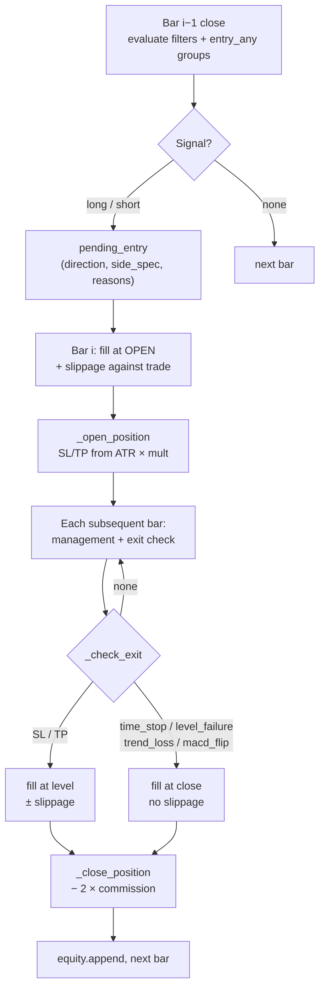

#### The no-lookahead contract

| Rule ↕▾ | Implementation ↕▾ |
|---|---|
| −**Signal on close of bar *i−1*** | `_entry_signal(side_spec, row, prev)` evaluates conditions against the bar that already closed |
| **Fill on open of bar *i*** | `entry_fill = raw_open × (1 ± eps)` |
| **One position at a time** | While `position is not None`, no new signals are evaluated |
| **End of period** | Force-close at last bar's close with `exit_reason: "end_of_period"` |
| **First bar skipped** | Loop starts at `i=1` — first bar has no `prev` |
| **Filters checked before entry** | Global `filters` evaluated on bar *i−1*; `False` short-circuits both sides |
⚙

This is what separates a real backtest from a curve-fitting exercise. Signalling on a close and filling on that same close is the single most common way backtests lie.

---

### 💸 Costs

| Cost | Default | Applied to |
|---|---|---|
| **Commission** | 0.055% per side (`commission_pct=0.055`) | Entry **and** exit: `pnl_pct = (pnl_pct − 2 × commission/100) × 100` |
| **Slippage** | 0.05% (`config.BACKTEST_SLIPPAGE_PCT`) | Entry (always), SL/TP exits (always) |
| **Soft exits** | 0% | `time_stop`, `level_failure`, `trend_loss`, `macd_flip`, `end_of_period` |

The asymmetry is intentional. A stop-loss fill happens *at a level* — live you get filled slightly past it, so the backtest must charge you. A soft exit happens *at a close you already saw* — live it's a market order on an observed price, so slippage there would double-count.

Slippage direction is always against the trade:

```
long entry:   open × (1 + eps)
short entry:  open × (1 − eps)
long SL/TP:   level × (1 − eps)
short SL/TP:  level × (1 + eps)
```

Where `eps = slippage_pct / 100`, so 0.05% → `0.0005`.

Both are configurable per call. The UI exposes `commission_pct`; `slippage_pct` comes from `config` unless overridden by a caller. **Note:** the optimizer does not pass an explicit `slippage_pct`, so it inherits `config.BACKTEST_SLIPPAGE_PCT` — the backtest and the optimizer see the same slippage model.

---

### 🛡️ Position management

Evaluated on **every bar** while a position is open. All of this runs *before* the exit check — a stop moved to breakeven on this bar can fire on this same bar.

#### 1. Breakeven move — `move_to_breakeven_at_tp_pct`

When price has travelled a fraction of the way to TP (e.g. `0.65` = 65%), the stop jumps to entry ± `breakeven_offset_pct`. The offset covers commissions — a "breakeven" stop at exactly entry is still a small loss after fees.

Only moves in the favourable direction. A breakeven that's been set cannot be given back.

#### 2. ATR trailing — `trailing_atr_mult`

```
long:  new_sl = close − trailing_atr_mult × atr_14
short: new_sl = close + trailing_atr_mult × atr_14
```

Applied only if it tightens the stop. `None` disables it. If both breakeven and trailing fire, the tighter of the two wins.

#### 3. Hard exits — checked by high/low

| Direction ↕▾ | Stop ↕▾ | Take ↕▾ |
|---|---|---|
| −Long | `low <= stop_loss` | `high >= take_profit` |
| Short | `high >= stop_loss` | `low <= take_profit` |
⚙

Intrabar, using the bar's extremes. If both would trigger in the same bar, **the stop wins** (checked first).

#### 4. Soft exits — checked by close

| Exit ↕▾ | Condition (long) ↕▾ | Condition (short) ↕▾ |
|---|---|---|
| −`time_stop` | `bars_held >= max_hold_candles` | same |
| `level_failure` | `close < level × (1 − buffer)` | `close > level × (1 + buffer)` |
| `trend_loss` | `close < sma_50` | `close > sma_50` |
| `macd_flip` | `macd_hist < 0` | `macd_hist > 0` |
⚙

`level_field` selects which level (`resistance_1` for longs, `support_1` for shorts). `level_failure_buffer_pct` (default 1.0%) prevents the exit on a single wick.

Each soft exit is individually switchable and **off by default** in `default_strategy_spec()`. Level failure in particular was found to cut trades into a loss right at the entry level, before the thesis had room to play out.

#### 5. SL/TP construction at entry

`_open_position()` computes stop and take:

1. **ATR-based**: `stop_dist = stop_loss_atr_mult × atr_14`, `take_dist = take_profit_atr_mult × atr_14` — used when `atr_14 > 0` and the multiplier is set
2. **Percentage fallback**: `stop_dist = entry × stop_loss_pct / 100`, `take_dist = entry × take_profit_pct[0] / 100`

The ATR preference is not aesthetic — a fixed 2% stop on SOL at $150 is very different from 2% on ARB at $0.60. ATR normalises.

---

### 🚦 Loss-streak cooldown — `risk_controls`

Optional circuit breaker, fully inside the simulation:

```
"risk_controls": {
  "enabled": true,
  "max_consecutive_losses": 4,
  "pause_candles_after_losses": 32,
  "max_losses_in_window": 6,
  "loss_window_trades": 10
}
```

Two independent triggers, checked on every close:

- **Streak** — `max_consecutive_losses` in a row
- **Window** — `max_losses_in_window` within the last `loss_window_trades`

When tripped, `cooldown_until_index = i + pause_candles_after_losses` and entry evaluation is skipped until the index catches up. The engine records:

| Stat ↕▾ | Meaning ↕▾ |
|---|---|
| −`cooldown_activations` | How many times the cooldown tripped |
| −`skipped_candles_by_cooldown` | Bars spent in cooldown |
⚙

The exact same logic is mirrored in `trading/auto_trader.py` (`_get_risk_controls`, `_should_pause_after_loss`) with identical defaults — a strategy behaves identically live and in backtest.

---

### 📤 Output

```
{
  "trades": [...],
  "equity_curve": [...],
  "stats": {...},
  "strategy_spec_used": {...},
  "spec_source": "ai" | "default",
  "start_date": ...,
  "end_date": ...,
}
```

#### Each trade

| Field | Content |
|---|---|
| `entry_time`, `exit_time` | Timestamps |
| `direction` | `"long"` / `"short"` |
| `entry_price`, `exit_price` | Fill prices (post-slippage) |
| `result_pct` | Net P&L after both commissions |
| `exit_reason` | `stop_loss` · `take_profit` · `time_stop` · `level_failure` · `trend_loss` · `macd_flip` · `end_of_period` |
| `capital_after` | Compounded capital after this trade |
| `entry_reasons` | Per-condition `{text, passed, detail}` — actual values at entry |
| `entry_snapshot` | RSI, ADX, ATR, volume, SMAs, MACD, VWAP, pivots at entry |

`entry_reasons` and `entry_snapshot` are diagnostic gold. They let you answer *"were my losses clustered at low ADX?"* without re-running anything. This is exactly the data `optimize_strategy` consumes.

#### Statistics block

| Metric ↕▾ | Meaning ↕▾ |
|---|---|
| −`total_trades` | Count |
| `win_rate` | % of trades with `result_pct > 0` |
| `total_pnl_pct` | Sum of trade returns (reference, not compounded) |
| `return_pct` | Compounded return on initial capital |
| `final_capital` | Ending balance |
| `max_drawdown_pct` | Peak-to-trough on the **equity curve** |
| `profit_factor` | Gross profit / gross loss (`999.0` when no losses) |
| `avg_trade_pct` / `expectancy_pct` | Mean return per trade |
| `avg_win_pct` / `avg_loss_pct` | Average winner / loser magnitude |
| `long_trades` / `short_trades` | Direction split |
| `risk_controls_enabled` | Whether cooldown block was active |
| `cooldown_activations` | Times tripped |
| `skipped_candles_by_cooldown` | Bars lost to cooldowns |
⚙

> ⚠️ **`max_drawdown_pct` is trade-to-trade, not intrabar.** The equity list gains an entry only when a trade closes; an open position's floating drawdown is invisible. A strategy can show 3% max DD while having been 20% underwater intra-position. Read with `avg_loss_pct` and management settings.

> ⚠️ **`total_pnl_pct` ≠ `return_pct`.** The first is a raw sum of per-trade percentages; the second is compounded. Ten +1% trades = `total_pnl_pct = 10%` but `return_pct ≈ 10.46%`. The UI shows both explicitly.

---

### 📁 Output files

#### XLSX per single backtest

On every single backtest (not optimization), `export_backtest_to_xlsx()` writes a two-sheet workbook:

```
data/backtests/{SYMBOL}_backtest_{start}_{end}.xlsx
```

| Sheet ↕▾ | Contents ↕▾ |
|---|---|
| −**Статистика** | Header (symbol, spec_source, dates) + all metric rows |
| **Сделки** | Full trade table with `entry_reasons` flattened into one column |
⚙

The trades sheet has a human-readable `entry_reasons` column: each condition becomes `✓ close > resistance_1 → close=1.234, resistance_1=1.230`. That column alone is worth the export.

Export failures are caught and logged — broken export never prevents the trade list from rendering.

#### Per-iteration CSVs from the optimizer

For every candidate evaluated:

```
data/backtests/{SYMBOL}_optimization_summary.csv      ← append, one row per iteration
data/backtests/{SYMBOL}_iteration_{N}_{train|test}_trades.csv
```

`optimization_summary.csv` accumulates a row per iteration with all metrics, `selection_score`, `acceptable` flag, the full `strategy_spec` JSON, rules text, and `changes_summary`.

#### Text report per optimization run

One file per run, written **streaming** so a crash or cancel doesn't lose data:

```
optimization_reports/{SYMBOL}_{YYYYMMDD_HHMMSS}.txt
```

Contains: the baseline, the Phase 0 screen (if run), every AI prompt/response pair, every candidate's score breakdown, every robustness assessment, the final winner, and the full iteration history. Heavy arrays (`trades`, `fold_results`, `rejected_fingerprints`) are replaced with `<N элементов — полные данные в CSV>`; long text (`reasoning`) is truncated at 500 chars. **The report never affects prompt size or token cost.**

---

### 🔁 The optimization loop — full cycle

The `♻️ Запустить оптимизацию` button calls `backtest_optimizer.run(...)`. This is the most complex piece of the system, and it has **six independent gates** between "an idea exists" and "the strategy is saved to memory".

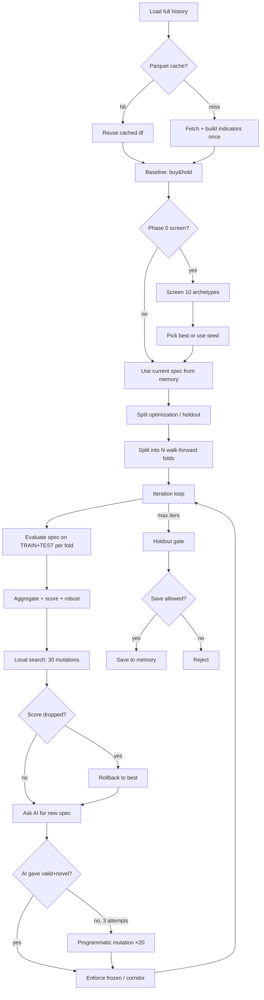

#### 1. Baseline — `buy_and_hold`

Before anything else, `optimization/baselines.py` computes what simply holding the coin would have returned:

```
return_pct = (close[-1] / close[0] - 1) × 100
max_drawdown_pct = max peak-to-trough on price
```

This is logged and saved in the report as the number every strategy must beat to be worth anything.

#### 2. Phase 0 — archetype screening

Optional, triggered by the `Фаза 0` checkbox **or by setting an explicit `seed_archetype`** (an explicit seed forces Phase 0 so its grid can be scored).

`optimization/archetypes.py` defines **10 fixed strategies** in two families. Each has its structure **hardcoded** — only 2-3 numeric knobs are exposed. The comment in the file calls this *"барьер переобучения: идею нельзя «переписать», можно лишь настроить риск под волатильность."*

**Trend/momentum family:**

| Name | Idea | Tunable |
|---|---|---|
| **A1_TREND_PULLBACK** | 1h trend + pullback to SMA20 on 15m | stop, tp, vol mult |
| **A2_VOL_BREAKOUT** | Bollinger breakout with 1h ADX filter | stop, tp, ADX threshold |
| **A3_MEAN_REVERSION** | RSI extreme inside a 1h trend | stop, tp, RSI threshold |
| **A4_TREND_MOMENTUM** | pure 1h trend (sma_50_1h + macd_hist_1h) | stop, tp |
| **A5_STRONG_VOL_BREAKOUT** | 32-bar breakout with volume + close_position > 0.6 | stop, tp, vol, hold |
| **A6_SHORT_MOMENTUM** | SHORT-only: `drop_2_atr < −2.0` + `volume > 2.0×` | stop, tp, vol, hold |

**Mean-reversion family:**

| Name ↕▾ | Idea ↕▾ | Tunable ↕▾ |
|---|---|---|
| −**R1_BB_MEAN_REVERSION** | cross back into BB, RSI range, low ADX | stop, tp, ADX |
| **R2_RSI_REVERSION** | RSI extreme vs VWAP, low ADX | stop, tp, ADX, RSI |
| **R3_RANGE_BOUNDARIES** | close inside support_1 / resistance_1 zone, low ADX | stop, tp, ADX |
| **R4_VWAP_REVERSION** | close stretched 1-2.5% from VWAP, low ADX | stop, tp, ADX |
⚙

Each archetype's `grid()` yields 8-36 parameter combinations. `screen_runner.run_screen()` runs every combination of every archetype, records the best per archetype (by `return_pct`, requiring **≥ 10 trades**), and returns a table plus a `by_name` dict.

**Selection rule:**

- **Explicit seed** (`seed_archetype` from UI) → use it unconditionally, even if it underperforms buy&hold
- **Auto mode** → only use an archetype that beats buy&hold *and* has `PF > 1.0`

**Two special mechanics in A6** (`_build_a6_short_momentum`):

| Mechanism ↕▾ | Effect ↕▾ |
|---|---|
| −`frozen_entries: True` | Optimizer's `_enforce_frozen_entries` will force-restore `entry`/`entry_any` from this base spec into any AI candidate |
| `exit_corridor` | `_enforce_exit_corridor` clamps `stop_loss_atr_mult ∈ [1.8, 2.2]`, `take_profit_atr_mult ∈ [1.3, 1.7]`, `max_hold_candles ∈ [6, 12]`; also forces `trailing_atr_mult = None` and `move_to_breakeven_at_tp_pct = None` (laboratory-measured: both hurt this specific signal) |
⚙

So A6 is a "laboratory-locked" archetype — the optimizer can tune inside the corridor, but cannot leave it, and cannot change the entry conditions.

#### 3. Data loading with parquet cache

`optimizer_data_utils.load_prepared_dataframe()`:

| Step ↕▾ | Behavior ↕▾ |
|---|---|
| −**Parquet path** | `data/ohlcv_cache/{SYMBOL}_15_{start}_{end}.parquet` |
| **Cache usable** | Only if `end_date < today` — fresh ranges are never trusted from cache |
| **On miss** | `fetcher.fetch_ohlcv()` → save to parquet (best-effort, failure ignored) |
| **Min candles** | Returns error if `< 150` |
| **Indicators** | Computed **once** here via `engine._build_indicator_frame()`, then reused across all iterations |
⚙

**This is the single biggest performance decision in the optimizer**: fetch once, compute indicators once, then slice the same DataFrame for every TRAIN and TEST window across every iteration. Without it, 10 iterations × 6 folds × 2 (TRAIN+TEST) × 30 local mutations would be 3600+ network requests.

#### 4. Optimization / holdout split

`split_optimization_and_holdout()` reserves the **last 15%** of history for final validation:

| Parameter ↕▾ | Value ↕▾ |
|---|---|
| −`holdout_ratio` | **0.15** |
| −`min_holdout_candles` | **500** (~5 days) |
| `min_optimization_candles` | **3000** (~31 days) |
⚙

If either minimum is not met, **holdout is disabled entirely** and the whole DataFrame goes into optimization. That's honest — you can't validate on data you don't have.

The optimizer **never sees** the holdout DataFrame during iteration.

#### 5. Walk-forward splits

`make_splits()` builds the folds:

| `walk_forward_folds` ↕▾ | Behavior ↕▾ |
|---|---|
| −**1** | One standard split: TRAIN = first `train_ratio`, TEST = rest |
| **> 1** | TRAIN always starts at `start_date` and **expands** before each TEST window; TEST windows are sequential non-overlapping slices of the remaining range |
⚙

`train_ratio` is clamped to `[0.5, 0.9]`.

**Crucial subtlety:** each TEST window starts with its own `initial_capital`. `return_pct` inside a fold is compounded from that fold's start; `_aggregate_fold_results` then compounds `return_pct` across folds via `compounded *= (1 + ret/100)`. Compounding is applied exactly once per level — not doubled.

#### 6. The per-iteration flow

For each iteration `1..max_iterations`:

**a. Evaluate current spec** — `_evaluate_spec_on_splits()` runs `engine.run_on_dataframe()` for TRAIN and TEST of every fold. Errors abort the whole optimization with a reason.

**b. Aggregate results** — `_aggregate_fold_results()`:

| Stat | Aggregation |
|---|---|
| **TRAIN** | Taken **only from the last fold** (which has the largest TRAIN window) |
| **TEST** | All folds concatenated: trades merged, `return_pct` compounded, `max_drawdown_pct` = worst across folds |
| **win_rate / avg_win / avg_loss / PF** | Recomputed from the merged trade list |

**c. Score** — `OptimizerScoring.compute_raw_selection_score_v2()`:

```
raw_score =
      3.0 × test_expectancy
    + 1.5 × (min(test_pf, 2.5) − 1.0)
    + 0.30 × test_return                    (capped [-100, +2000])

    + trade_count_bonus                     (see table below)

    + 1.5 × train_expectancy
    + 0.8 × (min(train_pf, 2.5) − 1.0)
    + 0.015 × min(train_trades, 80)

    − 0.30 × max(test_dd − 2.0, 0)
    − 0.08 × max(|train_return − test_return| − 10, 0)
    − 4.0  × max(|train_exp − test_exp| − 0.15, 0)
    − 1.5  × max(test_profit_concentration − 0.60, 0)
```

Trade-count bonus:

| `test_trades` ↕▾ | Bonus ↕▾ |
|---|---|
| −`< 20` | **−5.0** (flat penalty — overfitting) |
| −`20..39` | `+0.10 × test_trades` |
| `≥ 40` | `+0.25 × test_trades` |
⚙

The penalty for `< 20` trades is deliberately brutal. A strategy with PF 3.0 on 8 trades is not better than one with PF 1.3 on 40 trades, and the scoring enforces that.

**d. Acceptable flag** — `score_and_flags()` returns `(raw_score, acceptable, train_exp, test_exp)` where:

```
acceptable = test_trades >= min_test_trades     # min = 10
           AND train_expectancy > 0
           AND test_expectancy  > 0
           AND train_pf > 1.0
           AND test_pf  > 1.0
```

`MIN_ACCEPT_TEST_TRADES = 10` is the hard floor. A candidate with fewer trades than this can never become `best`, no matter how good the score.

**e. Window robustness** — `OptimizerRobustness.compute_window_robustness()` computes per-window ratios:

| Metric ↕▾ | Meaning ↕▾ |
|---|---|
| −`profitable_windows_ratio` | Fraction of TEST windows with `return_pct > 0` |
| `positive_expectancy_windows_ratio` | Fraction with `expectancy > 0` |
| `pf_pass_windows_ratio` | Fraction with `PF > 1` |
| `median_window_return_pct` | Median across windows |
| `worst_window_return_pct` | Worst window |
| `return_std` | Std of returns |
| `stability_score` | 0..1, computed from the diagnostics above |
⚙

**f. Robust assessment** — `assess_window_robustness()` with default thresholds (from `optimizer_robustness.py`):

| Threshold ↕▾ | Value ↕▾ |
|---|---|
| −`min_profitable_windows_ratio` | **2/3** |
| −`min_positive_expectancy_windows_ratio` | **2/3** |
| −`min_pf_pass_windows_ratio` | **2/3** |
| `min_median_window_return_pct` | **0.0** |
| `max_worst_window_return_pct` | **−5.0** |
| `min_stability_score` | **0.5** |
⚙

Status:

- **`robust`** — all thresholds met → `passed=True, fragile=False`
- **`fragile`** — weak-pass fallback (windows ≥ 2, all ratios ≥ 0.5, stability ≥ 0.35) → `passed=True, fragile=True`
- **`unstable`** — otherwise → `passed=False`

**g. Soft window penalty** — `window_stability_penalty()` adds 0-3.0 to a penalty applied to `raw_score`:

```
final_score = raw_score − window_penalty
```

Penalties: `profitable < 50%` → +1.0; `50-67%` → +0.4; same pattern for expectancy and PF ratios; `worst < −10%` → +0.8; `std > 10%` → +0.6. Capped at 3.0.

**h. Local search** — `OptimizerMutations.local_search()` runs up to **30** mutations (`LOCAL_SEARCH_MUTATIONS = 30`), keeping the best by `train_score` (`total_pnl − 0.5 × drawdown`). Each mutation is a full TRAIN+TEST run on every fold. If any beats the base, it's recorded as `{iteration}-local` and becomes the base for the AI step.

Mutation types (`mutate_numeric`):

| Condition type | Mutation |
|---|---|
| `range` | min/max ± U(−8, 8), clamped to [0, 100], min-width 5 |
| `volume` | `mult` ± U(−0.4, +0.3), min 0.8 |
| `compare` with `left='adx_14'` | `right` ± U(−6, 6), min 10 |
| `{name, mult}` operand | `mult` ± U(−0.004, +0.004) |
| `stop_loss_atr_mult` | In corridor [lo, hi]; else U(1.0, 2.5) |
| `take_profit_atr_mult` | In corridor [lo, hi]; else U(2.0, 6.0) |
| `move_to_breakeven_at_tp_pct` | If no corridor: `choice([None, 0.3, 0.5, 0.7])` |
| `trailing_atr_mult` | If no corridor: `choice([None, 2.0, 2.5, 3.0, 3.5])` |
| `max_hold_candles` | If corridor: `randint(lo, hi)` |

Entries are only mutated if `frozen_entries` is not set.

**i. Rollback** — before asking the AI for the next spec, the code checks:

```
threshold = best.selection_score − max(1.0, abs(best.selection_score) × 0.3)
if current_score < threshold:
    base = best
```

So a bad iteration doesn't poison the next one — the optimizer always gives the AI its best result so far, not the last result.

**j. AI proposal** — `optimize_strategy()` called up to **3 times** per iteration with escalating `extra_instruction`. On each attempt:

1. `validate_strategy_spec(candidate)` — reject if invalid
2. `_inherit_engine_controls(candidate, base)` — copy `risk_controls`, `management`, `frozen_entries`, `exit_corridor` from base if missing
3. `_enforce_frozen_entries(candidate, base)` — if base has `frozen_entries`, restore base's `entry`/`entry_any` into candidate (risk params from candidate survive)
4. `_enforce_exit_corridor(candidate, base)` — if base has `exit_corridor`, clamp stop/tp/hold; force trailing/breakeven to `None`
5. `ensure_engine_defaults(candidate)` — fill in missing management fields
6. Re-apply `frozen_entries` and `exit_corridor` after defaults (defaults can drop them)
7. `_spec_fingerprint(candidate)` in `rejected_fingerprints`? Skip, retry.

**k. Fallback** — if 3 AI attempts fail, `PROGRAM_MUTATION_ATTEMPTS = 20` tries of `mutate_numeric(base)`, validated and fingerprinted the same way.

**l. Record candidate** — `record_candidate()`:

- Appends to `history` with full score breakdown, robustness, soft warnings
- Calls `OptimizerSummary.save_round()` → writes to the summary CSV and trade CSVs
- Logs extensively with `emit()` (visible in the text report)
- Updates `best` if `acceptable` **and** `score > best.score` **and** (new is robust **or** new beats robust best by ≥ 10%)

The 10% rule is the "fragile can't displace robust cheaply" gate — a fragile candidate that barely edges out a robust best is rejected.

**m. Repeat.** If `iteration == max_iterations`, break.

#### 7. Holdout gate

After the loop, if `holdout_meta.enabled` and `holdout_df` is non-empty, `OptimizerHoldout.evaluate_spec_on_holdout()` runs the winning spec once on the holdout period.

`assess_holdout_quality()` classifies the result:

| Status | Condition |
|---|---|
| **`passed`** | `trades ≥ 10` AND `expectancy > 0` AND `PF > 1.05` AND `return > 0` |
| **`weak_pass`** | `5 ≤ trades < 10` AND same quality gates |
| **`failed`** | Otherwise |

Note the stricter PF gate on holdout: **1.05**, not 1.0. A strategy that just barely scraped by on TEST doesn't deserve to be called validated.

The holdout summary also records `profit_concentration`, warnings (`мало сделок`, `DD > 10%`), and recommendations.

#### 8. Save gate

`save_best_to_memory` writes the winner into `data/{SYMBOL}/state.json` and `trading_rules.md` — **only** if all of these are true:

| Gate ↕▾ | Blocks save if ↕▾ |
|---|---|
| −`best is not None` | No acceptable candidate ever existed |
| `holdout_meta.enabled` | N/A (holdout disabled → not a blocker) |
| `holdout_status == "failed"` | **Yes** — holdout failed |
| `holdout_status == "weak_pass"` AND `not allow_weak_holdout_save` | **Yes** — weak pass without explicit permission |
| `holdout_status == "passed"` | No block |
| `holdout disabled` | No block |
⚙

So `allow_weak_holdout_save=True` is the *only* way a `weak_pass` gets saved. It's an opt-in — the operator decides that 7 trades at PF 1.2 on holdout is "good enough for now."

#### 9. Report

`OptimizationReport` is opened at the start of `run()` and written **streaming** throughout: every `emit()` line, every AI prompt, every AI response, every score breakdown, every robustness verdict, the final winner, and the whole history. A crash mid-run leaves a usable partial report.

Full structure saved per run:

| Section ↕▾ | Content ↕▾ |
|---|---|
| −Header | Symbol, timestamp, path |
| Baseline | Buy&hold |
| Phase 0 | Archetype screen (if run) |
| Every iteration | Inputs to AI, response from AI, candidate evaluation, robustness verdict, score breakdown, soft warnings |
| Holdout | Final validation result |
| History | Every candidate ever evaluated |
⚙

---

### 🧱 Six independent gates — read this once and you understand the optimizer

Between "a spec exists" and "the spec is saved to memory", the code passes through **six** distinct checks. They're layered deliberately — each one exists because a prior version of the system was fooled by something.

| # | Gate | Threshold | Failsafe |
|---|---|---|---|
| 1 | **AI prompt injection** (`ai_client._build_optimize_message`) | `test_pf > 1.1` → freeze entry; `test_trades < 30` → force `entry_any` | Prompt text only — model may ignore, so not a hard block |
| 2 | **`acceptable`** (`optimizer_scoring.score_and_flags`) | `test_trades ≥ 10` AND `train_exp > 0` AND `test_exp > 0` AND `train_pf > 1.0` AND `test_pf > 1.0` | Candidate cannot become `best` |
| 3 | **Robustness** (`optimizer_robustness.assess_window_robustness`) | ≥ 2/3 of windows profitable, positive-expectancy, PF-pass; median ≥ 0; worst ≥ −5%; stability ≥ 0.5 | `fragile` can pass but at +10% score cost vs a `robust` best |
| 4 | **Window penalty** (`optimizer_robustness.window_stability_penalty`) | 0-3.0 points subtracted from raw score based on window consistency | Only affects ranking — doesn't hard-reject |
| 5 | **Holdout** (`optimizer_holdout.assess_holdout_quality`) | `trades ≥ 10`, `exp > 0`, `PF > 1.05`, `return > 0` for `passed`; 5-9 trades → `weak_pass` | `failed` → hard block; `weak_pass` → block unless `allow_weak_holdout_save=True` |
| 6 | **Save gate** (in `run()`) | Best must exist; holdout status must not be `failed`; `weak_pass` needs the allow flag | If any gate blocks, nothing is saved — the coin keeps its old spec |

The layers are **not redundant**. Gate 1 shapes the search, gate 2 filters obvious garbage, gate 3 rewards strategies that work in *most* windows rather than one, gate 4 penalises inconsistency, gate 5 tests against data the optimizer never saw, gate 6 blocks the save if any of the above failed.

---

### 🧪 What a real optimization run looks like

Rough shape of a 10-iteration, 6-fold run:

| Phase | Approx. backtests | Wall clock (typical) |
|---|---|---|
| Data load + indicators | 1 | 10–30 s (with parquet) |
| Baseline | 1 | <1 s |
| Phase 0 screen (opt) | ~150 | 2–4 min |
| 10 iterations × (12 fold evals + 30 local × 12 fold evals) | ~3600 | 5–15 min |
| Holdout | 1 | <1 s |

The `parquet` cache turns the second run of the same period from "10 minutes of network" into "instant." The 3600 backtests are local — the engine is pure pandas on a DataFrame it already has.

---

### 📁 Offline data path

`data_loader.py` reads yearly CSVs from `backtest_data/`:

```
backtest_data/
└── SOLUSDT/
    ├── SOLUSDT_15m_2023.csv
    ├── SOLUSDT_15m_2024.csv
    ├── SOLUSDT_15m_2025.csv
    └── SOLUSDT_15m_2026.csv
```

| Function ↕▾ | Returns ↕▾ |
|---|---|
| −`get_available_symbols()` | `["ADAUSDT", "ARBUSDT", ...]` |
| `get_available_years(symbol)` | `[2023, 2024, 2025, 2026]` |
| `load_local_data(symbol, year, start_date, end_date)` | Normalized DataFrame |
| `load_first_available_data(preferred)` | `(symbol, year, df)` |
⚙

The loader sniffs the delimiter, renames `datetime_utc → timestamp`, coerces numerics, drops unparseable rows, sorts by time, and extracts year from the filename. If a symbol has multiple files for one year, it prefers the `15m` one.

Also present: `funding/`, `long_short/`, `open_interest/` — used by research, not by the current engine.

The UI page does **not** expose offline mode. For offline research through the UI, either pass a DataFrame to `run_on_dataframe()` directly or use the Research Lab (see [Section 5](https://05-lab/)).

---

### ✅ What "a good backtest" looks like

| Signal | Reading |
|---|---|
| `profit_factor > 1.1` on **TEST** | The only number that counts — TRAIN is for fitting |
| `total_trades >= 30` | Below this, PF is noise |
| `avg_win_pct / avg_loss_pct >= 2.5` | Payoff must justify a sub-50% win rate |
| `max_drawdown_pct` acceptable vs `avg_loss_pct` | DD should be a multiple of a single loss, not a regime shift |
| `cooldown_activations` low but non-zero | The breaker works without dominating |
| `spec_source == "ai"` | You are testing the model's strategy, not the fallback |
| `TRAIN WR − TEST WR < 15%` | Bigger gap = overfitting (UI warns above this) |
| `expectancy_pct > 0 on TEST` | The single most important line (UI warns if ≤ 0) |

If any of the last three fails, treat the result as "promising but not ready" and use optimization to search for a better point.

---

### 🚫 What the engine will not do

- **No partial fills, no order-book simulation, no funding payments** — commission and slippage only
- **No pyramiding** — one position at a time, full allocation of current capital
- **No shorting constraints** — assumes both sides always available
- **No multi-symbol portfolio** — one symbol, one run
- **No intrabar drawdown** — see the `max_drawdown_pct` note
- **No walk-forward enforcement inside the engine** — TRAIN/TEST splits come from the optimizer

Knowing the boundaries matters more than the features. A backtest that says PF 1.4 under these assumptions is **evidence**, not proof.

---

### 🧱 Constants that shape behaviour

| Constant ↕▾ | Value ↕▾ | Source ↕▾ |
|---|---|---|
| −Default commission | **0.055%** per side | `run()` default (taker Bybit) |
| Default slippage | **0.05%** | `config.BACKTEST_SLIPPAGE_PCT` |
| Minimum candles | **60** | `run_on_dataframe()` guard |
| Minimum backtest period | **15 days** | `_get_common_params()` |
| Default max_hold_candles | **48** (12h) | `auto_trader.DEFAULT_MAX_HOLD_CANDLES` |
| Default trailing ATR mult | **2.0** | `auto_trader.DEFAULT_TRAILING_ATR_MULT` |
| Default risk_controls | 4 consecutive / 32 candles / 6 in 10 | `default_strategy_spec()` + `ensure_engine_defaults()` |
| `MIN_ACCEPT_TEST_TRADES` | **10** | `backtest_optimizer.py` |
| `LOCAL_SEARCH_MUTATIONS` | **30** | `optimizer_mutations.py` |
| `PROGRAM_MUTATION_ATTEMPTS` | **20** | `backtest_optimizer.py` |
| AI attempts per iteration | **3** | `backtest_optimizer.py` |
| Holdout ratio | **15%** | `split_optimization_and_holdout()` |
| Min holdout candles | **500** | same |
| Min optimization candles | **3000** | same |
| Robust ratio thresholds | **2/3** each | `optimizer_robustness.py` |
| Robust worst window | **−5.0%** | same |
| Robust stability score | **0.5** | same |
| Fragile→robust displacement | **+10%** score | `backtest_optimizer.record_candidate()` |
| Holdout `passed` trades | **≥ 10** | `optimizer_holdout.py` |
| Holdout `weak_pass` trades | **5..9** | same |
| Holdout `PF` threshold | **> 1.05** | same |
| Default TRAIN ratio | **70%** | UI |
| Default walk-forward folds | **6** | UI |
| UI iteration cap | **30** | `max=30` on the iterations field |
⚙

---

### 🛡️ What makes a backtest here trustworthy

| Property ↕▾ | How it's achieved ↕▾ |
|---|---|
| −**No same-bar cheating** | Signal on close of bar *i−1*, fill on open of bar *i* |
| **No future leakage in indicators** | Every rolling-window indicator uses `shift(1)`; pivots use yesterday's OHLC |
| **Realistic costs** | Commission × 2 + slippage against the trade on entry and SL/TP |
| **Deliberate cost asymmetry** | Soft exits unslipped because they execute on already-observed close |
| **Deterministic replay** | Same spec + same data = same trades, every time |
| **Diagnosable trades** | `entry_reasons` + `entry_snapshot` on every trade |
| **Six independent anti-overfitting gates** | Prompt injection → acceptable → robust → penalty → holdout → save |
| **Same risk logic live and backtest** | `risk_controls` code duplicated deliberately in `auto_trader` with identical defaults |
| **Frozen entries are enforced, not requested** | `_enforce_frozen_entries()` overwrites the AI's entry conditions with the base's |
| **Corridors are enforced, not requested** | `_enforce_exit_corridor()` clamps exits to measured bounds; trailing/breakeven forced to null for A6 |
| **Rollback on regression** | `if score < best − max(1, |best|×0.3)` → base becomes best, not the last |
| **Streaming report** | `OptimizationReport` writes to disk on every `emit()`, survives crashes |
| **Parquet cache is honest** | Only used for complete past periods — a today-end range is always freshly fetched |
⚙

---


---

<a id="5-lab"></a>
## 5. 🧪 Lab

### 💡 What it is

The Lab is the **research workshop** — the place where trading ideas are born, stress-tested, and either killed or promoted to production. It is not a single screen. It has **two surfaces** and **sixteen scripts**, and the difference between them matters:

| Surface | What it does | Who it's for |
|---------|--------------|--------------|
| **🔬 UI Lab page** (`ui/pages/research_lab_page.py`) | One specific thing: **portfolio backtest** with multiple strategies, symbols, leverage, and exit parameters. Produces an equity curve chart + year-by-year breakdown + downloadable text report | Interactive use from the browser |
| **🧪 CLI labs** (`research/*.py`, 16 scripts) | Everything else: signal discovery, exit tuning, funding arbitrage, grid strategies, pairs arb, stress tests | One-shot research runs, `python research/xxx_lab.py` |

The two share the same core engine (`research/impulse_lab._simulate_fixed`) but serve different purposes. The UI is for **validating a portfolio you've already assembled**; the CLI scripts are for **building the components in the first place**.

The Lab's whole reason to exist: **nothing goes into production because it looked good on one chart**. It goes in because it survived multiple datasets, multiple years, multiple slippage levels, and (in the case of signal-based strategies) a specific exit laboratory.

---

### 🔬 The UI Lab page — portfolio simulation

This is what opens when you click **🔬 Лаборатория** in the sidebar.

#### The model


Each symbol is simulated **independently** — one position at a time, no cross-symbol interaction. The portfolio curve is the **sum of each symbol's current capital** plus unallocated cash.

#### Portfolio parameters

| Field ↕▾ | Default ↕▾ | Meaning ↕▾ |
|---|---|---|
| −**Начальный капитал** | 1000.0 USDT | Total across all symbols |
| −**Комиссия, % (round-trip)** | 0.11 | Applied per trade on the full position |
| −**Проскальзывание, %** | 0.05 | Added to commission for total cost |
| −**Реинвестировать прибыль** | on | If off, each trade uses the *allocated* capital, not current |
⚙

Combined cost = `fee_pct + slippage_pct` — subtracted from each trade's raw return.

#### Exit parameters (shared across symbols)

| Field ↕▾ | Default ↕▾ | Meaning ↕▾ |
|---|---|---|
| −**Стоп-лосс (×ATR)** | 2.0 | Hard stop distance |
| −**Тейк-профит (×ATR)** | 1.5 | Take profit distance |
| −**Макс. удержание (свечей)** | 8 | Time stop (8 × 15m = 2 h) |
⚙

Note the **short TP vs wide stop** — payoff < 1 (1.5:2.0 = 0.75). That's not a bug: the momentum-short signals that make up the portfolio tend to hit TP quickly on continuation, and the wide stop protects against the post-dump bounce. The optimality of this asymmetry came directly from `research/exit_lab.py` (see below).

#### Strategy picker — 8 strategies

The checkbox list is built from `STRATEGY_REGISTRY` in `portfolio_simulator.py`:

| Strategy ↕▾ | Direction ↕▾ | Rule ↕▾ | Source ↕▾ |
|---|---|---|---|
| −**`mom2_short_t2.0`** | short | `vel_2 < −2.0` (drop > 2 ATR in 2 bars) | impulse_lab iter 4 |
| −**`m2s2_vol1.5`** | short | `mom2` AND `vol_ratio > 1.5` | impulse_lab iter 5 |
| −**`m2s2_vol2.0`** | short | `mom2` AND `vol_ratio > 2.0` | impulse_lab iter 5 — **best single signal** |
| −**`act_short`** | short | `activity > 3.0` AND `vel_2 < −1.0` | portfolio_lab iter 1 |
| −**`act_long`** | long | `activity > 3.0` AND `vel_2 > 1.0` | portfolio_lab iter 1 |
| −**`cont_long_t2.0`** | long | `vel_2 > 2.0` (up-momentum) | impulse_lab iter 6 |
| −**`climax_bear`** | short | `range_atr > 1.5` AND `vol_ratio > 2.0` AND `close_position < 0.2` | impulse_lab iter 6 |
| −**`climax_bull`** | long | `range_atr > 1.5` AND `vol_ratio > 2.0` AND `close_position > 0.8` | impulse_lab iter 6 |
⚙

Default checked: **`m2s2_vol2.0`** only — the single best signal from the labs.

Multiple selected strategies are merged as **one signal stream per symbol, priority LONG first then SHORT** — matching the production engine's priority. If two signals fire on the same bar, LONG wins. If a position is already open, later signals are discarded — no new position until the current one closes.

#### Symbol picker

Lists symbols from `backtest_data/` (via `get_available_symbols()`). For each:

| Input ↕▾ | Default ↕▾ |
|---|---|
| −**Торговать** checkbox | on for `{ARBUSDT, DOGEUSDT, SOLUSDT}`, off for others |
| −**Доля капитала (%)** | 33.3 for the three defaults |
| −**Размер позиции (%)** | 50 |
| −**Плечо** | 1.0 |
⚙

Effective leverage on capital = `position_size_pct/100 × leverage`. With defaults, 0.5 × 1 = 0.5× — half the allocated capital per trade.

Constraint: total `capital_share_pct` must be ≤ 100%. Unallocated cash is tracked but not traded — it sits in the portfolio curve as a constant additive term.

#### Run

Click **🚀 Запустить симуляцию**. What happens:

1. Each symbol's history is loaded once and cached (`_PREPARED_CACHE`)
2. Indicators are computed once per symbol via `engine._build_indicator_frame()`
3. Lab features are added (`lab.add_features()` — the impulse_lab feature set)
4. Selected strategies' masks are evaluated on the prepared frame
5. Trades are simulated **sequentially** — signal on bar *s*, fill on open of *s+1*, exit on SL/TP/time, one position per symbol, no overlapping signals
6. Per-symbol capital curves are built with `position_size × leverage × (result_pct/100)`
7. Portfolio curve = sum of current capitals + unallocated
8. Metrics rendered, echart drawn, text report saved

A **`bankrupt`** flag is set per symbol if `final_capital <= 0` — the system does not silently zero out; it stops trading that symbol once capital hits zero and reports it.

#### Results

Three sections render together:

**1. 📊 Итоги портфеля** — six metric cards:

| Card ↕▾ | Value ↕▾ |
|---|---|
| −Начальный капитал | `initial_capital` |
| −Конечный капитал | sum of symbol finals + unallocated |
| −Общий P&L | `+` / `−` with $ and % |
| −Монет / сделок | `len(symbols) / sum(trades)` |
| −Макс. просадка (монета) | worst per-symbol drawdown |
| −БАНКРОТСТВО | count of symbols with `bankrupt=True` (only shown when > 0) |
⚙

**2. 🪙 Результаты по монетам** — table with per-symbol rows:

| Column ↕▾ | Meaning ↕▾ |
|---|---|
| −Сделок | trade count |
| −Win Rate | % of winning trades |
| −`exp_mean` | **average trade result in % of entry price**, before position sizing and leverage. This is the "quality of the signal itself" |
| −Конечный капитал | final capital for this symbol |
| −P&L | `$` delta |
| −P&L % | `%` return on allocated capital |
⚙

The `exp_mean` column is deliberately surfaced with an explanatory caption: *"exp_mean — средний результат одной сделки в % от цены входа (до учёта размера позиции и плеча). Показывает качество сигнала самого по себе."*

**3. 📅 Результаты по годам** — aggregates all trades across all symbols by `exit_time.year`, reporting total trades, mean `exp_mean`, and sum of `result_pct`.

**4. 📈 Кривые доходности** — an ECharts line chart:

| Series ↕▾ | Colour ↕▾ | Style ↕▾ |
|---|---|---|
| −Each symbol | one colour from palette | thin line |
| −Портфель | `#222` (dark) | **3px** line |
⚙

`dataZoom` slider at the bottom, `time` x-axis, `value` y-axis, scaled. Time axis means you can see exactly when a symbol went bankrupt if it did.

#### Text report

Every simulation saves a full report to:

```
research/lab_runs/lab_{YYYYMMDD_HHMMSS}.txt
```

`save_simulation_report()` writes a structured text file with nine sections:

| Section ↕▾ | Content ↕▾ |
|---|---|
| −Header | Timestamp, all portfolio parameters, all coin configurations |
| −Итоги портфеля | Final capital, P&L, all trades, mean `exp_mean`, win rate, best/worst trade |
| −Диагностика реализма | Total cost per trade, warning about Bybit taker (0.20% round-trip), unallocated cash |
| −Результаты по монетам | Table with trades, win rate, exp_mean, capital, P&L |
| −Разбивка по годам | Year × {trades, mean exp, sum} |
| −Разбивка по монетам и годам | `(symbol, year)` × {trades, mean exp, sum} |
| −Статистика причин выхода | Per symbol: SL / TP / time counts |
| −Предупреждения | Errors list |
| −**Список сделок** | Every single trade: symbol, strategy, entry/exit times, direction, prices, result, bars held, exit reason |
⚙

The trade list is the debugging gold — you can trace any losing streak back to the exact strategy and entry that produced it.

---

### 🧪 The CLI labs — the workshop

Sixteen scripts. They fall into six categories:

#### 🔍 Signal discovery

**`impulse_lab.py`** — the foundation of everything.

This is not a lab in the sense of "run one backtest." It is:

1. A **feature engineering module** (`add_features`) — 40+ columns beyond the base indicators
2. A **fixed-exit simulator** (`_simulate_fixed`) — the shared engine all other labs use
3. A **signal catalog** (`iteration_signals`) — 20+ candidate signals evaluated against an oracle
4. An **oracle** (`oracle_events`) — labels bars by whether a "real" impulse followed (move ≥ 2.5 ATR, ER ≥ 0.45, within 8 bars)

Key features in `add_features`:

| Group ↕▾ | Series ↕▾ |
|---|---|
| −Position in range | `pos_in_range` (0..1 within 96-bar range) |
| −Efficiency | `er_96` (Efficiency Ratio) |
| −Volume momentum | `pos_vol_ratio` (4-bar avg / 96-bar avg) |
| −Momentum | `vel_2`, `vel_4`, `vel_8` (close.diff(k) / atr_14) |
| −Intra-bar | `close_position`, `strong_bullish_close`, `strong_bearish_close` |
| −Breakout | `brk32_long`, `brk32_short`, `brk32_vol_short`, `brk32_strong_short` |
| −BB state | `bb_width_pct`, `keltner_squeeze`, `squeeze_recent` |
| −Streak | `streak_up`, `streak_dn` (5+ consecutive bars) |
| −Spike | `spike_up`, `spike_dn` (>3 ATR over 8 bars) |
| −Distance | `dist_ema8_atr` |
| −Range | `range_atr` |
| −Activity | `activity` = `vol_ratio × atr_ratio` |
| −Positioning | `fund_z`, `oi_d4`, `ls_z` (from `positioning.py`) |
⚙

`_simulate_fixed` signature:

```
_simulate_fixed(d, idx, direction, sl_atr, tp_atr, max_hold,
                trail_atr=None, be_atr=None, cost=None)
```

**SL checked before TP** — same as production. Optional trailing (`trail_atr`) and breakeven (`be_atr`) that only engage when the bar's high/low reaches the trigger. If `cost` is `None`, uses `FEE_PCT + SLIPPAGE_PCT` from module globals (mutable — used by stress tests).

The `_chase_diagnosis` function is worth noting: it compares `entry_mode="signal_close"` (ideal, fill at signal bar's close) vs `entry_mode="next_open"` (realistic). The difference is the **cost of chasing** — how much edge the market eats in the bar transition.

Outputs:

- `research/lab_report.txt` — the running log
- `research/leaderboard.txt` — signal rankings

**`swing_lab.py`** — signal discovery on 1h and 4h.

Tests four strategies on higher timeframes:

1. **Trend Pullback** — price above/below SMA(50), pullback to EMA(10), close in favourable half
2. **Breakout** — Donchian channel (20-bar) breakout
3. **Momentum Bar** — vel_1 > 1 ATR + strong close, aligned with trend
4. **Momentum Any** — same as (3) but without trend filter

Holds: 1h → 72 bars (3 days), 4h → 30 bars (5 days). Both taker (0.28%) and maker (0.04%) cost scenarios. Robustness filter: ≥ 6 datasets, ≥ 100 trades, ≥ 60% positive, mean exp > 0.

**`positioning.py`** — the no-lookahead positioning feature module.

Produces three series that are merged into the 15m frame via `merge_asof(direction="backward")`:

| Feature ↕▾ | Source ↕▾ | Formula ↕▾ |
|---|---|---|
| −`fund_z` | `funding/funding_rate` | 96-period rolling z-score of funding rate |
| −`oi_d4` | `open_interest/open_interest` | `log(OI).diff(4)` — 4-hour OI change in log units |
| −`ls_z` | `long_short/long_short_ratio` | 96-period rolling z-score of `log(L/S ratio)` |
⚙

**Critical rule:** every feature must use only records with `timestamp <= T`. Enforced by:

- Separate `merge_asof` per feature on its native timestamp
- `MAX_AGE` validation — `fund_z` requires source within 30h, `oi_d4` and `ls_z` within 6h
- Age computed on **naive-UTC numpy arrays** — no timezone comparison bugs

Without this module, no positioning-aware signal could exist in the labs. Without the `MAX_AGE` check, a stale funding rate from three days ago would silently leak into the current bar.

#### 🎯 Exit tuning

**`exit_lab.py`** — the exit laboratory.

The input signal is **frozen**: `m2s2_vol2.0` (short, `vel_2 < −2.0` AND `vol_ratio > 2.0`). The lab varies **only** exit parameters.

Three-stage grid:

| Stage ↕▾ | Parameters ↕▾ | Combos ↕▾ |
|---|---|---|
| −1 | `sl ∈ {0.75, 1.0, 1.5, 2.0}` × `tp ∈ {1.5, 2.0, 3.0, 4.0}` × `hold ∈ {8, 16, 32, 64}` | 64 |
| −2 | Stage 1 + `trail ∈ {1.0, 1.5, 2.0}` (hold=16 fixed) | 45 |
| −3 | Stage 2 + `be ∈ {0.5, 0.75, 1.0}` | 36 |
| −**Total** |  | **145** |
⚙

Each combo evaluated across **every (symbol, year) dataset**. Aggregate metrics: `n_datasets`, `trades_total`, `exp_mean`, `frac_pos`, `pf_mean`.

The verdict is **cross-asset**: a combination is "good" only if it is positive across many datasets, not just one. This is why the output shows `frac_pos` prominently — 0.85 means 85% of datasets had positive expectancy.

**The result fed directly into production.** The optimum — `sl=2.0, tp=1.5, hold=8` — became the `exit_corridor` of **A6_SHORT_MOMENTUM** in `optimization/archetypes.py`:

```
"exit_corridor": {
    "stop_loss_atr_mult": [1.8, 2.2],
    "take_profit_atr_mult": [1.3, 1.7],
    "max_hold_candles": [6, 12],
}
```

The optimizer can tune inside the corridor but cannot leave it — the laboratory already proved that narrow stops (0.75-1.0) get shaken out by the post-dump bounce, and wide stops lose too much on the original signal.

A second, subtler finding from the lab went into production as well: **trailing and breakeven are harmful for this specific signal**. Both are explicitly forced to `null` in the A6 spec. This is why `_enforce_exit_corridor()` in `backtest_optimizer.py` forces `trailing_atr_mult=None` and `move_to_breakeven_at_tp_pct=None` for specs with an exit corridor — the laboratory said so, and the optimizer must not override it.

**`swing_exit_lab.py`** — the swing equivalent.

Frozen signal: `momentum_any_long` on 4H. Grid:

| Parameter ↕▾ | Values ↕▾ | Count ↕▾ |
|---|---|---|
| −`sl_atr` | 1.5, 2.0, 2.5, 3.0 | 4 |
| −`tp_atr` | 2.0, 3.0, 4.0, 6.0, 8.0 | 5 |
| −`max_hold` | 20, 30, 45, 60 bars 4H | 4 |
| −`trail_atr` | None, 2.0, 3.0 | 3 |
| −`be_atr` | None, 1.5 | 2 |
| −**Total** |  | **480** |
⚙

Data is split **60% train / 30-bar buffer / 40% test** — the buffer prevents trades opened in the train split from straddling into the test window and contaminating evaluation. Top 15 combos from train are re-run on test. A combo is "stable" only if it has `train_exp > 0` **and** `test_exp > 0`.

#### 📊 Grid strategy labs

These two form a two-step process — first check if the data has the raw material for grid, then only simulate if it does.

**`grid_feasibility_lab.py`** — **Step 1: diagnostic, no simulation.**

Three independent measurements on 15m and 1h data:

| Measurement ↕▾ | What it computes ↕▾ | Interpretation ↕▾ |
|---|---|---|
| −**Autocorrelation** (`acf_1..16`) | Log-return autocorrelation at lags 1, 2, 4, 8, 16 | `acf < 0` → mean-reversion, grid has raw material. `acf > 0` → trending, grid bleeds |
| −**Efficiency Ratio** (`er_*`) | `|Δnet| / path_length` over 6h/24h/72h/7d windows | `ER → 0` = chop (good for grid), `ER → 1` = trend (bad) |
| −**Zigzag capacity** | Completed reversals ≥ g% amplitude; max amplitude = inventory risk | Number of round-trips = grid's potential; max amplitude = how many levels you'd accumulate in the worst case |
⚙

The verdict per timeframe:

- ✅ if `acf < −0.02` AND `ER(24h) < 0.30` → run Step 2
- ⚠️ if only ER is low → grid possible but needs regime filter
- ❌ if data is trending → do not run Step 2

The lab explicitly warns: *"net_per_year_pct — ВЕРХНЯЯ граница. Она НЕ учитывает убыток от накопления инвентаря в тренде. Реальный результат даст только ШАГ 2."*

**`grid_lab.py`** — **Step 2: full grid simulation with regime switching.**

Three modes compared on the same data:

| Mode ↕▾ | Behavior ↕▾ |
|---|---|
| −**A. naive_grid** | Grid always active — maximum upside, maximum inventory risk |
| −**B. flat_only** | Grid only in flat regime (ER < 0.15); in trend → cash |
| −**C. hybrid** | Grid in flat; in trend → long/short follow with 3 ATR stop |
⚙

**Regime detection** is via Efficiency Ratio with hysteresis:

- ER < 0.15 → flat (grid on)
- ER > 0.25 → trend (grid off)
- Between 0.15 and 0.25 → **keep previous state** (this is the hysteresis — prevents flip-flopping on noise)

Grid parameters are **fixed** (не оптимизируются):

- `SPACING_PCT = 0.4%`
- `LEVELS_PER_SIDE = 10`
- `ORDER_SIZE_PCT = 1.0%` of capital per level
- Cost: maker 0.02% / taker 0.10% per side

The simulator handles intrabar path ordering: within a bar, the price is walked `open → low → high → close` (for up-closes) or `open → high → low → close` (for down-closes). This means grid trades fire in the correct intrabar sequence, not just at bar close.

Key outputs:

- `realized_grid_pnl` — actual profit from completed cycles (not including unrealized inventory loss)
- `grid_cycles` — count of completed buy→sell round-trips
- `regime_switches` — how many times the regime flipped
- `flat_time_pct` — % of time in flat

The verdict: if `realized_grid_pnl` is positive but `annualized_pct` is negative, the grid has raw material but inventory losses kill it — this is the standard grid failure mode.

#### 💰 Funding strategy labs

Three separate labs explore funding from different angles:

**`funding_arb_lab.py`** — v1: **ideal hedge**.

Model: short perp + long spot = delta-neutral. Price moves cancel. Income = funding received every 8h. Cost = entry/exit fees.

Five strategies evaluated:

| Strategy ↕▾ | Logic ↕▾ |
|---|---|
| −`always_in` | Always in position, collect all funding |
| −`threshold_001` | Enter when funding > 0.01%, exit when < 0 |
| −`threshold_003` | Enter when funding > 0.03%, exit when < 0.01% |
| −`rolling_mean` | Enter when funding > 30-day rolling mean |
| −`percentile_75` | Enter when funding > 75th percentile of last 30 days |
⚙

Costs: taker (0.31% round-trip) vs maker (0.04% round-trip). Leverage fixed at 5× (`CAPITAL_EFFICIENCY = 5/6 = 83.3%`).

Verdict thresholds:

- ✅ if `avg_annual > 3.0%` AND `frac_positive > 0.7`
- ⚠️ if `avg_annual > 0` but below thresholds
- ❌ if `avg_annual ≤ 0`

**`funding_arb_risk_lab.py`** — v2: **realistic basis risk**.

Adds to v1:

1. **Ornstein-Uhlenbeck basis model** — `dBasis = −θ·basis·dt + σ·dW`. Basis mean-reverts but has stochastic noise. Parameters: `BASIS_VOL_DAILY = 0.008`, `BASIS_MEAN_REVERT = 0.1`
2. **Rebalancing cost** — every 7 days, basis reset costs `0.05%` (maker)
3. **Liquidation check** — if `|basis| > LIQUIDATION_PRICE_MOVE/leverage = 20%/5 = 4%`, the position is liquidated (partial margin loss)
4. **Monte Carlo** — 1000 simulations with fixed seed 42

Output is a **distribution** of outcomes per symbol:

| Metric ↕▾ | Meaning ↕▾ |
|---|---|
| −`mean_return_pct` | Average final return |
| −`p5_return_pct` | 5th percentile — worst realistic case |
| −`p95_return_pct` | 95th percentile — best case |
| −`prob_loss` | Fraction of sims with negative return |
| −`mean_max_dd_pct` | Average drawdown across sims |
| −`p95_max_dd_pct` | 95th percentile drawdown |
| −`liquidation_rate` | Fraction of sims where at least one liquidation occurred |
⚙

The comparison shows **degradation** vs v1 (ideal) — how much of the theoretical funding yield the basis risk eats.

Verdict:

- ✅ if `avg_annual > 3%` AND `frac_positive > 0.7` AND `avg_p5 > 0`
- ⚠️ if positive but below thresholds
- ❌ otherwise

**`funding_reload_lab.py`** — **timing** around funding payments.

Different idea entirely. Hypothesizes price moves around the funding moment (00:00, 08:00, 16:00 UTC) due to position opening/closing:

| Strategy ↕▾ | When ↕▾ | Direction ↕▾ | Reasoning ↕▾ |
|---|---|---|---|
| −`pre_short` | Before payment, positive funding | short | Longs close to avoid paying → downward pressure |
| −`pre_long` | Before payment, negative funding | long | Shorts close to avoid paying → upward pressure |
| −`post_long` | After payment, positive funding | long | Pressure lifted → longs re-enter → reload up |
| −`post_short` | After payment, negative funding | short | Pressure lifted → shorts re-enter → reload down |
⚙

Timing (aligned with `_simulate_fixed`'s next-open fill):

- `PRE`: signal on bar *i−2*, fill on open of *i−1*, hold 1 bar → exit exactly at payment
- `POST`: signal on bar *i−1*, fill on open of *i*, hold 2 bars → exit 30 min after payment

Four funding thresholds: 0.01%, 0.02%, 0.03%, 0.05%. Two cost scenarios (taker/maker).

**The lab explicitly notes:** the simulator models **only price action**, not the funding payment itself. We are trading the price reaction to funding, not collecting the funding.

Verdict requires three conditions: `exp_mean > 0` AND `frac_pos ≥ 0.6` AND `trades ≥ 100`.

#### 🔗 Pairs arbitrage

**`pairs_arb_lab.py`** — statistical arbitrage on cointegrated pairs.

Full workflow:

1. Load all symbols' data, resample to **1h**
2. For every pair (A, B), run **Engle-Granger cointegration test** on the **first 50%** of data:

- `coint_pvalue < 0.05` required to be "cointegrated"
- Additional ADF test on the residual spread: `adf_pvalue < 0.05`
- If both pass, compute hedge ratio `β` via OLS: `log(A) = β·log(B) + const`
3. On the **second 50%** (walk-forward), simulate trading:

- `spread = log(A) − β·log(B)`
- `z = (spread − rolling_mean) / rolling_std` (20-day window = 480h)
- Entry: `|z| > 2.0` — short A / long B if z > 0, reverse if z < 0
- Exit: `|z| < 0.5` (mean reverted) or `|z| > 4.0` (stop)
- Cost: 0.10% per pair per round-trip (both legs, maker)

Output:

- Full pair table with `coint_pvalue`, `β`, `n_trades`, `win_rate`, `total_pnl_pct`, `annualized_pct`, `sharpe_like`
- "Robust" subset: `n_trades ≥ 10` AND `annualized > 1%` AND `win_rate > 50%`

The verdict is honest:

- ✅ if robust pairs found — best pair displayed with its annualized return and Sharpe
- ⚠️ if cointegrated pairs exist but are not robust (dies on costs/noise)
- ❌ if no pair passes the cointegration test at all on 1h

#### 📦 Portfolio combination + stress

**`portfolio_lab.py`** — portfolio of three best signals, stress-tested against slippage.

Three signals combined equally (`exp_mean` averaged per dataset, not summed):

- `m2s2_vol2.0` (weight 1/3)
- `act_short` (weight 1/3)
- `mom2_short_t2.0` (weight 1/3)

Exit parameters are the **laboratory optimum** from `exit_lab.py`: `sl=2.0, tp=1.5, hold=8`.

Four slippage levels stress-tested: **0.0% → 0.03% → 0.05% → 0.10%** (round-trip on top of 0.11% commission).

Pass criteria:

- At `slip=0.05%`: `overall_exp ≥ 0.05%` AND `all_years_positive=True`
- At `slip=0.10%`: `overall_exp > 0` (pessimistic reserve)

Verdict:

- ✅ if both pass
- ⚠️ if marginal
- ❌ if portfolio dies under stress

**`portfolio_trios.py`** — optimal trio search.

Takes a fixed set of 6 altcoins: `{ADA, ARB, AVAX, DOGE, SOL, XRP}` (explicitly excludes BTC, BNB, HYPE — probably because BTC is too correlated to alts and BNB/HYPE have short history).

Enumerates all **C(6,3) = 20** possible trios. For each, computes:

- Overall mean `exp` across all datasets
- Fraction of positive datasets
- Regime independence: **every year's mean must be positive** (stricter than portfolio_lab's overall mean)

Top-10 trios ranked by `overall_exp`. Detailed year-by-year breakdown for top 3. Recommendation: if the best trio is regime-independent, "готово для production" — otherwise "добавьте ещё монет для диверсификации."

**`stress_slippage.py`** — the simplest stress test.

Three signals × four slippage levels. For each combination: mean `exp`, `frac_pos`, `pf_mean`, total trades. No aggregation, no verdict — just the numbers per `signal × slippage`.

**`stress_slippage_exits.py`** — same idea, but comparing three exit configurations per signal.

Two signals (`m2s2_vol2.0`, `m2s2_rsi_le30`) × three exits (base / intraday / positional) × four slippages. Same output format as `stress_slippage`, but grouped by exit config.

The point of this lab is to answer a specific question: *does the signal still work with a wide stop and long hold, or only with the tightly-tuned lab optimum?* A signal that only works at one specific exit configuration is overfit.

---

### 🔄 How lab discoveries become production strategies

This is the most important narrative arc in the whole system. The labs are not isolated research — they **feed directly into the archetypes and portfolio strategies** that drive production trading.
Rendering diagram...
Concrete traces:

| Lab finding ↕▾ | Where it lives in production ↕▾ |
|---|---|
| −`m2s2_vol2.0` (impulse_lab iter 5) — best single short signal | **`A6_SHORT_MOMENTUM`** archetype, signal `drop_2_atr < −2.0 AND volume > 2.0×` |
| −`low_32 / high_32` from impulse_lab iter 3 | **`A5_STRONG_VOL_BREAKOUT`** archetype + added to `backtest_engine._build_indicator_frame` |
| −`drop_2_atr` from impulse_lab iter 5 | **`A6_SHORT_MOMENTUM`** signal + added to `backtest_engine._build_indicator_frame` |
| −`activity = vol_ratio × atr_ratio` from portfolio_lab | Added to `backtest_engine._build_indicator_frame` + exposed in `strategy_spec.AVAILABLE_SERIES` |
| −Exit optimum `sl=2.0, tp=1.5, hold=8` from exit_lab | **`A6.exit_corridor`**: `{[1.8, 2.2], [1.3, 1.7], [6, 12]}` |
| −Trailing + breakeven are harmful for momentum-short | `A6.management.trailing_atr_mult = None` + `_enforce_exit_corridor` forces `None` even if AI tries to set it |
| −`m2s2_vol2.0`, `act_short`, `mom2_short_t2.0` — the 3-signal portfolio | **Default strategy registry** in `research_lab_page.py` (m2s2_vol2.0 checked by default) |
| −A6 SHORT-ONLY (long momentum is never profitable) | Empirical finding from impulse_lab iter 4 — A6 has **only** a `short` block, no `long` |
⚙

This traceability is the whole point: **every production archetype has a documented lab origin**. If the strategy starts failing live, the traceback path is:

1. Which archetype? → `optimization/archetypes.py`
2. Which lab produced it? → comments in the archetype file reference specific iterations
3. Re-run that lab with new data → does the finding still hold?

Without the labs, "why did we build the strategy this way?" becomes folklore. With them, every decision is traceable to a specific experiment.

---

### 🧱 Constants that shape Lab behaviour

| Constant ↕▾ | Value ↕▾ | Source ↕▾ |
|---|---|---|
| −Default commission (UI) | **0.11%** round-trip | `SimConfig.fee_pct` |
| −Default slippage (UI) | **0.05%** round-trip | `SimConfig.slippage_pct` |
| −Default SL / TP / hold (UI) | **2.0 / 1.5 / 8** | Lab optimum from `exit_lab.py` |
| −Default checked strategy | `m2s2_vol2.0` only | Best single signal |
| −Default portfolio symbols | `ARB, DOGE, SOL` | `SymbolConfig` defaults |
| −Default capital share | **33.3%** per symbol | Same |
| −Default position size | **50%** of allocated | Same |
| −Default leverage | **1.0×** | Same |
| −Lab report directory | `research/lab_runs/` | `LAB_RUNS_DIR` |
| −`impulse_lab.FEE_PCT` | **0.2%** round-trip | Module default |
| −`impulse_lab.SLIPPAGE_PCT` | **0.08%** round-trip | Stress default |
| −`impulse_lab.H_DEFAULT` | **8 bars** | 2 h |
| −`impulse_lab.MOVE_ATR` | **2.5** | Oracle threshold |
| −`impulse_lab.ER_MIN` | **0.45** | Oracle efficiency threshold |
| −`exit_lab` grid | **145 combos** | 3 stages |
| −`swing_exit_lab` grid | **480 combos** | 4×5×4×3×2 |
| −`grid_lab.SPACING_PCT` | **0.4%** | Best from Step 1 |
| −`grid_lab.FLAT_THRESHOLD` | **0.15** (ER) | Regime boundary |
| −`grid_lab.TREND_THRESHOLD` | **0.25** (ER) | Regime boundary (hysteresis) |
| −`funding_arb_lab.LEVERAGE` | **5×** | Capital efficiency 83.3% |
| −`funding_arb_risk_lab.N_SIMULATIONS` | **1000** | Monte Carlo |
| −`funding_arb_risk_lab.BASIS_VOL_DAILY` | **0.8%** | Basis vol assumption |
| −`pairs_arb_lab.COINT_PVALUE_THRESHOLD` | **0.05** | Engle-Granger |
| −`pairs_arb_lab.ENTRY_Z / EXIT_Z / STOP_Z` | **2.0 / 0.5 / 4.0** | Z-score thresholds |
| −`portfolio_lab.SLIPS` | **0.0 / 0.03 / 0.05 / 0.10** | Stress levels |
| −`portfolio_lab.STRESS_PASS_EXP` | **+0.05%** | Pass at slip=0.05% |
| −`portfolio_trios.SYMBOLS` | **6 altcoins** | Excludes BTC, BNB, HYPE |
⚙

---

### 🚫 What the Lab will not do

- **No live trading** — nothing in `research/` touches `BybitExecutor`
- **No risk controls** — the lab simulator does not apply daily/monthly loss limits
- **No multi-symbol portfolio allocation** — each symbol traded independently; the "portfolio" is just a sum of independent curves
- **No rebalancing** — weights are frozen at start
- **No funding payments** — the lab engine does not add or subtract funding costs
- **No funding reload approximation** in the UI — the funding reload lab is CLI-only
- **No partial fills** — full fills assumed at open or at the level
- **No order book simulation** — commission + slippage only
- **No cross-symbol correlation** — two symbols can be "diversified" in the UI lab while being 95% correlated in reality

The last one matters. The UI Lab will happily report two symbols as independent even if they move identically. The stats are honest *about the trades*; the diversification claim is the user's responsibility to verify.

---

### 🎯 When to use the Lab vs Backtest vs Optimization

| Question ↕▾ | Tool ↕▾ |
|---|---|
| −*"Does this specific strategy I already have work on this data?"* | **Section 4 — Backtest page** (single run, one strategy) |
| −*"Can I improve this strategy?"* | **Section 4 — Optimization** (iterative search) |
| −*"What happens if I trade 3 symbols with this strategy portfolio simultaneously?"* | **Section 5 — Lab page** (portfolio simulation) |
| −*"Is there any edge in momentum shorts on this coin at all?"* | **`impulse_lab.py`** (CLI) |
| −*"What's the best exit for this specific signal?"* | **`exit_lab.py`** (CLI) |
| −*"Does the signal survive realistic slippage?"* | **`stress_slippage.py`** (CLI) |
| −*"Can I collect funding risk-free?"* | **`funding_arb_lab.py`** (CLI) |
| −*"What's the realistic funding yield after basis risk?"* | **`funding_arb_risk_lab.py`** (CLI) |
| −*"Is there any cointegrated pair I can trade?"* | **`pairs_arb_lab.py`** (CLI) |
| −*"Which 3 of these 6 coins form the best portfolio?"* | **`portfolio_trios.py`** (CLI) |
| −*"Should I run a grid strategy?"* | **`grid_feasibility_lab.py`** then `grid_lab.py` (CLI) |
| −*"Do higher timeframes have better signal-to-noise?"* | **`swing_lab.py`** (CLI) |
⚙

The decision matrix is not arbitrary: the UI Lab is for **portfolio-level validation**, all CLI labs are for **component research**. They answer different questions and you should not confuse them.

---

### 🧱 What makes the Lab trustworthy

| Property ↕▾ | How it's achieved ↕▾ |
|---|---|
| −**No single-dataset conclusions** | Every lab aggregates `exp_mean`, `frac_pos`, `pf_mean` across many (symbol, year) datasets |
| −**No lookahead in positioning** | `merge_asof(direction="backward")` + `MAX_AGE` staleness check on naive-UTC arrays |
| −**Exit parameters frozen** | In `exit_lab` and `swing_exit_lab`, the entry signal is fixed and only exits vary |
| −**Signal discovery separated from exit tuning** | Different scripts — you cannot accidentally conflate the two |
| −**Realistic costs in every test** | Taker and maker scenarios run separately; stress levels go up to 0.10% |
| −**Regime independence tested** | Year-by-year breakdown required to be all-positive for portfolio verdicts |
| −**Bankrupt is explicit, not silent** | `bankrupt=True` per symbol when capital hits zero |
| −**Reports persist** | Every simulation writes a structured text file with full trade log |
| −**Empirical findings frozen into archetypes** | Lab optimums become `exit_corridor` in production specs, not just documentation |
| −**Findings traceable to specific iterations** | Comments in `archetypes.py` reference `impulse_lab iter N` |
⚙

The Lab is where the system is allowed to be wrong. Every idea starts here as a hypothesis, dies or survives on numbers, and only then gets to influence the strategy that trades real money.

---


---

<a id="6-auto-trading"></a>
## 6. 🤖 Auto Trading

### 💡 What it is

The autonomous execution layer. Every other part of the system produces *information*; this part produces *orders*.

Auto trading runs **one background thread per symbol**, each fully independent: own capital allocation, own position, own daily and monthly loss state, own cooldown, own JSON state file, own CSV and HTML logs. Six symbols means six threads, and one blowing up cannot take down the others.

The design is deliberately boring where it matters: **one position per symbol, max**. No pyramiding, no hedging, no averaging down.

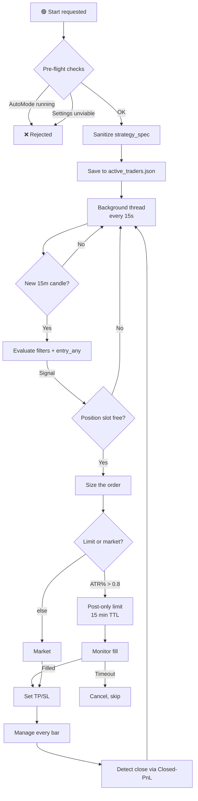

---

### 🏗️ The six modules

The `trading/` package is not one file with everything in it. Each module has a specific responsibility, and the separation is what makes it testable.

| Module | Responsibility | Directly touches |
|---|---|---|
| **`auto_trader.py`** | Orchestrator: main loop, signal routing, position lifecycle, persistence | Everything below |
| **`executor.py`** | Low-level Bybit REST adapter | `pybit.HTTP` |
| **`position_manager.py`** | Position state, TP/SL computation, soft exits, limit-entry finalization | `executor` |
| **`risk_manager.py`** | Daily/monthly loss limits, current-capital tracking | `risk_state.json` |
| **`signal_detector.py`** | `strategy_spec` evaluation on current+prev indicators | `strategy_spec` |
| **`trade_logger.py`** | CSV and HTML logs, weekly rotation, SL updates, optimization records | Disk |


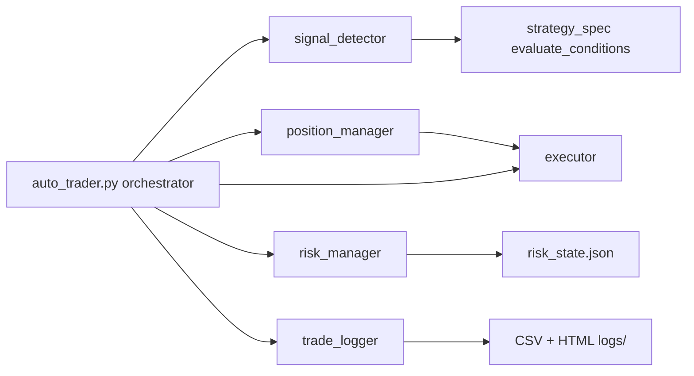

---

### ⚙️ Lifecycle

#### Start — the pre-flight gate

Starting a trader is not a button that flips a boolean. `AutoTraderSymbol.start()` runs **four** checks before a single thread is spawned:

| # ↕▾ | Check ↕▾ | Failure behavior ↕▾ |
|---|---|---|
| −1 | **No AutoMode running** for this symbol | Reject with warning — two loops fighting over one symbol would produce duplicate orders |
| 2 | **Spec sanitization** — fill `max_hold_candles`, `trailing_atr_mult` if missing | Log the exception, continue — sanitization is a nice-to-have, not a gate |
| 3 | **`validate_symbol_settings()`** — will the calculated notional actually clear Bybit's `minNotionalValue` at this leverage? | **Reject the start** — do not spin a loop that will reject every order |
| 4 | **Not already running** | Silent `False` |
⚙

Only after all four pass does `is_running = True`, the config get written to `active_traders.json`, and the daemon thread start.

The 3rd check exists because a trader starting with `position_size_pct × capital × leverage < min_notional` would enter an infinite loop of rejected orders. The pre-check catches it in 200 ms instead of at the first signal (which might be hours later).

#### Loop — 15-second cadence, 4-minute data refresh

The main loop wakes every **15 seconds**. That cadence is for fast position monitoring, not for signal generation:

| Thing | Frequency | Why |
|---|---|---|
| Loop tick | **15 s** | Catch SL/TP and fills quickly |
| Full 15m history fetch | ≤ every **240 s** | ~10-12 REST calls per fetch; more often trips Bybit rate limit (`10006`) |
| Signal evaluation | On new **closed 15m candle** only | Signals on an open candle are lookahead |
| Position management | On new 15m candle only | Breakeven/trailing are per-bar decisions |

Between fetches the loop serves from cache. If the fetch fails and the cache is older than **30 minutes**, the iteration raises `ConnectionError` — the trader survives (see error handling), but stops generating new signals until data returns.

#### Stop — five flavors

| Trigger | Close positions first? | Reason recorded |
|---|---|---|
| User clicks ⏹ | No (`close_positions=False`) | `manual` |
| Daily loss limit hit | **Yes** — `_close_all_positions(reason="daily_loss_limit")` | `daily_loss_limit` |
| 60 consecutive non-network errors | No | `repeated_errors` |
| No `strategy_spec` for the symbol | No | `no_strategy` |
| Insufficient balance on order attempt | No | `insufficient_balance` |

On stop, the symbol is removed from `_active_traders` **and** from `active_traders.json` — it will not auto-restart on the next app launch.

---

### 🛡️ Spec sanitization at start

Before trading begins, `_sanitize_strategy_spec()` closes the two gaps the LLM most often leaves:

| Field | Default | When |
|---|---|---|
| `management.max_hold_candles` | **48** (48 × 15m = 12 h) | If absent or `None` |
| `management.trailing_atr_mult` | **2.0** | Only if the strategy has **no other** management mechanism (no breakeven trigger, no `exit_on_*`, no explicit `max_hold_candles`) |

The second rule has a subtle `had_explicit_max_hold` check: if the model set a time-stop on purpose, that counts as intentional management — trailing is **not** forced on top, because it would silently convert a swing strategy into a scalper and close trades on normal pullbacks.

Every change is logged (`SPEC_SANITIZED`), surfaced in the UI, and written back to `state.json`. Sanitization **never** overwrites an existing value.

---

### 📐 Executor — the Bybit adapter

`trading/executor.py` is a thin wrapper around `pybit`. Its job is not to be clever — it's to be **boring and bulletproof**.

#### Endpoints exposed

| Method | Purpose |
|---|---|
| `get_instrument_info(symbol)` | `tickSize`, `qtyStep`, `minOrderQty`, `maxOrderQty`, `minNotionalValue` |
| `get_wallet_balance()` / `get_usdt_balance()` | UTA 2.0 balance (falls through `availableToWithdraw → walletBalance → equity`) |
| `get_position_info(symbol)` | Open positions for symbol |
| `set_leverage(symbol, leverage)` | Leverage for both sides |
| `switch_margin_mode(symbol, mode)` | Isolated ↔ cross |
| `place_market_order()` | Market order with optional attached TP/SL |
| `place_limit_order()` | Post-only limit |
| `cancel_order()` / `cancel_all_orders()` | Cancel by id / all |
| `get_open_orders()` | Current open orders |
| `get_order_info(order_id)` | Order status by id (with retry) |
| `get_closed_pnl(symbol, limit)` | Closed-PnL records |
| `get_best_bid_ask(symbol)` | Top of book |
| `set_trading_stop()` | Update SL/TP on open position |
| `get_ticker_price()` | Current last price |
| `get_fee_rates(symbol)` | Taker / maker rates (returns **percent**, not fraction) |
| `calculate_position_size(...)` | qty from capital/leverage/price + min-notional check |
| `validate_symbol_settings(...)` | Pre-flight viability check |
| `round_quantity()` / `round_price()` | Round down to step |

#### Three defensive patterns that matter

**1. `get_instruments_info` — three retries with cache fallback**

Bybit testnet periodically returns transient `10016` (Internal System Error) and `10000` (Server Timeout). The adapter retries 3 times with exponential backoff (1s, 2s). If all fail but the cache has data from an earlier successful call, **the cache is used** — `tickSize` and `qtyStep` don't change per instrument, so stale data is fine. Without this, a single blip would make every subsequent order fail.

**2. `set_trading_stop` — `34040` is success, not failure**

When the SL is already set to exactly the requested value, Bybit returns `34040: not modified`. The adapter treats this as success — because the goal (SL is at that price) is achieved. Without this check, the trader would log an error every candle for a position whose SL is already correct.

**3. `calculate_position_size` — checks `minNotionalValue`**

After computing qty from `capital × leverage / entry_price` and rounding to `qtyStep`, the adapter computes `notional = qty × entry_price`. If `notional < minNotionalValue` (default $5 on Bybit), it returns a **specific error** instead of letting Bybit reject the order at placement:

> *"Размер позиции X контрактов (Y USDT) меньше минимальной стоимости ордера Z USDT для {symbol}. Увеличьте выделенный капитал, размер позиции или плечо."*

This is exactly what `validate_symbol_settings` catches at start — same check, but at pre-flight time with current price.

#### `place_limit_order` — PostOnly handling

```
if ret_code == 110016:  # "would be taker"
    return False, {"error": "post_only_rejected", "detail": error}
```

Returns a structured marker so `position_manager.open_position_limit` can retry **one tick deeper** into the book. If the retry also gets rejected, the caller falls back to market.

---

### 🎯 Position manager — TP/SL, soft exits, limit entries

`trading/position_manager.py` owns the position lifecycle.

#### Position snapshot keys

On entry, `SNAPSHOT_KEYS` captures 16 indicators for post-hoc analysis:

```
close, rsi_14, adx_14, volume, avg_volume_96, avg_volume_20,
sma_20, sma_50, macd, macd_signal, macd_hist, atr_14, vwap,
pivot, resistance_1, support_1
```

These land in `trade.entry_snapshot` — the same diagnostic gold as the backtest engine's snapshot.

#### TP/SL computation — with hard safety caps

`_compute_tp_sl()` prefers ATR (specifically `atr_14_4h` for swing strategies, `atr_14` otherwise), falls back to percentages, but then applies **two hard limits**:

| Cap ↕▾ | Value ↕▾ | Why ↕▾ |
|---|---|---|
| −**`MAX_STOP_PCT`** | **2.5%** from entry | ATR can spike 10-20× on OHLCV outliers (especially testnet); an uncapped SL would be absurd |
| **`MAX_TAKE_PCT`** | **10.0%** from entry | Same reason, opposite side |
⚙

Both caps preserve the direction (long SL still below entry, etc.) — they just clamp the distance. The computation then rounds to `tickSize` via `executor.round_price()`. Without rounding, Bybit would reject `set_trading_stop` and the position would be left **without any protection at all**.

#### Soft exits vs hard exits

The module distinguishes sharply between two kinds of exit:

| Exit type | Who executes it | Detection path |
|---|---|---|
| **SL / TP** | **Bybit** (order is on the exchange) | Detected via `get_position_info` (position vanishes) |
| **Time / level / trend / macd** | **This process** (reduce-only market order) | `check_soft_exit()` → `_close_by_soft_exit()` |

`check_soft_exit()` is the public entry for soft exits and is called from `auto_trader._apply_live_management()`. It is **separate from `_check_exit()`** because `_check_exit` includes hard exits (used in backtest and unit tests), while live trading must **never** re-evaluate a hard SL that the exchange is already enforcing.

Time-stop in live trading:

```
def _compute_bars_held(pos, row):
    entry_dt = _to_dt(pos.get("entry_candle_ts"))
    curr_dt  = _to_dt(row.get("timestamp"))
    if entry_dt is None or curr_dt is None:
        return None
    return int(((curr_dt - entry_dt).total_seconds() / 60.0) // 15)
```

`bars_held` is computed from `entry_candle_ts` (the timestamp of the **signal bar**, not the fill time) — because `max_hold_candles` in the spec is measured from signal, matching the backtest engine.

#### Limit entry lifecycle

`open_position_limit()`:

1. Verify no existing exchange position — refuse if one exists (`position_already_exists_on_exchange`)
2. Get best bid/ask via `get_best_bid_ask()`
3. For long: `limit_price = best_bid + offset_ticks × tick_size`; for short: `best_ask - offset_ticks`
4. Place post-only limit
5. If rejected as `110016` (would be taker): move 1 tick deeper and retry once
6. Return `(True, order_id, limit_price)` — the position is **not yet in `self.positions`**

The actual position only enters state after `finalize_limit_entry()` runs, which happens when `auto_trader._monitor_pending_limit_orders()` sees the order filled.

#### `sync_with_exchange` — orphans only, no deletions

The single most important asymmetry: `sync_with_exchange` **adds** orphan positions (found on exchange but not locally) but never **removes** local ones. Removal is the job of `_detect_closed_positions`, which knows how to log CLOSE events and pull Closed-PnL records. Doing removal here would silently drop trades from the journal.

---

### 💰 Risk manager — capital tracking with live recalc

`trading/risk_manager.py` is deliberately simple in concept and rigorous in detail.

#### The current-capital rule

Limits are calculated from `current_capital`, **not** `initial_capital`:

```
pnl_usdt = position_value_usdt * (pnl_pct / 100.0)
self.current_capital += pnl_usdt
```

So if a coin starts with 300 USDT and loses 30, the next daily limit is calculated against 270, not 300. This is the "drawdown from current, not from start" model — it never lets a losing streak compound into a killing blow.

#### The settings-change detection

When a user changes `capital_share_pct` (or anything else that changes `allocated_capital`), the persisted `initial_capital` in `risk_state.json` no longer matches what the constructor receives. `_load_state` handles it:

```
delta = float(self.initial_capital) - float(stored_initial)
self.current_capital = float(stored_current) + delta
```

Meaning: **accumulated P&L is preserved, base is rebased**. If you had 100 base, 105 current, and you double the allocation to 200, you get 205 current. Without this, changing settings would silently reset your P&L history.

#### Thread safety

`_state_file_lock = threading.Lock()` serializes file access across symbols. Without it, two traders finishing a trade simultaneously could both read `risk_state.json`, both write their own version, and one symbol's update would be lost. The lock is module-level because the file is shared.

Atomic write via `tmp.replace(STATE_FILE)`.

#### Two flags, one reset each

| Flag ↕▾ | Set when ↕▾ | Reset when ↕▾ |
|---|---|---|
| −`daily_stop_triggered` | `should_stop_daily()` fires | New UTC day (in `_check_rollover`) |
| `monthly_optimization_triggered` | `should_optimize_monthly()` fires | New month (in `_check_rollover`), or `reset_monthly_optimization_flag()` |
⚙

The flags prevent the same trigger from firing on every loop iteration. `reset_monthly_optimization_flag` exists so a *second* optimization in the same month can trigger if the loss continues after the first — the auto-trader's `_run_optimization` doesn't reset it, but it can be reset externally if the situation demands.

---

### 🔍 Signal detector

`trading/signal_detector.py` is deliberately minimal — 90 lines that do exactly one thing:

```
if filters and not evaluate_conditions(filters, current, prev):
    return []

matched_long = _check_entry(long_spec, current, prev)
if matched_long is not None: signals.append(...)

matched_short = _check_entry(short_spec, current, prev)
if matched_short is not None: signals.append(...)
```

`_check_entry` mirrors `backtest_engine._entry_signal` **exactly**:

1. If `entry_any` is a non-empty list → try each group, return first that passes
2. Else if `entry` is a non-empty list → return it if it passes
3. Else return `None`

This is not coincidence. The backtest engine and the live detector share the same evaluation semantics, so a strategy that backtests with 100 trades will produce exactly the same signals live. Any drift between them would invalidate every backtest result — which is why this module exists at all, rather than the detector logic being inline in `auto_trader`.

---

### 📝 Trade logger — weekly rotation with searchable HTML

`trading/trade_logger.py` writes four CSV files and two HTML files per symbol per week.

#### Rotation

Files rotate **weekly** by ISO week, not monthly:

```
data/auto_trading/logs/{SYMBOL}_trades_2026_W44.csv
data/auto_trading/logs/{SYMBOL}_events_2026_W44.csv
data/auto_trading/logs/{SYMBOL}_events_2026_W44.html
data/auto_trading/logs/{SYMBOL}_sl_updates_2026_W44.csv
data/auto_trading/logs/{SYMBOL}_optimization_2026_W44.csv
```

Week suffix: `_week_suffix()` returns `f"{iso.year}_W{iso.week:02d}"`. New file created automatically at week boundary — no manual cleanup, no CSV growth past what a text editor can open.

#### The CSV files

| File | One row per | Columns |
|---|---|---|
| `_trades_` | Closed trade | timestamp, position_id, entry/exit time, direction, prices, qty, position_value_usdt, result_pct, pnl_usdt, exit_reason, stop_loss, take_profit, **initial** stop/take, entry_reasons, entry_type |
| `_events_` | Event | timestamp, event_type, message, details |
| `_sl_updates_` | SL move | timestamp, position_id, direction, old_sl, new_sl, delta, reason, extra (JSON) |
| `_optimization_` | Optimization run | timestamp, trigger_reason, iterations, test_* metrics, holdout_* metrics, new_strategy_saved, notes |

The `initial_stop_loss` / `initial_take_profit` columns are essential — the current `stop_loss` in a trade row might have moved three times via trailing, and the initial value is what tells you whether the *thesis* had room.

The `sl_updates` file exists separately because it would otherwise turn `trades` into a many-to-one relationship. If a trader moves SL 40 times on one position, the trade row is still one row, and the 40 SL moves are their own CSV with `position_id` linking back.

#### The HTML events log

The `_events_*.html` file is what makes the log actually readable. It renders every event with:

- **Colour classification** — `OPEN` is green, `CLOSE_LOSS` is red, `SIGNAL_CHECK` is purple, `MGMT` is teal, `NETWORK` is orange
- **Filter panel** — a sticky header with a date picker and event-type dropdown, wired to client-side JavaScript
- **Group separators** — a visual divider is inserted when the `group` key changes. `auto_trader._log_event()` passes `str(self.last_candle_time)` as `group`, so all events from the same 15m bar (filters + LONG + SHORT + signal detail) collapse into one visual block
- **`<pre>` rendering for details** — `SIGNAL_CHECK` diagnostics keep their formatting with `\n` and multiple conditions

The filter panel calls `applyFilters()`, which walks the DOM once and hides both non-matching events and empty group separators. `collectEventTypes()` on `DOMContentLoaded` populates the dropdown from the actual event types present.

#### What "one line" really looks like

A `SIGNAL_CHECK` event for a candle that fired short looks like this in the HTML:

```
2026-11-02 14:00:00 UTC   ──────────────────────────────────

SIGNAL_CHECK  SHORT: SIGNAL
SHORT ENTRY: 6/6 условий
  PASSED: drop_2_atr(-2.41) < -2.0;
          volume(1840) > avg_volume_96(750)*2.0;
          close(0.9847) < low_32(0.9862)
  ... (ещё 3)

ORDER placed: SHORT 42 @ 0.9847 (Post-Only)
```

All five events (FILTERS, SHORT SIGNAL, ORDER) share the same `group` (`2026-11-02 14:00:00`) and appear under one separator. Without the group key they would be five separate dividers and the story would be unreadable.

---

### 🎯 Order sizing and entry

#### Sizing

```
allocated_capital = total_capital × capital_share_pct / 100
position_value    = allocated_capital × position_size_pct / 100
qty               = position_value × leverage / entry_price
```

Then rounded to `qtyStep` **down** (never up — rounding up would exceed the intended size). If resulting `notional < minNotionalValue`, the specific reason is logged and the signal is skipped with a `warning`-level notification.

#### Market vs limit

`_should_use_limit_entry()` reads the current ATR as a percentage of price:

| Condition ↕▾ | Entry type ↕▾ | Fee ↕▾ |
|---|---|---|
| −`atr / close × 100 > 0.8%` | **Post-only limit** | Maker (~0.02%) |
| else | **Market** | Taker (~0.055%) |
⚙

The 0.8% threshold is a heuristic for volatility regime: on slow 15m strategies, a limit order placed near the current price is likely to fill and saves meaningful fees. On volatile moves, an unfilled limit order is just a missed trade — so market is safer.

#### Limit order monitoring

Every open limit order lives in `_pending_limit_orders` and is polled each loop iteration:

| Exchange status ↕▾ | Action ↕▾ |
|---|---|
| −`New`, `PartiallyFilled` | Keep waiting |
| `Filled` | Call `finalize_limit_entry()` with the actual filled qty and `avgPrice`, then place TP/SL |
| `Cancelled` | Drop the order, log `ORDER_CANCELLED` |
| **Age > 900 s** | Cancel via `executor.cancel_order()`, log `ORDER_TIMEOUT` |
⚙

At app restart, **any** pending limit orders in state are automatically cancelled — the code does not trust that the market context or spec are still the same after a restart, and would rather miss a trade than reopen one on stale reasoning.

---

### 🎯 Position management while open

Every closed 15m candle, for every non-orphan position, `_apply_management_to_position()` recomputes the stop and pushes an update to the exchange if it moved.

#### Breakeven

When price has travelled `move_to_breakeven_at_tp_pct` of the way to TP, the stop jumps to `entry × (1 ± breakeven_offset_pct / 100)`. The offset exists to cover round-trip commission — a "breakeven" stop at exactly entry is still a small loss after fees.

Only moves in the favourable direction. A breakeven that has already been set cannot be given back.

#### ATR trailing

```
long:  new_sl = close − trailing_atr_mult × atr_14
short: new_sl = close + trailing_atr_mult × atr_14
```

Applied only if it tightens the stop (long: raises it; short: lowers it). `None` disables it. If both breakeven and trailing fire on the same bar, the tighter of the two wins.

#### Four guards before sending `set_trading_stop`

These are not decorative — each one corresponds to a real Bybit failure mode:

| Guard ↕▾ | Reason ↕▾ |
|---|---|
| −**`tickSize` must be available** | If missing, we skip the bar rather than send an unrounded SL that Bybit will reject — better to try again on the next candle than to lie in the UI that the SL was updated |
| **Round first, then compare** | Comparing raw `88.8798` against `88.88` before rounding caused Bybit to see no change on the rounded value and respond `34040` every bar. Now we compare the rounded value |
| **SL must be on the correct side of price** | `10001` is Bybit's "wrong side" error. We check `new_sl < close` (long) / `new_sl > close` (short) using the candle's close as a price proxy — no extra ticker request |
| **TP is untouched** | Only the stop is updated; the take profit set at entry stays fixed |
⚙

Every successful stop update is written to `sl_updates` CSV with a `position_id` and a `reason` field (`breakeven`, `trailing`, or `breakeven+trailing`) — so a post-mortem can unambiguously link every SL move to a specific trade.

#### Soft exits

Separately from SL/TP, `check_soft_exit()` can trigger an immediate market close:

| Exit | Long | Short |
|---|---|---|
| `time_stop` | `bars_held >= max_hold_candles` | same |
| `level_failure` | `close < level × (1 − buffer)` | `close > level × (1 + buffer)` |
| `trend_loss` | `close < sma_50` | `close > sma_50` |
| `macd_flip` | `macd_hist < 0` | `macd_hist > 0` |

Each is individually switchable and **off by default** in `default_strategy_spec()`. When triggered, `_close_by_soft_exit()` sends a reduce-only market order and registers the trade exactly like a normal close — including the cooldown bookkeeping.

---

### 💰 PnL, fees and Closed-PnL matching

Bybit's `closedPnl` field **does not include trading fees**. The live code therefore subtracts them manually:

```
pnl_pct -= 2.0 * self._taker_fee_pct   # entry + exit
```

The taker fee itself is not hardcoded — `_setup_leverage()` calls `executor.get_fee_rates(symbol)` and stores the real value from your account (as a percentage, not fraction). If that call fails, a conservative default of **0.055%** is used and the discrepancy is logged.

#### Closed-PnL record matching

When the exchange reports a position gone (size < 50% of the local qty), `_register_closed_position()` finds the matching Closed-PnL record:

| Filter ↕▾ | Rule ↕▾ |
|---|---|
| −**Side** | `Buy` for a long, `Sell` for a short |
| −**Qty ratio** | Within ±50% of the local qty |
| −**Timestamp** | Not earlier than `entry_time − 60s` |
| **Dedup** | `orderId` must not already be in `_consumed_closed_pnl_ids` |
⚙

If the best match is found, real `closedPnl`, `avgExitPrice` and `avgEntryPrice` are used. If not, the code falls back to ticker price — a degraded but honest result, reflected in the log.

The `_consumed_closed_pnl_ids` set is **persisted** across restarts. Otherwise a network outage that closed a trade while the bot was offline could cause the same Closed-PnL record to be counted twice on the next launch.

#### Exit reason inference

The exchange does not say *why* a position closed. `_infer_exit_reason()` compares the exit price to known levels:

| Exit price ≈ ↕▾ | Reason ↕▾ |
|---|---|
| −Current `stop_loss`, and ≈ entry (±0.2%) | `breakeven` |
| −Current `stop_loss`, not ≈ entry | `stop_loss` |
| Current `take_profit` | `take_profit` |
| Neither | `manual_or_other` |
⚙

The 0.2% tolerance for breakeven detection matters: when trailing raises SL to exactly `entry × (1 + 0.001)`, an exit there looks like `stop_loss` to a naive comparison. The tolerance makes it classify as `breakeven`, which is what the user expects to see.

---

### 🛑 Risk limits

Three independent stopping mechanisms, all enforced by the trader itself:

#### Daily loss limit

Triggered by `risk_manager.should_stop_daily(unrealized)`. It counts **realized + unrealized** — an open position deep in loss can trip it before the position closes.

On trigger:

1. `_close_all_positions(reason="daily_loss_limit")`
2. `stop(reason="daily_loss_limit")`
3. Red notification: *"Позиции закрыты, торговля остановлена. Для возобновления нажмите «Начать торговлю»"*

The symbol does **not** resume on its own. Daily limit requires manual acknowledgement — the whole point is that the operator sees it.

#### Monthly loss limit → auto-optimization

Triggered by `should_optimize_monthly()`. This is a softer stop:

1. `is_optimizing = True`
2. Open position monitoring continues — existing trades are not abandoned
3. A **background thread** runs `backtest_optimizer.run()` over `optimization_days_back` of history with `optimization_iterations` and `walk_forward_folds`
4. The result is passed to `save_best_to_memory=True` — if a better strategy wins, it lands in the symbol's `state.json`
5. `is_optimizing = False` and the loop resumes, either with the improved spec or the old one

The design goal: a losing month should not just halt trading, it should trigger the system to *learn*. But it also never blocks the trader — monitoring keeps running, and the optimization is off-thread.

The optimization result is also logged to `optimization_YYYY_Www.csv` via `trade_logger.log_optimization()`, so the log has both the trigger event and the outcome.

#### Cooldown after losing streak (from `risk_controls`)

Same logic as `backtest_engine._should_pause_after_loss()`:

```
"risk_controls": {
  "enabled": true,
  "max_consecutive_losses": 4,
  "pause_candles_after_losses": 32,
  "max_losses_in_window": 6,
  "loss_window_trades": 10
}
```

Two triggers, same as backtest: N losses in a row, or M losses in the last K trades. When tripped, `_cooldown_remaining = pause_candles_after_losses`, and `_process_signals()` decrements it each candle and returns early — no entries during cooldown.

The cooldown state is persisted with the position state, but with a **24-hour staleness cutoff**:

> If the bot was off for more than 24 hours, `consecutive_losses`, `recent_loss_flags` and `cooldown_remaining` are reset on load. The reasoning: cooldown ticks in candles, and when the bot is off, candles aren't being counted — so a three-day-old cooldown "remaining 90 candles" is meaningless, and a "3 losses in a row" from last week is not a streak any more.

---

### 🔁 Persistence and restart recovery

The trader's entire state survives an app restart through a single JSON file:

```
data/auto_trading/positions/SOLUSDT.json
```

Contents:

| Key ↕▾ | Purpose ↕▾ |
|---|---|
| −`positions` | Full position list with all management state, SL/TP, entry snapshots |
| −`pending_limit_orders` | Open limit orders (auto-cancelled on load) |
| −`consumed_closed_pnl_ids` | Dedup set for Closed-PnL matching |
| −`risk_controls_state` | `consecutive_losses`, `recent_loss_flags`, `cooldown_remaining` |
| `saved_at` | ISO timestamp — drives the staleness check |
⚙

The write is atomic: `.json.tmp` → `os.replace()`. A crash mid-write cannot leave a corrupt state file.

On load:

1. Positions are validated for required fields (`position_id`, `direction`, `entry_price`, `qty`, `stop_loss`, `take_profit`, `entry_time`). Invalid records are skipped with a warning.
2. Restored positions are **not** marked orphan — they're ours, with real exchange SL/TP.
3. Consumed Closed-PnL IDs are restored.
4. `risk_controls_state` restored only if `saved_at` is fresh (< 24h).
5. Every saved `bybit_order_id` is checked once against the exchange. Any that is `Cancelled`, `Rejected` or `Deactivated` produces a `STATE_WARNING` — the user is told to check the position manually.

Separately, `active_traders.json` remembers which symbols were trading. `nicegui_app._restore_auto_traders()` reads it at app start (with a 10s timer, to let services warm up) and re-instantiates each trader with its saved config.

---

### 🚨 Error handling — the most important design decision

The loop distinguishes two kinds of failures and treats them completely differently:

#### `ConnectionError` — network failure

| Behavior ↕▾ |
|---|
| −Trading does **not** stop |
| −Exponential backoff: 15 → 30 → 60 → 120 → 240 → 300 → 300 s cap |
| `_non_network_errors` reset to 0 (so a network blip doesn't "count" toward the bug threshold) |
| Existing positions continue to be managed whenever the connection returns |
⚙

The logic: a network failure is not a bug in your strategy — it's the internet being the internet. Stopping the trader because Binance had a hiccup would be worse than useless, because the open positions would then be unattended. The trader should keep trying forever, backoff politely, and recover.

#### Any other `Exception` — a bug

| Behavior ↕▾ |
|---|
| −`_non_network_errors += 1` |
| −Logged with full traceback |
| −Sleep 60 s, retry |
| −**After 60 consecutive non-network errors**, the trader stops itself with a red notification |
⚙

The logic: if the code is broken, retrying forever will just fill the log. Sixty errors gives ample time for a transient issue to resolve (a payload shape change, a one-off parse error) while still catching a real bug within about an hour.

This is the difference between a resilient system and an annoying one.

---

### 📊 UI state and heartbeat

`get_state()` returns everything the Auto Trading page renders:

| Group ↕▾ | Fields ↕▾ |
|---|---|
| −Lifecycle | `is_running`, `is_optimizing`, `status_message` |
| Heartbeat | `last_iteration_utc`, `last_candle_time`, `last_price`, `last_indicators_summary`, `candles_processed`, `_last_iteration_ts` |
| Positions | `open_positions`, `allocated_capital`, `current_capital` |
| PnL | `daily_pnl`, `daily_pnl_pct`, `monthly_pnl`, `monthly_pnl_pct` |
| Limits | `daily_loss_limit`, `monthly_loss_limit` |
| Log | `log_lines[-20:]` |
⚙

The **`_last_iteration_ts`** field is what the UI uses for its stale-check: if a trader shows `is_running = True` but `now − _last_iteration_ts > 120 s`, the UI flips the status to 🟡 *"Нет данных (ошибка сети?)"* — because a live trader that hasn't ticked in two minutes is not healthy, no matter what the boolean says.

---

### 🔍 Signal diagnostics — and where they end up

One feature that pays for itself the first time something doesn't fire.

Every candle, `_log_signal_diagnostics()` writes a full block:

```
SIGNAL_CHECK [group = 2026-11-02 14:00 UTC]
FILTERS: PASSED
  adx_14(24.3) > 18

LONG: NO SIGNAL
  LONG ENTRY: 4/6 условий
  PASSED: close(1.2345) > sma_50_1h(1.2100);
          macd_hist(0.0012) > 0;
          rsi_14(58.2) in [45, 65];
          volume(1200) > avg_volume_96(1050)*1.1
  FAILED: close(1.2345) > resistance_1(1.2400);
          low(1.2290) <= resistance_1*1.003(1.2437)

SHORT: NO SIGNAL
  ...
```

Every event is written to **both** `events.csv` and `events.html`. In the HTML, all events for the same candle share a `group` key, so the whole block collapses visually into one purple section — no more scrolling through a wall of `SIGNAL_CHECK` spam to find the one that fired.

---

### 🧯 Orphan positions

A position that exists on the exchange but not in the local state file — after a crash, a manual open from another device, or a state file that got wiped — is an **orphan**.

| Behavior |  |
|---|---|
| **Synced in** by `position_manager.sync_with_exchange()` | So `open_positions` in the UI reflects reality |
| **Not managed** — `_apply_live_management` skips `is_orphan = True` | There are no real SL/TP to manage; forcing trailing on a position of unknown origin could compound the problem |
| **Detected as closed** normally | Once the exchange reports size back to 0, it's logged like any other close |
| **`tpsl_error = "external_position_detected"`** | Marks the source clearly in state.json |

So an orphan does not go unmanaged forever *by accident* — it goes unmanaged *by design*, so the user sees it and decides, rather than the bot guessing what to do with a trade it didn't open.

---

### 🧱 Constants that shape behavior

| Constant ↕▾ | Value ↕▾ | Source ↕▾ | Why this number ↕▾ |
|---|---|---|---|
| −`MAX_POSITIONS_PER_SYMBOL` | **1** | `auto_trader.py` | No pyramiding; one thesis per coin |
| `NETWORK_RETRY_LIMIT` | **60** | `auto_trader.py` | Bug threshold — below this, transient noise; above, unfixable loop |
| `DATA_FETCH_MIN_INTERVAL_SEC` | **240 s** | `auto_trader.py` | Below Bybit rate limit with margin |
| `DEFAULT_TRAILING_ATR_MULT` | **2.0** | `auto_trader.py` | Standard trend-follow distance |
| `DEFAULT_MAX_HOLD_CANDLES` | **48** (12 h) | `auto_trader.py` | Stale thesis threshold |
| `RISK_CONTROLS_MAX_STALENESS_HOURS` | **24** | `auto_trader.py` | Cooldown that old isn't a cooldown |
| Loop sleep | **15 s** | `auto_trader.py` | Fast enough for SL/TP, slow enough for rate limit |
| Backoff cap | **300 s** | `auto_trader.py` | 15 → 30 → 60 → 120 → 240 → 300 |
| Limit entry TTL | **900 s** (15 min) | `auto_trader.py` | One candle of acceptance |
| Limit entry ATR gate | **0.8%** | `auto_trader.py` | 15m-range vs 4h-range heuristic |
| `MAX_STOP_PCT` (executor cap) | **2.5%** from entry | `position_manager.py` | ATR-outlier safety |
| `MAX_TAKE_PCT` (executor cap) | **10.0%** from entry | `position_manager.py` | Same |
| `get_instruments_info` retries | **3** with 1s/2s backoff | `executor.py` | Testnet transient errors |
| Default taker fee | **0.055%** | `executor.py` | Fallback if `get_fee_rates` fails |
| Default `minNotionalValue` | **5.0 USDT** | `executor.py` | Bybit default for linear |
⚙

---

### ✅ What makes auto trading trustworthy

| Property | How it's achieved |
|---|---|
| **Deterministic sizing** | Explicit formula, `qtyStep` rounding **down**, `minNotionalValue` check with reason |
| **Same risk math as backtest** | `risk_controls` logic duplicated line-for-line from `backtest_engine._should_pause_after_loss` |
| **Same PnL math as backtest** | Taker fee subtracted exactly as in `_close_position` |
| **Same signal eval as backtest** | `signal_detector._check_entry` mirrors `backtest_engine._entry_signal` |
| **No same-bar cheating** | Signals only on **closed** candles |
| **No duplicate trade logging** | Persisted `consumed_closed_pnl_ids` |
| **No double position management** | `_last_managed_candle_ts` guard per position |
| **No silent order failures** | Every rejected order, every failed SL update, every timeout is logged with a reason |
| **No silent ATR blowups** | `MAX_STOP_PCT` / `MAX_TAKE_PCT` caps prevent 20% SL from a single spiking bar |
| **No silent unrounded SL** | `tickSize` guard skips the bar rather than send an unrounded value that Bybit would reject |
| **Survives the internet** | Network errors never stop trading; backoff bounded and polite |
| **Survives restarts** | Full state on disk, atomic writes, graceful recovery of positions, orders, cooldowns, dedup set |
| **Survives settings changes** | `current_capital` rebased with `initial_capital` delta, P&L preserved |
| **Never bets against itself** | AutoMode conflict blocked at start; daily limit forces manual re-entry |
| **Every move is traceable** | `sl_updates` CSV links every SL change to a `position_id`; `trades` CSV carries initial and current SL/TP |

The result is a system where, if a trade happens, you can reconstruct exactly why — from the signal log, through the spec, into the position state file, down to the Closed-PnL record that matched it. That traceability is the whole point of splitting reasoning from execution.

---

### 🎯 The daily life of a live trade

A single position, end to end:

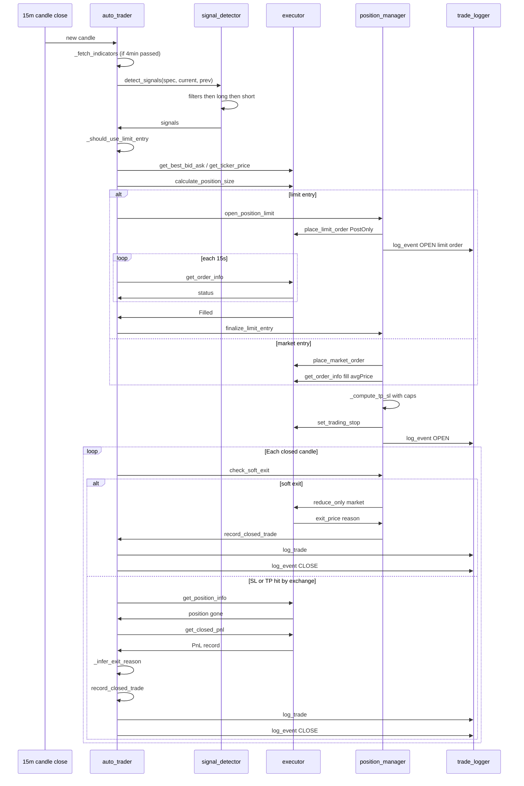

Every arrow in that diagram is a place where something could go wrong. The value of `trading/` being five focused modules instead of one 2500-line file is that each arrow has exactly one owner, and when something fails, you know exactly which module to look at.

---


---
<div align="center">
<sub>Last updated: 2026-11-02 · Sections 2–6 to be added</sub>
</div>
