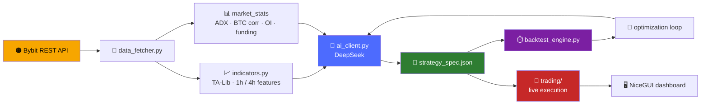
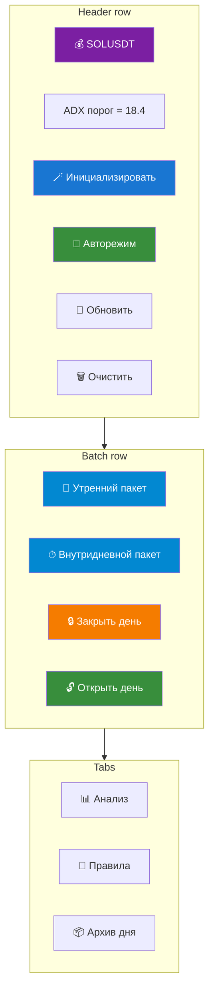
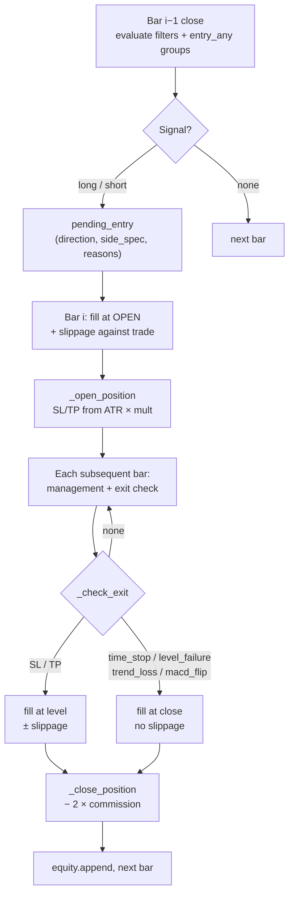
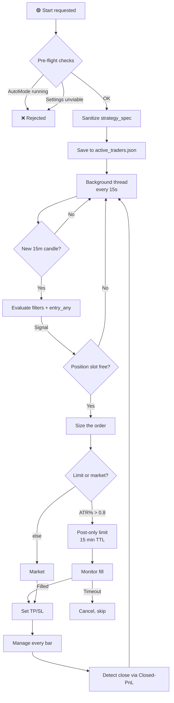

# 🧠 Crypto Trading System

> **LLM-driven strategy generation. Deterministic execution. Zero lookahead.**


---

## 📑 Table of Contents

| # | Section | What you'll find |
|---|---------|------------------|
| **1** | [🔭 Project Overview](#1-project-overview) | What the system is, how the pipeline works, what has been built |
| **2** | [🪙 Coin Pages](#2-coin-pages) | Full walkthrough of a single coin's page — every panel and action |
| **3** | [💬 AI Chat](#3-ai-chat) | Conversational interface and the complete toolset the model can call |
| **4** | [📊 Backtesting](#4-backtesting) | Replaying a strategy over history — inputs, execution model, outputs |
| **5** | [🧪 Lab](#5-lab) | Research and optimization workspace — experiments, regimes, iteration |
| **6** | [🤖 Auto Trading](#6-auto-trading) | Live signals, risk controls, order execution, position tracking |

---

<a id="1-project-overview"></a>
## 1. 🔭 Project Overview

### 💡 What it is

An **autonomous crypto trading system for Bybit linear perpetuals**, written in Python, built around one central principle:

> *Let a large language model do the reasoning, but never let it touch the money directly.*

The LLM (DeepSeek) studies the market, writes trading rules in plain language, and — crucially — emits a **machine-readable strategy specification** in strict JSON. Everything that decides whether a trade happens or how it is closed is executed by a deterministic engine that only understands that JSON. **The model proposes; the engine disposes.**

This separation is what makes the system testable. A strategy invented by the model for XRP can be replayed over years of 15-minute candles in seconds, scored, rejected, rewritten, and re-scored — without a single order ever reaching the exchange.

---

### ⚙️ How it works



#### 1️⃣ Data Acquisition — `data_fetcher.py`

Fetches **15m and 1h klines** with paginated backfill and exponential-backoff retries, plus orderbook depth, aggregated public trades, open interest, funding rate, long/short ratio and the Fear & Greed index.

On top of raw candles it precomputes `market_stats`:

- 24h volume and price change
- Open-interest delta
- **Adaptive ADX threshold** derived from the last five days of 1h data (clamped to **12–30**)
- **BTC correlation** over 24h returns, with a 15-minute cache so six symbols don't hammer the API six times

Three package flavours exist:

| Package ↕▾ | Window ↕▾ | Purpose ↕▾ |
|---|---|---|
| −`morning_package` | Wide (2 days, up to 64×15m candles) | Full context analysis at the start of a session |
| −`intraday_package` | Tighter (8h, up to 30×15m candles) | Periodic re-evaluation during the day |
| −`intraday_light` | Minimal (2 candles + fresh stats) | Validating a pending setup or babysitting a position at a fraction of the token cost |
⚙

#### 2️⃣ Indicator Layer — `indicators.py` + engine

TA-Lib for SMA 20/50, RSI 14, ATR 14, Bollinger Bands, MACD, ADX. Daily-reset VWAP. Classic pivot levels computed from the **previous** day, never the current one.

1h candles are resampled from 15m and their features merged back with `merge_asof` — filtering strictly on `*_1h` columns, because merging the hourly OHLCV would silently freeze the 15m close inside each hour and corrupt every trailing stop.

A **4h layer** adds ATR, velocity in ATR units, close position and a candle-boundary flag.

Purpose-built series round it out:

- `low_32` / `high_32` — 32-bar breakout extremes (shifted to avoid lookahead)
- `drop_2_atr` — 2-candle momentum in ATR units
- `activity` — volume ratio × ATR ratio

#### 3️⃣ AI Layer — `ai_client.py`

| Method ↕▾ | Role ↕▾ |
|---|---|
| −`init_symbol` | Runs up to **5 iterations** in which the model may call a `web_search` tool to research a coin, then is forced to return JSON |
| −`analyze` | Requests structured JSON with `response_format`; auto-corrects any timeframe the model invented that isn't in the data |
| −`optimize_strategy` | Takes a TRAIN/TEST backtest summary and returns a revised spec — with hard guardrails injected into the prompt (see below) |
| −`revise_init_strategy` | Rebuilds a spec after a sanity backtest |
| −`chat_with_tools` | Multi-turn tool-calling loop for the interactive chat |
⚙

**Guardrails injected automatically:**

- If test profit factor already exceeds **1.1**, the entry logic is **frozen** — only filters, management and ATR multipliers may change
- If there are **fewer than 30 trades**, the model is required to build `entry_any` OR-groups instead of piling conditions onto a single entry

Every response passes through `_safe_json_loads` — a tolerant parser that strips markdown fences, comments and trailing commas before falling back to `json_repair`.

#### 4️⃣ Strategy Specification — `strategy_spec.py`

The **contract** between model and engine. Each side (`long` / `short`) declares:

| Field ↕▾ | Purpose ↕▾ |
|---|---|
| −`entry` or `entry_any` | A list of AND-groups (OR-combined) |
| −`stop_loss_atr_mult` / `take_profit_atr_mult` | ATR-based risk, with percentage fallbacks |
| −`management` | Breakeven trigger, ATR trailing, max hold candles, optional exits on level failure / trend loss / MACD flip |
| −`filters` | Global filters applied to both sides |
| −`risk_controls` | Cooldown after losing streaks |
⚙

**Six condition primitives:** `compare`, `cross`, `range`, `volume`, `slope`, `distance`.

Validation is **opinionated**: every entry group must contain a volume filter, a trend filter and a level-or-momentum confirmation, and both a stop and a take profit must exist — a model that forgets them gets its spec rejected outright and replaced by the default.

#### 5️⃣ Backtest Engine — `backtest_engine.py`

| Rule ↕▾ | Detail ↕▾ |
|---|---|
| −**Signal timing** | Signals are evaluated on the close of bar *i* and filled at the **open of bar *i+1*** — no same-bar cheating |
| −**Slippage** | **0.05%** against the trade on entry and on SL/TP fills; deliberately **not** on soft exits (which execute at an already-observed close) |
| −**Commission** | 0.055% per side |
| −**Position management** | Runs every bar; SL/TP checked intrabar by high/low |
⚙

**Outputs:** full trade list with entry snapshots (RSI, ADX, ATR, pivots at the moment of entry), equity curve, and stats — win rate, profit factor, expectancy, max drawdown, average win/loss, long/short split, cooldown activation counters.

#### 6️⃣ Live Execution — `trading/`

Signal detection, risk management, position management, order execution and trade journaling. Positions and risk state are persisted as JSON under `data/auto_trading/`.

Order routing and data sourcing are gated by **two independent flags**:

| Flag ↕▾ | Controls ↕▾ |
|---|---|
| −`BYBIT_TESTNET` | Where **orders** go |
| −`BYBIT_DATA_TESTNET` | Where **candles** come from |
⚙

This lets signals be validated on real mainnet history while orders still go to testnet.

---

### 🧩 Core components at a glance

| File ↕▾ | Lines ↕▾ | Responsibility ↕▾ |
|---|---|---|
| −`config.py` | ~110 | Paths, API keys, symbols, candle limits, slippage, testnet flags |
| −`data_fetcher.py` | ~775 | Bybit REST: klines, orderbook, trades, fundamentals, news, precomputed stats |
| −`indicators.py` | ~478 | TA-Lib wrappers, 1h/4h resampling, volume profile, pivots |
| −`ai_client.py` | ~856 | DeepSeek client: init, analyze, optimize, revise, chat |
| −`strategy_spec.py` | ~604 | Strategy DSL: evaluator, validator, defaults, explainer |
| −`backtest_engine.py` | ~865 | Deterministic simulation with slippage, commissions, management |
| −`data_loader.py` | ~226 | Offline CSV loader for `backtest_data/` |
| −`trading/` | — | Live execution: signals, risk, positions, orders, journal |
⚙

---

### ✅ What has been built

- 🪙 **Multi-symbol configuration** — 6 linear perpetuals, each with its own state, rules, journals and archives
- 📡 **Three data-package tiers** tuned for token economy, plus precomputed market statistics and adaptive thresholds
- 📜 **A validated, versionable strategy DSL** with mandatory risk filters and engine-side defaults that fill in whatever the model omits
- 🔁 **A full AI loop** — initialize → sanity backtest → revise → optimize → deploy — with anti-overfitting restrictions injected automatically
- ⏱️ **A lookahead-free backtest engine** with slippage, commissions, position management and loss-streak cooldown
- 💾 **An offline data path** reading yearly 15m CSVs (2023–2026) — enabling long-horizon research without touching the exchange
- 🖥️ **A NiceGUI dashboard** for monitoring, chatting with the model, running backtests and controlling auto-trading

---

### 🎯 Design principles

| Principle ↕▾ | Why it matters ↕▾ |
|---|---|
| −**Separation of reasoning and execution** | The LLM is creative but unreliable; the engine is dumb but exact. Each does what it's good at |
| −**Zero lookahead** | Every indicator is shifted, every pivot uses yesterday's data, every entry fills on the next bar. Backtest results mean something |
| −**Explicit risk contract** | No entry without a volume filter, a trend filter, a level confirmation, a stop and a take profit |
| −**Token economy** | Three package sizes, precomputed stats, trimmed context — so a real trading loop runs on a real API budget |
| −**Deterministic replay** | Same JSON + same data = same trades. Every time |
⚙

---

### 🔧 Technology stack

| Layer ↕▾ | Choice ↕▾ |
|---|---|
| −Language | **Python 3.10+** |
| −Exchange | **Bybit** (via `pybit`) |
| −LLM | **DeepSeek** (via `openai` SDK) |
| −Indicators | **TA-Lib** + **pandas** / **numpy** |
| −UI | **NiceGUI** |
| −Persistence | JSON files + CSV journals |
| −Backtest data | Yearly 15m CSVs in `backtest_data/` |
⚙

---

<a id="2-coin-pages"></a>
## 2. 🪙 Coin Pages

### 💡 What a coin page is

A coin page is the **cockpit for a single symbol** — every action the user can take on one asset lives here and nowhere else.

There are six of them by default, one per entry in `config.TRADING_PAIRS`:

```

XRPUSDT · HYPEUSDT · SOLUSDT · ETHUSDT · DOGEUSDT · ARBUSDT

```

Each one is completely independent. Its own state file, own rules, own trade journal, own archive, own auto-loop, own losses and cooldowns. If one coin is broken, the other five don't notice.

The page is organised around four questions:

| Question | Where it's answered |
|----------|---------------------|
| 🧭 **What is the market doing?** | Analysis card, indicators card, setup/signal card |
| 📜 **What is this coin's strategy?** | Rules tab, `strategy_spec` in state |
| 🎯 **Is there a position?** | Active trade card, entry card, position advice card |
| 📈 **What has happened?** | Archive tab, trade journal, day P&L |

---

### 🧭 Page layout



#### Header row

| Element | What it shows / does |
|---|---|
| **💰 {SYMBOL}** | Symbol name, always visible |
| **ADX порог = X.X** | Live adaptive ADX threshold from `state.market_stats.adx_threshold`; falls back to *"ADX порог = 20 (по умолч.)"* if absent |
| **🪄 Инициализировать** | Visible **only** when `is_initialized == false`. Runs the full AI initialization |
| **🚀 Авторежим / ⏹ Остановить** | Toggles the AutoMode loop for this symbol — the button text flips based on `AutoModeState.get_state(symbol).is_running` |
| **🔄 Обновить** | Forces `refresh()` — re-reads state from disk and re-renders every card |
| **🗑 Очистить** | Destructive reset (confirmation dialog required) — see Clear |

#### Batch row

Four day-cycle controls, described in Day lifecycle.

---

### 📊 Tab 1: Analysis

The default view. Six cards that update together on every refresh.

#### 📊 Analysis card

A key-value table rendered from `state.last_analysis`:

| Field ↕▾ | Source ↕▾ |
|---|---|
| −Время анализа | `analysis.timestamp_utc` |
| Цена | `analysis.current_price` |
| Изменение 24ч | `analysis.price_change_24h_pct` |
| Стакан | `analysis.orderbook_bias` |
| OI тренд | `analysis.oi_trend` |
| Funding rate | `analysis.funding_rate_status` |
| Fear & Greed | `analysis.fear_greed_state` |
| L/S Ratio | `analysis.long_short_ratio_signal` |
| Новости | `analysis.news_impact` |
⚙

Below the table, the model's own words: `📝 Сводка: {summary}`.

The card is **empty** until the first morning or intraday package has run.

#### 📐 Setup / Signal card

Shows the model's current thesis — but **only when there is no active trade** (an open position suppresses the setup card; its own advice lives in `position_advice_card`).

Priority order:

| Condition | What renders |
|---|---|
| `last_signal.confidence_pct > 0` | 🚨 **СИГНАЛ** — a live, actionable entry |
| `last_setup` exists (no active trade) | 📐 **СЕТАП** — a conditional watch |
| Neither | Card hidden |

Both views share a common shape:

| Row | Signal | Setup |
|---|---|---|
| Тип | 🚨 СИГНАЛ | 📐 СЕТАП |
| Направление | `direction` | `direction` |
| Уверенность | `confidence_pct`% | `confidence_pct`% |
| Вход | `entry_price` or *"По рынку"* | same |
| SL | `stop_loss` | `stop_loss` |
| TP | list of `take_profit[]` | same |
| Обоснование | `signal_rationale` | `rationale` |

Below the table, two lists:

- **Условия входа** — `entry_conditions[]` (signal) or `conditions[]` (setup)
- **Условия отмены** — `cancel_conditions[]`

Every setup and signal carries **cancellation conditions**. This is not decoration: the model is forbidden from producing a bare "buy now" without saying what would invalidate the idea.

#### 📈 Indicators card

Renders the last **5 values** of every numeric indicator series, plus the volume profile.

The columns are built dynamically from `state.indicators` keys — each series with a list value gets its own column. Pivot levels and other scalars appear as-is. Timestamps come from `state.indicator_timestamps`, aligned by index.

Below the table: **📊 Объёмный профиль (топ-5 уровней)** — the top five price levels by volume, each with (price, volume). This is what "where has the market actually traded" looks like as a table.

The card is hidden until the first package has been delivered.

#### 🔴 Active trade card

Appears only when `state.active_trade` exists. Shows:

| Field ↕▾ | Content ↕▾ |
|---|---|
| −Направление | `direction` (LONG/SHORT) |
| Цена входа | `entry_price` |
| Стоп-лосс | `stop_loss` |
| Тейк-профит | `take_profit[]` |
| Тип входа | `entry_type` (`manual` / `signal`) |
⚙

Two actions:

**✏️ Редактировать** → opens a dialog with new SL and TP fields. On save, it re-runs the AI analysis with `keep_history=False` so the model sees the *new* parameters as fact, not as a delta. The advice card updates accordingly.

**🔒 Закрыть позицию** — closes at a price you specify:

| Input | Options |
|---|---|
| Цена выхода | Pre-filled with current price (fetched fresh on refresh) |
| Причина | `manual` · `stop_loss` · `take_profit` |

On close:

1. `result_pct` computed from direction and prices
2. Trade appended to `trade_journal.csv`
3. `active_trade` cleared
4. **Post-close analysis** runs with `error_analysis=True` if `result_pct < 0`, so the model reviews its own mistake and may propose `new_rules`

That last step is subtle but important: the system deliberately learns from losses, not just from wins.

#### ➕ Entry card

The manual trade form. Appears when there is **no active position**.

| Field ↕▾ | Notes ↕▾ |
|---|---|
| −Направление | `long` / `short` |
| −Цена входа | must be > 0 |
| Стоп-лосс | direction-dependent validation |
| Тейк-профит | direction-dependent validation |
⚙

**Validation rules** (rejected with a toast if violated):

```
long:  stop_loss < entry_price  AND  take_profit > entry_price
short: stop_loss > entry_price  AND  take_profit < entry_price
```

On successful submit, three things happen in one action:

1. `active_trade` written to state
2. **AutoMode started in `position_only` mode** — no catch-up, no morning package, because a position already exists and doesn't need a fresh read of the chart from scratch
3. **Post-entry analysis** runs on an intraday package

So a manual entry is never a blind entry: the AI immediately gets asked *"what do you make of this position?"* and writes its answer into `position_advice_card`.

#### 📋 Position advice card

Populated when there is an active trade **and** either `last_position_update` exists or `last_analysis` exists. The model's live read on the open position:

| Field | Source |
|---|---|
| Рекомендация | `last_position_update.advice` (e.g. *"перенести SL"*, *"частично зафиксировать"*, *"закрыть"*) |
| Новый стоп-лосс | `last_position_update.new_stop_loss` (optional) |
| Частичная фиксация | `last_position_update.partial_take_profit_pct` (optional) |

Below: **Условия закрытия** — the `cancel_conditions[]` from the currently-active signal or setup, re-surfaced as a checklist.

---

### 📐 Tab 2: Rules

Two views of the same thing, synced on save.

#### Structured view

`rules_table` splits the rules text into rows:

| Column ↕▾ | Content ↕▾ |
|---|---|
| −№ | Sequential number |
| −Условие | Text before the first `:` (or `---`) |
| Описание | Text after |
⚙

Trading rules come first, then a divider row (`=== РИСК-МЕНЕДЖМЕНТ ===`), then risk rules.

If `state.trading_rules_list` and `state.risk_management_rules_list` are both empty but `trading_rules.md` exists, the page **parses the file** and populates both lists — so a hand-edited Markdown file becomes first-class structured data on the next refresh.

#### Markdown view

`rules_text_area` shows the full raw Markdown. Editable, with one button:

**💾 Сохранить правила** → on save:

1. `cm.update_rules(new_rules)` — writes `trading_rules.md`
2. `parse_rules_from_text()` splits into two lists
3. Both lists written to `state.json`

From that moment on, every analysis prompt includes the updated rules.

This is the human-in-the-loop override. The AI writes its own rules at initialization and via `optimize_strategy`, but a human can always rewrite them by hand and the AI will honour them on the next call.

---

### 📦 Tab 3: Archive

One row per archived day:

| Column ↕▾ | Content ↕▾ |
|---|---|
| −Дата | `YYYY-MM-DD` |
| −P&L | Sum of `result_pct` for that day's trades, formatted with sign |
| −Сделок | Trade count |
⚙

Clicking a row opens a modal:

```
📅 Архив SOLUSDT — 2026-11-01
P
```

Behind this: `load_archive_day(date)` pulls `state.json`, `trades.csv`, `morning_context.md`, `intraday_context.md` and `key_events.md` from the day folder.

The archive is intentionally **read-only**. To re-run a day, you open a new day — the archive is history.

---

### 🌅 Day lifecycle

Every coin lives inside a **24-hour day cycle**, tracked in `state.date` and gated by `state.day_closed`. Day boundaries are UTC.
This diagram is empty.<svg id="mermaid-svg-1" width="100%" xmlns="http://www.w3.org/2000/svg" class="statediagram mermaid-svg" viewBox="-19 -19 666.296875 418" role="graphics-document document" height="100%" style="max-width: 100%; display: block; transform-origin: 0px 0px; user-select: none;"><style>#mermaid-svg-1{font-family:"trebuchet ms",verdana,arial,sans-serif;font-size:16px;fill:#333;}@keyframes edge-animation-frame{from{stroke-dashoffset:0;}}@keyframes dash{to{stroke-dashoffset:0;}}#mermaid-svg-1 .edge-animation-slow{stroke-dasharray:9,5!important;stroke-dashoffset:900;animation:dash 50s linear infinite;stroke-linecap:round;}#mermaid-svg-1 .edge-animation-fast{stroke-dasharray:9,5!important;stroke-dashoffset:900;animation:dash 20s linear infinite;stroke-linecap:round;}#mermaid-svg-1 .error-icon{fill:#552222;}#mermaid-svg-1 .error-text{fill:#552222;stroke:#552222;}#mermaid-svg-1 .edge-thickness-normal{stroke-width:1px;}#mermaid-svg-1 .edge-thickness-thick{stroke-width:3.5px;}#mermaid-svg-1 .edge-pattern-solid{stroke-dasharray:0;}#mermaid-svg-1 .edge-thickness-invisible{stroke-width:0;fill:none;}#mermaid-svg-1 .edge-pattern-dashed{stroke-dasharray:3;}#mermaid-svg-1 .edge-pattern-dotted{stroke-dasharray:2;}#mermaid-svg-1 .marker{fill:#333333;stroke:#333333;}#mermaid-svg-1 .marker.cross{stroke:#333333;}#mermaid-svg-1 svg{font-family:"trebuchet ms",verdana,arial,sans-serif;font-size:16px;}#mermaid-svg-1 p{margin:0;}#mermaid-svg-1 defs #statediagram-barbEnd{fill:#333333;stroke:#333333;}#mermaid-svg-1 g.stateGroup text{fill:#9370DB;stroke:none;font-size:10px;}#mermaid-svg-1 g.stateGroup text{fill:#333;stroke:none;font-size:10px;}#mermaid-svg-1 g.stateGroup .state-title{font-weight:bolder;fill:#131300;}#mermaid-svg-1 g.stateGroup rect{fill:#ECECFF;stroke:#9370DB;}#mermaid-svg-1 g.stateGroup line{stroke:#333333;stroke-width:1;}#mermaid-svg-1 .transition{stroke:#333333;stroke-width:1;fill:none;}#mermaid-svg-1 .stateGroup .composit{fill:white;border-bottom:1px;}#mermaid-svg-1 .stateGroup .alt-composit{fill:#e0e0e0;border-bottom:1px;}#mermaid-svg-1 .state-note{stroke:#aaaa33;fill:#fff5ad;}#mermaid-svg-1 .state-note text{fill:black;stroke:none;font-size:10px;}#mermaid-svg-1 .stateLabel .box{stroke:none;stroke-width:0;fill:#ECECFF;opacity:0.5;}#mermaid-svg-1 .edgeLabel .label rect{fill:#ECECFF;opacity:0.5;}#mermaid-svg-1 .edgeLabel{background-color:rgba(232,232,232, 0.8);text-align:center;}#mermaid-svg-1 .edgeLabel p{background-color:rgba(232,232,232, 0.8);}#mermaid-svg-1 .edgeLabel rect{opacity:0.5;background-color:rgba(232,232,232, 0.8);fill:rgba(232,232,232, 0.8);}#mermaid-svg-1 .edgeLabel .label text{fill:#333;}#mermaid-svg-1 .label div .edgeLabel{color:#333;}#mermaid-svg-1 .stateLabel text{fill:#131300;font-size:10px;font-weight:bold;}#mermaid-svg-1 .node circle.state-start{fill:#333333;stroke:#333333;}#mermaid-svg-1 .node .fork-join{fill:#333333;stroke:#333333;}#mermaid-svg-1 .node circle.state-end{fill:#9370DB;stroke:white;stroke-width:1.5;}#mermaid-svg-1 .end-state-inner{fill:white;stroke-width:1.5;}#mermaid-svg-1 .node rect{fill:#ECECFF;stroke:#9370DB;stroke-width:1px;}#mermaid-svg-1 .node polygon{fill:#ECECFF;stroke:#9370DB;stroke-width:1px;}#mermaid-svg-1 #statediagram-barbEnd{fill:#333333;}#mermaid-svg-1 .statediagram-cluster rect{fill:#ECECFF;stroke:#9370DB;stroke-width:1px;}#mermaid-svg-1 .cluster-label,#mermaid-svg-1 .nodeLabel{color:#131300;}#mermaid-svg-1 .statediagram-cluster rect.outer{rx:5px;ry:5px;}#mermaid-svg-1 .statediagram-state .divider{stroke:#9370DB;}#mermaid-svg-1 .statediagram-state .title-state{rx:5px;ry:5px;}#mermaid-svg-1 .statediagram-cluster.statediagram-cluster .inner{fill:white;}#mermaid-svg-1 .statediagram-cluster.statediagram-cluster-alt .inner{fill:#f0f0f0;}#mermaid-svg-1 .statediagram-cluster .inner{rx:0;ry:0;}#mermaid-svg-1 .statediagram-state rect.basic{rx:5px;ry:5px;}#mermaid-svg-1 .statediagram-state rect.divider{stroke-dasharray:10,10;fill:#f0f0f0;}#mermaid-svg-1 .note-edge{stroke-dasharray:5;}#mermaid-svg-1 .statediagram-note rect{fill:#fff5ad;stroke:#aaaa33;stroke-width:1px;rx:0;ry:0;}#mermaid-svg-1 .statediagram-note rect{fill:#fff5ad;stroke:#aaaa33;stroke-width:1px;rx:0;ry:0;}#mermaid-svg-1 .statediagram-note text{fill:black;}#mermaid-svg-1 .statediagram-note .nodeLabel{color:black;}#mermaid-svg-1 .statediagram .edgeLabel{color:red;}#mermaid-svg-1 #dependencyStart,#mermaid-svg-1 #dependencyEnd{fill:#333333;stroke:#333333;stroke-width:1;}#mermaid-svg-1 .statediagramTitleText{text-anchor:middle;font-size:18px;fill:#333;}#mermaid-svg-1 :root{--mermaid-font-family:"trebuchet ms",verdana,arial,sans-serif;}</style><g><defs><marker id="mermaid-svg-1_stateDiagram-barbEnd" refX="19" refY="7" markerWidth="20" markerHeight="14" markerUnits="userSpaceOnUse" orient="auto"><path d="M 19,7 L9,13 L14,7 L9,1 Z"></path></marker></defs><g class="root"><g class="clusters"></g><g class="edgePaths"><path d="M297.609,22L297.609,28.167C297.609,34.333,297.609,46.667,297.693,59.083C297.776,71.5,297.943,84,298.026,90.25L298.109,96.5" id="edge0" class="edge-thickness-normal edge-pattern-solid transition" style="fill:none;" marker-end="url(#mermaid-svg-1_stateDiagram-barbEnd)"></path><path d="M267.693,125.462L240.438,133.385C213.182,141.308,158.672,157.154,131.417,175.235C104.161,193.317,104.161,213.633,104.161,223.792L104.161,233.95" id="Active-cyclic-special-1" class="edge-thickness-normal edge-pattern-solid transition" style="fill:none;"></path><path d="M104.161,234.05L104.161,244.208C104.161,254.367,104.161,274.683,113.833,294.333C123.505,313.984,142.849,332.967,152.52,342.459L162.192,351.951" id="Active-cyclic-special-mid" class="edge-thickness-normal edge-pattern-solid transition" style="fill:none;"></path><path d="M162.292,351.951L171.964,342.459C181.636,332.967,200.979,313.984,210.651,294.325C220.323,274.667,220.323,254.333,220.323,234C220.323,213.667,220.323,193.333,228.815,177.048C237.307,160.763,254.291,148.527,262.783,142.409L271.275,136.29" id="Active-cyclic-special-2" class="edge-thickness-normal edge-pattern-solid transition" style="fill:none;" marker-end="url(#mermaid-svg-1_stateDiagram-barbEnd)"></path><path d="M298.109,136.5L298.026,142.583C297.943,148.667,297.776,160.833,297.776,173.833C297.776,186.833,297.943,200.667,298.026,207.583L298.109,214.5" id="edge2" class="edge-thickness-normal edge-pattern-solid transition" style="fill:none;" marker-end="url(#mermaid-svg-1_stateDiagram-barbEnd)"></path><path d="M298.109,254.5L298.026,261.25C297.943,268,297.776,281.5,312.281,294.919C326.786,308.338,355.963,321.676,370.552,328.344L385.14,335.013" id="edge3" class="edge-thickness-normal edge-pattern-solid transition" style="fill:none;" marker-end="url(#mermaid-svg-1_stateDiagram-barbEnd)"></path><path d="M462.708,336.381L479.132,329.484C495.555,322.587,528.403,308.794,544.826,291.73C561.25,274.667,561.25,254.333,561.25,234C561.25,213.667,561.25,193.333,522.463,174.846C483.675,156.359,406.101,139.717,367.313,131.397L328.526,123.076" id="edge4" class="edge-thickness-normal edge-pattern-solid transition" style="fill:none;" marker-end="url(#mermaid-svg-1_stateDiagram-barbEnd)"></path><path d="M328.526,130.31L344.298,137.425C360.069,144.54,391.613,158.77,407.385,176.052C423.156,193.333,423.156,213.667,423.156,234C423.156,254.333,423.156,274.667,423.24,291.083C423.323,307.5,423.49,320,423.573,326.25L423.656,332.5" id="edge5" class="edge-thickness-normal edge-pattern-solid transition" style="fill:none;" marker-end="url(#mermaid-svg-1_stateDiagram-barbEnd)"></path></g><g class="edgeLabels"><g class="edgeLabel" transform="translate(297.60938262939453, 59)"><g class="label" transform="translate(-59.046875, -12)"><foreignObject width="118.09375" height="24"><div xmlns="http://www.w3.org/1999/xhtml" class="labelBkg" style="display: table-cell; white-space: nowrap; line-height: 1.5; max-width: 200px; text-align: center;"><span class="edgeLabel"><p>open_new_day()</p></span></div></foreignObject></g></g><g class="edgeLabel"><g class="label" transform="translate(0, 0)"><foreignObject width="0" height="0"><div xmlns="http://www.w3.org/1999/xhtml" class="labelBkg" style="display: table-cell; white-space: nowrap; line-height: 1.5; max-width: 200px; text-align: center;"><span class="edgeLabel"></span></div></foreignObject></g></g><g class="edgeLabel" transform="translate(104.16146087646484, 295)"><g class="label" transform="translate(-96.16146087646484, -12)"><foreignObject width="192.3229217529297" height="24"><div xmlns="http://www.w3.org/1999/xhtml" class="labelBkg" style="display: table-cell; white-space: nowrap; line-height: 1.5; max-width: 200px; text-align: center;"><span class="edgeLabel"><p>morning / intraday / trade</p></span></div></foreignObject></g></g><g class="edgeLabel"><g class="label" transform="translate(0, 0)"><foreignObject width="0" height="0"><div xmlns="http://www.w3.org/1999/xhtml" class="labelBkg" style="display: table-cell; white-space: nowrap; line-height: 1.5; max-width: 200px; text-align: center;"><span class="edgeLabel"></span></div></foreignObject></g></g><g class="edgeLabel" transform="translate(297.60938262939453, 173)"><g class="label" transform="translate(-40.890625, -12)"><foreignObject width="81.78125" height="24"><div xmlns="http://www.w3.org/1999/xhtml" class="labelBkg" style="display: table-cell; white-space: nowrap; line-height: 1.5; max-width: 200px; text-align: center;"><span class="edgeLabel"><p>close_day()</p></span></div></foreignObject></g></g><g class="edgeLabel" transform="translate(297.60938262939453, 295)"><g class="label" transform="translate(-57.286460876464844, -12)"><foreignObject width="114.57292175292969" height="24"><div xmlns="http://www.w3.org/1999/xhtml" class="labelBkg" style="display: table-cell; white-space: nowrap; line-height: 1.5; max-width: 200px; text-align: center;"><span class="edgeLabel"><p>archive_day() ✓</p></span></div></foreignObject></g></g><g class="edgeLabel" transform="translate(561.2500076293945, 234)"><g class="label" transform="translate(-59.046875, -12)"><foreignObject width="118.09375" height="24"><div xmlns="http://www.w3.org/1999/xhtml" class="labelBkg" style="display: table-cell; white-space: nowrap; line-height: 1.5; max-width: 200px; text-align: center;"><span class="edgeLabel"><p>open_new_day()</p></span></div></foreignObject></g></g><g class="edgeLabel" transform="translate(423.15625762939453, 234)"><g class="label" transform="translate(-59.046875, -24)"><foreignObject width="118.09375" height="48"><div xmlns="http://www.w3.org/1999/xhtml" class="labelBkg" style="display: table-cell; white-space: nowrap; line-height: 1.5; max-width: 200px; text-align: center;"><span class="edgeLabel"><p>open_new_day()<br>(next day, auto)</p></span></div></foreignObject></g></g></g><g class="nodes"><g class="node default" id="state-root_start-0" transform="translate(297.60938262939453, 15)"><circle class="state-start" r="7" width="14" height="14"></circle></g><g class="node  statediagram-state" id="state-Active-5" transform="translate(297.60938262939453, 116)"><g class="basic label-container outer-path"><path d="M-25.416667938232422 -20 C-13.18768892622457 -20, -0.958709914216719 -20, 25.416667938232422 -20 C25.416667938232422 -20, 25.416667938232422 -20, 25.416667938232422 -20 C25.52350113257236 -19.995581346397202, 25.630334326912298 -19.991162692794408, 25.829564665594084 -19.982922465033347 C25.97576670189251 -19.96469840021401, 26.121968738190937 -19.946474335394676, 26.239640889636092 -19.931806517013612 C26.39802652153791 -19.898596542336275, 26.55641215343973 -19.86538656765894, 26.64409537393642 -19.847001329696653 C26.744954006293643 -19.81697441387207, 26.845812638650862 -19.786947498047493, 27.04016528425584 -19.729086208503173 C27.132720088202905 -19.69297121193412, 27.225274892149976 -19.656856215365067, 27.42514506149727 -19.578866633275286 C27.505908940384735 -19.539383578765147, 27.586672819272206 -19.49990052425501, 27.79640490341779 -19.397368756032446 C27.90889103422666 -19.33034157072226, 28.02137716503553 -19.263314385412077, 28.151408728844558 -19.185832391312644 C28.261675405298522 -19.107103497552462, 28.371942081752483 -19.028374603792283, 28.487731501680763 -18.94570254698197 C28.57945686456505 -18.868015127475903, 28.671182227449336 -18.790327707969837, 28.803075796361128 -18.678619553365657 C28.897552847335618 -18.584142502391167, 28.99202989831011 -18.489665451416673, 29.09528749159808 -18.386407858128706 C29.183582445311963 -18.28215820327146, 29.27187739902585 -18.177908548414216, 29.36237048521439 -18.07106356344834 C29.457336470642236 -17.938055425150328, 29.55230245607008 -17.80504728685231, 29.602500329545066 -17.734740790612136 C29.66065510225634 -17.63714448934889, 29.718809874967608 -17.539548188085647, 29.814036694264868 -17.37973696518537 C29.85529945896515 -17.295332630916853, 29.896562223665434 -17.210928296648337, 29.995534571507708 -17.008477123264846 C30.040455495661174 -16.893354661043485, 30.085376419814644 -16.778232198822128, 30.145754146735595 -16.623497346023417 C30.170035403086874 -16.541938043635774, 30.194316659438154 -16.46037874124813, 30.263669267929075 -16.227427435703994 C30.293576485914507 -16.08479337274337, 30.323483703899935 -15.942159309782747, 30.348474455246034 -15.82297295140367 C30.367739835369854 -15.668416992999848, 30.387005215493673 -15.513861034596024, 30.39959040326577 -15.412896727361662 C30.403007336434623 -15.33028290014435, 30.406424269603473 -15.247669072927039, 30.416667938232422 -15 C30.416667938232422 -15, 30.416667938232422 -15, 30.416667938232422 -15 C30.416667938232422 -5.536239718112073, 30.416667938232422 3.927520563775854, 30.416667938232422 15 C30.416667938232422 15, 30.416667938232422 15, 30.416667938232422 15 C30.412492600512838 15.10095035866785, 30.40831726279325 15.2019007173357, 30.39959040326577 15.412896727361662 C30.38202716028809 15.553797339425799, 30.36446391731041 15.694697951489935, 30.348474455246034 15.822972951403669 C30.330512242327504 15.908638672955636, 30.31255002940897 15.994304394507601, 30.263669267929075 16.227427435703994 C30.237448911052667 16.31550006194115, 30.21122855417626 16.403572688178308, 30.145754146735595 16.623497346023417 C30.089737076836546 16.767056792645057, 30.033720006937497 16.910616239266698, 29.995534571507708 17.008477123264846 C29.94145972553479 17.1190889886638, 29.88738487956188 17.229700854062756, 29.814036694264868 17.379736965185366 C29.74900151540039 17.48888007783545, 29.683966336535917 17.598023190485538, 29.602500329545066 17.734740790612133 C29.54027120314294 17.821898105027067, 29.478042076740813 17.909055419442, 29.36237048521439 18.07106356344834 C29.259026872325304 18.193081136619046, 29.15568325943622 18.31509870978975, 29.09528749159808 18.386407858128706 C29.0250534131896 18.456641936537185, 28.954819334781117 18.526876014945667, 28.803075796361128 18.678619553365657 C28.688926092458193 18.77529942090445, 28.574776388555257 18.871979288443242, 28.487731501680763 18.94570254698197 C28.393466004821978 19.013006818100948, 28.29920050796319 19.080311089219926, 28.151408728844558 19.185832391312644 C28.050995125887468 19.245665911451265, 27.950581522930378 19.305499431589887, 27.79640490341779 19.397368756032446 C27.68437891203584 19.452134926073, 27.572352920653884 19.50690109611356, 27.42514506149727 19.578866633275286 C27.33127480135768 19.615494922443464, 27.23740454121809 19.652123211611645, 27.04016528425584 19.729086208503173 C26.94389062722605 19.757748415744246, 26.847615970196262 19.78641062298532, 26.64409537393642 19.847001329696653 C26.504128365887308 19.87634932507451, 26.364161357838192 19.905697320452365, 26.239640889636092 19.931806517013612 C26.08069303757773 19.951619346110554, 25.92174518551937 19.971432175207497, 25.829564665594084 19.982922465033347 C25.718467191587322 19.98751749054779, 25.607369717580564 19.992112516062235, 25.416667938232422 20 C25.416667938232422 20, 25.416667938232422 20, 25.416667938232422 20 C8.817944029540534 20, -7.780779879151353 20, -25.416667938232422 20 C-25.416667938232422 20, -25.416667938232422 20, -25.416667938232422 20 C-25.579321939016292 19.993272580764682, -25.74197593980016 19.986545161529364, -25.829564665594084 19.982922465033347 C-25.969807877856763 19.965441166855463, -26.110051090119438 19.947959868677575, -26.239640889636092 19.931806517013612 C-26.327845170249418 19.91331202423401, -26.416049450862744 19.894817531454404, -26.644095373936416 19.847001329696653 C-26.76980223026457 19.809576777079588, -26.895509086592728 19.77215222446252, -27.04016528425584 19.729086208503173 C-27.153710184299552 19.684780851021596, -27.26725508434326 19.64047549354002, -27.42514506149727 19.578866633275286 C-27.554190723604833 19.51578005321653, -27.683236385712398 19.452693473157776, -27.79640490341779 19.397368756032446 C-27.91592615196113 19.326149550455614, -28.03544740050447 19.254930344878787, -28.151408728844554 19.185832391312644 C-28.27763590852572 19.09570791727978, -28.403863088206887 19.005583443246913, -28.487731501680763 18.94570254698197 C-28.58471442707654 18.863562199173785, -28.681697352472323 18.7814218513656, -28.803075796361128 18.67861955336566 C-28.897994245782183 18.583701103944602, -28.99291269520324 18.488782654523547, -29.09528749159808 18.386407858128706 C-29.198321316797053 18.264756050592556, -29.301355141996023 18.143104243056406, -29.362370485214388 18.07106356344834 C-29.44371187587633 17.9571378574203, -29.525053266538265 17.843212151392255, -29.602500329545066 17.734740790612133 C-29.65149824788519 17.65251167378046, -29.700496166225314 17.570282556948786, -29.814036694264868 17.37973696518537 C-29.86164299326779 17.282356724100794, -29.909249292270715 17.18497648301622, -29.995534571507708 17.00847712326485 C-30.028117526775116 16.9249741654001, -30.060700482042524 16.841471207535356, -30.145754146735595 16.623497346023417 C-30.18411253457802 16.494653792465783, -30.222470922420445 16.365810238908153, -30.263669267929075 16.227427435703994 C-30.294231696441756 16.081668530451388, -30.324794124954437 15.935909625198782, -30.348474455246034 15.82297295140367 C-30.36031136873232 15.728011653123657, -30.372148282218603 15.633050354843641, -30.39959040326577 15.412896727361664 C-30.406216756197598 15.252686284505716, -30.412843109129426 15.092475841649769, -30.416667938232422 15 C-30.416667938232422 15, -30.416667938232422 15, -30.416667938232422 15 C-30.416667938232422 8.982390286334528, -30.416667938232422 2.9647805726690546, -30.416667938232422 -15 C-30.416667938232422 -15, -30.416667938232422 -15, -30.416667938232422 -15 C-30.410414663053515 -15.151190254431029, -30.404161387874606 -15.302380508862058, -30.39959040326577 -15.41289672736166 C-30.384197050867126 -15.536389454612769, -30.368803698468486 -15.659882181863878, -30.348474455246034 -15.822972951403669 C-30.32086814580549 -15.954633478329677, -30.293261836364948 -16.086294005255684, -30.263669267929075 -16.227427435703994 C-30.21697659802882 -16.384265349219977, -30.17028392812856 -16.541103262735955, -30.145754146735595 -16.623497346023417 C-30.090785068556936 -16.76437102004548, -30.035815990378282 -16.905244694067548, -29.99553457150771 -17.008477123264846 C-29.957666991924842 -17.085936495371097, -29.919799412341977 -17.163395867477348, -29.814036694264868 -17.379736965185366 C-29.76927894191082 -17.454850165340044, -29.724521189556768 -17.52996336549472, -29.602500329545066 -17.734740790612133 C-29.538729347295558 -17.82405760850466, -29.47495836504605 -17.913374426397183, -29.36237048521439 -18.07106356344834 C-29.26164245378377 -18.189992925426598, -29.160914422353148 -18.308922287404858, -29.095287491598082 -18.386407858128706 C-29.001692043703983 -18.4800033060228, -28.908096595809887 -18.5735987539169, -28.803075796361128 -18.678619553365657 C-28.69738091842647 -18.76813854858741, -28.591686040491815 -18.85765754380916, -28.487731501680763 -18.945702546981966 C-28.389214138146947 -19.01604259255707, -28.29069677461313 -19.086382638132175, -28.151408728844558 -19.185832391312644 C-28.044582810951784 -19.24948682180146, -27.937756893059014 -19.313141252290283, -27.796404903417788 -19.397368756032446 C-27.6971678295567 -19.44588280526655, -27.597930755695618 -19.494396854500657, -27.425145061497272 -19.578866633275286 C-27.33275668144726 -19.614916691038193, -27.24036830139725 -19.650966748801103, -27.040165284255842 -19.729086208503173 C-26.92029838769982 -19.764772129766644, -26.800431491143797 -19.80045805103012, -26.644095373936416 -19.847001329696653 C-26.53170439753752 -19.870567239276646, -26.419313421138625 -19.89413314885664, -26.239640889636096 -19.931806517013612 C-26.155307218075222 -19.942318698210876, -26.07097354651435 -19.95283087940814, -25.829564665594084 -19.982922465033347 C-25.666416409445425 -19.989670326821766, -25.503268153296766 -19.996418188610185, -25.416667938232422 -20 C-25.416667938232422 -20, -25.416667938232422 -20, -25.416667938232422 -20" stroke="none" stroke-width="0" fill="#ECECFF" style=""></path><path d="M-25.416667938232422 -20 C-7.397816034283608 -20, 10.621035869665207 -20, 25.416667938232422 -20 M-25.416667938232422 -20 C-7.024525079989051 -20, 11.36761777825432 -20, 25.416667938232422 -20 M25.416667938232422 -20 C25.416667938232422 -20, 25.416667938232422 -20, 25.416667938232422 -20 M25.416667938232422 -20 C25.416667938232422 -20, 25.416667938232422 -20, 25.416667938232422 -20 M25.416667938232422 -20 C25.504889092583802 -19.996351146065358, 25.593110246935183 -19.992702292130716, 25.829564665594084 -19.982922465033347 M25.416667938232422 -20 C25.557723727980626 -19.994165889380945, 25.698779517728834 -19.98833177876189, 25.829564665594084 -19.982922465033347 M25.829564665594084 -19.982922465033347 C25.947131766588598 -19.9682677411773, 26.064698867583115 -19.953613017321253, 26.239640889636092 -19.931806517013612 M25.829564665594084 -19.982922465033347 C25.915230301938085 -19.972244254599016, 26.000895938282085 -19.96156604416468, 26.239640889636092 -19.931806517013612 M26.239640889636092 -19.931806517013612 C26.321539020452672 -19.9146342847986, 26.40343715126925 -19.897462052583585, 26.64409537393642 -19.847001329696653 M26.239640889636092 -19.931806517013612 C26.391416320161024 -19.89998255581302, 26.54319175068596 -19.868158594612428, 26.64409537393642 -19.847001329696653 M26.64409537393642 -19.847001329696653 C26.727481844093365 -19.82217610193188, 26.81086831425031 -19.79735087416711, 27.04016528425584 -19.729086208503173 M26.64409537393642 -19.847001329696653 C26.79667647743579 -19.801575967046777, 26.949257580935157 -19.756150604396904, 27.04016528425584 -19.729086208503173 M27.04016528425584 -19.729086208503173 C27.126972935162847 -19.695213758009224, 27.21378058606986 -19.661341307515276, 27.42514506149727 -19.578866633275286 M27.04016528425584 -19.729086208503173 C27.16156783170283 -19.681714787490495, 27.28297037914982 -19.634343366477818, 27.42514506149727 -19.578866633275286 M27.42514506149727 -19.578866633275286 C27.555148030111823 -19.515312054582502, 27.685150998726375 -19.451757475889714, 27.79640490341779 -19.397368756032446 M27.42514506149727 -19.578866633275286 C27.50245710065246 -19.541071080383286, 27.579769139807652 -19.503275527491287, 27.79640490341779 -19.397368756032446 M27.79640490341779 -19.397368756032446 C27.93239643361703 -19.31633539281038, 28.068387963816264 -19.23530202958832, 28.151408728844558 -19.185832391312644 M27.79640490341779 -19.397368756032446 C27.899059683732467 -19.336199784056518, 28.001714464047144 -19.275030812080594, 28.151408728844558 -19.185832391312644 M28.151408728844558 -19.185832391312644 C28.25587168935764 -19.11124727108784, 28.360334649870723 -19.036662150863034, 28.487731501680763 -18.94570254698197 M28.151408728844558 -19.185832391312644 C28.26562494596748 -19.104283579715748, 28.3798411630904 -19.02273476811885, 28.487731501680763 -18.94570254698197 M28.487731501680763 -18.94570254698197 C28.607746158550448 -18.84405531766685, 28.72776081542013 -18.74240808835173, 28.803075796361128 -18.678619553365657 M28.487731501680763 -18.94570254698197 C28.573243956742576 -18.87327719198216, 28.658756411804394 -18.80085183698235, 28.803075796361128 -18.678619553365657 M28.803075796361128 -18.678619553365657 C28.906072813975765 -18.57562253575102, 29.009069831590402 -18.472625518136383, 29.09528749159808 -18.386407858128706 M28.803075796361128 -18.678619553365657 C28.89470072175399 -18.586994627972796, 28.98632564714685 -18.495369702579936, 29.09528749159808 -18.386407858128706 M29.09528749159808 -18.386407858128706 C29.18911176171475 -18.275629751731017, 29.28293603183142 -18.16485164533333, 29.36237048521439 -18.07106356344834 M29.09528749159808 -18.386407858128706 C29.17558486610594 -18.29160092719681, 29.255882240613797 -18.196793996264912, 29.36237048521439 -18.07106356344834 M29.36237048521439 -18.07106356344834 C29.441541679716934 -17.96017740626089, 29.520712874219477 -17.84929124907344, 29.602500329545066 -17.734740790612136 M29.36237048521439 -18.07106356344834 C29.420837484660648 -17.989175435681517, 29.479304484106905 -17.90728730791469, 29.602500329545066 -17.734740790612136 M29.602500329545066 -17.734740790612136 C29.657149274320204 -17.64302802776681, 29.71179821909534 -17.55131526492148, 29.814036694264868 -17.37973696518537 M29.602500329545066 -17.734740790612136 C29.652070755276117 -17.651550882409513, 29.70164118100717 -17.56836097420689, 29.814036694264868 -17.37973696518537 M29.814036694264868 -17.37973696518537 C29.885273342276314 -17.234020072616474, 29.956509990287763 -17.088303180047575, 29.995534571507708 -17.008477123264846 M29.814036694264868 -17.37973696518537 C29.861770489928283 -17.282095925513293, 29.909504285591698 -17.184454885841213, 29.995534571507708 -17.008477123264846 M29.995534571507708 -17.008477123264846 C30.041967362683277 -16.889480077930706, 30.088400153858842 -16.77048303259657, 30.145754146735595 -16.623497346023417 M29.995534571507708 -17.008477123264846 C30.049061550921973 -16.871299231634882, 30.102588530336238 -16.73412134000492, 30.145754146735595 -16.623497346023417 M30.145754146735595 -16.623497346023417 C30.171565150220488 -16.53679971359049, 30.19737615370538 -16.450102081157564, 30.263669267929075 -16.227427435703994 M30.145754146735595 -16.623497346023417 C30.192592099586065 -16.46617143567989, 30.239430052436536 -16.308845525336363, 30.263669267929075 -16.227427435703994 M30.263669267929075 -16.227427435703994 C30.287290080114754 -16.114774616771975, 30.31091089230043 -16.002121797839955, 30.348474455246034 -15.82297295140367 M30.263669267929075 -16.227427435703994 C30.287598317906845 -16.11330456333318, 30.31152736788462 -15.999181690962365, 30.348474455246034 -15.82297295140367 M30.348474455246034 -15.82297295140367 C30.363606282962838 -15.701578298397026, 30.37873811067964 -15.580183645390381, 30.39959040326577 -15.412896727361662 M30.348474455246034 -15.82297295140367 C30.3644756855142 -15.694603541413214, 30.380476915782367 -15.566234131422755, 30.39959040326577 -15.412896727361662 M30.39959040326577 -15.412896727361662 C30.406123398887996 -15.254943456145806, 30.412656394510226 -15.09699018492995, 30.416667938232422 -15 M30.39959040326577 -15.412896727361662 C30.403653549140625 -15.314658917408613, 30.40771669501548 -15.216421107455563, 30.416667938232422 -15 M30.416667938232422 -15 C30.416667938232422 -15, 30.416667938232422 -15, 30.416667938232422 -15 M30.416667938232422 -15 C30.416667938232422 -15, 30.416667938232422 -15, 30.416667938232422 -15 M30.416667938232422 -15 C30.416667938232422 -8.121702258688956, 30.416667938232422 -1.2434045173779111, 30.416667938232422 15 M30.416667938232422 -15 C30.416667938232422 -3.464658367173163, 30.416667938232422 8.070683265653674, 30.416667938232422 15 M30.416667938232422 15 C30.416667938232422 15, 30.416667938232422 15, 30.416667938232422 15 M30.416667938232422 15 C30.416667938232422 15, 30.416667938232422 15, 30.416667938232422 15 M30.416667938232422 15 C30.410496411453686 15.149213760343072, 30.404324884674953 15.298427520686143, 30.39959040326577 15.412896727361662 M30.416667938232422 15 C30.4123933458302 15.103350115641922, 30.408118753427978 15.206700231283843, 30.39959040326577 15.412896727361662 M30.39959040326577 15.412896727361662 C30.384534458973636 15.533682607774592, 30.3694785146815 15.65446848818752, 30.348474455246034 15.822972951403669 M30.39959040326577 15.412896727361662 C30.38531323478444 15.527434901212487, 30.371036066303116 15.641973075063314, 30.348474455246034 15.822972951403669 M30.348474455246034 15.822972951403669 C30.32400433955072 15.939676284506717, 30.299534223855407 16.056379617609768, 30.263669267929075 16.227427435703994 M30.348474455246034 15.822972951403669 C30.32836706454108 15.918869494946485, 30.308259673836126 16.014766038489302, 30.263669267929075 16.227427435703994 M30.263669267929075 16.227427435703994 C30.223367432655603 16.362798914110744, 30.18306559738213 16.498170392517494, 30.145754146735595 16.623497346023417 M30.263669267929075 16.227427435703994 C30.21730190586487 16.383172659460193, 30.170934543800666 16.538917883216392, 30.145754146735595 16.623497346023417 M30.145754146735595 16.623497346023417 C30.109882331275703 16.715428930199746, 30.07401051581581 16.807360514376075, 29.995534571507708 17.008477123264846 M30.145754146735595 16.623497346023417 C30.10697660389985 16.72287567125319, 30.068199061064107 16.82225399648296, 29.995534571507708 17.008477123264846 M29.995534571507708 17.008477123264846 C29.936461130239962 17.129313778766992, 29.87738768897222 17.250150434269138, 29.814036694264868 17.379736965185366 M29.995534571507708 17.008477123264846 C29.94435253864749 17.1131716448621, 29.893170505787268 17.217866166459352, 29.814036694264868 17.379736965185366 M29.814036694264868 17.379736965185366 C29.753756255222804 17.480900594836864, 29.693475816180737 17.58206422448836, 29.602500329545066 17.734740790612133 M29.814036694264868 17.379736965185366 C29.741299282705697 17.50180609211468, 29.668561871146522 17.623875219043992, 29.602500329545066 17.734740790612133 M29.602500329545066 17.734740790612133 C29.529659551799558 17.836760647474158, 29.45681877405405 17.93878050433618, 29.36237048521439 18.07106356344834 M29.602500329545066 17.734740790612133 C29.52476192089498 17.84362020635467, 29.4470235122449 17.952499622097207, 29.36237048521439 18.07106356344834 M29.36237048521439 18.07106356344834 C29.28541491454367 18.16192483404555, 29.208459343872946 18.252786104642755, 29.09528749159808 18.386407858128706 M29.36237048521439 18.07106356344834 C29.265810631375885 18.185071567443106, 29.16925077753738 18.299079571437876, 29.09528749159808 18.386407858128706 M29.09528749159808 18.386407858128706 C28.98074294079785 18.500952408928935, 28.866198389997624 18.61549695972916, 28.803075796361128 18.678619553365657 M29.09528749159808 18.386407858128706 C28.998140082617414 18.48355526710937, 28.900992673636747 18.580702676090038, 28.803075796361128 18.678619553365657 M28.803075796361128 18.678619553365657 C28.708995276383007 18.758301689179163, 28.61491475640489 18.837983824992673, 28.487731501680763 18.94570254698197 M28.803075796361128 18.678619553365657 C28.725219615673005 18.74456037474882, 28.647363434984882 18.810501196131977, 28.487731501680763 18.94570254698197 M28.487731501680763 18.94570254698197 C28.356347827957567 19.039508686996484, 28.22496415423437 19.133314827011002, 28.151408728844558 19.185832391312644 M28.487731501680763 18.94570254698197 C28.37641603691343 19.025180261205012, 28.265100572146093 19.104657975428054, 28.151408728844558 19.185832391312644 M28.151408728844558 19.185832391312644 C28.05557382451646 19.24293759926488, 27.959738920188364 19.30004280721712, 27.79640490341779 19.397368756032446 M28.151408728844558 19.185832391312644 C28.058968801922948 19.240914631827813, 27.966528875001337 19.29599687234298, 27.79640490341779 19.397368756032446 M27.79640490341779 19.397368756032446 C27.711770200118863 19.438744141289227, 27.627135496819932 19.48011952654601, 27.42514506149727 19.578866633275286 M27.79640490341779 19.397368756032446 C27.681965017375273 19.453315007264962, 27.567525131332754 19.509261258497478, 27.42514506149727 19.578866633275286 M27.42514506149727 19.578866633275286 C27.28104524006379 19.63509455808022, 27.13694541863031 19.691322482885155, 27.04016528425584 19.729086208503173 M27.42514506149727 19.578866633275286 C27.27245274905949 19.638447358474217, 27.119760436621707 19.698028083673147, 27.04016528425584 19.729086208503173 M27.04016528425584 19.729086208503173 C26.950900532053648 19.75566147665656, 26.86163577985146 19.78223674480995, 26.64409537393642 19.847001329696653 M27.04016528425584 19.729086208503173 C26.954369162942598 19.75462882049918, 26.868573041629357 19.780171432495184, 26.64409537393642 19.847001329696653 M26.64409537393642 19.847001329696653 C26.54413982642935 19.867959804033685, 26.444184278922286 19.888918278370717, 26.239640889636092 19.931806517013612 M26.64409537393642 19.847001329696653 C26.511095236869664 19.874888525845904, 26.378095099802913 19.902775721995155, 26.239640889636092 19.931806517013612 M26.239640889636092 19.931806517013612 C26.10353631072376 19.94877193508237, 25.96743173181143 19.96573735315113, 25.829564665594084 19.982922465033347 M26.239640889636092 19.931806517013612 C26.105504381768895 19.948526615282432, 25.9713678739017 19.96524671355125, 25.829564665594084 19.982922465033347 M25.829564665594084 19.982922465033347 C25.737179666742204 19.98674353685043, 25.644794667890324 19.990564608667512, 25.416667938232422 20 M25.829564665594084 19.982922465033347 C25.709637317804496 19.98788269682889, 25.58970997001491 19.99284292862443, 25.416667938232422 20 M25.416667938232422 20 C25.416667938232422 20, 25.416667938232422 20, 25.416667938232422 20 M25.416667938232422 20 C25.416667938232422 20, 25.416667938232422 20, 25.416667938232422 20 M25.416667938232422 20 C8.869248751504891 20, -7.67817043522264 20, -25.416667938232422 20 M25.416667938232422 20 C7.787365620378136 20, -9.84193669747615 20, -25.416667938232422 20 M-25.416667938232422 20 C-25.416667938232422 20, -25.416667938232422 20, -25.416667938232422 20 M-25.416667938232422 20 C-25.416667938232422 20, -25.416667938232422 20, -25.416667938232422 20 M-25.416667938232422 20 C-25.56818600124218 19.993733166557984, -25.71970406425194 19.987466333115968, -25.829564665594084 19.982922465033347 M-25.416667938232422 20 C-25.56259071113518 19.993964589468654, -25.708513484037937 19.987929178937303, -25.829564665594084 19.982922465033347 M-25.829564665594084 19.982922465033347 C-25.936262511648515 19.969622592392653, -26.042960357702945 19.956322719751956, -26.239640889636092 19.931806517013612 M-25.829564665594084 19.982922465033347 C-25.990657115095637 19.962842312143895, -26.151749564597193 19.94276215925444, -26.239640889636092 19.931806517013612 M-26.239640889636092 19.931806517013612 C-26.35415373605651 19.90779569807639, -26.46866658247693 19.88378487913917, -26.644095373936416 19.847001329696653 M-26.239640889636092 19.931806517013612 C-26.380393949667898 19.90229370386708, -26.521147009699703 19.87278089072055, -26.644095373936416 19.847001329696653 M-26.644095373936416 19.847001329696653 C-26.776725563879126 19.807515611358706, -26.90935575382183 19.76802989302076, -27.04016528425584 19.729086208503173 M-26.644095373936416 19.847001329696653 C-26.742129376821435 19.81781534250074, -26.840163379706453 19.788629355304828, -27.04016528425584 19.729086208503173 M-27.04016528425584 19.729086208503173 C-27.19235449054884 19.669701795931115, -27.34454369684184 19.610317383359057, -27.42514506149727 19.578866633275286 M-27.04016528425584 19.729086208503173 C-27.14096052225361 19.689755784589703, -27.241755760251383 19.65042536067623, -27.42514506149727 19.578866633275286 M-27.42514506149727 19.578866633275286 C-27.523326418623128 19.530868692504253, -27.621507775748988 19.482870751733216, -27.79640490341779 19.397368756032446 M-27.42514506149727 19.578866633275286 C-27.557638244893784 19.514094662756694, -27.690131428290297 19.4493226922381, -27.79640490341779 19.397368756032446 M-27.79640490341779 19.397368756032446 C-27.882053743969287 19.346333124653125, -27.96770258452078 19.295297493273804, -28.151408728844554 19.185832391312644 M-27.79640490341779 19.397368756032446 C-27.90437154701907 19.33303460055973, -28.01233819062035 19.26870044508702, -28.151408728844554 19.185832391312644 M-28.151408728844554 19.185832391312644 C-28.273837442351166 19.098419970000737, -28.39626615585778 19.011007548688827, -28.487731501680763 18.94570254698197 M-28.151408728844554 19.185832391312644 C-28.283557812489235 19.091479759118176, -28.415706896133916 18.997127126923708, -28.487731501680763 18.94570254698197 M-28.487731501680763 18.94570254698197 C-28.565374449372307 18.8799423247345, -28.64301739706385 18.81418210248703, -28.803075796361128 18.67861955336566 M-28.487731501680763 18.94570254698197 C-28.609708670072948 18.842393155194664, -28.731685838465133 18.739083763407358, -28.803075796361128 18.67861955336566 M-28.803075796361128 18.67861955336566 C-28.896577881047957 18.58511746867883, -28.990079965734786 18.491615383992002, -29.09528749159808 18.386407858128706 M-28.803075796361128 18.67861955336566 C-28.86314290019672 18.618552449530068, -28.92321000403231 18.558485345694475, -29.09528749159808 18.386407858128706 M-29.09528749159808 18.386407858128706 C-29.15360245608683 18.317555509661947, -29.211917420575578 18.248703161195188, -29.362370485214388 18.07106356344834 M-29.09528749159808 18.386407858128706 C-29.16520764955375 18.303853283627618, -29.23512780750942 18.221298709126533, -29.362370485214388 18.07106356344834 M-29.362370485214388 18.07106356344834 C-29.410851181529637 18.00316212346189, -29.459331877844885 17.935260683475445, -29.602500329545066 17.734740790612133 M-29.362370485214388 18.07106356344834 C-29.432300988564666 17.973119799489496, -29.502231491914948 17.875176035530654, -29.602500329545066 17.734740790612133 M-29.602500329545066 17.734740790612133 C-29.67104212078529 17.619712823084598, -29.739583912025516 17.50468485555706, -29.814036694264868 17.37973696518537 M-29.602500329545066 17.734740790612133 C-29.673845396243895 17.615008319852507, -29.74519046294272 17.49527584909288, -29.814036694264868 17.37973696518537 M-29.814036694264868 17.37973696518537 C-29.880502299083 17.243779397456272, -29.94696790390113 17.10782182972718, -29.995534571507708 17.00847712326485 M-29.814036694264868 17.37973696518537 C-29.882338279809684 17.24002383885298, -29.9506398653545 17.100310712520596, -29.995534571507708 17.00847712326485 M-29.995534571507708 17.00847712326485 C-30.0408887850647 16.89224423546948, -30.08624299862169 16.776011347674114, -30.145754146735595 16.623497346023417 M-29.995534571507708 17.00847712326485 C-30.034719573679237 16.908054569251398, -30.073904575850765 16.807632015237942, -30.145754146735595 16.623497346023417 M-30.145754146735595 16.623497346023417 C-30.172106368549418 16.534981793269225, -30.19845859036324 16.446466240515033, -30.263669267929075 16.227427435703994 M-30.145754146735595 16.623497346023417 C-30.178430248685235 16.513740254330767, -30.211106350634875 16.40398316263812, -30.263669267929075 16.227427435703994 M-30.263669267929075 16.227427435703994 C-30.282596084986178 16.137161306066595, -30.301522902043278 16.046895176429196, -30.348474455246034 15.82297295140367 M-30.263669267929075 16.227427435703994 C-30.296751898838387 16.069649134080603, -30.329834529747696 15.911870832457208, -30.348474455246034 15.82297295140367 M-30.348474455246034 15.82297295140367 C-30.368151622314013 15.665113444074068, -30.387828789381995 15.507253936744466, -30.39959040326577 15.412896727361664 M-30.348474455246034 15.82297295140367 C-30.36045163185166 15.726886396279562, -30.372428808457286 15.630799841155454, -30.39959040326577 15.412896727361664 M-30.39959040326577 15.412896727361664 C-30.40571415603189 15.264838036148822, -30.411837908798017 15.116779344935981, -30.416667938232422 15 M-30.39959040326577 15.412896727361664 C-30.40309264574884 15.32822031109261, -30.406594888231904 15.243543894823555, -30.416667938232422 15 M-30.416667938232422 15 C-30.416667938232422 15, -30.416667938232422 15, -30.416667938232422 15 M-30.416667938232422 15 C-30.416667938232422 15, -30.416667938232422 15, -30.416667938232422 15 M-30.416667938232422 15 C-30.416667938232422 5.837039053165354, -30.416667938232422 -3.3259218936692925, -30.416667938232422 -15 M-30.416667938232422 15 C-30.416667938232422 5.354077579811104, -30.416667938232422 -4.291844840377792, -30.416667938232422 -15 M-30.416667938232422 -15 C-30.416667938232422 -15, -30.416667938232422 -15, -30.416667938232422 -15 M-30.416667938232422 -15 C-30.416667938232422 -15, -30.416667938232422 -15, -30.416667938232422 -15 M-30.416667938232422 -15 C-30.410310732912098 -15.153703053576157, -30.403953527591774 -15.307406107152312, -30.39959040326577 -15.41289672736166 M-30.416667938232422 -15 C-30.410049184709283 -15.160026706093955, -30.40343043118614 -15.32005341218791, -30.39959040326577 -15.41289672736166 M-30.39959040326577 -15.41289672736166 C-30.3850358594534 -15.529660136834707, -30.370481315641026 -15.646423546307753, -30.348474455246034 -15.822972951403669 M-30.39959040326577 -15.41289672736166 C-30.383734936666144 -15.540096752510129, -30.36787947006652 -15.667296777658597, -30.348474455246034 -15.822972951403669 M-30.348474455246034 -15.822972951403669 C-30.329887565196582 -15.9116178948032, -30.311300675147127 -16.00026283820273, -30.263669267929075 -16.227427435703994 M-30.348474455246034 -15.822972951403669 C-30.3196178493915 -15.960596415354438, -30.290761243536963 -16.09821987930521, -30.263669267929075 -16.227427435703994 M-30.263669267929075 -16.227427435703994 C-30.230688002727987 -16.3382095526895, -30.1977067375269 -16.448991669675, -30.145754146735595 -16.623497346023417 M-30.263669267929075 -16.227427435703994 C-30.22975405166428 -16.341346639013132, -30.19583883539948 -16.45526584232227, -30.145754146735595 -16.623497346023417 M-30.145754146735595 -16.623497346023417 C-30.094721911957567 -16.754281755093768, -30.043689677179536 -16.88506616416412, -29.99553457150771 -17.008477123264846 M-30.145754146735595 -16.623497346023417 C-30.103840191016236 -16.730913608595507, -30.061926235296873 -16.838329871167602, -29.99553457150771 -17.008477123264846 M-29.99553457150771 -17.008477123264846 C-29.953328181521435 -17.09481167390741, -29.91112179153516 -17.18114622454998, -29.814036694264868 -17.379736965185366 M-29.99553457150771 -17.008477123264846 C-29.940548483601315 -17.120952963831524, -29.88556239569492 -17.233428804398198, -29.814036694264868 -17.379736965185366 M-29.814036694264868 -17.379736965185366 C-29.736723497504368 -17.509485250508813, -29.65941030074387 -17.639233535832258, -29.602500329545066 -17.734740790612133 M-29.814036694264868 -17.379736965185366 C-29.736745388885872 -17.509448512030357, -29.65945408350688 -17.639160058875348, -29.602500329545066 -17.734740790612133 M-29.602500329545066 -17.734740790612133 C-29.548224444567094 -17.810758897336065, -29.49394855958912 -17.88677700406, -29.36237048521439 -18.07106356344834 M-29.602500329545066 -17.734740790612133 C-29.522575943478053 -17.84668185822168, -29.44265155741104 -17.958622925831225, -29.36237048521439 -18.07106356344834 M-29.36237048521439 -18.07106356344834 C-29.269840827225174 -18.18031312419553, -29.177311169235956 -18.289562684942712, -29.095287491598082 -18.386407858128706 M-29.36237048521439 -18.07106356344834 C-29.261934488248183 -18.18964812098602, -29.16149849128197 -18.308232678523698, -29.095287491598082 -18.386407858128706 M-29.095287491598082 -18.386407858128706 C-29.011722271052932 -18.469973078673856, -28.92815705050778 -18.553538299219003, -28.803075796361128 -18.678619553365657 M-29.095287491598082 -18.386407858128706 C-29.002070217866848 -18.479625131859937, -28.908852944135617 -18.572842405591167, -28.803075796361128 -18.678619553365657 M-28.803075796361128 -18.678619553365657 C-28.710679638365267 -18.756875107350528, -28.618283480369406 -18.835130661335395, -28.487731501680763 -18.945702546981966 M-28.803075796361128 -18.678619553365657 C-28.714001399178045 -18.754061719453805, -28.624927001994962 -18.829503885541953, -28.487731501680763 -18.945702546981966 M-28.487731501680763 -18.945702546981966 C-28.41309595485596 -18.998991303165308, -28.33846040803116 -19.052280059348654, -28.151408728844558 -19.185832391312644 M-28.487731501680763 -18.945702546981966 C-28.380201678062367 -19.022477365376336, -28.27267185444397 -19.09925218377071, -28.151408728844558 -19.185832391312644 M-28.151408728844558 -19.185832391312644 C-28.009501067507095 -19.27039100351669, -27.867593406169636 -19.354949615720738, -27.796404903417788 -19.397368756032446 M-28.151408728844558 -19.185832391312644 C-28.060516253599488 -19.239992550771806, -27.96962377835442 -19.294152710230968, -27.796404903417788 -19.397368756032446 M-27.796404903417788 -19.397368756032446 C-27.67896333859077 -19.454782438605594, -27.561521773763747 -19.512196121178743, -27.425145061497272 -19.578866633275286 M-27.796404903417788 -19.397368756032446 C-27.715205144202784 -19.437064899450263, -27.63400538498778 -19.47676104286808, -27.425145061497272 -19.578866633275286 M-27.425145061497272 -19.578866633275286 C-27.347184014082405 -19.609287128374792, -27.269222966667538 -19.6397076234743, -27.040165284255842 -19.729086208503173 M-27.425145061497272 -19.578866633275286 C-27.303527770098302 -19.626321847638046, -27.181910478699333 -19.673777062000806, -27.040165284255842 -19.729086208503173 M-27.040165284255842 -19.729086208503173 C-26.929540985738516 -19.76202048911059, -26.818916687221186 -19.794954769718007, -26.644095373936416 -19.847001329696653 M-27.040165284255842 -19.729086208503173 C-26.905408182993906 -19.769205135775806, -26.770651081731966 -19.80932406304844, -26.644095373936416 -19.847001329696653 M-26.644095373936416 -19.847001329696653 C-26.559219046203857 -19.864798024137034, -26.474342718471302 -19.88259471857742, -26.239640889636096 -19.931806517013612 M-26.644095373936416 -19.847001329696653 C-26.559420389950507 -19.864755806792903, -26.4747454059646 -19.88251028388915, -26.239640889636096 -19.931806517013612 M-26.239640889636096 -19.931806517013612 C-26.110570960946422 -19.947895066846574, -25.981501032256748 -19.963983616679535, -25.829564665594084 -19.982922465033347 M-26.239640889636096 -19.931806517013612 C-26.07959986037523 -19.95175561050674, -25.91955883111436 -19.97170470399987, -25.829564665594084 -19.982922465033347 M-25.829564665594084 -19.982922465033347 C-25.72625246452843 -19.987195489277095, -25.622940263462773 -19.991468513520843, -25.416667938232422 -20 M-25.829564665594084 -19.982922465033347 C-25.713795481589607 -19.987710713902576, -25.59802629758513 -19.9924989627718, -25.416667938232422 -20 M-25.416667938232422 -20 C-25.416667938232422 -20, -25.416667938232422 -20, -25.416667938232422 -20 M-25.416667938232422 -20 C-25.416667938232422 -20, -25.416667938232422 -20, -25.416667938232422 -20" stroke="#9370DB" stroke-width="1.3" fill="none" stroke-dasharray="0 0" style=""></path></g><g class="label" style="" transform="translate(-22.416667938232422, -12)"><rect></rect><foreignObject width="44.833335876464844" height="24"><div xmlns="http://www.w3.org/1999/xhtml" style="display: table-cell; white-space: nowrap; line-height: 1.5; max-width: 200px; text-align: center;"><span class="nodeLabel"><p>Active</p></span></div></foreignObject></g></g><g class="node  statediagram-state" id="state-Closed-3" transform="translate(297.60938262939453, 234)"><g class="basic label-container outer-path"><path d="M-26.5 -20 C-15.481306983890743 -20, -4.462613967781486 -20, 26.5 -20 C26.5 -20, 26.5 -20, 26.5 -20 C26.622018110725072 -19.994953293609793, 26.744036221450145 -19.989906587219583, 26.912896727361662 -19.982922465033347 C27.06648802044372 -19.963777330316486, 27.220079313525783 -19.944632195599624, 27.32297295140367 -19.931806517013612 C27.483473564479908 -19.898153077418392, 27.64397417755615 -19.86449963782317, 27.727427435703998 -19.847001329696653 C27.808197660637575 -19.82295499188173, 27.88896788557115 -19.798908654066803, 28.123497346023417 -19.729086208503173 C28.228053780013152 -19.688288161359438, 28.332610214002887 -19.647490114215703, 28.508477123264846 -19.578866633275286 C28.596120572770246 -19.536020361625805, 28.683764022275643 -19.493174089976325, 28.87973696518537 -19.397368756032446 C29.005997929602376 -19.32213355149153, 29.132258894019387 -19.246898346950616, 29.234740790612136 -19.185832391312644 C29.34443747793593 -19.107510461969245, 29.454134165259724 -19.029188532625845, 29.57106356344834 -18.94570254698197 C29.693064421843157 -18.842373090785923, 29.815065280237974 -18.73904363458988, 29.886407858128706 -18.678619553365657 C29.95261403391741 -18.612413377576953, 30.018820209706114 -18.54620720178825, 30.178619553365657 -18.386407858128706 C30.236037349471285 -18.318614794370248, 30.293455145576914 -18.25082173061179, 30.44570254698197 -18.07106356344834 C30.499397019702744 -17.995859775257145, 30.553091492423516 -17.920655987065953, 30.685832391312644 -17.734740790612136 C30.74507510370581 -17.6353186909836, 30.80431781609897 -17.535896591355062, 30.897368756032446 -17.37973696518537 C30.95857964464184 -17.25452809126266, 31.019790533251232 -17.12931921733995, 31.078866633275286 -17.008477123264846 C31.122939962945463 -16.895526859539412, 31.16701329261564 -16.78257659581398, 31.229086208503173 -16.623497346023417 C31.273963713574755 -16.472756463690818, 31.318841218646334 -16.32201558135822, 31.347001329696653 -16.227427435703994 C31.36584758964538 -16.137545500533413, 31.384693849594104 -16.047663565362836, 31.431806517013612 -15.82297295140367 C31.44239623253631 -15.738017262945144, 31.45298594805901 -15.653061574486616, 31.482922465033347 -15.412896727361662 C31.487498972062266 -15.302246989054705, 31.492075479091184 -15.191597250747748, 31.5 -15 C31.5 -15, 31.5 -15, 31.5 -15 C31.5 -5.489510611103688, 31.5 4.0209787777926245, 31.5 15 C31.5 15, 31.5 15, 31.5 15 C31.494014263558068 15.144721764150892, 31.48802852711614 15.289443528301787, 31.482922465033347 15.412896727361662 C31.469991035433132 15.516638749711989, 31.457059605832917 15.620380772062315, 31.431806517013612 15.822972951403669 C31.41177790893136 15.918493763389904, 31.391749300849106 16.01401457537614, 31.347001329696653 16.227427435703994 C31.30734011849705 16.360647095778052, 31.267678907297444 16.49386675585211, 31.229086208503173 16.623497346023417 C31.187989836153385 16.728818321992435, 31.146893463803597 16.834139297961453, 31.078866633275286 17.008477123264846 C31.008377147810897 17.152665670415473, 30.937887662346508 17.2968542175661, 30.897368756032446 17.379736965185366 C30.83290493131788 17.487921221852652, 30.768441106603316 17.596105478519934, 30.685832391312644 17.734740790612133 C30.609674539526623 17.84140649873066, 30.533516687740605 17.94807220684919, 30.44570254698197 18.07106356344834 C30.383431215123913 18.144587186041086, 30.321159883265857 18.218110808633828, 30.178619553365657 18.386407858128706 C30.118791630589012 18.44623578090535, 30.058963707812367 18.506063703681995, 29.886407858128706 18.678619553365657 C29.789653497417984 18.760566316760396, 29.692899136707258 18.842513080155133, 29.57106356344834 18.94570254698197 C29.487592602841467 19.005299667354258, 29.40412164223459 19.064896787726546, 29.234740790612136 19.185832391312644 C29.107575547969596 19.261606428719077, 28.98041030532706 19.337380466125506, 28.87973696518537 19.397368756032446 C28.788786341825062 19.441831806462076, 28.69783571846476 19.486294856891703, 28.508477123264846 19.578866633275286 C28.390638674596897 19.624847338628832, 28.272800225928947 19.670828043982382, 28.123497346023417 19.729086208503173 C27.989043467125708 19.76911486256672, 27.854589588227995 19.80914351663027, 27.727427435703998 19.847001329696653 C27.623868878238074 19.868715275777298, 27.520310320772154 19.89042922185794, 27.32297295140367 19.931806517013612 C27.20366270463546 19.946678523763754, 27.084352457867247 19.961550530513897, 26.912896727361662 19.982922465033347 C26.815868957021884 19.986935563299593, 26.718841186682106 19.99094866156584, 26.5 20 C26.5 20, 26.5 20, 26.5 20 C10.866706856306942 20, -4.766586287386115 20, -26.5 20 C-26.5 20, -26.5 20, -26.5 20 C-26.650397004488333 19.993779533881412, -26.800794008976663 19.987559067762824, -26.912896727361662 19.982922465033347 C-27.037227138364464 19.96742469546395, -27.161557549367267 19.951926925894554, -27.32297295140367 19.931806517013612 C-27.447220246233886 19.9057545988851, -27.571467541064102 19.879702680756587, -27.727427435703994 19.847001329696653 C-27.86979231248989 19.804617469518117, -28.012157189275783 19.76223360933958, -28.123497346023417 19.729086208503173 C-28.246017356487517 19.681278752068152, -28.368537366951617 19.633471295633132, -28.508477123264846 19.578866633275286 C-28.613911380647927 19.52732296562539, -28.719345638031005 19.475779297975496, -28.87973696518537 19.397368756032446 C-28.951419570901766 19.354655194259806, -29.02310217661816 19.311941632487166, -29.234740790612133 19.185832391312644 C-29.310989707049586 19.1313917113667, -29.38723862348704 19.076951031420755, -29.57106356344834 18.94570254698197 C-29.677019247516355 18.855962660233, -29.78297493158437 18.766222773484035, -29.886407858128706 18.67861955336566 C-29.99981763711799 18.565209774376378, -30.11322741610727 18.45179999538709, -30.178619553365657 18.386407858128706 C-30.26865332761436 18.28010518174544, -30.358687101863065 18.173802505362172, -30.445702546981966 18.07106356344834 C-30.499097508566262 17.996279266704352, -30.552492470150558 17.921494969960367, -30.685832391312644 17.734740790612133 C-30.73489322245742 17.65240609247131, -30.783954053602194 17.570071394330487, -30.897368756032446 17.37973696518537 C-30.9484488365 17.275250990540616, -30.999528916967556 17.170765015895864, -31.078866633275286 17.00847712326485 C-31.124611963518184 16.891241889307956, -31.170357293761082 16.774006655351062, -31.229086208503173 16.623497346023417 C-31.263246806318286 16.50875392061584, -31.2974074041334 16.394010495208263, -31.347001329696653 16.227427435703994 C-31.371273464313173 16.11166831766205, -31.395545598929694 15.995909199620106, -31.431806517013612 15.82297295140367 C-31.446500356504632 15.705092046351693, -31.46119419599565 15.587211141299717, -31.482922465033347 15.412896727361664 C-31.488994829287453 15.266080495817475, -31.49506719354156 15.119264264273285, -31.5 15 C-31.5 15, -31.5 15, -31.5 15 C-31.5 4.654956772070188, -31.5 -5.690086455859625, -31.5 -15 C-31.5 -15, -31.5 -15, -31.5 -15 C-31.49357202279508 -15.155414159985547, -31.487144045590163 -15.310828319971094, -31.482922465033347 -15.41289672736166 C-31.466322206566176 -15.546071823864047, -31.449721948099004 -15.679246920366433, -31.431806517013612 -15.822972951403669 C-31.404200058852364 -15.954634187611239, -31.37659360069112 -16.08629542381881, -31.347001329696653 -16.227427435703994 C-31.301060451669052 -16.381740124833414, -31.25511957364145 -16.536052813962833, -31.229086208503173 -16.623497346023417 C-31.170159637893274 -16.774513203927334, -31.111233067283372 -16.92552906183125, -31.07886663327529 -17.008477123264846 C-31.034050749616195 -17.100149478531797, -30.9892348659571 -17.191821833798752, -30.897368756032446 -17.379736965185366 C-30.82121761826683 -17.50753506388676, -30.745066480501208 -17.635333162588154, -30.685832391312644 -17.734740790612133 C-30.594160798715535 -17.863134844664465, -30.502489206118426 -17.991528898716798, -30.44570254698197 -18.07106356344834 C-30.35472675921173 -18.178478473094785, -30.263750971441485 -18.28589338274123, -30.17861955336566 -18.386407858128706 C-30.092181268590092 -18.47284614290427, -30.005742983814528 -18.559284427679838, -29.886407858128706 -18.678619553365657 C-29.801442911357682 -18.75058119249744, -29.716477964586662 -18.82254283162922, -29.57106356344834 -18.945702546981966 C-29.484929149208565 -19.007201336696646, -29.398794734968792 -19.068700126411322, -29.234740790612136 -19.185832391312644 C-29.14743107380814 -19.237857690125214, -29.060121357004142 -19.28988298893778, -28.879736965185366 -19.397368756032446 C-28.775876249504275 -19.44814316601853, -28.672015533823185 -19.498917576004608, -28.50847712326485 -19.578866633275286 C-28.376103800358692 -19.630518864155967, -28.243730477452537 -19.682171095036644, -28.12349734602342 -19.729086208503173 C-27.997906569362296 -19.766476202706055, -27.872315792701173 -19.80386619690894, -27.727427435703994 -19.847001329696653 C-27.5802294796787 -19.87786549542594, -27.43303152365341 -19.908729661155228, -27.322972951403674 -19.931806517013612 C-27.167930805633972 -19.95113250032939, -27.012888659864267 -19.970458483645164, -26.912896727361662 -19.982922465033347 C-26.799732129790765 -19.987602987410828, -26.686567532219872 -19.992283509788304, -26.5 -20 C-26.5 -20, -26.5 -20, -26.5 -20" stroke="none" stroke-width="0" fill="#ECECFF" style=""></path><path d="M-26.5 -20 C-15.790383642458364 -20, -5.080767284916728 -20, 26.5 -20 M-26.5 -20 C-9.323802269454099 -20, 7.8523954610918025 -20, 26.5 -20 M26.5 -20 C26.5 -20, 26.5 -20, 26.5 -20 M26.5 -20 C26.5 -20, 26.5 -20, 26.5 -20 M26.5 -20 C26.64211166744969 -19.99412221795617, 26.78422333489938 -19.988244435912346, 26.912896727361662 -19.982922465033347 M26.5 -20 C26.62537830755163 -19.994814314841015, 26.750756615103263 -19.98962862968203, 26.912896727361662 -19.982922465033347 M26.912896727361662 -19.982922465033347 C27.033890245229188 -19.96784063875949, 27.154883763096713 -19.95275881248563, 27.32297295140367 -19.931806517013612 M26.912896727361662 -19.982922465033347 C27.00292783791351 -19.971700098806487, 27.09295894846536 -19.960477732579626, 27.32297295140367 -19.931806517013612 M27.32297295140367 -19.931806517013612 C27.438315708280403 -19.907621684152858, 27.553658465157135 -19.883436851292103, 27.727427435703998 -19.847001329696653 M27.32297295140367 -19.931806517013612 C27.446570109040792 -19.905890918319255, 27.570167266677917 -19.8799753196249, 27.727427435703998 -19.847001329696653 M27.727427435703998 -19.847001329696653 C27.871507881432784 -19.804106722514756, 28.015588327161574 -19.76121211533286, 28.123497346023417 -19.729086208503173 M27.727427435703998 -19.847001329696653 C27.826446765328022 -19.817521998020844, 27.925466094952046 -19.788042666345035, 28.123497346023417 -19.729086208503173 M28.123497346023417 -19.729086208503173 C28.228654239496 -19.688053861342173, 28.33381113296858 -19.64702151418117, 28.508477123264846 -19.578866633275286 M28.123497346023417 -19.729086208503173 C28.251710253863674 -19.679057376618797, 28.379923161703935 -19.62902854473442, 28.508477123264846 -19.578866633275286 M28.508477123264846 -19.578866633275286 C28.63696127560574 -19.516054558614623, 28.76544542794663 -19.45324248395396, 28.87973696518537 -19.397368756032446 M28.508477123264846 -19.578866633275286 C28.60301181960025 -19.532651436334202, 28.697546515935656 -19.486436239393118, 28.87973696518537 -19.397368756032446 M28.87973696518537 -19.397368756032446 C28.988554346860077 -19.33252767070013, 29.097371728534785 -19.26768658536782, 29.234740790612136 -19.185832391312644 M28.87973696518537 -19.397368756032446 C29.019115129608604 -19.314317396830987, 29.15849329403184 -19.23126603762953, 29.234740790612136 -19.185832391312644 M29.234740790612136 -19.185832391312644 C29.32336778873082 -19.12255393091502, 29.411994786849505 -19.0592754705174, 29.57106356344834 -18.94570254698197 M29.234740790612136 -19.185832391312644 C29.3560606558668 -19.099211672435516, 29.477380521121464 -19.01259095355839, 29.57106356344834 -18.94570254698197 M29.57106356344834 -18.94570254698197 C29.666302019295486 -18.865039689514283, 29.76154047514263 -18.784376832046597, 29.886407858128706 -18.678619553365657 M29.57106356344834 -18.94570254698197 C29.641945555066034 -18.885668562432073, 29.712827546683723 -18.825634577882173, 29.886407858128706 -18.678619553365657 M29.886407858128706 -18.678619553365657 C29.99460015543723 -18.570427256057133, 30.102792452745753 -18.46223495874861, 30.178619553365657 -18.386407858128706 M29.886407858128706 -18.678619553365657 C29.993503112673004 -18.57152429882136, 30.100598367217305 -18.464429044277058, 30.178619553365657 -18.386407858128706 M30.178619553365657 -18.386407858128706 C30.261425584153034 -18.288638962324583, 30.344231614940416 -18.19087006652046, 30.44570254698197 -18.07106356344834 M30.178619553365657 -18.386407858128706 C30.276965193777798 -18.270291379910674, 30.37531083418994 -18.15417490169264, 30.44570254698197 -18.07106356344834 M30.44570254698197 -18.07106356344834 C30.539270077338326 -17.940014083344774, 30.63283760769468 -17.808964603241208, 30.685832391312644 -17.734740790612136 M30.44570254698197 -18.07106356344834 C30.523716108321917 -17.961798772385773, 30.601729669661864 -17.8525339813232, 30.685832391312644 -17.734740790612136 M30.685832391312644 -17.734740790612136 C30.75149013561669 -17.624552878346062, 30.817147879920743 -17.514364966079988, 30.897368756032446 -17.37973696518537 M30.685832391312644 -17.734740790612136 C30.732458915039793 -17.65649138743545, 30.77908543876694 -17.57824198425877, 30.897368756032446 -17.37973696518537 M30.897368756032446 -17.37973696518537 C30.966968842811852 -17.237367712123504, 31.036568929591258 -17.09499845906164, 31.078866633275286 -17.008477123264846 M30.897368756032446 -17.37973696518537 C30.954691645715098 -17.2624811201843, 31.01201453539775 -17.145225275183236, 31.078866633275286 -17.008477123264846 M31.078866633275286 -17.008477123264846 C31.125886596402236 -16.887975285185142, 31.172906559529185 -16.767473447105434, 31.229086208503173 -16.623497346023417 M31.078866633275286 -17.008477123264846 C31.13890053095921 -16.854623429282356, 31.19893442864313 -16.700769735299865, 31.229086208503173 -16.623497346023417 M31.229086208503173 -16.623497346023417 C31.276101798680607 -16.46557476241655, 31.32311738885804 -16.30765217880969, 31.347001329696653 -16.227427435703994 M31.229086208503173 -16.623497346023417 C31.27060117033534 -16.484051047335395, 31.312116132167507 -16.34460474864737, 31.347001329696653 -16.227427435703994 M31.347001329696653 -16.227427435703994 C31.38014652872129 -16.069350733055632, 31.41329172774593 -15.911274030407274, 31.431806517013612 -15.82297295140367 M31.347001329696653 -16.227427435703994 C31.376842359988114 -16.085109036330444, 31.40668339027958 -15.942790636956891, 31.431806517013612 -15.82297295140367 M31.431806517013612 -15.82297295140367 C31.444099299893498 -15.724354454014067, 31.45639208277338 -15.625735956624464, 31.482922465033347 -15.412896727361662 M31.431806517013612 -15.82297295140367 C31.451990945099894 -15.661043957132174, 31.472175373186175 -15.499114962860675, 31.482922465033347 -15.412896727361662 M31.482922465033347 -15.412896727361662 C31.4879590305869 -15.29112379946162, 31.492995596140453 -15.169350871561575, 31.5 -15 M31.482922465033347 -15.412896727361662 C31.486433357827693 -15.328011165848661, 31.489944250622035 -15.24312560433566, 31.5 -15 M31.5 -15 C31.5 -15, 31.5 -15, 31.5 -15 M31.5 -15 C31.5 -15, 31.5 -15, 31.5 -15 M31.5 -15 C31.5 -7.979909591993866, 31.5 -0.9598191839877313, 31.5 15 M31.5 -15 C31.5 -4.642409042909335, 31.5 5.715181914181329, 31.5 15 M31.5 15 C31.5 15, 31.5 15, 31.5 15 M31.5 15 C31.5 15, 31.5 15, 31.5 15 M31.5 15 C31.49479790613397 15.125775033510726, 31.489595812267943 15.251550067021451, 31.482922465033347 15.412896727361662 M31.5 15 C31.493875504919473 15.1480766387204, 31.487751009838945 15.296153277440801, 31.482922465033347 15.412896727361662 M31.482922465033347 15.412896727361662 C31.46460847006653 15.559820225683895, 31.446294475099712 15.706743724006127, 31.431806517013612 15.822972951403669 M31.482922465033347 15.412896727361662 C31.469558220685663 15.520110993585519, 31.456193976337982 15.627325259809377, 31.431806517013612 15.822972951403669 M31.431806517013612 15.822972951403669 C31.405561780018672 15.948139841575292, 31.379317043023732 16.073306731746918, 31.347001329696653 16.227427435703994 M31.431806517013612 15.822972951403669 C31.40914281627659 15.931061096527042, 31.38647911553956 16.039149241650417, 31.347001329696653 16.227427435703994 M31.347001329696653 16.227427435703994 C31.301179695075472 16.38133959329166, 31.255358060454295 16.53525175087933, 31.229086208503173 16.623497346023417 M31.347001329696653 16.227427435703994 C31.317788265924243 16.325552387206255, 31.288575202151836 16.42367733870852, 31.229086208503173 16.623497346023417 M31.229086208503173 16.623497346023417 C31.18759910189542 16.72981968807514, 31.14611199528767 16.836142030126865, 31.078866633275286 17.008477123264846 M31.229086208503173 16.623497346023417 C31.177027148171064 16.756913283458, 31.124968087838955 16.890329220892585, 31.078866633275286 17.008477123264846 M31.078866633275286 17.008477123264846 C31.03940650090229 17.089194114171352, 30.9999463685293 17.16991110507786, 30.897368756032446 17.379736965185366 M31.078866633275286 17.008477123264846 C31.036176849797034 17.09580047109966, 30.99348706631878 17.183123818934476, 30.897368756032446 17.379736965185366 M30.897368756032446 17.379736965185366 C30.827688317228347 17.49667582988429, 30.758007878424245 17.613614694583216, 30.685832391312644 17.734740790612133 M30.897368756032446 17.379736965185366 C30.83987703915208 17.476220515188306, 30.78238532227171 17.572704065191243, 30.685832391312644 17.734740790612133 M30.685832391312644 17.734740790612133 C30.62121585448198 17.82524188138049, 30.55659931765132 17.915742972148845, 30.44570254698197 18.07106356344834 M30.685832391312644 17.734740790612133 C30.63029696079703 17.812523000623248, 30.57476153028141 17.89030521063436, 30.44570254698197 18.07106356344834 M30.44570254698197 18.07106356344834 C30.389857317667694 18.136999901104762, 30.334012088353422 18.202936238761183, 30.178619553365657 18.386407858128706 M30.44570254698197 18.07106356344834 C30.34081316029132 18.194906228297818, 30.235923773600668 18.31874889314729, 30.178619553365657 18.386407858128706 M30.178619553365657 18.386407858128706 C30.069755500520124 18.49527191097424, 29.960891447674594 18.60413596381977, 29.886407858128706 18.678619553365657 M30.178619553365657 18.386407858128706 C30.114844109416882 18.45018330207748, 30.051068665468108 18.513958746026255, 29.886407858128706 18.678619553365657 M29.886407858128706 18.678619553365657 C29.765789206264195 18.780778340346696, 29.645170554399684 18.882937127327736, 29.57106356344834 18.94570254698197 M29.886407858128706 18.678619553365657 C29.794093305109094 18.756805991461267, 29.70177875208948 18.834992429556873, 29.57106356344834 18.94570254698197 M29.57106356344834 18.94570254698197 C29.457160208234544 19.027027979469263, 29.34325685302075 19.108353411956557, 29.234740790612136 19.185832391312644 M29.57106356344834 18.94570254698197 C29.444276282210655 19.036226925839724, 29.31748900097297 19.12675130469748, 29.234740790612136 19.185832391312644 M29.234740790612136 19.185832391312644 C29.124945100713486 19.251256421814688, 29.01514941081484 19.31668045231673, 28.87973696518537 19.397368756032446 M29.234740790612136 19.185832391312644 C29.15687416001066 19.23223083209174, 29.079007529409182 19.278629272870834, 28.87973696518537 19.397368756032446 M28.87973696518537 19.397368756032446 C28.733387390009742 19.46891470372332, 28.58703781483411 19.540460651414193, 28.508477123264846 19.578866633275286 M28.87973696518537 19.397368756032446 C28.777387278890906 19.44740446876351, 28.675037592596446 19.497440181494575, 28.508477123264846 19.578866633275286 M28.508477123264846 19.578866633275286 C28.41717925781305 19.614491170921536, 28.325881392361257 19.650115708567782, 28.123497346023417 19.729086208503173 M28.508477123264846 19.578866633275286 C28.42833180952093 19.61013943174118, 28.348186495777014 19.641412230207077, 28.123497346023417 19.729086208503173 M28.123497346023417 19.729086208503173 C28.010951967661974 19.76259241936012, 27.898406589300535 19.79609863021707, 27.727427435703998 19.847001329696653 M28.123497346023417 19.729086208503173 C28.038848248672814 19.754287336670078, 27.954199151322207 19.779488464836987, 27.727427435703998 19.847001329696653 M27.727427435703998 19.847001329696653 C27.60392612827444 19.872896830715938, 27.480424820844885 19.89879233173522, 27.32297295140367 19.931806517013612 M27.727427435703998 19.847001329696653 C27.570882960510012 19.879825254409038, 27.414338485316023 19.912649179121427, 27.32297295140367 19.931806517013612 M27.32297295140367 19.931806517013612 C27.195371362397044 19.947712038495954, 27.067769773390417 19.9636175599783, 26.912896727361662 19.982922465033347 M27.32297295140367 19.931806517013612 C27.231126791113837 19.94325512895437, 27.139280630824004 19.954703740895123, 26.912896727361662 19.982922465033347 M26.912896727361662 19.982922465033347 C26.788195548198416 19.988080143955024, 26.66349436903517 19.993237822876704, 26.5 20 M26.912896727361662 19.982922465033347 C26.8208242082235 19.98673061259387, 26.72875168908534 19.99053876015439, 26.5 20 M26.5 20 C26.5 20, 26.5 20, 26.5 20 M26.5 20 C26.5 20, 26.5 20, 26.5 20 M26.5 20 C10.580250439507813 20, -5.3394991209843745 20, -26.5 20 M26.5 20 C8.438384711159262 20, -9.623230577681475 20, -26.5 20 M-26.5 20 C-26.5 20, -26.5 20, -26.5 20 M-26.5 20 C-26.5 20, -26.5 20, -26.5 20 M-26.5 20 C-26.63455278296226 19.994434855731164, -26.769105565924516 19.988869711462325, -26.912896727361662 19.982922465033347 M-26.5 20 C-26.663981848958212 19.993217660557946, -26.82796369791642 19.98643532111589, -26.912896727361662 19.982922465033347 M-26.912896727361662 19.982922465033347 C-27.007765238968297 19.971097117393835, -27.102633750574935 19.959271769754327, -27.32297295140367 19.931806517013612 M-26.912896727361662 19.982922465033347 C-27.0178110977604 19.969844902401295, -27.12272546815914 19.956767339769243, -27.32297295140367 19.931806517013612 M-27.32297295140367 19.931806517013612 C-27.432787517193756 19.908780823929582, -27.54260208298384 19.885755130845553, -27.727427435703994 19.847001329696653 M-27.32297295140367 19.931806517013612 C-27.452089305971587 19.904733664418696, -27.581205660539503 19.87766081182378, -27.727427435703994 19.847001329696653 M-27.727427435703994 19.847001329696653 C-27.861215393446383 19.807170928950736, -27.99500335118877 19.76734052820482, -28.123497346023417 19.729086208503173 M-27.727427435703994 19.847001329696653 C-27.812691897306415 19.82161699965442, -27.897956358908836 19.796232669612184, -28.123497346023417 19.729086208503173 M-28.123497346023417 19.729086208503173 C-28.263142170020217 19.674596629092314, -28.402786994017013 19.62010704968145, -28.508477123264846 19.578866633275286 M-28.123497346023417 19.729086208503173 C-28.273307779123687 19.670629996111227, -28.423118212223955 19.612173783719285, -28.508477123264846 19.578866633275286 M-28.508477123264846 19.578866633275286 C-28.604734806852445 19.53180911919273, -28.700992490440047 19.484751605110176, -28.87973696518537 19.397368756032446 M-28.508477123264846 19.578866633275286 C-28.617640768126957 19.525499779181743, -28.72680441298907 19.4721329250882, -28.87973696518537 19.397368756032446 M-28.87973696518537 19.397368756032446 C-28.983201538638642 19.335717252082368, -29.086666112091915 19.274065748132294, -29.234740790612133 19.185832391312644 M-28.87973696518537 19.397368756032446 C-29.010400933104986 19.31950993087654, -29.141064901024606 19.24165110572063, -29.234740790612133 19.185832391312644 M-29.234740790612133 19.185832391312644 C-29.333678238005188 19.115192411627003, -29.432615685398243 19.04455243194136, -29.57106356344834 18.94570254698197 M-29.234740790612133 19.185832391312644 C-29.305418217547484 19.135369678411713, -29.376095644482838 19.08490696551078, -29.57106356344834 18.94570254698197 M-29.57106356344834 18.94570254698197 C-29.666558800246232 18.86482220714284, -29.76205403704412 18.78394186730371, -29.886407858128706 18.67861955336566 M-29.57106356344834 18.94570254698197 C-29.636469552626068 18.89030649991624, -29.701875541803794 18.834910452850508, -29.886407858128706 18.67861955336566 M-29.886407858128706 18.67861955336566 C-29.980754851054666 18.5842725604397, -30.075101843980626 18.489925567513737, -30.178619553365657 18.386407858128706 M-29.886407858128706 18.67861955336566 C-30.002581057039556 18.56244635445481, -30.118754255950403 18.44627315554396, -30.178619553365657 18.386407858128706 M-30.178619553365657 18.386407858128706 C-30.251605011395934 18.300234090668447, -30.324590469426216 18.214060323208187, -30.445702546981966 18.07106356344834 M-30.178619553365657 18.386407858128706 C-30.24704548086843 18.305617518189617, -30.3154714083712 18.22482717825053, -30.445702546981966 18.07106356344834 M-30.445702546981966 18.07106356344834 C-30.528183371925333 17.95554198041441, -30.6106641968687 17.840020397380478, -30.685832391312644 17.734740790612133 M-30.445702546981966 18.07106356344834 C-30.520880110722814 17.965770834163205, -30.59605767446366 17.860478104878066, -30.685832391312644 17.734740790612133 M-30.685832391312644 17.734740790612133 C-30.743208092888633 17.638451939411535, -30.80058379446462 17.542163088210938, -30.897368756032446 17.37973696518537 M-30.685832391312644 17.734740790612133 C-30.770055011393545 17.593396996812, -30.854277631474446 17.45205320301187, -30.897368756032446 17.37973696518537 M-30.897368756032446 17.37973696518537 C-30.96481144783976 17.241780734074325, -31.032254139647073 17.103824502963278, -31.078866633275286 17.00847712326485 M-30.897368756032446 17.37973696518537 C-30.9561134992491 17.25957267229342, -31.01485824246575 17.13940837940147, -31.078866633275286 17.00847712326485 M-31.078866633275286 17.00847712326485 C-31.131074698474524 16.874679319083086, -31.18328276367376 16.740881514901325, -31.229086208503173 16.623497346023417 M-31.078866633275286 17.00847712326485 C-31.13055928769879 16.87600020369701, -31.182251942122296 16.743523284129175, -31.229086208503173 16.623497346023417 M-31.229086208503173 16.623497346023417 C-31.269069419440864 16.489196107894763, -31.30905263037856 16.35489486976611, -31.347001329696653 16.227427435703994 M-31.229086208503173 16.623497346023417 C-31.274191826828496 16.471990244778112, -31.31929744515382 16.320483143532808, -31.347001329696653 16.227427435703994 M-31.347001329696653 16.227427435703994 C-31.365319472510347 16.14006420664394, -31.38363761532404 16.052700977583893, -31.431806517013612 15.82297295140367 M-31.347001329696653 16.227427435703994 C-31.37680604676427 16.08528222203628, -31.406610763831885 15.943137008368568, -31.431806517013612 15.82297295140367 M-31.431806517013612 15.82297295140367 C-31.44608010127535 15.7084635318515, -31.460353685537086 15.59395411229933, -31.482922465033347 15.412896727361664 M-31.431806517013612 15.82297295140367 C-31.451325417563716 15.66638313266554, -31.47084431811382 15.50979331392741, -31.482922465033347 15.412896727361664 M-31.482922465033347 15.412896727361664 C-31.487418895083458 15.304183071899855, -31.49191532513357 15.195469416438048, -31.5 15 M-31.482922465033347 15.412896727361664 C-31.488220486702275 15.28480237341287, -31.493518508371203 15.156708019464075, -31.5 15 M-31.5 15 C-31.5 15, -31.5 15, -31.5 15 M-31.5 15 C-31.5 15, -31.5 15, -31.5 15 M-31.5 15 C-31.5 4.645877894614008, -31.5 -5.7082442107719835, -31.5 -15 M-31.5 15 C-31.5 6.268427125135034, -31.5 -2.4631457497299323, -31.5 -15 M-31.5 -15 C-31.5 -15, -31.5 -15, -31.5 -15 M-31.5 -15 C-31.5 -15, -31.5 -15, -31.5 -15 M-31.5 -15 C-31.495772018190607 -15.102223175408621, -31.491544036381214 -15.204446350817243, -31.482922465033347 -15.41289672736166 M-31.5 -15 C-31.494860068374148 -15.124272089111273, -31.489720136748296 -15.248544178222545, -31.482922465033347 -15.41289672736166 M-31.482922465033347 -15.41289672736166 C-31.466611941488324 -15.543747433777373, -31.4503014179433 -15.674598140193085, -31.431806517013612 -15.822972951403669 M-31.482922465033347 -15.41289672736166 C-31.46443726130566 -15.56119374304785, -31.445952057577973 -15.70949075873404, -31.431806517013612 -15.822972951403669 M-31.431806517013612 -15.822972951403669 C-31.401557162342346 -15.967238739040665, -31.371307807671084 -16.11150452667766, -31.347001329696653 -16.227427435703994 M-31.431806517013612 -15.822972951403669 C-31.410240845171394 -15.925824356600556, -31.388675173329176 -16.028675761797444, -31.347001329696653 -16.227427435703994 M-31.347001329696653 -16.227427435703994 C-31.314267621162937 -16.337378024501657, -31.28153391262922 -16.44732861329932, -31.229086208503173 -16.623497346023417 M-31.347001329696653 -16.227427435703994 C-31.303997968943666 -16.371873178238758, -31.260994608190682 -16.51631892077352, -31.229086208503173 -16.623497346023417 M-31.229086208503173 -16.623497346023417 C-31.180736866473634 -16.7474060902471, -31.13238752444409 -16.871314834470784, -31.07886663327529 -17.008477123264846 M-31.229086208503173 -16.623497346023417 C-31.178665712915812 -16.752714001909833, -31.12824521732845 -16.88193065779625, -31.07886663327529 -17.008477123264846 M-31.07886663327529 -17.008477123264846 C-31.012968705847356 -17.143273488332245, -30.947070778419423 -17.278069853399643, -30.897368756032446 -17.379736965185366 M-31.07886663327529 -17.008477123264846 C-31.0190322029442 -17.13087040677638, -30.95919777261311 -17.253263690287916, -30.897368756032446 -17.379736965185366 M-30.897368756032446 -17.379736965185366 C-30.84488693946579 -17.467812817633654, -30.792405122899133 -17.55588867008194, -30.685832391312644 -17.734740790612133 M-30.897368756032446 -17.379736965185366 C-30.849701574691704 -17.459732817178427, -30.802034393350958 -17.539728669171488, -30.685832391312644 -17.734740790612133 M-30.685832391312644 -17.734740790612133 C-30.620149292791254 -17.826735693972697, -30.55446619426986 -17.918730597333266, -30.44570254698197 -18.07106356344834 M-30.685832391312644 -17.734740790612133 C-30.635058821071446 -17.80585360034185, -30.584285250830245 -17.876966410071567, -30.44570254698197 -18.07106356344834 M-30.44570254698197 -18.07106356344834 C-30.35381063714728 -18.17956013637234, -30.26191872731259 -18.28805670929634, -30.17861955336566 -18.386407858128706 M-30.44570254698197 -18.07106356344834 C-30.3776103791826 -18.151459834050268, -30.309518211383228 -18.231856104652195, -30.17861955336566 -18.386407858128706 M-30.17861955336566 -18.386407858128706 C-30.09550476519461 -18.469522646299755, -30.012389977023563 -18.552637434470803, -29.886407858128706 -18.678619553365657 M-30.17861955336566 -18.386407858128706 C-30.070340130204794 -18.494687281289572, -29.96206070704393 -18.602966704450438, -29.886407858128706 -18.678619553365657 M-29.886407858128706 -18.678619553365657 C-29.794750644925713 -18.75624925303597, -29.703093431722717 -18.833878952706286, -29.57106356344834 -18.945702546981966 M-29.886407858128706 -18.678619553365657 C-29.804259774090486 -18.74819543146109, -29.722111690052262 -18.81777130955653, -29.57106356344834 -18.945702546981966 M-29.57106356344834 -18.945702546981966 C-29.458633385155533 -19.025976151364596, -29.34620320686272 -19.106249755747225, -29.234740790612136 -19.185832391312644 M-29.57106356344834 -18.945702546981966 C-29.491788039248455 -19.002304183335095, -29.41251251504857 -19.058905819688228, -29.234740790612136 -19.185832391312644 M-29.234740790612136 -19.185832391312644 C-29.099099500010304 -19.266657057033697, -28.963458209408472 -19.34748172275475, -28.879736965185366 -19.397368756032446 M-29.234740790612136 -19.185832391312644 C-29.154578629177703 -19.233598671570434, -29.07441646774327 -19.28136495182822, -28.879736965185366 -19.397368756032446 M-28.879736965185366 -19.397368756032446 C-28.736397103180114 -19.467443344610775, -28.59305724117486 -19.5375179331891, -28.50847712326485 -19.578866633275286 M-28.879736965185366 -19.397368756032446 C-28.79868506552026 -19.43699261532091, -28.71763316585516 -19.476616474609376, -28.50847712326485 -19.578866633275286 M-28.50847712326485 -19.578866633275286 C-28.423789782584684 -19.611911736151367, -28.339102441904515 -19.64495683902745, -28.12349734602342 -19.729086208503173 M-28.50847712326485 -19.578866633275286 C-28.35714020584803 -19.637918481695873, -28.205803288431206 -19.69697033011646, -28.12349734602342 -19.729086208503173 M-28.12349734602342 -19.729086208503173 C-28.019903497075124 -19.759927433588377, -27.916309648126823 -19.790768658673578, -27.727427435703994 -19.847001329696653 M-28.12349734602342 -19.729086208503173 C-27.977633383640367 -19.77251179159856, -27.831769421257317 -19.81593737469395, -27.727427435703994 -19.847001329696653 M-27.727427435703994 -19.847001329696653 C-27.57585380069314 -19.878782978827445, -27.424280165682283 -19.910564627958237, -27.322972951403674 -19.931806517013612 M-27.727427435703994 -19.847001329696653 C-27.64333408841714 -19.86463385040194, -27.55924074113029 -19.882266371107228, -27.322972951403674 -19.931806517013612 M-27.322972951403674 -19.931806517013612 C-27.193969741664088 -19.947886750338117, -27.064966531924505 -19.963966983662623, -26.912896727361662 -19.982922465033347 M-27.322972951403674 -19.931806517013612 C-27.24035668792608 -19.942104623516546, -27.157740424448487 -19.95240273001948, -26.912896727361662 -19.982922465033347 M-26.912896727361662 -19.982922465033347 C-26.754840156949772 -19.989459733141928, -26.59678358653788 -19.995997001250508, -26.5 -20 M-26.912896727361662 -19.982922465033347 C-26.763039638069856 -19.989120600094225, -26.613182548778052 -19.995318735155102, -26.5 -20 M-26.5 -20 C-26.5 -20, -26.5 -20, -26.5 -20 M-26.5 -20 C-26.5 -20, -26.5 -20, -26.5 -20" stroke="#9370DB" stroke-width="1.3" fill="none" stroke-dasharray="0 0" style=""></path></g><g class="label" style="" transform="translate(-23.5, -12)"><rect></rect><foreignObject width="47" height="24"><div xmlns="http://www.w3.org/1999/xhtml" style="display: table-cell; white-space: nowrap; line-height: 1.5; max-width: 200px; text-align: center;"><span class="nodeLabel"><p>Closed</p></span></div></foreignObject></g></g><g class="node  statediagram-state" id="state-Archived-5" transform="translate(423.15625762939453, 352)"><g class="basic label-container outer-path"><path d="M-34.18229293823242 -20 C-14.799323681791531 -20, 4.58364557464936 -20, 34.18229293823242 -20 C34.18229293823242 -20, 34.18229293823242 -20, 34.18229293823242 -20 C34.323957250460744 -19.994140720704994, 34.465621562689066 -19.98828144140999, 34.595189665594084 -19.982922465033347 C34.71534856470092 -19.967944673879515, 34.83550746380776 -19.952966882725683, 35.00526588963609 -19.931806517013612 C35.148026469564016 -19.90187277120978, 35.29078704949195 -19.87193902540595, 35.409720373936416 -19.847001329696653 C35.51540289049 -19.815538281323708, 35.62108540704359 -19.784075232950762, 35.80579028425584 -19.729086208503173 C35.945507645064964 -19.674568325140314, 36.08522500587408 -19.620050441777455, 36.19077006149727 -19.578866633275286 C36.3165307018087 -19.517386002515032, 36.44229134212013 -19.45590537175478, 36.56202990341779 -19.397368756032446 C36.68076690797265 -19.326616858440754, 36.799503912527506 -19.255864960849063, 36.91703372884456 -19.185832391312644 C37.01780955084284 -19.113879837387522, 37.11858537284113 -19.041927283462396, 37.25335650168076 -18.94570254698197 C37.37818529700987 -18.83997795037936, 37.50301409233898 -18.73425335377675, 37.56870079636113 -18.678619553365657 C37.638988408081225 -18.60833194164556, 37.70927601980132 -18.53804432992546, 37.86091249159808 -18.386407858128706 C37.94564189971774 -18.286368034999555, 38.030371307837406 -18.1863282118704, 38.12799548521439 -18.07106356344834 C38.19139939000792 -17.982260869521472, 38.254803294801455 -17.893458175594606, 38.368125329545066 -17.734740790612136 C38.44664679108393 -17.6029647753567, 38.52516825262279 -17.471188760101263, 38.57966169426487 -17.37973696518537 C38.62518882463937 -17.286609731508047, 38.67071595501387 -17.193482497830725, 38.76115957150771 -17.008477123264846 C38.80063067399648 -16.90732135697708, 38.84010177648525 -16.806165590689307, 38.9113791467356 -16.623497346023417 C38.942874742917475 -16.517705503306775, 38.97437033909936 -16.411913660590137, 39.029294267929075 -16.227427435703994 C39.06000284269366 -16.080971527015414, 39.09071141745826 -15.934515618326834, 39.114099455246034 -15.82297295140367 C39.12701356880455 -15.719369846500259, 39.139927682363066 -15.615766741596849, 39.16521540326577 -15.412896727361662 C39.16998907977138 -15.297479870625672, 39.17476275627699 -15.182063013889683, 39.18229293823242 -15 C39.18229293823242 -15, 39.18229293823242 -15, 39.18229293823242 -15 C39.18229293823242 -3.829429112202023, 39.18229293823242 7.341141775595954, 39.18229293823242 15 C39.18229293823242 15, 39.18229293823242 15, 39.18229293823242 15 C39.17772276576084 15.110496582831086, 39.17315259328926 15.220993165662172, 39.16521540326577 15.412896727361662 C39.15169102183515 15.521395688731433, 39.13816664040453 15.629894650101203, 39.114099455246034 15.822972951403669 C39.09573480318382 15.91055799324102, 39.07737015112159 15.998143035078373, 39.029294267929075 16.227427435703994 C38.986757330213116 16.37030649087435, 38.944220392497165 16.5131855460447, 38.9113791467356 16.623497346023417 C38.85373703865908 16.771221408572263, 38.796094930582555 16.918945471121113, 38.76115957150771 17.008477123264846 C38.71782957159853 17.097110054740817, 38.674499571689346 17.185742986216788, 38.57966169426487 17.379736965185366 C38.51321245146508 17.491253183315912, 38.446763208665296 17.602769401446462, 38.368125329545066 17.734740790612133 C38.28140424616269 17.85620122510256, 38.19468316278031 17.977661659592982, 38.12799548521439 18.07106356344834 C38.02277034789879 18.19530264831161, 37.91754521058319 18.319541733174876, 37.86091249159808 18.386407858128706 C37.758537237004525 18.48878311272226, 37.65616198241097 18.59115836731581, 37.56870079636113 18.678619553365657 C37.45341939365363 18.776257920898562, 37.33813799094613 18.873896288431467, 37.25335650168076 18.94570254698197 C37.15676843661838 19.014665099924905, 37.060180371556 19.083627652867836, 36.91703372884456 19.185832391312644 C36.79553578566529 19.258229451232154, 36.67403784248601 19.33062651115166, 36.56202990341779 19.397368756032446 C36.458552845785405 19.447955607027314, 36.35507578815303 19.498542458022182, 36.19077006149727 19.578866633275286 C36.07511037827732 19.62399718171289, 35.95945069505738 19.669127730150496, 35.80579028425584 19.729086208503173 C35.688016869094525 19.7641488733517, 35.57024345393321 19.79921153820023, 35.409720373936416 19.847001329696653 C35.295133284765214 19.871027715701693, 35.18054619559402 19.89505410170673, 35.00526588963609 19.931806517013612 C34.9186421813522 19.94260415099071, 34.832018473068295 19.95340178496781, 34.595189665594084 19.982922465033347 C34.477114937520575 19.987806071910637, 34.359040209447066 19.992689678787926, 34.18229293823242 20 C34.18229293823242 20, 34.18229293823242 20, 34.18229293823242 20 C7.224818570380645 20, -19.732655797471132 20, -34.18229293823242 20 C-34.18229293823242 20, -34.18229293823242 20, -34.18229293823242 20 C-34.32810510035597 19.99396916436432, -34.47391726247952 19.987938328728642, -34.595189665594084 19.982922465033347 C-34.74222523900463 19.96459449992134, -34.88926081241518 19.946266534809332, -35.00526588963609 19.931806517013612 C-35.10858548434185 19.910142676154752, -35.21190507904761 19.888478835295892, -35.409720373936416 19.847001329696653 C-35.56181053495189 19.801722126956882, -35.71390069596736 19.756442924217115, -35.80579028425584 19.729086208503173 C-35.93211807466882 19.679792951721495, -36.058445865081794 19.630499694939818, -36.19077006149727 19.578866633275286 C-36.27669389537434 19.536861030480804, -36.362617729251426 19.494855427686318, -36.56202990341779 19.397368756032446 C-36.6521735659866 19.343654792078926, -36.742317228555414 19.289940828125406, -36.91703372884456 19.185832391312644 C-36.998872889408645 19.127400353777148, -37.08071204997273 19.06896831624165, -37.25335650168076 18.94570254698197 C-37.360170315997436 18.85523586098662, -37.4669841303141 18.764769174991272, -37.56870079636113 18.67861955336566 C-37.682492167390215 18.564828182336573, -37.7962835384193 18.451036811307482, -37.86091249159808 18.386407858128706 C-37.91569786641648 18.321722888310948, -37.97048324123488 18.25703791849319, -38.12799548521439 18.07106356344834 C-38.17698502702811 18.002449440998507, -38.22597456884182 17.933835318548674, -38.368125329545066 17.734740790612133 C-38.41574828891849 17.65481915265592, -38.463371248291914 17.574897514699707, -38.579661694264864 17.37973696518537 C-38.65192463834941 17.231920750444495, -38.72418758243396 17.084104535703617, -38.761159571507704 17.00847712326485 C-38.808571842074095 16.886969887383852, -38.85598411264048 16.765462651502858, -38.9113791467356 16.623497346023417 C-38.95342579985303 16.482265127789685, -38.99547245297047 16.34103290955595, -39.029294267929075 16.227427435703994 C-39.056605023008714 16.097176472159695, -39.083915778088354 15.966925508615397, -39.114099455246034 15.82297295140367 C-39.12749880643859 15.715477041525752, -39.140898157631135 15.607981131647833, -39.16521540326577 15.412896727361664 C-39.168666298376465 15.32946177609633, -39.17211719348716 15.246026824830997, -39.18229293823242 15 C-39.18229293823242 15, -39.18229293823242 15, -39.18229293823242 15 C-39.18229293823242 3.6574028766201554, -39.18229293823242 -7.685194246759689, -39.18229293823242 -15 C-39.18229293823242 -15, -39.18229293823242 -15, -39.18229293823242 -15 C-39.17844528276405 -15.093027732281465, -39.17459762729568 -15.18605546456293, -39.16521540326577 -15.41289672736166 C-39.145754239182835 -15.569023356951103, -39.12629307509991 -15.725149986540545, -39.114099455246034 -15.822972951403669 C-39.085083131096624 -15.961358146831358, -39.05606680694722 -16.099743342259046, -39.029294267929075 -16.227427435703994 C-39.00359568675419 -16.313747448254137, -38.97789710557931 -16.40006746080428, -38.9113791467356 -16.623497346023417 C-38.86434244737845 -16.7440420753852, -38.8173057480213 -16.86458680474698, -38.76115957150771 -17.008477123264846 C-38.701805755489985 -17.129887294484853, -38.64245193947226 -17.25129746570486, -38.57966169426487 -17.379736965185366 C-38.5227373131092 -17.47526840299316, -38.465812931953515 -17.57079984080095, -38.368125329545066 -17.734740790612133 C-38.2846047097462 -17.85171869695297, -38.20108408994733 -17.968696603293807, -38.12799548521439 -18.07106356344834 C-38.048838800686106 -18.164523684266317, -37.96968211615783 -18.257983805084294, -37.86091249159808 -18.386407858128706 C-37.766893997889035 -18.480426351837753, -37.672875504179984 -18.574444845546797, -37.56870079636113 -18.678619553365657 C-37.456164336526996 -18.773933072875963, -37.343627876692864 -18.869246592386272, -37.25335650168076 -18.945702546981966 C-37.16125163560575 -19.01146415737242, -37.06914676953073 -19.077225767762872, -36.91703372884456 -19.185832391312644 C-36.808860605526384 -19.250289581991094, -36.70068748220822 -19.314746772669547, -36.56202990341779 -19.397368756032446 C-36.42729975955645 -19.4632343098854, -36.29256961569511 -19.529099863738356, -36.19077006149727 -19.578866633275286 C-36.06242469967436 -19.62894714886407, -35.93407933785145 -19.67902766445286, -35.80579028425584 -19.729086208503173 C-35.67464224300679 -19.768130672056838, -35.54349420175773 -19.8071751356105, -35.409720373936416 -19.847001329696653 C-35.25977692479767 -19.878441164794936, -35.10983347565892 -19.909880999893215, -35.00526588963609 -19.931806517013612 C-34.859607488090276 -19.949962817831704, -34.71394908654446 -19.968119118649795, -34.595189665594084 -19.982922465033347 C-34.441321802191624 -19.98928648693851, -34.28745393878916 -19.995650508843674, -34.18229293823242 -20 C-34.18229293823242 -20, -34.18229293823242 -20, -34.18229293823242 -20" stroke="none" stroke-width="0" fill="#ECECFF" style=""></path><path d="M-34.18229293823242 -20 C-19.709390090260875 -20, -5.2364872422893285 -20, 34.18229293823242 -20 M-34.18229293823242 -20 C-9.421762187237576 -20, 15.33876856375727 -20, 34.18229293823242 -20 M34.18229293823242 -20 C34.18229293823242 -20, 34.18229293823242 -20, 34.18229293823242 -20 M34.18229293823242 -20 C34.18229293823242 -20, 34.18229293823242 -20, 34.18229293823242 -20 M34.18229293823242 -20 C34.342907778070476 -19.99335692108527, 34.50352261790852 -19.986713842170538, 34.595189665594084 -19.982922465033347 M34.18229293823242 -20 C34.3418496837789 -19.993400684188884, 34.50140642932537 -19.986801368377773, 34.595189665594084 -19.982922465033347 M34.595189665594084 -19.982922465033347 C34.69702481048182 -19.970228727460963, 34.79885995536956 -19.95753498988858, 35.00526588963609 -19.931806517013612 M34.595189665594084 -19.982922465033347 C34.68946045508323 -19.971171623378083, 34.78373124457237 -19.95942078172282, 35.00526588963609 -19.931806517013612 M35.00526588963609 -19.931806517013612 C35.125598484812635 -19.906575425085094, 35.24593107998918 -19.88134433315658, 35.409720373936416 -19.847001329696653 M35.00526588963609 -19.931806517013612 C35.110581888174686 -19.90972407429082, 35.21589788671327 -19.88764163156803, 35.409720373936416 -19.847001329696653 M35.409720373936416 -19.847001329696653 C35.528367276747645 -19.81167861630766, 35.64701417955887 -19.776355902918667, 35.80579028425584 -19.729086208503173 M35.409720373936416 -19.847001329696653 C35.527224750812884 -19.81201876101584, 35.644729127689345 -19.777036192335025, 35.80579028425584 -19.729086208503173 M35.80579028425584 -19.729086208503173 C35.928779271498236 -19.681095756761408, 36.05176825874063 -19.63310530501964, 36.19077006149727 -19.578866633275286 M35.80579028425584 -19.729086208503173 C35.95449991480719 -19.67105953059871, 36.10320954535853 -19.613032852694253, 36.19077006149727 -19.578866633275286 M36.19077006149727 -19.578866633275286 C36.31965162407221 -19.515860276589667, 36.44853318664714 -19.452853919904044, 36.56202990341779 -19.397368756032446 M36.19077006149727 -19.578866633275286 C36.30346890349923 -19.523771526610176, 36.41616774550119 -19.46867641994507, 36.56202990341779 -19.397368756032446 M36.56202990341779 -19.397368756032446 C36.65700490226556 -19.340775940528633, 36.75197990111333 -19.28418312502482, 36.91703372884456 -19.185832391312644 M36.56202990341779 -19.397368756032446 C36.69815429628103 -19.31625622384673, 36.83427868914428 -19.235143691661015, 36.91703372884456 -19.185832391312644 M36.91703372884456 -19.185832391312644 C37.01543611639109 -19.1155744370146, 37.113838503937636 -19.04531648271656, 37.25335650168076 -18.94570254698197 M36.91703372884456 -19.185832391312644 C37.022997174963706 -19.110175944956797, 37.12896062108285 -19.03451949860095, 37.25335650168076 -18.94570254698197 M37.25335650168076 -18.94570254698197 C37.32952162534326 -18.881193977839924, 37.40568674900577 -18.816685408697882, 37.56870079636113 -18.678619553365657 M37.25335650168076 -18.94570254698197 C37.31864545526778 -18.890405624005226, 37.38393440885479 -18.83510870102848, 37.56870079636113 -18.678619553365657 M37.56870079636113 -18.678619553365657 C37.67958327688504 -18.567737072841744, 37.79046575740895 -18.456854592317832, 37.86091249159808 -18.386407858128706 M37.56870079636113 -18.678619553365657 C37.67988346248365 -18.567436887243137, 37.79106612860617 -18.456254221120616, 37.86091249159808 -18.386407858128706 M37.86091249159808 -18.386407858128706 C37.96629334914484 -18.26198491473593, 38.071674206691604 -18.137561971343157, 38.12799548521439 -18.07106356344834 M37.86091249159808 -18.386407858128706 C37.91596231122988 -18.321410658909755, 37.971012130861695 -18.2564134596908, 38.12799548521439 -18.07106356344834 M38.12799548521439 -18.07106356344834 C38.223131885661076 -17.93781674406581, 38.31826828610776 -17.80456992468328, 38.368125329545066 -17.734740790612136 M38.12799548521439 -18.07106356344834 C38.17887285649767 -17.999805371313563, 38.229750227780954 -17.928547179178782, 38.368125329545066 -17.734740790612136 M38.368125329545066 -17.734740790612136 C38.428630833978154 -17.633199452499547, 38.48913633841124 -17.531658114386953, 38.57966169426487 -17.37973696518537 M38.368125329545066 -17.734740790612136 C38.41676951261325 -17.65310531816351, 38.465413695681434 -17.571469845714887, 38.57966169426487 -17.37973696518537 M38.57966169426487 -17.37973696518537 C38.65185318815935 -17.23206690414432, 38.72404468205383 -17.084396843103274, 38.76115957150771 -17.008477123264846 M38.57966169426487 -17.37973696518537 C38.632016941232195 -17.27264259577414, 38.68437218819952 -17.165548226362912, 38.76115957150771 -17.008477123264846 M38.76115957150771 -17.008477123264846 C38.79244880299494 -16.928289695296584, 38.82373803448217 -16.848102267328326, 38.9113791467356 -16.623497346023417 M38.76115957150771 -17.008477123264846 C38.79826455728982 -16.913385194404903, 38.83536954307192 -16.818293265544956, 38.9113791467356 -16.623497346023417 M38.9113791467356 -16.623497346023417 C38.951903629096535 -16.487378009232835, 38.99242811145747 -16.35125867244225, 39.029294267929075 -16.227427435703994 M38.9113791467356 -16.623497346023417 C38.945828056898534 -16.507785496510504, 38.98027696706147 -16.39207364699759, 39.029294267929075 -16.227427435703994 M39.029294267929075 -16.227427435703994 C39.05747585905872 -16.093023264594727, 39.08565745018836 -15.958619093485463, 39.114099455246034 -15.82297295140367 M39.029294267929075 -16.227427435703994 C39.056374424680506 -16.098276246016297, 39.083454581431944 -15.969125056328597, 39.114099455246034 -15.82297295140367 M39.114099455246034 -15.82297295140367 C39.12823676927707 -15.709556755861199, 39.14237408330811 -15.596140560318725, 39.16521540326577 -15.412896727361662 M39.114099455246034 -15.82297295140367 C39.127054208780415 -15.71904381346178, 39.140008962314795 -15.61511467551989, 39.16521540326577 -15.412896727361662 M39.16521540326577 -15.412896727361662 C39.17143118536295 -15.262612972069723, 39.17764696746013 -15.112329216777784, 39.18229293823242 -15 M39.16521540326577 -15.412896727361662 C39.171183214621394 -15.268608351840182, 39.17715102597702 -15.124319976318702, 39.18229293823242 -15 M39.18229293823242 -15 C39.18229293823242 -15, 39.18229293823242 -15, 39.18229293823242 -15 M39.18229293823242 -15 C39.18229293823242 -15, 39.18229293823242 -15, 39.18229293823242 -15 M39.18229293823242 -15 C39.18229293823242 -5.319847526918304, 39.18229293823242 4.360304946163392, 39.18229293823242 15 M39.18229293823242 -15 C39.18229293823242 -6.591785362062245, 39.18229293823242 1.8164292758755103, 39.18229293823242 15 M39.18229293823242 15 C39.18229293823242 15, 39.18229293823242 15, 39.18229293823242 15 M39.18229293823242 15 C39.18229293823242 15, 39.18229293823242 15, 39.18229293823242 15 M39.18229293823242 15 C39.17589187351633 15.154763475997324, 39.169490808800234 15.309526951994648, 39.16521540326577 15.412896727361662 M39.18229293823242 15 C39.177332711678254 15.119927221064845, 39.172372485124086 15.239854442129692, 39.16521540326577 15.412896727361662 M39.16521540326577 15.412896727361662 C39.1507868651 15.528649260155897, 39.13635832693424 15.644401792950129, 39.114099455246034 15.822972951403669 M39.16521540326577 15.412896727361662 C39.150458892263046 15.531280412815287, 39.135702381260316 15.64966409826891, 39.114099455246034 15.822972951403669 M39.114099455246034 15.822972951403669 C39.092318950858804 15.92684893998929, 39.07053844647157 16.030724928574912, 39.029294267929075 16.227427435703994 M39.114099455246034 15.822972951403669 C39.09250662422259 15.92595388467527, 39.07091379319913 16.02893481794687, 39.029294267929075 16.227427435703994 M39.029294267929075 16.227427435703994 C38.99797661562819 16.332621575460458, 38.9666589633273 16.437815715216924, 38.9113791467356 16.623497346023417 M39.029294267929075 16.227427435703994 C38.984444847074975 16.378073984812943, 38.939595426220876 16.528720533921895, 38.9113791467356 16.623497346023417 M38.9113791467356 16.623497346023417 C38.869529557139515 16.73074865235886, 38.827679967543425 16.837999958694304, 38.76115957150771 17.008477123264846 M38.9113791467356 16.623497346023417 C38.85708394138471 16.762644031996622, 38.80278873603382 16.901790717969828, 38.76115957150771 17.008477123264846 M38.76115957150771 17.008477123264846 C38.69563692440701 17.142505840153213, 38.63011427730631 17.27653455704158, 38.57966169426487 17.379736965185366 M38.76115957150771 17.008477123264846 C38.69605897133338 17.14164252936662, 38.630958371159046 17.2748079354684, 38.57966169426487 17.379736965185366 M38.57966169426487 17.379736965185366 C38.51568430611167 17.487104875971216, 38.45170691795847 17.59447278675707, 38.368125329545066 17.734740790612133 M38.57966169426487 17.379736965185366 C38.518536398735634 17.482318446964936, 38.4574111032064 17.584899928744505, 38.368125329545066 17.734740790612133 M38.368125329545066 17.734740790612133 C38.30997249994313 17.81618889613401, 38.251819670341185 17.89763700165588, 38.12799548521439 18.07106356344834 M38.368125329545066 17.734740790612133 C38.27504316774168 17.865110469760364, 38.181961005938284 17.995480148908594, 38.12799548521439 18.07106356344834 M38.12799548521439 18.07106356344834 C38.066206196343096 18.144018038962095, 38.00441690747179 18.216972514475845, 37.86091249159808 18.386407858128706 M38.12799548521439 18.07106356344834 C38.046814038254126 18.16691431675236, 37.96563259129386 18.26276507005638, 37.86091249159808 18.386407858128706 M37.86091249159808 18.386407858128706 C37.7468525931791 18.50046775654769, 37.63279269476011 18.61452765496667, 37.56870079636113 18.678619553365657 M37.86091249159808 18.386407858128706 C37.79291889140324 18.45440145832354, 37.72492529120841 18.52239505851838, 37.56870079636113 18.678619553365657 M37.56870079636113 18.678619553365657 C37.49508497768286 18.74096897132496, 37.42146915900459 18.803318389284264, 37.25335650168076 18.94570254698197 M37.56870079636113 18.678619553365657 C37.47701703899529 18.7562717347951, 37.38533328162945 18.833923916224546, 37.25335650168076 18.94570254698197 M37.25335650168076 18.94570254698197 C37.176075541643804 19.000880091894867, 37.098794581606846 19.05605763680776, 36.91703372884456 19.185832391312644 M37.25335650168076 18.94570254698197 C37.18547324849832 18.994170258168744, 37.117589995315875 19.042637969355518, 36.91703372884456 19.185832391312644 M36.91703372884456 19.185832391312644 C36.82007873925974 19.243605025209092, 36.72312374967492 19.301377659105537, 36.56202990341779 19.397368756032446 M36.91703372884456 19.185832391312644 C36.8278900086949 19.238950518914198, 36.73874628854524 19.292068646515748, 36.56202990341779 19.397368756032446 M36.56202990341779 19.397368756032446 C36.42167519127277 19.465983993768834, 36.28132047912775 19.534599231505226, 36.19077006149727 19.578866633275286 M36.56202990341779 19.397368756032446 C36.4432261004887 19.455448396233937, 36.32442229755961 19.513528036435428, 36.19077006149727 19.578866633275286 M36.19077006149727 19.578866633275286 C36.08701167737744 19.619353280393476, 35.983253293257604 19.659839927511666, 35.80579028425584 19.729086208503173 M36.19077006149727 19.578866633275286 C36.08749611982277 19.61916425036473, 35.98422217814826 19.65946186745417, 35.80579028425584 19.729086208503173 M35.80579028425584 19.729086208503173 C35.6477526855507 19.77613604015894, 35.48971508684556 19.823185871814704, 35.409720373936416 19.847001329696653 M35.80579028425584 19.729086208503173 C35.66350871936328 19.771445265656425, 35.52122715447072 19.813804322809677, 35.409720373936416 19.847001329696653 M35.409720373936416 19.847001329696653 C35.27599251775197 19.875041112499, 35.14226466156753 19.90308089530135, 35.00526588963609 19.931806517013612 M35.409720373936416 19.847001329696653 C35.287791670026195 19.872567090433137, 35.165862966115974 19.89813285116962, 35.00526588963609 19.931806517013612 M35.00526588963609 19.931806517013612 C34.85992444010546 19.949923309804213, 34.71458299057483 19.968040102594813, 34.595189665594084 19.982922465033347 M35.00526588963609 19.931806517013612 C34.86620646041844 19.94914025678882, 34.72714703120078 19.966473996564027, 34.595189665594084 19.982922465033347 M34.595189665594084 19.982922465033347 C34.464764463674086 19.98831689128747, 34.33433926175408 19.993711317541596, 34.18229293823242 20 M34.595189665594084 19.982922465033347 C34.465990197344894 19.988266194567842, 34.33679072909571 19.993609924102337, 34.18229293823242 20 M34.18229293823242 20 C34.18229293823242 20, 34.18229293823242 20, 34.18229293823242 20 M34.18229293823242 20 C34.18229293823242 20, 34.18229293823242 20, 34.18229293823242 20 M34.18229293823242 20 C17.679542463476288 20, 1.1767919887201543 20, -34.18229293823242 20 M34.18229293823242 20 C16.03878444706567 20, -2.104724044101083 20, -34.18229293823242 20 M-34.18229293823242 20 C-34.18229293823242 20, -34.18229293823242 20, -34.18229293823242 20 M-34.18229293823242 20 C-34.18229293823242 20, -34.18229293823242 20, -34.18229293823242 20 M-34.18229293823242 20 C-34.29734750355376 19.99524130797814, -34.41240206887509 19.990482615956278, -34.595189665594084 19.982922465033347 M-34.18229293823242 20 C-34.29538199292418 19.995322602099115, -34.40847104761594 19.990645204198227, -34.595189665594084 19.982922465033347 M-34.595189665594084 19.982922465033347 C-34.681508918825294 19.972162781338987, -34.767828172056504 19.96140309764463, -35.00526588963609 19.931806517013612 M-34.595189665594084 19.982922465033347 C-34.681431439173174 19.972172439167554, -34.76767321275227 19.961422413301758, -35.00526588963609 19.931806517013612 M-35.00526588963609 19.931806517013612 C-35.15563416033219 19.90027760620188, -35.3060024310283 19.868748695390146, -35.409720373936416 19.847001329696653 M-35.00526588963609 19.931806517013612 C-35.15088133455578 19.901274168969508, -35.29649677947546 19.870741820925403, -35.409720373936416 19.847001329696653 M-35.409720373936416 19.847001329696653 C-35.493045235505384 19.82219444360321, -35.57637009707436 19.79738755750976, -35.80579028425584 19.729086208503173 M-35.409720373936416 19.847001329696653 C-35.528572037432866 19.81161765641047, -35.64742370092931 19.776233983124285, -35.80579028425584 19.729086208503173 M-35.80579028425584 19.729086208503173 C-35.91312997267558 19.68720213211078, -36.02046966109531 19.645318055718384, -36.19077006149727 19.578866633275286 M-35.80579028425584 19.729086208503173 C-35.955070747490105 19.670836790994652, -36.10435121072437 19.612587373486132, -36.19077006149727 19.578866633275286 M-36.19077006149727 19.578866633275286 C-36.2876708168072 19.531494740584165, -36.38457157211714 19.484122847893047, -36.56202990341779 19.397368756032446 M-36.19077006149727 19.578866633275286 C-36.266097925634995 19.542041084442666, -36.34142578977272 19.50521553561005, -36.56202990341779 19.397368756032446 M-36.56202990341779 19.397368756032446 C-36.6877764754603 19.32244006281661, -36.81352304750281 19.247511369600776, -36.91703372884456 19.185832391312644 M-36.56202990341779 19.397368756032446 C-36.65244898312914 19.34349067908368, -36.74286806284049 19.289612602134913, -36.91703372884456 19.185832391312644 M-36.91703372884456 19.185832391312644 C-36.99287943030942 19.13167960132367, -37.068725131774286 19.077526811334693, -37.25335650168076 18.94570254698197 M-36.91703372884456 19.185832391312644 C-37.00355372877293 19.124058298707837, -37.09007372870129 19.062284206103033, -37.25335650168076 18.94570254698197 M-37.25335650168076 18.94570254698197 C-37.378034642591665 18.840105548162782, -37.50271278350257 18.734508549343595, -37.56870079636113 18.67861955336566 M-37.25335650168076 18.94570254698197 C-37.328885713473035 18.88173256772039, -37.4044149252653 18.817762588458816, -37.56870079636113 18.67861955336566 M-37.56870079636113 18.67861955336566 C-37.649066245703615 18.59825410402317, -37.72943169504611 18.51788865468068, -37.86091249159808 18.386407858128706 M-37.56870079636113 18.67861955336566 C-37.64708295671887 18.600237393007916, -37.72546511707662 18.52185523265017, -37.86091249159808 18.386407858128706 M-37.86091249159808 18.386407858128706 C-37.952985389433394 18.277697593076162, -38.045058287268716 18.168987328023622, -38.12799548521439 18.07106356344834 M-37.86091249159808 18.386407858128706 C-37.94658592182641 18.285253430202037, -38.03225935205474 18.18409900227537, -38.12799548521439 18.07106356344834 M-38.12799548521439 18.07106356344834 C-38.18595051359097 17.989892495779763, -38.243905541967536 17.90872142811119, -38.368125329545066 17.734740790612133 M-38.12799548521439 18.07106356344834 C-38.2146203851566 17.94973784224768, -38.30124528509881 17.828412121047013, -38.368125329545066 17.734740790612133 M-38.368125329545066 17.734740790612133 C-38.45215152257079 17.59372664394429, -38.536177715596516 17.452712497276448, -38.579661694264864 17.37973696518537 M-38.368125329545066 17.734740790612133 C-38.412354186837554 17.660515190896053, -38.456583044130035 17.58628959117997, -38.579661694264864 17.37973696518537 M-38.579661694264864 17.37973696518537 C-38.62323888101333 17.29059840494794, -38.66681606776179 17.20145984471051, -38.761159571507704 17.00847712326485 M-38.579661694264864 17.37973696518537 C-38.61611394015601 17.305172704419448, -38.65256618604717 17.230608443653527, -38.761159571507704 17.00847712326485 M-38.761159571507704 17.00847712326485 C-38.79470308191372 16.922512473555173, -38.82824659231973 16.836547823845496, -38.9113791467356 16.623497346023417 M-38.761159571507704 17.00847712326485 C-38.81926329345404 16.85957004575605, -38.877367015400374 16.710662968247256, -38.9113791467356 16.623497346023417 M-38.9113791467356 16.623497346023417 C-38.93941196021374 16.52933678537683, -38.96744477369188 16.435176224730245, -39.029294267929075 16.227427435703994 M-38.9113791467356 16.623497346023417 C-38.95296156867493 16.483824452829737, -38.99454399061427 16.344151559636057, -39.029294267929075 16.227427435703994 M-39.029294267929075 16.227427435703994 C-39.05302664994782 16.11424251583896, -39.07675903196656 16.001057595973926, -39.114099455246034 15.82297295140367 M-39.029294267929075 16.227427435703994 C-39.06291221577637 16.067096090535284, -39.09653016362366 15.906764745366571, -39.114099455246034 15.82297295140367 M-39.114099455246034 15.82297295140367 C-39.1322260569488 15.677552810157081, -39.15035265865156 15.532132668910494, -39.16521540326577 15.412896727361664 M-39.114099455246034 15.82297295140367 C-39.12609278047991 15.726756844373513, -39.13808610571378 15.630540737343356, -39.16521540326577 15.412896727361664 M-39.16521540326577 15.412896727361664 C-39.169454757159514 15.31039860030339, -39.17369411105325 15.207900473245115, -39.18229293823242 15 M-39.16521540326577 15.412896727361664 C-39.169772961168455 15.302705136686836, -39.17433051907114 15.192513546012007, -39.18229293823242 15 M-39.18229293823242 15 C-39.18229293823242 15, -39.18229293823242 15, -39.18229293823242 15 M-39.18229293823242 15 C-39.18229293823242 15, -39.18229293823242 15, -39.18229293823242 15 M-39.18229293823242 15 C-39.18229293823242 8.166410576833206, -39.18229293823242 1.332821153666412, -39.18229293823242 -15 M-39.18229293823242 15 C-39.18229293823242 5.19151701563041, -39.18229293823242 -4.61696596873918, -39.18229293823242 -15 M-39.18229293823242 -15 C-39.18229293823242 -15, -39.18229293823242 -15, -39.18229293823242 -15 M-39.18229293823242 -15 C-39.18229293823242 -15, -39.18229293823242 -15, -39.18229293823242 -15 M-39.18229293823242 -15 C-39.17737128482054 -15.11899460846918, -39.172449631408654 -15.237989216938361, -39.16521540326577 -15.41289672736166 M-39.18229293823242 -15 C-39.17858660521598 -15.089610870420646, -39.17488027219954 -15.17922174084129, -39.16521540326577 -15.41289672736166 M-39.16521540326577 -15.41289672736166 C-39.148154658566554 -15.549766061427388, -39.13109391386734 -15.686635395493115, -39.114099455246034 -15.822972951403669 M-39.16521540326577 -15.41289672736166 C-39.15459971801382 -15.49806075722679, -39.14398403276187 -15.583224787091922, -39.114099455246034 -15.822972951403669 M-39.114099455246034 -15.822972951403669 C-39.09519179825597 -15.913147702491287, -39.076284141265894 -16.003322453578903, -39.029294267929075 -16.227427435703994 M-39.114099455246034 -15.822972951403669 C-39.081002642884265 -15.980818887475156, -39.0479058305225 -16.13866482354664, -39.029294267929075 -16.227427435703994 M-39.029294267929075 -16.227427435703994 C-39.000849886021626 -16.3229704303356, -38.97240550411418 -16.418513424967212, -38.9113791467356 -16.623497346023417 M-39.029294267929075 -16.227427435703994 C-38.99135860195909 -16.354851091521525, -38.9534229359891 -16.48227474733905, -38.9113791467356 -16.623497346023417 M-38.9113791467356 -16.623497346023417 C-38.867566629838294 -16.73577920389662, -38.82375411294099 -16.848061061769823, -38.76115957150771 -17.008477123264846 M-38.9113791467356 -16.623497346023417 C-38.873243996954315 -16.72122935894913, -38.83510884717303 -16.818961371874842, -38.76115957150771 -17.008477123264846 M-38.76115957150771 -17.008477123264846 C-38.711249485278 -17.110569836443467, -38.661339399048295 -17.212662549622085, -38.57966169426487 -17.379736965185366 M-38.76115957150771 -17.008477123264846 C-38.69174264637572 -17.1504717131885, -38.62232572124373 -17.292466303112153, -38.57966169426487 -17.379736965185366 M-38.57966169426487 -17.379736965185366 C-38.52018383879155 -17.479553685819557, -38.460705983318235 -17.579370406453744, -38.368125329545066 -17.734740790612133 M-38.57966169426487 -17.379736965185366 C-38.517114915058066 -17.484704004379545, -38.45456813585127 -17.589671043573723, -38.368125329545066 -17.734740790612133 M-38.368125329545066 -17.734740790612133 C-38.29133858514137 -17.842287317645873, -38.21455184073767 -17.94983384467961, -38.12799548521439 -18.07106356344834 M-38.368125329545066 -17.734740790612133 C-38.303436179809395 -17.825343582081718, -38.23874703007373 -17.915946373551307, -38.12799548521439 -18.07106356344834 M-38.12799548521439 -18.07106356344834 C-38.06457567023635 -18.145943197498493, -38.00115585525832 -18.220822831548645, -37.86091249159808 -18.386407858128706 M-38.12799548521439 -18.07106356344834 C-38.02502563419345 -18.192639836815218, -37.92205578317251 -18.314216110182098, -37.86091249159808 -18.386407858128706 M-37.86091249159808 -18.386407858128706 C-37.77711765359564 -18.470202696131146, -37.6933228155932 -18.553997534133586, -37.56870079636113 -18.678619553365657 M-37.86091249159808 -18.386407858128706 C-37.779593784754134 -18.46772656497265, -37.69827507791019 -18.549045271816595, -37.56870079636113 -18.678619553365657 M-37.56870079636113 -18.678619553365657 C-37.485063592227675 -18.74945665184655, -37.40142638809422 -18.820293750327448, -37.25335650168076 -18.945702546981966 M-37.56870079636113 -18.678619553365657 C-37.4951238118441 -18.74093608046816, -37.42154682732707 -18.803252607570663, -37.25335650168076 -18.945702546981966 M-37.25335650168076 -18.945702546981966 C-37.16894405133553 -19.00597187810705, -37.084531600990296 -19.06624120923214, -36.91703372884456 -19.185832391312644 M-37.25335650168076 -18.945702546981966 C-37.14558096298954 -19.022652802566302, -37.03780542429832 -19.099603058150635, -36.91703372884456 -19.185832391312644 M-36.91703372884456 -19.185832391312644 C-36.817758790999434 -19.2449874143164, -36.718483853154304 -19.30414243732016, -36.56202990341779 -19.397368756032446 M-36.91703372884456 -19.185832391312644 C-36.79245947765222 -19.260062532926582, -36.66788522645988 -19.334292674540517, -36.56202990341779 -19.397368756032446 M-36.56202990341779 -19.397368756032446 C-36.47523653210651 -19.43979944977583, -36.38844316079523 -19.482230143519214, -36.19077006149727 -19.578866633275286 M-36.56202990341779 -19.397368756032446 C-36.47215743395142 -19.44130472914049, -36.38228496448506 -19.485240702248536, -36.19077006149727 -19.578866633275286 M-36.19077006149727 -19.578866633275286 C-36.09356770584649 -19.616795110146562, -35.99636535019572 -19.654723587017834, -35.80579028425584 -19.729086208503173 M-36.19077006149727 -19.578866633275286 C-36.09509591703343 -19.616198800291, -35.999421772569605 -19.653530967306708, -35.80579028425584 -19.729086208503173 M-35.80579028425584 -19.729086208503173 C-35.68935417451035 -19.763750740279555, -35.572918064764856 -19.79841527205594, -35.409720373936416 -19.847001329696653 M-35.80579028425584 -19.729086208503173 C-35.70818262923898 -19.75814526643929, -35.610574974222125 -19.787204324375406, -35.409720373936416 -19.847001329696653 M-35.409720373936416 -19.847001329696653 C-35.32565905925953 -19.864627133869934, -35.24159774458265 -19.882252938043216, -35.00526588963609 -19.931806517013612 M-35.409720373936416 -19.847001329696653 C-35.31830952631709 -19.866168168874044, -35.22689867869776 -19.885335008051435, -35.00526588963609 -19.931806517013612 M-35.00526588963609 -19.931806517013612 C-34.85334046735114 -19.950744001152167, -34.701415045066184 -19.96968148529072, -34.595189665594084 -19.982922465033347 M-35.00526588963609 -19.931806517013612 C-34.921569857833575 -19.942239216497885, -34.83787382603105 -19.952671915982158, -34.595189665594084 -19.982922465033347 M-34.595189665594084 -19.982922465033347 C-34.448640107727186 -19.988983799582574, -34.30209054986028 -19.9950451341318, -34.18229293823242 -20 M-34.595189665594084 -19.982922465033347 C-34.44144862520619 -19.989281241499828, -34.2877075848183 -19.995640017966306, -34.18229293823242 -20 M-34.18229293823242 -20 C-34.18229293823242 -20, -34.18229293823242 -20, -34.18229293823242 -20 M-34.18229293823242 -20 C-34.18229293823242 -20, -34.18229293823242 -20, -34.18229293823242 -20" stroke="#9370DB" stroke-width="1.3" fill="none" stroke-dasharray="0 0" style=""></path></g><g class="label" style="" transform="translate(-31.182292938232422, -12)"><rect></rect><foreignObject width="62.364585876464844" height="24"><div xmlns="http://www.w3.org/1999/xhtml" style="display: table-cell; white-space: nowrap; line-height: 1.5; max-width: 200px; text-align: center;"><span class="nodeLabel"><p>Archived</p></span></div></foreignObject></g></g><g class="label edgeLabel" id="Active---Active---1" transform="translate(104.16146087646484, 234)"><rect width="0.1" height="0.1"></rect><g class="label" style="" transform="translate(0, 0)"><rect></rect><foreignObject width="0" height="0"><div xmlns="http://www.w3.org/1999/xhtml" style="display: table-cell; white-space: nowrap; line-height: 1.5; max-width: 10px; text-align: center;"><span class="nodeLabel"></span></div></foreignObject></g></g><g class="label edgeLabel" id="Active---Active---2" transform="translate(162.24219131469727, 352)"><rect width="0.1" height="0.1"></rect><g class="label" style="" transform="translate(0, 0)"><rect></rect><foreignObject width="0" height="0"><div xmlns="http://www.w3.org/1999/xhtml" style="display: table-cell; white-space: nowrap; line-height: 1.5; max-width: 10px; text-align: center;"><span class="nodeLabel"></span></div></foreignObject></g></g></g></g></g></svg>
#### 🌅 Утренний пакет

Full-context analysis. On click:

1. Refuses if the day is closed
2. Refuses if `is_initialized == false`
3. Fetches a **morning package** (2 days of 1h candles, up to 64× 15m candles, fundamentals, orderbook, trades, news, market_stats)
4. Calls `ai_client.analyze(...)` with `is_initial=False`
5. `process_ai_response(...)` writes the result into state
6. Sets `last_morning_update_utc`
7. Schedules a UI refresh

This is what starts the day's thesis.

#### ⏱ Внутридневной пакет

Tighter context (30× 15m candles, 8h window). Same flow as morning, but passes `morning_context` and `intraday_context` so the model can *continue* a conversation rather than start fresh.

#### 🔒 Закрыть день

One-way switch:

- Stops `AutoModeState` for this symbol
- Archives the day (`archive_day()` — if a folder already exists for that date, this is skipped)
- Sets `state.day_closed = true`

Why this exists: **a halted day is different from a paused auto mode**. Pausing lets the loop resume; closing the day requires `open_day()` to trade again. It's an "I'm done for today" statement, not a "wait a bit."

If the day is closed, all three of these refuse to run:

- Morning package
- Intraday package
- Auto mode start

#### 🔓 Открыть день

Creates a new day. Triggers:

- `archive_day()` for the *old* date (if not already archived)
- Reset `day_closed = false`
- Clear **all** transient context: `active_trade`, `last_signal`, `last_setup`, `last_analysis`, `last_update_utc`, `last_morning_update_utc`, `last_candle_time`, `morning_context`, `intraday_context`, `last_key_events`, `indicators`, `indicator_timestamps`
- Set `state.date = today`

What is **preserved** across the day boundary:

- `trading_rules_list`, `risk_management_rules_list` — rules survive days
- `strategy_spec` — spec survives days
- `is_initialized` — the coin stays initialized
- The trade journal (`trade_journal.csv`) — history is permanent

So a new day is a *fresh analytical slate*, not a *wipe*.

---

### 🪄 Initialize

The one action that turns a blank coin into a tradeable one.
This diagram is empty.<svg id="mermaid-svg-4" width="100%" xmlns="http://www.w3.org/2000/svg" class="flowchart mermaid-svg" viewBox="-30.18984375 -30.18984375 664.1765625 1687.7443115234373" role="graphics-document document" height="100%" style="max-width: 100%; display: block; transform-origin: 0px 0px; user-select: none;"><style>#mermaid-svg-4{font-family:"trebuchet ms",verdana,arial,sans-serif;font-size:16px;fill:#333;}@keyframes edge-animation-frame{from{stroke-dashoffset:0;}}@keyframes dash{to{stroke-dashoffset:0;}}#mermaid-svg-4 .edge-animation-slow{stroke-dasharray:9,5!important;stroke-dashoffset:900;animation:dash 50s linear infinite;stroke-linecap:round;}#mermaid-svg-4 .edge-animation-fast{stroke-dasharray:9,5!important;stroke-dashoffset:900;animation:dash 20s linear infinite;stroke-linecap:round;}#mermaid-svg-4 .error-icon{fill:#552222;}#mermaid-svg-4 .error-text{fill:#552222;stroke:#552222;}#mermaid-svg-4 .edge-thickness-normal{stroke-width:1px;}#mermaid-svg-4 .edge-thickness-thick{stroke-width:3.5px;}#mermaid-svg-4 .edge-pattern-solid{stroke-dasharray:0;}#mermaid-svg-4 .edge-thickness-invisible{stroke-width:0;fill:none;}#mermaid-svg-4 .edge-pattern-dashed{stroke-dasharray:3;}#mermaid-svg-4 .edge-pattern-dotted{stroke-dasharray:2;}#mermaid-svg-4 .marker{fill:#333333;stroke:#333333;}#mermaid-svg-4 .marker.cross{stroke:#333333;}#mermaid-svg-4 svg{font-family:"trebuchet ms",verdana,arial,sans-serif;font-size:16px;}#mermaid-svg-4 p{margin:0;}#mermaid-svg-4 .label{font-family:"trebuchet ms",verdana,arial,sans-serif;color:#333;}#mermaid-svg-4 .cluster-label text{fill:#333;}#mermaid-svg-4 .cluster-label span{color:#333;}#mermaid-svg-4 .cluster-label span p{background-color:transparent;}#mermaid-svg-4 .label text,#mermaid-svg-4 span{fill:#333;color:#333;}#mermaid-svg-4 .node rect,#mermaid-svg-4 .node circle,#mermaid-svg-4 .node ellipse,#mermaid-svg-4 .node polygon,#mermaid-svg-4 .node path{fill:#ECECFF;stroke:#9370DB;stroke-width:1px;}#mermaid-svg-4 .rough-node .label text,#mermaid-svg-4 .node .label text,#mermaid-svg-4 .image-shape .label,#mermaid-svg-4 .icon-shape .label{text-anchor:middle;}#mermaid-svg-4 .node .katex path{fill:#000;stroke:#000;stroke-width:1px;}#mermaid-svg-4 .rough-node .label,#mermaid-svg-4 .node .label,#mermaid-svg-4 .image-shape .label,#mermaid-svg-4 .icon-shape .label{text-align:center;}#mermaid-svg-4 .node.clickable{cursor:pointer;}#mermaid-svg-4 .root .anchor path{fill:#333333!important;stroke-width:0;stroke:#333333;}#mermaid-svg-4 .arrowheadPath{fill:#333333;}#mermaid-svg-4 .edgePath .path{stroke:#333333;stroke-width:2.0px;}#mermaid-svg-4 .flowchart-link{stroke:#333333;fill:none;}#mermaid-svg-4 .edgeLabel{background-color:rgba(232,232,232, 0.8);text-align:center;}#mermaid-svg-4 .edgeLabel p{background-color:rgba(232,232,232, 0.8);}#mermaid-svg-4 .edgeLabel rect{opacity:0.5;background-color:rgba(232,232,232, 0.8);fill:rgba(232,232,232, 0.8);}#mermaid-svg-4 .labelBkg{background-color:rgba(232, 232, 232, 0.5);}#mermaid-svg-4 .cluster rect{fill:#ffffde;stroke:#aaaa33;stroke-width:1px;}#mermaid-svg-4 .cluster text{fill:#333;}#mermaid-svg-4 .cluster span{color:#333;}#mermaid-svg-4 div.mermaidTooltip{position:absolute;text-align:center;max-width:200px;padding:2px;font-family:"trebuchet ms",verdana,arial,sans-serif;font-size:12px;background:hsl(80, 100%, 96.2745098039%);border:1px solid #aaaa33;border-radius:2px;pointer-events:none;z-index:100;}#mermaid-svg-4 .flowchartTitleText{text-anchor:middle;font-size:18px;fill:#333;}#mermaid-svg-4 rect.text{fill:none;stroke-width:0;}#mermaid-svg-4 .icon-shape,#mermaid-svg-4 .image-shape{background-color:rgba(232,232,232, 0.8);text-align:center;}#mermaid-svg-4 .icon-shape p,#mermaid-svg-4 .image-shape p{background-color:rgba(232,232,232, 0.8);padding:2px;}#mermaid-svg-4 .icon-shape rect,#mermaid-svg-4 .image-shape rect{opacity:0.5;background-color:rgba(232,232,232, 0.8);fill:rgba(232,232,232, 0.8);}#mermaid-svg-4 .label-icon{display:inline-block;height:1em;overflow:visible;vertical-align:-0.125em;}#mermaid-svg-4 .node .label-icon path{fill:currentColor;stroke:revert;stroke-width:revert;}#mermaid-svg-4 :root{--mermaid-font-family:"trebuchet ms",verdana,arial,sans-serif;}</style><g><marker id="mermaid-svg-4_flowchart-v2-pointEnd" class="marker flowchart-v2" viewBox="0 0 10 10" refX="5" refY="5" markerUnits="userSpaceOnUse" markerWidth="8" markerHeight="8" orient="auto"><path d="M 0 0 L 10 5 L 0 10 z" class="arrowMarkerPath" style="stroke-width: 1; stroke-dasharray: 1, 0;"></path></marker><marker id="mermaid-svg-4_flowchart-v2-pointStart" class="marker flowchart-v2" viewBox="0 0 10 10" refX="4.5" refY="5" markerUnits="userSpaceOnUse" markerWidth="8" markerHeight="8" orient="auto"><path d="M 0 5 L 10 10 L 10 0 z" class="arrowMarkerPath" style="stroke-width: 1; stroke-dasharray: 1, 0;"></path></marker><marker id="mermaid-svg-4_flowchart-v2-circleEnd" class="marker flowchart-v2" viewBox="0 0 10 10" refX="11" refY="5" markerUnits="userSpaceOnUse" markerWidth="11" markerHeight="11" orient="auto"><circle cx="5" cy="5" r="5" class="arrowMarkerPath" style="stroke-width: 1; stroke-dasharray: 1, 0;"></circle></marker><marker id="mermaid-svg-4_flowchart-v2-circleStart" class="marker flowchart-v2" viewBox="0 0 10 10" refX="-1" refY="5" markerUnits="userSpaceOnUse" markerWidth="11" markerHeight="11" orient="auto"><circle cx="5" cy="5" r="5" class="arrowMarkerPath" style="stroke-width: 1; stroke-dasharray: 1, 0;"></circle></marker><marker id="mermaid-svg-4_flowchart-v2-crossEnd" class="marker cross flowchart-v2" viewBox="0 0 11 11" refX="12" refY="5.2" markerUnits="userSpaceOnUse" markerWidth="11" markerHeight="11" orient="auto"><path d="M 1,1 l 9,9 M 10,1 l -9,9" class="arrowMarkerPath" style="stroke-width: 2; stroke-dasharray: 1, 0;"></path></marker><marker id="mermaid-svg-4_flowchart-v2-crossStart" class="marker cross flowchart-v2" viewBox="0 0 11 11" refX="-1" refY="5.2" markerUnits="userSpaceOnUse" markerWidth="11" markerHeight="11" orient="auto"><path d="M 1,1 l 9,9 M 10,1 l -9,9" class="arrowMarkerPath" style="stroke-width: 2; stroke-dasharray: 1, 0;"></path></marker><g class="root"><g class="clusters"></g><g class="edgePaths"><path d="M228.156,86L228.156,90.167C228.156,94.333,228.156,102.667,228.156,110.333C228.156,118,228.156,125,228.156,128.5L228.156,132" id="L_A_B_0" class="edge-thickness-normal edge-pattern-solid edge-thickness-normal edge-pattern-solid flowchart-link" style="" marker-end="url(#mermaid-svg-4_flowchart-v2-pointEnd)"></path><path d="M228.156,190L228.156,194.167C228.156,198.333,228.156,206.667,228.156,214.333C228.156,222,228.156,229,228.156,232.5L228.156,236" id="L_B_C_0" class="edge-thickness-normal edge-pattern-solid edge-thickness-normal edge-pattern-solid flowchart-link" style="" marker-end="url(#mermaid-svg-4_flowchart-v2-pointEnd)"></path><path d="M228.156,294L228.156,298.167C228.156,302.333,228.156,310.667,228.227,318.417C228.297,326.167,228.437,333.334,228.508,336.917L228.578,340.501" id="L_C_D_0" class="edge-thickness-normal edge-pattern-solid edge-thickness-normal edge-pattern-solid flowchart-link" style="" marker-end="url(#mermaid-svg-4_flowchart-v2-pointEnd)"></path><path d="M196.204,425.891L180.769,437.383C165.334,448.876,134.464,471.86,119.029,490.852C103.594,509.844,103.594,524.844,103.594,532.344L103.594,539.844" id="L_D_E_0" class="edge-thickness-normal edge-pattern-solid edge-thickness-normal edge-pattern-solid flowchart-link" style="" marker-end="url(#mermaid-svg-4_flowchart-v2-pointEnd)"></path><path d="M261.109,425.891L276.377,437.383C291.645,448.876,322.182,471.86,337.45,488.852C352.719,505.844,352.719,516.844,352.719,522.344L352.719,527.844" id="L_D_F_0" class="edge-thickness-normal edge-pattern-solid edge-thickness-normal edge-pattern-solid flowchart-link" style="" marker-end="url(#mermaid-svg-4_flowchart-v2-pointEnd)"></path><path d="M352.719,609.844L352.719,614.01C352.719,618.177,352.719,626.51,352.789,634.261C352.859,642.011,353,649.178,353.07,652.761L353.14,656.345" id="L_F_G_0" class="edge-thickness-normal edge-pattern-solid edge-thickness-normal edge-pattern-solid flowchart-link" style="" marker-end="url(#mermaid-svg-4_flowchart-v2-pointEnd)"></path><path d="M312.456,779.102L298.825,791.979C285.194,804.856,257.933,830.61,244.303,856.154C230.672,881.698,230.672,907.031,230.672,932.365C230.672,957.698,230.672,983.031,230.672,1006.365C230.672,1029.698,230.672,1051.031,230.672,1070.365C230.672,1089.698,230.672,1107.031,230.672,1119.198C230.672,1131.365,230.672,1138.365,230.672,1141.865L230.672,1145.365" id="L_G_H_0" class="edge-thickness-normal edge-pattern-solid edge-thickness-normal edge-pattern-solid flowchart-link" style="" marker-end="url(#mermaid-svg-4_flowchart-v2-pointEnd)"></path><path d="M393.982,779.102L407.446,791.979C420.91,804.856,447.838,830.61,461.302,848.987C474.766,867.365,474.766,878.365,474.766,883.865L474.766,889.365" id="L_G_I_0" class="edge-thickness-normal edge-pattern-solid edge-thickness-normal edge-pattern-solid flowchart-link" style="" marker-end="url(#mermaid-svg-4_flowchart-v2-pointEnd)"></path><path d="M474.766,971.365L474.766,977.531C474.766,983.698,474.766,996.031,474.766,1007.698C474.766,1019.365,474.766,1030.365,474.766,1035.865L474.766,1041.365" id="L_I_J_0" class="edge-thickness-normal edge-pattern-solid edge-thickness-normal edge-pattern-solid flowchart-link" style="" marker-end="url(#mermaid-svg-4_flowchart-v2-pointEnd)"></path><path d="M474.766,1099.365L474.766,1103.531C474.766,1107.698,474.766,1116.031,474.766,1123.698C474.766,1131.365,474.766,1138.365,474.766,1141.865L474.766,1145.365" id="L_J_K_0" class="edge-thickness-normal edge-pattern-solid edge-thickness-normal edge-pattern-solid flowchart-link" style="" marker-end="url(#mermaid-svg-4_flowchart-v2-pointEnd)"></path><path d="M230.672,1203.365L230.672,1207.531C230.672,1211.698,230.672,1220.031,239.838,1228.103C249.004,1236.175,267.336,1243.986,276.502,1247.891L285.668,1251.797" id="L_H_L_0" class="edge-thickness-normal edge-pattern-solid edge-thickness-normal edge-pattern-solid flowchart-link" style="" marker-end="url(#mermaid-svg-4_flowchart-v2-pointEnd)"></path><path d="M474.766,1203.365L474.766,1207.531C474.766,1211.698,474.766,1220.031,465.6,1228.103C456.433,1236.175,438.101,1243.986,428.935,1247.891L419.769,1251.797" id="L_K_L_0" class="edge-thickness-normal edge-pattern-solid edge-thickness-normal edge-pattern-solid flowchart-link" style="" marker-end="url(#mermaid-svg-4_flowchart-v2-pointEnd)"></path><path d="M352.719,1307.365L352.719,1311.531C352.719,1315.698,352.719,1324.031,352.719,1331.698C352.719,1339.365,352.719,1346.365,352.719,1349.865L352.719,1353.365" id="L_L_M_0" class="edge-thickness-normal edge-pattern-solid edge-thickness-normal edge-pattern-solid flowchart-link" style="" marker-end="url(#mermaid-svg-4_flowchart-v2-pointEnd)"></path><path d="M352.719,1411.365L352.719,1415.531C352.719,1419.698,352.719,1428.031,352.719,1435.698C352.719,1443.365,352.719,1450.365,352.719,1453.865L352.719,1457.365" id="L_M_N_0" class="edge-thickness-normal edge-pattern-solid edge-thickness-normal edge-pattern-solid flowchart-link" style="" marker-end="url(#mermaid-svg-4_flowchart-v2-pointEnd)"></path><path d="M352.719,1515.365L352.719,1519.531C352.719,1523.698,352.719,1532.031,352.719,1539.698C352.719,1547.365,352.719,1554.365,352.719,1557.865L352.719,1561.365" id="L_N_O_0" class="edge-thickness-normal edge-pattern-solid edge-thickness-normal edge-pattern-solid flowchart-link" style="" marker-end="url(#mermaid-svg-4_flowchart-v2-pointEnd)"></path></g><g class="edgeLabels"><g class="edgeLabel"><g class="label" transform="translate(0, 0)"><foreignObject width="0" height="0"><div xmlns="http://www.w3.org/1999/xhtml" class="labelBkg" style="display: table-cell; white-space: nowrap; line-height: 1.5; max-width: 200px; text-align: center;"><span class="edgeLabel"></span></div></foreignObject></g></g><g class="edgeLabel"><g class="label" transform="translate(0, 0)"><foreignObject width="0" height="0"><div xmlns="http://www.w3.org/1999/xhtml" class="labelBkg" style="display: table-cell; white-space: nowrap; line-height: 1.5; max-width: 200px; text-align: center;"><span class="edgeLabel"></span></div></foreignObject></g></g><g class="edgeLabel"><g class="label" transform="translate(0, 0)"><foreignObject width="0" height="0"><div xmlns="http://www.w3.org/1999/xhtml" class="labelBkg" style="display: table-cell; white-space: nowrap; line-height: 1.5; max-width: 200px; text-align: center;"><span class="edgeLabel"></span></div></foreignObject></g></g><g class="edgeLabel" transform="translate(103.59375, 494.84375)"><g class="label" transform="translate(-9.401041984558105, -12)"><foreignObject width="18.80208396911621" height="24"><div xmlns="http://www.w3.org/1999/xhtml" class="labelBkg" style="display: table-cell; white-space: nowrap; line-height: 1.5; max-width: 200px; text-align: center;"><span class="edgeLabel"><p>No</p></span></div></foreignObject></g></g><g class="edgeLabel" transform="translate(352.71875, 494.84375)"><g class="label" transform="translate(-11.328125, -12)"><foreignObject width="22.65625" height="24"><div xmlns="http://www.w3.org/1999/xhtml" class="labelBkg" style="display: table-cell; white-space: nowrap; line-height: 1.5; max-width: 200px; text-align: center;"><span class="edgeLabel"><p>Yes</p></span></div></foreignObject></g></g><g class="edgeLabel"><g class="label" transform="translate(0, 0)"><foreignObject width="0" height="0"><div xmlns="http://www.w3.org/1999/xhtml" class="labelBkg" style="display: table-cell; white-space: nowrap; line-height: 1.5; max-width: 200px; text-align: center;"><span class="edgeLabel"></span></div></foreignObject></g></g><g class="edgeLabel" transform="translate(230.671875, 1008.3645782470703)"><g class="label" transform="translate(-9.401041984558105, -12)"><foreignObject width="18.80208396911621" height="24"><div xmlns="http://www.w3.org/1999/xhtml" class="labelBkg" style="display: table-cell; white-space: nowrap; line-height: 1.5; max-width: 200px; text-align: center;"><span class="edgeLabel"><p>No</p></span></div></foreignObject></g></g><g class="edgeLabel" transform="translate(474.765625, 856.3645782470703)"><g class="label" transform="translate(-11.328125, -12)"><foreignObject width="22.65625" height="24"><div xmlns="http://www.w3.org/1999/xhtml" class="labelBkg" style="display: table-cell; white-space: nowrap; line-height: 1.5; max-width: 200px; text-align: center;"><span class="edgeLabel"><p>Yes</p></span></div></foreignObject></g></g><g class="edgeLabel"><g class="label" transform="translate(0, 0)"><foreignObject width="0" height="0"><div xmlns="http://www.w3.org/1999/xhtml" class="labelBkg" style="display: table-cell; white-space: nowrap; line-height: 1.5; max-width: 200px; text-align: center;"><span class="edgeLabel"></span></div></foreignObject></g></g><g class="edgeLabel"><g class="label" transform="translate(0, 0)"><foreignObject width="0" height="0"><div xmlns="http://www.w3.org/1999/xhtml" class="labelBkg" style="display: table-cell; white-space: nowrap; line-height: 1.5; max-width: 200px; text-align: center;"><span class="edgeLabel"></span></div></foreignObject></g></g><g class="edgeLabel"><g class="label" transform="translate(0, 0)"><foreignObject width="0" height="0"><div xmlns="http://www.w3.org/1999/xhtml" class="labelBkg" style="display: table-cell; white-space: nowrap; line-height: 1.5; max-width: 200px; text-align: center;"><span class="edgeLabel"></span></div></foreignObject></g></g><g class="edgeLabel"><g class="label" transform="translate(0, 0)"><foreignObject width="0" height="0"><div xmlns="http://www.w3.org/1999/xhtml" class="labelBkg" style="display: table-cell; white-space: nowrap; line-height: 1.5; max-width: 200px; text-align: center;"><span class="edgeLabel"></span></div></foreignObject></g></g><g class="edgeLabel"><g class="label" transform="translate(0, 0)"><foreignObject width="0" height="0"><div xmlns="http://www.w3.org/1999/xhtml" class="labelBkg" style="display: table-cell; white-space: nowrap; line-height: 1.5; max-width: 200px; text-align: center;"><span class="edgeLabel"></span></div></foreignObject></g></g><g class="edgeLabel"><g class="label" transform="translate(0, 0)"><foreignObject width="0" height="0"><div xmlns="http://www.w3.org/1999/xhtml" class="labelBkg" style="display: table-cell; white-space: nowrap; line-height: 1.5; max-width: 200px; text-align: center;"><span class="edgeLabel"></span></div></foreignObject></g></g><g class="edgeLabel"><g class="label" transform="translate(0, 0)"><foreignObject width="0" height="0"><div xmlns="http://www.w3.org/1999/xhtml" class="labelBkg" style="display: table-cell; white-space: nowrap; line-height: 1.5; max-width: 200px; text-align: center;"><span class="edgeLabel"></span></div></foreignObject></g></g></g><g class="nodes"><g class="node default" id="flowchart-A-0" transform="translate(228.15625, 47)"><rect class="basic label-container" style="" x="-130" y="-39" width="260" height="78"></rect><g class="label" style="" transform="translate(-100, -24)"><rect></rect><foreignObject width="200" height="48"><div xmlns="http://www.w3.org/1999/xhtml" style="display: table; white-space: break-spaces; line-height: 1.5; max-width: 200px; text-align: center; width: 200px;"><span class="nodeLabel"><p>🪄 Нажать Инициализировать</p></span></div></foreignObject></g></g><g class="node default" id="flowchart-B-1" transform="translate(228.15625, 163)"><rect class="basic label-container" style="" x="-113.20833587646484" y="-27" width="226.4166717529297" height="54"></rect><g class="label" style="" transform="translate(-83.20833587646484, -12)"><rect></rect><foreignObject width="166.4166717529297" height="24"><div xmlns="http://www.w3.org/1999/xhtml" style="display: table-cell; white-space: nowrap; line-height: 1.5; max-width: 200px; text-align: center;"><span class="nodeLabel"><p>Fetch morning package</p></span></div></foreignObject></g></g><g class="node default" id="flowchart-C-3" transform="translate(228.15625, 267)"><rect class="basic label-container" style="" x="-105.359375" y="-27" width="210.71875" height="54"></rect><g class="label" style="" transform="translate(-75.359375, -12)"><rect></rect><foreignObject width="150.71875" height="24"><div xmlns="http://www.w3.org/1999/xhtml" style="display: table-cell; white-space: nowrap; line-height: 1.5; max-width: 200px; text-align: center;"><span class="nodeLabel"><p>ai_client.init_symbol</p></span></div></foreignObject></g></g><g class="node default" id="flowchart-D-5" transform="translate(228.15625, 400.921875)"><polygon points="56.921875,0 113.84375,-56.921875 56.921875,-113.84375 0,-56.921875" class="label-container" transform="translate(-56.421875, 56.921875)"></polygon><g class="label" style="" transform="translate(-29.921875, -12)"><rect></rect><foreignObject width="59.84375" height="24"><div xmlns="http://www.w3.org/1999/xhtml" style="display: table-cell; white-space: nowrap; line-height: 1.5; max-width: 200px; text-align: center;"><span class="nodeLabel"><p>Success?</p></span></div></foreignObject></g></g><g class="node default" id="flowchart-E-7" transform="translate(103.59375, 570.84375)"><rect class="basic label-container" style="" x="-95.59375" y="-27" width="191.1875" height="54"></rect><g class="label" style="" transform="translate(-65.59375, -12)"><rect></rect><foreignObject width="131.1875" height="24"><div xmlns="http://www.w3.org/1999/xhtml" style="display: table-cell; white-space: nowrap; line-height: 1.5; max-width: 200px; text-align: center;"><span class="nodeLabel"><p>Notify error, abort</p></span></div></foreignObject></g></g><g class="node default" id="flowchart-F-9" transform="translate(352.71875, 570.84375)"><rect class="basic label-container" style="" x="-103.53125" y="-39" width="207.0625" height="78"></rect><g class="label" style="" transform="translate(-73.53125, -24)"><rect></rect><foreignObject width="147.0625" height="48"><div xmlns="http://www.w3.org/1999/xhtml" style="display: table-cell; white-space: nowrap; line-height: 1.5; max-width: 200px; text-align: center;"><span class="nodeLabel"><p>run_init_with_sanity<br>60 days backtest</p></span></div></foreignObject></g></g><g class="node default" id="flowchart-G-11" transform="translate(352.71875, 739.6041641235352)"><polygon points="79.76041793823242,0 159.52083587646484,-79.76041793823242 79.76041793823242,-159.52083587646484 0,-79.76041793823242" class="label-container" transform="translate(-79.26041793823242, 79.76041793823242)"></polygon><g class="label" style="" transform="translate(-52.76041793823242, -12)"><rect></rect><foreignObject width="105.52083587646484" height="24"><div xmlns="http://www.w3.org/1999/xhtml" style="display: table-cell; white-space: nowrap; line-height: 1.5; max-width: 200px; text-align: center;"><span class="nodeLabel"><p>Defects found?</p></span></div></foreignObject></g></g><g class="node default" id="flowchart-H-13" transform="translate(230.671875, 1176.3645782470703)"><rect class="basic label-container" style="" x="-73.0625" y="-27" width="146.125" height="54"></rect><g class="label" style="" transform="translate(-43.0625, -12)"><rect></rect><foreignObject width="86.125" height="24"><div xmlns="http://www.w3.org/1999/xhtml" style="display: table-cell; white-space: nowrap; line-height: 1.5; max-width: 200px; text-align: center;"><span class="nodeLabel"><p>Accept spec</p></span></div></foreignObject></g></g><g class="node default" id="flowchart-I-15" transform="translate(474.765625, 932.3645782470703)"><rect class="basic label-container" style="" x="-100.98958587646484" y="-39" width="201.9791717529297" height="78"></rect><g class="label" style="" transform="translate(-70.98958587646484, -24)"><rect></rect><foreignObject width="141.9791717529297" height="48"><div xmlns="http://www.w3.org/1999/xhtml" style="display: table-cell; white-space: nowrap; line-height: 1.5; max-width: 200px; text-align: center;"><span class="nodeLabel"><p>revise_init_strategy<br>max 2 rounds</p></span></div></foreignObject></g></g><g class="node default" id="flowchart-J-17" transform="translate(474.765625, 1072.3645782470703)"><rect class="basic label-container" style="" x="-75.05208587646484" y="-27" width="150.1041717529297" height="54"></rect><g class="label" style="" transform="translate(-45.052085876464844, -12)"><rect></rect><foreignObject width="90.10417175292969" height="24"><div xmlns="http://www.w3.org/1999/xhtml" style="display: table-cell; white-space: nowrap; line-height: 1.5; max-width: 200px; text-align: center;"><span class="nodeLabel"><p>Rebuild spec</p></span></div></foreignObject></g></g><g class="node default" id="flowchart-K-19" transform="translate(474.765625, 1176.3645782470703)"><rect class="basic label-container" style="" x="-121.03125" y="-27" width="242.0625" height="54"></rect><g class="label" style="" transform="translate(-91.03125, -12)"><rect></rect><foreignObject width="182.0625" height="24"><div xmlns="http://www.w3.org/1999/xhtml" style="display: table-cell; white-space: nowrap; line-height: 1.5; max-width: 200px; text-align: center;"><span class="nodeLabel"><p>Re-backtest, pick best PF</p></span></div></foreignObject></g></g><g class="node default" id="flowchart-L-21" transform="translate(352.71875, 1280.3645782470703)"><rect class="basic label-container" style="" x="-102.96875" y="-27" width="205.9375" height="54"></rect><g class="label" style="" transform="translate(-72.96875, -12)"><rect></rect><foreignObject width="145.9375" height="24"><div xmlns="http://www.w3.org/1999/xhtml" style="display: table-cell; white-space: nowrap; line-height: 1.5; max-width: 200px; text-align: center;"><span class="nodeLabel"><p>process_ai_response</p></span></div></foreignObject></g></g><g class="node default" id="flowchart-M-25" transform="translate(352.71875, 1384.3645782470703)"><rect class="basic label-container" style="" x="-88.03125" y="-27" width="176.0625" height="54"></rect><g class="label" style="" transform="translate(-58.03125, -12)"><rect></rect><foreignObject width="116.0625" height="24"><div xmlns="http://www.w3.org/1999/xhtml" style="display: table-cell; white-space: nowrap; line-height: 1.5; max-width: 200px; text-align: center;"><span class="nodeLabel"><p>mark_initialized</p></span></div></foreignObject></g></g><g class="node default" id="flowchart-N-27" transform="translate(352.71875, 1488.3645782470703)"><rect class="basic label-container" style="" x="-83.171875" y="-27" width="166.34375" height="54"></rect><g class="label" style="" transform="translate(-53.171875, -12)"><rect></rect><foreignObject width="106.34375" height="24"><div xmlns="http://www.w3.org/1999/xhtml" style="display: table-cell; white-space: nowrap; line-height: 1.5; max-width: 200px; text-align: center;"><span class="nodeLabel"><p>open_new_day</p></span></div></foreignObject></g></g><g class="node default" id="flowchart-O-29" transform="translate(352.71875, 1592.3645782470703)"><rect class="basic label-container" style="" x="-99.84375" y="-27" width="199.6875" height="54"></rect><g class="label" style="" transform="translate(-69.84375, -12)"><rect></rect><foreignObject width="139.6875" height="24"><div xmlns="http://www.w3.org/1999/xhtml" style="display: table-cell; white-space: nowrap; line-height: 1.5; max-width: 200px; text-align: center;"><span class="nodeLabel"><p>Schedule UI refresh</p></span></div></foreignObject></g></g></g></g></g></svg>
#### `run_init_with_sanity` — the 60-day reality check

Before the AI's spec is accepted as final, the code runs it over the **last 60 days of 15m history** and produces a numerical diagnosis.

Diagnostic checks:

| Check ↕▾ | Threshold ↕▾ | Failure message ↕▾ |
|---|---|---|
| −Trade frequency | `< 1.5 trades/week` | *"фильтры входа слишком жёсткие"* |
| −Edge | `PF < 1.0` **and** `expectancy < 0` | *"нет эджа"* |
| −Quick losses | `> 50% of losses` close in ≤ 3 candles | *"входы слишком поздние или стоп внутри шума"* |
⚙

If **any** of these triggers, the text is passed to `revise_init_strategy` with a specific remediation checklist:

> *"Ослабь объёмный/RSI-фильтры и/или добавь вторую OR-группу входа (ретест/откат); цель 2-5 сделок в неделю."*
> *"При доле быстрых убытков > 50% входи раньше (ретест, а не догон) и/или расширь стоп до 2.5-4.0 x ATR15m."*
> *"Если WR ниже безубыточного порока, подними take_profit_atr_mult до 3-5."*

The model gets **up to 2 revision rounds**. If a later revision has better PF than the previous best, that one is kept. If not, the earlier spec survives.

The result is remembered: `response.sanity_best_pf` — so you can see *"the model's spec passed with PF 1.32 on the sanity backtest"* immediately after initialization.

Then `_process_init_response` (in `ui/ai_handlers.py`):

1. `research` written to state
2. `strategy_spec` validated and enriched with `ensure_engine_defaults()`
3. `trading_rules_list` and `risk_management_rules_list` written
4. `new_rules` written to `trading_rules.md`
5. `is_initialized = true`
6. `open_new_day()` called

After this the coin is live-ready: it has a spec, rules, and a fresh day.

#### What if the model forgets `setup`?

`_ensure_safe_setup_fallback` in `ui/ai_handlers.py` catches the case where the model returns `ANALYSIS` without setup/signal/position_update and no active trade. Instead of leaving the UI blank, it inserts a **placeholder setup** with:

```
{
  "direction
```

Zero-confidence means no trade, but the structure is preserved — the UI doesn't crash, the next iteration can overwrite it, and the reason is documented.

---

### 🚀 Auto mode — the background loop

Toggled by **🚀 Авторежим** (becomes **⏹ Остановить** when running). This is **not** auto trading; it's an AI-driven analysis loop that keeps producing setups/signals but never places orders. Real orders are [Section 6](https://06-auto-trading/).

#### Two start modes

| Mode ↕▾ | Triggered by ↕▾ | What it does ↕▾ |
|---|---|---|
| −**`full`** | 🚀 Авторежим button | Catch-up + morning package (if needed) + loop |
| −**`position_only`** | `open_trade()` in the coin page | **Skips** catch-up and morning, because a manual entry is already in flight |
⚙

#### The full-mode bootstrap

On start, the loop:

1. **Archives yesterday** (if the date rolled over) and opens a new day
2. Refuses to start if the day is closed
3. **Catch-up fetch** — pulls the missed candles since `last_update_utc` (or `last_morning_update_utc`)

- If the gap is < 15 minutes, catch-up is skipped
- Otherwise it fetches 15m + 1h, computes indicators, builds an `intraday_update`-shaped package, and sends it to `analyze()` with fresh history
4. **Morning package** — if `last_morning_update_utc` is before today's UTC midnight

- Delivered through the full morning flow
- `last_morning_update_utc` stamped
5. Enters the **candle loop**

#### The candle loop

Waits for the **next 15-minute boundary** (minute 0, 15, 30, or 45), then:

| Condition ↕▾ | Package used ↕▾ |
|---|---|
| −`active_trade` exists **or** `last_setup` exists | `get_intraday_light_package()` — 2 candles, cheap |
| −Neither | `get_intraday_package()` — 30 candles, full |
⚙

Then `analyze()` → `process_ai_response()` → wait for the next boundary.

The `intraday_light` branch is the token-economy decision at work. When there's already a thesis in play, you don't need 30 candles to validate it — 2 candles plus fresh `market_stats` is enough.

#### What stops the loop

- `close_day()` — the day is closed
- `AutoModeState.stop(symbol)` — manual stop
- `day_closed == true` at any check

---

### 🗑 Clear — the nuclear option

A confirmation dialog guards the **🗑 Очистить** button. On confirm, `clear_coin_data(mode="all")` runs:

| Cleared ↕▾ | Kept ↕▾ |
|---|---|
| −`last_analysis`, `last_signal`, `last_setup` | `trade_journal.csv` |
| −All `last_*` timestamps | Archive folder history |
| `morning_context`, `intraday_context` |  |
| `indicators`, `indicator_timestamps` |  |
| `last_key_events` |  |
| `trading_rules.md` |  |
| `behavior_rules.md` |  |
| `active_trade` |  |
| `is_initialized` → false |  |
| `strategy_spec` → null |  |
| `trading_rules_list`, `risk_management_rules_list` |  |
| `research` |  |
⚙

Also stops auto mode for the symbol.

The UI toast reads **"Данные очищены (кроме журнала)."** — because the journal survives, so you can never accidentally lose your trade history, only the AI's current thesis.

After clearing, the coin is back to **uninitialized** state: **🪄 Инициализировать** button returns, auto mode refuses to start, and a fresh init is required before anything will trade.

---

### 📁 What lives on disk per symbol

```
data/
└── SOLUSDT/
    ├── state.json              # every state field listed above
    ├── trading_rules.md        # human-readable rules
```

Plus, at the `data/auto_trading/` level:

```
data
```

Every operation from the coin page writes to **its own slot** — nothing leaks across symbols.

---

### 🧠 The reasoning state machine
This diagram is empty.<svg id="mermaid-svg-9" width="100%" xmlns="http://www.w3.org/2000/svg" class="statediagram mermaid-svg" viewBox="-39.19999618530274 -39.2 892.7834228515626 862.4000000000001" role="graphics-document document" height="100%" style="max-width: 100%; display: block; transform-origin: 0px 0px; user-select: none;"><style>#mermaid-svg-9{font-family:"trebuchet ms",verdana,arial,sans-serif;font-size:16px;fill:#333;}@keyframes edge-animation-frame{from{stroke-dashoffset:0;}}@keyframes dash{to{stroke-dashoffset:0;}}#mermaid-svg-9 .edge-animation-slow{stroke-dasharray:9,5!important;stroke-dashoffset:900;animation:dash 50s linear infinite;stroke-linecap:round;}#mermaid-svg-9 .edge-animation-fast{stroke-dasharray:9,5!important;stroke-dashoffset:900;animation:dash 20s linear infinite;stroke-linecap:round;}#mermaid-svg-9 .error-icon{fill:#552222;}#mermaid-svg-9 .error-text{fill:#552222;stroke:#552222;}#mermaid-svg-9 .edge-thickness-normal{stroke-width:1px;}#mermaid-svg-9 .edge-thickness-thick{stroke-width:3.5px;}#mermaid-svg-9 .edge-pattern-solid{stroke-dasharray:0;}#mermaid-svg-9 .edge-thickness-invisible{stroke-width:0;fill:none;}#mermaid-svg-9 .edge-pattern-dashed{stroke-dasharray:3;}#mermaid-svg-9 .edge-pattern-dotted{stroke-dasharray:2;}#mermaid-svg-9 .marker{fill:#333333;stroke:#333333;}#mermaid-svg-9 .marker.cross{stroke:#333333;}#mermaid-svg-9 svg{font-family:"trebuchet ms",verdana,arial,sans-serif;font-size:16px;}#mermaid-svg-9 p{margin:0;}#mermaid-svg-9 defs #statediagram-barbEnd{fill:#333333;stroke:#333333;}#mermaid-svg-9 g.stateGroup text{fill:#9370DB;stroke:none;font-size:10px;}#mermaid-svg-9 g.stateGroup text{fill:#333;stroke:none;font-size:10px;}#mermaid-svg-9 g.stateGroup .state-title{font-weight:bolder;fill:#131300;}#mermaid-svg-9 g.stateGroup rect{fill:#ECECFF;stroke:#9370DB;}#mermaid-svg-9 g.stateGroup line{stroke:#333333;stroke-width:1;}#mermaid-svg-9 .transition{stroke:#333333;stroke-width:1;fill:none;}#mermaid-svg-9 .stateGroup .composit{fill:white;border-bottom:1px;}#mermaid-svg-9 .stateGroup .alt-composit{fill:#e0e0e0;border-bottom:1px;}#mermaid-svg-9 .state-note{stroke:#aaaa33;fill:#fff5ad;}#mermaid-svg-9 .state-note text{fill:black;stroke:none;font-size:10px;}#mermaid-svg-9 .stateLabel .box{stroke:none;stroke-width:0;fill:#ECECFF;opacity:0.5;}#mermaid-svg-9 .edgeLabel .label rect{fill:#ECECFF;opacity:0.5;}#mermaid-svg-9 .edgeLabel{background-color:rgba(232,232,232, 0.8);text-align:center;}#mermaid-svg-9 .edgeLabel p{background-color:rgba(232,232,232, 0.8);}#mermaid-svg-9 .edgeLabel rect{opacity:0.5;background-color:rgba(232,232,232, 0.8);fill:rgba(232,232,232, 0.8);}#mermaid-svg-9 .edgeLabel .label text{fill:#333;}#mermaid-svg-9 .label div .edgeLabel{color:#333;}#mermaid-svg-9 .stateLabel text{fill:#131300;font-size:10px;font-weight:bold;}#mermaid-svg-9 .node circle.state-start{fill:#333333;stroke:#333333;}#mermaid-svg-9 .node .fork-join{fill:#333333;stroke:#333333;}#mermaid-svg-9 .node circle.state-end{fill:#9370DB;stroke:white;stroke-width:1.5;}#mermaid-svg-9 .end-state-inner{fill:white;stroke-width:1.5;}#mermaid-svg-9 .node rect{fill:#ECECFF;stroke:#9370DB;stroke-width:1px;}#mermaid-svg-9 .node polygon{fill:#ECECFF;stroke:#9370DB;stroke-width:1px;}#mermaid-svg-9 #statediagram-barbEnd{fill:#333333;}#mermaid-svg-9 .statediagram-cluster rect{fill:#ECECFF;stroke:#9370DB;stroke-width:1px;}#mermaid-svg-9 .cluster-label,#mermaid-svg-9 .nodeLabel{color:#131300;}#mermaid-svg-9 .statediagram-cluster rect.outer{rx:5px;ry:5px;}#mermaid-svg-9 .statediagram-state .divider{stroke:#9370DB;}#mermaid-svg-9 .statediagram-state .title-state{rx:5px;ry:5px;}#mermaid-svg-9 .statediagram-cluster.statediagram-cluster .inner{fill:white;}#mermaid-svg-9 .statediagram-cluster.statediagram-cluster-alt .inner{fill:#f0f0f0;}#mermaid-svg-9 .statediagram-cluster .inner{rx:0;ry:0;}#mermaid-svg-9 .statediagram-state rect.basic{rx:5px;ry:5px;}#mermaid-svg-9 .statediagram-state rect.divider{stroke-dasharray:10,10;fill:#f0f0f0;}#mermaid-svg-9 .note-edge{stroke-dasharray:5;}#mermaid-svg-9 .statediagram-note rect{fill:#fff5ad;stroke:#aaaa33;stroke-width:1px;rx:0;ry:0;}#mermaid-svg-9 .statediagram-note rect{fill:#fff5ad;stroke:#aaaa33;stroke-width:1px;rx:0;ry:0;}#mermaid-svg-9 .statediagram-note text{fill:black;}#mermaid-svg-9 .statediagram-note .nodeLabel{color:black;}#mermaid-svg-9 .statediagram .edgeLabel{color:red;}#mermaid-svg-9 #dependencyStart,#mermaid-svg-9 #dependencyEnd{fill:#333333;stroke:#333333;stroke-width:1;}#mermaid-svg-9 .statediagramTitleText{text-anchor:middle;font-size:18px;fill:#333;}#mermaid-svg-9 :root{--mermaid-font-family:"trebuchet ms",verdana,arial,sans-serif;}</style><g><defs><marker id="mermaid-svg-9_stateDiagram-barbEnd" refX="19" refY="7" markerWidth="20" markerHeight="14" markerUnits="userSpaceOnUse" orient="auto"><path d="M 19,7 L9,13 L14,7 L9,1 Z"></path></marker></defs><g class="root"><g class="clusters"></g><g class="edgePaths"><path d="M516.891,22L516.891,28.167C516.891,34.333,516.891,46.667,516.974,59.083C517.057,71.5,517.224,84,517.307,90.25L517.391,96.5" id="edge0" class="edge-thickness-normal edge-pattern-solid transition" style="fill:none;" marker-end="url(#mermaid-svg-9_stateDiagram-barbEnd)"></path><path d="M517.391,136.5L517.307,146.583C517.224,156.667,517.057,176.833,517.057,197.167C517.057,217.5,517.224,238,517.307,248.25L517.391,258.5" id="edge1" class="edge-thickness-normal edge-pattern-solid transition" style="fill:none;" marker-end="url(#mermaid-svg-9_stateDiagram-barbEnd)"></path><path d="M517.391,298.5L517.307,304.583C517.224,310.667,517.057,322.833,517.057,335.167C517.057,347.5,517.224,360,517.307,366.25L517.391,372.5" id="edge2" class="edge-thickness-normal edge-pattern-solid transition" style="fill:none;" marker-end="url(#mermaid-svg-9_stateDiagram-barbEnd)"></path><path d="M545.225,411.875L557.024,420.062C568.823,428.25,592.421,444.625,604.22,464.304C616.019,483.983,616.019,506.967,616.019,518.458L616.019,529.95" id="Active-cyclic-special-1" class="edge-thickness-normal edge-pattern-solid transition" style="fill:none;"></path><path d="M616.019,530.05L616.019,541.542C616.019,553.033,616.019,576.017,623.2,599C630.382,621.983,644.744,644.967,651.926,656.458L659.107,667.95" id="Active-cyclic-special-mid" class="edge-thickness-normal edge-pattern-solid transition" style="fill:none;"></path><path d="M659.17,667.95L666.351,656.458C673.533,644.967,687.895,621.983,695.077,598.992C702.258,576,702.258,553,702.258,530C702.258,507,702.258,484,676.517,462.97C650.775,441.941,599.291,422.881,573.549,413.352L547.807,403.822" id="Active-cyclic-special-2" class="edge-thickness-normal edge-pattern-solid transition" style="fill:none;" marker-end="url(#mermaid-svg-9_stateDiagram-barbEnd)"></path><path d="M486.974,399.141L439.286,409.451C391.597,419.76,296.22,440.38,260.302,458.94C224.384,477.5,247.923,494,259.693,502.25L271.463,510.5" id="edge4" class="edge-thickness-normal edge-pattern-solid transition" style="fill:none;" marker-end="url(#mermaid-svg-9_stateDiagram-barbEnd)"></path><path d="M328.704,510.5L340.307,502.25C351.91,494,375.116,477.5,401.593,460.726C428.07,443.952,457.818,426.904,472.692,418.381L487.565,409.857" id="edge5" class="edge-thickness-normal edge-pattern-solid transition" style="fill:none;" marker-end="url(#mermaid-svg-9_stateDiagram-barbEnd)"></path><path d="M486.974,397.211L417.707,407.842C348.439,418.474,209.905,439.737,140.637,461.868C71.37,484,71.37,507,71.37,530C71.37,553,71.37,576,104.239,597.496C137.108,618.992,202.845,638.984,235.714,648.98L268.583,658.976" id="edge6" class="edge-thickness-normal edge-pattern-solid transition" style="fill:none;" marker-end="url(#mermaid-svg-9_stateDiagram-barbEnd)"></path><path d="M331.583,658.498L362.468,648.582C393.352,638.665,455.122,618.833,486.006,597.416C516.891,576,516.891,553,516.891,530C516.891,507,516.891,484,516.974,464.417C517.057,444.833,517.224,428.667,517.307,420.583L517.391,412.5" id="edge7" class="edge-thickness-normal edge-pattern-solid transition" style="fill:none;" marker-end="url(#mermaid-svg-9_stateDiagram-barbEnd)"></path><path d="M300.083,550.5L300,558.583C299.917,566.667,299.75,582.833,299.75,599.167C299.75,615.5,299.917,632,300,640.25L300.083,648.5" id="edge8" class="edge-thickness-normal edge-pattern-solid transition" style="fill:none;" marker-end="url(#mermaid-svg-9_stateDiagram-barbEnd)"></path><path d="M300.083,688.5L300,694.583C299.917,700.667,299.75,712.833,330.786,725.991C361.822,739.149,424.062,753.299,455.181,760.374L486.301,767.448" id="edge9" class="edge-thickness-normal edge-pattern-solid transition" style="fill:none;" marker-end="url(#mermaid-svg-9_stateDiagram-barbEnd)"></path><path d="M547.807,400.982L583.893,410.985C619.978,420.988,692.15,440.994,728.235,462.497C764.321,484,764.321,507,764.321,530C764.321,553,764.321,576,764.321,599C764.321,622,764.321,645,764.321,666C764.321,687,764.321,706,720.273,722.646C676.226,739.293,588.131,753.586,544.084,760.732L500.036,767.879" id="edge10" class="edge-thickness-normal edge-pattern-solid transition" style="fill:none;" marker-end="url(#mermaid-svg-9_stateDiagram-barbEnd)"></path></g><g class="edgeLabels"><g class="edgeLabel" transform="translate(516.8906345367432, 59)"><g class="label" transform="translate(-35.359375, -12)"><foreignObject width="70.71875" height="24"><div xmlns="http://www.w3.org/1999/xhtml" class="labelBkg" style="display: table-cell; white-space: nowrap; line-height: 1.5; max-width: 200px; text-align: center;"><span class="edgeLabel"><p>fresh coin</p></span></div></foreignObject></g></g><g class="edgeLabel" transform="translate(516.8906345367432, 197)"><g class="label" transform="translate(-100, -36)"><foreignObject width="200" height="72"><div xmlns="http://www.w3.org/1999/xhtml" class="labelBkg" style="display: table; white-space: break-spaces; line-height: 1.5; max-width: 200px; text-align: center; width: 200px;"><span class="edgeLabel"><p>🪄 Инициализировать<br>(web_search + sanity backtest)</p></span></div></foreignObject></g></g><g class="edgeLabel" transform="translate(516.8906345367432, 335)"><g class="label" transform="translate(-71.578125, -12)"><foreignObject width="143.15625" height="24"><div xmlns="http://www.w3.org/1999/xhtml" class="labelBkg" style="display: table-cell; white-space: nowrap; line-height: 1.5; max-width: 200px; text-align: center;"><span class="edgeLabel"><p>🌅 Утренний пакет</p></span></div></foreignObject></g></g><g class="edgeLabel"><g class="label" transform="translate(0, 0)"><foreignObject width="0" height="0"><div xmlns="http://www.w3.org/1999/xhtml" class="labelBkg" style="display: table-cell; white-space: nowrap; line-height: 1.5; max-width: 200px; text-align: center;"><span class="edgeLabel"></span></div></foreignObject></g></g><g class="edgeLabel" transform="translate(616.0187595374882, 599)"><g class="label" transform="translate(-66.23958587646484, -24)"><foreignObject width="132.4791717529297" height="48"><div xmlns="http://www.w3.org/1999/xhtml" class="labelBkg" style="display: table-cell; white-space: nowrap; line-height: 1.5; max-width: 200px; text-align: center;"><span class="edgeLabel"><p>⏱ Внутридневной<br>🚀 Авторежим</p></span></div></foreignObject></g></g><g class="edgeLabel"><g class="label" transform="translate(0, 0)"><foreignObject width="0" height="0"><div xmlns="http://www.w3.org/1999/xhtml" class="labelBkg" style="display: table-cell; white-space: nowrap; line-height: 1.5; max-width: 200px; text-align: center;"><span class="edgeLabel"></span></div></foreignObject></g></g><g class="edgeLabel" transform="translate(301.76252, 439.18206)"><g class="label" transform="translate(-100, -24)"><foreignObject width="200" height="48"><div xmlns="http://www.w3.org/1999/xhtml" class="labelBkg" style="display: table; white-space: break-spaces; line-height: 1.5; max-width: 200px; text-align: center; width: 200px;"><span class="edgeLabel"><p>➕ Войти / 🚀 Авторежим signal</p></span></div></foreignObject></g></g><g class="edgeLabel" transform="translate(398.3229236602783, 461)"><g class="label" transform="translate(-77.47917175292969, -12)"><foreignObject width="154.95834350585938" height="24"><div xmlns="http://www.w3.org/1999/xhtml" class="labelBkg" style="display: table-cell; white-space: nowrap; line-height: 1.5; max-width: 200px; text-align: center;"><span class="edgeLabel"><p>🔒 Закрыть позицию</p></span></div></foreignObject></g></g><g class="edgeLabel" transform="translate(71.36979293823242, 530)"><g class="label" transform="translate(-63.36979293823242, -12)"><foreignObject width="126.73958587646484" height="24"><div xmlns="http://www.w3.org/1999/xhtml" class="labelBkg" style="display: table-cell; white-space: nowrap; line-height: 1.5; max-width: 200px; text-align: center;"><span class="edgeLabel"><p>🔒 Закрыть день</p></span></div></foreignObject></g></g><g class="edgeLabel" transform="translate(516.8906345367432, 530)"><g class="label" transform="translate(-64.078125, -12)"><foreignObject width="128.15625" height="24"><div xmlns="http://www.w3.org/1999/xhtml" class="labelBkg" style="display: table-cell; white-space: nowrap; line-height: 1.5; max-width: 200px; text-align: center;"><span class="edgeLabel"><p>🔓 Открыть день</p></span></div></foreignObject></g></g><g class="edgeLabel" transform="translate(299.5833377838135, 599)"><g class="label" transform="translate(-63.36979293823242, -12)"><foreignObject width="126.73958587646484" height="24"><div xmlns="http://www.w3.org/1999/xhtml" class="labelBkg" style="display: table-cell; white-space: nowrap; line-height: 1.5; max-width: 200px; text-align: center;"><span class="edgeLabel"><p>🔒 Закрыть день</p></span></div></foreignObject></g></g><g class="edgeLabel" transform="translate(299.5833377838135, 725)"><g class="label" transform="translate(-42.0625, -12)"><foreignObject width="84.125" height="24"><div xmlns="http://www.w3.org/1999/xhtml" class="labelBkg" style="display: table-cell; white-space: nowrap; line-height: 1.5; max-width: 200px; text-align: center;"><span class="edgeLabel"><p>🗑 Очистить</p></span></div></foreignObject></g></g><g class="edgeLabel" transform="translate(764.3208454139531, 599)"><g class="label" transform="translate(-42.0625, -12)"><foreignObject width="84.125" height="24"><div xmlns="http://www.w3.org/1999/xhtml" class="labelBkg" style="display: table-cell; white-space: nowrap; line-height: 1.5; max-width: 200px; text-align: center;"><span class="edgeLabel"><p>🗑 Очистить</p></span></div></foreignObject></g></g></g><g class="nodes"><g class="node default" id="state-root_start-0" transform="translate(516.8906345367432, 15)"><circle class="state-start" r="7" width="14" height="14"></circle></g><g class="node  statediagram-state" id="state-Uninitialized-1" transform="translate(516.8906345367432, 116)"><g class="basic label-container outer-path"><path d="M-48.40625 -20 C-11.956358737132106 -20, 24.493532525735787 -20, 48.40625 -20 C48.40625 -20, 48.40625 -20, 48.40625 -20 C48.56870360401668 -19.993280869236283, 48.73115720803337 -19.986561738472567, 48.81914672736166 -19.982922465033347 C48.939571089788636 -19.967911583911167, 49.05999545221562 -19.952900702788988, 49.22922295140367 -19.931806517013612 C49.36621065540166 -19.90308321600295, 49.503198359399654 -19.87435991499229, 49.633677435703994 -19.847001329696653 C49.78838187581194 -19.800943822349563, 49.943086315919885 -19.754886315002473, 50.02974734602342 -19.729086208503173 C50.178104171691864 -19.67119719549121, 50.326460997360314 -19.613308182479244, 50.414727123264846 -19.578866633275286 C50.50826671973693 -19.533137911014315, 50.601806316209014 -19.487409188753347, 50.785986965185366 -19.397368756032446 C50.92477821790433 -19.31466712029716, 51.0635694706233 -19.231965484561872, 51.140990790612136 -19.185832391312644 C51.218313662075396 -19.130624922216533, 51.295636533538655 -19.075417453120423, 51.47731356344834 -18.94570254698197 C51.5690611310134 -18.86799632107061, 51.66080869857846 -18.79029009515925, 51.792657858128706 -18.678619553365657 C51.86434940045165 -18.60692801104271, 51.936040942774596 -18.53523646871977, 52.08486955336566 -18.386407858128706 C52.18264814727076 -18.270960890456408, 52.280426741175866 -18.15551392278411, 52.35195254698197 -18.07106356344834 C52.432879042233346 -17.957718954598395, 52.51380553748472 -17.844374345748452, 52.592082391312644 -17.734740790612136 C52.63947164613689 -17.65521135949511, 52.68686090096113 -17.57568192837808, 52.80361875603245 -17.37973696518537 C52.85059187853561 -17.283651907332576, 52.89756500103877 -17.187566849479783, 52.98511663327529 -17.008477123264846 C53.03672238321891 -16.876222920791353, 53.08832813316253 -16.743968718317863, 53.135336208503176 -16.623497346023417 C53.17467804750754 -16.49135043824308, 53.21401988651191 -16.359203530462747, 53.25325132969665 -16.227427435703994 C53.28628307176061 -16.069891834112948, 53.31931481382456 -15.912356232521898, 53.33805651701361 -15.82297295140367 C53.34990219260798 -15.727941359363399, 53.361747868202336 -15.632909767323127, 53.38917246503335 -15.412896727361662 C53.39365772547186 -15.304453128209701, 53.398142985910376 -15.196009529057738, 53.40625 -15 C53.40625 -15, 53.40625 -15, 53.40625 -15 C53.40625 -6.855697345649359, 53.40625 1.2886053087012819, 53.40625 15 C53.40625 15, 53.40625 15, 53.40625 15 C53.399860650919535 15.154480218043483, 53.39347130183908 15.308960436086968, 53.38917246503335 15.412896727361662 C53.371349569546894 15.555880394215672, 53.35352667406044 15.698864061069681, 53.33805651701361 15.822972951403669 C53.31029476376113 15.955374823862734, 53.28253301050864 16.0877766963218, 53.25325132969665 16.227427435703994 C53.20944810100506 16.37455988728427, 53.165644872313464 16.521692338864543, 53.135336208503176 16.623497346023417 C53.08687138370266 16.7477020472246, 53.03840655890214 16.871906748425783, 52.98511663327529 17.008477123264846 C52.945100677092164 17.090331069947478, 52.90508472090903 17.172185016630113, 52.80361875603245 17.379736965185366 C52.75534437213254 17.46075183455446, 52.70706998823263 17.541766703923557, 52.592082391312644 17.734740790612133 C52.50931524038152 17.850663398143485, 52.42654808945039 17.966586005674838, 52.35195254698197 18.07106356344834 C52.29716769103542 18.135747920635264, 52.24238283508887 18.200432277822188, 52.08486955336566 18.386407858128706 C51.98804668183495 18.483230729659414, 51.89122381030424 18.580053601190123, 51.792657858128706 18.678619553365657 C51.7171593409544 18.742563535611932, 51.64166082378009 18.80650751785821, 51.47731356344834 18.94570254698197 C51.408294459721965 18.99498123986944, 51.33927535599559 19.04425993275691, 51.140990790612136 19.185832391312644 C51.00767680820338 19.265270282358372, 50.87436282579461 19.3447081734041, 50.785986965185366 19.397368756032446 C50.64845807638519 19.46460253291409, 50.51092918758501 19.531836309795736, 50.414727123264846 19.578866633275286 C50.274822882680894 19.633457437352565, 50.13491864209694 19.688048241429847, 50.02974734602342 19.729086208503173 C49.89779929015696 19.7683688467278, 49.7658512342905 19.807651484952423, 49.633677435703994 19.847001329696653 C49.50101768617904 19.874817154083782, 49.368357936654085 19.902632978470912, 49.22922295140367 19.931806517013612 C49.11712589307578 19.945779400762333, 49.00502883474789 19.959752284511055, 48.81914672736166 19.982922465033347 C48.696179994222 19.98800840673685, 48.573213261082344 19.993094348440348, 48.40625 20 C48.40625 20, 48.40625 20, 48.40625 20 C28.078275221105216 20, 7.750300442210431 20, -48.40625 20 C-48.40625 20, -48.40625 20, -48.40625 20 C-48.519507804390905 19.99531562255993, -48.63276560878181 19.990631245119857, -48.81914672736166 19.982922465033347 C-48.9331506266241 19.96871189381001, -49.047154525886526 19.954501322586676, -49.22922295140367 19.931806517013612 C-49.36240634514131 19.903880895981203, -49.495589738878955 19.875955274948794, -49.633677435703994 19.847001329696653 C-49.75029245568455 19.812283534035537, -49.8669074756651 19.777565738374417, -50.02974734602342 19.729086208503173 C-50.154643330609524 19.680351644088827, -50.27953931519563 19.63161707967448, -50.414727123264846 19.578866633275286 C-50.49135753470493 19.54140430786817, -50.56798794614502 19.503941982461054, -50.785986965185366 19.397368756032446 C-50.89289658520237 19.33366444990339, -50.99980620521937 19.269960143774338, -51.140990790612136 19.185832391312644 C-51.24867743888108 19.10894560226994, -51.35636408715003 19.03205881322724, -51.47731356344834 18.94570254698197 C-51.54704559739781 18.88664252689486, -51.616777631347276 18.827582506807747, -51.792657858128706 18.67861955336566 C-51.87799280829969 18.593284603194675, -51.96332775847067 18.507949653023694, -52.08486955336566 18.386407858128706 C-52.17589220331964 18.278937618406474, -52.266914853273626 18.17146737868424, -52.35195254698197 18.07106356344834 C-52.43170473703887 17.95936367135679, -52.51145692709577 17.847663779265243, -52.592082391312644 17.734740790612133 C-52.664518818118886 17.613176781272543, -52.73695524492512 17.49161277193295, -52.80361875603244 17.37973696518537 C-52.845486118702766 17.294095906001974, -52.8873534813731 17.20845484681858, -52.98511663327528 17.00847712326485 C-53.0296499024946 16.894348135495605, -53.07418317171392 16.78021914772636, -53.135336208503176 16.623497346023417 C-53.179690789973186 16.474512933106116, -53.2240453714432 16.32552852018882, -53.25325132969665 16.227427435703994 C-53.279913458468904 16.10026991286727, -53.30657558724115 15.973112390030543, -53.33805651701361 15.82297295140367 C-53.354053948776205 15.694634014815037, -53.37005138053879 15.566295078226403, -53.38917246503335 15.412896727361664 C-53.3931746811681 15.3161320627037, -53.39717689730285 15.219367398045733, -53.40625 15 C-53.40625 15, -53.40625 15, -53.40625 15 C-53.40625 5.854689581137384, -53.40625 -3.290620837725232, -53.40625 -15 C-53.40625 -15, -53.40625 -15, -53.40625 -15 C-53.402609348011595 -15.0880228495746, -53.39896869602319 -15.176045699149197, -53.38917246503335 -15.41289672736166 C-53.37079914045743 -15.560296195767934, -53.3524258158815 -15.707695664174208, -53.33805651701361 -15.822972951403669 C-53.3173436870173 -15.921756967330062, -53.296630857020986 -16.020540983256456, -53.25325132969665 -16.227427435703994 C-53.20965754340594 -16.37385638266081, -53.166063757115225 -16.520285329617632, -53.135336208503176 -16.623497346023417 C-53.10469612958661 -16.702021138532263, -53.07405605067003 -16.780544931041106, -52.98511663327529 -17.008477123264846 C-52.929739912759686 -17.121752015605278, -52.87436319224408 -17.235026907945706, -52.80361875603245 -17.379736965185366 C-52.74207092990477 -17.48302754480258, -52.68052310377709 -17.5863181244198, -52.592082391312644 -17.734740790612133 C-52.50002937813397 -17.863669057427423, -52.4079763649553 -17.99259732424271, -52.35195254698197 -18.07106356344834 C-52.25850124523888 -18.18140130691946, -52.165049943495795 -18.291739050390582, -52.08486955336566 -18.386407858128706 C-52.012291209687085 -18.458986201807278, -51.93971286600851 -18.53156454548585, -51.792657858128706 -18.678619553365657 C-51.669880528631985 -18.782606647038744, -51.547103199135265 -18.88659374071183, -51.47731356344834 -18.945702546981966 C-51.40374771314052 -18.998227554532004, -51.330181862832696 -19.050752562082042, -51.140990790612136 -19.185832391312644 C-51.06648130832191 -19.230230405902713, -50.99197182603169 -19.274628420492782, -50.785986965185366 -19.397368756032446 C-50.657871738216656 -19.46000047406858, -50.529756511247946 -19.522632192104712, -50.414727123264846 -19.578866633275286 C-50.33511457852407 -19.60993154463106, -50.255502033783294 -19.640996455986834, -50.02974734602342 -19.729086208503173 C-49.926731679014395 -19.759755301367104, -49.82371601200538 -19.79042439423104, -49.633677435703994 -19.847001329696653 C-49.514457019551195 -19.87199922220694, -49.395236603398395 -19.896997114717234, -49.22922295140367 -19.931806517013612 C-49.09698303014615 -19.94829020600808, -48.964743108888634 -19.964773895002544, -48.81914672736166 -19.982922465033347 C-48.723312044163755 -19.98688621685039, -48.62747736096585 -19.99084996866743, -48.40625 -20 C-48.40625 -20, -48.40625 -20, -48.40625 -20" stroke="none" stroke-width="0" fill="#ECECFF" style=""></path><path d="M-48.40625 -20 C-20.65778451260376 -20, 7.090680974792477 -20, 48.40625 -20 M-48.40625 -20 C-28.382431951871936 -20, -8.358613903743873 -20, 48.40625 -20 M48.40625 -20 C48.40625 -20, 48.40625 -20, 48.40625 -20 M48.40625 -20 C48.40625 -20, 48.40625 -20, 48.40625 -20 M48.40625 -20 C48.55816482016438 -19.993716756560683, 48.71007964032876 -19.98743351312137, 48.81914672736166 -19.982922465033347 M48.40625 -20 C48.52964706447753 -19.99489625966071, 48.65304412895506 -19.989792519321416, 48.81914672736166 -19.982922465033347 M48.81914672736166 -19.982922465033347 C48.9434305819029 -19.96743049872083, 49.06771443644414 -19.951938532408317, 49.22922295140367 -19.931806517013612 M48.81914672736166 -19.982922465033347 C48.91886755232922 -19.970492277164166, 49.01858837729677 -19.958062089294984, 49.22922295140367 -19.931806517013612 M49.22922295140367 -19.931806517013612 C49.35250053656777 -19.90595792562042, 49.47577812173187 -19.880109334227225, 49.633677435703994 -19.847001329696653 M49.22922295140367 -19.931806517013612 C49.361379047239744 -19.904096297699702, 49.493535143075825 -19.876386078385792, 49.633677435703994 -19.847001329696653 M49.633677435703994 -19.847001329696653 C49.75791555394651 -19.81001403935288, 49.88215367218903 -19.77302674900911, 50.02974734602342 -19.729086208503173 M49.633677435703994 -19.847001329696653 C49.71593053791535 -19.822513520188554, 49.79818364012671 -19.798025710680456, 50.02974734602342 -19.729086208503173 M50.02974734602342 -19.729086208503173 C50.18373448545708 -19.66900024024262, 50.33772162489075 -19.608914271982073, 50.414727123264846 -19.578866633275286 M50.02974734602342 -19.729086208503173 C50.16786651863114 -19.67519194011165, 50.30598569123886 -19.62129767172012, 50.414727123264846 -19.578866633275286 M50.414727123264846 -19.578866633275286 C50.56184354098824 -19.506945799106305, 50.708959958711645 -19.435024964937323, 50.785986965185366 -19.397368756032446 M50.414727123264846 -19.578866633275286 C50.492207647667506 -19.540988712964815, 50.56968817207016 -19.50311079265434, 50.785986965185366 -19.397368756032446 M50.785986965185366 -19.397368756032446 C50.887102052986 -19.33711724165522, 50.988217140786645 -19.276865727277997, 51.140990790612136 -19.185832391312644 M50.785986965185366 -19.397368756032446 C50.89709232661777 -19.331164330685656, 51.00819768805018 -19.26495990533887, 51.140990790612136 -19.185832391312644 M51.140990790612136 -19.185832391312644 C51.24615194554364 -19.110748769854656, 51.35131310047514 -19.035665148396664, 51.47731356344834 -18.94570254698197 M51.140990790612136 -19.185832391312644 C51.24325111244754 -19.112819924876128, 51.34551143428293 -19.039807458439615, 51.47731356344834 -18.94570254698197 M51.47731356344834 -18.94570254698197 C51.57698002864346 -18.86128935690206, 51.67664649383858 -18.77687616682215, 51.792657858128706 -18.678619553365657 M51.47731356344834 -18.94570254698197 C51.54445037179529 -18.888840570857354, 51.61158718014225 -18.831978594732735, 51.792657858128706 -18.678619553365657 M51.792657858128706 -18.678619553365657 C51.90201102627224 -18.56926638522212, 52.011364194415776 -18.459913217078586, 52.08486955336566 -18.386407858128706 M51.792657858128706 -18.678619553365657 C51.85129733962202 -18.61998007187234, 51.90993682111534 -18.561340590379025, 52.08486955336566 -18.386407858128706 M52.08486955336566 -18.386407858128706 C52.14729928052963 -18.31269721855166, 52.2097290076936 -18.23898657897461, 52.35195254698197 -18.07106356344834 M52.08486955336566 -18.386407858128706 C52.17306019888331 -18.28228135972603, 52.26125084440097 -18.178154861323353, 52.35195254698197 -18.07106356344834 M52.35195254698197 -18.07106356344834 C52.42122994071232 -17.97403453642672, 52.490507334442675 -17.8770055094051, 52.592082391312644 -17.734740790612136 M52.35195254698197 -18.07106356344834 C52.430938706330345 -17.960436564118982, 52.50992486567872 -17.849809564789627, 52.592082391312644 -17.734740790612136 M52.592082391312644 -17.734740790612136 C52.64250177988291 -17.65012613893353, 52.69292116845319 -17.56551148725492, 52.80361875603245 -17.37973696518537 M52.592082391312644 -17.734740790612136 C52.639254600448055 -17.655575609159364, 52.68642680958347 -17.57641042770659, 52.80361875603245 -17.37973696518537 M52.80361875603245 -17.37973696518537 C52.847914334875874 -17.289128910430076, 52.892209913719306 -17.198520855674783, 52.98511663327529 -17.008477123264846 M52.80361875603245 -17.37973696518537 C52.86556570953357 -17.25302244646121, 52.92751266303469 -17.126307927737045, 52.98511663327529 -17.008477123264846 M52.98511663327529 -17.008477123264846 C53.02338963118286 -16.91039183586828, 53.06166262909043 -16.81230654847171, 53.135336208503176 -16.623497346023417 M52.98511663327529 -17.008477123264846 C53.03936427180514 -16.869452340606436, 53.09361191033499 -16.730427557948026, 53.135336208503176 -16.623497346023417 M53.135336208503176 -16.623497346023417 C53.17945698225067 -16.475298279402256, 53.22357775599817 -16.327099212781096, 53.25325132969665 -16.227427435703994 M53.135336208503176 -16.623497346023417 C53.174936694389494 -16.490481658681123, 53.21453718027581 -16.35746597133883, 53.25325132969665 -16.227427435703994 M53.25325132969665 -16.227427435703994 C53.285394039177184 -16.0741318249252, 53.317536748657716 -15.920836214146405, 53.33805651701361 -15.82297295140367 M53.25325132969665 -16.227427435703994 C53.28596253132336 -16.07142056155697, 53.31867373295006 -15.915413687409941, 53.33805651701361 -15.82297295140367 M53.33805651701361 -15.82297295140367 C53.35345324041176 -15.699453180405879, 53.368849963809915 -15.575933409408087, 53.38917246503335 -15.412896727361662 M53.33805651701361 -15.82297295140367 C53.357188303975484 -15.669488740302445, 53.376320090937355 -15.516004529201217, 53.38917246503335 -15.412896727361662 M53.38917246503335 -15.412896727361662 C53.39480312489914 -15.276759923308136, 53.400433784764935 -15.140623119254608, 53.40625 -15 M53.38917246503335 -15.412896727361662 C53.39480212871552 -15.276784008807452, 53.40043179239769 -15.14067129025324, 53.40625 -15 M53.40625 -15 C53.40625 -15, 53.40625 -15, 53.40625 -15 M53.40625 -15 C53.40625 -15, 53.40625 -15, 53.40625 -15 M53.40625 -15 C53.40625 -5.943708730029458, 53.40625 3.1125825399410836, 53.40625 15 M53.40625 -15 C53.40625 -5.447577604428467, 53.40625 4.104844791143066, 53.40625 15 M53.40625 15 C53.40625 15, 53.40625 15, 53.40625 15 M53.40625 15 C53.40625 15, 53.40625 15, 53.40625 15 M53.40625 15 C53.402722665212465 15.08528309225697, 53.39919533042493 15.170566184513943, 53.38917246503335 15.412896727361662 M53.40625 15 C53.401334997984996 15.118833792519448, 53.39641999596999 15.237667585038896, 53.38917246503335 15.412896727361662 M53.38917246503335 15.412896727361662 C53.37179856639042 15.552278329941577, 53.35442466774748 15.691659932521494, 53.33805651701361 15.822972951403669 M53.38917246503335 15.412896727361662 C53.37358324528316 15.537960794811848, 53.35799402553296 15.663024862262034, 53.33805651701361 15.822972951403669 M53.33805651701361 15.822972951403669 C53.30679221473991 15.972079246114879, 53.275527912466195 16.12118554082609, 53.25325132969665 16.227427435703994 M53.33805651701361 15.822972951403669 C53.31904698980703 15.913633543831763, 53.30003746260045 16.00429413625986, 53.25325132969665 16.227427435703994 M53.25325132969665 16.227427435703994 C53.215179488477986 16.355308496118898, 53.17710764725931 16.483189556533805, 53.135336208503176 16.623497346023417 M53.25325132969665 16.227427435703994 C53.21320234677199 16.36194959804251, 53.17315336384733 16.49647176038103, 53.135336208503176 16.623497346023417 M53.135336208503176 16.623497346023417 C53.0951927100905 16.726376315379838, 53.05504921167782 16.829255284736256, 52.98511663327529 17.008477123264846 M53.135336208503176 16.623497346023417 C53.07603007528163 16.775485939534256, 53.016723942060075 16.9274745330451, 52.98511663327529 17.008477123264846 M52.98511663327529 17.008477123264846 C52.919142200517 17.143429982486808, 52.85316776775871 17.278382841708773, 52.80361875603245 17.379736965185366 M52.98511663327529 17.008477123264846 C52.9467284089944 17.087001491123218, 52.90834018471352 17.165525858981592, 52.80361875603245 17.379736965185366 M52.80361875603245 17.379736965185366 C52.72611520067842 17.509804713448407, 52.6486116453244 17.639872461711448, 52.592082391312644 17.734740790612133 M52.80361875603245 17.379736965185366 C52.73173582310852 17.500372091938583, 52.6598528901846 17.6210072186918, 52.592082391312644 17.734740790612133 M52.592082391312644 17.734740790612133 C52.52871917056085 17.82348650299318, 52.46535594980906 17.912232215374228, 52.35195254698197 18.07106356344834 M52.592082391312644 17.734740790612133 C52.52947985116788 17.822421103514365, 52.46687731102311 17.910101416416595, 52.35195254698197 18.07106356344834 M52.35195254698197 18.07106356344834 C52.27280907929041 18.164508079176688, 52.19366561159885 18.25795259490503, 52.08486955336566 18.386407858128706 M52.35195254698197 18.07106356344834 C52.295924000505885 18.13721634326872, 52.2398954540298 18.2033691230891, 52.08486955336566 18.386407858128706 M52.08486955336566 18.386407858128706 C51.968255743678135 18.503021667816228, 51.851641933990614 18.619635477503746, 51.792657858128706 18.678619553365657 M52.08486955336566 18.386407858128706 C52.02303946548706 18.4482379460073, 51.96120937760847 18.510068033885897, 51.792657858128706 18.678619553365657 M51.792657858128706 18.678619553365657 C51.72747912444552 18.733823124845745, 51.66230039076233 18.789026696325834, 51.47731356344834 18.94570254698197 M51.792657858128706 18.678619553365657 C51.71804306049387 18.741815063341786, 51.64342826285903 18.80501057331791, 51.47731356344834 18.94570254698197 M51.47731356344834 18.94570254698197 C51.39842507320203 19.00202784640365, 51.31953658295572 19.05835314582533, 51.140990790612136 19.185832391312644 M51.47731356344834 18.94570254698197 C51.38081417032018 19.014601789380745, 51.284314777192016 19.083501031779523, 51.140990790612136 19.185832391312644 M51.140990790612136 19.185832391312644 C51.02333836785069 19.255938018432335, 50.90568594508925 19.326043645552026, 50.785986965185366 19.397368756032446 M51.140990790612136 19.185832391312644 C51.01586428402707 19.26039160571343, 50.890737777442 19.334950820114216, 50.785986965185366 19.397368756032446 M50.785986965185366 19.397368756032446 C50.65859449703341 19.459647138813356, 50.53120202888146 19.521925521594266, 50.414727123264846 19.578866633275286 M50.785986965185366 19.397368756032446 C50.701072361909794 19.43888097604986, 50.616157758634216 19.480393196067272, 50.414727123264846 19.578866633275286 M50.414727123264846 19.578866633275286 C50.33562880001797 19.6097308947815, 50.2565304767711 19.640595156287716, 50.02974734602342 19.729086208503173 M50.414727123264846 19.578866633275286 C50.297996025044476 19.624415249143365, 50.181264926824106 19.669963865011447, 50.02974734602342 19.729086208503173 M50.02974734602342 19.729086208503173 C49.92865963623591 19.75918132363361, 49.82757192644841 19.78927643876405, 49.633677435703994 19.847001329696653 M50.02974734602342 19.729086208503173 C49.92343214529341 19.76073761511641, 49.81711694456341 19.792389021729644, 49.633677435703994 19.847001329696653 M49.633677435703994 19.847001329696653 C49.51704731572381 19.87145609421442, 49.40041719574363 19.895910858732186, 49.22922295140367 19.931806517013612 M49.633677435703994 19.847001329696653 C49.50299819315662 19.874401885439877, 49.37231895060925 19.901802441183104, 49.22922295140367 19.931806517013612 M49.22922295140367 19.931806517013612 C49.07336526397672 19.95123415749095, 48.91750757654976 19.970661797968287, 48.81914672736166 19.982922465033347 M49.22922295140367 19.931806517013612 C49.0982580565351 19.94813127413444, 48.96729316166653 19.964456031255267, 48.81914672736166 19.982922465033347 M48.81914672736166 19.982922465033347 C48.663015454443844 19.98938010224854, 48.50688418152603 19.995837739463735, 48.40625 20 M48.81914672736166 19.982922465033347 C48.68855584969535 19.988323743687026, 48.55796497202904 19.993725022340705, 48.40625 20 M48.40625 20 C48.40625 20, 48.40625 20, 48.40625 20 M48.40625 20 C48.40625 20, 48.40625 20, 48.40625 20 M48.40625 20 C11.755982316986454 20, -24.89428536602709 20, -48.40625 20 M48.40625 20 C26.983084178514044 20, 5.559918357028089 20, -48.40625 20 M-48.40625 20 C-48.40625 20, -48.40625 20, -48.40625 20 M-48.40625 20 C-48.40625 20, -48.40625 20, -48.40625 20 M-48.40625 20 C-48.52699869125036 19.995005797187634, -48.64774738250073 19.99001159437527, -48.81914672736166 19.982922465033347 M-48.40625 20 C-48.57098287403238 19.993186597931107, -48.735715748064756 19.986373195862214, -48.81914672736166 19.982922465033347 M-48.81914672736166 19.982922465033347 C-48.980354999258886 19.96282787489733, -49.141563271156116 19.942733284761314, -49.22922295140367 19.931806517013612 M-48.81914672736166 19.982922465033347 C-48.94087503284503 19.967749047578693, -49.0626033383284 19.952575630124034, -49.22922295140367 19.931806517013612 M-49.22922295140367 19.931806517013612 C-49.324508983968165 19.911827136999317, -49.41979501653267 19.891847756985022, -49.633677435703994 19.847001329696653 M-49.22922295140367 19.931806517013612 C-49.38791730395595 19.898531810423027, -49.54661165650824 19.86525710383244, -49.633677435703994 19.847001329696653 M-49.633677435703994 19.847001329696653 C-49.78418346856637 19.80219374234167, -49.93468950142875 19.75738615498669, -50.02974734602342 19.729086208503173 M-49.633677435703994 19.847001329696653 C-49.74225892875334 19.81467521862713, -49.85084042180268 19.782349107557604, -50.02974734602342 19.729086208503173 M-50.02974734602342 19.729086208503173 C-50.125086577259815 19.69188472503433, -50.220425808496216 19.654683241565493, -50.414727123264846 19.578866633275286 M-50.02974734602342 19.729086208503173 C-50.17978745921417 19.67054037466182, -50.329827572404916 19.61199454082046, -50.414727123264846 19.578866633275286 M-50.414727123264846 19.578866633275286 C-50.549729539039205 19.512867973794773, -50.684731954813564 19.44686931431426, -50.785986965185366 19.397368756032446 M-50.414727123264846 19.578866633275286 C-50.49796212957823 19.538175518179116, -50.581197135891614 19.497484403082947, -50.785986965185366 19.397368756032446 M-50.785986965185366 19.397368756032446 C-50.86821712726924 19.3483702148572, -50.95044728935311 19.29937167368196, -51.140990790612136 19.185832391312644 M-50.785986965185366 19.397368756032446 C-50.90992427476244 19.323518149240904, -51.033861584339505 19.24966754244936, -51.140990790612136 19.185832391312644 M-51.140990790612136 19.185832391312644 C-51.27004138957497 19.09369203465943, -51.39909198853781 19.001551678006212, -51.47731356344834 18.94570254698197 M-51.140990790612136 19.185832391312644 C-51.25730002682209 19.10278919281084, -51.37360926303203 19.019745994309034, -51.47731356344834 18.94570254698197 M-51.47731356344834 18.94570254698197 C-51.58451259335875 18.854909600021386, -51.691711623269164 18.764116653060803, -51.792657858128706 18.67861955336566 M-51.47731356344834 18.94570254698197 C-51.59408821763856 18.846799459956895, -51.71086287182878 18.74789637293182, -51.792657858128706 18.67861955336566 M-51.792657858128706 18.67861955336566 C-51.89902155792604 18.572255853568326, -52.005385257723376 18.46589215377099, -52.08486955336566 18.386407858128706 M-51.792657858128706 18.67861955336566 C-51.868502835308874 18.602774576185496, -51.944347812489035 18.526929599005328, -52.08486955336566 18.386407858128706 M-52.08486955336566 18.386407858128706 C-52.15526564799159 18.30329134626289, -52.22566174261753 18.22017483439707, -52.35195254698197 18.07106356344834 M-52.08486955336566 18.386407858128706 C-52.183282392861 18.27021203810306, -52.28169523235635 18.154016218077416, -52.35195254698197 18.07106356344834 M-52.35195254698197 18.07106356344834 C-52.412234265186854 17.98663376391839, -52.47251598339173 17.902203964388445, -52.592082391312644 17.734740790612133 M-52.35195254698197 18.07106356344834 C-52.43595970910683 17.953404212180747, -52.5199668712317 17.835744860913152, -52.592082391312644 17.734740790612133 M-52.592082391312644 17.734740790612133 C-52.66807957067908 17.607201067442237, -52.74407675004552 17.47966134427234, -52.80361875603244 17.37973696518537 M-52.592082391312644 17.734740790612133 C-52.65804432659494 17.62404238001599, -52.724006261877236 17.513343969419843, -52.80361875603244 17.37973696518537 M-52.80361875603244 17.37973696518537 C-52.84348366437987 17.29819199178913, -52.88334857272729 17.21664701839289, -52.98511663327528 17.00847712326485 M-52.80361875603244 17.37973696518537 C-52.87300040532775 17.237814533138973, -52.94238205462307 17.095892101092577, -52.98511663327528 17.00847712326485 M-52.98511663327528 17.00847712326485 C-53.017770834831005 16.924791576811625, -53.05042503638672 16.8411060303584, -53.135336208503176 16.623497346023417 M-52.98511663327528 17.00847712326485 C-53.017600352395746 16.9252284858486, -53.05008407151622 16.84197984843235, -53.135336208503176 16.623497346023417 M-53.135336208503176 16.623497346023417 C-53.166310358751375 16.519457009323126, -53.19728450899957 16.415416672622836, -53.25325132969665 16.227427435703994 M-53.135336208503176 16.623497346023417 C-53.16096959365488 16.53739632305486, -53.18660297880659 16.451295300086304, -53.25325132969665 16.227427435703994 M-53.25325132969665 16.227427435703994 C-53.2766033676044 16.116056460081484, -53.29995540551215 16.004685484458975, -53.33805651701361 15.82297295140367 M-53.25325132969665 16.227427435703994 C-53.276269241997475 16.117649978170597, -53.2992871542983 16.0078725206372, -53.33805651701361 15.82297295140367 M-53.33805651701361 15.82297295140367 C-53.349263750798514 15.733063240432568, -53.360470984583415 15.643153529461467, -53.38917246503335 15.412896727361664 M-53.33805651701361 15.82297295140367 C-53.35840507825395 15.659727203620546, -53.378753639494285 15.496481455837424, -53.38917246503335 15.412896727361664 M-53.38917246503335 15.412896727361664 C-53.393384907511006 15.31104925835513, -53.397597349988665 15.209201789348596, -53.40625 15 M-53.38917246503335 15.412896727361664 C-53.3933688013016 15.311438670595626, -53.397565137569856 15.209980613829588, -53.40625 15 M-53.40625 15 C-53.40625 15, -53.40625 15, -53.40625 15 M-53.40625 15 C-53.40625 15, -53.40625 15, -53.40625 15 M-53.40625 15 C-53.40625 5.1464673679892154, -53.40625 -4.707065264021569, -53.40625 -15 M-53.40625 15 C-53.40625 6.171489057426411, -53.40625 -2.657021885147177, -53.40625 -15 M-53.40625 -15 C-53.40625 -15, -53.40625 -15, -53.40625 -15 M-53.40625 -15 C-53.40625 -15, -53.40625 -15, -53.40625 -15 M-53.40625 -15 C-53.40024110519121 -15.145281681838378, -53.39423221038243 -15.290563363676757, -53.38917246503335 -15.41289672736166 M-53.40625 -15 C-53.40147765929478 -15.115384560060368, -53.39670531858955 -15.230769120120737, -53.38917246503335 -15.41289672736166 M-53.38917246503335 -15.41289672736166 C-53.37372214529914 -15.536846473425236, -53.358271825564934 -15.66079621948881, -53.33805651701361 -15.822972951403669 M-53.38917246503335 -15.41289672736166 C-53.37298995584553 -15.542720442275472, -53.356807446657726 -15.672544157189282, -53.33805651701361 -15.822972951403669 M-53.33805651701361 -15.822972951403669 C-53.30438319460081 -15.983568389985114, -53.27070987218801 -16.144163828566562, -53.25325132969665 -16.227427435703994 M-53.33805651701361 -15.822972951403669 C-53.313876326478436 -15.938293568014487, -53.28969613594327 -16.053614184625303, -53.25325132969665 -16.227427435703994 M-53.25325132969665 -16.227427435703994 C-53.22846357363162 -16.310688040640212, -53.20367581756659 -16.393948645576426, -53.135336208503176 -16.623497346023417 M-53.25325132969665 -16.227427435703994 C-53.213694000740134 -16.360298161474418, -53.174136671783614 -16.493168887244845, -53.135336208503176 -16.623497346023417 M-53.135336208503176 -16.623497346023417 C-53.081341573619675 -16.76187373590568, -53.02734693873618 -16.90025012578794, -52.98511663327529 -17.008477123264846 M-53.135336208503176 -16.623497346023417 C-53.079838328495335 -16.765726222988217, -53.024340448487486 -16.907955099953018, -52.98511663327529 -17.008477123264846 M-52.98511663327529 -17.008477123264846 C-52.93388468139495 -17.113273755849836, -52.88265272951462 -17.218070388434825, -52.80361875603245 -17.379736965185366 M-52.98511663327529 -17.008477123264846 C-52.93732723101225 -17.106231908054507, -52.8895378287492 -17.20398669284417, -52.80361875603245 -17.379736965185366 M-52.80361875603245 -17.379736965185366 C-52.74732147624581 -17.47421599110534, -52.69102419645916 -17.568695017025313, -52.592082391312644 -17.734740790612133 M-52.80361875603245 -17.379736965185366 C-52.730845324283806 -17.501866541792317, -52.658071892535155 -17.623996118399265, -52.592082391312644 -17.734740790612133 M-52.592082391312644 -17.734740790612133 C-52.53725874171671 -17.81152608941786, -52.48243509212079 -17.888311388223585, -52.35195254698197 -18.07106356344834 M-52.592082391312644 -17.734740790612133 C-52.512379754115805 -17.846371279604934, -52.432677116918974 -17.958001768597736, -52.35195254698197 -18.07106356344834 M-52.35195254698197 -18.07106356344834 C-52.25508935013522 -18.18542972385616, -52.15822615328847 -18.29979588426398, -52.08486955336566 -18.386407858128706 M-52.35195254698197 -18.07106356344834 C-52.27834777772464 -18.157968550292647, -52.20474300846731 -18.244873537136954, -52.08486955336566 -18.386407858128706 M-52.08486955336566 -18.386407858128706 C-52.00677173470485 -18.464505676789514, -51.92867391604404 -18.542603495450322, -51.792657858128706 -18.678619553365657 M-52.08486955336566 -18.386407858128706 C-52.00080935907491 -18.47046805241946, -51.91674916478415 -18.554528246710213, -51.792657858128706 -18.678619553365657 M-51.792657858128706 -18.678619553365657 C-51.68822638308616 -18.767068500921223, -51.58379490804361 -18.85551744847679, -51.47731356344834 -18.945702546981966 M-51.792657858128706 -18.678619553365657 C-51.682590104394 -18.7718421854665, -51.5725223506593 -18.86506481756734, -51.47731356344834 -18.945702546981966 M-51.47731356344834 -18.945702546981966 C-51.3480563706812 -19.0379904087763, -51.21879917791406 -19.130278270570628, -51.140990790612136 -19.185832391312644 M-51.47731356344834 -18.945702546981966 C-51.37171216252007 -19.021100498040003, -51.266110761591804 -19.09649844909804, -51.140990790612136 -19.185832391312644 M-51.140990790612136 -19.185832391312644 C-51.06284234268083 -19.232398758770824, -50.984693894749526 -19.278965126229007, -50.785986965185366 -19.397368756032446 M-51.140990790612136 -19.185832391312644 C-51.00540516188811 -19.266623889753678, -50.86981953316409 -19.34741538819471, -50.785986965185366 -19.397368756032446 M-50.785986965185366 -19.397368756032446 C-50.71011655398609 -19.4344595399615, -50.634246142786814 -19.47155032389056, -50.414727123264846 -19.578866633275286 M-50.785986965185366 -19.397368756032446 C-50.639270937143344 -19.469093851613426, -50.492554909101315 -19.540818947194403, -50.414727123264846 -19.578866633275286 M-50.414727123264846 -19.578866633275286 C-50.286694210255874 -19.62882523095855, -50.1586612972469 -19.678783828641812, -50.02974734602342 -19.729086208503173 M-50.414727123264846 -19.578866633275286 C-50.29443845555813 -19.62580341706458, -50.17414978785141 -19.672740200853873, -50.02974734602342 -19.729086208503173 M-50.02974734602342 -19.729086208503173 C-49.9389526420758 -19.756116963025967, -49.848157938128175 -19.783147717548765, -49.633677435703994 -19.847001329696653 M-50.02974734602342 -19.729086208503173 C-49.885148804756426 -19.77213505940969, -49.740550263489425 -19.815183910316208, -49.633677435703994 -19.847001329696653 M-49.633677435703994 -19.847001329696653 C-49.515557366431295 -19.871768503728344, -49.397437297158596 -19.89653567776003, -49.22922295140367 -19.931806517013612 M-49.633677435703994 -19.847001329696653 C-49.54043449569412 -19.86655231825152, -49.44719155568424 -19.886103306806394, -49.22922295140367 -19.931806517013612 M-49.22922295140367 -19.931806517013612 C-49.12171898124241 -19.94520687291943, -49.014215011081156 -19.958607228825255, -48.81914672736166 -19.982922465033347 M-49.22922295140367 -19.931806517013612 C-49.117500355307754 -19.945732724093798, -49.00577775921183 -19.95965893117398, -48.81914672736166 -19.982922465033347 M-48.81914672736166 -19.982922465033347 C-48.66995276828246 -19.98909317282575, -48.52075880920325 -19.995263880618154, -48.40625 -20 M-48.81914672736166 -19.982922465033347 C-48.73020191342705 -19.98660124974975, -48.64125709949244 -19.990280034466153, -48.40625 -20 M-48.40625 -20 C-48.40625 -20, -48.40625 -20, -48.40625 -20 M-48.40625 -20 C-48.40625 -20, -48.40625 -20, -48.40625 -20" stroke="#9370DB" stroke-width="1.3" fill="none" stroke-dasharray="0 0" style=""></path></g><g class="label" style="" transform="translate(-45.40625, -12)"><rect></rect><foreignObject width="90.8125" height="24"><div xmlns="http://www.w3.org/1999/xhtml" style="display: table-cell; white-space: nowrap; line-height: 1.5; max-width: 200px; text-align: center;"><span class="nodeLabel"><p>Uninitialized</p></span></div></foreignObject></g></g><g class="node  statediagram-state" id="state-Initialized-2" transform="translate(516.8906345367432, 278)"><g class="basic label-container outer-path"><path d="M-38.796875 -20 C-9.136373627255939 -20, 20.524127745488123 -20, 38.796875 -20 C38.796875 -20, 38.796875 -20, 38.796875 -20 C38.927990013558215 -19.994577042925478, 39.05910502711643 -19.989154085850952, 39.20977172736166 -19.982922465033347 C39.32333013600095 -19.968767424158276, 39.43688854464023 -19.954612383283205, 39.61984795140367 -19.931806517013612 C39.71292808592943 -19.912289665178974, 39.80600822045518 -19.892772813344333, 40.024302435703994 -19.847001329696653 C40.12831301299376 -19.816036039208832, 40.23232359028352 -19.78507074872101, 40.42037234602342 -19.729086208503173 C40.51407883394015 -19.692521823454655, 40.60778532185687 -19.655957438406137, 40.805352123264846 -19.578866633275286 C40.94619812135281 -19.510011220476326, 41.08704411944077 -19.441155807677365, 41.176611965185366 -19.397368756032446 C41.27914432308517 -19.336272731982, 41.381676680984974 -19.275176707931553, 41.531615790612136 -19.185832391312644 C41.609355478063705 -19.13032732132099, 41.687095165515274 -19.07482225132934, 41.86793856344834 -18.94570254698197 C41.96810064098305 -18.860869594662613, 42.068262718517765 -18.776036642343257, 42.183282858128706 -18.678619553365657 C42.29611218607334 -18.565790225421026, 42.40894151401797 -18.452960897476395, 42.47549455336566 -18.386407858128706 C42.554060333695645 -18.293645416579302, 42.63262611402563 -18.2008829750299, 42.74257754698197 -18.07106356344834 C42.83010916616188 -17.948467902940227, 42.91764078534179 -17.82587224243211, 42.982707391312644 -17.734740790612136 C43.04481115872088 -17.630517221144338, 43.10691492612913 -17.52629365167654, 43.19424375603245 -17.37973696518537 C43.26040784852162 -17.244396150783007, 43.3265719410108 -17.109055336380642, 43.37574163327529 -17.008477123264846 C43.41408086902395 -16.910222082829982, 43.4524201047726 -16.811967042395114, 43.525961208503176 -16.623497346023417 C43.55666606248948 -16.52036155952177, 43.587370916475784 -16.417225773020125, 43.64387632969665 -16.227427435703994 C43.67522627188241 -16.077912705523712, 43.70657621406816 -15.928397975343433, 43.72868151701361 -15.82297295140367 C43.73900355907914 -15.740164665563018, 43.74932560114467 -15.657356379722366, 43.77979746503335 -15.412896727361662 C43.78501942970562 -15.286641262050667, 43.790241394377894 -15.16038579673967, 43.796875 -15 C43.796875 -15, 43.796875 -15, 43.796875 -15 C43.796875 -4.986283942015108, 43.796875 5.027432115969784, 43.796875 15 C43.796875 15, 43.796875 15, 43.796875 15 C43.79192040602896 15.11979103776071, 43.78696581205791 15.239582075521419, 43.77979746503335 15.412896727361662 C43.76008674060895 15.571025447618789, 43.74037601618455 15.729154167875913, 43.72868151701361 15.822972951403669 C43.69652024707843 15.976357081049668, 43.664358977143245 16.12974121069567, 43.64387632969665 16.227427435703994 C43.60279657631888 16.36541189496245, 43.561716822941115 16.503396354220904, 43.525961208503176 16.623497346023417 C43.468811615423505 16.769959200810806, 43.41166202234383 16.916421055598192, 43.37574163327529 17.008477123264846 C43.31616104415479 17.130351166280857, 43.25658045503429 17.25222520929687, 43.19424375603245 17.379736965185366 C43.128043149034966 17.490835918600826, 43.061842542037475 17.601934872016287, 42.982707391312644 17.734740790612133 C42.89530271232904 17.857158660313257, 42.807898033345445 17.979576530014377, 42.74257754698197 18.07106356344834 C42.67770325765466 18.147660492117634, 42.61282896832736 18.224257420786927, 42.47549455336566 18.386407858128706 C42.37732903899069 18.48457337250367, 42.279163524615726 18.582738886878637, 42.183282858128706 18.678619553365657 C42.05831210378061 18.784464383124227, 41.9333413494325 18.890309212882798, 41.86793856344834 18.94570254698197 C41.7711084377739 19.014837927880034, 41.674278312099446 19.083973308778102, 41.531615790612136 19.185832391312644 C41.43608946138425 19.242753728415423, 41.34056313215637 19.299675065518205, 41.176611965185366 19.397368756032446 C41.03340728979896 19.467377255899898, 40.89020261441255 19.53738575576735, 40.805352123264846 19.578866633275286 C40.7277732539298 19.609138002025293, 40.65019438459475 19.6394093707753, 40.42037234602342 19.729086208503173 C40.30967420585804 19.762042472721696, 40.19897606569265 19.794998736940222, 40.024302435703994 19.847001329696653 C39.932758012480626 19.866196176732927, 39.841213589257265 19.885391023769206, 39.61984795140367 19.931806517013612 C39.46636648721548 19.950937961573132, 39.31288502302729 19.970069406132648, 39.20977172736166 19.982922465033347 C39.08029720552032 19.988277570868565, 38.950822683678965 19.99363267670378, 38.796875 20 C38.796875 20, 38.796875 20, 38.796875 20 C12.138749151553352 20, -14.519376696893296 20, -38.796875 20 C-38.796875 20, -38.796875 20, -38.796875 20 C-38.93245706105861 19.9943922844742, -39.06803912211721 19.988784568948393, -39.20977172736166 19.982922465033347 C-39.33589051701369 19.967201774297802, -39.46200930666571 19.951481083562257, -39.61984795140367 19.931806517013612 C-39.73410558266973 19.907849211066882, -39.84836321393578 19.88389190512015, -40.024302435703994 19.847001329696653 C-40.17228977992846 19.80294358843765, -40.32027712415294 19.758885847178647, -40.42037234602342 19.729086208503173 C-40.542584474407526 19.68139888802856, -40.66479660279163 19.63371156755395, -40.805352123264846 19.578866633275286 C-40.937797569590295 19.514117999988695, -41.07024301591574 19.449369366702104, -41.176611965185366 19.397368756032446 C-41.25256544119694 19.35211030794669, -41.32851891720853 19.306851859860934, -41.531615790612136 19.185832391312644 C-41.600767667977415 19.136458899869098, -41.669919545342694 19.08708540842555, -41.86793856344834 18.94570254698197 C-41.98715695623391 18.8447297189447, -42.10637534901948 18.743756890907427, -42.183282858128706 18.67861955336566 C-42.294721209661745 18.567181201832618, -42.406159561194784 18.45574285029958, -42.47549455336566 18.386407858128706 C-42.57977710368934 18.26328168362381, -42.684059654013026 18.140155509118916, -42.74257754698197 18.07106356344834 C-42.833762430571255 17.943351187775182, -42.92494731416055 17.815638812102026, -42.982707391312644 17.734740790612133 C-43.061277081262745 17.6028838376394, -43.139846771212845 17.47102688466667, -43.19424375603244 17.37973696518537 C-43.24801915704349 17.269737624246183, -43.30179455805454 17.159738283306996, -43.37574163327528 17.00847712326485 C-43.423710055692816 16.88554459234196, -43.471678478110356 16.762612061419077, -43.525961208503176 16.623497346023417 C-43.56311094098436 16.498713594259545, -43.60026067346555 16.373929842495674, -43.64387632969665 16.227427435703994 C-43.67387515838323 16.08435646127531, -43.70387398706981 15.941285486846626, -43.72868151701361 15.82297295140367 C-43.74493139763886 15.692608751069113, -43.76118127826411 15.562244550734555, -43.77979746503335 15.412896727361664 C-43.78481117334149 15.291676436703884, -43.78982488164962 15.170456146046105, -43.796875 15 C-43.796875 15, -43.796875 15, -43.796875 15 C-43.796875 6.3753258642550925, -43.796875 -2.249348271489815, -43.796875 -15 C-43.796875 -15, -43.796875 -15, -43.796875 -15 C-43.79306145025753 -15.092203131855484, -43.78924790051506 -15.184406263710969, -43.77979746503335 -15.41289672736166 C-43.76569725787706 -15.52601523406782, -43.75159705072076 -15.639133740773978, -43.72868151701361 -15.822972951403669 C-43.69488936003279 -15.984135138027865, -43.66109720305196 -16.14529732465206, -43.64387632969665 -16.227427435703994 C-43.60637476977261 -16.35339295501669, -43.56887320984856 -16.479358474329388, -43.525961208503176 -16.623497346023417 C-43.48803254443964 -16.72070018140685, -43.450103880376105 -16.817903016790286, -43.37574163327529 -17.008477123264846 C-43.332551069136684 -17.096824834313292, -43.28936050499808 -17.185172545361738, -43.19424375603245 -17.379736965185366 C-43.12036417903561 -17.503722893040035, -43.046484602038774 -17.627708820894707, -42.982707391312644 -17.734740790612133 C-42.9284261182657 -17.810766443796197, -42.87414484521876 -17.886792096980262, -42.74257754698197 -18.07106356344834 C-42.68166774396564 -18.14297963197533, -42.62075794094932 -18.214895700502314, -42.47549455336566 -18.386407858128706 C-42.398951805024126 -18.462950606470237, -42.322409056682595 -18.539493354811768, -42.183282858128706 -18.678619553365657 C-42.10218282058061 -18.747307781363237, -42.02108278303251 -18.81599600936082, -41.86793856344834 -18.945702546981966 C-41.74212926281609 -19.035528661108607, -41.616319962183844 -19.125354775235248, -41.531615790612136 -19.185832391312644 C-41.391005390187274 -19.269618003797, -41.25039498976241 -19.353403616281355, -41.176611965185366 -19.397368756032446 C-41.05955731666331 -19.454593286749958, -40.94250266814125 -19.511817817467474, -40.805352123264846 -19.578866633275286 C-40.725553449723485 -19.61000417231442, -40.64575477618212 -19.641141711353555, -40.42037234602342 -19.729086208503173 C-40.31188717896243 -19.76138364208346, -40.20340201190144 -19.793681075663745, -40.024302435703994 -19.847001329696653 C-39.901144262589106 -19.872824883016108, -39.777986089474226 -19.898648436335563, -39.61984795140367 -19.931806517013612 C-39.501984051469975 -19.946498236818847, -39.38412015153629 -19.961189956624082, -39.20977172736166 -19.982922465033347 C-39.090829429265455 -19.987841954872202, -38.97188713116925 -19.992761444711057, -38.796875 -20 C-38.796875 -20, -38.796875 -20, -38.796875 -20" stroke="none" stroke-width="0" fill="#ECECFF" style=""></path><path d="M-38.796875 -20 C-19.066180955896066 -20, 0.6645130882078689 -20, 38.796875 -20 M-38.796875 -20 C-16.92086596103428 -20, 4.955143077931439 -20, 38.796875 -20 M38.796875 -20 C38.796875 -20, 38.796875 -20, 38.796875 -20 M38.796875 -20 C38.796875 -20, 38.796875 -20, 38.796875 -20 M38.796875 -20 C38.91801614485432 -19.994989565186508, 39.03915728970864 -19.989979130373015, 39.20977172736166 -19.982922465033347 M38.796875 -20 C38.88974765653018 -19.99615875851215, 38.98262031306037 -19.992317517024293, 39.20977172736166 -19.982922465033347 M39.20977172736166 -19.982922465033347 C39.35957277272786 -19.964249784201563, 39.50937381809405 -19.945577103369775, 39.61984795140367 -19.931806517013612 M39.20977172736166 -19.982922465033347 C39.33739903556262 -19.967013737656774, 39.465026343763576 -19.9511050102802, 39.61984795140367 -19.931806517013612 M39.61984795140367 -19.931806517013612 C39.77809108345512 -19.898626421412843, 39.93633421550656 -19.86544632581207, 40.024302435703994 -19.847001329696653 M39.61984795140367 -19.931806517013612 C39.761309805049166 -19.90214508547487, 39.90277165869466 -19.872483653936133, 40.024302435703994 -19.847001329696653 M40.024302435703994 -19.847001329696653 C40.1698234647845 -19.803677842268918, 40.31534449386501 -19.760354354841184, 40.42037234602342 -19.729086208503173 M40.024302435703994 -19.847001329696653 C40.10862473156583 -19.821897494548352, 40.19294702742768 -19.79679365940005, 40.42037234602342 -19.729086208503173 M40.42037234602342 -19.729086208503173 C40.57341286296857 -19.66936961348385, 40.72645337991372 -19.60965301846452, 40.805352123264846 -19.578866633275286 M40.42037234602342 -19.729086208503173 C40.4989105036035 -19.698440524318414, 40.57744866118357 -19.667794840133656, 40.805352123264846 -19.578866633275286 M40.805352123264846 -19.578866633275286 C40.88676645932167 -19.53906558963154, 40.968180795378494 -19.499264545987796, 41.176611965185366 -19.397368756032446 M40.805352123264846 -19.578866633275286 C40.91249897377789 -19.526485729860642, 41.01964582429094 -19.474104826446002, 41.176611965185366 -19.397368756032446 M41.176611965185366 -19.397368756032446 C41.25018222228512 -19.35353039817905, 41.32375247938487 -19.309692040325658, 41.531615790612136 -19.185832391312644 M41.176611965185366 -19.397368756032446 C41.27658179754033 -19.337799665776604, 41.37655162989529 -19.278230575520762, 41.531615790612136 -19.185832391312644 M41.531615790612136 -19.185832391312644 C41.60739861435946 -19.1317244951511, 41.683181438106786 -19.077616598989557, 41.86793856344834 -18.94570254698197 M41.531615790612136 -19.185832391312644 C41.60005494472562 -19.13696777448993, 41.668494098839105 -19.088103157667213, 41.86793856344834 -18.94570254698197 M41.86793856344834 -18.94570254698197 C41.956696016216334 -18.870528819120295, 42.04545346898432 -18.79535509125862, 42.183282858128706 -18.678619553365657 M41.86793856344834 -18.94570254698197 C41.93630633870196 -18.887797995069487, 42.00467411395559 -18.829893443157, 42.183282858128706 -18.678619553365657 M42.183282858128706 -18.678619553365657 C42.28973110946588 -18.57217130202848, 42.39617936080306 -18.465723050691306, 42.47549455336566 -18.386407858128706 M42.183282858128706 -18.678619553365657 C42.270713664824626 -18.591188746669737, 42.358144471520546 -18.503757939973813, 42.47549455336566 -18.386407858128706 M42.47549455336566 -18.386407858128706 C42.56727221006541 -18.278046183626216, 42.659049866765166 -18.16968450912373, 42.74257754698197 -18.07106356344834 M42.47549455336566 -18.386407858128706 C42.54976750020776 -18.29871395550082, 42.62404044704985 -18.211020052872932, 42.74257754698197 -18.07106356344834 M42.74257754698197 -18.07106356344834 C42.794668995765086 -17.998104949975588, 42.84676044454821 -17.925146336502834, 42.982707391312644 -17.734740790612136 M42.74257754698197 -18.07106356344834 C42.810641352270856 -17.975734272795826, 42.87870515755974 -17.880404982143308, 42.982707391312644 -17.734740790612136 M42.982707391312644 -17.734740790612136 C43.03228021502502 -17.6515468580776, 43.08185303873739 -17.568352925543067, 43.19424375603245 -17.37973696518537 M42.982707391312644 -17.734740790612136 C43.038498324355494 -17.641111524170995, 43.094289257398344 -17.547482257729857, 43.19424375603245 -17.37973696518537 M43.19424375603245 -17.37973696518537 C43.23266491540562 -17.301145227518912, 43.2710860747788 -17.222553489852455, 43.37574163327529 -17.008477123264846 M43.19424375603245 -17.37973696518537 C43.241924690485426 -17.282204054847526, 43.2896056249384 -17.184671144509682, 43.37574163327529 -17.008477123264846 M43.37574163327529 -17.008477123264846 C43.41020177851104 -16.92016333981526, 43.44466192374678 -16.831849556365675, 43.525961208503176 -16.623497346023417 M43.37574163327529 -17.008477123264846 C43.40920115016358 -16.922727730492838, 43.442660667051875 -16.836978337720833, 43.525961208503176 -16.623497346023417 M43.525961208503176 -16.623497346023417 C43.55217880832817 -16.535433980558714, 43.57839640815316 -16.44737061509401, 43.64387632969665 -16.227427435703994 M43.525961208503176 -16.623497346023417 C43.563457043775664 -16.497551055476347, 43.60095287904815 -16.371604764929277, 43.64387632969665 -16.227427435703994 M43.64387632969665 -16.227427435703994 C43.67016643273066 -16.10204418497099, 43.69645653576467 -15.976660934237987, 43.72868151701361 -15.82297295140367 M43.64387632969665 -16.227427435703994 C43.66286764815351 -16.13685368478539, 43.68185896661037 -16.046279933866785, 43.72868151701361 -15.82297295140367 M43.72868151701361 -15.82297295140367 C43.73897442660025 -15.74039838003772, 43.74926733618689 -15.657823808671768, 43.77979746503335 -15.412896727361662 M43.72868151701361 -15.82297295140367 C43.74685291661418 -15.677193420309326, 43.76502431621475 -15.53141388921498, 43.77979746503335 -15.412896727361662 M43.77979746503335 -15.412896727361662 C43.78652503839345 -15.250239000184111, 43.793252611753545 -15.08758127300656, 43.796875 -15 M43.77979746503335 -15.412896727361662 C43.785388478018994 -15.277718496491767, 43.79097949100464 -15.14254026562187, 43.796875 -15 M43.796875 -15 C43.796875 -15, 43.796875 -15, 43.796875 -15 M43.796875 -15 C43.796875 -15, 43.796875 -15, 43.796875 -15 M43.796875 -15 C43.796875 -8.923841110816456, 43.796875 -2.847682221632912, 43.796875 15 M43.796875 -15 C43.796875 -7.793458341758841, 43.796875 -0.586916683517682, 43.796875 15 M43.796875 15 C43.796875 15, 43.796875 15, 43.796875 15 M43.796875 15 C43.796875 15, 43.796875 15, 43.796875 15 M43.796875 15 C43.791721720919405 15.124594800813746, 43.7865684418388 15.249189601627492, 43.77979746503335 15.412896727361662 M43.796875 15 C43.79299637117848 15.09377659891686, 43.78911774235696 15.187553197833719, 43.77979746503335 15.412896727361662 M43.77979746503335 15.412896727361662 C43.767558791167964 15.511081136737372, 43.75532011730258 15.609265546113082, 43.72868151701361 15.822972951403669 M43.77979746503335 15.412896727361662 C43.76540296195357 15.528376214656632, 43.7510084588738 15.643855701951601, 43.72868151701361 15.822972951403669 M43.72868151701361 15.822972951403669 C43.7018103533515 15.951127407343865, 43.674939189689375 16.079281863284063, 43.64387632969665 16.227427435703994 M43.72868151701361 15.822972951403669 C43.70566219383846 15.932757137705307, 43.6826428706633 16.042541324006947, 43.64387632969665 16.227427435703994 M43.64387632969665 16.227427435703994 C43.61055399111287 16.33935519798696, 43.57723165252909 16.45128296026993, 43.525961208503176 16.623497346023417 M43.64387632969665 16.227427435703994 C43.61802898768492 16.31424712709696, 43.59218164567319 16.40106681848992, 43.525961208503176 16.623497346023417 M43.525961208503176 16.623497346023417 C43.49511875243342 16.70253978672597, 43.464276296363664 16.781582227428522, 43.37574163327529 17.008477123264846 M43.525961208503176 16.623497346023417 C43.46598848449251 16.777194265317465, 43.40601576048185 16.93089118461151, 43.37574163327529 17.008477123264846 M43.37574163327529 17.008477123264846 C43.334060023017585 17.09373821981511, 43.292378412759874 17.178999316365367, 43.19424375603245 17.379736965185366 M43.37574163327529 17.008477123264846 C43.3294102635373 17.103249454854566, 43.2830788937993 17.198021786444286, 43.19424375603245 17.379736965185366 M43.19424375603245 17.379736965185366 C43.11657029191476 17.510089857145346, 43.038896827797075 17.640442749105326, 42.982707391312644 17.734740790612133 M43.19424375603245 17.379736965185366 C43.11146535682969 17.518657043624877, 43.028686957626924 17.657577122064385, 42.982707391312644 17.734740790612133 M42.982707391312644 17.734740790612133 C42.897233984290665 17.854453745632437, 42.81176057726868 17.974166700652745, 42.74257754698197 18.07106356344834 M42.982707391312644 17.734740790612133 C42.922039963987885 17.81971080937667, 42.86137253666312 17.90468082814121, 42.74257754698197 18.07106356344834 M42.74257754698197 18.07106356344834 C42.68538910352528 18.1385858310459, 42.62820066006859 18.20610809864346, 42.47549455336566 18.386407858128706 M42.74257754698197 18.07106356344834 C42.63985475432254 18.192348135558984, 42.53713196166312 18.313632707669626, 42.47549455336566 18.386407858128706 M42.47549455336566 18.386407858128706 C42.39255825367776 18.469344157816597, 42.309621953989875 18.552280457504487, 42.183282858128706 18.678619553365657 M42.47549455336566 18.386407858128706 C42.398174459815365 18.463727951679, 42.32085436626507 18.541048045229292, 42.183282858128706 18.678619553365657 M42.183282858128706 18.678619553365657 C42.11966953176824 18.73249729247448, 42.05605620540777 18.786375031583304, 41.86793856344834 18.94570254698197 M42.183282858128706 18.678619553365657 C42.103679855917086 18.746039857110414, 42.02407685370546 18.81346016085517, 41.86793856344834 18.94570254698197 M41.86793856344834 18.94570254698197 C41.79529693055232 18.997567675983337, 41.722655297656296 19.049432804984708, 41.531615790612136 19.185832391312644 M41.86793856344834 18.94570254698197 C41.74265826019164 19.03515096424208, 41.617377956934945 19.124599381502193, 41.531615790612136 19.185832391312644 M41.531615790612136 19.185832391312644 C41.410467203239314 19.258021280356246, 41.289318615866485 19.330210169399844, 41.176611965185366 19.397368756032446 M41.531615790612136 19.185832391312644 C41.42912563729893 19.246903266888104, 41.32663548398573 19.30797414246356, 41.176611965185366 19.397368756032446 M41.176611965185366 19.397368756032446 C41.09325294177322 19.438120499393847, 41.00989391836109 19.47887224275525, 40.805352123264846 19.578866633275286 M41.176611965185366 19.397368756032446 C41.08203199595644 19.443606085542537, 40.98745202672752 19.489843415052626, 40.805352123264846 19.578866633275286 M40.805352123264846 19.578866633275286 C40.6848047145626 19.625904378114328, 40.56425730586036 19.672942122953373, 40.42037234602342 19.729086208503173 M40.805352123264846 19.578866633275286 C40.65173521423689 19.63880813718324, 40.49811830520894 19.698749641091194, 40.42037234602342 19.729086208503173 M40.42037234602342 19.729086208503173 C40.328174174901584 19.756534793307004, 40.235976003779754 19.783983378110833, 40.024302435703994 19.847001329696653 M40.42037234602342 19.729086208503173 C40.262546131312554 19.776073108417208, 40.10471991660169 19.823060008331243, 40.024302435703994 19.847001329696653 M40.024302435703994 19.847001329696653 C39.936208735320506 19.865472636240305, 39.84811503493702 19.883943942783958, 39.61984795140367 19.931806517013612 M40.024302435703994 19.847001329696653 C39.86414725929738 19.880582338838977, 39.70399208289077 19.9141633479813, 39.61984795140367 19.931806517013612 M39.61984795140367 19.931806517013612 C39.4727922927953 19.95013698574292, 39.325736634186924 19.968467454472222, 39.20977172736166 19.982922465033347 M39.61984795140367 19.931806517013612 C39.48085087865161 19.94913248406349, 39.34185380589954 19.96645845111337, 39.20977172736166 19.982922465033347 M39.20977172736166 19.982922465033347 C39.061947121412004 19.989036535961368, 38.91412251546234 19.99515060688939, 38.796875 20 M39.20977172736166 19.982922465033347 C39.11677818156343 19.98676870653831, 39.02378463576521 19.990614948043277, 38.796875 20 M38.796875 20 C38.796875 20, 38.796875 20, 38.796875 20 M38.796875 20 C38.796875 20, 38.796875 20, 38.796875 20 M38.796875 20 C21.652455429943416 20, 4.5080358598868315 20, -38.796875 20 M38.796875 20 C9.698332857659143 20, -19.400209284681715 20, -38.796875 20 M-38.796875 20 C-38.796875 20, -38.796875 20, -38.796875 20 M-38.796875 20 C-38.796875 20, -38.796875 20, -38.796875 20 M-38.796875 20 C-38.8914647928731 19.996087737227658, -38.9860545857462 19.992175474455316, -39.20977172736166 19.982922465033347 M-38.796875 20 C-38.91090153702184 19.995283827543126, -39.024928074043686 19.99056765508625, -39.20977172736166 19.982922465033347 M-39.20977172736166 19.982922465033347 C-39.29385066105778 19.972442036877812, -39.3779295947539 19.961961608722277, -39.61984795140367 19.931806517013612 M-39.20977172736166 19.982922465033347 C-39.35472580758194 19.964853957776928, -39.49967988780222 19.946785450520508, -39.61984795140367 19.931806517013612 M-39.61984795140367 19.931806517013612 C-39.71654023422276 19.911532277328117, -39.813232517041854 19.891258037642626, -40.024302435703994 19.847001329696653 M-39.61984795140367 19.931806517013612 C-39.72970744940169 19.908771402636315, -39.8395669473997 19.885736288259018, -40.024302435703994 19.847001329696653 M-40.024302435703994 19.847001329696653 C-40.10606934733365 19.822658265396083, -40.1878362589633 19.79831520109551, -40.42037234602342 19.729086208503173 M-40.024302435703994 19.847001329696653 C-40.121764735352315 19.817985545928686, -40.219227035000635 19.78896976216072, -40.42037234602342 19.729086208503173 M-40.42037234602342 19.729086208503173 C-40.5558762253301 19.676212430724412, -40.69138010463678 19.623338652945648, -40.805352123264846 19.578866633275286 M-40.42037234602342 19.729086208503173 C-40.513328949754076 19.69281442917205, -40.60628555348474 19.656542649840922, -40.805352123264846 19.578866633275286 M-40.805352123264846 19.578866633275286 C-40.89414802040175 19.535456964309066, -40.98294391753865 19.492047295342843, -41.176611965185366 19.397368756032446 M-40.805352123264846 19.578866633275286 C-40.94357760617886 19.511292312282254, -41.08180308909287 19.44371799128922, -41.176611965185366 19.397368756032446 M-41.176611965185366 19.397368756032446 C-41.27212345891279 19.34045625896916, -41.36763495264021 19.28354376190587, -41.531615790612136 19.185832391312644 M-41.176611965185366 19.397368756032446 C-41.26160099630631 19.346726285735766, -41.34659002742726 19.296083815439086, -41.531615790612136 19.185832391312644 M-41.531615790612136 19.185832391312644 C-41.657098526821926 19.09623943970208, -41.782581263031716 19.00664648809152, -41.86793856344834 18.94570254698197 M-41.531615790612136 19.185832391312644 C-41.66292047222818 19.0920826505786, -41.79422515384422 18.998332909844553, -41.86793856344834 18.94570254698197 M-41.86793856344834 18.94570254698197 C-41.93270516909686 18.890848030141868, -41.997471774745385 18.835993513301766, -42.183282858128706 18.67861955336566 M-41.86793856344834 18.94570254698197 C-41.955339891971896 18.871677397766017, -42.042741220495444 18.79765224855007, -42.183282858128706 18.67861955336566 M-42.183282858128706 18.67861955336566 C-42.26037443057662 18.601527980917748, -42.33746600302453 18.524436408469835, -42.47549455336566 18.386407858128706 M-42.183282858128706 18.67861955336566 C-42.26581330905974 18.596089102434625, -42.34834375999077 18.513558651503594, -42.47549455336566 18.386407858128706 M-42.47549455336566 18.386407858128706 C-42.55547243272887 18.291978154401274, -42.63545031209208 18.197548450673846, -42.74257754698197 18.07106356344834 M-42.47549455336566 18.386407858128706 C-42.58143555868456 18.261323549511093, -42.687376564003465 18.13623924089348, -42.74257754698197 18.07106356344834 M-42.74257754698197 18.07106356344834 C-42.802369841722154 17.987319244130966, -42.862162136462345 17.90357492481359, -42.982707391312644 17.734740790612133 M-42.74257754698197 18.07106356344834 C-42.82158151255098 17.960411624955288, -42.90058547811998 17.849759686462235, -42.982707391312644 17.734740790612133 M-42.982707391312644 17.734740790612133 C-43.05253144566756 17.617560907920872, -43.12235550002248 17.500381025229615, -43.19424375603244 17.37973696518537 M-42.982707391312644 17.734740790612133 C-43.0665482949695 17.59403759962724, -43.15038919862635 17.453334408642345, -43.19424375603244 17.37973696518537 M-43.19424375603244 17.37973696518537 C-43.25301374937554 17.259521022334226, -43.31178374271864 17.139305079483087, -43.37574163327528 17.00847712326485 M-43.19424375603244 17.37973696518537 C-43.24385746910613 17.27825049298722, -43.29347118217983 17.17676402078907, -43.37574163327528 17.00847712326485 M-43.37574163327528 17.00847712326485 C-43.41901010879466 16.897589523950614, -43.462278584314035 16.78670192463638, -43.525961208503176 16.623497346023417 M-43.37574163327528 17.00847712326485 C-43.41659523691105 16.90377831018841, -43.45744884054682 16.799079497111972, -43.525961208503176 16.623497346023417 M-43.525961208503176 16.623497346023417 C-43.56377170112197 16.496494140081012, -43.60158219374076 16.36949093413861, -43.64387632969665 16.227427435703994 M-43.525961208503176 16.623497346023417 C-43.55027171470678 16.541839795113702, -43.574582220910386 16.460182244203985, -43.64387632969665 16.227427435703994 M-43.64387632969665 16.227427435703994 C-43.664414727638714 16.12947532439074, -43.68495312558078 16.031523213077485, -43.72868151701361 15.82297295140367 M-43.64387632969665 16.227427435703994 C-43.66628283065376 16.120565932577865, -43.688689331610874 16.013704429451735, -43.72868151701361 15.82297295140367 M-43.72868151701361 15.82297295140367 C-43.74892771137485 15.6605484389664, -43.769173905736075 15.498123926529129, -43.77979746503335 15.412896727361664 M-43.72868151701361 15.82297295140367 C-43.73943662242596 15.736690427308307, -43.75019172783831 15.650407903212942, -43.77979746503335 15.412896727361664 M-43.77979746503335 15.412896727361664 C-43.784261899261395 15.30495665955443, -43.788726333489436 15.197016591747193, -43.796875 15 M-43.77979746503335 15.412896727361664 C-43.78460387737313 15.29668839112795, -43.78941028971292 15.180480054894234, -43.796875 15 M-43.796875 15 C-43.796875 15, -43.796875 15, -43.796875 15 M-43.796875 15 C-43.796875 15, -43.796875 15, -43.796875 15 M-43.796875 15 C-43.796875 6.733207177546882, -43.796875 -1.5335856449062355, -43.796875 -15 M-43.796875 15 C-43.796875 3.4785235934492302, -43.796875 -8.04295281310154, -43.796875 -15 M-43.796875 -15 C-43.796875 -15, -43.796875 -15, -43.796875 -15 M-43.796875 -15 C-43.796875 -15, -43.796875 -15, -43.796875 -15 M-43.796875 -15 C-43.793075615773354 -15.091860641259654, -43.789276231546715 -15.183721282519308, -43.77979746503335 -15.41289672736166 M-43.796875 -15 C-43.79092190933718 -15.143932461983919, -43.78496881867436 -15.287864923967838, -43.77979746503335 -15.41289672736166 M-43.77979746503335 -15.41289672736166 C-43.763573163393595 -15.543055721020131, -43.74734886175385 -15.673214714678602, -43.72868151701361 -15.822972951403669 M-43.77979746503335 -15.41289672736166 C-43.76635735254446 -15.520719643568075, -43.75291724005557 -15.628542559774491, -43.72868151701361 -15.822972951403669 M-43.72868151701361 -15.822972951403669 C-43.7104855836062 -15.909753337079284, -43.69228965019879 -15.996533722754897, -43.64387632969665 -16.227427435703994 M-43.72868151701361 -15.822972951403669 C-43.70028164708529 -15.958418141839074, -43.67188177715697 -16.093863332274477, -43.64387632969665 -16.227427435703994 M-43.64387632969665 -16.227427435703994 C-43.60736719553113 -16.35005945565545, -43.57085806136561 -16.472691475606908, -43.525961208503176 -16.623497346023417 M-43.64387632969665 -16.227427435703994 C-43.609994045216716 -16.34123602309769, -43.57611176073678 -16.455044610491388, -43.525961208503176 -16.623497346023417 M-43.525961208503176 -16.623497346023417 C-43.48046358193443 -16.740097769868832, -43.43496595536568 -16.85669819371425, -43.37574163327529 -17.008477123264846 M-43.525961208503176 -16.623497346023417 C-43.486462580588984 -16.724723653930887, -43.44696395267479 -16.825949961838358, -43.37574163327529 -17.008477123264846 M-43.37574163327529 -17.008477123264846 C-43.33074714591561 -17.100514818240747, -43.28575265855593 -17.192552513216647, -43.19424375603245 -17.379736965185366 M-43.37574163327529 -17.008477123264846 C-43.30605283134252 -17.151027846073436, -43.23636402940974 -17.29357856888203, -43.19424375603245 -17.379736965185366 M-43.19424375603245 -17.379736965185366 C-43.13125680186776 -17.485442713273, -43.06826984770307 -17.591148461360632, -42.982707391312644 -17.734740790612133 M-43.19424375603245 -17.379736965185366 C-43.128085767385215 -17.490764395780662, -43.06192777873798 -17.601791826375955, -42.982707391312644 -17.734740790612133 M-42.982707391312644 -17.734740790612133 C-42.92031951157829 -17.82212045290324, -42.85793163184393 -17.90950011519434, -42.74257754698197 -18.07106356344834 M-42.982707391312644 -17.734740790612133 C-42.89666625554142 -17.855248899219852, -42.810625119770194 -17.975757007827568, -42.74257754698197 -18.07106356344834 M-42.74257754698197 -18.07106356344834 C-42.64311025932821 -18.18850436806207, -42.54364297167445 -18.3059451726758, -42.47549455336566 -18.386407858128706 M-42.74257754698197 -18.07106356344834 C-42.6549461783158 -18.174529724920266, -42.567314809649616 -18.27799588639219, -42.47549455336566 -18.386407858128706 M-42.47549455336566 -18.386407858128706 C-42.36576384707401 -18.496138564420356, -42.25603314078236 -18.605869270712006, -42.183282858128706 -18.678619553365657 M-42.47549455336566 -18.386407858128706 C-42.37136013772732 -18.490542273767037, -42.267225722088995 -18.594676689405368, -42.183282858128706 -18.678619553365657 M-42.183282858128706 -18.678619553365657 C-42.08392724809877 -18.76276946255069, -41.98457163806882 -18.846919371735726, -41.86793856344834 -18.945702546981966 M-42.183282858128706 -18.678619553365657 C-42.07893287300874 -18.766999482477445, -41.97458288788878 -18.855379411589233, -41.86793856344834 -18.945702546981966 M-41.86793856344834 -18.945702546981966 C-41.796309939050616 -18.996844401817423, -41.724681314652884 -19.047986256652877, -41.531615790612136 -19.185832391312644 M-41.86793856344834 -18.945702546981966 C-41.749859879300814 -19.030009107028455, -41.63178119515329 -19.114315667074944, -41.531615790612136 -19.185832391312644 M-41.531615790612136 -19.185832391312644 C-41.42524002519674 -19.249218589146448, -41.31886425978135 -19.312604786980256, -41.176611965185366 -19.397368756032446 M-41.531615790612136 -19.185832391312644 C-41.42048670643696 -19.25205095234589, -41.309357622261786 -19.318269513379132, -41.176611965185366 -19.397368756032446 M-41.176611965185366 -19.397368756032446 C-41.074795635949215 -19.447143726385892, -40.972979306713064 -19.49691869673934, -40.805352123264846 -19.578866633275286 M-41.176611965185366 -19.397368756032446 C-41.09409815741717 -19.43770729864368, -41.011584349648984 -19.47804584125491, -40.805352123264846 -19.578866633275286 M-40.805352123264846 -19.578866633275286 C-40.713211561299524 -19.614819992121483, -40.62107099933421 -19.650773350967675, -40.42037234602342 -19.729086208503173 M-40.805352123264846 -19.578866633275286 C-40.69426583876615 -19.622212635994213, -40.583179554267446 -19.66555863871314, -40.42037234602342 -19.729086208503173 M-40.42037234602342 -19.729086208503173 C-40.32924049471404 -19.756217336144413, -40.238108643404665 -19.783348463785654, -40.024302435703994 -19.847001329696653 M-40.42037234602342 -19.729086208503173 C-40.274476507340815 -19.77252128158411, -40.128580668658216 -19.81595635466504, -40.024302435703994 -19.847001329696653 M-40.024302435703994 -19.847001329696653 C-39.915439106520466 -19.86982756943863, -39.80657577733693 -19.892653809180608, -39.61984795140367 -19.931806517013612 M-40.024302435703994 -19.847001329696653 C-39.919367970995005 -19.869003773188027, -39.814433506286015 -19.8910062166794, -39.61984795140367 -19.931806517013612 M-39.61984795140367 -19.931806517013612 C-39.51613595040047 -19.94473420445681, -39.41242394939726 -19.95766189190001, -39.20977172736166 -19.982922465033347 M-39.61984795140367 -19.931806517013612 C-39.4871561512045 -19.948346532659414, -39.35446435100533 -19.964886548305213, -39.20977172736166 -19.982922465033347 M-39.20977172736166 -19.982922465033347 C-39.106478335641896 -19.987194711316796, -39.00318494392213 -19.99146695760024, -38.796875 -20 M-39.20977172736166 -19.982922465033347 C-39.084857854806295 -19.988088941018795, -38.95994398225092 -19.993255417004246, -38.796875 -20 M-38.796875 -20 C-38.796875 -20, -38.796875 -20, -38.796875 -20 M-38.796875 -20 C-38.796875 -20, -38.796875 -20, -38.796875 -20" stroke="#9370DB" stroke-width="1.3" fill="none" stroke-dasharray="0 0" style=""></path></g><g class="label" style="" transform="translate(-35.796875, -12)"><rect></rect><foreignObject width="71.59375" height="24"><div xmlns="http://www.w3.org/1999/xhtml" style="display: table-cell; white-space: nowrap; line-height: 1.5; max-width: 200px; text-align: center;"><span class="nodeLabel"><p>Initialized</p></span></div></foreignObject></g></g><g class="node  statediagram-state" id="state-Active-10" transform="translate(516.8906345367432, 392)"><g class="basic label-container outer-path"><path d="M-25.416667938232422 -20 C-12.602351579330062 -20, 0.2119647795722983 -20, 25.416667938232422 -20 C25.416667938232422 -20, 25.416667938232422 -20, 25.416667938232422 -20 C25.501954847884093 -19.99647250732385, 25.587241757535768 -19.992945014647702, 25.829564665594084 -19.982922465033347 C25.954459622618092 -19.967354324875792, 26.0793545796421 -19.95178618471824, 26.239640889636092 -19.931806517013612 C26.362439886341917 -19.90605827506746, 26.485238883047746 -19.8803100331213, 26.64409537393642 -19.847001329696653 C26.746245030196732 -19.816590059403254, 26.84839468645704 -19.78617878910985, 27.04016528425584 -19.729086208503173 C27.12897288315782 -19.69443337587997, 27.217780482059805 -19.659780543256772, 27.42514506149727 -19.578866633275286 C27.566419998013185 -19.50980152525656, 27.7076949345291 -19.440736417237837, 27.79640490341779 -19.397368756032446 C27.887813904695236 -19.342900813864066, 27.97922290597268 -19.288432871695687, 28.151408728844558 -19.185832391312644 C28.27111652080454 -19.100362670644877, 28.390824312764522 -19.01489294997711, 28.487731501680763 -18.94570254698197 C28.556819956332877 -18.88718761075484, 28.62590841098499 -18.828672674527706, 28.803075796361128 -18.678619553365657 C28.911348561478835 -18.57034678824795, 29.019621326596543 -18.462074023130242, 29.09528749159808 -18.386407858128706 C29.163540653448766 -18.30582150220958, 29.231793815299458 -18.22523514629045, 29.36237048521439 -18.07106356344834 C29.455700227957543 -17.940347125618807, 29.549029970700698 -17.80963068778927, 29.602500329545066 -17.734740790612136 C29.658786849453424 -17.64027982209784, 29.71507336936178 -17.545818853583537, 29.814036694264868 -17.37973696518537 C29.88308625128926 -17.238493838736797, 29.95213580831365 -17.09725071228823, 29.995534571507708 -17.008477123264846 C30.025680158345377 -16.931220605344517, 30.055825745183043 -16.85396408742419, 30.145754146735595 -16.623497346023417 C30.178304046530602 -16.51416415989573, 30.210853946325614 -16.404830973768043, 30.263669267929075 -16.227427435703994 C30.29415762964362 -16.08202177120931, 30.324645991358167 -15.936616106714624, 30.348474455246034 -15.82297295140367 C30.36467262245624 -15.693023620455177, 30.380870789666446 -15.563074289506684, 30.39959040326577 -15.412896727361662 C30.40306133675567 -15.32897729275541, 30.40653227024557 -15.245057858149154, 30.416667938232422 -15 C30.416667938232422 -15, 30.416667938232422 -15, 30.416667938232422 -15 C30.416667938232422 -7.231012870760161, 30.416667938232422 0.5379742584796787, 30.416667938232422 15 C30.416667938232422 15, 30.416667938232422 15, 30.416667938232422 15 C30.412499334656697 15.100787542080592, 30.408330731080977 15.201575084161187, 30.39959040326577 15.412896727361662 C30.382864678165465 15.54707837632276, 30.366138953065157 15.681260025283859, 30.348474455246034 15.822972951403669 C30.31753843561632 15.97051359439378, 30.286602415986604 16.11805423738389, 30.263669267929075 16.227427435703994 C30.234861599106505 16.324190689573236, 30.206053930283932 16.420953943442477, 30.145754146735595 16.623497346023417 C30.11230236747532 16.709226908954307, 30.07885058821504 16.7949564718852, 29.995534571507708 17.008477123264846 C29.932731983968843 17.136941869387922, 29.869929396429978 17.265406615511, 29.814036694264868 17.379736965185366 C29.76327621223077 17.46492404555559, 29.71251573019667 17.55011112592582, 29.602500329545066 17.734740790612133 C29.542457093078326 17.818836575685584, 29.482413856611586 17.90293236075904, 29.36237048521439 18.07106356344834 C29.292959669435696 18.15301675877745, 29.223548853657 18.234969954106564, 29.09528749159808 18.386407858128706 C29.03094038151624 18.450754968210546, 28.966593271434398 18.515102078292387, 28.803075796361128 18.678619553365657 C28.690593835790438 18.773886914354392, 28.578111875219747 18.869154275343124, 28.487731501680763 18.94570254698197 C28.390795787226445 19.014913316819833, 28.293860072772123 19.084124086657695, 28.151408728844558 19.185832391312644 C28.034294133026563 19.255617543135124, 27.917179537208572 19.3254026949576, 27.79640490341779 19.397368756032446 C27.6637740269588 19.462208040587537, 27.531143150499815 19.527047325142632, 27.42514506149727 19.578866633275286 C27.295533696864993 19.62944114469321, 27.165922332232718 19.680015656111138, 27.04016528425584 19.729086208503173 C26.919633939464774 19.76496994457691, 26.799102594673712 19.80085368065065, 26.64409537393642 19.847001329696653 C26.551453773056117 19.86642623069531, 26.45881217217581 19.88585113169397, 26.239640889636092 19.931806517013612 C26.116708645406284 19.94713000527651, 25.993776401176476 19.962453493539403, 25.829564665594084 19.982922465033347 C25.671552917863135 19.98945787926213, 25.513541170132186 19.995993293490912, 25.416667938232422 20 C25.416667938232422 20, 25.416667938232422 20, 25.416667938232422 20 C10.45296012908841 20, -4.5107476800556014 20, -25.416667938232422 20 C-25.416667938232422 20, -25.416667938232422 20, -25.416667938232422 20 C-25.52233403678375 19.995629617836087, -25.628000135335075 19.99125923567217, -25.829564665594084 19.982922465033347 C-25.931328577019165 19.970237606702824, -26.03309248844425 19.957552748372297, -26.239640889636092 19.931806517013612 C-26.352204810954255 19.908204344697406, -26.464768732272418 19.8846021723812, -26.644095373936416 19.847001329696653 C-26.775332102129923 19.807930462895655, -26.906568830323426 19.768859596094657, -27.04016528425584 19.729086208503173 C-27.1727103005199 19.677366982666346, -27.305255316783956 19.625647756829522, -27.42514506149727 19.578866633275286 C-27.5574558890244 19.514183811109028, -27.689766716551528 19.449500988942773, -27.79640490341779 19.397368756032446 C-27.929089677070127 19.318305792025384, -28.061774450722464 19.239242828018323, -28.151408728844554 19.185832391312644 C-28.219607962671944 19.13713907428169, -28.287807196499337 19.08844575725074, -28.487731501680763 18.94570254698197 C-28.57952471571921 18.86795766047974, -28.671317929757656 18.790212773977508, -28.803075796361128 18.67861955336566 C-28.917414494404472 18.564280855322316, -29.031753192447812 18.449942157278972, -29.09528749159808 18.386407858128706 C-29.156818140601633 18.313758758129755, -29.218348789605184 18.241109658130803, -29.362370485214388 18.07106356344834 C-29.431753473072213 17.973886642649315, -29.501136460930038 17.87670972185029, -29.602500329545066 17.734740790612133 C-29.6457195758736 17.662209536711583, -29.688938822202132 17.589678282811033, -29.814036694264868 17.37973696518537 C-29.88193566772833 17.24084739502867, -29.949834641191796 17.101957824871974, -29.995534571507708 17.00847712326485 C-30.025778182010463 16.930969392220717, -30.056021792513214 16.85346166117659, -30.145754146735595 16.623497346023417 C-30.178004779153948 16.51516938129425, -30.210255411572305 16.406841416565086, -30.263669267929075 16.227427435703994 C-30.28320360793577 16.13426389626122, -30.302737947942468 16.041100356818447, -30.348474455246034 15.82297295140367 C-30.36742465858022 15.670945489737301, -30.3863748619144 15.51891802807093, -30.39959040326577 15.412896727361664 C-30.405463607453477 15.270895742268245, -30.41133681164119 15.128894757174823, -30.416667938232422 15 C-30.416667938232422 15, -30.416667938232422 15, -30.416667938232422 15 C-30.416667938232422 6.341313501996536, -30.416667938232422 -2.3173729960069274, -30.416667938232422 -15 C-30.416667938232422 -15, -30.416667938232422 -15, -30.416667938232422 -15 C-30.413180735898887 -15.08431277897985, -30.409693533565353 -15.1686255579597, -30.39959040326577 -15.41289672736166 C-30.380378593276827 -15.567022920897884, -30.36116678328789 -15.721149114434105, -30.348474455246034 -15.822972951403669 C-30.324264758739766 -15.938434288443279, -30.300055062233493 -16.053895625482888, -30.263669267929075 -16.227427435703994 C-30.218937018837583 -16.377680411800107, -30.174204769746087 -16.527933387896216, -30.145754146735595 -16.623497346023417 C-30.100755002117836 -16.7388202701145, -30.055755857500074 -16.854143194205584, -29.99553457150771 -17.008477123264846 C-29.95209134004095 -17.097341673593917, -29.90864810857419 -17.186206223922987, -29.814036694264868 -17.379736965185366 C-29.74278496870924 -17.499312789294898, -29.67153324315362 -17.618888613404433, -29.602500329545066 -17.734740790612133 C-29.552285866680354 -17.805070521738283, -29.50207140381564 -17.875400252864434, -29.36237048521439 -18.07106356344834 C-29.25944673893091 -18.192585401054565, -29.156522992647428 -18.31410723866079, -29.095287491598082 -18.386407858128706 C-29.0036207755226 -18.478074574204186, -28.91195405944712 -18.56974129027967, -28.803075796361128 -18.678619553365657 C-28.7363371574384 -18.73514429719027, -28.669598518515667 -18.79166904101488, -28.487731501680763 -18.945702546981966 C-28.365636202222063 -19.03287691523922, -28.243540902763364 -19.12005128349648, -28.151408728844558 -19.185832391312644 C-28.05568542890192 -19.242871097485757, -27.959962128959283 -19.29990980365887, -27.796404903417788 -19.397368756032446 C-27.70708765497011 -19.441033298123955, -27.61777040652243 -19.484697840215464, -27.425145061497272 -19.578866633275286 C-27.305629214890757 -19.62550186133552, -27.186113368284243 -19.672137089395754, -27.040165284255842 -19.729086208503173 C-26.927583453492755 -19.76260327171029, -26.815001622729667 -19.796120334917408, -26.644095373936416 -19.847001329696653 C-26.517148709863438 -19.873619246035485, -26.39020204579046 -19.90023716237432, -26.239640889636096 -19.931806517013612 C-26.13511993802253 -19.944835040045234, -26.030598986408965 -19.957863563076856, -25.829564665594084 -19.982922465033347 C-25.702969654781896 -19.98815847341143, -25.576374643969707 -19.993394481789515, -25.416667938232422 -20 C-25.416667938232422 -20, -25.416667938232422 -20, -25.416667938232422 -20" stroke="none" stroke-width="0" fill="#ECECFF" style=""></path><path d="M-25.416667938232422 -20 C-8.645177053859477 -20, 8.126313830513467 -20, 25.416667938232422 -20 M-25.416667938232422 -20 C-6.47980217148406 -20, 12.457063595264302 -20, 25.416667938232422 -20 M25.416667938232422 -20 C25.416667938232422 -20, 25.416667938232422 -20, 25.416667938232422 -20 M25.416667938232422 -20 C25.416667938232422 -20, 25.416667938232422 -20, 25.416667938232422 -20 M25.416667938232422 -20 C25.5268587789063 -19.99544247311758, 25.637049619580175 -19.990884946235166, 25.829564665594084 -19.982922465033347 M25.416667938232422 -20 C25.50315525992034 -19.996422857914773, 25.589642581608256 -19.99284571582955, 25.829564665594084 -19.982922465033347 M25.829564665594084 -19.982922465033347 C25.954798325791646 -19.96731210556924, 26.08003198598921 -19.951701746105133, 26.239640889636092 -19.931806517013612 M25.829564665594084 -19.982922465033347 C25.956171550487795 -19.967140933289375, 26.082778435381503 -19.951359401545403, 26.239640889636092 -19.931806517013612 M26.239640889636092 -19.931806517013612 C26.331433941273954 -19.912559538080963, 26.423226992911815 -19.893312559148313, 26.64409537393642 -19.847001329696653 M26.239640889636092 -19.931806517013612 C26.39196697018287 -19.899867096645025, 26.54429305072965 -19.86792767627644, 26.64409537393642 -19.847001329696653 M26.64409537393642 -19.847001329696653 C26.799566740680874 -19.800715498397317, 26.95503810742533 -19.754429667097977, 27.04016528425584 -19.729086208503173 M26.64409537393642 -19.847001329696653 C26.753817331490175 -19.814335687633353, 26.863539289043928 -19.781670045570056, 27.04016528425584 -19.729086208503173 M27.04016528425584 -19.729086208503173 C27.118273207334422 -19.69860840234184, 27.196381130413005 -19.668130596180507, 27.42514506149727 -19.578866633275286 M27.04016528425584 -19.729086208503173 C27.127463774078404 -19.69502223207005, 27.21476226390097 -19.660958255636924, 27.42514506149727 -19.578866633275286 M27.42514506149727 -19.578866633275286 C27.510068518972247 -19.537350084703544, 27.594991976447226 -19.495833536131798, 27.79640490341779 -19.397368756032446 M27.42514506149727 -19.578866633275286 C27.55781962477889 -19.514005991533995, 27.690494188060516 -19.449145349792705, 27.79640490341779 -19.397368756032446 M27.79640490341779 -19.397368756032446 C27.903182561758303 -19.333743081995014, 28.009960220098815 -19.27011740795758, 28.151408728844558 -19.185832391312644 M27.79640490341779 -19.397368756032446 C27.88422760476245 -19.345037784781674, 27.972050306107114 -19.292706813530902, 28.151408728844558 -19.185832391312644 M28.151408728844558 -19.185832391312644 C28.261891721660312 -19.10694905063873, 28.37237471447607 -19.028065709964814, 28.487731501680763 -18.94570254698197 M28.151408728844558 -19.185832391312644 C28.230750192529605 -19.12918367507202, 28.31009165621465 -19.072534958831397, 28.487731501680763 -18.94570254698197 M28.487731501680763 -18.94570254698197 C28.58881807647255 -18.860086585427393, 28.68990465126433 -18.774470623872816, 28.803075796361128 -18.678619553365657 M28.487731501680763 -18.94570254698197 C28.589588303928988 -18.859434236048312, 28.691445106177213 -18.773165925114654, 28.803075796361128 -18.678619553365657 M28.803075796361128 -18.678619553365657 C28.905683629175147 -18.576011720551637, 29.008291461989167 -18.473403887737618, 29.09528749159808 -18.386407858128706 M28.803075796361128 -18.678619553365657 C28.90732133537789 -18.574374014348894, 29.01156687439465 -18.470128475332135, 29.09528749159808 -18.386407858128706 M29.09528749159808 -18.386407858128706 C29.19921773094548 -18.263697656407473, 29.303147970292887 -18.14098745468624, 29.36237048521439 -18.07106356344834 M29.09528749159808 -18.386407858128706 C29.19146370046834 -18.272852822892006, 29.287639909338598 -18.159297787655305, 29.36237048521439 -18.07106356344834 M29.36237048521439 -18.07106356344834 C29.423296563446982 -17.98573128154754, 29.484222641679573 -17.90039899964674, 29.602500329545066 -17.734740790612136 M29.36237048521439 -18.07106356344834 C29.4210863323919 -17.988826902748336, 29.47980217956941 -17.906590242048328, 29.602500329545066 -17.734740790612136 M29.602500329545066 -17.734740790612136 C29.668873714089475 -17.623351879060223, 29.735247098633884 -17.51196296750831, 29.814036694264868 -17.37973696518537 M29.602500329545066 -17.734740790612136 C29.670167796082577 -17.621180129259308, 29.737835262620088 -17.507619467906476, 29.814036694264868 -17.37973696518537 M29.814036694264868 -17.37973696518537 C29.854364895604846 -17.297244310825636, 29.894693096944824 -17.2147516564659, 29.995534571507708 -17.008477123264846 M29.814036694264868 -17.37973696518537 C29.8538079161919 -17.298383630425093, 29.893579138118934 -17.21703029566482, 29.995534571507708 -17.008477123264846 M29.995534571507708 -17.008477123264846 C30.04415358442771 -16.883877271779134, 30.092772597347714 -16.759277420293426, 30.145754146735595 -16.623497346023417 M29.995534571507708 -17.008477123264846 C30.05364051440823 -16.859564353938275, 30.11174645730875 -16.710651584611703, 30.145754146735595 -16.623497346023417 M30.145754146735595 -16.623497346023417 C30.176073197286506 -16.521657450417788, 30.206392247837414 -16.41981755481216, 30.263669267929075 -16.227427435703994 M30.145754146735595 -16.623497346023417 C30.177758400506967 -16.515996952581354, 30.20976265427834 -16.408496559139287, 30.263669267929075 -16.227427435703994 M30.263669267929075 -16.227427435703994 C30.289135594969274 -16.10597295283645, 30.31460192200947 -15.984518469968908, 30.348474455246034 -15.82297295140367 M30.263669267929075 -16.227427435703994 C30.282536903626237 -16.137443554914473, 30.3014045393234 -16.047459674124948, 30.348474455246034 -15.82297295140367 M30.348474455246034 -15.82297295140367 C30.360643220752213 -15.725349379830662, 30.372811986258395 -15.627725808257656, 30.39959040326577 -15.412896727361662 M30.348474455246034 -15.82297295140367 C30.363547019958965 -15.702053734142542, 30.378619584671892 -15.581134516881415, 30.39959040326577 -15.412896727361662 M30.39959040326577 -15.412896727361662 C30.404298985106237 -15.299053714524, 30.40900756694671 -15.185210701686335, 30.416667938232422 -15 M30.39959040326577 -15.412896727361662 C30.40499646476493 -15.282190211153152, 30.410402526264093 -15.151483694944641, 30.416667938232422 -15 M30.416667938232422 -15 C30.416667938232422 -15, 30.416667938232422 -15, 30.416667938232422 -15 M30.416667938232422 -15 C30.416667938232422 -15, 30.416667938232422 -15, 30.416667938232422 -15 M30.416667938232422 -15 C30.416667938232422 -5.979793687107454, 30.416667938232422 3.040412625785091, 30.416667938232422 15 M30.416667938232422 -15 C30.416667938232422 -8.3082447163649, 30.416667938232422 -1.6164894327297983, 30.416667938232422 15 M30.416667938232422 15 C30.416667938232422 15, 30.416667938232422 15, 30.416667938232422 15 M30.416667938232422 15 C30.416667938232422 15, 30.416667938232422 15, 30.416667938232422 15 M30.416667938232422 15 C30.412895807992935 15.091201700602962, 30.409123677753453 15.182403401205926, 30.39959040326577 15.412896727361662 M30.416667938232422 15 C30.412348649882492 15.104430764024166, 30.408029361532563 15.208861528048331, 30.39959040326577 15.412896727361662 M30.39959040326577 15.412896727361662 C30.381796021610704 15.555651642822768, 30.36400163995564 15.698406558283875, 30.348474455246034 15.822972951403669 M30.39959040326577 15.412896727361662 C30.379932228863797 15.570603866574025, 30.360274054461822 15.72831100578639, 30.348474455246034 15.822972951403669 M30.348474455246034 15.822972951403669 C30.329865450614907 15.911723364079423, 30.31125644598378 16.000473776755175, 30.263669267929075 16.227427435703994 M30.348474455246034 15.822972951403669 C30.321005993886157 15.953976050687096, 30.293537532526276 16.084979149970522, 30.263669267929075 16.227427435703994 M30.263669267929075 16.227427435703994 C30.220098982584364 16.37377744437468, 30.176528697239654 16.52012745304537, 30.145754146735595 16.623497346023417 M30.263669267929075 16.227427435703994 C30.225512582023164 16.35559348439967, 30.187355896117253 16.48375953309535, 30.145754146735595 16.623497346023417 M30.145754146735595 16.623497346023417 C30.113047567545696 16.707317124848878, 30.080340988355797 16.79113690367434, 29.995534571507708 17.008477123264846 M30.145754146735595 16.623497346023417 C30.10282258419455 16.73352151137341, 30.0598910216535 16.84354567672341, 29.995534571507708 17.008477123264846 M29.995534571507708 17.008477123264846 C29.93230095774443 17.137823547622233, 29.869067343981154 17.267169971979623, 29.814036694264868 17.379736965185366 M29.995534571507708 17.008477123264846 C29.957197007195887 17.086897864500187, 29.918859442884063 17.165318605735532, 29.814036694264868 17.379736965185366 M29.814036694264868 17.379736965185366 C29.738634780894767 17.50627770311636, 29.663232867524666 17.632818441047355, 29.602500329545066 17.734740790612133 M29.814036694264868 17.379736965185366 C29.76090420668367 17.468904784490338, 29.70777171910247 17.55807260379531, 29.602500329545066 17.734740790612133 M29.602500329545066 17.734740790612133 C29.55174927634865 17.805822063258407, 29.500998223152237 17.876903335904682, 29.36237048521439 18.07106356344834 M29.602500329545066 17.734740790612133 C29.52235583499893 17.8469901393278, 29.442211340452793 17.959239488043465, 29.36237048521439 18.07106356344834 M29.36237048521439 18.07106356344834 C29.277938897388612 18.170751750820962, 29.193507309562836 18.270439938193583, 29.09528749159808 18.386407858128706 M29.36237048521439 18.07106356344834 C29.298913091795093 18.14598756628025, 29.23545569837579 18.22091156911216, 29.09528749159808 18.386407858128706 M29.09528749159808 18.386407858128706 C28.97981443999491 18.501880909731874, 28.864341388391747 18.617353961335038, 28.803075796361128 18.678619553365657 M29.09528749159808 18.386407858128706 C29.023921113213667 18.457774236513117, 28.952554734829253 18.529140614897532, 28.803075796361128 18.678619553365657 M28.803075796361128 18.678619553365657 C28.6951361004457 18.770039812433122, 28.587196404530275 18.86146007150059, 28.487731501680763 18.94570254698197 M28.803075796361128 18.678619553365657 C28.730764642709264 18.739863976413695, 28.6584534890574 18.80110839946173, 28.487731501680763 18.94570254698197 M28.487731501680763 18.94570254698197 C28.36567343282024 19.032850333103056, 28.24361536395972 19.119998119224142, 28.151408728844558 19.185832391312644 M28.487731501680763 18.94570254698197 C28.400097985497816 19.008271674911374, 28.312464469314868 19.07084080284078, 28.151408728844558 19.185832391312644 M28.151408728844558 19.185832391312644 C28.02404431605601 19.26172510836597, 27.896679903267458 19.337617825419297, 27.79640490341779 19.397368756032446 M28.151408728844558 19.185832391312644 C28.05260658362065 19.244705691063874, 27.95380443839674 19.303578990815105, 27.79640490341779 19.397368756032446 M27.79640490341779 19.397368756032446 C27.655408145336978 19.466297870900917, 27.514411387256164 19.535226985769388, 27.42514506149727 19.578866633275286 M27.79640490341779 19.397368756032446 C27.6558603432489 19.466076804812317, 27.515315783080005 19.53478485359219, 27.42514506149727 19.578866633275286 M27.42514506149727 19.578866633275286 C27.279464447104573 19.635711385406992, 27.13378383271188 19.692556137538695, 27.04016528425584 19.729086208503173 M27.42514506149727 19.578866633275286 C27.27965706728146 19.63563622478074, 27.13416907306565 19.69240581628619, 27.04016528425584 19.729086208503173 M27.04016528425584 19.729086208503173 C26.953096576536087 19.755007685887442, 26.86602786881634 19.78092916327171, 26.64409537393642 19.847001329696653 M27.04016528425584 19.729086208503173 C26.89536159654804 19.772196134151294, 26.75055790884024 19.815306059799415, 26.64409537393642 19.847001329696653 M26.64409537393642 19.847001329696653 C26.51545845589575 19.873973655023164, 26.386821537855077 19.90094598034968, 26.239640889636092 19.931806517013612 M26.64409537393642 19.847001329696653 C26.525994445653755 19.871764490284782, 26.407893517371093 19.896527650872912, 26.239640889636092 19.931806517013612 M26.239640889636092 19.931806517013612 C26.129574657957857 19.94552625848445, 26.019508426279625 19.959245999955282, 25.829564665594084 19.982922465033347 M26.239640889636092 19.931806517013612 C26.120345152365978 19.946676715156702, 26.001049415095867 19.961546913299795, 25.829564665594084 19.982922465033347 M25.829564665594084 19.982922465033347 C25.719471974654795 19.987475932412714, 25.60937928371551 19.99202939979208, 25.416667938232422 20 M25.829564665594084 19.982922465033347 C25.668008103538074 19.989604493867127, 25.506451541482065 19.996286522700906, 25.416667938232422 20 M25.416667938232422 20 C25.416667938232422 20, 25.416667938232422 20, 25.416667938232422 20 M25.416667938232422 20 C25.416667938232422 20, 25.416667938232422 20, 25.416667938232422 20 M25.416667938232422 20 C6.3642089258290575 20, -12.688250086574307 20, -25.416667938232422 20 M25.416667938232422 20 C7.919034520213799 20, -9.578598897804824 20, -25.416667938232422 20 M-25.416667938232422 20 C-25.416667938232422 20, -25.416667938232422 20, -25.416667938232422 20 M-25.416667938232422 20 C-25.416667938232422 20, -25.416667938232422 20, -25.416667938232422 20 M-25.416667938232422 20 C-25.56696606259907 19.993783623593497, -25.71726418696572 19.98756724718699, -25.829564665594084 19.982922465033347 M-25.416667938232422 20 C-25.516664885876875 19.99586409565203, -25.61666183352133 19.991728191304066, -25.829564665594084 19.982922465033347 M-25.829564665594084 19.982922465033347 C-25.91307794284701 19.972512545879923, -25.996591220099933 19.9621026267265, -26.239640889636092 19.931806517013612 M-25.829564665594084 19.982922465033347 C-25.943739567577506 19.968690578343068, -26.057914469560927 19.954458691652793, -26.239640889636092 19.931806517013612 M-26.239640889636092 19.931806517013612 C-26.39855973827181 19.89848473854437, -26.55747858690753 19.865162960075125, -26.644095373936416 19.847001329696653 M-26.239640889636092 19.931806517013612 C-26.362275043390795 19.906092838999594, -26.484909197145498 19.880379160985576, -26.644095373936416 19.847001329696653 M-26.644095373936416 19.847001329696653 C-26.783735773912632 19.805428581407284, -26.92337617388885 19.76385583311792, -27.04016528425584 19.729086208503173 M-26.644095373936416 19.847001329696653 C-26.75418530496783 19.81422613718258, -26.864275235999244 19.781450944668507, -27.04016528425584 19.729086208503173 M-27.04016528425584 19.729086208503173 C-27.12604844545687 19.695574495011904, -27.211931606657902 19.662062781520635, -27.42514506149727 19.578866633275286 M-27.04016528425584 19.729086208503173 C-27.152525284486998 19.685243200363175, -27.26488528471816 19.641400192223177, -27.42514506149727 19.578866633275286 M-27.42514506149727 19.578866633275286 C-27.542763365403886 19.52136654823101, -27.660381669310503 19.463866463186733, -27.79640490341779 19.397368756032446 M-27.42514506149727 19.578866633275286 C-27.554950333835578 19.515408702402777, -27.684755606173887 19.451950771530264, -27.79640490341779 19.397368756032446 M-27.79640490341779 19.397368756032446 C-27.890876130672517 19.34107612324163, -27.985347357927242 19.284783490450817, -28.151408728844554 19.185832391312644 M-27.79640490341779 19.397368756032446 C-27.92621391228702 19.32001937589248, -28.056022921156256 19.242669995752507, -28.151408728844554 19.185832391312644 M-28.151408728844554 19.185832391312644 C-28.232030345836154 19.12826966317913, -28.312651962827754 19.070706935045617, -28.487731501680763 18.94570254698197 M-28.151408728844554 19.185832391312644 C-28.27749949430549 19.095805315160963, -28.40359025976643 19.00577823900928, -28.487731501680763 18.94570254698197 M-28.487731501680763 18.94570254698197 C-28.605350540532868 18.84608430262865, -28.722969579384973 18.746466058275335, -28.803075796361128 18.67861955336566 M-28.487731501680763 18.94570254698197 C-28.607732218483452 18.844067124301336, -28.72773293528614 18.742431701620703, -28.803075796361128 18.67861955336566 M-28.803075796361128 18.67861955336566 C-28.913776041198886 18.567919308527898, -29.024476286036645 18.45721906369014, -29.09528749159808 18.386407858128706 M-28.803075796361128 18.67861955336566 C-28.883710736455043 18.59798461327174, -28.964345676548962 18.517349673177826, -29.09528749159808 18.386407858128706 M-29.09528749159808 18.386407858128706 C-29.20071477610771 18.261930098524452, -29.30614206061734 18.1374523389202, -29.362370485214388 18.07106356344834 M-29.09528749159808 18.386407858128706 C-29.17010497494976 18.298071022458856, -29.244922458301442 18.209734186789003, -29.362370485214388 18.07106356344834 M-29.362370485214388 18.07106356344834 C-29.425125687401795 17.983169434051824, -29.487880889589206 17.895275304655307, -29.602500329545066 17.734740790612133 M-29.362370485214388 18.07106356344834 C-29.416408378928452 17.995378784229, -29.470446272642512 17.919694005009664, -29.602500329545066 17.734740790612133 M-29.602500329545066 17.734740790612133 C-29.64515242060305 17.663161346065607, -29.68780451166103 17.59158190151908, -29.814036694264868 17.37973696518537 M-29.602500329545066 17.734740790612133 C-29.683130229226744 17.599426359598404, -29.763760128908427 17.464111928584675, -29.814036694264868 17.37973696518537 M-29.814036694264868 17.37973696518537 C-29.86953658447116 17.266210125215636, -29.92503647467745 17.152683285245903, -29.995534571507708 17.00847712326485 M-29.814036694264868 17.37973696518537 C-29.8517759475504 17.302540088715904, -29.889515200835937 17.225343212246436, -29.995534571507708 17.00847712326485 M-29.995534571507708 17.00847712326485 C-30.026457252753172 16.929229083057525, -30.05737993399864 16.849981042850196, -30.145754146735595 16.623497346023417 M-29.995534571507708 17.00847712326485 C-30.043960447207468 16.884372240054166, -30.09238632290723 16.76026735684348, -30.145754146735595 16.623497346023417 M-30.145754146735595 16.623497346023417 C-30.19047616829264 16.473278723609944, -30.235198189849687 16.32306010119647, -30.263669267929075 16.227427435703994 M-30.145754146735595 16.623497346023417 C-30.186026017174832 16.488226517720644, -30.226297887614066 16.352955689417875, -30.263669267929075 16.227427435703994 M-30.263669267929075 16.227427435703994 C-30.28714648716267 16.11545944296271, -30.31062370639626 16.00349145022143, -30.348474455246034 15.82297295140367 M-30.263669267929075 16.227427435703994 C-30.291776697480127 16.093376957381366, -30.31988412703118 15.959326479058737, -30.348474455246034 15.82297295140367 M-30.348474455246034 15.82297295140367 C-30.368212143490346 15.664627914676176, -30.38794983173466 15.506282877948683, -30.39959040326577 15.412896727361664 M-30.348474455246034 15.82297295140367 C-30.359914380005335 15.731196483777408, -30.371354304764637 15.639420016151146, -30.39959040326577 15.412896727361664 M-30.39959040326577 15.412896727361664 C-30.403757192024816 15.312153063502855, -30.40792398078386 15.211409399644046, -30.416667938232422 15 M-30.39959040326577 15.412896727361664 C-30.4039050754785 15.308577571244943, -30.40821974769123 15.20425841512822, -30.416667938232422 15 M-30.416667938232422 15 C-30.416667938232422 15, -30.416667938232422 15, -30.416667938232422 15 M-30.416667938232422 15 C-30.416667938232422 15, -30.416667938232422 15, -30.416667938232422 15 M-30.416667938232422 15 C-30.416667938232422 8.110057048550104, -30.416667938232422 1.2201140971002076, -30.416667938232422 -15 M-30.416667938232422 15 C-30.416667938232422 3.196468320381314, -30.416667938232422 -8.607063359237372, -30.416667938232422 -15 M-30.416667938232422 -15 C-30.416667938232422 -15, -30.416667938232422 -15, -30.416667938232422 -15 M-30.416667938232422 -15 C-30.416667938232422 -15, -30.416667938232422 -15, -30.416667938232422 -15 M-30.416667938232422 -15 C-30.41317631273515 -15.084419721219184, -30.40968468723788 -15.168839442438367, -30.39959040326577 -15.41289672736166 M-30.416667938232422 -15 C-30.412710143297666 -15.095690659062967, -30.408752348362906 -15.191381318125934, -30.39959040326577 -15.41289672736166 M-30.39959040326577 -15.41289672736166 C-30.38194699199984 -15.554440487214448, -30.364303580733907 -15.695984247067235, -30.348474455246034 -15.822972951403669 M-30.39959040326577 -15.41289672736166 C-30.386152871611515 -15.520698938896388, -30.37271533995726 -15.628501150431115, -30.348474455246034 -15.822972951403669 M-30.348474455246034 -15.822972951403669 C-30.326877594525996 -15.925973103179551, -30.305280733805958 -16.028973254955435, -30.263669267929075 -16.227427435703994 M-30.348474455246034 -15.822972951403669 C-30.32452955187913 -15.93717143205422, -30.300584648512228 -16.05136991270477, -30.263669267929075 -16.227427435703994 M-30.263669267929075 -16.227427435703994 C-30.216651085942384 -16.385358725044682, -30.169632903955698 -16.543290014385374, -30.145754146735595 -16.623497346023417 M-30.263669267929075 -16.227427435703994 C-30.228697993880147 -16.344893874580713, -30.19372671983122 -16.46236031345743, -30.145754146735595 -16.623497346023417 M-30.145754146735595 -16.623497346023417 C-30.10672269667102 -16.723526379712762, -30.06769124660645 -16.823555413402108, -29.99553457150771 -17.008477123264846 M-30.145754146735595 -16.623497346023417 C-30.086844902574274 -16.77446880004519, -30.02793565841295 -16.925440254066963, -29.99553457150771 -17.008477123264846 M-29.99553457150771 -17.008477123264846 C-29.93794432861638 -17.1262798479953, -29.880354085725045 -17.244082572725755, -29.814036694264868 -17.379736965185366 M-29.99553457150771 -17.008477123264846 C-29.92834688190647 -17.145911739026143, -29.861159192305234 -17.283346354787437, -29.814036694264868 -17.379736965185366 M-29.814036694264868 -17.379736965185366 C-29.76020858835554 -17.47007218267197, -29.70638048244621 -17.560407400158574, -29.602500329545066 -17.734740790612133 M-29.814036694264868 -17.379736965185366 C-29.730136182989877 -17.52054019066074, -29.646235671714887 -17.661343416136113, -29.602500329545066 -17.734740790612133 M-29.602500329545066 -17.734740790612133 C-29.512716113515637 -17.860491409308075, -29.422931897486205 -17.98624202800402, -29.36237048521439 -18.07106356344834 M-29.602500329545066 -17.734740790612133 C-29.523162463288905 -17.845860386114953, -29.443824597032744 -17.956979981617774, -29.36237048521439 -18.07106356344834 M-29.36237048521439 -18.07106356344834 C-29.28858408536357 -18.158183001129153, -29.21479768551275 -18.24530243880996, -29.095287491598082 -18.386407858128706 M-29.36237048521439 -18.07106356344834 C-29.303638163638574 -18.140408684496645, -29.244905842062757 -18.20975380554495, -29.095287491598082 -18.386407858128706 M-29.095287491598082 -18.386407858128706 C-29.004171078107102 -18.477524271619686, -28.91305466461612 -18.568640685110665, -28.803075796361128 -18.678619553365657 M-29.095287491598082 -18.386407858128706 C-28.990338266165164 -18.491357083561624, -28.885389040732242 -18.596306308994542, -28.803075796361128 -18.678619553365657 M-28.803075796361128 -18.678619553365657 C-28.7314296738385 -18.739300723778904, -28.659783551315876 -18.799981894192147, -28.487731501680763 -18.945702546981966 M-28.803075796361128 -18.678619553365657 C-28.73736059600725 -18.73427748893858, -28.67164539565337 -18.78993542451151, -28.487731501680763 -18.945702546981966 M-28.487731501680763 -18.945702546981966 C-28.40667925030861 -19.00357274215345, -28.325626998936453 -19.061442937324937, -28.151408728844558 -19.185832391312644 M-28.487731501680763 -18.945702546981966 C-28.41752669579102 -18.995827814942274, -28.34732188990128 -19.045953082902585, -28.151408728844558 -19.185832391312644 M-28.151408728844558 -19.185832391312644 C-28.034790983500223 -19.255321484514116, -27.918173238155884 -19.324810577715592, -27.796404903417788 -19.397368756032446 M-28.151408728844558 -19.185832391312644 C-28.076100242598805 -19.230706508919198, -28.000791756353053 -19.275580626525752, -27.796404903417788 -19.397368756032446 M-27.796404903417788 -19.397368756032446 C-27.71558835224164 -19.436877560455464, -27.634771801065494 -19.476386364878483, -27.425145061497272 -19.578866633275286 M-27.796404903417788 -19.397368756032446 C-27.64907453268328 -19.469394185455105, -27.50174416194877 -19.541419614877764, -27.425145061497272 -19.578866633275286 M-27.425145061497272 -19.578866633275286 C-27.34676317774169 -19.609451339224506, -27.268381293986106 -19.640036045173726, -27.040165284255842 -19.729086208503173 M-27.425145061497272 -19.578866633275286 C-27.335270028337188 -19.613935980038487, -27.2453949951771 -19.649005326801692, -27.040165284255842 -19.729086208503173 M-27.040165284255842 -19.729086208503173 C-26.896142159095987 -19.771963750612322, -26.752119033936133 -19.81484129272147, -26.644095373936416 -19.847001329696653 M-27.040165284255842 -19.729086208503173 C-26.90279161171147 -19.769984122797645, -26.765417939167104 -19.810882037092114, -26.644095373936416 -19.847001329696653 M-26.644095373936416 -19.847001329696653 C-26.521919413322344 -19.872618934712037, -26.39974345270827 -19.898236539727417, -26.239640889636096 -19.931806517013612 M-26.644095373936416 -19.847001329696653 C-26.501520741770303 -19.876896086354897, -26.358946109604194 -19.90679084301314, -26.239640889636096 -19.931806517013612 M-26.239640889636096 -19.931806517013612 C-26.114446842218886 -19.9474119387498, -25.98925279480168 -19.963017360485985, -25.829564665594084 -19.982922465033347 M-26.239640889636096 -19.931806517013612 C-26.09385260131002 -19.94997900820198, -25.94806431298394 -19.968151499390345, -25.829564665594084 -19.982922465033347 M-25.829564665594084 -19.982922465033347 C-25.689223137125722 -19.988727033587345, -25.54888160865736 -19.994531602141343, -25.416667938232422 -20 M-25.829564665594084 -19.982922465033347 C-25.67538579544439 -19.989299350272727, -25.5212069252947 -19.995676235512104, -25.416667938232422 -20 M-25.416667938232422 -20 C-25.416667938232422 -20, -25.416667938232422 -20, -25.416667938232422 -20 M-25.416667938232422 -20 C-25.416667938232422 -20, -25.416667938232422 -20, -25.416667938232422 -20" stroke="#9370DB" stroke-width="1.3" fill="none" stroke-dasharray="0 0" style=""></path></g><g class="label" style="" transform="translate(-22.416667938232422, -12)"><rect></rect><foreignObject width="44.833335876464844" height="24"><div xmlns="http://www.w3.org/1999/xhtml" style="display: table-cell; white-space: nowrap; line-height: 1.5; max-width: 200px; text-align: center;"><span class="nodeLabel"><p>Active</p></span></div></foreignObject></g></g><g class="node  statediagram-state" id="state-HasTrade-8" transform="translate(299.5833377838135, 530)"><g class="basic label-container outer-path"><path d="M-35.578125 -20 C-11.776071065447137 -20, 12.025982869105725 -20, 35.578125 -20 C35.578125 -20, 35.578125 -20, 35.578125 -20 C35.729013456694666 -19.9937592072678, 35.87990191338934 -19.9875184145356, 35.99102172736166 -19.982922465033347 C36.15124502419682 -19.962950651910777, 36.31146832103198 -19.942978838788207, 36.40109795140367 -19.931806517013612 C36.52634699313583 -19.905544554647832, 36.651596034868 -19.879282592282053, 36.805552435703994 -19.847001329696653 C36.95870945262931 -19.80140451019119, 37.11186646955462 -19.755807690685725, 37.20162234602342 -19.729086208503173 C37.280745123265405 -19.698212405018456, 37.35986790050738 -19.667338601533743, 37.586602123264846 -19.578866633275286 C37.721482307953586 -19.512927728931388, 37.856362492642326 -19.446988824587486, 37.957861965185366 -19.397368756032446 C38.08466853819464 -19.32180843933808, 38.21147511120391 -19.246248122643717, 38.312865790612136 -19.185832391312644 C38.442116032936426 -19.093549492039127, 38.57136627526071 -19.001266592765614, 38.64918856344834 -18.94570254698197 C38.77474074440081 -18.839365274009165, 38.900292925353284 -18.73302800103636, 38.964532858128706 -18.678619553365657 C39.06355804973076 -18.5795943617636, 39.16258324133282 -18.480569170161544, 39.25674455336566 -18.386407858128706 C39.35709378743925 -18.26792574134477, 39.457443021512844 -18.149443624560828, 39.52382754698197 -18.07106356344834 C39.58802618686152 -17.981147773777188, 39.652224826741076 -17.89123198410603, 39.763957391312644 -17.734740790612136 C39.82660745019508 -17.629600425758387, 39.88925750907751 -17.52446006090464, 39.97549375603245 -17.37973696518537 C40.01787279927185 -17.293049246668684, 40.06025184251125 -17.206361528151998, 40.15699163327529 -17.008477123264846 C40.20477589039102 -16.88601656756061, 40.252560147506756 -16.76355601185637, 40.307211208503176 -16.623497346023417 C40.331512700579594 -16.541870073033202, 40.355814192656005 -16.460242800042984, 40.42512632969665 -16.227427435703994 C40.45691941831025 -16.07579924329795, 40.48871250692385 -15.924171050891907, 40.50993151701361 -15.82297295140367 C40.52525278046447 -15.700058555664524, 40.54057404391532 -15.577144159925378, 40.56104746503335 -15.412896727361662 C40.5669625424934 -15.269883339884096, 40.57287761995346 -15.12686995240653, 40.578125 -15 C40.578125 -15, 40.578125 -15, 40.578125 -15 C40.578125 -4.080610062871569, 40.578125 6.838779874256861, 40.578125 15 C40.578125 15, 40.578125 15, 40.578125 15 C40.571315800280395 15.164631270594185, 40.56450660056079 15.32926254118837, 40.56104746503335 15.412896727361662 C40.546554701185734 15.529164508842824, 40.53206193733813 15.645432290323987, 40.50993151701361 15.822972951403669 C40.48911241196278 15.92226381630627, 40.46829330691195 16.021554681208872, 40.42512632969665 16.227427435703994 C40.387738472720976 16.35301103354547, 40.350350615745306 16.478594631386944, 40.307211208503176 16.623497346023417 C40.25625926750202 16.754075979779284, 40.20530732650086 16.884654613535155, 40.15699163327529 17.008477123264846 C40.10412195721051 17.116623774214037, 40.05125228114572 17.224770425163225, 39.97549375603245 17.379736965185366 C39.89237287911915 17.519231795382222, 39.809252002205845 17.658726625579078, 39.763957391312644 17.734740790612133 C39.69379603919016 17.833007878393506, 39.623634687067685 17.93127496617488, 39.52382754698197 18.07106356344834 C39.46534090515435 18.140118610966077, 39.406854263326736 18.20917365848381, 39.25674455336566 18.386407858128706 C39.18893702253748 18.454215388956882, 39.121129491709304 18.522022919785055, 38.964532858128706 18.678619553365657 C38.86972725000484 18.758915807512263, 38.77492164188097 18.83921206165887, 38.64918856344834 18.94570254698197 C38.536474921524835 19.026178540506844, 38.42376127960133 19.10665453403172, 38.312865790612136 19.185832391312644 C38.22973208496796 19.23536932758795, 38.146598379323784 19.284906263863252, 37.957861965185366 19.397368756032446 C37.81759206773249 19.465942530392393, 37.67732217027962 19.534516304752337, 37.586602123264846 19.578866633275286 C37.444906314498205 19.63415650942675, 37.30321050573156 19.689446385578215, 37.20162234602342 19.729086208503173 C37.09759668100943 19.760055990801114, 36.99357101599544 19.79102577309905, 36.805552435703994 19.847001329696653 C36.69665170381437 19.869835411961386, 36.58775097192474 19.89266949422612, 36.40109795140367 19.931806517013612 C36.287402007997 19.94597870157956, 36.17370606459033 19.960150886145506, 35.99102172736166 19.982922465033347 C35.85358701150466 19.98860680692842, 35.71615229564765 19.994291148823493, 35.578125 20 C35.578125 20, 35.578125 20, 35.578125 20 C20.7042066149827 20, 5.830288229965397 20, -35.578125 20 C-35.578125 20, -35.578125 20, -35.578125 20 C-35.69334321344122 19.995234539441835, -35.808561426882434 19.99046907888367, -35.99102172736166 19.982922465033347 C-36.11986824465026 19.966861763402488, -36.24871476193886 19.95080106177163, -36.40109795140367 19.931806517013612 C-36.53558644302409 19.90360724573201, -36.6700749346445 19.87540797445041, -36.805552435703994 19.847001329696653 C-36.90146165429664 19.818447918192096, -36.997370872889284 19.78989450668754, -37.20162234602342 19.729086208503173 C-37.28657246977925 19.695938567352776, -37.37152259353509 19.662790926202383, -37.586602123264846 19.578866633275286 C-37.73013946397984 19.508695503238467, -37.87367680469483 19.43852437320165, -37.957861965185366 19.397368756032446 C-38.02940673270327 19.35473732799849, -38.10095150022117 19.312105899964532, -38.312865790612136 19.185832391312644 C-38.41804464715802 19.11073613114491, -38.523223503703896 19.03563987097718, -38.64918856344834 18.94570254698197 C-38.724225760517925 18.88214928293375, -38.7992629575875 18.818596018885533, -38.964532858128706 18.67861955336566 C-39.055673302180445 18.58747910931392, -39.14681374623218 18.496338665262183, -39.25674455336566 18.386407858128706 C-39.3333878055312 18.295915341293757, -39.41003105769674 18.205422824458807, -39.52382754698197 18.07106356344834 C-39.61234667528982 17.947084810351143, -39.70086580359768 17.82310605725394, -39.763957391312644 17.734740790612133 C-39.82142632527183 17.638295475284284, -39.87889525923101 17.541850159956436, -39.97549375603244 17.37973696518537 C-40.03665110047423 17.254637617608104, -40.097808444916026 17.12953827003084, -40.15699163327528 17.00847712326485 C-40.21663735003448 16.855618251732785, -40.27628306679368 16.70275938020072, -40.307211208503176 16.623497346023417 C-40.349142643424095 16.482652138889694, -40.391074078345014 16.341806931755972, -40.42512632969665 16.227427435703994 C-40.449115077383624 16.11301985190276, -40.473103825070595 15.998612268101525, -40.50993151701361 15.82297295140367 C-40.52765234853025 15.680808089814425, -40.545373180046894 15.538643228225178, -40.56104746503335 15.412896727361664 C-40.56453788689791 15.32850610729824, -40.56802830876248 15.244115487234817, -40.578125 15 C-40.578125 15, -40.578125 15, -40.578125 15 C-40.578125 7.520317318501153, -40.578125 0.04063463700230585, -40.578125 -15 C-40.578125 -15, -40.578125 -15, -40.578125 -15 C-40.57225213545295 -15.141992773339407, -40.5663792709059 -15.283985546678814, -40.56104746503335 -15.41289672736166 C-40.54158370590821 -15.569044175602642, -40.52211994678307 -15.725191623843621, -40.50993151701361 -15.822972951403669 C-40.4920324273974 -15.908337624122517, -40.474133337781176 -15.993702296841365, -40.42512632969665 -16.227427435703994 C-40.3839631262371 -16.365692198846077, -40.342799922777544 -16.50395696198816, -40.307211208503176 -16.623497346023417 C-40.27448650073753 -16.70736358440678, -40.24176179297188 -16.791229822790147, -40.15699163327529 -17.008477123264846 C-40.097273807856965 -17.130631887614957, -40.03755598243864 -17.252786651965067, -39.97549375603245 -17.379736965185366 C-39.9067183170658 -17.495157044191195, -39.83794287809915 -17.61057712319702, -39.763957391312644 -17.734740790612133 C-39.689763559096974 -17.83865571817006, -39.615569726881304 -17.942570645727987, -39.52382754698197 -18.07106356344834 C-39.46952219653968 -18.135181769556198, -39.41521684609739 -18.199299975664054, -39.25674455336566 -18.386407858128706 C-39.18433708695613 -18.458815324538236, -39.1119296205466 -18.531222790947766, -38.964532858128706 -18.678619553365657 C-38.840164682291636 -18.783954025158884, -38.715796506454566 -18.889288496952112, -38.64918856344834 -18.945702546981966 C-38.51543329279452 -19.0412019746587, -38.3816780221407 -19.136701402335436, -38.312865790612136 -19.185832391312644 C-38.24046006199783 -19.22897684080568, -38.16805433338352 -19.27212129029871, -37.957861965185366 -19.397368756032446 C-37.83949679579055 -19.4552339613655, -37.72113162639574 -19.513099166698556, -37.586602123264846 -19.578866633275286 C-37.46856998165939 -19.62492291784758, -37.35053784005393 -19.670979202419876, -37.20162234602342 -19.729086208503173 C-37.07552881315944 -19.76662587971268, -36.949435280295454 -19.80416555092219, -36.805552435703994 -19.847001329696653 C-36.65778251664499 -19.87798542346258, -36.510012597586 -19.908969517228506, -36.40109795140367 -19.931806517013612 C-36.30629441229312 -19.94362376583993, -36.21149087318257 -19.95544101466625, -35.99102172736166 -19.982922465033347 C-35.89558793894631 -19.986869635719533, -35.80015415053097 -19.990816806405714, -35.578125 -20 C-35.578125 -20, -35.578125 -20, -35.578125 -20" stroke="none" stroke-width="0" fill="#ECECFF" style=""></path><path d="M-35.578125 -20 C-8.221078711887863 -20, 19.135967576224274 -20, 35.578125 -20 M-35.578125 -20 C-19.72541835126885 -20, -3.8727117025376963 -20, 35.578125 -20 M35.578125 -20 C35.578125 -20, 35.578125 -20, 35.578125 -20 M35.578125 -20 C35.578125 -20, 35.578125 -20, 35.578125 -20 M35.578125 -20 C35.72848721647076 -19.993780972724462, 35.87884943294152 -19.987561945448924, 35.99102172736166 -19.982922465033347 M35.578125 -20 C35.70908736115523 -19.994583356675566, 35.84004972231045 -19.989166713351135, 35.99102172736166 -19.982922465033347 M35.99102172736166 -19.982922465033347 C36.14329854293232 -19.963941179767406, 36.29557535850299 -19.94495989450147, 36.40109795140367 -19.931806517013612 M35.99102172736166 -19.982922465033347 C36.09713656166197 -19.969695264732017, 36.203251395962276 -19.956468064430684, 36.40109795140367 -19.931806517013612 M36.40109795140367 -19.931806517013612 C36.52129055673569 -19.906604777868775, 36.64148316206772 -19.881403038723942, 36.805552435703994 -19.847001329696653 M36.40109795140367 -19.931806517013612 C36.49137834573421 -19.912876708964887, 36.58165874006475 -19.893946900916166, 36.805552435703994 -19.847001329696653 M36.805552435703994 -19.847001329696653 C36.96341835300316 -19.800002609809955, 37.12128427030234 -19.75300388992326, 37.20162234602342 -19.729086208503173 M36.805552435703994 -19.847001329696653 C36.942954809826006 -19.806094870572295, 37.080357183948024 -19.76518841144794, 37.20162234602342 -19.729086208503173 M37.20162234602342 -19.729086208503173 C37.28429358778128 -19.696827789867747, 37.366964829539135 -19.66456937123232, 37.586602123264846 -19.578866633275286 M37.20162234602342 -19.729086208503173 C37.3414874649531 -19.674510669742762, 37.481352583882774 -19.619935130982352, 37.586602123264846 -19.578866633275286 M37.586602123264846 -19.578866633275286 C37.70020890144638 -19.523327663658527, 37.81381567962791 -19.46778869404177, 37.957861965185366 -19.397368756032446 M37.586602123264846 -19.578866633275286 C37.687188088784346 -19.52969315109156, 37.787774054303846 -19.48051966890784, 37.957861965185366 -19.397368756032446 M37.957861965185366 -19.397368756032446 C38.07022959630247 -19.33041218121213, 38.18259722741956 -19.26345560639181, 38.312865790612136 -19.185832391312644 M37.957861965185366 -19.397368756032446 C38.07878856566048 -19.325312142468697, 38.1997151661356 -19.253255528904944, 38.312865790612136 -19.185832391312644 M38.312865790612136 -19.185832391312644 C38.42296131677124 -19.107225696514238, 38.53305684293034 -19.028619001715832, 38.64918856344834 -18.94570254698197 M38.312865790612136 -19.185832391312644 C38.43744658600212 -19.09688341306978, 38.56202738139209 -19.007934434826918, 38.64918856344834 -18.94570254698197 M38.64918856344834 -18.94570254698197 C38.72273063728123 -18.88341558772067, 38.79627271111411 -18.82112862845937, 38.964532858128706 -18.678619553365657 M38.64918856344834 -18.94570254698197 C38.74113136156976 -18.86783096922402, 38.83307415969117 -18.78995939146607, 38.964532858128706 -18.678619553365657 M38.964532858128706 -18.678619553365657 C39.044100610871816 -18.599051800622547, 39.123668363614925 -18.519484047879438, 39.25674455336566 -18.386407858128706 M38.964532858128706 -18.678619553365657 C39.08071113324993 -18.56244127824444, 39.19688940837114 -18.446263003123217, 39.25674455336566 -18.386407858128706 M39.25674455336566 -18.386407858128706 C39.3455479571509 -18.2815578774066, 39.43435136093614 -18.176707896684494, 39.52382754698197 -18.07106356344834 M39.25674455336566 -18.386407858128706 C39.32738518518798 -18.303002621740696, 39.39802581701031 -18.219597385352685, 39.52382754698197 -18.07106356344834 M39.52382754698197 -18.07106356344834 C39.58970493120083 -17.978796546037657, 39.65558231541969 -17.886529528626973, 39.763957391312644 -17.734740790612136 M39.52382754698197 -18.07106356344834 C39.57666435739249 -17.997061006062697, 39.62950116780301 -17.923058448677057, 39.763957391312644 -17.734740790612136 M39.763957391312644 -17.734740790612136 C39.81286977457693 -17.65265522015922, 39.86178215784121 -17.570569649706304, 39.97549375603245 -17.37973696518537 M39.763957391312644 -17.734740790612136 C39.83744546905234 -17.61141188328498, 39.91093354679204 -17.488082975957823, 39.97549375603245 -17.37973696518537 M39.97549375603245 -17.37973696518537 C40.04749078427915 -17.23246468998485, 40.11948781252585 -17.085192414784334, 40.15699163327529 -17.008477123264846 M39.97549375603245 -17.37973696518537 C40.025624668046596 -17.277192545644855, 40.075755580060736 -17.17464812610434, 40.15699163327529 -17.008477123264846 M40.15699163327529 -17.008477123264846 C40.202278084185174 -16.892417896250688, 40.247564535095066 -16.776358669236533, 40.307211208503176 -16.623497346023417 M40.15699163327529 -17.008477123264846 C40.18840876379907 -16.927961918157514, 40.219825894322845 -16.847446713050186, 40.307211208503176 -16.623497346023417 M40.307211208503176 -16.623497346023417 C40.343093699872945 -16.502970182119277, 40.37897619124272 -16.382443018215138, 40.42512632969665 -16.227427435703994 M40.307211208503176 -16.623497346023417 C40.34483344323178 -16.497126487187384, 40.38245567796039 -16.370755628351347, 40.42512632969665 -16.227427435703994 M40.42512632969665 -16.227427435703994 C40.453464246230034 -16.092277714557603, 40.481802162763415 -15.957127993411214, 40.50993151701361 -15.82297295140367 M40.42512632969665 -16.227427435703994 C40.45019048747306 -16.107890986005586, 40.475254645249464 -15.98835453630718, 40.50993151701361 -15.82297295140367 M40.50993151701361 -15.82297295140367 C40.524833831447765 -15.703419562111435, 40.539736145881925 -15.5838661728192, 40.56104746503335 -15.412896727361662 M40.50993151701361 -15.82297295140367 C40.52211722328163 -15.72521347305564, 40.53430292954965 -15.627453994707608, 40.56104746503335 -15.412896727361662 M40.56104746503335 -15.412896727361662 C40.56492452701549 -15.319158011128176, 40.56880158899764 -15.225419294894689, 40.578125 -15 M40.56104746503335 -15.412896727361662 C40.567095302280656 -15.266673504167828, 40.573143139527964 -15.120450280973996, 40.578125 -15 M40.578125 -15 C40.578125 -15, 40.578125 -15, 40.578125 -15 M40.578125 -15 C40.578125 -15, 40.578125 -15, 40.578125 -15 M40.578125 -15 C40.578125 -4.194824740658547, 40.578125 6.610350518682907, 40.578125 15 M40.578125 -15 C40.578125 -8.830467483711086, 40.578125 -2.66093496742217, 40.578125 15 M40.578125 15 C40.578125 15, 40.578125 15, 40.578125 15 M40.578125 15 C40.578125 15, 40.578125 15, 40.578125 15 M40.578125 15 C40.574439651432975 15.089103513211011, 40.57075430286594 15.178207026422024, 40.56104746503335 15.412896727361662 M40.578125 15 C40.57412356015481 15.096745895706903, 40.57012212030961 15.193491791413804, 40.56104746503335 15.412896727361662 M40.56104746503335 15.412896727361662 C40.54304309688545 15.55733625342702, 40.525038728737556 15.701775779492374, 40.50993151701361 15.822972951403669 M40.56104746503335 15.412896727361662 C40.549087164133475 15.508847897621314, 40.53712686323361 15.604799067880965, 40.50993151701361 15.822972951403669 M40.50993151701361 15.822972951403669 C40.481421235241214 15.958944720069354, 40.452910953468816 16.09491648873504, 40.42512632969665 16.227427435703994 M40.50993151701361 15.822972951403669 C40.481649403637384 15.957856535090027, 40.45336729026116 16.092740118776387, 40.42512632969665 16.227427435703994 M40.42512632969665 16.227427435703994 C40.391885020142965 16.339083026272625, 40.35864371058928 16.45073861684126, 40.307211208503176 16.623497346023417 M40.42512632969665 16.227427435703994 C40.37964051316436 16.380211600214928, 40.33415469663207 16.532995764725865, 40.307211208503176 16.623497346023417 M40.307211208503176 16.623497346023417 C40.261551985330726 16.74051190647121, 40.21589276215828 16.857526466919, 40.15699163327529 17.008477123264846 M40.307211208503176 16.623497346023417 C40.247667100185346 16.77609581743743, 40.188122991867516 16.928694288851442, 40.15699163327529 17.008477123264846 M40.15699163327529 17.008477123264846 C40.105174117568545 17.114471545801592, 40.0533566018618 17.220465968338342, 39.97549375603245 17.379736965185366 M40.15699163327529 17.008477123264846 C40.116537620279786 17.09122712947934, 40.076083607284275 17.173977135693832, 39.97549375603245 17.379736965185366 M39.97549375603245 17.379736965185366 C39.91628621732209 17.47910003575776, 39.85707867861173 17.578463106330155, 39.763957391312644 17.734740790612133 M39.97549375603245 17.379736965185366 C39.89576921793437 17.513532003417623, 39.816044679836295 17.647327041649877, 39.763957391312644 17.734740790612133 M39.763957391312644 17.734740790612133 C39.70954471897958 17.810950479947053, 39.65513204664652 17.887160169281973, 39.52382754698197 18.07106356344834 M39.763957391312644 17.734740790612133 C39.6911326859187 17.83673813674518, 39.61830798052476 17.938735482878222, 39.52382754698197 18.07106356344834 M39.52382754698197 18.07106356344834 C39.448767236671664 18.159687104366473, 39.37370692636136 18.248310645284604, 39.25674455336566 18.386407858128706 M39.52382754698197 18.07106356344834 C39.444523482352714 18.16469769562272, 39.36521941772345 18.258331827797104, 39.25674455336566 18.386407858128706 M39.25674455336566 18.386407858128706 C39.17186978959803 18.471282621896332, 39.086995025830404 18.556157385663962, 38.964532858128706 18.678619553365657 M39.25674455336566 18.386407858128706 C39.16099880386001 18.482153607634352, 39.065253054354365 18.57789935714, 38.964532858128706 18.678619553365657 M38.964532858128706 18.678619553365657 C38.88684184478117 18.744420485147142, 38.80915083143364 18.81022141692863, 38.64918856344834 18.94570254698197 M38.964532858128706 18.678619553365657 C38.842257687529035 18.782181340147964, 38.71998251692937 18.88574312693027, 38.64918856344834 18.94570254698197 M38.64918856344834 18.94570254698197 C38.52412463040672 19.03499647887784, 38.3990606973651 19.12429041077371, 38.312865790612136 19.185832391312644 M38.64918856344834 18.94570254698197 C38.52112652380542 19.037137085847107, 38.3930644841625 19.128571624712247, 38.312865790612136 19.185832391312644 M38.312865790612136 19.185832391312644 C38.2245504884447 19.238456888942135, 38.136235186277254 19.291081386571626, 37.957861965185366 19.397368756032446 M38.312865790612136 19.185832391312644 C38.17232727262381 19.269575171161904, 38.031788754635485 19.353317951011164, 37.957861965185366 19.397368756032446 M37.957861965185366 19.397368756032446 C37.82689965606435 19.461392327721015, 37.69593734694333 19.525415899409584, 37.586602123264846 19.578866633275286 M37.957861965185366 19.397368756032446 C37.829935688939614 19.459908101688786, 37.70200941269386 19.522447447345122, 37.586602123264846 19.578866633275286 M37.586602123264846 19.578866633275286 C37.479761526721525 19.620555963413185, 37.372920930178196 19.66224529355108, 37.20162234602342 19.729086208503173 M37.586602123264846 19.578866633275286 C37.44367383055723 19.634637426152857, 37.30074553784962 19.690408219030427, 37.20162234602342 19.729086208503173 M37.20162234602342 19.729086208503173 C37.09075851198757 19.762091801924214, 36.97989467795172 19.795097395345255, 36.805552435703994 19.847001329696653 M37.20162234602342 19.729086208503173 C37.057344087187495 19.772039707198648, 36.91306582835157 19.814993205894122, 36.805552435703994 19.847001329696653 M36.805552435703994 19.847001329696653 C36.70659641444522 19.867750225418526, 36.60764039318646 19.8884991211404, 36.40109795140367 19.931806517013612 M36.805552435703994 19.847001329696653 C36.722872953282675 19.864337394114727, 36.64019347086135 19.881673458532802, 36.40109795140367 19.931806517013612 M36.40109795140367 19.931806517013612 C36.272746466805394 19.947805512883974, 36.14439498220711 19.963804508754336, 35.99102172736166 19.982922465033347 M36.40109795140367 19.931806517013612 C36.310034793285 19.943157527835517, 36.218971635166334 19.95450853865742, 35.99102172736166 19.982922465033347 M35.99102172736166 19.982922465033347 C35.88979163832653 19.987109372486504, 35.78856154929139 19.99129627993966, 35.578125 20 M35.99102172736166 19.982922465033347 C35.848746813735666 19.98880699898897, 35.70647190010966 19.994691532944593, 35.578125 20 M35.578125 20 C35.578125 20, 35.578125 20, 35.578125 20 M35.578125 20 C35.578125 20, 35.578125 20, 35.578125 20 M35.578125 20 C7.602421940431128 20, -20.373281119137744 20, -35.578125 20 M35.578125 20 C10.67371160388722 20, -14.23070179222556 20, -35.578125 20 M-35.578125 20 C-35.578125 20, -35.578125 20, -35.578125 20 M-35.578125 20 C-35.578125 20, -35.578125 20, -35.578125 20 M-35.578125 20 C-35.67689412399723 19.995914878813725, -35.77566324799446 19.991829757627453, -35.99102172736166 19.982922465033347 M-35.578125 20 C-35.67209695168107 19.996113291328385, -35.76606890336214 19.99222658265677, -35.99102172736166 19.982922465033347 M-35.99102172736166 19.982922465033347 C-36.13015982040379 19.965578919822644, -36.269297913445925 19.948235374611944, -36.40109795140367 19.931806517013612 M-35.99102172736166 19.982922465033347 C-36.106238643432 19.96856069142259, -36.221455559502346 19.954198917811834, -36.40109795140367 19.931806517013612 M-36.40109795140367 19.931806517013612 C-36.505294025561696 19.909958897739592, -36.609490099719714 19.888111278465576, -36.805552435703994 19.847001329696653 M-36.40109795140367 19.931806517013612 C-36.53067688149633 19.904636672530742, -36.66025581158899 19.877466828047872, -36.805552435703994 19.847001329696653 M-36.805552435703994 19.847001329696653 C-36.920387660527155 19.812813402011404, -37.03522288535031 19.778625474326155, -37.20162234602342 19.729086208503173 M-36.805552435703994 19.847001329696653 C-36.92353306841886 19.81187697350954, -37.04151370113373 19.776752617322426, -37.20162234602342 19.729086208503173 M-37.20162234602342 19.729086208503173 C-37.28115049530867 19.698054228356334, -37.360678644593925 19.667022248209495, -37.586602123264846 19.578866633275286 M-37.20162234602342 19.729086208503173 C-37.313828581567186 19.68530319953038, -37.42603481711096 19.641520190557586, -37.586602123264846 19.578866633275286 M-37.586602123264846 19.578866633275286 C-37.66209230063342 19.541961734339264, -37.73758247800198 19.505056835403238, -37.957861965185366 19.397368756032446 M-37.586602123264846 19.578866633275286 C-37.72254972716797 19.51240589947486, -37.858497331071106 19.44594516567443, -37.957861965185366 19.397368756032446 M-37.957861965185366 19.397368756032446 C-38.06803557204912 19.331719535897957, -38.17820917891288 19.266070315763468, -38.312865790612136 19.185832391312644 M-37.957861965185366 19.397368756032446 C-38.07512851336527 19.327493060255378, -38.19239506154518 19.257617364478307, -38.312865790612136 19.185832391312644 M-38.312865790612136 19.185832391312644 C-38.442155976203786 19.093520973094385, -38.571446161795436 19.001209554876127, -38.64918856344834 18.94570254698197 M-38.312865790612136 19.185832391312644 C-38.39946840383166 19.123999313951686, -38.48607101705118 19.062166236590723, -38.64918856344834 18.94570254698197 M-38.64918856344834 18.94570254698197 C-38.761654302855526 18.850448924617915, -38.87412004226271 18.755195302253863, -38.964532858128706 18.67861955336566 M-38.64918856344834 18.94570254698197 C-38.76560414585374 18.847103578245473, -38.88201972825915 18.748504609508977, -38.964532858128706 18.67861955336566 M-38.964532858128706 18.67861955336566 C-39.055500707481336 18.587651704013027, -39.146468556833966 18.496683854660397, -39.25674455336566 18.386407858128706 M-38.964532858128706 18.67861955336566 C-39.0387347576996 18.60441765379477, -39.11293665727049 18.530215754223875, -39.25674455336566 18.386407858128706 M-39.25674455336566 18.386407858128706 C-39.33526815088355 18.29369522173143, -39.413791748401444 18.200982585334156, -39.52382754698197 18.07106356344834 M-39.25674455336566 18.386407858128706 C-39.35028713922363 18.2759623357068, -39.4438297250816 18.165516813284896, -39.52382754698197 18.07106356344834 M-39.52382754698197 18.07106356344834 C-39.57267113292394 18.002653864916052, -39.62151471886591 17.934244166383767, -39.763957391312644 17.734740790612133 M-39.52382754698197 18.07106356344834 C-39.609225190904766 17.95145672125074, -39.69462283482756 17.831849879053138, -39.763957391312644 17.734740790612133 M-39.763957391312644 17.734740790612133 C-39.816510531347575 17.64654524193992, -39.8690636713825 17.558349693267704, -39.97549375603244 17.37973696518537 M-39.763957391312644 17.734740790612133 C-39.82245634632898 17.63656687691283, -39.8809553013453 17.53839296321353, -39.97549375603244 17.37973696518537 M-39.97549375603244 17.37973696518537 C-40.02323860211949 17.282073321510456, -40.07098344820654 17.184409677835546, -40.15699163327528 17.00847712326485 M-39.97549375603244 17.37973696518537 C-40.0328463497514 17.262420359606878, -40.090198943470355 17.145103754028387, -40.15699163327528 17.00847712326485 M-40.15699163327528 17.00847712326485 C-40.20933129353404 16.874342069848932, -40.2616709537928 16.74020701643302, -40.307211208503176 16.623497346023417 M-40.15699163327528 17.00847712326485 C-40.196728493455346 16.906640278385034, -40.23646535363541 16.804803433505214, -40.307211208503176 16.623497346023417 M-40.307211208503176 16.623497346023417 C-40.352980401627576 16.469761336318346, -40.39874959475198 16.31602532661328, -40.42512632969665 16.227427435703994 M-40.307211208503176 16.623497346023417 C-40.34571136123473 16.49417761259713, -40.38421151396627 16.364857879170845, -40.42512632969665 16.227427435703994 M-40.42512632969665 16.227427435703994 C-40.44431999259456 16.135888659895492, -40.463513655492456 16.044349884086994, -40.50993151701361 15.82297295140367 M-40.42512632969665 16.227427435703994 C-40.455831292861546 16.080988751524185, -40.48653625602644 15.934550067344375, -40.50993151701361 15.82297295140367 M-40.50993151701361 15.82297295140367 C-40.52361931954105 15.713162948981017, -40.53730712206848 15.603352946558363, -40.56104746503335 15.412896727361664 M-40.50993151701361 15.82297295140367 C-40.522527116636546 15.721925115395143, -40.53512271625949 15.620877279386615, -40.56104746503335 15.412896727361664 M-40.56104746503335 15.412896727361664 C-40.567510847501865 15.256626547025363, -40.57397422997039 15.10035636668906, -40.578125 15 M-40.56104746503335 15.412896727361664 C-40.56495297620399 15.318470173167396, -40.568858487374634 15.224043618973129, -40.578125 15 M-40.578125 15 C-40.578125 15, -40.578125 15, -40.578125 15 M-40.578125 15 C-40.578125 15, -40.578125 15, -40.578125 15 M-40.578125 15 C-40.578125 4.705650929738935, -40.578125 -5.58869814052213, -40.578125 -15 M-40.578125 15 C-40.578125 4.351464843582081, -40.578125 -6.297070312835839, -40.578125 -15 M-40.578125 -15 C-40.578125 -15, -40.578125 -15, -40.578125 -15 M-40.578125 -15 C-40.578125 -15, -40.578125 -15, -40.578125 -15 M-40.578125 -15 C-40.5738530273805 -15.103286775135487, -40.569581054761 -15.206573550270974, -40.56104746503335 -15.41289672736166 M-40.578125 -15 C-40.573008810374255 -15.12369806047291, -40.5678926207485 -15.24739612094582, -40.56104746503335 -15.41289672736166 M-40.56104746503335 -15.41289672736166 C-40.54478998512479 -15.543321892728224, -40.52853250521622 -15.67374705809479, -40.50993151701361 -15.822972951403669 M-40.56104746503335 -15.41289672736166 C-40.544608972670616 -15.54477405993994, -40.528170480307885 -15.676651392518217, -40.50993151701361 -15.822972951403669 M-40.50993151701361 -15.822972951403669 C-40.489172908734844 -15.92197529397032, -40.46841430045607 -16.020977636536973, -40.42512632969665 -16.227427435703994 M-40.50993151701361 -15.822972951403669 C-40.48118512816038 -15.960070766371947, -40.45243873930715 -16.097168581340227, -40.42512632969665 -16.227427435703994 M-40.42512632969665 -16.227427435703994 C-40.37928868773852 -16.381393360988678, -40.3334510457804 -16.535359286273362, -40.307211208503176 -16.623497346023417 M-40.42512632969665 -16.227427435703994 C-40.38354875715516 -16.367084040057463, -40.34197118461367 -16.50674064441093, -40.307211208503176 -16.623497346023417 M-40.307211208503176 -16.623497346023417 C-40.27571722647533 -16.7042095046561, -40.244223244447475 -16.78492166328878, -40.15699163327529 -17.008477123264846 M-40.307211208503176 -16.623497346023417 C-40.26567257435327 -16.72995174184824, -40.22413394020335 -16.83640613767306, -40.15699163327529 -17.008477123264846 M-40.15699163327529 -17.008477123264846 C-40.09182794793007 -17.141771572146226, -40.02666426258485 -17.275066021027605, -39.97549375603245 -17.379736965185366 M-40.15699163327529 -17.008477123264846 C-40.08977695149729 -17.1459669524062, -40.0225622697193 -17.283456781547553, -39.97549375603245 -17.379736965185366 M-39.97549375603245 -17.379736965185366 C-39.92450994785035 -17.465298835190282, -39.87352613966826 -17.550860705195202, -39.763957391312644 -17.734740790612133 M-39.97549375603245 -17.379736965185366 C-39.89960189910817 -17.50709993449112, -39.82371004218389 -17.634462903796877, -39.763957391312644 -17.734740790612133 M-39.763957391312644 -17.734740790612133 C-39.683763306752674 -17.84705959446364, -39.60356922219271 -17.959378398315145, -39.52382754698197 -18.07106356344834 M-39.763957391312644 -17.734740790612133 C-39.669493807481295 -17.867045271693026, -39.57503022364995 -17.999349752773917, -39.52382754698197 -18.07106356344834 M-39.52382754698197 -18.07106356344834 C-39.43325849567908 -18.177998240255242, -39.34268944437619 -18.284932917062143, -39.25674455336566 -18.386407858128706 M-39.52382754698197 -18.07106356344834 C-39.44412150482263 -18.165172309595647, -39.364415462663295 -18.25928105574295, -39.25674455336566 -18.386407858128706 M-39.25674455336566 -18.386407858128706 C-39.17371840546918 -18.469434006025182, -39.090692257572705 -18.552460153921658, -38.964532858128706 -18.678619553365657 M-39.25674455336566 -18.386407858128706 C-39.14813866745834 -18.495013744036026, -39.03953278155102 -18.603619629943342, -38.964532858128706 -18.678619553365657 M-38.964532858128706 -18.678619553365657 C-38.86407656865074 -18.763701690489963, -38.76362027917277 -18.84878382761427, -38.64918856344834 -18.945702546981966 M-38.964532858128706 -18.678619553365657 C-38.86534968796855 -18.76262341343099, -38.766166517808394 -18.84662727349632, -38.64918856344834 -18.945702546981966 M-38.64918856344834 -18.945702546981966 C-38.57915677494562 -18.99570428290232, -38.509124986442906 -19.04570601882267, -38.312865790612136 -19.185832391312644 M-38.64918856344834 -18.945702546981966 C-38.57518511613736 -18.998539992786963, -38.50118166882638 -19.051377438591956, -38.312865790612136 -19.185832391312644 M-38.312865790612136 -19.185832391312644 C-38.20410748057963 -19.25063827758637, -38.09534917054713 -19.315444163860096, -37.957861965185366 -19.397368756032446 M-38.312865790612136 -19.185832391312644 C-38.233406052201374 -19.233180118297817, -38.15394631379061 -19.280527845282993, -37.957861965185366 -19.397368756032446 M-37.957861965185366 -19.397368756032446 C-37.866313467937296 -19.44212408919572, -37.774764970689226 -19.48687942235899, -37.586602123264846 -19.578866633275286 M-37.957861965185366 -19.397368756032446 C-37.829388339180475 -19.460175684681005, -37.70091471317559 -19.522982613329567, -37.586602123264846 -19.578866633275286 M-37.586602123264846 -19.578866633275286 C-37.432826270903504 -19.638870157064385, -37.279050418542155 -19.69887368085348, -37.20162234602342 -19.729086208503173 M-37.586602123264846 -19.578866633275286 C-37.44139271790175 -19.635527519073086, -37.29618331253865 -19.692188404870883, -37.20162234602342 -19.729086208503173 M-37.20162234602342 -19.729086208503173 C-37.05321617512251 -19.77326863986618, -36.904810004221595 -19.817451071229193, -36.805552435703994 -19.847001329696653 M-37.20162234602342 -19.729086208503173 C-37.07457581897968 -19.76690959837263, -36.94752929193594 -19.80473298824209, -36.805552435703994 -19.847001329696653 M-36.805552435703994 -19.847001329696653 C-36.6787752783266 -19.87358370421897, -36.55199812094919 -19.90016607874129, -36.40109795140367 -19.931806517013612 M-36.805552435703994 -19.847001329696653 C-36.662730726240255 -19.876947893016265, -36.51990901677652 -19.906894456335877, -36.40109795140367 -19.931806517013612 M-36.40109795140367 -19.931806517013612 C-36.313088429868635 -19.94277689243232, -36.2250789083336 -19.953747267851025, -35.99102172736166 -19.982922465033347 M-36.40109795140367 -19.931806517013612 C-36.28652936817447 -19.94608747602, -36.17196078494526 -19.96036843502639, -35.99102172736166 -19.982922465033347 M-35.99102172736166 -19.982922465033347 C-35.82906973428723 -19.98962084901503, -35.66711774121279 -19.996319232996708, -35.578125 -20 M-35.99102172736166 -19.982922465033347 C-35.83532410299336 -19.989362166411862, -35.67962647862505 -19.995801867790373, -35.578125 -20 M-35.578125 -20 C-35.578125 -20, -35.578125 -20, -35.578125 -20 M-35.578125 -20 C-35.578125 -20, -35.578125 -20, -35.578125 -20" stroke="#9370DB" stroke-width="1.3" fill="none" stroke-dasharray="0 0" style=""></path></g><g class="label" style="" transform="translate(-32.578125, -12)"><rect></rect><foreignObject width="65.15625" height="24"><div xmlns="http://www.w3.org/1999/xhtml" style="display: table-cell; white-space: nowrap; line-height: 1.5; max-width: 200px; text-align: center;"><span class="nodeLabel"><p>HasTrade</p></span></div></foreignObject></g></g><g class="node  statediagram-state" id="state-Closed-9" transform="translate(299.5833377838135, 668)"><g class="basic label-container outer-path"><path d="M-26.5 -20 C-10.568984463368157 -20, 5.362031073263687 -20, 26.5 -20 C26.5 -20, 26.5 -20, 26.5 -20 C26.605801579473187 -19.995624014303708, 26.711603158946378 -19.991248028607416, 26.912896727361662 -19.982922465033347 C27.029329015941187 -19.96840919539731, 27.145761304520708 -19.953895925761273, 27.32297295140367 -19.931806517013612 C27.453875516079336 -19.904359135544237, 27.584778080755004 -19.876911754074865, 27.727427435703998 -19.847001329696653 C27.854680932509687 -19.809116322259364, 27.981934429315377 -19.771231314822078, 28.123497346023417 -19.729086208503173 C28.221978049439258 -19.6906589187861, 28.320458752855096 -19.652231629069025, 28.508477123264846 -19.578866633275286 C28.656596485161263 -19.506455489576854, 28.80471584705768 -19.434044345878426, 28.87973696518537 -19.397368756032446 C29.008282667388833 -19.32077214327261, 29.136828369592298 -19.244175530512774, 29.234740790612136 -19.185832391312644 C29.357540105202258 -19.098155365912998, 29.48033941979238 -19.01047834051335, 29.57106356344834 -18.94570254698197 C29.645191731205447 -18.882919191488167, 29.719319898962553 -18.82013583599436, 29.886407858128706 -18.678619553365657 C30.00009225727648 -18.56493515421788, 30.113776656424257 -18.451250755070106, 30.178619553365657 -18.386407858128706 C30.24828199224004 -18.304157571971906, 30.317944431114423 -18.221907285815107, 30.44570254698197 -18.07106356344834 C30.54171085973038 -17.93659555490541, 30.637719172478786 -17.802127546362474, 30.685832391312644 -17.734740790612136 C30.73162925828906 -17.657883731114477, 30.777426125265475 -17.581026671616815, 30.897368756032446 -17.37973696518537 C30.968049116304815 -17.23515797737442, 31.038729476577185 -17.090578989563472, 31.078866633275286 -17.008477123264846 C31.11121651977612 -16.925571469457854, 31.143566406276957 -16.842665815650857, 31.229086208503173 -16.623497346023417 C31.25312136613087 -16.54276467467675, 31.27715652375857 -16.462032003330084, 31.347001329696653 -16.227427435703994 C31.36857545256498 -16.12453572571545, 31.390149575433306 -16.021644015726906, 31.431806517013612 -15.82297295140367 C31.450812230719308 -15.670500159377088, 31.469817944425003 -15.518027367350506, 31.482922465033347 -15.412896727361662 C31.48663905137128 -15.323037954483354, 31.490355637709214 -15.233179181605047, 31.5 -15 C31.5 -15, 31.5 -15, 31.5 -15 C31.5 -4.225338961330509, 31.5 6.5493220773389815, 31.5 15 C31.5 15, 31.5 15, 31.5 15 C31.496325477416057 15.088841765072626, 31.49265095483211 15.177683530145252, 31.482922465033347 15.412896727361662 C31.465376647962046 15.55365754059265, 31.447830830890744 15.694418353823634, 31.431806517013612 15.822972951403669 C31.398523071639538 15.98170898112548, 31.365239626265467 16.140445010847294, 31.347001329696653 16.227427435703994 C31.302586893945264 16.37661289560846, 31.258172458193876 16.525798355512926, 31.229086208503173 16.623497346023417 C31.17320021860015 16.766720863405514, 31.11731422869713 16.909944380787607, 31.078866633275286 17.008477123264846 C31.028144880738566 17.112230126411653, 30.977423128201842 17.21598312955846, 30.897368756032446 17.379736965185366 C30.847692058778357 17.46310522001535, 30.798015361524268 17.546473474845335, 30.685832391312644 17.734740790612133 C30.60470875652901 17.848361510556515, 30.523585121745374 17.9619822305009, 30.44570254698197 18.07106356344834 C30.362209227387346 18.169643939613785, 30.27871590779272 18.268224315779232, 30.178619553365657 18.386407858128706 C30.07378198440672 18.491245427087645, 29.968944415447776 18.596082996046587, 29.886407858128706 18.678619553365657 C29.823036059307867 18.73229272908325, 29.75966426048703 18.785965904800847, 29.57106356344834 18.94570254698197 C29.466977052367845 19.020018887478052, 29.362890541287353 19.094335227974135, 29.234740790612136 19.185832391312644 C29.136137531632276 19.24458718058583, 29.037534272652415 19.303341969859016, 28.87973696518537 19.397368756032446 C28.78083466227991 19.445719145718847, 28.68193235937445 19.49406953540525, 28.508477123264846 19.578866633275286 C28.363756437385533 19.63533682013875, 28.21903575150622 19.691807007002218, 28.123497346023417 19.729086208503173 C27.988237212322122 19.7693548950216, 27.852977078620828 19.809623581540027, 27.727427435703998 19.847001329696653 C27.57264743536408 19.879455282938025, 27.41786743502416 19.911909236179397, 27.32297295140367 19.931806517013612 C27.173833018976847 19.950396790203445, 27.02469308655002 19.96898706339328, 26.912896727361662 19.982922465033347 C26.792398403468887 19.987906312575202, 26.671900079576115 19.99289016011706, 26.5 20 C26.5 20, 26.5 20, 26.5 20 C7.447371440193248 20, -11.605257119613505 20, -26.5 20 C-26.5 20, -26.5 20, -26.5 20 C-26.62711175788627 19.99474261880484, -26.75422351577254 19.989485237609674, -26.912896727361662 19.982922465033347 C-27.015175729422147 19.97017340072208, -27.117454731482635 19.957424336410806, -27.32297295140367 19.931806517013612 C-27.41322079795734 19.912883533516034, -27.503468644511013 19.893960550018456, -27.727427435703994 19.847001329696653 C-27.873741526942254 19.803441737434873, -28.020055618180518 19.759882145173094, -28.123497346023417 19.729086208503173 C-28.229070492309702 19.68789143899025, -28.33464363859599 19.646696669477326, -28.508477123264846 19.578866633275286 C-28.61349388061894 19.52752706895264, -28.718510637973036 19.47618750462999, -28.87973696518537 19.397368756032446 C-28.96398203850694 19.347169588362704, -29.048227111828513 19.296970420692958, -29.234740790612133 19.185832391312644 C-29.360819949891024 19.095813601815667, -29.486899109169915 19.005794812318687, -29.57106356344834 18.94570254698197 C-29.67550825386655 18.85724240657417, -29.779952944284755 18.768782266166372, -29.886407858128706 18.67861955336566 C-29.966711612471514 18.598315799022853, -30.047015366814318 18.518012044680045, -30.178619553365657 18.386407858128706 C-30.264913543227543 18.284520736827215, -30.351207533089426 18.18263361552572, -30.445702546981966 18.07106356344834 C-30.531927791774105 17.950297594112858, -30.61815303656624 17.829531624777378, -30.685832391312644 17.734740790612133 C-30.739033918405912 17.645457108056313, -30.792235445499177 17.55617342550049, -30.897368756032446 17.37973696518537 C-30.95726147350866 17.257224453412803, -31.017154190984872 17.13471194164024, -31.078866633275286 17.00847712326485 C-31.132970554265988 16.869820657093314, -31.187074475256686 16.731164190921778, -31.229086208503173 16.623497346023417 C-31.262914884889323 16.509868825042613, -31.296743561275473 16.396240304061806, -31.347001329696653 16.227427435703994 C-31.374905580012133 16.094345963588932, -31.402809830327612 15.961264491473871, -31.431806517013612 15.82297295140367 C-31.44787073867667 15.69409819475792, -31.463934960339724 15.565223438112172, -31.482922465033347 15.412896727361664 C-31.487378821499988 15.305151961818769, -31.491835177966628 15.197407196275876, -31.5 15 C-31.5 15, -31.5 15, -31.5 15 C-31.5 8.652718046221269, -31.5 2.3054360924425374, -31.5 -15 C-31.5 -15, -31.5 -15, -31.5 -15 C-31.494959219105642 -15.12187484544418, -31.48991843821128 -15.243749690888361, -31.482922465033347 -15.41289672736166 C-31.463221180075156 -15.570949719772406, -31.443519895116964 -15.729002712183151, -31.431806517013612 -15.822972951403669 C-31.40858554868155 -15.93371882755623, -31.385364580349485 -16.044464703708794, -31.347001329696653 -16.227427435703994 C-31.31216764589825 -16.344431717075942, -31.277333962099842 -16.46143599844789, -31.229086208503173 -16.623497346023417 C-31.169771581373727 -16.77550770755461, -31.11045695424428 -16.9275180690858, -31.07886663327529 -17.008477123264846 C-31.01505793676954 -17.13899989817412, -30.95124924026379 -17.269522673083394, -30.897368756032446 -17.379736965185366 C-30.81764798237939 -17.513525685863737, -30.737927208726337 -17.647314406542108, -30.685832391312644 -17.734740790612133 C-30.616691707398573 -17.83157834362262, -30.547551023484502 -17.928415896633112, -30.44570254698197 -18.07106356344834 C-30.385923416819157 -18.1416446490598, -30.326144286656344 -18.21222573467126, -30.17861955336566 -18.386407858128706 C-30.100447571105974 -18.464579840388392, -30.022275588846284 -18.54275182264808, -29.886407858128706 -18.678619553365657 C-29.7811792407492 -18.767743646041286, -29.675950623369694 -18.856867738716915, -29.57106356344834 -18.945702546981966 C-29.501482761769246 -18.9953822844993, -29.431901960090155 -19.045062022016634, -29.234740790612136 -19.185832391312644 C-29.108354560775844 -19.261142237841963, -28.981968330939548 -19.33645208437128, -28.879736965185366 -19.397368756032446 C-28.770097819270383 -19.45096806842602, -28.660458673355404 -19.504567380819598, -28.50847712326485 -19.578866633275286 C-28.42380773740363 -19.611904730159274, -28.339138351542417 -19.64494282704326, -28.12349734602342 -19.729086208503173 C-28.007484837234063 -19.763624628810902, -27.891472328444703 -19.79816304911863, -27.727427435703994 -19.847001329696653 C-27.588329326030944 -19.876167136243872, -27.449231216357898 -19.905332942791087, -27.322972951403674 -19.931806517013612 C-27.1920360338932 -19.94812778676039, -27.061099116382724 -19.964449056507167, -26.912896727361662 -19.982922465033347 C-26.753084452629476 -19.98953234960976, -26.593272177897294 -19.996142234186173, -26.5 -20 C-26.5 -20, -26.5 -20, -26.5 -20" stroke="none" stroke-width="0" fill="#ECECFF" style=""></path><path d="M-26.5 -20 C-11.419007417659726 -20, 3.661985164680548 -20, 26.5 -20 M-26.5 -20 C-9.203697509308007 -20, 8.092604981383985 -20, 26.5 -20 M26.5 -20 C26.5 -20, 26.5 -20, 26.5 -20 M26.5 -20 C26.5 -20, 26.5 -20, 26.5 -20 M26.5 -20 C26.60571880482016 -19.995627437888682, 26.711437609640317 -19.99125487577736, 26.912896727361662 -19.982922465033347 M26.5 -20 C26.58297838747311 -19.996567988507433, 26.66595677494622 -19.993135977014866, 26.912896727361662 -19.982922465033347 M26.912896727361662 -19.982922465033347 C26.998810615071925 -19.97221331009848, 27.084724502782187 -19.961504155163613, 27.32297295140367 -19.931806517013612 M26.912896727361662 -19.982922465033347 C27.070890481075132 -19.963228564171068, 27.2288842347886 -19.943534663308792, 27.32297295140367 -19.931806517013612 M27.32297295140367 -19.931806517013612 C27.44485726071323 -19.906250064846006, 27.566741570022792 -19.8806936126784, 27.727427435703998 -19.847001329696653 M27.32297295140367 -19.931806517013612 C27.444013965833843 -19.906426885187937, 27.565054980264012 -19.88104725336226, 27.727427435703998 -19.847001329696653 M27.727427435703998 -19.847001329696653 C27.821140642401186 -19.81910169925965, 27.91485384909837 -19.79120206882265, 28.123497346023417 -19.729086208503173 M27.727427435703998 -19.847001329696653 C27.869570931683654 -19.804683377439716, 28.01171442766331 -19.762365425182782, 28.123497346023417 -19.729086208503173 M28.123497346023417 -19.729086208503173 C28.237500714389054 -19.68460195612725, 28.35150408275469 -19.64011770375133, 28.508477123264846 -19.578866633275286 M28.123497346023417 -19.729086208503173 C28.225567173516858 -19.68925843822517, 28.3276370010103 -19.64943066794717, 28.508477123264846 -19.578866633275286 M28.508477123264846 -19.578866633275286 C28.631634328955958 -19.518658744147107, 28.75479153464707 -19.458450855018928, 28.87973696518537 -19.397368756032446 M28.508477123264846 -19.578866633275286 C28.605980389231977 -19.531200191072074, 28.703483655199104 -19.48353374886886, 28.87973696518537 -19.397368756032446 M28.87973696518537 -19.397368756032446 C28.97352548917772 -19.341482926087014, 29.067314013170073 -19.285597096141583, 29.234740790612136 -19.185832391312644 M28.87973696518537 -19.397368756032446 C28.99237847935142 -19.330248982338244, 29.10501999351747 -19.26312920864404, 29.234740790612136 -19.185832391312644 M29.234740790612136 -19.185832391312644 C29.34278185920014 -19.108692551025968, 29.450822927788145 -19.03155271073929, 29.57106356344834 -18.94570254698197 M29.234740790612136 -19.185832391312644 C29.336030791665774 -19.11351272059826, 29.43732079271941 -19.04119304988387, 29.57106356344834 -18.94570254698197 M29.57106356344834 -18.94570254698197 C29.657877521399882 -18.872174875264044, 29.744691479351424 -18.79864720354612, 29.886407858128706 -18.678619553365657 M29.57106356344834 -18.94570254698197 C29.637900408662958 -18.889094626670985, 29.704737253877575 -18.832486706359997, 29.886407858128706 -18.678619553365657 M29.886407858128706 -18.678619553365657 C29.995476706537463 -18.5695507049569, 30.10454555494622 -18.460481856548142, 30.178619553365657 -18.386407858128706 M29.886407858128706 -18.678619553365657 C29.968707208203888 -18.596320203290475, 30.051006558279067 -18.514020853215296, 30.178619553365657 -18.386407858128706 M30.178619553365657 -18.386407858128706 C30.232218897657646 -18.32312323190736, 30.285818241949634 -18.25983860568601, 30.44570254698197 -18.07106356344834 M30.178619553365657 -18.386407858128706 C30.27583084196596 -18.271630706564086, 30.373042130566265 -18.156853554999465, 30.44570254698197 -18.07106356344834 M30.44570254698197 -18.07106356344834 C30.502448906947382 -17.991585341217675, 30.559195266912795 -17.912107118987006, 30.685832391312644 -17.734740790612136 M30.44570254698197 -18.07106356344834 C30.50407352143503 -17.989309927052485, 30.562444495888087 -17.907556290656625, 30.685832391312644 -17.734740790612136 M30.685832391312644 -17.734740790612136 C30.738496001542114 -17.646359849032613, 30.79115961177158 -17.55797890745309, 30.897368756032446 -17.37973696518537 M30.685832391312644 -17.734740790612136 C30.742336349777048 -17.63991491311732, 30.798840308241452 -17.545089035622507, 30.897368756032446 -17.37973696518537 M30.897368756032446 -17.37973696518537 C30.94139784178785 -17.28967403075454, 30.985426927543255 -17.19961109632371, 31.078866633275286 -17.008477123264846 M30.897368756032446 -17.37973696518537 C30.938007860777464 -17.296608347745725, 30.978646965522486 -17.21347973030608, 31.078866633275286 -17.008477123264846 M31.078866633275286 -17.008477123264846 C31.112945809247453 -16.921139680362128, 31.14702498521962 -16.83380223745941, 31.229086208503173 -16.623497346023417 M31.078866633275286 -17.008477123264846 C31.120122047986182 -16.902748556656203, 31.16137746269708 -16.79701999004756, 31.229086208503173 -16.623497346023417 M31.229086208503173 -16.623497346023417 C31.253859318052744 -16.54028593786541, 31.278632427602314 -16.457074529707402, 31.347001329696653 -16.227427435703994 M31.229086208503173 -16.623497346023417 C31.262416159573025 -16.511544013850468, 31.295746110642877 -16.399590681677516, 31.347001329696653 -16.227427435703994 M31.347001329696653 -16.227427435703994 C31.370268248024733 -16.116462413971654, 31.393535166352812 -16.005497392239313, 31.431806517013612 -15.82297295140367 M31.347001329696653 -16.227427435703994 C31.36797356980618 -16.127406236217478, 31.388945809915707 -16.02738503673096, 31.431806517013612 -15.82297295140367 M31.431806517013612 -15.82297295140367 C31.44927531795359 -15.682829997872968, 31.46674411889357 -15.542687044342266, 31.482922465033347 -15.412896727361662 M31.431806517013612 -15.82297295140367 C31.44535115651876 -15.714311470213149, 31.458895796023914 -15.605649989022625, 31.482922465033347 -15.412896727361662 M31.482922465033347 -15.412896727361662 C31.48882938476759 -15.270080575509548, 31.494736304501835 -15.127264423657431, 31.5 -15 M31.482922465033347 -15.412896727361662 C31.488911128382888 -15.26810419710926, 31.494899791732426 -15.123311666856857, 31.5 -15 M31.5 -15 C31.5 -15, 31.5 -15, 31.5 -15 M31.5 -15 C31.5 -15, 31.5 -15, 31.5 -15 M31.5 -15 C31.5 -3.038562593879311, 31.5 8.922874812241378, 31.5 15 M31.5 -15 C31.5 -6.526197145691873, 31.5 1.9476057086162548, 31.5 15 M31.5 15 C31.5 15, 31.5 15, 31.5 15 M31.5 15 C31.5 15, 31.5 15, 31.5 15 M31.5 15 C31.494411772813375 15.135110876459404, 31.48882354562675 15.270221752918808, 31.482922465033347 15.412896727361662 M31.5 15 C31.49656642851041 15.08301610472375, 31.493132857020814 15.166032209447502, 31.482922465033347 15.412896727361662 M31.482922465033347 15.412896727361662 C31.469536195925137 15.5202876865939, 31.45614992681693 15.627678645826137, 31.431806517013612 15.822972951403669 M31.482922465033347 15.412896727361662 C31.46314293476337 15.571577440537629, 31.44336340449339 15.730258153713597, 31.431806517013612 15.822972951403669 M31.431806517013612 15.822972951403669 C31.406223433804907 15.944984269972155, 31.3806403505962 16.066995588540642, 31.347001329696653 16.227427435703994 M31.431806517013612 15.822972951403669 C31.399762282255352 15.97579891469658, 31.367718047497092 16.128624877989495, 31.347001329696653 16.227427435703994 M31.347001329696653 16.227427435703994 C31.303739759137084 16.37274048969043, 31.26047818857752 16.518053543676864, 31.229086208503173 16.623497346023417 M31.347001329696653 16.227427435703994 C31.319380767069784 16.320203270150586, 31.291760204442916 16.412979104597177, 31.229086208503173 16.623497346023417 M31.229086208503173 16.623497346023417 C31.17074778047566 16.77300592366768, 31.112409352448147 16.922514501311944, 31.078866633275286 17.008477123264846 M31.229086208503173 16.623497346023417 C31.176532371492335 16.75818128741336, 31.123978534481495 16.892865228803302, 31.078866633275286 17.008477123264846 M31.078866633275286 17.008477123264846 C31.024361439264492 17.11996927964539, 30.969856245253695 17.231461436025928, 30.897368756032446 17.379736965185366 M31.078866633275286 17.008477123264846 C31.03785433600019 17.09236911822618, 30.996842038725095 17.176261113187515, 30.897368756032446 17.379736965185366 M30.897368756032446 17.379736965185366 C30.843079179354667 17.470846630546873, 30.78878960267689 17.56195629590838, 30.685832391312644 17.734740790612133 M30.897368756032446 17.379736965185366 C30.827225139447556 17.49745314249553, 30.757081522862666 17.615169319805698, 30.685832391312644 17.734740790612133 M30.685832391312644 17.734740790612133 C30.61399323306643 17.835357792080366, 30.542154074820214 17.9359747935486, 30.44570254698197 18.07106356344834 M30.685832391312644 17.734740790612133 C30.626859600110414 17.817337323809863, 30.567886808908185 17.899933857007596, 30.44570254698197 18.07106356344834 M30.44570254698197 18.07106356344834 C30.360795666004396 18.17131292838487, 30.275888785026826 18.2715622933214, 30.178619553365657 18.386407858128706 M30.44570254698197 18.07106356344834 C30.37832259076802 18.15061892742036, 30.310942634554067 18.23017429139238, 30.178619553365657 18.386407858128706 M30.178619553365657 18.386407858128706 C30.065503577310114 18.49952383418425, 29.95238760125457 18.61263981023979, 29.886407858128706 18.678619553365657 M30.178619553365657 18.386407858128706 C30.112365212225153 18.45266219926921, 30.046110871084654 18.51891654040971, 29.886407858128706 18.678619553365657 M29.886407858128706 18.678619553365657 C29.810310338759944 18.743070864591644, 29.734212819391182 18.807522175817635, 29.57106356344834 18.94570254698197 M29.886407858128706 18.678619553365657 C29.772439110697587 18.775146158590776, 29.658470363266463 18.871672763815894, 29.57106356344834 18.94570254698197 M29.57106356344834 18.94570254698197 C29.459997737481117 19.025002022527612, 29.34893191151389 19.104301498073255, 29.234740790612136 19.185832391312644 M29.57106356344834 18.94570254698197 C29.463689163184057 19.02236639523443, 29.356314762919773 19.099030243486894, 29.234740790612136 19.185832391312644 M29.234740790612136 19.185832391312644 C29.113874799166254 19.25785288973398, 28.993008807720372 19.329873388155313, 28.87973696518537 19.397368756032446 M29.234740790612136 19.185832391312644 C29.104459835503093 19.26346299037129, 28.97417888039405 19.341093589429935, 28.87973696518537 19.397368756032446 M28.87973696518537 19.397368756032446 C28.776024263353975 19.4480708064566, 28.67231156152258 19.498772856880752, 28.508477123264846 19.578866633275286 M28.87973696518537 19.397368756032446 C28.744430764834497 19.463515926742968, 28.609124564483626 19.529663097453486, 28.508477123264846 19.578866633275286 M28.508477123264846 19.578866633275286 C28.422711427372917 19.61233251166071, 28.336945731480988 19.645798390046135, 28.123497346023417 19.729086208503173 M28.508477123264846 19.578866633275286 C28.36482610354063 19.63491943510984, 28.22117508381641 19.690972236944397, 28.123497346023417 19.729086208503173 M28.123497346023417 19.729086208503173 C28.026766159597624 19.75788433043419, 27.930034973171832 19.78668245236521, 27.727427435703998 19.847001329696653 M28.123497346023417 19.729086208503173 C28.020383165961636 19.759784629973627, 27.91726898589986 19.790483051444085, 27.727427435703998 19.847001329696653 M27.727427435703998 19.847001329696653 C27.57304511852605 19.879371897547696, 27.418662801348102 19.91174246539874, 27.32297295140367 19.931806517013612 M27.727427435703998 19.847001329696653 C27.620859488167564 19.869346278519377, 27.514291540631127 19.891691227342097, 27.32297295140367 19.931806517013612 M27.32297295140367 19.931806517013612 C27.225384596194104 19.943970892804668, 27.127796240984537 19.95613526859572, 26.912896727361662 19.982922465033347 M27.32297295140367 19.931806517013612 C27.23397689345313 19.94289986406827, 27.14498083550259 19.953993211122924, 26.912896727361662 19.982922465033347 M26.912896727361662 19.982922465033347 C26.78659457174689 19.988146360830868, 26.660292416132116 19.99337025662839, 26.5 20 M26.912896727361662 19.982922465033347 C26.79973570114712 19.987602839698436, 26.68657467493258 19.99228321436352, 26.5 20 M26.5 20 C26.5 20, 26.5 20, 26.5 20 M26.5 20 C26.5 20, 26.5 20, 26.5 20 M26.5 20 C12.792048327802162 20, -0.9159033443956766 20, -26.5 20 M26.5 20 C5.998770336991985 20, -14.50245932601603 20, -26.5 20 M-26.5 20 C-26.5 20, -26.5 20, -26.5 20 M-26.5 20 C-26.5 20, -26.5 20, -26.5 20 M-26.5 20 C-26.632374381959938 19.994524955063085, -26.764748763919876 19.989049910126173, -26.912896727361662 19.982922465033347 M-26.5 20 C-26.59953514614136 19.995883195903485, -26.699070292282723 19.99176639180697, -26.912896727361662 19.982922465033347 M-26.912896727361662 19.982922465033347 C-27.05779957767222 19.964860343578515, -27.202702427982775 19.946798222123682, -27.32297295140367 19.931806517013612 M-26.912896727361662 19.982922465033347 C-27.053237859522554 19.965428961152877, -27.193578991683445 19.94793545727241, -27.32297295140367 19.931806517013612 M-27.32297295140367 19.931806517013612 C-27.46200755358103 19.90265402658793, -27.60104215575839 19.873501536162244, -27.727427435703994 19.847001329696653 M-27.32297295140367 19.931806517013612 C-27.460608496773485 19.902947377951893, -27.5982440421433 19.874088238890174, -27.727427435703994 19.847001329696653 M-27.727427435703994 19.847001329696653 C-27.815831040423003 19.820682436256917, -27.90423464514201 19.794363542817184, -28.123497346023417 19.729086208503173 M-27.727427435703994 19.847001329696653 C-27.820151606382883 19.819396148039836, -27.912875777061775 19.791790966383022, -28.123497346023417 19.729086208503173 M-28.123497346023417 19.729086208503173 C-28.255591767507134 19.677542805295232, -28.387686188990855 19.625999402087295, -28.508477123264846 19.578866633275286 M-28.123497346023417 19.729086208503173 C-28.274955734377553 19.669986961975763, -28.426414122731686 19.610887715448353, -28.508477123264846 19.578866633275286 M-28.508477123264846 19.578866633275286 C-28.587573280448282 19.54019887822643, -28.666669437631718 19.501531123177575, -28.87973696518537 19.397368756032446 M-28.508477123264846 19.578866633275286 C-28.63493571887683 19.517044792960007, -28.761394314488815 19.455222952644732, -28.87973696518537 19.397368756032446 M-28.87973696518537 19.397368756032446 C-29.01591778702517 19.316222599475072, -29.15209860886497 19.235076442917702, -29.234740790612133 19.185832391312644 M-28.87973696518537 19.397368756032446 C-28.982950760325913 19.33586668352177, -29.086164555466457 19.274364611011087, -29.234740790612133 19.185832391312644 M-29.234740790612133 19.185832391312644 C-29.36456599767533 19.09313897510599, -29.494391204738527 19.000445558899333, -29.57106356344834 18.94570254698197 M-29.234740790612133 19.185832391312644 C-29.34064111335819 19.11022101417892, -29.446541436104244 19.034609637045197, -29.57106356344834 18.94570254698197 M-29.57106356344834 18.94570254698197 C-29.63874458469229 18.8883796460455, -29.706425605936243 18.83105674510903, -29.886407858128706 18.67861955336566 M-29.57106356344834 18.94570254698197 C-29.693559065819823 18.841954148708044, -29.8160545681913 18.73820575043412, -29.886407858128706 18.67861955336566 M-29.886407858128706 18.67861955336566 C-29.979632452558118 18.58539495893625, -30.07285704698753 18.492170364506833, -30.178619553365657 18.386407858128706 M-29.886407858128706 18.67861955336566 C-29.99592188763219 18.569105523862177, -30.105435917135672 18.459591494358694, -30.178619553365657 18.386407858128706 M-30.178619553365657 18.386407858128706 C-30.24594769528537 18.30691367117829, -30.313275837205083 18.227419484227877, -30.445702546981966 18.07106356344834 M-30.178619553365657 18.386407858128706 C-30.268782130985404 18.279953103892616, -30.35894470860515 18.17349834965653, -30.445702546981966 18.07106356344834 M-30.445702546981966 18.07106356344834 C-30.52055115448019 17.966231566047526, -30.595399761978417 17.861399568646707, -30.685832391312644 17.734740790612133 M-30.445702546981966 18.07106356344834 C-30.521645572153126 17.964698738724756, -30.597588597324286 17.85833391400117, -30.685832391312644 17.734740790612133 M-30.685832391312644 17.734740790612133 C-30.740771953621447 17.642540308615896, -30.795711515930254 17.550339826619656, -30.897368756032446 17.37973696518537 M-30.685832391312644 17.734740790612133 C-30.730954026084564 17.6590169169663, -30.776075660856485 17.583293043320467, -30.897368756032446 17.37973696518537 M-30.897368756032446 17.37973696518537 C-30.965770039073174 17.23981990436551, -31.034171322113902 17.099902843545653, -31.078866633275286 17.00847712326485 M-30.897368756032446 17.37973696518537 C-30.962669382981485 17.24616239777611, -31.027970009930524 17.112587830366852, -31.078866633275286 17.00847712326485 M-31.078866633275286 17.00847712326485 C-31.11974033207807 16.903726810689026, -31.16061403088085 16.7989764981132, -31.229086208503173 16.623497346023417 M-31.078866633275286 17.00847712326485 C-31.125413268947096 16.889188319491527, -31.171959904618905 16.7698995157182, -31.229086208503173 16.623497346023417 M-31.229086208503173 16.623497346023417 C-31.275602518045336 16.46725181650796, -31.322118827587495 16.31100628699251, -31.347001329696653 16.227427435703994 M-31.229086208503173 16.623497346023417 C-31.257063219970682 16.5295242210265, -31.28504023143819 16.435551096029577, -31.347001329696653 16.227427435703994 M-31.347001329696653 16.227427435703994 C-31.372143631974506 16.10751829778882, -31.397285934252356 15.987609159873644, -31.431806517013612 15.82297295140367 M-31.347001329696653 16.227427435703994 C-31.372593062418257 16.105374865716936, -31.398184795139862 15.98332229572988, -31.431806517013612 15.82297295140367 M-31.431806517013612 15.82297295140367 C-31.44541928385393 15.713764920624586, -31.459032050694244 15.604556889845501, -31.482922465033347 15.412896727361664 M-31.431806517013612 15.82297295140367 C-31.444646141034337 15.719967436676535, -31.457485765055065 15.616961921949402, -31.482922465033347 15.412896727361664 M-31.482922465033347 15.412896727361664 C-31.488225232107133 15.28468764010153, -31.49352799918092 15.156478552841397, -31.5 15 M-31.482922465033347 15.412896727361664 C-31.48915527947485 15.262201167951345, -31.495388093916354 15.111505608541027, -31.5 15 M-31.5 15 C-31.5 15, -31.5 15, -31.5 15 M-31.5 15 C-31.5 15, -31.5 15, -31.5 15 M-31.5 15 C-31.5 3.3135030678974644, -31.5 -8.372993864205071, -31.5 -15 M-31.5 15 C-31.5 6.155622756597497, -31.5 -2.6887544868050064, -31.5 -15 M-31.5 -15 C-31.5 -15, -31.5 -15, -31.5 -15 M-31.5 -15 C-31.5 -15, -31.5 -15, -31.5 -15 M-31.5 -15 C-31.494607788321442 -15.130371658419389, -31.489215576642884 -15.260743316838775, -31.482922465033347 -15.41289672736166 M-31.5 -15 C-31.494491773641716 -15.13317663476277, -31.488983547283432 -15.26635326952554, -31.482922465033347 -15.41289672736166 M-31.482922465033347 -15.41289672736166 C-31.463806014867608 -15.566257899456662, -31.444689564701868 -15.719619071551662, -31.431806517013612 -15.822972951403669 M-31.482922465033347 -15.41289672736166 C-31.464294988788804 -15.562335120225764, -31.44566751254426 -15.711773513089868, -31.431806517013612 -15.822972951403669 M-31.431806517013612 -15.822972951403669 C-31.41231972875916 -15.915909706140926, -31.39283294050471 -16.008846460878182, -31.347001329696653 -16.227427435703994 M-31.431806517013612 -15.822972951403669 C-31.405158442839372 -15.950063444788894, -31.378510368665133 -16.077153938174117, -31.347001329696653 -16.227427435703994 M-31.347001329696653 -16.227427435703994 C-31.3088255082206 -16.355657759646757, -31.27064968674455 -16.483888083589516, -31.229086208503173 -16.623497346023417 M-31.347001329696653 -16.227427435703994 C-31.317228423760703 -16.32743286388526, -31.287455517824753 -16.42743829206653, -31.229086208503173 -16.623497346023417 M-31.229086208503173 -16.623497346023417 C-31.19056976201466 -16.72220653866216, -31.152053315526146 -16.8209157313009, -31.07886663327529 -17.008477123264846 M-31.229086208503173 -16.623497346023417 C-31.185364714739414 -16.73554593159757, -31.141643220975652 -16.84759451717173, -31.07886663327529 -17.008477123264846 M-31.07886663327529 -17.008477123264846 C-31.02808662568873 -17.112349289020727, -30.97730661810217 -17.216221454776605, -30.897368756032446 -17.379736965185366 M-31.07886663327529 -17.008477123264846 C-31.007877410149792 -17.153687900140046, -30.93688818702429 -17.29889867701525, -30.897368756032446 -17.379736965185366 M-30.897368756032446 -17.379736965185366 C-30.826550125506106 -17.498585962054705, -30.75573149497977 -17.617434958924044, -30.685832391312644 -17.734740790612133 M-30.897368756032446 -17.379736965185366 C-30.842885886405035 -17.471171017971407, -30.78840301677763 -17.56260507075745, -30.685832391312644 -17.734740790612133 M-30.685832391312644 -17.734740790612133 C-30.605183102286755 -17.84769714798645, -30.52453381326087 -17.96065350536077, -30.44570254698197 -18.07106356344834 M-30.685832391312644 -17.734740790612133 C-30.629299189048822 -17.81392046690633, -30.572765986785 -17.893100143200524, -30.44570254698197 -18.07106356344834 M-30.44570254698197 -18.07106356344834 C-30.348292849611248 -18.186074975805532, -30.250883152240522 -18.301086388162727, -30.17861955336566 -18.386407858128706 M-30.44570254698197 -18.07106356344834 C-30.34626002803152 -18.188475123709335, -30.246817509081072 -18.305886683970332, -30.17861955336566 -18.386407858128706 M-30.17861955336566 -18.386407858128706 C-30.101210548201802 -18.46381686329256, -30.023801543037948 -18.54122586845642, -29.886407858128706 -18.678619553365657 M-30.17861955336566 -18.386407858128706 C-30.108476737551165 -18.4565506739432, -30.038333921736665 -18.5266934897577, -29.886407858128706 -18.678619553365657 M-29.886407858128706 -18.678619553365657 C-29.772109636718483 -18.775425208816642, -29.657811415308263 -18.87223086426763, -29.57106356344834 -18.945702546981966 M-29.886407858128706 -18.678619553365657 C-29.808760676176963 -18.74438336184858, -29.73111349422522 -18.8101471703315, -29.57106356344834 -18.945702546981966 M-29.57106356344834 -18.945702546981966 C-29.46220574944421 -19.023425532287277, -29.353347935440077 -19.101148517592588, -29.234740790612136 -19.185832391312644 M-29.57106356344834 -18.945702546981966 C-29.48185001108068 -19.00939979906387, -29.392636458713017 -19.07309705114578, -29.234740790612136 -19.185832391312644 M-29.234740790612136 -19.185832391312644 C-29.1298199261707 -19.248351656338926, -29.02489906172927 -19.310870921365208, -28.879736965185366 -19.397368756032446 M-29.234740790612136 -19.185832391312644 C-29.136544241705668 -19.24434483398487, -29.038347692799203 -19.302857276657093, -28.879736965185366 -19.397368756032446 M-28.879736965185366 -19.397368756032446 C-28.754539699906548 -19.45857396952165, -28.62934243462773 -19.519779183010858, -28.50847712326485 -19.578866633275286 M-28.879736965185366 -19.397368756032446 C-28.797498219791525 -19.4375728288427, -28.71525947439768 -19.47777690165296, -28.50847712326485 -19.578866633275286 M-28.50847712326485 -19.578866633275286 C-28.385588133144015 -19.62681806601914, -28.262699143023177 -19.67476949876299, -28.12349734602342 -19.729086208503173 M-28.50847712326485 -19.578866633275286 C-28.404903742156343 -19.61928109199445, -28.301330361047835 -19.65969555071361, -28.12349734602342 -19.729086208503173 M-28.12349734602342 -19.729086208503173 C-27.981931827154874 -19.771232089518826, -27.840366308286328 -19.813377970534475, -27.727427435703994 -19.847001329696653 M-28.12349734602342 -19.729086208503173 C-28.043217760796846 -19.75298647654858, -27.962938175570276 -19.77688674459398, -27.727427435703994 -19.847001329696653 M-27.727427435703994 -19.847001329696653 C-27.600434882661975 -19.873628867940464, -27.473442329619957 -19.900256406184273, -27.322972951403674 -19.931806517013612 M-27.727427435703994 -19.847001329696653 C-27.628122668071118 -19.867823349843473, -27.528817900438245 -19.888645369990293, -27.322972951403674 -19.931806517013612 M-27.322972951403674 -19.931806517013612 C-27.233067393480205 -19.943013233121665, -27.143161835556736 -19.95421994922972, -26.912896727361662 -19.982922465033347 M-27.322972951403674 -19.931806517013612 C-27.173129560525698 -19.950484476207937, -27.02328616964772 -19.96916243540226, -26.912896727361662 -19.982922465033347 M-26.912896727361662 -19.982922465033347 C-26.782307695071225 -19.988323667361716, -26.651718662780787 -19.993724869690084, -26.5 -20 M-26.912896727361662 -19.982922465033347 C-26.75636562999445 -19.98939663911009, -26.599834532627234 -19.995870813186833, -26.5 -20 M-26.5 -20 C-26.5 -20, -26.5 -20, -26.5 -20 M-26.5 -20 C-26.5 -20, -26.5 -20, -26.5 -20" stroke="#9370DB" stroke-width="1.3" fill="none" stroke-dasharray="0 0" style=""></path></g><g class="label" style="" transform="translate(-23.5, -12)"><rect></rect><foreignObject width="47" height="24"><div xmlns="http://www.w3.org/1999/xhtml" style="display: table-cell; white-space: nowrap; line-height: 1.5; max-width: 200px; text-align: center;"><span class="nodeLabel"><p>Closed</p></span></div></foreignObject></g></g><g class="node default" id="state-root_end-10" transform="translate(493.1265682224184, 769)"><g><path d="M7 0 C7 0.40517908122283747, 6.964012880168563 0.816513743121899, 6.893654271085456 1.2155372436685123 C6.823295662002349 1.6145607442151257, 6.716427752933756 2.013397210557766, 6.5778483455013586 2.394141003279681 C6.439268938068961 2.7748847960015954, 6.26476736710249 3.149104622578984, 6.062177826491071 3.4999999999999996 C5.859588285879653 3.8508953774210153, 5.622755194947063 4.189128084166967, 5.362311101832846 4.499513267805774 C5.10186700871863 4.809898451444582, 4.809898451444583 5.10186700871863, 4.499513267805775 5.362311101832846 C4.189128084166968 5.622755194947063, 3.8508953774210166 5.859588285879652, 3.500000000000001 6.06217782649107 C3.149104622578985 6.264767367102489, 2.7748847960015963 6.439268938068961, 2.3941410032796817 6.5778483455013586 C2.013397210557767 6.716427752933756, 1.6145607442151264 6.823295662002349, 1.2155372436685128 6.893654271085456 C0.8165137431218992 6.964012880168563, 0.4051790812228379 7, 4.286263797015736e-16 7 C-0.405179081222837 7, -0.8165137431218985 6.964012880168563, -1.2155372436685121 6.893654271085456 C-1.6145607442151257 6.823295662002349, -2.0133972105577667 6.716427752933756, -2.394141003279681 6.5778483455013586 C-2.774884796001595 6.439268938068961, -3.149104622578983 6.26476736710249, -3.4999999999999982 6.062177826491071 C-3.8508953774210135 5.859588285879653, -4.189128084166966 5.6227551949470636, -4.499513267805773 5.362311101832848 C-4.809898451444581 5.101867008718632, -5.101867008718628 4.809898451444586, -5.3623111018328435 4.499513267805779 C-5.622755194947059 4.189128084166971, -5.859588285879649 3.8508953774210206, -6.062177826491068 3.5000000000000053 C-6.264767367102486 3.14910462257899, -6.439268938068958 2.774884796001602, -6.577848345501356 2.394141003279688 C-6.716427752933754 2.0133972105577738, -6.823295662002347 1.614560744215134, -6.893654271085454 1.215537243668521 C-6.9640128801685615 0.816513743121908, -6.999999999999999 0.4051790812228472, -7 1.0183126166254463e-14 C-7.000000000000001 -0.40517908122282686, -6.964012880168565 -0.8165137431218878, -6.893654271085459 -1.215537243668501 C-6.823295662002352 -1.6145607442151142, -6.716427752933759 -2.0133972105577542, -6.577848345501363 -2.394141003279669 C-6.439268938068967 -2.7748847960015834, -6.264767367102496 -3.149104622578972, -6.062177826491078 -3.4999999999999876 C-5.859588285879661 -3.8508953774210033, -5.6227551949470715 -4.1891280841669545, -5.362311101832856 -4.499513267805763 C-5.10186700871864 -4.809898451444571, -4.809898451444594 -5.10186700871862, -4.499513267805787 -5.362311101832836 C-4.189128084166979 -5.622755194947053, -3.850895377421028 -5.859588285879643, -3.5000000000000133 -6.062177826491062 C-3.1491046225789985 -6.264767367102482, -2.774884796001611 -6.439268938068954, -2.3941410032796973 -6.577848345501353 C-2.0133972105577835 -6.716427752933752, -1.6145607442151435 -6.823295662002345, -1.2155372436685306 -6.893654271085453 C-0.8165137431219176 -6.9640128801685615, -0.40517908122285695 -6.999999999999999, -1.9937625952807352e-14 -7 C0.4051790812228171 -7.000000000000001, 0.8165137431218781 -6.964012880168565, 1.2155372436684913 -6.89365427108546 C1.6145607442151044 -6.823295662002354, 2.013397210557745 -6.716427752933763, 2.3941410032796595 -6.5778483455013665 C2.774884796001574 -6.43926893806897, 3.149104622578963 -6.2647673671025, 3.499999999999979 -6.062177826491083 C3.8508953774209953 -5.859588285879665, 4.189128084166947 -5.622755194947077, 4.499513267805756 -5.362311101832862 C4.809898451444564 -5.1018670087186475, 5.101867008718613 -4.809898451444602, 5.362311101832829 -4.499513267805796 C5.622755194947046 -4.189128084166989, 5.859588285879637 -3.8508953774210393, 6.062177826491056 -3.500000000000025 C6.2647673671024755 -3.1491046225790105, 6.439268938068949 -2.774884796001623, 6.577848345501348 -2.3941410032797092 C6.716427752933747 -2.0133972105577955, 6.823295662002342 -1.6145607442151562, 6.893654271085451 -1.2155372436685434 C6.96401288016856 -0.8165137431219307, 6.982275711847575 -0.2025895406114567, 7 -3.2800750208310675e-14 C7.017724288152425 0.2025895406113911, 7.017724288152424 -0.2025895406114242, 7 0" stroke="none" stroke-width="0" fill="#ECECFF" style=""></path><path d="M7 0 C7 0.40517908122283747, 6.964012880168563 0.816513743121899, 6.893654271085456 1.2155372436685123 C6.823295662002349 1.6145607442151257, 6.716427752933756 2.013397210557766, 6.5778483455013586 2.394141003279681 C6.439268938068961 2.7748847960015954, 6.26476736710249 3.149104622578984, 6.062177826491071 3.4999999999999996 C5.859588285879653 3.8508953774210153, 5.622755194947063 4.189128084166967, 5.362311101832846 4.499513267805774 C5.10186700871863 4.809898451444582, 4.809898451444583 5.10186700871863, 4.499513267805775 5.362311101832846 C4.189128084166968 5.622755194947063, 3.8508953774210166 5.859588285879652, 3.500000000000001 6.06217782649107 C3.149104622578985 6.264767367102489, 2.7748847960015963 6.439268938068961, 2.3941410032796817 6.5778483455013586 C2.013397210557767 6.716427752933756, 1.6145607442151264 6.823295662002349, 1.2155372436685128 6.893654271085456 C0.8165137431218992 6.964012880168563, 0.4051790812228379 7, 4.286263797015736e-16 7 C-0.405179081222837 7, -0.8165137431218985 6.964012880168563, -1.2155372436685121 6.893654271085456 C-1.6145607442151257 6.823295662002349, -2.0133972105577667 6.716427752933756, -2.394141003279681 6.5778483455013586 C-2.774884796001595 6.439268938068961, -3.149104622578983 6.26476736710249, -3.4999999999999982 6.062177826491071 C-3.8508953774210135 5.859588285879653, -4.189128084166966 5.6227551949470636, -4.499513267805773 5.362311101832848 C-4.809898451444581 5.101867008718632, -5.101867008718628 4.809898451444586, -5.3623111018328435 4.499513267805779 C-5.622755194947059 4.189128084166971, -5.859588285879649 3.8508953774210206, -6.062177826491068 3.5000000000000053 C-6.264767367102486 3.14910462257899, -6.439268938068958 2.774884796001602, -6.577848345501356 2.394141003279688 C-6.716427752933754 2.0133972105577738, -6.823295662002347 1.614560744215134, -6.893654271085454 1.215537243668521 C-6.9640128801685615 0.816513743121908, -6.999999999999999 0.4051790812228472, -7 1.0183126166254463e-14 C-7.000000000000001 -0.40517908122282686, -6.964012880168565 -0.8165137431218878, -6.893654271085459 -1.215537243668501 C-6.823295662002352 -1.6145607442151142, -6.716427752933759 -2.0133972105577542, -6.577848345501363 -2.394141003279669 C-6.439268938068967 -2.7748847960015834, -6.264767367102496 -3.149104622578972, -6.062177826491078 -3.4999999999999876 C-5.859588285879661 -3.8508953774210033, -5.6227551949470715 -4.1891280841669545, -5.362311101832856 -4.499513267805763 C-5.10186700871864 -4.809898451444571, -4.809898451444594 -5.10186700871862, -4.499513267805787 -5.362311101832836 C-4.189128084166979 -5.622755194947053, -3.850895377421028 -5.859588285879643, -3.5000000000000133 -6.062177826491062 C-3.1491046225789985 -6.264767367102482, -2.774884796001611 -6.439268938068954, -2.3941410032796973 -6.577848345501353 C-2.0133972105577835 -6.716427752933752, -1.6145607442151435 -6.823295662002345, -1.2155372436685306 -6.893654271085453 C-0.8165137431219176 -6.9640128801685615, -0.40517908122285695 -6.999999999999999, -1.9937625952807352e-14 -7 C0.4051790812228171 -7.000000000000001, 0.8165137431218781 -6.964012880168565, 1.2155372436684913 -6.89365427108546 C1.6145607442151044 -6.823295662002354, 2.013397210557745 -6.716427752933763, 2.3941410032796595 -6.5778483455013665 C2.774884796001574 -6.43926893806897, 3.149104622578963 -6.2647673671025, 3.499999999999979 -6.062177826491083 C3.8508953774209953 -5.859588285879665, 4.189128084166947 -5.622755194947077, 4.499513267805756 -5.362311101832862 C4.809898451444564 -5.1018670087186475, 5.101867008718613 -4.809898451444602, 5.362311101832829 -4.499513267805796 C5.622755194947046 -4.189128084166989, 5.859588285879637 -3.8508953774210393, 6.062177826491056 -3.500000000000025 C6.2647673671024755 -3.1491046225790105, 6.439268938068949 -2.774884796001623, 6.577848345501348 -2.3941410032797092 C6.716427752933747 -2.0133972105577955, 6.823295662002342 -1.6145607442151562, 6.893654271085451 -1.2155372436685434 C6.96401288016856 -0.8165137431219307, 6.982275711847575 -0.2025895406114567, 7 -3.2800750208310675e-14 C7.017724288152425 0.2025895406113911, 7.017724288152424 -0.2025895406114242, 7 0" stroke="#333333" stroke-width="2" fill="none" stroke-dasharray="0 0" style=""></path><g><path d="M2.5 0 C2.5 0.14470681472244193, 2.487147457203058 0.29161205111496386, 2.46201938253052 0.4341204441673258 C2.436891307857982 0.5766288372196877, 2.3987241974763416 0.7190704323420595, 2.3492315519647713 0.8550503583141718 C2.299738906453201 0.991030284286284, 2.2374169168223177 1.124680222349637, 2.165063509461097 1.2499999999999998 C2.092710102099876 1.3753197776503625, 2.0081268553382365 1.496117172916774, 1.915111107797445 1.6069690242163481 C1.8220953602566536 1.7178208755159223, 1.7178208755159226 1.8220953602566536, 1.6069690242163484 1.915111107797445 C1.4961171729167742 2.0081268553382365, 1.375319777650363 2.0927101020998755, 1.2500000000000002 2.1650635094610964 C1.1246802223496375 2.2374169168223172, 0.9910302842862845 2.2997389064532, 0.8550503583141721 2.349231551964771 C0.7190704323420597 2.3987241974763416, 0.576628837219688 2.436891307857982, 0.43412044416732604 2.46201938253052 C0.291612051114964 2.487147457203058, 0.14470681472244212 2.5, 1.5308084989341916e-16 2.5 C-0.1447068147224418 2.5, -0.2916120511149638 2.487147457203058, -0.43412044416732576 2.46201938253052 C-0.5766288372196877 2.436891307857982, -0.7190704323420595 2.3987241974763416, -0.8550503583141718 2.3492315519647713 C-0.991030284286284 2.299738906453201, -1.124680222349637 2.2374169168223177, -1.2499999999999996 2.165063509461097 C-1.375319777650362 2.092710102099876, -1.4961171729167733 2.008126855338237, -1.6069690242163475 1.9151111077974459 C-1.7178208755159217 1.8220953602566548, -1.822095360256653 1.7178208755159234, -1.9151111077974443 1.6069690242163495 C-2.0081268553382357 1.4961171729167755, -2.0927101020998746 1.3753197776503645, -2.1650635094610955 1.250000000000002 C-2.2374169168223164 1.1246802223496395, -2.2997389064531992 0.9910302842862865, -2.34923155196477 0.8550503583141743 C-2.3987241974763407 0.7190704323420621, -2.436891307857981 0.5766288372196907, -2.4620193825305194 0.434120444167329 C-2.487147457203058 0.29161205111496724, -2.5 0.14470681472244545, -2.5 3.636830773662308e-15 C-2.5 -0.14470681472243818, -2.4871474572030587 -0.2916120511149599, -2.4620193825305208 -0.4341204441673218 C-2.436891307857983 -0.5766288372196837, -2.398724197476343 -0.7190704323420553, -2.3492315519647726 -0.8550503583141675 C-2.2997389064532023 -0.9910302842862798, -2.23741691682232 -1.1246802223496328, -2.165063509461099 -1.2499999999999956 C-2.092710102099878 -1.3753197776503583, -2.00812685533824 -1.4961171729167695, -1.9151111077974488 -1.606969024216344 C-1.8220953602566576 -1.7178208755159183, -1.7178208755159263 -1.82209536025665, -1.6069690242163523 -1.9151111077974416 C-1.4961171729167784 -2.0081268553382334, -1.3753197776503672 -2.0927101020998724, -1.2500000000000047 -2.1650635094610937 C-1.1246802223496422 -2.237416916822315, -0.9910302842862897 -2.299738906453198, -0.8550503583141776 -2.3492315519647686 C-0.7190704323420656 -2.3987241974763394, -0.5766288372196942 -2.4368913078579806, -0.43412044416733236 -2.462019382530519 C-0.29161205111497057 -2.4871474572030574, -0.1447068147224489 -2.4999999999999996, -7.120580697431198e-15 -2.5 C0.14470681472243463 -2.5000000000000004, 0.29161205111495647 -2.487147457203059, 0.4341204441673183 -2.4620193825305217 C0.5766288372196802 -2.436891307857984, 0.7190704323420518 -2.3987241974763442, 0.8550503583141642 -2.349231551964774 C0.9910302842862766 -2.2997389064532037, 1.1246802223496295 -2.2374169168223212, 1.2499999999999925 -2.165063509461101 C1.3753197776503554 -2.0927101020998804, 1.4961171729167668 -2.008126855338242, 1.6069690242163412 -1.915111107797451 C1.7178208755159157 -1.82209536025666, 1.8220953602566472 -1.7178208755159294, 1.915111107797439 -1.6069690242163557 C2.0081268553382308 -1.496117172916782, 2.09271010209987 -1.3753197776503712, 2.1650635094610915 -1.2500000000000089 C2.237416916822313 -1.1246802223496466, 2.299738906453196 -0.9910302842862939, 2.3492315519647673 -0.855050358314182 C2.3987241974763385 -0.71907043234207, 2.4368913078579792 -0.5766288372196986, 2.462019382530518 -0.4341204441673369 C2.487147457203057 -0.29161205111497523, 2.4936698970884197 -0.07235340736123454, 2.5 -1.1714553645825241e-14 C2.5063301029115803 0.07235340736121111, 2.50633010291158 -0.07235340736122292, 2.5 0" stroke="none" stroke-width="0" fill="#9370DB" style=""></path><path d="M2.5 0 C2.5 0.14470681472244193, 2.487147457203058 0.29161205111496386, 2.46201938253052 0.4341204441673258 C2.436891307857982 0.5766288372196877, 2.3987241974763416 0.7190704323420595, 2.3492315519647713 0.8550503583141718 C2.299738906453201 0.991030284286284, 2.2374169168223177 1.124680222349637, 2.165063509461097 1.2499999999999998 C2.092710102099876 1.3753197776503625, 2.0081268553382365 1.496117172916774, 1.915111107797445 1.6069690242163481 C1.8220953602566536 1.7178208755159223, 1.7178208755159226 1.8220953602566536, 1.6069690242163484 1.915111107797445 C1.4961171729167742 2.0081268553382365, 1.375319777650363 2.0927101020998755, 1.2500000000000002 2.1650635094610964 C1.1246802223496375 2.2374169168223172, 0.9910302842862845 2.2997389064532, 0.8550503583141721 2.349231551964771 C0.7190704323420597 2.3987241974763416, 0.576628837219688 2.436891307857982, 0.43412044416732604 2.46201938253052 C0.291612051114964 2.487147457203058, 0.14470681472244212 2.5, 1.5308084989341916e-16 2.5 C-0.1447068147224418 2.5, -0.2916120511149638 2.487147457203058, -0.43412044416732576 2.46201938253052 C-0.5766288372196877 2.436891307857982, -0.7190704323420595 2.3987241974763416, -0.8550503583141718 2.3492315519647713 C-0.991030284286284 2.299738906453201, -1.124680222349637 2.2374169168223177, -1.2499999999999996 2.165063509461097 C-1.375319777650362 2.092710102099876, -1.4961171729167733 2.008126855338237, -1.6069690242163475 1.9151111077974459 C-1.7178208755159217 1.8220953602566548, -1.822095360256653 1.7178208755159234, -1.9151111077974443 1.6069690242163495 C-2.0081268553382357 1.4961171729167755, -2.0927101020998746 1.3753197776503645, -2.1650635094610955 1.250000000000002 C-2.2374169168223164 1.1246802223496395, -2.2997389064531992 0.9910302842862865, -2.34923155196477 0.8550503583141743 C-2.3987241974763407 0.7190704323420621, -2.436891307857981 0.5766288372196907, -2.4620193825305194 0.434120444167329 C-2.487147457203058 0.29161205111496724, -2.5 0.14470681472244545, -2.5 3.636830773662308e-15 C-2.5 -0.14470681472243818, -2.4871474572030587 -0.2916120511149599, -2.4620193825305208 -0.4341204441673218 C-2.436891307857983 -0.5766288372196837, -2.398724197476343 -0.7190704323420553, -2.3492315519647726 -0.8550503583141675 C-2.2997389064532023 -0.9910302842862798, -2.23741691682232 -1.1246802223496328, -2.165063509461099 -1.2499999999999956 C-2.092710102099878 -1.3753197776503583, -2.00812685533824 -1.4961171729167695, -1.9151111077974488 -1.606969024216344 C-1.8220953602566576 -1.7178208755159183, -1.7178208755159263 -1.82209536025665, -1.6069690242163523 -1.9151111077974416 C-1.4961171729167784 -2.0081268553382334, -1.3753197776503672 -2.0927101020998724, -1.2500000000000047 -2.1650635094610937 C-1.1246802223496422 -2.237416916822315, -0.9910302842862897 -2.299738906453198, -0.8550503583141776 -2.3492315519647686 C-0.7190704323420656 -2.3987241974763394, -0.5766288372196942 -2.4368913078579806, -0.43412044416733236 -2.462019382530519 C-0.29161205111497057 -2.4871474572030574, -0.1447068147224489 -2.4999999999999996, -7.120580697431198e-15 -2.5 C0.14470681472243463 -2.5000000000000004, 0.29161205111495647 -2.487147457203059, 0.4341204441673183 -2.4620193825305217 C0.5766288372196802 -2.436891307857984, 0.7190704323420518 -2.3987241974763442, 0.8550503583141642 -2.349231551964774 C0.9910302842862766 -2.2997389064532037, 1.1246802223496295 -2.2374169168223212, 1.2499999999999925 -2.165063509461101 C1.3753197776503554 -2.0927101020998804, 1.4961171729167668 -2.008126855338242, 1.6069690242163412 -1.915111107797451 C1.7178208755159157 -1.82209536025666, 1.8220953602566472 -1.7178208755159294, 1.915111107797439 -1.6069690242163557 C2.0081268553382308 -1.496117172916782, 2.09271010209987 -1.3753197776503712, 2.1650635094610915 -1.2500000000000089 C2.237416916822313 -1.1246802223496466, 2.299738906453196 -0.9910302842862939, 2.3492315519647673 -0.855050358314182 C2.3987241974763385 -0.71907043234207, 2.4368913078579792 -0.5766288372196986, 2.462019382530518 -0.4341204441673369 C2.487147457203057 -0.29161205111497523, 2.4936698970884197 -0.07235340736123454, 2.5 -1.1714553645825241e-14 C2.5063301029115803 0.07235340736121111, 2.50633010291158 -0.07235340736122292, 2.5 0" stroke="#9370DB" stroke-width="2" fill="none" stroke-dasharray="0 0" style=""></path></g></g></g><g class="label edgeLabel" id="Active---Active---1" transform="translate(616.0187595374882, 530)"><rect width="0.1" height="0.1"></rect><g class="label" style="" transform="translate(0, 0)"><rect></rect><foreignObject width="0" height="0"><div xmlns="http://www.w3.org/1999/xhtml" style="display: table-cell; white-space: nowrap; line-height: 1.5; max-width: 10px; text-align: center;"><span class="nodeLabel"></span></div></foreignObject></g></g><g class="label edgeLabel" id="Active---Active---2" transform="translate(659.1385524757206, 668)"><rect width="0.1" height="0.1"></rect><g class="label" style="" transform="translate(0, 0)"><rect></rect><foreignObject width="0" height="0"><div xmlns="http://www.w3.org/1999/xhtml" style="display: table-cell; white-space: nowrap; line-height: 1.5; max-width: 10px; text-align: center;"><span class="nodeLabel"></span></div></foreignObject></g></g></g></g></g></svg>
Every arrow is a page action. A coin never jumps straight from "the model wrote something" to "money at risk" — there is always an analysis, a sanity backtest, and (if auto trading is enabled) a strategy spec validated against history.

---

### 🛡️ Safety properties

| Property ↕▾ | Guarantee ↕▾ |
|---|---|
| −**Symbol isolation** | All state per-symbol; a corrupt SOLUSDT cannot affect XRPUSDT |
| −**Day discipline** | Closing a day requires `open_day` to resume — a hard "I'm done" gate |
| −**Journal is forever** | 🗑 Clear leaves `trade_journal.csv` untouched |
| −**Fallback setup** | Model failing to return a setup produces a zero-confidence placeholder, not a blank UI |
| −**Auto mode is not auto trading** | 🚀 Авторежим produces analysis, never orders — the two are deliberately separate |
| −**Manual entry is bounded** | SL/TP side validation prevents "long with stop above entry" from ever being submitted |
| −**Post-close analysis on losses** | Losing trades feed `error_analysis=True` — the model is asked to diagnose itself |
| −**Explicit cancellation** | Every setup and signal carries `cancel_conditions` — nothing is a forever-thesis |
⚙

---

### 🎯 What the user actually does on a coin page

In rough chronological order, over a coin's life:

| Moment ↕▾ | Action ↕▾ |
|---|---|
| −**New coin** | 🪄 Инициализировать → sanity backtest → accepted |
| −**Start of day** | 🔓 Открыть день (auto on first refresh) → 🌅 Утренний пакет |
| −**During day** | ⏱ Внутридневной пакет, or flip 🚀 Авторежим and let the loop drive |
| **Signal fires** | Model writes `last_signal` → 📐 Сетап / Сигнал card shows the setup → you decide to ➕ Войти |
| **Open position** | 🔴 Активная позиция card shows it → ✏️ Редактировать (adjust SL/TP) or 🔒 Закрыть (exit) |
| **End of day** | 🔒 Закрыть день → archived |
| **Next morning** | 🔓 Открыть день → fresh analysis slate |
| **Underperforming** | Tune rules in 📐 Правила, or clear + re-init |
| **Wanting a fresh start** | 🗑 Очистить (rules reset, journal preserved) → 🪄 Инициализировать |
⚙

The coin page is where the human decides *when* and *whether*; the AI decides *what*. Keeping those two decisions in separate hands is why the page has both a *stratégie editor* (Правила tab) and a *strategy executor* (Сетап card) sitting next to each other.

---

```

</


---

<a id="3-ai-chat"></a>
## 3. 💬 AI Chat

### 💡 What it is

The chat is a **conversational window into the same model that writes your strategies** — but with its hands untied.

Everywhere else the model is boxed in: it must return strict JSON, it gets one shot, and the engine decides what to do with the answer. In the chat it can reason across multiple turns, pull data with tools, and explain itself in prose. It's the one place where you can *ask the model what it thinks* without a schema standing in the way.

The distinction is deliberate:

| Concern | Analysis pipeline | Chat |
|---------|-------------------|------|
| **Output format** | Strict JSON (`response_format={"type": "json_object"}`) | Free-form prose |
| **Turns** | One request → one response | Up to **5** tool rounds |
| **History** | 7 messages trimmed, or fresh context | Rebuilt from scratch per call |
| **Tools** | Only `web_search`, only during `init_symbol` | **12 tools** via `ToolExecutor` |
| **Temperature** | 0.3 | **0.5** — more exploratory |
| **Failure mode** | Fallback JSON, logged | Error string returned to the user |

The temperature gap is not cosmetic. Analysis wants the most likely reading of the chart. Chat wants the model to actually *think out loud*.

---

### ⚙️ How a chat turn is assembled

Every message goes through `ChatPage.send_message()` → `DeepSeekClient.chat_with_tools()`. Along the way, a single large user message is built from labelled blocks:

```

=== ЧАТ ОТ ПОЛЬЗОВАТЕЛЯ ===
Пара: SOLUSDT
СООБЩЕНИЕ ПОЛЬЗОВАТЕЛЯ: <your text>
У тебя есть доступ к инструментам (tools). Отвечай на русском языке.

--- УТРЕННИЙ КОНТЕКСТ ---        ← optional
--- ПОСЛЕДНИЕ ВЫВОДЫ ---          ← optional (intraday context)
--- ПОСЛЕДНИЙ АНАЛИЗ ---          ← optional (JSON)
--- ПРАВИЛА ТОРГОВЛИ ---          ← optional (trading_rules.md)
--- ПОВЕДЕНЧЕСКИЕ ПРАВИЛА ---     ← optional (behavior_rules.md)
--- АКТИВНАЯ ПОЗИЦИЯ ---          ← optional (active_trade JSON)
--- ИНДИКАТОРЫ (JSON) ---         ← when available
--- НОВОСТИ ---                   ← optional (or cached)
--- ПРЕДВЫЧИСЛЕННЫЕ МЕТРИКИ ---   ← when available (market_stats)

```

The system prompt is the standard `SYSTEM_PROMPT`, the same one used for analysis. The chat model and the analysis model share the same worldview — they just have different output contracts.

---

### 🧭 Symbol detection

The chat is **per-symbol**, even though the page looks general. Before the model is called, `ChatPage.detect_symbol()` scans the message for any known symbol:

```python
for sym in self.memory.get_all_symbols():
    if re.search(r"\b" + re.escape(sym) + r"\b", message, re.IGNORECASE):
        return sym
```

Behaviour:

| Case ↕▾ | Result ↕▾ |
|---|---|
| −`"что думаешь про SOLUSDT?"` | Match → proceeds with SOLUSDT |
| `"sol"`, `"Sol"`, `"sOlUsDt"` | Match (case-insensitive) — but only if a symbol named exactly `SOL` exists in `TRADING_PAIRS`. `SOLUSDT` will **not** match `sol` — the boundary is on `\bSOLUSDT\b` |
| No symbol | Returns `None` → user sees `❓ Не удалось определить монету.` |
⚙

Then two guards:

| Guard ↕▾ | Message ↕▾ |
|---|---|
| −`cm.is_initialized() == False` | `⚠️ Монета {symbol} не инициализирована.` |
| Symbol not in `config.TRADING_PAIRS` | Silent return — should not happen |
⚙

If both pass, the chat fetches a fresh **intraday package** starting from `last_candle_time`, so the model has current data and doesn't re-read candles it already saw.

---

### 🔁 The tool-calling loop
This diagram is empty.<svg id="mermaid-svg-14" width="100%" xmlns="http://www.w3.org/2000/svg" class="flowchart mermaid-svg" viewBox="-27.965887451171877 -27.965887451171877 615.2495239257812 1346.473522949219" role="graphics-document document" height="100%" style="max-width: 100%; display: block; transform-origin: 0px 0px; user-select: none;"><style>#mermaid-svg-14{font-family:"trebuchet ms",verdana,arial,sans-serif;font-size:16px;fill:#333;}@keyframes edge-animation-frame{from{stroke-dashoffset:0;}}@keyframes dash{to{stroke-dashoffset:0;}}#mermaid-svg-14 .edge-animation-slow{stroke-dasharray:9,5!important;stroke-dashoffset:900;animation:dash 50s linear infinite;stroke-linecap:round;}#mermaid-svg-14 .edge-animation-fast{stroke-dasharray:9,5!important;stroke-dashoffset:900;animation:dash 20s linear infinite;stroke-linecap:round;}#mermaid-svg-14 .error-icon{fill:#552222;}#mermaid-svg-14 .error-text{fill:#552222;stroke:#552222;}#mermaid-svg-14 .edge-thickness-normal{stroke-width:1px;}#mermaid-svg-14 .edge-thickness-thick{stroke-width:3.5px;}#mermaid-svg-14 .edge-pattern-solid{stroke-dasharray:0;}#mermaid-svg-14 .edge-thickness-invisible{stroke-width:0;fill:none;}#mermaid-svg-14 .edge-pattern-dashed{stroke-dasharray:3;}#mermaid-svg-14 .edge-pattern-dotted{stroke-dasharray:2;}#mermaid-svg-14 .marker{fill:#333333;stroke:#333333;}#mermaid-svg-14 .marker.cross{stroke:#333333;}#mermaid-svg-14 svg{font-family:"trebuchet ms",verdana,arial,sans-serif;font-size:16px;}#mermaid-svg-14 p{margin:0;}#mermaid-svg-14 .label{font-family:"trebuchet ms",verdana,arial,sans-serif;color:#333;}#mermaid-svg-14 .cluster-label text{fill:#333;}#mermaid-svg-14 .cluster-label span{color:#333;}#mermaid-svg-14 .cluster-label span p{background-color:transparent;}#mermaid-svg-14 .label text,#mermaid-svg-14 span{fill:#333;color:#333;}#mermaid-svg-14 .node rect,#mermaid-svg-14 .node circle,#mermaid-svg-14 .node ellipse,#mermaid-svg-14 .node polygon,#mermaid-svg-14 .node path{fill:#ECECFF;stroke:#9370DB;stroke-width:1px;}#mermaid-svg-14 .rough-node .label text,#mermaid-svg-14 .node .label text,#mermaid-svg-14 .image-shape .label,#mermaid-svg-14 .icon-shape .label{text-anchor:middle;}#mermaid-svg-14 .node .katex path{fill:#000;stroke:#000;stroke-width:1px;}#mermaid-svg-14 .rough-node .label,#mermaid-svg-14 .node .label,#mermaid-svg-14 .image-shape .label,#mermaid-svg-14 .icon-shape .label{text-align:center;}#mermaid-svg-14 .node.clickable{cursor:pointer;}#mermaid-svg-14 .root .anchor path{fill:#333333!important;stroke-width:0;stroke:#333333;}#mermaid-svg-14 .arrowheadPath{fill:#333333;}#mermaid-svg-14 .edgePath .path{stroke:#333333;stroke-width:2.0px;}#mermaid-svg-14 .flowchart-link{stroke:#333333;fill:none;}#mermaid-svg-14 .edgeLabel{background-color:rgba(232,232,232, 0.8);text-align:center;}#mermaid-svg-14 .edgeLabel p{background-color:rgba(232,232,232, 0.8);}#mermaid-svg-14 .edgeLabel rect{opacity:0.5;background-color:rgba(232,232,232, 0.8);fill:rgba(232,232,232, 0.8);}#mermaid-svg-14 .labelBkg{background-color:rgba(232, 232, 232, 0.5);}#mermaid-svg-14 .cluster rect{fill:#ffffde;stroke:#aaaa33;stroke-width:1px;}#mermaid-svg-14 .cluster text{fill:#333;}#mermaid-svg-14 .cluster span{color:#333;}#mermaid-svg-14 div.mermaidTooltip{position:absolute;text-align:center;max-width:200px;padding:2px;font-family:"trebuchet ms",verdana,arial,sans-serif;font-size:12px;background:hsl(80, 100%, 96.2745098039%);border:1px solid #aaaa33;border-radius:2px;pointer-events:none;z-index:100;}#mermaid-svg-14 .flowchartTitleText{text-anchor:middle;font-size:18px;fill:#333;}#mermaid-svg-14 rect.text{fill:none;stroke-width:0;}#mermaid-svg-14 .icon-shape,#mermaid-svg-14 .image-shape{background-color:rgba(232,232,232, 0.8);text-align:center;}#mermaid-svg-14 .icon-shape p,#mermaid-svg-14 .image-shape p{background-color:rgba(232,232,232, 0.8);padding:2px;}#mermaid-svg-14 .icon-shape rect,#mermaid-svg-14 .image-shape rect{opacity:0.5;background-color:rgba(232,232,232, 0.8);fill:rgba(232,232,232, 0.8);}#mermaid-svg-14 .label-icon{display:inline-block;height:1em;overflow:visible;vertical-align:-0.125em;}#mermaid-svg-14 .node .label-icon path{fill:currentColor;stroke:revert;stroke-width:revert;}#mermaid-svg-14 :root{--mermaid-font-family:"trebuchet ms",verdana,arial,sans-serif;}</style><g><marker id="mermaid-svg-14_flowchart-v2-pointEnd" class="marker flowchart-v2" viewBox="0 0 10 10" refX="5" refY="5" markerUnits="userSpaceOnUse" markerWidth="8" markerHeight="8" orient="auto"><path d="M 0 0 L 10 5 L 0 10 z" class="arrowMarkerPath" style="stroke-width: 1; stroke-dasharray: 1, 0;"></path></marker><marker id="mermaid-svg-14_flowchart-v2-pointStart" class="marker flowchart-v2" viewBox="0 0 10 10" refX="4.5" refY="5" markerUnits="userSpaceOnUse" markerWidth="8" markerHeight="8" orient="auto"><path d="M 0 5 L 10 10 L 10 0 z" class="arrowMarkerPath" style="stroke-width: 1; stroke-dasharray: 1, 0;"></path></marker><marker id="mermaid-svg-14_flowchart-v2-circleEnd" class="marker flowchart-v2" viewBox="0 0 10 10" refX="11" refY="5" markerUnits="userSpaceOnUse" markerWidth="11" markerHeight="11" orient="auto"><circle cx="5" cy="5" r="5" class="arrowMarkerPath" style="stroke-width: 1; stroke-dasharray: 1, 0;"></circle></marker><marker id="mermaid-svg-14_flowchart-v2-circleStart" class="marker flowchart-v2" viewBox="0 0 10 10" refX="-1" refY="5" markerUnits="userSpaceOnUse" markerWidth="11" markerHeight="11" orient="auto"><circle cx="5" cy="5" r="5" class="arrowMarkerPath" style="stroke-width: 1; stroke-dasharray: 1, 0;"></circle></marker><marker id="mermaid-svg-14_flowchart-v2-crossEnd" class="marker cross flowchart-v2" viewBox="0 0 11 11" refX="12" refY="5.2" markerUnits="userSpaceOnUse" markerWidth="11" markerHeight="11" orient="auto"><path d="M 1,1 l 9,9 M 10,1 l -9,9" class="arrowMarkerPath" style="stroke-width: 2; stroke-dasharray: 1, 0;"></path></marker><marker id="mermaid-svg-14_flowchart-v2-crossStart" class="marker cross flowchart-v2" viewBox="0 0 11 11" refX="-1" refY="5.2" markerUnits="userSpaceOnUse" markerWidth="11" markerHeight="11" orient="auto"><path d="M 1,1 l 9,9 M 10,1 l -9,9" class="arrowMarkerPath" style="stroke-width: 2; stroke-dasharray: 1, 0;"></path></marker><g class="root"><g class="clusters"></g><g class="edgePaths"><path d="M335.409,86L335.409,90.167C335.409,94.333,335.409,102.667,335.409,110.333C335.409,118,335.409,125,335.409,128.5L335.409,132" id="L_A_B_0" class="edge-thickness-normal edge-pattern-solid edge-thickness-normal edge-pattern-solid flowchart-link" style="" marker-end="url(#mermaid-svg-14_flowchart-v2-pointEnd)"></path><path d="M289.889,238L286.17,242.167C282.451,246.333,275.013,254.667,271.365,262.417C267.716,270.167,267.857,277.334,267.927,280.917L267.997,284.501" id="L_B_C_0" class="edge-thickness-normal edge-pattern-solid edge-thickness-normal edge-pattern-solid flowchart-link" style="" marker-end="url(#mermaid-svg-14_flowchart-v2-pointEnd)"></path><path d="M220.108,428.283L205.228,442.36C190.348,456.438,160.588,484.594,145.708,504.172C130.828,523.75,130.828,534.75,130.828,540.25L130.828,545.75" id="L_C_D_0" class="edge-thickness-normal edge-pattern-solid edge-thickness-normal edge-pattern-solid flowchart-link" style="" marker-end="url(#mermaid-svg-14_flowchart-v2-pointEnd)"></path><path d="M130.828,627.75L130.828,633.917C130.828,640.083,130.828,652.417,130.828,664.083C130.828,675.75,130.828,686.75,130.828,692.25L130.828,697.75" id="L_D_E_0" class="edge-thickness-normal edge-pattern-solid edge-thickness-normal edge-pattern-solid flowchart-link" style="" marker-end="url(#mermaid-svg-14_flowchart-v2-pointEnd)"></path><path d="M130.828,779.75L130.828,783.917C130.828,788.083,130.828,796.417,130.828,804.083C130.828,811.75,130.828,818.75,130.828,822.25L130.828,825.75" id="L_E_F_0" class="edge-thickness-normal edge-pattern-solid edge-thickness-normal edge-pattern-solid flowchart-link" style="" marker-end="url(#mermaid-svg-14_flowchart-v2-pointEnd)"></path><path d="M130.828,907.75L130.828,911.917C130.828,916.083,130.828,924.417,156.064,940.886C181.3,957.356,231.772,981.961,257.008,994.264L282.244,1006.567" id="L_F_G_0" class="edge-thickness-normal edge-pattern-solid edge-thickness-normal edge-pattern-solid flowchart-link" style="" marker-end="url(#mermaid-svg-14_flowchart-v2-pointEnd)"></path><path d="M385.978,1008.319L411.647,995.725C437.315,983.13,488.653,957.94,514.321,934.678C539.99,911.417,539.99,890.083,539.99,868.75C539.99,847.417,539.99,826.083,539.99,804.75C539.99,783.417,539.99,762.083,539.99,738.75C539.99,715.417,539.99,690.083,539.99,664.75C539.99,639.417,539.99,614.083,539.99,588.75C539.99,563.417,539.99,538.083,539.99,503.604C539.99,469.125,539.99,425.5,539.99,383.875C539.99,342.25,539.99,302.625,527.934,278.334C515.879,254.043,491.769,245.086,479.714,240.608L467.658,236.13" id="L_G_B_0" class="edge-thickness-normal edge-pattern-solid edge-thickness-normal edge-pattern-solid flowchart-link" style="" marker-end="url(#mermaid-svg-14_flowchart-v2-pointEnd)"></path><path d="M335.909,1107.042L335.826,1113.125C335.742,1119.208,335.576,1131.375,335.492,1142.958C335.409,1154.542,335.409,1165.542,335.409,1171.042L335.409,1176.542" id="L_G_H_0" class="edge-thickness-normal edge-pattern-solid edge-thickness-normal edge-pattern-solid flowchart-link" style="" marker-end="url(#mermaid-svg-14_flowchart-v2-pointEnd)"></path><path d="M316.043,428.283L330.756,442.36C345.47,456.438,374.896,484.594,389.61,504.172C404.323,523.75,404.323,534.75,404.323,540.25L404.323,545.75" id="L_C_I_0" class="edge-thickness-normal edge-pattern-solid edge-thickness-normal edge-pattern-solid flowchart-link" style="" marker-end="url(#mermaid-svg-14_flowchart-v2-pointEnd)"></path><path d="M404.323,627.75L404.323,633.917C404.323,640.083,404.323,652.417,404.323,666.083C404.323,679.75,404.323,694.75,404.323,702.25L404.323,709.75" id="L_I_J_0" class="edge-thickness-normal edge-pattern-solid edge-thickness-normal edge-pattern-solid flowchart-link" style="" marker-end="url(#mermaid-svg-14_flowchart-v2-pointEnd)"></path></g><g class="edgeLabels"><g class="edgeLabel"><g class="label" transform="translate(0, 0)"><foreignObject width="0" height="0"><div xmlns="http://www.w3.org/1999/xhtml" class="labelBkg" style="display: table-cell; white-space: nowrap; line-height: 1.5; max-width: 200px; text-align: center;"><span class="edgeLabel"></span></div></foreignObject></g></g><g class="edgeLabel"><g class="label" transform="translate(0, 0)"><foreignObject width="0" height="0"><div xmlns="http://www.w3.org/1999/xhtml" class="labelBkg" style="display: table-cell; white-space: nowrap; line-height: 1.5; max-width: 200px; text-align: center;"><span class="edgeLabel"></span></div></foreignObject></g></g><g class="edgeLabel" transform="translate(130.828125, 512.75)"><g class="label" transform="translate(-11.328125, -12)"><foreignObject width="22.65625" height="24"><div xmlns="http://www.w3.org/1999/xhtml" class="labelBkg" style="display: table-cell; white-space: nowrap; line-height: 1.5; max-width: 200px; text-align: center;"><span class="edgeLabel"><p>Yes</p></span></div></foreignObject></g></g><g class="edgeLabel"><g class="label" transform="translate(0, 0)"><foreignObject width="0" height="0"><div xmlns="http://www.w3.org/1999/xhtml" class="labelBkg" style="display: table-cell; white-space: nowrap; line-height: 1.5; max-width: 200px; text-align: center;"><span class="edgeLabel"></span></div></foreignObject></g></g><g class="edgeLabel"><g class="label" transform="translate(0, 0)"><foreignObject width="0" height="0"><div xmlns="http://www.w3.org/1999/xhtml" class="labelBkg" style="display: table-cell; white-space: nowrap; line-height: 1.5; max-width: 200px; text-align: center;"><span class="edgeLabel"></span></div></foreignObject></g></g><g class="edgeLabel"><g class="label" transform="translate(0, 0)"><foreignObject width="0" height="0"><div xmlns="http://www.w3.org/1999/xhtml" class="labelBkg" style="display: table-cell; white-space: nowrap; line-height: 1.5; max-width: 200px; text-align: center;"><span class="edgeLabel"></span></div></foreignObject></g></g><g class="edgeLabel" transform="translate(539.9895782470703, 664.75)"><g class="label" transform="translate(-11.328125, -12)"><foreignObject width="22.65625" height="24"><div xmlns="http://www.w3.org/1999/xhtml" class="labelBkg" style="display: table-cell; white-space: nowrap; line-height: 1.5; max-width: 200px; text-align: center;"><span class="edgeLabel"><p>Yes</p></span></div></foreignObject></g></g><g class="edgeLabel" transform="translate(335.40885162353516, 1143.5416717529297)"><g class="label" transform="translate(-9.401041984558105, -12)"><foreignObject width="18.80208396911621" height="24"><div xmlns="http://www.w3.org/1999/xhtml" class="labelBkg" style="display: table-cell; white-space: nowrap; line-height: 1.5; max-width: 200px; text-align: center;"><span class="edgeLabel"><p>No</p></span></div></foreignObject></g></g><g class="edgeLabel" transform="translate(404.32291412353516, 512.75)"><g class="label" transform="translate(-9.401041984558105, -12)"><foreignObject width="18.80208396911621" height="24"><div xmlns="http://www.w3.org/1999/xhtml" class="labelBkg" style="display: table-cell; white-space: nowrap; line-height: 1.5; max-width: 200px; text-align: center;"><span class="edgeLabel"><p>No</p></span></div></foreignObject></g></g><g class="edgeLabel"><g class="label" transform="translate(0, 0)"><foreignObject width="0" height="0"><div xmlns="http://www.w3.org/1999/xhtml" class="labelBkg" style="display: table-cell; white-space: nowrap; line-height: 1.5; max-width: 200px; text-align: center;"><span class="edgeLabel"></span></div></foreignObject></g></g></g><g class="nodes"><g class="node default" id="flowchart-A-0" transform="translate(335.40885162353516, 47)"><rect class="basic label-container" style="" x="-130" y="-39" width="260" height="78"></rect><g class="label" style="" transform="translate(-100, -24)"><rect></rect><foreignObject width="200" height="48"><div xmlns="http://www.w3.org/1999/xhtml" style="display: table; white-space: break-spaces; line-height: 1.5; max-width: 200px; text-align: center; width: 200px;"><span class="nodeLabel"><p>User message + context blocks</p></span></div></foreignObject></g></g><g class="node default" id="flowchart-B-1" transform="translate(335.40885162353516, 187)"><rect class="basic label-container" style="fill:#4D6BFE !important" x="-128.5" y="-51" width="257" height="102"></rect><g class="label" style="color:#fff !important" transform="translate(-98.5, -36)"><rect></rect><foreignObject width="197" height="72"><div style="color: rgb(255, 255, 255) !important; display: table-cell; white-space: nowrap; line-height: 1.5; max-width: 200px; text-align: center;" xmlns="http://www.w3.org/1999/xhtml"><span style="color:#fff !important" class="nodeLabel"><p>POST to DeepSeek<br>tools = get_tool_definitions<br>tool_choice = auto</p></span></div></foreignObject></g></g><g class="node default" id="flowchart-C-3" transform="translate(267.5755195617676, 381.875)"><polygon points="93.875,0 187.75,-93.875 93.875,-187.75 0,-93.875" class="label-container" transform="translate(-93.375, 93.875)"></polygon><g class="label" style="" transform="translate(-54.875, -24)"><rect></rect><foreignObject width="109.75" height="48"><div xmlns="http://www.w3.org/1999/xhtml" style="display: table-cell; white-space: nowrap; line-height: 1.5; max-width: 200px; text-align: center;"><span class="nodeLabel"><p>Model returned<br>tool_calls?</p></span></div></foreignObject></g></g><g class="node default" id="flowchart-D-5" transform="translate(130.828125, 588.75)"><rect class="basic label-container" style="" x="-122.828125" y="-39" width="245.65625" height="78"></rect><g class="label" style="" transform="translate(-92.828125, -24)"><rect></rect><foreignObject width="185.65625" height="48"><div xmlns="http://www.w3.org/1999/xhtml" style="display: table-cell; white-space: nowrap; line-height: 1.5; max-width: 200px; text-align: center;"><span class="nodeLabel"><p>Append assistant message<br>with tool_calls</p></span></div></foreignObject></g></g><g class="node default" id="flowchart-E-7" transform="translate(130.828125, 740.75)"><rect class="basic label-container" style="" x="-119.296875" y="-39" width="238.59375" height="78"></rect><g class="label" style="" transform="translate(-89.296875, -24)"><rect></rect><foreignObject width="178.59375" height="48"><div xmlns="http://www.w3.org/1999/xhtml" style="display: table-cell; white-space: nowrap; line-height: 1.5; max-width: 200px; text-align: center;"><span class="nodeLabel"><p>Execute each tool<br>via ToolExecutor.execute</p></span></div></foreignObject></g></g><g class="node default" id="flowchart-F-9" transform="translate(130.828125, 868.75)"><rect class="basic label-container" style="" x="-107.75" y="-39" width="215.5" height="78"></rect><g class="label" style="" transform="translate(-77.75, -24)"><rect></rect><foreignObject width="155.5" height="48"><div xmlns="http://www.w3.org/1999/xhtml" style="display: table-cell; white-space: nowrap; line-height: 1.5; max-width: 200px; text-align: center;"><span class="nodeLabel"><p>Append role=tool<br>messages with results</p></span></div></foreignObject></g></g><g class="node default" id="flowchart-G-11" transform="translate(335.40885162353516, 1032.1458358764648)"><polygon points="74.39583587646484,0 148.7916717529297,-74.39583587646484 74.39583587646484,-148.7916717529297 0,-74.39583587646484" class="label-container" transform="translate(-73.89583587646484, 74.39583587646484)"></polygon><g class="label" style="" transform="translate(-47.395835876464844, -12)"><rect></rect><foreignObject width="94.79167175292969" height="24"><div xmlns="http://www.w3.org/1999/xhtml" style="display: table-cell; white-space: nowrap; line-height: 1.5; max-width: 200px; text-align: center;"><span class="nodeLabel"><p>iteration &lt; 5?</p></span></div></foreignObject></g></g><g class="node default" id="flowchart-H-15" transform="translate(335.40885162353516, 1231.5416717529297)"><rect class="basic label-container" style="fill:#C62828 !important" x="-130" y="-51" width="260" height="102"></rect><g class="label" style="color:#fff !important" transform="translate(-100, -36)"><rect></rect><foreignObject width="200" height="72"><div style="color: rgb(255, 255, 255) !important; display: table; white-space: break-spaces; line-height: 1.5; max-width: 200px; text-align: center; width: 200px;" xmlns="http://www.w3.org/1999/xhtml"><span style="color:#fff !important" class="nodeLabel"><p>Return<br>'Достигнут лимит итераций инструментов.'</p></span></div></foreignObject></g></g><g class="node default" id="flowchart-I-17" transform="translate(404.32291412353516, 588.75)"><rect class="basic label-container" style="fill:#2E7D32 !important" x="-100.66667175292969" y="-39" width="201.33334350585938" height="78"></rect><g class="label" style="color:#fff !important" transform="translate(-70.66667175292969, -24)"><rect></rect><foreignObject width="141.33334350585938" height="48"><div style="color: rgb(255, 255, 255) !important; display: table-cell; white-space: nowrap; line-height: 1.5; max-width: 200px; text-align: center;" xmlns="http://www.w3.org/1999/xhtml"><span style="color:#fff !important" class="nodeLabel"><p>Return msg.content<br>as final answer</p></span></div></foreignObject></g></g><g class="node default" id="flowchart-J-19" transform="translate(404.32291412353516, 740.75)"><rect class="basic label-container" style="" x="-82.57291793823242" y="-27" width="165.14583587646484" height="54"></rect><g class="label" style="" transform="translate(-52.57291793823242, -12)"><rect></rect><foreignObject width="105.14583587646484" height="24"><div xmlns="http://www.w3.org/1999/xhtml" style="display: table-cell; white-space: nowrap; line-height: 1.5; max-width: 200px; text-align: center;"><span class="nodeLabel"><p>Display in chat</p></span></div></foreignObject></g></g></g></g></g></svg>
Properties of the loop (from `chat_with_tools`):

| Property ↕▾ | Value ↕▾ |
|---|---|
| −**Max iterations** | **5** (`max_iterations=5` passed by ChatPage) |
| **Tool choice** | `"auto"` — the model decides when to call, when to answer |
| **Temperature** | 0.5 |
| **Max tokens** | 2000 |
| **Missing executor** | Returns `"Обработчик не задан."` — the loop still completes |
| **Exception in call** | Caught, logged, returned as `"Ошибка: ..."` — chat does not hang |
| **Empty response** | Returns `"Модель не ответила."` |
| **Iteration limit** | Returns `"Достигнут лимит итераций инструментов."` |
⚙

Each tool result is appended as a proper `role: "tool"` message with the matching `tool_call_id` — so the model can chain calls: *read rules → read setup → suggest update → verify*. If a tool fails, the model sees the failure and can react.

---

### 🧰 The toolset — all 12

Declared in `tool_registry.get_tool_definitions()`, dispatched by `ToolExecutor.execute()`.

#### 📜 Rules

| Tool | Args | Returns |
|---|---|---|
| `get_current_rules` | — | Full `trading_rules.md` text, or *"Правила не созданы."* |
| `add_trading_rule` | `rule_text: str` | Appends to `trading_rules.md` **and** to `state.trading_rules_list` |
| `update_trading_rules` | `rules_text: str` | **Replaces** all rules. Also clears both lists in state (they'll be re-parsed on next read) |

`add_trading_rule` is the "additive" path: the model can propose a new rule without destroying what's there. `update_trading_rules` is the "rewrite" path: the model must first `get_current_rules`, then submit the full new text.

#### 🎯 Setup

| Tool ↕▾ | Args ↕▾ | Returns ↕▾ |
|---|---|---|
| −`get_current_setup` | — | Current signal (if `confidence_pct > 0`) or setup, or *"Сетап отсутствует."* |
| `update_setup` | `direction`, `entry_price`, `stop_loss`, `take_profit[]`, `conditions[]`, `cancel_conditions[]`, `rationale` | Writes a new `last_setup` into state with `confidence_pct = 0` |
⚙

`update_setup` deliberately sets `confidence_pct = 0`. A setup written from chat is a *sketch*, not a signal — the UI shows it as 📐 but the auto trading loop will never act on it. Only the analysis pipeline (morning/intraday/auto mode) can raise confidence above zero.

#### 🔴 Position & analysis

| Tool ↕▾ | Args ↕▾ | Returns ↕▾ |
|---|---|---|
| −`get_market_analysis` | — | Last analysis: price, 24h change, orderbook bias, OI trend, funding, F&G, news impact, summary |
| `get_active_trade` | — | Open position: direction, entry, SL, TP. Or *"Открытых позиций нет."* |
| `get_trade_stats` | — | Trade count, win rate, total P&L%, avg win%, avg loss% |
⚙

These three let the model reason about *"is my existing thesis working?"* without needing the full context blocks re-injected.

#### 📰 News

| Tool ↕▾ | Args ↕▾ | Returns ↕▾ |
|---|---|---|
| −`get_news` | — | Headlines over the last 24h, formatted |
| `get_news_analysis` | — | **Extended** news: sentiment impact (`positive`/`negative`/`neutral`), positive/negative counts, plus the formatted list |
⚙

Both are cached in the `ToolExecutor` instance:

```
self._news_cache_local      # for get_news
self._news_analysis_cache   # for get_news_analysis
```

So if the model calls `get_news` then `get_news_analysis`, RSS feeds are parsed **once** — the second call is free. This matters because a well-behaved model does exactly that: fetch, then analyse.

#### 🧠 Behaviour rules

| Tool | Args | Returns |
|---|---|---|
| `get_behavior_rules` | — | Full `behavior_rules.md`, or *"Поведенческие правила отсутствуют."* |
| `add_behavior_rule` | `rule_text: str` | Appends to `behavior_rules.md` with a UTC timestamp |

Behaviour rules are the "discipline layer" — separate from trading rules, and honoured on every subsequent analysis.

---

### 🧠 What "tool" actually means here

The tools **write to disk**. `add_trading_rule` is not a proposal — it immediately persists to `data/SOLUSDT/trading_rules.md`. `update_setup` writes to `state.json`. `add_behavior_rule` appends to `behavior_rules.md`.

This is the fundamental difference from the analysis pipeline: **in chat, the model has side effects**.

The trade-off was made consciously:

| Risk | Mitigation |
|---|---|
| Model hallucinates a bad rule | The user sees the rule in the chat response and can edit it in the 📐 Правила tab |
| Model overwrites rules | `update_trading_rules` is a **destructive** replace — used only after an explicit `get_current_rules` |
| Model sets a "good setup" from chat | `confidence_pct = 0` — no auto trade will trigger |
| Model corrupts state | `update_state()` only touches specific keys; other fields survive |

The design principle: **the chat can write analysis and rules, but it cannot write signals**. Only the analysis pipeline can raise confidence above zero, and only the analysis pipeline feeds auto trading.

---

### 🧵 Threading and UI

The chat runs in the **same background-thread pattern** as everything else in the app:
This diagram is empty.<svg id="mermaid-svg-19" width="100%" xmlns="http://www.w3.org/2000/svg" viewBox="-87.05000000000001 -47.050000000000004 1390.1 815.0999999999999" role="graphics-document document" height="100%" class="undefined mermaid-svg" style="max-width: 100%; display: block; transform-origin: 0px 0px; user-select: none;"><g><rect x="1066" y="655" fill="#eaeaea" stroke="#666" width="150" height="65" name="M" rx="3" ry="3" class="actor actor-bottom"></rect><text x="1141" y="687.5" dominant-baseline="central" alignment-baseline="central" class="actor actor-box" style="text-anchor: middle; font-size: 16px; font-weight: 400;"><tspan x="1141" dy="0">UI timer (2s)</tspan></text></g><g><rect x="751" y="655" fill="#eaeaea" stroke="#666" width="150" height="65" name="Q" rx="3" ry="3" class="actor actor-bottom"></rect><text x="826" y="687.5" dominant-baseline="central" alignment-baseline="central" class="actor actor-box" style="text-anchor: middle; font-size: 16px; font-weight: 400;"><tspan x="826" dy="0">UiEventQueue</tspan></text></g><g><rect x="468" y="655" fill="#eaeaea" stroke="#666" width="150" height="65" name="W" rx="3" ry="3" class="actor actor-bottom"></rect><text x="543" y="687.5" dominant-baseline="central" alignment-baseline="central" class="actor actor-box" style="text-anchor: middle; font-size: 16px; font-weight: 400;"><tspan x="543" dy="0">worker thread</tspan></text></g><g><rect x="200" y="655" fill="#eaeaea" stroke="#666" width="150" height="65" name="UI" rx="3" ry="3" class="actor actor-bottom"></rect><text x="275" y="687.5" dominant-baseline="central" alignment-baseline="central" class="actor actor-box" style="text-anchor: middle; font-size: 16px; font-weight: 400;"><tspan x="275" dy="0">ChatPage</tspan></text></g><g><rect x="0" y="655" fill="#eaeaea" stroke="#666" width="150" height="65" name="U" rx="3" ry="3" class="actor actor-bottom"></rect><text x="75" y="687.5" dominant-baseline="central" alignment-baseline="central" class="actor actor-box" style="text-anchor: middle; font-size: 16px; font-weight: 400;"><tspan x="75" dy="0">User</tspan></text></g><g><line id="actor22" x1="1141" y1="65" x2="1141" y2="655" class="actor-line 200" stroke-width="0.5px" stroke="#999" name="M"></line><g id="root-22"><rect x="1066" y="0" fill="#eaeaea" stroke="#666" width="150" height="65" name="M" rx="3" ry="3" class="actor actor-top"></rect><text x="1141" y="32.5" dominant-baseline="central" alignment-baseline="central" class="actor actor-box" style="text-anchor: middle; font-size: 16px; font-weight: 400;"><tspan x="1141" dy="0">UI timer (2s)</tspan></text></g></g><g><line id="actor21" x1="826" y1="65" x2="826" y2="655" class="actor-line 200" stroke-width="0.5px" stroke="#999" name="Q"></line><g id="root-21"><rect x="751" y="0" fill="#eaeaea" stroke="#666" width="150" height="65" name="Q" rx="3" ry="3" class="actor actor-top"></rect><text x="826" y="32.5" dominant-baseline="central" alignment-baseline="central" class="actor actor-box" style="text-anchor: middle; font-size: 16px; font-weight: 400;"><tspan x="826" dy="0">UiEventQueue</tspan></text></g></g><g><line id="actor20" x1="543" y1="65" x2="543" y2="655" class="actor-line 200" stroke-width="0.5px" stroke="#999" name="W"></line><g id="root-20"><rect x="468" y="0" fill="#eaeaea" stroke="#666" width="150" height="65" name="W" rx="3" ry="3" class="actor actor-top"></rect><text x="543" y="32.5" dominant-baseline="central" alignment-baseline="central" class="actor actor-box" style="text-anchor: middle; font-size: 16px; font-weight: 400;"><tspan x="543" dy="0">worker thread</tspan></text></g></g><g><line id="actor19" x1="275" y1="65" x2="275" y2="655" class="actor-line 200" stroke-width="0.5px" stroke="#999" name="UI"></line><g id="root-19"><rect x="200" y="0" fill="#eaeaea" stroke="#666" width="150" height="65" name="UI" rx="3" ry="3" class="actor actor-top"></rect><text x="275" y="32.5" dominant-baseline="central" alignment-baseline="central" class="actor actor-box" style="text-anchor: middle; font-size: 16px; font-weight: 400;"><tspan x="275" dy="0">ChatPage</tspan></text></g></g><g><line id="actor18" x1="75" y1="65" x2="75" y2="655" class="actor-line 200" stroke-width="0.5px" stroke="#999" name="U"></line><g id="root-18"><rect x="0" y="0" fill="#eaeaea" stroke="#666" width="150" height="65" name="U" rx="3" ry="3" class="actor actor-top"></rect><text x="75" y="32.5" dominant-baseline="central" alignment-baseline="central" class="actor actor-box" style="text-anchor: middle; font-size: 16px; font-weight: 400;"><tspan x="75" dy="0">User</tspan></text></g></g><style>#mermaid-svg-19{font-family:"trebuchet ms",verdana,arial,sans-serif;font-size:16px;fill:#333;}@keyframes edge-animation-frame{from{stroke-dashoffset:0;}}@keyframes dash{to{stroke-dashoffset:0;}}#mermaid-svg-19 .edge-animation-slow{stroke-dasharray:9,5!important;stroke-dashoffset:900;animation:dash 50s linear infinite;stroke-linecap:round;}#mermaid-svg-19 .edge-animation-fast{stroke-dasharray:9,5!important;stroke-dashoffset:900;animation:dash 20s linear infinite;stroke-linecap:round;}#mermaid-svg-19 .error-icon{fill:#552222;}#mermaid-svg-19 .error-text{fill:#552222;stroke:#552222;}#mermaid-svg-19 .edge-thickness-normal{stroke-width:1px;}#mermaid-svg-19 .edge-thickness-thick{stroke-width:3.5px;}#mermaid-svg-19 .edge-pattern-solid{stroke-dasharray:0;}#mermaid-svg-19 .edge-thickness-invisible{stroke-width:0;fill:none;}#mermaid-svg-19 .edge-pattern-dashed{stroke-dasharray:3;}#mermaid-svg-19 .edge-pattern-dotted{stroke-dasharray:2;}#mermaid-svg-19 .marker{fill:#333333;stroke:#333333;}#mermaid-svg-19 .marker.cross{stroke:#333333;}#mermaid-svg-19 svg{font-family:"trebuchet ms",verdana,arial,sans-serif;font-size:16px;}#mermaid-svg-19 p{margin:0;}#mermaid-svg-19 .actor{stroke:hsl(259.6261682243, 59.7765363128%, 87.9019607843%);fill:#ECECFF;}#mermaid-svg-19 text.actor&gt;tspan{fill:black;stroke:none;}#mermaid-svg-19 .actor-line{stroke:hsl(259.6261682243, 59.7765363128%, 87.9019607843%);}#mermaid-svg-19 .messageLine0{stroke-width:1.5;stroke-dasharray:none;stroke:#333;}#mermaid-svg-19 .messageLine1{stroke-width:1.5;stroke-dasharray:2,2;stroke:#333;}#mermaid-svg-19 #arrowhead path{fill:#333;stroke:#333;}#mermaid-svg-19 .sequenceNumber{fill:white;}#mermaid-svg-19 #sequencenumber{fill:#333;}#mermaid-svg-19 #crosshead path{fill:#333;stroke:#333;}#mermaid-svg-19 .messageText{fill:#333;stroke:none;}#mermaid-svg-19 .labelBox{stroke:hsl(259.6261682243, 59.7765363128%, 87.9019607843%);fill:#ECECFF;}#mermaid-svg-19 .labelText,#mermaid-svg-19 .labelText&gt;tspan{fill:black;stroke:none;}#mermaid-svg-19 .loopText,#mermaid-svg-19 .loopText&gt;tspan{fill:black;stroke:none;}#mermaid-svg-19 .loopLine{stroke-width:2px;stroke-dasharray:2,2;stroke:hsl(259.6261682243, 59.7765363128%, 87.9019607843%);fill:hsl(259.6261682243, 59.7765363128%, 87.9019607843%);}#mermaid-svg-19 .note{stroke:#aaaa33;fill:#fff5ad;}#mermaid-svg-19 .noteText,#mermaid-svg-19 .noteText&gt;tspan{fill:black;stroke:none;}#mermaid-svg-19 .activation0{fill:#f4f4f4;stroke:#666;}#mermaid-svg-19 .activation1{fill:#f4f4f4;stroke:#666;}#mermaid-svg-19 .activation2{fill:#f4f4f4;stroke:#666;}#mermaid-svg-19 .actorPopupMenu{position:absolute;}#mermaid-svg-19 .actorPopupMenuPanel{position:absolute;fill:#ECECFF;box-shadow:0px 8px 16px 0px rgba(0,0,0,0.2);filter:drop-shadow(3px 5px 2px rgb(0 0 0 / 0.4));}#mermaid-svg-19 .actor-man line{stroke:hsl(259.6261682243, 59.7765363128%, 87.9019607843%);fill:#ECECFF;}#mermaid-svg-19 .actor-man circle,#mermaid-svg-19 line{stroke:hsl(259.6261682243, 59.7765363128%, 87.9019607843%);fill:#ECECFF;stroke-width:2px;}#mermaid-svg-19 :root{--mermaid-font-family:"trebuchet ms",verdana,arial,sans-serif;}</style><g></g><defs><symbol id="computer" width="24" height="24"><path transform="scale(.5)" d="M2 2v13h20v-13h-20zm18 11h-16v-9h16v9zm-10.228 6l.466-1h3.524l.467 1h-4.457zm14.228 3h-24l2-6h2.104l-1.33 4h18.45l-1.297-4h2.073l2 6zm-5-10h-14v-7h14v7z"></path></symbol></defs><defs><symbol id="database" fill-rule="evenodd" clip-rule="evenodd"><path transform="scale(.5)" d="M12.258.001l.256.004.255.005.253.008.251.01.249.012.247.015.246.016.242.019.241.02.239.023.236.024.233.027.231.028.229.031.225.032.223.034.22.036.217.038.214.04.211.041.208.043.205.045.201.046.198.048.194.05.191.051.187.053.183.054.18.056.175.057.172.059.168.06.163.061.16.063.155.064.15.066.074.033.073.033.071.034.07.034.069.035.068.035.067.035.066.035.064.036.064.036.062.036.06.036.06.037.058.037.058.037.055.038.055.038.053.038.052.038.051.039.05.039.048.039.047.039.045.04.044.04.043.04.041.04.04.041.039.041.037.041.036.041.034.041.033.042.032.042.03.042.029.042.027.042.026.043.024.043.023.043.021.043.02.043.018.044.017.043.015.044.013.044.012.044.011.045.009.044.007.045.006.045.004.045.002.045.001.045v17l-.001.045-.002.045-.004.045-.006.045-.007.045-.009.044-.011.045-.012.044-.013.044-.015.044-.017.043-.018.044-.02.043-.021.043-.023.043-.024.043-.026.043-.027.042-.029.042-.03.042-.032.042-.033.042-.034.041-.036.041-.037.041-.039.041-.04.041-.041.04-.043.04-.044.04-.045.04-.047.039-.048.039-.05.039-.051.039-.052.038-.053.038-.055.038-.055.038-.058.037-.058.037-.06.037-.06.036-.062.036-.064.036-.064.036-.066.035-.067.035-.068.035-.069.035-.07.034-.071.034-.073.033-.074.033-.15.066-.155.064-.16.063-.163.061-.168.06-.172.059-.175.057-.18.056-.183.054-.187.053-.191.051-.194.05-.198.048-.201.046-.205.045-.208.043-.211.041-.214.04-.217.038-.22.036-.223.034-.225.032-.229.031-.231.028-.233.027-.236.024-.239.023-.241.02-.242.019-.246.016-.247.015-.249.012-.251.01-.253.008-.255.005-.256.004-.258.001-.258-.001-.256-.004-.255-.005-.253-.008-.251-.01-.249-.012-.247-.015-.245-.016-.243-.019-.241-.02-.238-.023-.236-.024-.234-.027-.231-.028-.228-.031-.226-.032-.223-.034-.22-.036-.217-.038-.214-.04-.211-.041-.208-.043-.204-.045-.201-.046-.198-.048-.195-.05-.19-.051-.187-.053-.184-.054-.179-.056-.176-.057-.172-.059-.167-.06-.164-.061-.159-.063-.155-.064-.151-.066-.074-.033-.072-.033-.072-.034-.07-.034-.069-.035-.068-.035-.067-.035-.066-.035-.064-.036-.063-.036-.062-.036-.061-.036-.06-.037-.058-.037-.057-.037-.056-.038-.055-.038-.053-.038-.052-.038-.051-.039-.049-.039-.049-.039-.046-.039-.046-.04-.044-.04-.043-.04-.041-.04-.04-.041-.039-.041-.037-.041-.036-.041-.034-.041-.033-.042-.032-.042-.03-.042-.029-.042-.027-.042-.026-.043-.024-.043-.023-.043-.021-.043-.02-.043-.018-.044-.017-.043-.015-.044-.013-.044-.012-.044-.011-.045-.009-.044-.007-.045-.006-.045-.004-.045-.002-.045-.001-.045v-17l.001-.045.002-.045.004-.045.006-.045.007-.045.009-.044.011-.045.012-.044.013-.044.015-.044.017-.043.018-.044.02-.043.021-.043.023-.043.024-.043.026-.043.027-.042.029-.042.03-.042.032-.042.033-.042.034-.041.036-.041.037-.041.039-.041.04-.041.041-.04.043-.04.044-.04.046-.04.046-.039.049-.039.049-.039.051-.039.052-.038.053-.038.055-.038.056-.038.057-.037.058-.037.06-.037.061-.036.062-.036.063-.036.064-.036.066-.035.067-.035.068-.035.069-.035.07-.034.072-.034.072-.033.074-.033.151-.066.155-.064.159-.063.164-.061.167-.06.172-.059.176-.057.179-.056.184-.054.187-.053.19-.051.195-.05.198-.048.201-.046.204-.045.208-.043.211-.041.214-.04.217-.038.22-.036.223-.034.226-.032.228-.031.231-.028.234-.027.236-.024.238-.023.241-.02.243-.019.245-.016.247-.015.249-.012.251-.01.253-.008.255-.005.256-.004.258-.001.258.001zm-9.258 20.499v.01l.001.021.003.021.004.022.005.021.006.022.007.022.009.023.01.022.011.023.012.023.013.023.015.023.016.024.017.023.018.024.019.024.021.024.022.025.023.024.024.025.052.049.056.05.061.051.066.051.07.051.075.051.079.052.084.052.088.052.092.052.097.052.102.051.105.052.11.052.114.051.119.051.123.051.127.05.131.05.135.05.139.048.144.049.147.047.152.047.155.047.16.045.163.045.167.043.171.043.176.041.178.041.183.039.187.039.19.037.194.035.197.035.202.033.204.031.209.03.212.029.216.027.219.025.222.024.226.021.23.02.233.018.236.016.24.015.243.012.246.01.249.008.253.005.256.004.259.001.26-.001.257-.004.254-.005.25-.008.247-.011.244-.012.241-.014.237-.016.233-.018.231-.021.226-.021.224-.024.22-.026.216-.027.212-.028.21-.031.205-.031.202-.034.198-.034.194-.036.191-.037.187-.039.183-.04.179-.04.175-.042.172-.043.168-.044.163-.045.16-.046.155-.046.152-.047.148-.048.143-.049.139-.049.136-.05.131-.05.126-.05.123-.051.118-.052.114-.051.11-.052.106-.052.101-.052.096-.052.092-.052.088-.053.083-.051.079-.052.074-.052.07-.051.065-.051.06-.051.056-.05.051-.05.023-.024.023-.025.021-.024.02-.024.019-.024.018-.024.017-.024.015-.023.014-.024.013-.023.012-.023.01-.023.01-.022.008-.022.006-.022.006-.022.004-.022.004-.021.001-.021.001-.021v-4.127l-.077.055-.08.053-.083.054-.085.053-.087.052-.09.052-.093.051-.095.05-.097.05-.1.049-.102.049-.105.048-.106.047-.109.047-.111.046-.114.045-.115.045-.118.044-.12.043-.122.042-.124.042-.126.041-.128.04-.13.04-.132.038-.134.038-.135.037-.138.037-.139.035-.142.035-.143.034-.144.033-.147.032-.148.031-.15.03-.151.03-.153.029-.154.027-.156.027-.158.026-.159.025-.161.024-.162.023-.163.022-.165.021-.166.02-.167.019-.169.018-.169.017-.171.016-.173.015-.173.014-.175.013-.175.012-.177.011-.178.01-.179.008-.179.008-.181.006-.182.005-.182.004-.184.003-.184.002h-.37l-.184-.002-.184-.003-.182-.004-.182-.005-.181-.006-.179-.008-.179-.008-.178-.01-.176-.011-.176-.012-.175-.013-.173-.014-.172-.015-.171-.016-.17-.017-.169-.018-.167-.019-.166-.02-.165-.021-.163-.022-.162-.023-.161-.024-.159-.025-.157-.026-.156-.027-.155-.027-.153-.029-.151-.03-.15-.03-.148-.031-.146-.032-.145-.033-.143-.034-.141-.035-.14-.035-.137-.037-.136-.037-.134-.038-.132-.038-.13-.04-.128-.04-.126-.041-.124-.042-.122-.042-.12-.044-.117-.043-.116-.045-.113-.045-.112-.046-.109-.047-.106-.047-.105-.048-.102-.049-.1-.049-.097-.05-.095-.05-.093-.052-.09-.051-.087-.052-.085-.053-.083-.054-.08-.054-.077-.054v4.127zm0-5.654v.011l.001.021.003.021.004.021.005.022.006.022.007.022.009.022.01.022.011.023.012.023.013.023.015.024.016.023.017.024.018.024.019.024.021.024.022.024.023.025.024.024.052.05.056.05.061.05.066.051.07.051.075.052.079.051.084.052.088.052.092.052.097.052.102.052.105.052.11.051.114.051.119.052.123.05.127.051.131.05.135.049.139.049.144.048.147.048.152.047.155.046.16.045.163.045.167.044.171.042.176.042.178.04.183.04.187.038.19.037.194.036.197.034.202.033.204.032.209.03.212.028.216.027.219.025.222.024.226.022.23.02.233.018.236.016.24.014.243.012.246.01.249.008.253.006.256.003.259.001.26-.001.257-.003.254-.006.25-.008.247-.01.244-.012.241-.015.237-.016.233-.018.231-.02.226-.022.224-.024.22-.025.216-.027.212-.029.21-.03.205-.032.202-.033.198-.035.194-.036.191-.037.187-.039.183-.039.179-.041.175-.042.172-.043.168-.044.163-.045.16-.045.155-.047.152-.047.148-.048.143-.048.139-.05.136-.049.131-.05.126-.051.123-.051.118-.051.114-.052.11-.052.106-.052.101-.052.096-.052.092-.052.088-.052.083-.052.079-.052.074-.051.07-.052.065-.051.06-.05.056-.051.051-.049.023-.025.023-.024.021-.025.02-.024.019-.024.018-.024.017-.024.015-.023.014-.023.013-.024.012-.022.01-.023.01-.023.008-.022.006-.022.006-.022.004-.021.004-.022.001-.021.001-.021v-4.139l-.077.054-.08.054-.083.054-.085.052-.087.053-.09.051-.093.051-.095.051-.097.05-.1.049-.102.049-.105.048-.106.047-.109.047-.111.046-.114.045-.115.044-.118.044-.12.044-.122.042-.124.042-.126.041-.128.04-.13.039-.132.039-.134.038-.135.037-.138.036-.139.036-.142.035-.143.033-.144.033-.147.033-.148.031-.15.03-.151.03-.153.028-.154.028-.156.027-.158.026-.159.025-.161.024-.162.023-.163.022-.165.021-.166.02-.167.019-.169.018-.169.017-.171.016-.173.015-.173.014-.175.013-.175.012-.177.011-.178.009-.179.009-.179.007-.181.007-.182.005-.182.004-.184.003-.184.002h-.37l-.184-.002-.184-.003-.182-.004-.182-.005-.181-.007-.179-.007-.179-.009-.178-.009-.176-.011-.176-.012-.175-.013-.173-.014-.172-.015-.171-.016-.17-.017-.169-.018-.167-.019-.166-.02-.165-.021-.163-.022-.162-.023-.161-.024-.159-.025-.157-.026-.156-.027-.155-.028-.153-.028-.151-.03-.15-.03-.148-.031-.146-.033-.145-.033-.143-.033-.141-.035-.14-.036-.137-.036-.136-.037-.134-.038-.132-.039-.13-.039-.128-.04-.126-.041-.124-.042-.122-.043-.12-.043-.117-.044-.116-.044-.113-.046-.112-.046-.109-.046-.106-.047-.105-.048-.102-.049-.1-.049-.097-.05-.095-.051-.093-.051-.09-.051-.087-.053-.085-.052-.083-.054-.08-.054-.077-.054v4.139zm0-5.666v.011l.001.02.003.022.004.021.005.022.006.021.007.022.009.023.01.022.011.023.012.023.013.023.015.023.016.024.017.024.018.023.019.024.021.025.022.024.023.024.024.025.052.05.056.05.061.05.066.051.07.051.075.052.079.051.084.052.088.052.092.052.097.052.102.052.105.051.11.052.114.051.119.051.123.051.127.05.131.05.135.05.139.049.144.048.147.048.152.047.155.046.16.045.163.045.167.043.171.043.176.042.178.04.183.04.187.038.19.037.194.036.197.034.202.033.204.032.209.03.212.028.216.027.219.025.222.024.226.021.23.02.233.018.236.017.24.014.243.012.246.01.249.008.253.006.256.003.259.001.26-.001.257-.003.254-.006.25-.008.247-.01.244-.013.241-.014.237-.016.233-.018.231-.02.226-.022.224-.024.22-.025.216-.027.212-.029.21-.03.205-.032.202-.033.198-.035.194-.036.191-.037.187-.039.183-.039.179-.041.175-.042.172-.043.168-.044.163-.045.16-.045.155-.047.152-.047.148-.048.143-.049.139-.049.136-.049.131-.051.126-.05.123-.051.118-.052.114-.051.11-.052.106-.052.101-.052.096-.052.092-.052.088-.052.083-.052.079-.052.074-.052.07-.051.065-.051.06-.051.056-.05.051-.049.023-.025.023-.025.021-.024.02-.024.019-.024.018-.024.017-.024.015-.023.014-.024.013-.023.012-.023.01-.022.01-.023.008-.022.006-.022.006-.022.004-.022.004-.021.001-.021.001-.021v-4.153l-.077.054-.08.054-.083.053-.085.053-.087.053-.09.051-.093.051-.095.051-.097.05-.1.049-.102.048-.105.048-.106.048-.109.046-.111.046-.114.046-.115.044-.118.044-.12.043-.122.043-.124.042-.126.041-.128.04-.13.039-.132.039-.134.038-.135.037-.138.036-.139.036-.142.034-.143.034-.144.033-.147.032-.148.032-.15.03-.151.03-.153.028-.154.028-.156.027-.158.026-.159.024-.161.024-.162.023-.163.023-.165.021-.166.02-.167.019-.169.018-.169.017-.171.016-.173.015-.173.014-.175.013-.175.012-.177.01-.178.01-.179.009-.179.007-.181.006-.182.006-.182.004-.184.003-.184.001-.185.001-.185-.001-.184-.001-.184-.003-.182-.004-.182-.006-.181-.006-.179-.007-.179-.009-.178-.01-.176-.01-.176-.012-.175-.013-.173-.014-.172-.015-.171-.016-.17-.017-.169-.018-.167-.019-.166-.02-.165-.021-.163-.023-.162-.023-.161-.024-.159-.024-.157-.026-.156-.027-.155-.028-.153-.028-.151-.03-.15-.03-.148-.032-.146-.032-.145-.033-.143-.034-.141-.034-.14-.036-.137-.036-.136-.037-.134-.038-.132-.039-.13-.039-.128-.041-.126-.041-.124-.041-.122-.043-.12-.043-.117-.044-.116-.044-.113-.046-.112-.046-.109-.046-.106-.048-.105-.048-.102-.048-.1-.05-.097-.049-.095-.051-.093-.051-.09-.052-.087-.052-.085-.053-.083-.053-.08-.054-.077-.054v4.153zm8.74-8.179l-.257.004-.254.005-.25.008-.247.011-.244.012-.241.014-.237.016-.233.018-.231.021-.226.022-.224.023-.22.026-.216.027-.212.028-.21.031-.205.032-.202.033-.198.034-.194.036-.191.038-.187.038-.183.04-.179.041-.175.042-.172.043-.168.043-.163.045-.16.046-.155.046-.152.048-.148.048-.143.048-.139.049-.136.05-.131.05-.126.051-.123.051-.118.051-.114.052-.11.052-.106.052-.101.052-.096.052-.092.052-.088.052-.083.052-.079.052-.074.051-.07.052-.065.051-.06.05-.056.05-.051.05-.023.025-.023.024-.021.024-.02.025-.019.024-.018.024-.017.023-.015.024-.014.023-.013.023-.012.023-.01.023-.01.022-.008.022-.006.023-.006.021-.004.022-.004.021-.001.021-.001.021.001.021.001.021.004.021.004.022.006.021.006.023.008.022.01.022.01.023.012.023.013.023.014.023.015.024.017.023.018.024.019.024.02.025.021.024.023.024.023.025.051.05.056.05.06.05.065.051.07.052.074.051.079.052.083.052.088.052.092.052.096.052.101.052.106.052.11.052.114.052.118.051.123.051.126.051.131.05.136.05.139.049.143.048.148.048.152.048.155.046.16.046.163.045.168.043.172.043.175.042.179.041.183.04.187.038.191.038.194.036.198.034.202.033.205.032.21.031.212.028.216.027.22.026.224.023.226.022.231.021.233.018.237.016.241.014.244.012.247.011.25.008.254.005.257.004.26.001.26-.001.257-.004.254-.005.25-.008.247-.011.244-.012.241-.014.237-.016.233-.018.231-.021.226-.022.224-.023.22-.026.216-.027.212-.028.21-.031.205-.032.202-.033.198-.034.194-.036.191-.038.187-.038.183-.04.179-.041.175-.042.172-.043.168-.043.163-.045.16-.046.155-.046.152-.048.148-.048.143-.048.139-.049.136-.05.131-.05.126-.051.123-.051.118-.051.114-.052.11-.052.106-.052.101-.052.096-.052.092-.052.088-.052.083-.052.079-.052.074-.051.07-.052.065-.051.06-.05.056-.05.051-.05.023-.025.023-.024.021-.024.02-.025.019-.024.018-.024.017-.023.015-.024.014-.023.013-.023.012-.023.01-.023.01-.022.008-.022.006-.023.006-.021.004-.022.004-.021.001-.021.001-.021-.001-.021-.001-.021-.004-.021-.004-.022-.006-.021-.006-.023-.008-.022-.01-.022-.01-.023-.012-.023-.013-.023-.014-.023-.015-.024-.017-.023-.018-.024-.019-.024-.02-.025-.021-.024-.023-.024-.023-.025-.051-.05-.056-.05-.06-.05-.065-.051-.07-.052-.074-.051-.079-.052-.083-.052-.088-.052-.092-.052-.096-.052-.101-.052-.106-.052-.11-.052-.114-.052-.118-.051-.123-.051-.126-.051-.131-.05-.136-.05-.139-.049-.143-.048-.148-.048-.152-.048-.155-.046-.16-.046-.163-.045-.168-.043-.172-.043-.175-.042-.179-.041-.183-.04-.187-.038-.191-.038-.194-.036-.198-.034-.202-.033-.205-.032-.21-.031-.212-.028-.216-.027-.22-.026-.224-.023-.226-.022-.231-.021-.233-.018-.237-.016-.241-.014-.244-.012-.247-.011-.25-.008-.254-.005-.257-.004-.26-.001-.26.001z"></path></symbol></defs><defs><symbol id="clock" width="24" height="24"><path transform="scale(.5)" d="M12 2c5.514 0 10 4.486 10 10s-4.486 10-10 10-10-4.486-10-10 4.486-10 10-10zm0-2c-6.627 0-12 5.373-12 12s5.373 12 12 12 12-5.373 12-12-5.373-12-12-12zm5.848 12.459c.202.038.202.333.001.372-1.907.361-6.045 1.111-6.547 1.111-.719 0-1.301-.582-1.301-1.301 0-.512.77-5.447 1.125-7.445.034-.192.312-.181.343.014l.985 6.238 5.394 1.011z"></path></symbol></defs><defs><marker id="arrowhead" refX="7.9" refY="5" markerUnits="userSpaceOnUse" markerWidth="12" markerHeight="12" orient="auto-start-reverse"><path d="M -1 0 L 10 5 L 0 10 z"></path></marker></defs><defs><marker id="crosshead" markerWidth="15" markerHeight="8" orient="auto" refX="4" refY="4.5"><path fill="none" stroke="#000000" stroke-width="1pt" d="M 1,2 L 6,7 M 6,2 L 1,7" style="stroke-dasharray: 0, 0;"></path></marker></defs><defs><marker id="filled-head" refX="15.5" refY="7" markerWidth="20" markerHeight="28" orient="auto"><path d="M 18,7 L9,13 L14,7 L9,1 Z"></path></marker></defs><defs><marker id="sequencenumber" refX="15" refY="15" markerWidth="60" markerHeight="40" orient="auto"><circle cx="15" cy="15" r="6"></circle></marker></defs><text x="174" y="80" text-anchor="middle" dominant-baseline="middle" alignment-baseline="middle" class="messageText" dy="1em" style="font-size: 16px; font-weight: 400;">Enter message</text><line x1="76" y1="113" x2="271" y2="113" class="messageLine0" stroke-width="2" stroke="none" marker-end="url(#arrowhead)" style="fill: none;"></line><text x="276" y="128" text-anchor="middle" dominant-baseline="middle" alignment-baseline="middle" class="messageText" dy="1em" style="font-size: 16px; font-weight: 400;">Disable input + send btn</text><path d="M 276,161 C 336,151 336,191 276,181" class="messageLine0" stroke-width="2" stroke="none" marker-end="url(#arrowhead)" style="fill: none;"></path><text x="408" y="206" text-anchor="middle" dominant-baseline="middle" alignment-baseline="middle" class="messageText" dy="1em" style="font-size: 16px; font-weight: 400;">asyncio.to_thread(worker)</text><line x1="276" y1="239" x2="539" y2="239" class="messageLine0" stroke-width="2" stroke="none" marker-end="url(#arrowhead)" style="fill: none;"></line><text x="544" y="254" text-anchor="middle" dominant-baseline="middle" alignment-baseline="middle" class="messageText" dy="1em" style="font-size: 16px; font-weight: 400;">detect symbol, fetch package</text><path d="M 544,287 C 604,277 604,317 544,307" class="messageLine0" stroke-width="2" stroke="none" marker-end="url(#arrowhead)" style="fill: none;"></path><text x="544" y="332" text-anchor="middle" dominant-baseline="middle" alignment-baseline="middle" class="messageText" dy="1em" style="font-size: 16px; font-weight: 400;">chat_with_tools()</text><path d="M 544,365 C 604,355 604,395 544,385" class="messageLine0" stroke-width="2" stroke="none" marker-end="url(#arrowhead)" style="fill: none;"></path><text x="683" y="410" text-anchor="middle" dominant-baseline="middle" alignment-baseline="middle" class="messageText" dy="1em" style="font-size: 16px; font-weight: 400;">queue_chat_message(reply)</text><line x1="544" y1="443" x2="822" y2="443" class="messageLine0" stroke-width="2" stroke="none" marker-end="url(#arrowhead)" style="fill: none;"></line><text x="683" y="458" text-anchor="middle" dominant-baseline="middle" alignment-baseline="middle" class="messageText" dy="1em" style="font-size: 16px; font-weight: 400;">queue_chat_loading(False)</text><line x1="544" y1="491" x2="822" y2="491" class="messageLine0" stroke-width="2" stroke="none" marker-end="url(#arrowhead)" style="fill: none;"></line><text x="985" y="506" text-anchor="middle" dominant-baseline="middle" alignment-baseline="middle" class="messageText" dy="1em" style="font-size: 16px; font-weight: 400;">process_chat_queue(chat_page)</text><line x1="1140" y1="539" x2="830" y2="539" class="messageLine0" stroke-width="2" stroke="none" marker-end="url(#arrowhead)" style="fill: none;"></line><text x="552" y="554" text-anchor="middle" dominant-baseline="middle" alignment-baseline="middle" class="messageText" dy="1em" style="font-size: 16px; font-weight: 400;">Add chat bubble</text><line x1="825" y1="587" x2="279" y2="587" class="messageLine0" stroke-width="2" stroke="none" marker-end="url(#arrowhead)" style="fill: none;"></line><text x="552" y="602" text-anchor="middle" dominant-baseline="middle" alignment-baseline="middle" class="messageText" dy="1em" style="font-size: 16px; font-weight: 400;">Re-enable input + send btn</text><line x1="825" y1="635" x2="279" y2="635" class="messageLine0" stroke-width="2" stroke="none" marker-end="url(#arrowhead)" style="fill: none;"></line></svg>
Nothing in the worker thread touches `ui.*` directly. All UI updates flow through `UiEventQueue`, which the main thread drains every 2 seconds via `ui.timer(2.0, check_updates)`. So a slow model response — or a crash mid-response — never freezes the UI.

The `_set_loading_ui(True)` state disables both the input field and the Send button. This is intentional: it prevents the user from queuing a second message while the first is still processing, which would race two `chat_with_tools` loops against the same state.

---

### 🗑 Clear chat

One button: **🗑 Очистить чат**. It:

1. Clears `self.messages` (the local message list)
2. Clears `chat_container` (the visual message bubbles)
3. Shows the toast *"Чат очищен."*

What it does **not** do:

- Does not touch `state.json`, `trading_rules.md`, or any trade data
- Does not clear `ai_client.conversation_history` — but that doesn't matter for chat, because `chat_with_tools` **always** rebuilds the message list from scratch (see below)

So clearing the chat is purely visual housekeeping. It's a "start a fresh visual session" action, not a state reset.

---

### 🧠 Conversation history — deliberately stateless

`chat_with_tools` **rebuilds `messages` from zero on every call**:

```
messages = [
    {"role": "system", "content": SYSTEM_PROMPT},
    {"role": "user", "content": chat_msg},
]
```

There is no `self.conversation_history[pair].append(...)` on the chat path. The only place history accumulates is `analyze()`, which trims to 7 messages.

Why: chat is meant to be **stateless and self-contained**. Context comes from the labelled blocks (rules, position, indicators, news), not from what was said two turns ago. This makes each call reproducible — the same input message + same state = same answer, regardless of what preceded it.

The trade-off: the model does **not** remember "what we discussed five minutes ago." If you want it to remember, put it in your message or update the rules.

The advantage: a chat session can never poison itself. A bad rule the model invented in turn 3 cannot sneak into turn 10 via history — it lands in `trading_rules.md` and shows up as explicit context, where you can see it.

---

### 🎯 What the chat is good for

| Use case | Why chat beats the pipeline |
|---|---|
| *"Почему модель отклонила этот сетап?"* | It can walk through its own reasoning and quote the exact conditions |
| *"Сравни RSI поведение SOL и ARB на прошлой неделе"* | Multi-step: fetch, compute, compare, explain |
| *"Сформулируй pullback-вариант текущего breakout-правила"* | Iterative refinement in prose before committing to JSON |
| *"Что сейчас говорит funding rate?"* | `get_market_analysis` → interpretation |
| *"Объясни эту strategy_spec"* | Renders `explain_conditions` output as narrative |
| *"Поищи новости по HYPE и скажи, меняет ли это тезис"* | `get_news_analysis` → sentiment reasoning |
| *"Добавь правило про запрет входа в первые 3 свечи после пробоя"* | `add_trading_rule` writes it permanently |

What it is **not** for: deciding to open a trade. That path always runs `strategy_spec` → `backtest_engine` → `trading/auto_trader.py`. The chat informs; it does not execute.

---

### 🛡️ Guardrails

| Guard | How |
|---|---|
| **No order execution** | Chat has no tool that touches `BybitExecutor`. Order placement lives only in `trading/` |
| **No signal injection** | `update_setup` sets `confidence_pct = 0` — auto trading never sees it |
| **No history bleed** | Messages rebuilt per call — no cross-turn contamination |
| **Bounded reasoning** | `max_iterations=5` caps the tool loop |
| **Language contract** | Prompt mandates Russian responses |
| **Error transparency** | Every failure path returns a visible string, never an empty bubble |
| **Explicit context** | Rules, position, indicators are passed as labelled blocks — the model cannot "remember" what it wasn't given |

The distinction matters. The **analysis** pipeline is safe by *format* (strict JSON, no tools). The **chat** pipeline is safe by *scope* — it can read everything and write analysis/rules, but the two write paths that could affect trading (`confidence_pct`, order execution) are structurally unreachable from here.

---

### 🔗 Relationship to the rest of the system

```
                 ┌─────────────────────────┐
                 │   Same DeepSeek model   │
                 └───────────┬─────────────┘
                             │
              ┌──────────────┴──────────────┐
              ▼                             ▼
    ┌──────────────────┐          ┌──────────────────┐
    │  Analysis / Init │          │       Chat       │
    │  strict JSON     │          │  tools + prose   │
    │  1 shot          │          │  5 tool rounds   │
    │  temp 0.3        │          │  temp 0.5        │
    │  no disk writes  │          │  writes rules    │
    └────────┬─────────┘          └────────┬─────────┘
             │                             │
             ▼                             ▼
      strategy_spec                  rules + setup
             │                             │
             ▼                             │
      backtest_engine                      │
             │                             │
             ▼                             ▼
        trading/  ◄────── feeds next analysis cycle
```

The chat **informs** the analysis pipeline: the rules you write via chat become context on the next `analyze()` call. But the chat never gets to *execute*. That boundary is enforced by file layout — the chat has no import path to `trading/executor.py`.

---

### 🧱 The constant that shapes behaviour

| Constant ↕▾ | Value ↕▾ | Why ↕▾ |
|---|---|---|
| −`max_iterations` | **5** | Below 5, complex tool chains fail; above 5, a single stuck query eats a lot of tokens |
| `temperature` | **0.5** | More exploratory than analysis (0.3), but not creative-fiction (0.8) |
| `max_tokens` | **2000** | Enough for a paragraph of reasoning plus a tool call, not enough to ramble |
| UI refresh | **2 s** | The main event loop for all UI queues — chat messages appear within 2 s of arrival |
| `hours_back` for news | **24 h** | Wide enough to catch a two-day-old FUD event still being priced in |
⚙

---

### ✅ What makes the chat trustworthy

| Property ↕▾ | How it's achieved ↕▾ |
|---|---|
| −**Stateless and reproducible** | Messages rebuilt per call — no hidden accumulation |
| **Bounded cost** | `max_iterations=5`, `max_tokens=2000`, tool results cached |
| **Visible side effects** | Every rule write lands in `trading_rules.md` — you can diff it |
| **Cannot move money** | No tool touches `BybitExecutor` |
| **Cannot fake a signal** | `update_setup` writes `confidence_pct = 0` |
| **Survives a slow model** | Background thread + `UiEventQueue` + main-thread drain |
| **Survives a broken model** | Every exception path returns a visible string |
⚙

The chat is, in a sentence: **the model's chance to reason freely, walled off from the model's chance to trade**.

---

<a id="3-ai-chat"></a>
## 3. 💬 AI Chat

### 💡 What it is

The chat is a **conversational window into the same model that writes your strategies** — but with its hands untied.

Everywhere else the model is boxed in: it must return strict JSON, it gets one shot, and the engine decides what to do with the answer. In the chat it can reason across multiple turns, pull data with tools, and explain itself in prose. It's the one place where you can *ask the model what it thinks* without a schema standing in the way.

The distinction is deliberate:

| Concern | Analysis pipeline | Chat |
|---------|-------------------|------|
| **Output format** | Strict JSON (`response_format={"type": "json_object"}`) | Free-form prose |
| **Turns** | One request → one response | Up to **5** tool rounds |
| **History** | 7 messages trimmed, or fresh context | Rebuilt from scratch per call |
| **Tools** | Only `web_search`, only during `init_symbol` | **12 tools** via `ToolExecutor` |
| **Temperature** | 0.3 | **0.5** — more exploratory |
| **Failure mode** | Fallback JSON, logged | Error string returned to the user |

The temperature gap is not cosmetic. Analysis wants the most likely reading of the chart. Chat wants the model to actually *think out loud*.

---

### ⚙️ How a chat turn is assembled

Every message goes through `ChatPage.send_message()` → `DeepSeekClient.chat_with_tools()`. Along the way, a single large user message is built from labelled blocks:

```

=== ЧАТ ОТ ПОЛЬЗОВАТЕЛЯ ===
Пара: SOLUSDT
СООБЩЕНИЕ ПОЛЬЗОВАТЕЛЯ: <your text>
У тебя есть доступ к инструментам (tools). Отвечай на русском языке.

--- УТРЕННИЙ КОНТЕКСТ ---        ← optional
--- ПОСЛЕДНИЕ ВЫВОДЫ ---          ← optional (intraday context)
--- ПОСЛЕДНИЙ АНАЛИЗ ---          ← optional (JSON)
--- ПРАВИЛА ТОРГОВЛИ ---          ← optional (trading_rules.md)
--- ПОВЕДЕНЧЕСКИЕ ПРАВИЛА ---     ← optional (behavior_rules.md)
--- АКТИВНАЯ ПОЗИЦИЯ ---          ← optional (active_trade JSON)
--- ИНДИКАТОРЫ (JSON) ---         ← when available
--- НОВОСТИ ---                   ← optional (or cached)
--- ПРЕДВЫЧИСЛЕННЫЕ МЕТРИКИ ---   ← when available (market_stats)

```

The system prompt is the standard `SYSTEM_PROMPT`, the same one used for analysis. The chat model and the analysis model share the same worldview — they just have different output contracts.

---

### 🧭 Symbol detection

The chat is **per-symbol**, even though the page looks general. Before the model is called, `ChatPage.detect_symbol()` scans the message for any known symbol:

```python
for sym in self.memory.get_all_symbols():
    if re.search(r"\b" + re.escape(sym) + r"\b", message, re.IGNORECASE):
        return sym
```

Behaviour:

| Case ↕▾ | Result ↕▾ |
|---|---|
| −`"что думаешь про SOLUSDT?"` | Match → proceeds with SOLUSDT |
| `"sol"`, `"Sol"`, `"sOlUsDt"` | Match (case-insensitive) — but only if a symbol named exactly `SOL` exists in `TRADING_PAIRS`. `SOLUSDT` will **not** match `sol` — the boundary is on `\bSOLUSDT\b` |
| No symbol | Returns `None` → user sees `❓ Не удалось определить монету.` |
⚙

Then two guards:

| Guard ↕▾ | Message ↕▾ |
|---|---|
| −`cm.is_initialized() == False` | `⚠️ Монета {symbol} не инициализирована.` |
| Symbol not in `config.TRADING_PAIRS` | Silent return — should not happen |
⚙

If both pass, the chat fetches a fresh **intraday package** starting from `last_candle_time`, so the model has current data and doesn't re-read candles it already saw.

---

### 🔁 The tool-calling loop
This diagram is empty.<svg id="mermaid-svg-14" width="100%" xmlns="http://www.w3.org/2000/svg" class="flowchart mermaid-svg" viewBox="-27.965887451171877 -27.965887451171877 615.2495239257812 1346.473522949219" role="graphics-document document" height="100%" style="max-width: 100%; display: block; transform-origin: 0px 0px; user-select: none;"><style>#mermaid-svg-14{font-family:"trebuchet ms",verdana,arial,sans-serif;font-size:16px;fill:#333;}@keyframes edge-animation-frame{from{stroke-dashoffset:0;}}@keyframes dash{to{stroke-dashoffset:0;}}#mermaid-svg-14 .edge-animation-slow{stroke-dasharray:9,5!important;stroke-dashoffset:900;animation:dash 50s linear infinite;stroke-linecap:round;}#mermaid-svg-14 .edge-animation-fast{stroke-dasharray:9,5!important;stroke-dashoffset:900;animation:dash 20s linear infinite;stroke-linecap:round;}#mermaid-svg-14 .error-icon{fill:#552222;}#mermaid-svg-14 .error-text{fill:#552222;stroke:#552222;}#mermaid-svg-14 .edge-thickness-normal{stroke-width:1px;}#mermaid-svg-14 .edge-thickness-thick{stroke-width:3.5px;}#mermaid-svg-14 .edge-pattern-solid{stroke-dasharray:0;}#mermaid-svg-14 .edge-thickness-invisible{stroke-width:0;fill:none;}#mermaid-svg-14 .edge-pattern-dashed{stroke-dasharray:3;}#mermaid-svg-14 .edge-pattern-dotted{stroke-dasharray:2;}#mermaid-svg-14 .marker{fill:#333333;stroke:#333333;}#mermaid-svg-14 .marker.cross{stroke:#333333;}#mermaid-svg-14 svg{font-family:"trebuchet ms",verdana,arial,sans-serif;font-size:16px;}#mermaid-svg-14 p{margin:0;}#mermaid-svg-14 .label{font-family:"trebuchet ms",verdana,arial,sans-serif;color:#333;}#mermaid-svg-14 .cluster-label text{fill:#333;}#mermaid-svg-14 .cluster-label span{color:#333;}#mermaid-svg-14 .cluster-label span p{background-color:transparent;}#mermaid-svg-14 .label text,#mermaid-svg-14 span{fill:#333;color:#333;}#mermaid-svg-14 .node rect,#mermaid-svg-14 .node circle,#mermaid-svg-14 .node ellipse,#mermaid-svg-14 .node polygon,#mermaid-svg-14 .node path{fill:#ECECFF;stroke:#9370DB;stroke-width:1px;}#mermaid-svg-14 .rough-node .label text,#mermaid-svg-14 .node .label text,#mermaid-svg-14 .image-shape .label,#mermaid-svg-14 .icon-shape .label{text-anchor:middle;}#mermaid-svg-14 .node .katex path{fill:#000;stroke:#000;stroke-width:1px;}#mermaid-svg-14 .rough-node .label,#mermaid-svg-14 .node .label,#mermaid-svg-14 .image-shape .label,#mermaid-svg-14 .icon-shape .label{text-align:center;}#mermaid-svg-14 .node.clickable{cursor:pointer;}#mermaid-svg-14 .root .anchor path{fill:#333333!important;stroke-width:0;stroke:#333333;}#mermaid-svg-14 .arrowheadPath{fill:#333333;}#mermaid-svg-14 .edgePath .path{stroke:#333333;stroke-width:2.0px;}#mermaid-svg-14 .flowchart-link{stroke:#333333;fill:none;}#mermaid-svg-14 .edgeLabel{background-color:rgba(232,232,232, 0.8);text-align:center;}#mermaid-svg-14 .edgeLabel p{background-color:rgba(232,232,232, 0.8);}#mermaid-svg-14 .edgeLabel rect{opacity:0.5;background-color:rgba(232,232,232, 0.8);fill:rgba(232,232,232, 0.8);}#mermaid-svg-14 .labelBkg{background-color:rgba(232, 232, 232, 0.5);}#mermaid-svg-14 .cluster rect{fill:#ffffde;stroke:#aaaa33;stroke-width:1px;}#mermaid-svg-14 .cluster text{fill:#333;}#mermaid-svg-14 .cluster span{color:#333;}#mermaid-svg-14 div.mermaidTooltip{position:absolute;text-align:center;max-width:200px;padding:2px;font-family:"trebuchet ms",verdana,arial,sans-serif;font-size:12px;background:hsl(80, 100%, 96.2745098039%);border:1px solid #aaaa33;border-radius:2px;pointer-events:none;z-index:100;}#mermaid-svg-14 .flowchartTitleText{text-anchor:middle;font-size:18px;fill:#333;}#mermaid-svg-14 rect.text{fill:none;stroke-width:0;}#mermaid-svg-14 .icon-shape,#mermaid-svg-14 .image-shape{background-color:rgba(232,232,232, 0.8);text-align:center;}#mermaid-svg-14 .icon-shape p,#mermaid-svg-14 .image-shape p{background-color:rgba(232,232,232, 0.8);padding:2px;}#mermaid-svg-14 .icon-shape rect,#mermaid-svg-14 .image-shape rect{opacity:0.5;background-color:rgba(232,232,232, 0.8);fill:rgba(232,232,232, 0.8);}#mermaid-svg-14 .label-icon{display:inline-block;height:1em;overflow:visible;vertical-align:-0.125em;}#mermaid-svg-14 .node .label-icon path{fill:currentColor;stroke:revert;stroke-width:revert;}#mermaid-svg-14 :root{--mermaid-font-family:"trebuchet ms",verdana,arial,sans-serif;}</style><g><marker id="mermaid-svg-14_flowchart-v2-pointEnd" class="marker flowchart-v2" viewBox="0 0 10 10" refX="5" refY="5" markerUnits="userSpaceOnUse" markerWidth="8" markerHeight="8" orient="auto"><path d="M 0 0 L 10 5 L 0 10 z" class="arrowMarkerPath" style="stroke-width: 1; stroke-dasharray: 1, 0;"></path></marker><marker id="mermaid-svg-14_flowchart-v2-pointStart" class="marker flowchart-v2" viewBox="0 0 10 10" refX="4.5" refY="5" markerUnits="userSpaceOnUse" markerWidth="8" markerHeight="8" orient="auto"><path d="M 0 5 L 10 10 L 10 0 z" class="arrowMarkerPath" style="stroke-width: 1; stroke-dasharray: 1, 0;"></path></marker><marker id="mermaid-svg-14_flowchart-v2-circleEnd" class="marker flowchart-v2" viewBox="0 0 10 10" refX="11" refY="5" markerUnits="userSpaceOnUse" markerWidth="11" markerHeight="11" orient="auto"><circle cx="5" cy="5" r="5" class="arrowMarkerPath" style="stroke-width: 1; stroke-dasharray: 1, 0;"></circle></marker><marker id="mermaid-svg-14_flowchart-v2-circleStart" class="marker flowchart-v2" viewBox="0 0 10 10" refX="-1" refY="5" markerUnits="userSpaceOnUse" markerWidth="11" markerHeight="11" orient="auto"><circle cx="5" cy="5" r="5" class="arrowMarkerPath" style="stroke-width: 1; stroke-dasharray: 1, 0;"></circle></marker><marker id="mermaid-svg-14_flowchart-v2-crossEnd" class="marker cross flowchart-v2" viewBox="0 0 11 11" refX="12" refY="5.2" markerUnits="userSpaceOnUse" markerWidth="11" markerHeight="11" orient="auto"><path d="M 1,1 l 9,9 M 10,1 l -9,9" class="arrowMarkerPath" style="stroke-width: 2; stroke-dasharray: 1, 0;"></path></marker><marker id="mermaid-svg-14_flowchart-v2-crossStart" class="marker cross flowchart-v2" viewBox="0 0 11 11" refX="-1" refY="5.2" markerUnits="userSpaceOnUse" markerWidth="11" markerHeight="11" orient="auto"><path d="M 1,1 l 9,9 M 10,1 l -9,9" class="arrowMarkerPath" style="stroke-width: 2; stroke-dasharray: 1, 0;"></path></marker><g class="root"><g class="clusters"></g><g class="edgePaths"><path d="M335.409,86L335.409,90.167C335.409,94.333,335.409,102.667,335.409,110.333C335.409,118,335.409,125,335.409,128.5L335.409,132" id="L_A_B_0" class="edge-thickness-normal edge-pattern-solid edge-thickness-normal edge-pattern-solid flowchart-link" style="" marker-end="url(#mermaid-svg-14_flowchart-v2-pointEnd)"></path><path d="M289.889,238L286.17,242.167C282.451,246.333,275.013,254.667,271.365,262.417C267.716,270.167,267.857,277.334,267.927,280.917L267.997,284.501" id="L_B_C_0" class="edge-thickness-normal edge-pattern-solid edge-thickness-normal edge-pattern-solid flowchart-link" style="" marker-end="url(#mermaid-svg-14_flowchart-v2-pointEnd)"></path><path d="M220.108,428.283L205.228,442.36C190.348,456.438,160.588,484.594,145.708,504.172C130.828,523.75,130.828,534.75,130.828,540.25L130.828,545.75" id="L_C_D_0" class="edge-thickness-normal edge-pattern-solid edge-thickness-normal edge-pattern-solid flowchart-link" style="" marker-end="url(#mermaid-svg-14_flowchart-v2-pointEnd)"></path><path d="M130.828,627.75L130.828,633.917C130.828,640.083,130.828,652.417,130.828,664.083C130.828,675.75,130.828,686.75,130.828,692.25L130.828,697.75" id="L_D_E_0" class="edge-thickness-normal edge-pattern-solid edge-thickness-normal edge-pattern-solid flowchart-link" style="" marker-end="url(#mermaid-svg-14_flowchart-v2-pointEnd)"></path><path d="M130.828,779.75L130.828,783.917C130.828,788.083,130.828,796.417,130.828,804.083C130.828,811.75,130.828,818.75,130.828,822.25L130.828,825.75" id="L_E_F_0" class="edge-thickness-normal edge-pattern-solid edge-thickness-normal edge-pattern-solid flowchart-link" style="" marker-end="url(#mermaid-svg-14_flowchart-v2-pointEnd)"></path><path d="M130.828,907.75L130.828,911.917C130.828,916.083,130.828,924.417,156.064,940.886C181.3,957.356,231.772,981.961,257.008,994.264L282.244,1006.567" id="L_F_G_0" class="edge-thickness-normal edge-pattern-solid edge-thickness-normal edge-pattern-solid flowchart-link" style="" marker-end="url(#mermaid-svg-14_flowchart-v2-pointEnd)"></path><path d="M385.978,1008.319L411.647,995.725C437.315,983.13,488.653,957.94,514.321,934.678C539.99,911.417,539.99,890.083,539.99,868.75C539.99,847.417,539.99,826.083,539.99,804.75C539.99,783.417,539.99,762.083,539.99,738.75C539.99,715.417,539.99,690.083,539.99,664.75C539.99,639.417,539.99,614.083,539.99,588.75C539.99,563.417,539.99,538.083,539.99,503.604C539.99,469.125,539.99,425.5,539.99,383.875C539.99,342.25,539.99,302.625,527.934,278.334C515.879,254.043,491.769,245.086,479.714,240.608L467.658,236.13" id="L_G_B_0" class="edge-thickness-normal edge-pattern-solid edge-thickness-normal edge-pattern-solid flowchart-link" style="" marker-end="url(#mermaid-svg-14_flowchart-v2-pointEnd)"></path><path d="M335.909,1107.042L335.826,1113.125C335.742,1119.208,335.576,1131.375,335.492,1142.958C335.409,1154.542,335.409,1165.542,335.409,1171.042L335.409,1176.542" id="L_G_H_0" class="edge-thickness-normal edge-pattern-solid edge-thickness-normal edge-pattern-solid flowchart-link" style="" marker-end="url(#mermaid-svg-14_flowchart-v2-pointEnd)"></path><path d="M316.043,428.283L330.756,442.36C345.47,456.438,374.896,484.594,389.61,504.172C404.323,523.75,404.323,534.75,404.323,540.25L404.323,545.75" id="L_C_I_0" class="edge-thickness-normal edge-pattern-solid edge-thickness-normal edge-pattern-solid flowchart-link" style="" marker-end="url(#mermaid-svg-14_flowchart-v2-pointEnd)"></path><path d="M404.323,627.75L404.323,633.917C404.323,640.083,404.323,652.417,404.323,666.083C404.323,679.75,404.323,694.75,404.323,702.25L404.323,709.75" id="L_I_J_0" class="edge-thickness-normal edge-pattern-solid edge-thickness-normal edge-pattern-solid flowchart-link" style="" marker-end="url(#mermaid-svg-14_flowchart-v2-pointEnd)"></path></g><g class="edgeLabels"><g class="edgeLabel"><g class="label" transform="translate(0, 0)"><foreignObject width="0" height="0"><div xmlns="http://www.w3.org/1999/xhtml" class="labelBkg" style="display: table-cell; white-space: nowrap; line-height: 1.5; max-width: 200px; text-align: center;"><span class="edgeLabel"></span></div></foreignObject></g></g><g class="edgeLabel"><g class="label" transform="translate(0, 0)"><foreignObject width="0" height="0"><div xmlns="http://www.w3.org/1999/xhtml" class="labelBkg" style="display: table-cell; white-space: nowrap; line-height: 1.5; max-width: 200px; text-align: center;"><span class="edgeLabel"></span></div></foreignObject></g></g><g class="edgeLabel" transform="translate(130.828125, 512.75)"><g class="label" transform="translate(-11.328125, -12)"><foreignObject width="22.65625" height="24"><div xmlns="http://www.w3.org/1999/xhtml" class="labelBkg" style="display: table-cell; white-space: nowrap; line-height: 1.5; max-width: 200px; text-align: center;"><span class="edgeLabel"><p>Yes</p></span></div></foreignObject></g></g><g class="edgeLabel"><g class="label" transform="translate(0, 0)"><foreignObject width="0" height="0"><div xmlns="http://www.w3.org/1999/xhtml" class="labelBkg" style="display: table-cell; white-space: nowrap; line-height: 1.5; max-width: 200px; text-align: center;"><span class="edgeLabel"></span></div></foreignObject></g></g><g class="edgeLabel"><g class="label" transform="translate(0, 0)"><foreignObject width="0" height="0"><div xmlns="http://www.w3.org/1999/xhtml" class="labelBkg" style="display: table-cell; white-space: nowrap; line-height: 1.5; max-width: 200px; text-align: center;"><span class="edgeLabel"></span></div></foreignObject></g></g><g class="edgeLabel"><g class="label" transform="translate(0, 0)"><foreignObject width="0" height="0"><div xmlns="http://www.w3.org/1999/xhtml" class="labelBkg" style="display: table-cell; white-space: nowrap; line-height: 1.5; max-width: 200px; text-align: center;"><span class="edgeLabel"></span></div></foreignObject></g></g><g class="edgeLabel" transform="translate(539.9895782470703, 664.75)"><g class="label" transform="translate(-11.328125, -12)"><foreignObject width="22.65625" height="24"><div xmlns="http://www.w3.org/1999/xhtml" class="labelBkg" style="display: table-cell; white-space: nowrap; line-height: 1.5; max-width: 200px; text-align: center;"><span class="edgeLabel"><p>Yes</p></span></div></foreignObject></g></g><g class="edgeLabel" transform="translate(335.40885162353516, 1143.5416717529297)"><g class="label" transform="translate(-9.401041984558105, -12)"><foreignObject width="18.80208396911621" height="24"><div xmlns="http://www.w3.org/1999/xhtml" class="labelBkg" style="display: table-cell; white-space: nowrap; line-height: 1.5; max-width: 200px; text-align: center;"><span class="edgeLabel"><p>No</p></span></div></foreignObject></g></g><g class="edgeLabel" transform="translate(404.32291412353516, 512.75)"><g class="label" transform="translate(-9.401041984558105, -12)"><foreignObject width="18.80208396911621" height="24"><div xmlns="http://www.w3.org/1999/xhtml" class="labelBkg" style="display: table-cell; white-space: nowrap; line-height: 1.5; max-width: 200px; text-align: center;"><span class="edgeLabel"><p>No</p></span></div></foreignObject></g></g><g class="edgeLabel"><g class="label" transform="translate(0, 0)"><foreignObject width="0" height="0"><div xmlns="http://www.w3.org/1999/xhtml" class="labelBkg" style="display: table-cell; white-space: nowrap; line-height: 1.5; max-width: 200px; text-align: center;"><span class="edgeLabel"></span></div></foreignObject></g></g></g><g class="nodes"><g class="node default" id="flowchart-A-0" transform="translate(335.40885162353516, 47)"><rect class="basic label-container" style="" x="-130" y="-39" width="260" height="78"></rect><g class="label" style="" transform="translate(-100, -24)"><rect></rect><foreignObject width="200" height="48"><div xmlns="http://www.w3.org/1999/xhtml" style="display: table; white-space: break-spaces; line-height: 1.5; max-width: 200px; text-align: center; width: 200px;"><span class="nodeLabel"><p>User message + context blocks</p></span></div></foreignObject></g></g><g class="node default" id="flowchart-B-1" transform="translate(335.40885162353516, 187)"><rect class="basic label-container" style="fill:#4D6BFE !important" x="-128.5" y="-51" width="257" height="102"></rect><g class="label" style="color:#fff !important" transform="translate(-98.5, -36)"><rect></rect><foreignObject width="197" height="72"><div style="color: rgb(255, 255, 255) !important; display: table-cell; white-space: nowrap; line-height: 1.5; max-width: 200px; text-align: center;" xmlns="http://www.w3.org/1999/xhtml"><span style="color:#fff !important" class="nodeLabel"><p>POST to DeepSeek<br>tools = get_tool_definitions<br>tool_choice = auto</p></span></div></foreignObject></g></g><g class="node default" id="flowchart-C-3" transform="translate(267.5755195617676, 381.875)"><polygon points="93.875,0 187.75,-93.875 93.875,-187.75 0,-93.875" class="label-container" transform="translate(-93.375, 93.875)"></polygon><g class="label" style="" transform="translate(-54.875, -24)"><rect></rect><foreignObject width="109.75" height="48"><div xmlns="http://www.w3.org/1999/xhtml" style="display: table-cell; white-space: nowrap; line-height: 1.5; max-width: 200px; text-align: center;"><span class="nodeLabel"><p>Model returned<br>tool_calls?</p></span></div></foreignObject></g></g><g class="node default" id="flowchart-D-5" transform="translate(130.828125, 588.75)"><rect class="basic label-container" style="" x="-122.828125" y="-39" width="245.65625" height="78"></rect><g class="label" style="" transform="translate(-92.828125, -24)"><rect></rect><foreignObject width="185.65625" height="48"><div xmlns="http://www.w3.org/1999/xhtml" style="display: table-cell; white-space: nowrap; line-height: 1.5; max-width: 200px; text-align: center;"><span class="nodeLabel"><p>Append assistant message<br>with tool_calls</p></span></div></foreignObject></g></g><g class="node default" id="flowchart-E-7" transform="translate(130.828125, 740.75)"><rect class="basic label-container" style="" x="-119.296875" y="-39" width="238.59375" height="78"></rect><g class="label" style="" transform="translate(-89.296875, -24)"><rect></rect><foreignObject width="178.59375" height="48"><div xmlns="http://www.w3.org/1999/xhtml" style="display: table-cell; white-space: nowrap; line-height: 1.5; max-width: 200px; text-align: center;"><span class="nodeLabel"><p>Execute each tool<br>via ToolExecutor.execute</p></span></div></foreignObject></g></g><g class="node default" id="flowchart-F-9" transform="translate(130.828125, 868.75)"><rect class="basic label-container" style="" x="-107.75" y="-39" width="215.5" height="78"></rect><g class="label" style="" transform="translate(-77.75, -24)"><rect></rect><foreignObject width="155.5" height="48"><div xmlns="http://www.w3.org/1999/xhtml" style="display: table-cell; white-space: nowrap; line-height: 1.5; max-width: 200px; text-align: center;"><span class="nodeLabel"><p>Append role=tool<br>messages with results</p></span></div></foreignObject></g></g><g class="node default" id="flowchart-G-11" transform="translate(335.40885162353516, 1032.1458358764648)"><polygon points="74.39583587646484,0 148.7916717529297,-74.39583587646484 74.39583587646484,-148.7916717529297 0,-74.39583587646484" class="label-container" transform="translate(-73.89583587646484, 74.39583587646484)"></polygon><g class="label" style="" transform="translate(-47.395835876464844, -12)"><rect></rect><foreignObject width="94.79167175292969" height="24"><div xmlns="http://www.w3.org/1999/xhtml" style="display: table-cell; white-space: nowrap; line-height: 1.5; max-width: 200px; text-align: center;"><span class="nodeLabel"><p>iteration &lt; 5?</p></span></div></foreignObject></g></g><g class="node default" id="flowchart-H-15" transform="translate(335.40885162353516, 1231.5416717529297)"><rect class="basic label-container" style="fill:#C62828 !important" x="-130" y="-51" width="260" height="102"></rect><g class="label" style="color:#fff !important" transform="translate(-100, -36)"><rect></rect><foreignObject width="200" height="72"><div style="color: rgb(255, 255, 255) !important; display: table; white-space: break-spaces; line-height: 1.5; max-width: 200px; text-align: center; width: 200px;" xmlns="http://www.w3.org/1999/xhtml"><span style="color:#fff !important" class="nodeLabel"><p>Return<br>'Достигнут лимит итераций инструментов.'</p></span></div></foreignObject></g></g><g class="node default" id="flowchart-I-17" transform="translate(404.32291412353516, 588.75)"><rect class="basic label-container" style="fill:#2E7D32 !important" x="-100.66667175292969" y="-39" width="201.33334350585938" height="78"></rect><g class="label" style="color:#fff !important" transform="translate(-70.66667175292969, -24)"><rect></rect><foreignObject width="141.33334350585938" height="48"><div style="color: rgb(255, 255, 255) !important; display: table-cell; white-space: nowrap; line-height: 1.5; max-width: 200px; text-align: center;" xmlns="http://www.w3.org/1999/xhtml"><span style="color:#fff !important" class="nodeLabel"><p>Return msg.content<br>as final answer</p></span></div></foreignObject></g></g><g class="node default" id="flowchart-J-19" transform="translate(404.32291412353516, 740.75)"><rect class="basic label-container" style="" x="-82.57291793823242" y="-27" width="165.14583587646484" height="54"></rect><g class="label" style="" transform="translate(-52.57291793823242, -12)"><rect></rect><foreignObject width="105.14583587646484" height="24"><div xmlns="http://www.w3.org/1999/xhtml" style="display: table-cell; white-space: nowrap; line-height: 1.5; max-width: 200px; text-align: center;"><span class="nodeLabel"><p>Display in chat</p></span></div></foreignObject></g></g></g></g></g></svg>
Properties of the loop (from `chat_with_tools`):

| Property ↕▾ | Value ↕▾ |
|---|---|
| −**Max iterations** | **5** (`max_iterations=5` passed by ChatPage) |
| **Tool choice** | `"auto"` — the model decides when to call, when to answer |
| **Temperature** | 0.5 |
| **Max tokens** | 2000 |
| **Missing executor** | Returns `"Обработчик не задан."` — the loop still completes |
| **Exception in call** | Caught, logged, returned as `"Ошибка: ..."` — chat does not hang |
| **Empty response** | Returns `"Модель не ответила."` |
| **Iteration limit** | Returns `"Достигнут лимит итераций инструментов."` |
⚙

Each tool result is appended as a proper `role: "tool"` message with the matching `tool_call_id` — so the model can chain calls: *read rules → read setup → suggest update → verify*. If a tool fails, the model sees the failure and can react.

---

### 🧰 The toolset — all 12

Declared in `tool_registry.get_tool_definitions()`, dispatched by `ToolExecutor.execute()`.

#### 📜 Rules

| Tool | Args | Returns |
|---|---|---|
| `get_current_rules` | — | Full `trading_rules.md` text, or *"Правила не созданы."* |
| `add_trading_rule` | `rule_text: str` | Appends to `trading_rules.md` **and** to `state.trading_rules_list` |
| `update_trading_rules` | `rules_text: str` | **Replaces** all rules. Also clears both lists in state (they'll be re-parsed on next read) |

`add_trading_rule` is the "additive" path: the model can propose a new rule without destroying what's there. `update_trading_rules` is the "rewrite" path: the model must first `get_current_rules`, then submit the full new text.

#### 🎯 Setup

| Tool ↕▾ | Args ↕▾ | Returns ↕▾ |
|---|---|---|
| −`get_current_setup` | — | Current signal (if `confidence_pct > 0`) or setup, or *"Сетап отсутствует."* |
| `update_setup` | `direction`, `entry_price`, `stop_loss`, `take_profit[]`, `conditions[]`, `cancel_conditions[]`, `rationale` | Writes a new `last_setup` into state with `confidence_pct = 0` |
⚙

`update_setup` deliberately sets `confidence_pct = 0`. A setup written from chat is a *sketch*, not a signal — the UI shows it as 📐 but the auto trading loop will never act on it. Only the analysis pipeline (morning/intraday/auto mode) can raise confidence above zero.

#### 🔴 Position & analysis

| Tool ↕▾ | Args ↕▾ | Returns ↕▾ |
|---|---|---|
| −`get_market_analysis` | — | Last analysis: price, 24h change, orderbook bias, OI trend, funding, F&G, news impact, summary |
| `get_active_trade` | — | Open position: direction, entry, SL, TP. Or *"Открытых позиций нет."* |
| `get_trade_stats` | — | Trade count, win rate, total P&L%, avg win%, avg loss% |
⚙

These three let the model reason about *"is my existing thesis working?"* without needing the full context blocks re-injected.

#### 📰 News

| Tool ↕▾ | Args ↕▾ | Returns ↕▾ |
|---|---|---|
| −`get_news` | — | Headlines over the last 24h, formatted |
| `get_news_analysis` | — | **Extended** news: sentiment impact (`positive`/`negative`/`neutral`), positive/negative counts, plus the formatted list |
⚙

Both are cached in the `ToolExecutor` instance:

```
self._news_cache_local      # for get_news
self._news_analysis_cache   # for get_news_analysis
```

So if the model calls `get_news` then `get_news_analysis`, RSS feeds are parsed **once** — the second call is free. This matters because a well-behaved model does exactly that: fetch, then analyse.

#### 🧠 Behaviour rules

| Tool | Args | Returns |
|---|---|---|
| `get_behavior_rules` | — | Full `behavior_rules.md`, or *"Поведенческие правила отсутствуют."* |
| `add_behavior_rule` | `rule_text: str` | Appends to `behavior_rules.md` with a UTC timestamp |

Behaviour rules are the "discipline layer" — separate from trading rules, and honoured on every subsequent analysis.

---

### 🧠 What "tool" actually means here

The tools **write to disk**. `add_trading_rule` is not a proposal — it immediately persists to `data/SOLUSDT/trading_rules.md`. `update_setup` writes to `state.json`. `add_behavior_rule` appends to `behavior_rules.md`.

This is the fundamental difference from the analysis pipeline: **in chat, the model has side effects**.

The trade-off was made consciously:

| Risk | Mitigation |
|---|---|
| Model hallucinates a bad rule | The user sees the rule in the chat response and can edit it in the 📐 Правила tab |
| Model overwrites rules | `update_trading_rules` is a **destructive** replace — used only after an explicit `get_current_rules` |
| Model sets a "good setup" from chat | `confidence_pct = 0` — no auto trade will trigger |
| Model corrupts state | `update_state()` only touches specific keys; other fields survive |

The design principle: **the chat can write analysis and rules, but it cannot write signals**. Only the analysis pipeline can raise confidence above zero, and only the analysis pipeline feeds auto trading.

---

### 🧵 Threading and UI

The chat runs in the **same background-thread pattern** as everything else in the app:
This diagram is empty.<svg id="mermaid-svg-19" width="100%" xmlns="http://www.w3.org/2000/svg" viewBox="-87.05000000000001 -47.050000000000004 1390.1 815.0999999999999" role="graphics-document document" height="100%" class="undefined mermaid-svg" style="max-width: 100%; display: block; transform-origin: 0px 0px; user-select: none;"><g><rect x="1066" y="655" fill="#eaeaea" stroke="#666" width="150" height="65" name="M" rx="3" ry="3" class="actor actor-bottom"></rect><text x="1141" y="687.5" dominant-baseline="central" alignment-baseline="central" class="actor actor-box" style="text-anchor: middle; font-size: 16px; font-weight: 400;"><tspan x="1141" dy="0">UI timer (2s)</tspan></text></g><g><rect x="751" y="655" fill="#eaeaea" stroke="#666" width="150" height="65" name="Q" rx="3" ry="3" class="actor actor-bottom"></rect><text x="826" y="687.5" dominant-baseline="central" alignment-baseline="central" class="actor actor-box" style="text-anchor: middle; font-size: 16px; font-weight: 400;"><tspan x="826" dy="0">UiEventQueue</tspan></text></g><g><rect x="468" y="655" fill="#eaeaea" stroke="#666" width="150" height="65" name="W" rx="3" ry="3" class="actor actor-bottom"></rect><text x="543" y="687.5" dominant-baseline="central" alignment-baseline="central" class="actor actor-box" style="text-anchor: middle; font-size: 16px; font-weight: 400;"><tspan x="543" dy="0">worker thread</tspan></text></g><g><rect x="200" y="655" fill="#eaeaea" stroke="#666" width="150" height="65" name="UI" rx="3" ry="3" class="actor actor-bottom"></rect><text x="275" y="687.5" dominant-baseline="central" alignment-baseline="central" class="actor actor-box" style="text-anchor: middle; font-size: 16px; font-weight: 400;"><tspan x="275" dy="0">ChatPage</tspan></text></g><g><rect x="0" y="655" fill="#eaeaea" stroke="#666" width="150" height="65" name="U" rx="3" ry="3" class="actor actor-bottom"></rect><text x="75" y="687.5" dominant-baseline="central" alignment-baseline="central" class="actor actor-box" style="text-anchor: middle; font-size: 16px; font-weight: 400;"><tspan x="75" dy="0">User</tspan></text></g><g><line id="actor22" x1="1141" y1="65" x2="1141" y2="655" class="actor-line 200" stroke-width="0.5px" stroke="#999" name="M"></line><g id="root-22"><rect x="1066" y="0" fill="#eaeaea" stroke="#666" width="150" height="65" name="M" rx="3" ry="3" class="actor actor-top"></rect><text x="1141" y="32.5" dominant-baseline="central" alignment-baseline="central" class="actor actor-box" style="text-anchor: middle; font-size: 16px; font-weight: 400;"><tspan x="1141" dy="0">UI timer (2s)</tspan></text></g></g><g><line id="actor21" x1="826" y1="65" x2="826" y2="655" class="actor-line 200" stroke-width="0.5px" stroke="#999" name="Q"></line><g id="root-21"><rect x="751" y="0" fill="#eaeaea" stroke="#666" width="150" height="65" name="Q" rx="3" ry="3" class="actor actor-top"></rect><text x="826" y="32.5" dominant-baseline="central" alignment-baseline="central" class="actor actor-box" style="text-anchor: middle; font-size: 16px; font-weight: 400;"><tspan x="826" dy="0">UiEventQueue</tspan></text></g></g><g><line id="actor20" x1="543" y1="65" x2="543" y2="655" class="actor-line 200" stroke-width="0.5px" stroke="#999" name="W"></line><g id="root-20"><rect x="468" y="0" fill="#eaeaea" stroke="#666" width="150" height="65" name="W" rx="3" ry="3" class="actor actor-top"></rect><text x="543" y="32.5" dominant-baseline="central" alignment-baseline="central" class="actor actor-box" style="text-anchor: middle; font-size: 16px; font-weight: 400;"><tspan x="543" dy="0">worker thread</tspan></text></g></g><g><line id="actor19" x1="275" y1="65" x2="275" y2="655" class="actor-line 200" stroke-width="0.5px" stroke="#999" name="UI"></line><g id="root-19"><rect x="200" y="0" fill="#eaeaea" stroke="#666" width="150" height="65" name="UI" rx="3" ry="3" class="actor actor-top"></rect><text x="275" y="32.5" dominant-baseline="central" alignment-baseline="central" class="actor actor-box" style="text-anchor: middle; font-size: 16px; font-weight: 400;"><tspan x="275" dy="0">ChatPage</tspan></text></g></g><g><line id="actor18" x1="75" y1="65" x2="75" y2="655" class="actor-line 200" stroke-width="0.5px" stroke="#999" name="U"></line><g id="root-18"><rect x="0" y="0" fill="#eaeaea" stroke="#666" width="150" height="65" name="U" rx="3" ry="3" class="actor actor-top"></rect><text x="75" y="32.5" dominant-baseline="central" alignment-baseline="central" class="actor actor-box" style="text-anchor: middle; font-size: 16px; font-weight: 400;"><tspan x="75" dy="0">User</tspan></text></g></g><style>#mermaid-svg-19{font-family:"trebuchet ms",verdana,arial,sans-serif;font-size:16px;fill:#333;}@keyframes edge-animation-frame{from{stroke-dashoffset:0;}}@keyframes dash{to{stroke-dashoffset:0;}}#mermaid-svg-19 .edge-animation-slow{stroke-dasharray:9,5!important;stroke-dashoffset:900;animation:dash 50s linear infinite;stroke-linecap:round;}#mermaid-svg-19 .edge-animation-fast{stroke-dasharray:9,5!important;stroke-dashoffset:900;animation:dash 20s linear infinite;stroke-linecap:round;}#mermaid-svg-19 .error-icon{fill:#552222;}#mermaid-svg-19 .error-text{fill:#552222;stroke:#552222;}#mermaid-svg-19 .edge-thickness-normal{stroke-width:1px;}#mermaid-svg-19 .edge-thickness-thick{stroke-width:3.5px;}#mermaid-svg-19 .edge-pattern-solid{stroke-dasharray:0;}#mermaid-svg-19 .edge-thickness-invisible{stroke-width:0;fill:none;}#mermaid-svg-19 .edge-pattern-dashed{stroke-dasharray:3;}#mermaid-svg-19 .edge-pattern-dotted{stroke-dasharray:2;}#mermaid-svg-19 .marker{fill:#333333;stroke:#333333;}#mermaid-svg-19 .marker.cross{stroke:#333333;}#mermaid-svg-19 svg{font-family:"trebuchet ms",verdana,arial,sans-serif;font-size:16px;}#mermaid-svg-19 p{margin:0;}#mermaid-svg-19 .actor{stroke:hsl(259.6261682243, 59.7765363128%, 87.9019607843%);fill:#ECECFF;}#mermaid-svg-19 text.actor&gt;tspan{fill:black;stroke:none;}#mermaid-svg-19 .actor-line{stroke:hsl(259.6261682243, 59.7765363128%, 87.9019607843%);}#mermaid-svg-19 .messageLine0{stroke-width:1.5;stroke-dasharray:none;stroke:#333;}#mermaid-svg-19 .messageLine1{stroke-width:1.5;stroke-dasharray:2,2;stroke:#333;}#mermaid-svg-19 #arrowhead path{fill:#333;stroke:#333;}#mermaid-svg-19 .sequenceNumber{fill:white;}#mermaid-svg-19 #sequencenumber{fill:#333;}#mermaid-svg-19 #crosshead path{fill:#333;stroke:#333;}#mermaid-svg-19 .messageText{fill:#333;stroke:none;}#mermaid-svg-19 .labelBox{stroke:hsl(259.6261682243, 59.7765363128%, 87.9019607843%);fill:#ECECFF;}#mermaid-svg-19 .labelText,#mermaid-svg-19 .labelText&gt;tspan{fill:black;stroke:none;}#mermaid-svg-19 .loopText,#mermaid-svg-19 .loopText&gt;tspan{fill:black;stroke:none;}#mermaid-svg-19 .loopLine{stroke-width:2px;stroke-dasharray:2,2;stroke:hsl(259.6261682243, 59.7765363128%, 87.9019607843%);fill:hsl(259.6261682243, 59.7765363128%, 87.9019607843%);}#mermaid-svg-19 .note{stroke:#aaaa33;fill:#fff5ad;}#mermaid-svg-19 .noteText,#mermaid-svg-19 .noteText&gt;tspan{fill:black;stroke:none;}#mermaid-svg-19 .activation0{fill:#f4f4f4;stroke:#666;}#mermaid-svg-19 .activation1{fill:#f4f4f4;stroke:#666;}#mermaid-svg-19 .activation2{fill:#f4f4f4;stroke:#666;}#mermaid-svg-19 .actorPopupMenu{position:absolute;}#mermaid-svg-19 .actorPopupMenuPanel{position:absolute;fill:#ECECFF;box-shadow:0px 8px 16px 0px rgba(0,0,0,0.2);filter:drop-shadow(3px 5px 2px rgb(0 0 0 / 0.4));}#mermaid-svg-19 .actor-man line{stroke:hsl(259.6261682243, 59.7765363128%, 87.9019607843%);fill:#ECECFF;}#mermaid-svg-19 .actor-man circle,#mermaid-svg-19 line{stroke:hsl(259.6261682243, 59.7765363128%, 87.9019607843%);fill:#ECECFF;stroke-width:2px;}#mermaid-svg-19 :root{--mermaid-font-family:"trebuchet ms",verdana,arial,sans-serif;}</style><g></g><defs><symbol id="computer" width="24" height="24"><path transform="scale(.5)" d="M2 2v13h20v-13h-20zm18 11h-16v-9h16v9zm-10.228 6l.466-1h3.524l.467 1h-4.457zm14.228 3h-24l2-6h2.104l-1.33 4h18.45l-1.297-4h2.073l2 6zm-5-10h-14v-7h14v7z"></path></symbol></defs><defs><symbol id="database" fill-rule="evenodd" clip-rule="evenodd"><path transform="scale(.5)" d="M12.258.001l.256.004.255.005.253.008.251.01.249.012.247.015.246.016.242.019.241.02.239.023.236.024.233.027.231.028.229.031.225.032.223.034.22.036.217.038.214.04.211.041.208.043.205.045.201.046.198.048.194.05.191.051.187.053.183.054.18.056.175.057.172.059.168.06.163.061.16.063.155.064.15.066.074.033.073.033.071.034.07.034.069.035.068.035.067.035.066.035.064.036.064.036.062.036.06.036.06.037.058.037.058.037.055.038.055.038.053.038.052.038.051.039.05.039.048.039.047.039.045.04.044.04.043.04.041.04.04.041.039.041.037.041.036.041.034.041.033.042.032.042.03.042.029.042.027.042.026.043.024.043.023.043.021.043.02.043.018.044.017.043.015.044.013.044.012.044.011.045.009.044.007.045.006.045.004.045.002.045.001.045v17l-.001.045-.002.045-.004.045-.006.045-.007.045-.009.044-.011.045-.012.044-.013.044-.015.044-.017.043-.018.044-.02.043-.021.043-.023.043-.024.043-.026.043-.027.042-.029.042-.03.042-.032.042-.033.042-.034.041-.036.041-.037.041-.039.041-.04.041-.041.04-.043.04-.044.04-.045.04-.047.039-.048.039-.05.039-.051.039-.052.038-.053.038-.055.038-.055.038-.058.037-.058.037-.06.037-.06.036-.062.036-.064.036-.064.036-.066.035-.067.035-.068.035-.069.035-.07.034-.071.034-.073.033-.074.033-.15.066-.155.064-.16.063-.163.061-.168.06-.172.059-.175.057-.18.056-.183.054-.187.053-.191.051-.194.05-.198.048-.201.046-.205.045-.208.043-.211.041-.214.04-.217.038-.22.036-.223.034-.225.032-.229.031-.231.028-.233.027-.236.024-.239.023-.241.02-.242.019-.246.016-.247.015-.249.012-.251.01-.253.008-.255.005-.256.004-.258.001-.258-.001-.256-.004-.255-.005-.253-.008-.251-.01-.249-.012-.247-.015-.245-.016-.243-.019-.241-.02-.238-.023-.236-.024-.234-.027-.231-.028-.228-.031-.226-.032-.223-.034-.22-.036-.217-.038-.214-.04-.211-.041-.208-.043-.204-.045-.201-.046-.198-.048-.195-.05-.19-.051-.187-.053-.184-.054-.179-.056-.176-.057-.172-.059-.167-.06-.164-.061-.159-.063-.155-.064-.151-.066-.074-.033-.072-.033-.072-.034-.07-.034-.069-.035-.068-.035-.067-.035-.066-.035-.064-.036-.063-.036-.062-.036-.061-.036-.06-.037-.058-.037-.057-.037-.056-.038-.055-.038-.053-.038-.052-.038-.051-.039-.049-.039-.049-.039-.046-.039-.046-.04-.044-.04-.043-.04-.041-.04-.04-.041-.039-.041-.037-.041-.036-.041-.034-.041-.033-.042-.032-.042-.03-.042-.029-.042-.027-.042-.026-.043-.024-.043-.023-.043-.021-.043-.02-.043-.018-.044-.017-.043-.015-.044-.013-.044-.012-.044-.011-.045-.009-.044-.007-.045-.006-.045-.004-.045-.002-.045-.001-.045v-17l.001-.045.002-.045.004-.045.006-.045.007-.045.009-.044.011-.045.012-.044.013-.044.015-.044.017-.043.018-.044.02-.043.021-.043.023-.043.024-.043.026-.043.027-.042.029-.042.03-.042.032-.042.033-.042.034-.041.036-.041.037-.041.039-.041.04-.041.041-.04.043-.04.044-.04.046-.04.046-.039.049-.039.049-.039.051-.039.052-.038.053-.038.055-.038.056-.038.057-.037.058-.037.06-.037.061-.036.062-.036.063-.036.064-.036.066-.035.067-.035.068-.035.069-.035.07-.034.072-.034.072-.033.074-.033.151-.066.155-.064.159-.063.164-.061.167-.06.172-.059.176-.057.179-.056.184-.054.187-.053.19-.051.195-.05.198-.048.201-.046.204-.045.208-.043.211-.041.214-.04.217-.038.22-.036.223-.034.226-.032.228-.031.231-.028.234-.027.236-.024.238-.023.241-.02.243-.019.245-.016.247-.015.249-.012.251-.01.253-.008.255-.005.256-.004.258-.001.258.001zm-9.258 20.499v.01l.001.021.003.021.004.022.005.021.006.022.007.022.009.023.01.022.011.023.012.023.013.023.015.023.016.024.017.023.018.024.019.024.021.024.022.025.023.024.024.025.052.049.056.05.061.051.066.051.07.051.075.051.079.052.084.052.088.052.092.052.097.052.102.051.105.052.11.052.114.051.119.051.123.051.127.05.131.05.135.05.139.048.144.049.147.047.152.047.155.047.16.045.163.045.167.043.171.043.176.041.178.041.183.039.187.039.19.037.194.035.197.035.202.033.204.031.209.03.212.029.216.027.219.025.222.024.226.021.23.02.233.018.236.016.24.015.243.012.246.01.249.008.253.005.256.004.259.001.26-.001.257-.004.254-.005.25-.008.247-.011.244-.012.241-.014.237-.016.233-.018.231-.021.226-.021.224-.024.22-.026.216-.027.212-.028.21-.031.205-.031.202-.034.198-.034.194-.036.191-.037.187-.039.183-.04.179-.04.175-.042.172-.043.168-.044.163-.045.16-.046.155-.046.152-.047.148-.048.143-.049.139-.049.136-.05.131-.05.126-.05.123-.051.118-.052.114-.051.11-.052.106-.052.101-.052.096-.052.092-.052.088-.053.083-.051.079-.052.074-.052.07-.051.065-.051.06-.051.056-.05.051-.05.023-.024.023-.025.021-.024.02-.024.019-.024.018-.024.017-.024.015-.023.014-.024.013-.023.012-.023.01-.023.01-.022.008-.022.006-.022.006-.022.004-.022.004-.021.001-.021.001-.021v-4.127l-.077.055-.08.053-.083.054-.085.053-.087.052-.09.052-.093.051-.095.05-.097.05-.1.049-.102.049-.105.048-.106.047-.109.047-.111.046-.114.045-.115.045-.118.044-.12.043-.122.042-.124.042-.126.041-.128.04-.13.04-.132.038-.134.038-.135.037-.138.037-.139.035-.142.035-.143.034-.144.033-.147.032-.148.031-.15.03-.151.03-.153.029-.154.027-.156.027-.158.026-.159.025-.161.024-.162.023-.163.022-.165.021-.166.02-.167.019-.169.018-.169.017-.171.016-.173.015-.173.014-.175.013-.175.012-.177.011-.178.01-.179.008-.179.008-.181.006-.182.005-.182.004-.184.003-.184.002h-.37l-.184-.002-.184-.003-.182-.004-.182-.005-.181-.006-.179-.008-.179-.008-.178-.01-.176-.011-.176-.012-.175-.013-.173-.014-.172-.015-.171-.016-.17-.017-.169-.018-.167-.019-.166-.02-.165-.021-.163-.022-.162-.023-.161-.024-.159-.025-.157-.026-.156-.027-.155-.027-.153-.029-.151-.03-.15-.03-.148-.031-.146-.032-.145-.033-.143-.034-.141-.035-.14-.035-.137-.037-.136-.037-.134-.038-.132-.038-.13-.04-.128-.04-.126-.041-.124-.042-.122-.042-.12-.044-.117-.043-.116-.045-.113-.045-.112-.046-.109-.047-.106-.047-.105-.048-.102-.049-.1-.049-.097-.05-.095-.05-.093-.052-.09-.051-.087-.052-.085-.053-.083-.054-.08-.054-.077-.054v4.127zm0-5.654v.011l.001.021.003.021.004.021.005.022.006.022.007.022.009.022.01.022.011.023.012.023.013.023.015.024.016.023.017.024.018.024.019.024.021.024.022.024.023.025.024.024.052.05.056.05.061.05.066.051.07.051.075.052.079.051.084.052.088.052.092.052.097.052.102.052.105.052.11.051.114.051.119.052.123.05.127.051.131.05.135.049.139.049.144.048.147.048.152.047.155.046.16.045.163.045.167.044.171.042.176.042.178.04.183.04.187.038.19.037.194.036.197.034.202.033.204.032.209.03.212.028.216.027.219.025.222.024.226.022.23.02.233.018.236.016.24.014.243.012.246.01.249.008.253.006.256.003.259.001.26-.001.257-.003.254-.006.25-.008.247-.01.244-.012.241-.015.237-.016.233-.018.231-.02.226-.022.224-.024.22-.025.216-.027.212-.029.21-.03.205-.032.202-.033.198-.035.194-.036.191-.037.187-.039.183-.039.179-.041.175-.042.172-.043.168-.044.163-.045.16-.045.155-.047.152-.047.148-.048.143-.048.139-.05.136-.049.131-.05.126-.051.123-.051.118-.051.114-.052.11-.052.106-.052.101-.052.096-.052.092-.052.088-.052.083-.052.079-.052.074-.051.07-.052.065-.051.06-.05.056-.051.051-.049.023-.025.023-.024.021-.025.02-.024.019-.024.018-.024.017-.024.015-.023.014-.023.013-.024.012-.022.01-.023.01-.023.008-.022.006-.022.006-.022.004-.021.004-.022.001-.021.001-.021v-4.139l-.077.054-.08.054-.083.054-.085.052-.087.053-.09.051-.093.051-.095.051-.097.05-.1.049-.102.049-.105.048-.106.047-.109.047-.111.046-.114.045-.115.044-.118.044-.12.044-.122.042-.124.042-.126.041-.128.04-.13.039-.132.039-.134.038-.135.037-.138.036-.139.036-.142.035-.143.033-.144.033-.147.033-.148.031-.15.03-.151.03-.153.028-.154.028-.156.027-.158.026-.159.025-.161.024-.162.023-.163.022-.165.021-.166.02-.167.019-.169.018-.169.017-.171.016-.173.015-.173.014-.175.013-.175.012-.177.011-.178.009-.179.009-.179.007-.181.007-.182.005-.182.004-.184.003-.184.002h-.37l-.184-.002-.184-.003-.182-.004-.182-.005-.181-.007-.179-.007-.179-.009-.178-.009-.176-.011-.176-.012-.175-.013-.173-.014-.172-.015-.171-.016-.17-.017-.169-.018-.167-.019-.166-.02-.165-.021-.163-.022-.162-.023-.161-.024-.159-.025-.157-.026-.156-.027-.155-.028-.153-.028-.151-.03-.15-.03-.148-.031-.146-.033-.145-.033-.143-.033-.141-.035-.14-.036-.137-.036-.136-.037-.134-.038-.132-.039-.13-.039-.128-.04-.126-.041-.124-.042-.122-.043-.12-.043-.117-.044-.116-.044-.113-.046-.112-.046-.109-.046-.106-.047-.105-.048-.102-.049-.1-.049-.097-.05-.095-.051-.093-.051-.09-.051-.087-.053-.085-.052-.083-.054-.08-.054-.077-.054v4.139zm0-5.666v.011l.001.02.003.022.004.021.005.022.006.021.007.022.009.023.01.022.011.023.012.023.013.023.015.023.016.024.017.024.018.023.019.024.021.025.022.024.023.024.024.025.052.05.056.05.061.05.066.051.07.051.075.052.079.051.084.052.088.052.092.052.097.052.102.052.105.051.11.052.114.051.119.051.123.051.127.05.131.05.135.05.139.049.144.048.147.048.152.047.155.046.16.045.163.045.167.043.171.043.176.042.178.04.183.04.187.038.19.037.194.036.197.034.202.033.204.032.209.03.212.028.216.027.219.025.222.024.226.021.23.02.233.018.236.017.24.014.243.012.246.01.249.008.253.006.256.003.259.001.26-.001.257-.003.254-.006.25-.008.247-.01.244-.013.241-.014.237-.016.233-.018.231-.02.226-.022.224-.024.22-.025.216-.027.212-.029.21-.03.205-.032.202-.033.198-.035.194-.036.191-.037.187-.039.183-.039.179-.041.175-.042.172-.043.168-.044.163-.045.16-.045.155-.047.152-.047.148-.048.143-.049.139-.049.136-.049.131-.051.126-.05.123-.051.118-.052.114-.051.11-.052.106-.052.101-.052.096-.052.092-.052.088-.052.083-.052.079-.052.074-.052.07-.051.065-.051.06-.051.056-.05.051-.049.023-.025.023-.025.021-.024.02-.024.019-.024.018-.024.017-.024.015-.023.014-.024.013-.023.012-.023.01-.022.01-.023.008-.022.006-.022.006-.022.004-.022.004-.021.001-.021.001-.021v-4.153l-.077.054-.08.054-.083.053-.085.053-.087.053-.09.051-.093.051-.095.051-.097.05-.1.049-.102.048-.105.048-.106.048-.109.046-.111.046-.114.046-.115.044-.118.044-.12.043-.122.043-.124.042-.126.041-.128.04-.13.039-.132.039-.134.038-.135.037-.138.036-.139.036-.142.034-.143.034-.144.033-.147.032-.148.032-.15.03-.151.03-.153.028-.154.028-.156.027-.158.026-.159.024-.161.024-.162.023-.163.023-.165.021-.166.02-.167.019-.169.018-.169.017-.171.016-.173.015-.173.014-.175.013-.175.012-.177.01-.178.01-.179.009-.179.007-.181.006-.182.006-.182.004-.184.003-.184.001-.185.001-.185-.001-.184-.001-.184-.003-.182-.004-.182-.006-.181-.006-.179-.007-.179-.009-.178-.01-.176-.01-.176-.012-.175-.013-.173-.014-.172-.015-.171-.016-.17-.017-.169-.018-.167-.019-.166-.02-.165-.021-.163-.023-.162-.023-.161-.024-.159-.024-.157-.026-.156-.027-.155-.028-.153-.028-.151-.03-.15-.03-.148-.032-.146-.032-.145-.033-.143-.034-.141-.034-.14-.036-.137-.036-.136-.037-.134-.038-.132-.039-.13-.039-.128-.041-.126-.041-.124-.041-.122-.043-.12-.043-.117-.044-.116-.044-.113-.046-.112-.046-.109-.046-.106-.048-.105-.048-.102-.048-.1-.05-.097-.049-.095-.051-.093-.051-.09-.052-.087-.052-.085-.053-.083-.053-.08-.054-.077-.054v4.153zm8.74-8.179l-.257.004-.254.005-.25.008-.247.011-.244.012-.241.014-.237.016-.233.018-.231.021-.226.022-.224.023-.22.026-.216.027-.212.028-.21.031-.205.032-.202.033-.198.034-.194.036-.191.038-.187.038-.183.04-.179.041-.175.042-.172.043-.168.043-.163.045-.16.046-.155.046-.152.048-.148.048-.143.048-.139.049-.136.05-.131.05-.126.051-.123.051-.118.051-.114.052-.11.052-.106.052-.101.052-.096.052-.092.052-.088.052-.083.052-.079.052-.074.051-.07.052-.065.051-.06.05-.056.05-.051.05-.023.025-.023.024-.021.024-.02.025-.019.024-.018.024-.017.023-.015.024-.014.023-.013.023-.012.023-.01.023-.01.022-.008.022-.006.023-.006.021-.004.022-.004.021-.001.021-.001.021.001.021.001.021.004.021.004.022.006.021.006.023.008.022.01.022.01.023.012.023.013.023.014.023.015.024.017.023.018.024.019.024.02.025.021.024.023.024.023.025.051.05.056.05.06.05.065.051.07.052.074.051.079.052.083.052.088.052.092.052.096.052.101.052.106.052.11.052.114.052.118.051.123.051.126.051.131.05.136.05.139.049.143.048.148.048.152.048.155.046.16.046.163.045.168.043.172.043.175.042.179.041.183.04.187.038.191.038.194.036.198.034.202.033.205.032.21.031.212.028.216.027.22.026.224.023.226.022.231.021.233.018.237.016.241.014.244.012.247.011.25.008.254.005.257.004.26.001.26-.001.257-.004.254-.005.25-.008.247-.011.244-.012.241-.014.237-.016.233-.018.231-.021.226-.022.224-.023.22-.026.216-.027.212-.028.21-.031.205-.032.202-.033.198-.034.194-.036.191-.038.187-.038.183-.04.179-.041.175-.042.172-.043.168-.043.163-.045.16-.046.155-.046.152-.048.148-.048.143-.048.139-.049.136-.05.131-.05.126-.051.123-.051.118-.051.114-.052.11-.052.106-.052.101-.052.096-.052.092-.052.088-.052.083-.052.079-.052.074-.051.07-.052.065-.051.06-.05.056-.05.051-.05.023-.025.023-.024.021-.024.02-.025.019-.024.018-.024.017-.023.015-.024.014-.023.013-.023.012-.023.01-.023.01-.022.008-.022.006-.023.006-.021.004-.022.004-.021.001-.021.001-.021-.001-.021-.001-.021-.004-.021-.004-.022-.006-.021-.006-.023-.008-.022-.01-.022-.01-.023-.012-.023-.013-.023-.014-.023-.015-.024-.017-.023-.018-.024-.019-.024-.02-.025-.021-.024-.023-.024-.023-.025-.051-.05-.056-.05-.06-.05-.065-.051-.07-.052-.074-.051-.079-.052-.083-.052-.088-.052-.092-.052-.096-.052-.101-.052-.106-.052-.11-.052-.114-.052-.118-.051-.123-.051-.126-.051-.131-.05-.136-.05-.139-.049-.143-.048-.148-.048-.152-.048-.155-.046-.16-.046-.163-.045-.168-.043-.172-.043-.175-.042-.179-.041-.183-.04-.187-.038-.191-.038-.194-.036-.198-.034-.202-.033-.205-.032-.21-.031-.212-.028-.216-.027-.22-.026-.224-.023-.226-.022-.231-.021-.233-.018-.237-.016-.241-.014-.244-.012-.247-.011-.25-.008-.254-.005-.257-.004-.26-.001-.26.001z"></path></symbol></defs><defs><symbol id="clock" width="24" height="24"><path transform="scale(.5)" d="M12 2c5.514 0 10 4.486 10 10s-4.486 10-10 10-10-4.486-10-10 4.486-10 10-10zm0-2c-6.627 0-12 5.373-12 12s5.373 12 12 12 12-5.373 12-12-5.373-12-12-12zm5.848 12.459c.202.038.202.333.001.372-1.907.361-6.045 1.111-6.547 1.111-.719 0-1.301-.582-1.301-1.301 0-.512.77-5.447 1.125-7.445.034-.192.312-.181.343.014l.985 6.238 5.394 1.011z"></path></symbol></defs><defs><marker id="arrowhead" refX="7.9" refY="5" markerUnits="userSpaceOnUse" markerWidth="12" markerHeight="12" orient="auto-start-reverse"><path d="M -1 0 L 10 5 L 0 10 z"></path></marker></defs><defs><marker id="crosshead" markerWidth="15" markerHeight="8" orient="auto" refX="4" refY="4.5"><path fill="none" stroke="#000000" stroke-width="1pt" d="M 1,2 L 6,7 M 6,2 L 1,7" style="stroke-dasharray: 0, 0;"></path></marker></defs><defs><marker id="filled-head" refX="15.5" refY="7" markerWidth="20" markerHeight="28" orient="auto"><path d="M 18,7 L9,13 L14,7 L9,1 Z"></path></marker></defs><defs><marker id="sequencenumber" refX="15" refY="15" markerWidth="60" markerHeight="40" orient="auto"><circle cx="15" cy="15" r="6"></circle></marker></defs><text x="174" y="80" text-anchor="middle" dominant-baseline="middle" alignment-baseline="middle" class="messageText" dy="1em" style="font-size: 16px; font-weight: 400;">Enter message</text><line x1="76" y1="113" x2="271" y2="113" class="messageLine0" stroke-width="2" stroke="none" marker-end="url(#arrowhead)" style="fill: none;"></line><text x="276" y="128" text-anchor="middle" dominant-baseline="middle" alignment-baseline="middle" class="messageText" dy="1em" style="font-size: 16px; font-weight: 400;">Disable input + send btn</text><path d="M 276,161 C 336,151 336,191 276,181" class="messageLine0" stroke-width="2" stroke="none" marker-end="url(#arrowhead)" style="fill: none;"></path><text x="408" y="206" text-anchor="middle" dominant-baseline="middle" alignment-baseline="middle" class="messageText" dy="1em" style="font-size: 16px; font-weight: 400;">asyncio.to_thread(worker)</text><line x1="276" y1="239" x2="539" y2="239" class="messageLine0" stroke-width="2" stroke="none" marker-end="url(#arrowhead)" style="fill: none;"></line><text x="544" y="254" text-anchor="middle" dominant-baseline="middle" alignment-baseline="middle" class="messageText" dy="1em" style="font-size: 16px; font-weight: 400;">detect symbol, fetch package</text><path d="M 544,287 C 604,277 604,317 544,307" class="messageLine0" stroke-width="2" stroke="none" marker-end="url(#arrowhead)" style="fill: none;"></path><text x="544" y="332" text-anchor="middle" dominant-baseline="middle" alignment-baseline="middle" class="messageText" dy="1em" style="font-size: 16px; font-weight: 400;">chat_with_tools()</text><path d="M 544,365 C 604,355 604,395 544,385" class="messageLine0" stroke-width="2" stroke="none" marker-end="url(#arrowhead)" style="fill: none;"></path><text x="683" y="410" text-anchor="middle" dominant-baseline="middle" alignment-baseline="middle" class="messageText" dy="1em" style="font-size: 16px; font-weight: 400;">queue_chat_message(reply)</text><line x1="544" y1="443" x2="822" y2="443" class="messageLine0" stroke-width="2" stroke="none" marker-end="url(#arrowhead)" style="fill: none;"></line><text x="683" y="458" text-anchor="middle" dominant-baseline="middle" alignment-baseline="middle" class="messageText" dy="1em" style="font-size: 16px; font-weight: 400;">queue_chat_loading(False)</text><line x1="544" y1="491" x2="822" y2="491" class="messageLine0" stroke-width="2" stroke="none" marker-end="url(#arrowhead)" style="fill: none;"></line><text x="985" y="506" text-anchor="middle" dominant-baseline="middle" alignment-baseline="middle" class="messageText" dy="1em" style="font-size: 16px; font-weight: 400;">process_chat_queue(chat_page)</text><line x1="1140" y1="539" x2="830" y2="539" class="messageLine0" stroke-width="2" stroke="none" marker-end="url(#arrowhead)" style="fill: none;"></line><text x="552" y="554" text-anchor="middle" dominant-baseline="middle" alignment-baseline="middle" class="messageText" dy="1em" style="font-size: 16px; font-weight: 400;">Add chat bubble</text><line x1="825" y1="587" x2="279" y2="587" class="messageLine0" stroke-width="2" stroke="none" marker-end="url(#arrowhead)" style="fill: none;"></line><text x="552" y="602" text-anchor="middle" dominant-baseline="middle" alignment-baseline="middle" class="messageText" dy="1em" style="font-size: 16px; font-weight: 400;">Re-enable input + send btn</text><line x1="825" y1="635" x2="279" y2="635" class="messageLine0" stroke-width="2" stroke="none" marker-end="url(#arrowhead)" style="fill: none;"></line></svg>
Nothing in the worker thread touches `ui.*` directly. All UI updates flow through `UiEventQueue`, which the main thread drains every 2 seconds via `ui.timer(2.0, check_updates)`. So a slow model response — or a crash mid-response — never freezes the UI.

The `_set_loading_ui(True)` state disables both the input field and the Send button. This is intentional: it prevents the user from queuing a second message while the first is still processing, which would race two `chat_with_tools` loops against the same state.

---

### 🗑 Clear chat

One button: **🗑 Очистить чат**. It:

1. Clears `self.messages` (the local message list)
2. Clears `chat_container` (the visual message bubbles)
3. Shows the toast *"Чат очищен."*

What it does **not** do:

- Does not touch `state.json`, `trading_rules.md`, or any trade data
- Does not clear `ai_client.conversation_history` — but that doesn't matter for chat, because `chat_with_tools` **always** rebuilds the message list from scratch (see below)

So clearing the chat is purely visual housekeeping. It's a "start a fresh visual session" action, not a state reset.

---

### 🧠 Conversation history — deliberately stateless

`chat_with_tools` **rebuilds `messages` from zero on every call**:

```
messages = [
    {"role": "system", "content": SYSTEM_PROMPT},
    {"role": "user", "content": chat_msg},
]
```

There is no `self.conversation_history[pair].append(...)` on the chat path. The only place history accumulates is `analyze()`, which trims to 7 messages.

Why: chat is meant to be **stateless and self-contained**. Context comes from the labelled blocks (rules, position, indicators, news), not from what was said two turns ago. This makes each call reproducible — the same input message + same state = same answer, regardless of what preceded it.

The trade-off: the model does **not** remember "what we discussed five minutes ago." If you want it to remember, put it in your message or update the rules.

The advantage: a chat session can never poison itself. A bad rule the model invented in turn 3 cannot sneak into turn 10 via history — it lands in `trading_rules.md` and shows up as explicit context, where you can see it.

---

### 🎯 What the chat is good for

| Use case | Why chat beats the pipeline |
|---|---|
| *"Почему модель отклонила этот сетап?"* | It can walk through its own reasoning and quote the exact conditions |
| *"Сравни RSI поведение SOL и ARB на прошлой неделе"* | Multi-step: fetch, compute, compare, explain |
| *"Сформулируй pullback-вариант текущего breakout-правила"* | Iterative refinement in prose before committing to JSON |
| *"Что сейчас говорит funding rate?"* | `get_market_analysis` → interpretation |
| *"Объясни эту strategy_spec"* | Renders `explain_conditions` output as narrative |
| *"Поищи новости по HYPE и скажи, меняет ли это тезис"* | `get_news_analysis` → sentiment reasoning |
| *"Добавь правило про запрет входа в первые 3 свечи после пробоя"* | `add_trading_rule` writes it permanently |

What it is **not** for: deciding to open a trade. That path always runs `strategy_spec` → `backtest_engine` → `trading/auto_trader.py`. The chat informs; it does not execute.

---

### 🛡️ Guardrails

| Guard | How |
|---|---|
| **No order execution** | Chat has no tool that touches `BybitExecutor`. Order placement lives only in `trading/` |
| **No signal injection** | `update_setup` sets `confidence_pct = 0` — auto trading never sees it |
| **No history bleed** | Messages rebuilt per call — no cross-turn contamination |
| **Bounded reasoning** | `max_iterations=5` caps the tool loop |
| **Language contract** | Prompt mandates Russian responses |
| **Error transparency** | Every failure path returns a visible string, never an empty bubble |
| **Explicit context** | Rules, position, indicators are passed as labelled blocks — the model cannot "remember" what it wasn't given |

The distinction matters. The **analysis** pipeline is safe by *format* (strict JSON, no tools). The **chat** pipeline is safe by *scope* — it can read everything and write analysis/rules, but the two write paths that could affect trading (`confidence_pct`, order execution) are structurally unreachable from here.

---

### 🔗 Relationship to the rest of the system

```
                 ┌─────────────────────────┐
                 │   Same DeepSeek model   │
                 └───────────┬─────────────┘
                             │
              ┌──────────────┴──────────────┐
              ▼                             ▼
    ┌──────────────────┐          ┌──────────────────┐
    │  Analysis / Init │          │       Chat       │
    │  strict JSON     │          │  tools + prose   │
    │  1 shot          │          │  5 tool rounds   │
    │  temp 0.3        │          │  temp 0.5        │
    │  no disk writes  │          │  writes rules    │
    └────────┬─────────┘          └────────┬─────────┘
             │                             │
             ▼                             ▼
      strategy_spec                  rules + setup
             │                             │
             ▼                             │
      backtest_engine                      │
             │                             │
             ▼                             ▼
        trading/  ◄────── feeds next analysis cycle
```

The chat **informs** the analysis pipeline: the rules you write via chat become context on the next `analyze()` call. But the chat never gets to *execute*. That boundary is enforced by file layout — the chat has no import path to `trading/executor.py`.

---

### 🧱 The constant that shapes behaviour

| Constant ↕▾ | Value ↕▾ | Why ↕▾ |
|---|---|---|
| −`max_iterations` | **5** | Below 5, complex tool chains fail; above 5, a single stuck query eats a lot of tokens |
| `temperature` | **0.5** | More exploratory than analysis (0.3), but not creative-fiction (0.8) |
| `max_tokens` | **2000** | Enough for a paragraph of reasoning plus a tool call, not enough to ramble |
| UI refresh | **2 s** | The main event loop for all UI queues — chat messages appear within 2 s of arrival |
| `hours_back` for news | **24 h** | Wide enough to catch a two-day-old FUD event still being priced in |
⚙

---

### ✅ What makes the chat trustworthy

| Property ↕▾ | How it's achieved ↕▾ |
|---|---|
| −**Stateless and reproducible** | Messages rebuilt per call — no hidden accumulation |
| **Bounded cost** | `max_iterations=5`, `max_tokens=2000`, tool results cached |
| **Visible side effects** | Every rule write lands in `trading_rules.md` — you can diff it |
| **Cannot move money** | No tool touches `BybitExecutor` |
| **Cannot fake a signal** | `update_setup` writes `confidence_pct = 0` |
| **Survives a slow model** | Background thread + `UiEventQueue` + main-thread drain |
| **Survives a broken model** | Every exception path returns a visible string |
⚙

The chat is, in a sentence: **the model's chance to reason freely, walled off from the model's chance to trade**.

---

<a id="4-backtesting"></a>
## 4. 📊 Backtesting

### 💡 What it is

Two distinct tools that share one engine:

1. **A deterministic replay engine** (`backtest_engine.py`) — takes a `strategy_spec` and a DataFrame of candles, returns every trade it would have taken plus a stats block. No knowledge of the LLM. Same spec + same data = same trades, every time.
2. **An iterative optimizer** (`optimization/*`) — orchestrates a multi-round search for a better spec: TRAIN/TEST walk-forward, archetype screening, AI-driven mutation, local numeric search, robustness scoring, holdout gate, and save-to-memory. The optimizer uses the engine as its objective function.

Everything else in this section applies to both — they share the same execution model, cost model, and indicator stack.

---

### 🎛️ The UI page — `ui/pages/backtest_page.py`

Single-column inputs, two buttons. All fields are always visible; the button you press decides which workflow runs.

#### Header fields

| Field | Default | Notes |
|-------|---------|-------|
| **Монета** | First symbol in `memory.get_all_symbols()` | Dropdown, refreshed on every `refresh()` |
| **Дата начала** | `now − 180 days` | `YYYY-MM-DD`, forced to 00:00:00 UTC |
| **Дата конца** | `now` | `YYYY-MM-DD`, forced to 23:59:59.999999 UTC |

A caption reads *"Формат дат: YYYY-MM-DD"*.

#### Trading parameters

| Field | Default | Purpose |
|-------|---------|---------|
| **Начальный капитал ($)** | 1000.0 | Passed to `run()` |
| **Комиссия на сторону (%)** | 0.05 | Doubled internally (entry + exit) |
| **Итераций оптимизации** | 10 | Number of AI rounds (only used by the optimize button) |

Caption: *"Win rate НЕ задаётся: критерий — положительный expectancy и Profit Factor на TRAIN и TEST."*

#### Split parameters

| Field | Default | Purpose |
|-------|---------|---------|
| **Начальная доля TRAIN (%)** | 70 | `train_ratio = 0.70` |
| **TEST-окон walk-forward** | 6 | If > 1, split the TEST range into N sequential windows with expanding TRAIN |

Caption: *"1 = один обычный TRAIN/TEST split. 3 = три последовательных TEST-окна с расширяющимся TRAIN."*

#### Behaviour switches

| Checkbox | Default | Effect |
|----------|---------|--------|
| **Фаза 0: скрининг архетипов** | off | Runs a ~3-5 min archetype screen before the first iteration |
| **Заморозить входы** | off | Locks `entry` / `entry_any` — optimizer can only tune stops, takes, trailing, filters |
| **Разрешать сохранение при weak_pass holdout** | from `app_settings` | Allow saving a strategy that passed holdout only weakly |
| **Сид-архетип** | `memory` | `memory` (current spec), `auto` (screener picks), or a specific name from `ARCHETYPES` |

The seed select is populated on init from `optimization.archetypes.ARCHETYPES`. If the import fails, the page still works with just `memory` and `auto`.

#### Report folder

| Field | Default |
|-------|---------|
| **Папка для CSV-отчётов** | `data/backtests` |

Used for the XLSX export (see [Output files](#-output-files)) and for per-iteration CSVs from the optimizer.

#### The two buttons

| Button | Colour | What it does |
|--------|--------|--------------|
| **🚀 Одиночный бэктест** | secondary | `backtest_engine.run(...)` once with the current spec; renders trade-by-trade |
| **♻️ Запустить оптимизацию** | positive | `backtest_optimizer.run(...)` — the full iterative loop |

Both are disabled during execution; a shared `status_label` shows progress; results render into `result_container`.

#### Available series accordion

An expandable table lists every 15m and 1h series with a one-line description. Documentation, not input.

---

### 🔍 Validation before a single trade

`_get_common_params()` rejects the run if:

| Check | Message |
|-------|---------|
| No symbol selected | *"Выберите монету."* |
| Date format wrong | *"Неверный формат даты. Используйте формат YYYY-MM-DD."* |
| Start ≥ end | *"Дата начала должна быть раньше даты конца."* |
| Period < 15 days | *"Период должен быть не менее 15 дней: индикаторам требуется история."* |

Plus one **automatic correction**: if `start_date` precedes the instrument's `launchTime` (via `fetcher.get_symbol_launch_time()`), the start is moved forward and a warning shown.

Inside `run_on_dataframe()` there are three more gates:

| Check | Failure |
|-------|---------|
| Spec present and valid | If missing or invalid → falls back to `default_strategy_spec()`, sets `spec_source = "default"` |
| DataFrame non-empty | `{"error": "Пустой DataFrame ..."}` |
| At least 60 candles | `{"error": "Недостаточно свечей (N), нужно минимум 60"}` |

`spec_source` is the safety valve: an invalid model output is never silently replaced. The caller sees `"default"` and knows the run is a fallback.

---

### 🏗️ Indicator construction

When indicators are absent, `_build_indicator_frame()` computes the full stack in one pass. Everything is **shift-aware** — no indicator sees a future candle.

#### 15m base layer

| Group | Series |
|-------|--------|
| Trend | `sma_20`, `sma_50`, `adx_14`, `macd`, `macd_signal`, `macd_hist` |
| Momentum | `rsi_14` |
| Volatility | `atr_14`, `bb_upper`, `bb_middle`, `bb_lower` |
| Reference | `vwap` — daily reset at 00:00 UTC |
| Levels | `pivot`, `resistance_1..3`, `support_1..3` — **previous day's** OHLC |
| Volume | `avg_volume_20`, `avg_volume_96` |

#### Purpose-built series

| Series | Formula | Why |
|--------|---------|-----|
| `low_32` | `low.shift(1).rolling(32).min()` | 32-bar breakout floor; `shift(1)` blocks lookahead |
| `high_32` | `high.shift(1).rolling(32).max()` | 32-bar breakout ceiling |
| `drop_2_atr` | `close.diff(2) / atr_14` | 2-candle momentum in ATR units |
| `candle_range` | `high − low` (`0 → NaN`) | Intrabar width |
| `close_position` | `(close − low) / candle_range` | 0 = close at low, 1 = at high |
| `vol_ratio` | `volume / avg_volume_96` | Relative volume |
| `atr_ratio` | `atr_14 / atr_14.rolling(96, min_periods=24).mean()` | Relative volatility |
| `activity` | `vol_ratio × atr_ratio` | Anomalous activity composite |

#### 1h layer

15m candles are resampled to 1h (`resample_15m_to_1h`, label=right, closed=right), then `compute_1h_indicators()` runs the full TA-Lib stack plus daily pivots on the hourly series. Merged back with `merge_asof(direction="backward")`.

**Critical detail:** the merge keeps **only `*_1h` columns**. If hourly OHLCV were merged too, the 15m `close`/`high`/`low` would silently freeze inside each hour — every trailing stop, every soft exit, every intrabar SL check would operate on a stale price. This was a real bug in an earlier version; the filter is the fix.

If `len(df_1h) < 60`, all `*_1h` columns are filled with `NaN` rather than skipping — a spec referencing `sma_50_1h` will simply never fire, not crash.

#### 4h layer

Resampled from 15m: `atr_14_4h`, `avg_volume_20_4h`, `vel_1_4h`, `close_position_4h`, plus an `is_4h_boundary` flag. With fewer than 3 hourly-to-4h buckets, these columns are `NaN` / `0`.

---

### ⏱️ Execution model



#### The no-lookahead contract

| Rule ↕▾ | Implementation ↕▾ |
|---|---|
| −**Signal on close of bar *i−1*** | `_entry_signal(side_spec, row, prev)` evaluates conditions against the bar that already closed |
| **Fill on open of bar *i*** | `entry_fill = raw_open × (1 ± eps)` |
| **One position at a time** | While `position is not None`, no new signals are evaluated |
| **End of period** | Force-close at last bar's close with `exit_reason: "end_of_period"` |
| **First bar skipped** | Loop starts at `i=1` — first bar has no `prev` |
| **Filters checked before entry** | Global `filters` evaluated on bar *i−1*; `False` short-circuits both sides |
⚙

This is what separates a real backtest from a curve-fitting exercise. Signalling on a close and filling on that same close is the single most common way backtests lie.

---

### 💸 Costs

| Cost | Default | Applied to |
|---|---|---|
| **Commission** | 0.055% per side (`commission_pct=0.055`) | Entry **and** exit: `pnl_pct = (pnl_pct − 2 × commission/100) × 100` |
| **Slippage** | 0.05% (`config.BACKTEST_SLIPPAGE_PCT`) | Entry (always), SL/TP exits (always) |
| **Soft exits** | 0% | `time_stop`, `level_failure`, `trend_loss`, `macd_flip`, `end_of_period` |

The asymmetry is intentional. A stop-loss fill happens *at a level* — live you get filled slightly past it, so the backtest must charge you. A soft exit happens *at a close you already saw* — live it's a market order on an observed price, so slippage there would double-count.

Slippage direction is always against the trade:

```
long entry:   open × (1 + eps)
short entry:  open × (1 − eps)
long SL/TP:   level × (1 − eps)
short SL/TP:  level × (1 + eps)
```

Where `eps = slippage_pct / 100`, so 0.05% → `0.0005`.

Both are configurable per call. The UI exposes `commission_pct`; `slippage_pct` comes from `config` unless overridden by a caller. **Note:** the optimizer does not pass an explicit `slippage_pct`, so it inherits `config.BACKTEST_SLIPPAGE_PCT` — the backtest and the optimizer see the same slippage model.

---

### 🛡️ Position management

Evaluated on **every bar** while a position is open. All of this runs *before* the exit check — a stop moved to breakeven on this bar can fire on this same bar.

#### 1. Breakeven move — `move_to_breakeven_at_tp_pct`

When price has travelled a fraction of the way to TP (e.g. `0.65` = 65%), the stop jumps to entry ± `breakeven_offset_pct`. The offset covers commissions — a "breakeven" stop at exactly entry is still a small loss after fees.

Only moves in the favourable direction. A breakeven that's been set cannot be given back.

#### 2. ATR trailing — `trailing_atr_mult`

```
long:  new_sl = close − trailing_atr_mult × atr_14
short: new_sl = close + trailing_atr_mult × atr_14
```

Applied only if it tightens the stop. `None` disables it. If both breakeven and trailing fire, the tighter of the two wins.

#### 3. Hard exits — checked by high/low

| Direction ↕▾ | Stop ↕▾ | Take ↕▾ |
|---|---|---|
| −Long | `low <= stop_loss` | `high >= take_profit` |
| Short | `high >= stop_loss` | `low <= take_profit` |
⚙

Intrabar, using the bar's extremes. If both would trigger in the same bar, **the stop wins** (checked first).

#### 4. Soft exits — checked by close

| Exit ↕▾ | Condition (long) ↕▾ | Condition (short) ↕▾ |
|---|---|---|
| −`time_stop` | `bars_held >= max_hold_candles` | same |
| `level_failure` | `close < level × (1 − buffer)` | `close > level × (1 + buffer)` |
| `trend_loss` | `close < sma_50` | `close > sma_50` |
| `macd_flip` | `macd_hist < 0` | `macd_hist > 0` |
⚙

`level_field` selects which level (`resistance_1` for longs, `support_1` for shorts). `level_failure_buffer_pct` (default 1.0%) prevents the exit on a single wick.

Each soft exit is individually switchable and **off by default** in `default_strategy_spec()`. Level failure in particular was found to cut trades into a loss right at the entry level, before the thesis had room to play out.

#### 5. SL/TP construction at entry

`_open_position()` computes stop and take:

1. **ATR-based**: `stop_dist = stop_loss_atr_mult × atr_14`, `take_dist = take_profit_atr_mult × atr_14` — used when `atr_14 > 0` and the multiplier is set
2. **Percentage fallback**: `stop_dist = entry × stop_loss_pct / 100`, `take_dist = entry × take_profit_pct[0] / 100`

The ATR preference is not aesthetic — a fixed 2% stop on SOL at $150 is very different from 2% on ARB at $0.60. ATR normalises.

---

### 🚦 Loss-streak cooldown — `risk_controls`

Optional circuit breaker, fully inside the simulation:

```
"risk_controls": {
  "enabled": true,
  "max_consecutive_losses": 4,
  "pause_candles_after_losses": 32,
  "max_losses_in_window": 6,
  "loss_window_trades": 10
}
```

Two independent triggers, checked on every close:

- **Streak** — `max_consecutive_losses` in a row
- **Window** — `max_losses_in_window` within the last `loss_window_trades`

When tripped, `cooldown_until_index = i + pause_candles_after_losses` and entry evaluation is skipped until the index catches up. The engine records:

| Stat ↕▾ | Meaning ↕▾ |
|---|---|
| −`cooldown_activations` | How many times the cooldown tripped |
| −`skipped_candles_by_cooldown` | Bars spent in cooldown |
⚙

The exact same logic is mirrored in `trading/auto_trader.py` (`_get_risk_controls`, `_should_pause_after_loss`) with identical defaults — a strategy behaves identically live and in backtest.

---

### 📤 Output

```
{
  "trades": [...],
  "equity_curve": [...],
  "stats": {...},
  "strategy_spec_used": {...},
  "spec_source": "ai" | "default",
  "start_date": ...,
  "end_date": ...,
}
```

#### Each trade

| Field | Content |
|---|---|
| `entry_time`, `exit_time` | Timestamps |
| `direction` | `"long"` / `"short"` |
| `entry_price`, `exit_price` | Fill prices (post-slippage) |
| `result_pct` | Net P&L after both commissions |
| `exit_reason` | `stop_loss` · `take_profit` · `time_stop` · `level_failure` · `trend_loss` · `macd_flip` · `end_of_period` |
| `capital_after` | Compounded capital after this trade |
| `entry_reasons` | Per-condition `{text, passed, detail}` — actual values at entry |
| `entry_snapshot` | RSI, ADX, ATR, volume, SMAs, MACD, VWAP, pivots at entry |

`entry_reasons` and `entry_snapshot` are diagnostic gold. They let you answer *"were my losses clustered at low ADX?"* without re-running anything. This is exactly the data `optimize_strategy` consumes.

#### Statistics block

| Metric ↕▾ | Meaning ↕▾ |
|---|---|
| −`total_trades` | Count |
| `win_rate` | % of trades with `result_pct > 0` |
| `total_pnl_pct` | Sum of trade returns (reference, not compounded) |
| `return_pct` | Compounded return on initial capital |
| `final_capital` | Ending balance |
| `max_drawdown_pct` | Peak-to-trough on the **equity curve** |
| `profit_factor` | Gross profit / gross loss (`999.0` when no losses) |
| `avg_trade_pct` / `expectancy_pct` | Mean return per trade |
| `avg_win_pct` / `avg_loss_pct` | Average winner / loser magnitude |
| `long_trades` / `short_trades` | Direction split |
| `risk_controls_enabled` | Whether cooldown block was active |
| `cooldown_activations` | Times tripped |
| `skipped_candles_by_cooldown` | Bars lost to cooldowns |
⚙

> ⚠️ **`max_drawdown_pct` is trade-to-trade, not intrabar.** The equity list gains an entry only when a trade closes; an open position's floating drawdown is invisible. A strategy can show 3% max DD while having been 20% underwater intra-position. Read with `avg_loss_pct` and management settings.

> ⚠️ **`total_pnl_pct` ≠ `return_pct`.** The first is a raw sum of per-trade percentages; the second is compounded. Ten +1% trades = `total_pnl_pct = 10%` but `return_pct ≈ 10.46%`. The UI shows both explicitly.

---

### 📁 Output files

#### XLSX per single backtest

On every single backtest (not optimization), `export_backtest_to_xlsx()` writes a two-sheet workbook:

```
data/backtests/{SYMBOL}_backtest_{start}_{end}.xlsx
```

| Sheet ↕▾ | Contents ↕▾ |
|---|---|
| −**Статистика** | Header (symbol, spec_source, dates) + all metric rows |
| **Сделки** | Full trade table with `entry_reasons` flattened into one column |
⚙

The trades sheet has a human-readable `entry_reasons` column: each condition becomes `✓ close > resistance_1 → close=1.234, resistance_1=1.230`. That column alone is worth the export.

Export failures are caught and logged — broken export never prevents the trade list from rendering.

#### Per-iteration CSVs from the optimizer

For every candidate evaluated:

```
data/backtests/{SYMBOL}_optimization_summary.csv      ← append, one row per iteration
data/backtests/{SYMBOL}_iteration_{N}_{train|test}_trades.csv
```

`optimization_summary.csv` accumulates a row per iteration with all metrics, `selection_score`, `acceptable` flag, the full `strategy_spec` JSON, rules text, and `changes_summary`.

#### Text report per optimization run

One file per run, written **streaming** so a crash or cancel doesn't lose data:

```
optimization_reports/{SYMBOL}_{YYYYMMDD_HHMMSS}.txt
```

Contains: the baseline, the Phase 0 screen (if run), every AI prompt/response pair, every candidate's score breakdown, every robustness assessment, the final winner, and the full iteration history. Heavy arrays (`trades`, `fold_results`, `rejected_fingerprints`) are replaced with `<N элементов — полные данные в CSV>`; long text (`reasoning`) is truncated at 500 chars. **The report never affects prompt size or token cost.**

---

### 🔁 The optimization loop — full cycle

The `♻️ Запустить оптимизацию` button calls `backtest_optimizer.run(...)`. This is the most complex piece of the system, and it has **six independent gates** between "an idea exists" and "the strategy is saved to memory".
This diagram is empty.<svg id="mermaid-svg-27" width="100%" xmlns="http://www.w3.org/2000/svg" class="flowchart mermaid-svg" viewBox="-38.74114685058594 -38.74114685058594 852.3052307128905 2746.9510437011722" role="graphics-document document" height="100%" style="max-width: 100%; display: block; transform-origin: 0px 0px; user-select: none;"><style>#mermaid-svg-27{font-family:"trebuchet ms",verdana,arial,sans-serif;font-size:16px;fill:#333;}@keyframes edge-animation-frame{from{stroke-dashoffset:0;}}@keyframes dash{to{stroke-dashoffset:0;}}#mermaid-svg-27 .edge-animation-slow{stroke-dasharray:9,5!important;stroke-dashoffset:900;animation:dash 50s linear infinite;stroke-linecap:round;}#mermaid-svg-27 .edge-animation-fast{stroke-dasharray:9,5!important;stroke-dashoffset:900;animation:dash 20s linear infinite;stroke-linecap:round;}#mermaid-svg-27 .error-icon{fill:#552222;}#mermaid-svg-27 .error-text{fill:#552222;stroke:#552222;}#mermaid-svg-27 .edge-thickness-normal{stroke-width:1px;}#mermaid-svg-27 .edge-thickness-thick{stroke-width:3.5px;}#mermaid-svg-27 .edge-pattern-solid{stroke-dasharray:0;}#mermaid-svg-27 .edge-thickness-invisible{stroke-width:0;fill:none;}#mermaid-svg-27 .edge-pattern-dashed{stroke-dasharray:3;}#mermaid-svg-27 .edge-pattern-dotted{stroke-dasharray:2;}#mermaid-svg-27 .marker{fill:#333333;stroke:#333333;}#mermaid-svg-27 .marker.cross{stroke:#333333;}#mermaid-svg-27 svg{font-family:"trebuchet ms",verdana,arial,sans-serif;font-size:16px;}#mermaid-svg-27 p{margin:0;}#mermaid-svg-27 .label{font-family:"trebuchet ms",verdana,arial,sans-serif;color:#333;}#mermaid-svg-27 .cluster-label text{fill:#333;}#mermaid-svg-27 .cluster-label span{color:#333;}#mermaid-svg-27 .cluster-label span p{background-color:transparent;}#mermaid-svg-27 .label text,#mermaid-svg-27 span{fill:#333;color:#333;}#mermaid-svg-27 .node rect,#mermaid-svg-27 .node circle,#mermaid-svg-27 .node ellipse,#mermaid-svg-27 .node polygon,#mermaid-svg-27 .node path{fill:#ECECFF;stroke:#9370DB;stroke-width:1px;}#mermaid-svg-27 .rough-node .label text,#mermaid-svg-27 .node .label text,#mermaid-svg-27 .image-shape .label,#mermaid-svg-27 .icon-shape .label{text-anchor:middle;}#mermaid-svg-27 .node .katex path{fill:#000;stroke:#000;stroke-width:1px;}#mermaid-svg-27 .rough-node .label,#mermaid-svg-27 .node .label,#mermaid-svg-27 .image-shape .label,#mermaid-svg-27 .icon-shape .label{text-align:center;}#mermaid-svg-27 .node.clickable{cursor:pointer;}#mermaid-svg-27 .root .anchor path{fill:#333333!important;stroke-width:0;stroke:#333333;}#mermaid-svg-27 .arrowheadPath{fill:#333333;}#mermaid-svg-27 .edgePath .path{stroke:#333333;stroke-width:2.0px;}#mermaid-svg-27 .flowchart-link{stroke:#333333;fill:none;}#mermaid-svg-27 .edgeLabel{background-color:rgba(232,232,232, 0.8);text-align:center;}#mermaid-svg-27 .edgeLabel p{background-color:rgba(232,232,232, 0.8);}#mermaid-svg-27 .edgeLabel rect{opacity:0.5;background-color:rgba(232,232,232, 0.8);fill:rgba(232,232,232, 0.8);}#mermaid-svg-27 .labelBkg{background-color:rgba(232, 232, 232, 0.5);}#mermaid-svg-27 .cluster rect{fill:#ffffde;stroke:#aaaa33;stroke-width:1px;}#mermaid-svg-27 .cluster text{fill:#333;}#mermaid-svg-27 .cluster span{color:#333;}#mermaid-svg-27 div.mermaidTooltip{position:absolute;text-align:center;max-width:200px;padding:2px;font-family:"trebuchet ms",verdana,arial,sans-serif;font-size:12px;background:hsl(80, 100%, 96.2745098039%);border:1px solid #aaaa33;border-radius:2px;pointer-events:none;z-index:100;}#mermaid-svg-27 .flowchartTitleText{text-anchor:middle;font-size:18px;fill:#333;}#mermaid-svg-27 rect.text{fill:none;stroke-width:0;}#mermaid-svg-27 .icon-shape,#mermaid-svg-27 .image-shape{background-color:rgba(232,232,232, 0.8);text-align:center;}#mermaid-svg-27 .icon-shape p,#mermaid-svg-27 .image-shape p{background-color:rgba(232,232,232, 0.8);padding:2px;}#mermaid-svg-27 .icon-shape rect,#mermaid-svg-27 .image-shape rect{opacity:0.5;background-color:rgba(232,232,232, 0.8);fill:rgba(232,232,232, 0.8);}#mermaid-svg-27 .label-icon{display:inline-block;height:1em;overflow:visible;vertical-align:-0.125em;}#mermaid-svg-27 .node .label-icon path{fill:currentColor;stroke:revert;stroke-width:revert;}#mermaid-svg-27 :root{--mermaid-font-family:"trebuchet ms",verdana,arial,sans-serif;}</style><g><marker id="mermaid-svg-27_flowchart-v2-pointEnd" class="marker flowchart-v2" viewBox="0 0 10 10" refX="5" refY="5" markerUnits="userSpaceOnUse" markerWidth="8" markerHeight="8" orient="auto"><path d="M 0 0 L 10 5 L 0 10 z" class="arrowMarkerPath" style="stroke-width: 1; stroke-dasharray: 1, 0;"></path></marker><marker id="mermaid-svg-27_flowchart-v2-pointStart" class="marker flowchart-v2" viewBox="0 0 10 10" refX="4.5" refY="5" markerUnits="userSpaceOnUse" markerWidth="8" markerHeight="8" orient="auto"><path d="M 0 5 L 10 10 L 10 0 z" class="arrowMarkerPath" style="stroke-width: 1; stroke-dasharray: 1, 0;"></path></marker><marker id="mermaid-svg-27_flowchart-v2-circleEnd" class="marker flowchart-v2" viewBox="0 0 10 10" refX="11" refY="5" markerUnits="userSpaceOnUse" markerWidth="11" markerHeight="11" orient="auto"><circle cx="5" cy="5" r="5" class="arrowMarkerPath" style="stroke-width: 1; stroke-dasharray: 1, 0;"></circle></marker><marker id="mermaid-svg-27_flowchart-v2-circleStart" class="marker flowchart-v2" viewBox="0 0 10 10" refX="-1" refY="5" markerUnits="userSpaceOnUse" markerWidth="11" markerHeight="11" orient="auto"><circle cx="5" cy="5" r="5" class="arrowMarkerPath" style="stroke-width: 1; stroke-dasharray: 1, 0;"></circle></marker><marker id="mermaid-svg-27_flowchart-v2-crossEnd" class="marker cross flowchart-v2" viewBox="0 0 11 11" refX="12" refY="5.2" markerUnits="userSpaceOnUse" markerWidth="11" markerHeight="11" orient="auto"><path d="M 1,1 l 9,9 M 10,1 l -9,9" class="arrowMarkerPath" style="stroke-width: 2; stroke-dasharray: 1, 0;"></path></marker><marker id="mermaid-svg-27_flowchart-v2-crossStart" class="marker cross flowchart-v2" viewBox="0 0 11 11" refX="-1" refY="5.2" markerUnits="userSpaceOnUse" markerWidth="11" markerHeight="11" orient="auto"><path d="M 1,1 l 9,9 M 10,1 l -9,9" class="arrowMarkerPath" style="stroke-width: 2; stroke-dasharray: 1, 0;"></path></marker><g class="root"><g class="clusters"></g><g class="edgePaths"><path d="M497.393,62L497.393,66.167C497.393,70.333,497.393,78.667,497.393,86.333C497.393,94,497.393,101,497.393,104.5L497.393,108" id="L_A_B_0" class="edge-thickness-normal edge-pattern-solid edge-thickness-normal edge-pattern-solid flowchart-link" style="" marker-end="url(#mermaid-svg-27_flowchart-v2-pointEnd)"></path><path d="M553.971,166L566.893,172.167C579.815,178.333,605.659,190.667,618.581,204.333C631.503,218,631.503,233,631.503,240.5L631.503,248" id="L_B_C_0" class="edge-thickness-normal edge-pattern-solid edge-thickness-normal edge-pattern-solid flowchart-link" style="" marker-end="url(#mermaid-svg-27_flowchart-v2-pointEnd)"></path><path d="M440.816,166L427.894,172.167C414.972,178.333,389.128,190.667,376.206,202.333C363.284,214,363.284,225,363.284,230.5L363.284,236" id="L_B_D_0" class="edge-thickness-normal edge-pattern-solid edge-thickness-normal edge-pattern-solid flowchart-link" style="" marker-end="url(#mermaid-svg-27_flowchart-v2-pointEnd)"></path><path d="M363.284,318L363.284,322.167C363.284,326.333,363.284,334.667,373.408,342.759C383.533,350.851,403.781,358.703,413.906,362.628L424.03,366.554" id="L_D_E_0" class="edge-thickness-normal edge-pattern-solid edge-thickness-normal edge-pattern-solid flowchart-link" style="" marker-end="url(#mermaid-svg-27_flowchart-v2-pointEnd)"></path><path d="M631.503,306L631.503,312.167C631.503,318.333,631.503,330.667,621.378,340.759C611.254,350.851,591.005,358.703,580.881,362.628L570.756,366.554" id="L_C_E_0" class="edge-thickness-normal edge-pattern-solid edge-thickness-normal edge-pattern-solid flowchart-link" style="" marker-end="url(#mermaid-svg-27_flowchart-v2-pointEnd)"></path><path d="M497.393,422L497.393,426.167C497.393,430.333,497.393,438.667,497.463,446.417C497.534,454.167,497.674,461.334,497.745,464.917L497.815,468.501" id="L_E_F_0" class="edge-thickness-normal edge-pattern-solid edge-thickness-normal edge-pattern-solid flowchart-link" style="" marker-end="url(#mermaid-svg-27_flowchart-v2-pointEnd)"></path><path d="M452.535,592.391L435.744,606.034C418.954,619.678,385.373,646.964,368.582,666.107C351.792,685.25,351.792,696.25,351.792,701.75L351.792,707.25" id="L_F_G_0" class="edge-thickness-normal edge-pattern-solid edge-thickness-normal edge-pattern-solid flowchart-link" style="" marker-end="url(#mermaid-svg-27_flowchart-v2-pointEnd)"></path><path d="M351.792,765.25L351.792,769.417C351.792,773.583,351.792,781.917,351.792,791.583C351.792,801.25,351.792,812.25,351.792,817.75L351.792,823.25" id="L_G_H_0" class="edge-thickness-normal edge-pattern-solid edge-thickness-normal edge-pattern-solid flowchart-link" style="" marker-end="url(#mermaid-svg-27_flowchart-v2-pointEnd)"></path><path d="M542.364,593.279L558.107,606.774C573.85,620.269,605.337,647.26,621.08,671.422C636.823,695.583,636.823,716.917,636.823,736.25C636.823,755.583,636.823,772.917,636.823,785.083C636.823,797.25,636.823,804.25,636.823,807.75L636.823,811.25" id="L_F_I_0" class="edge-thickness-normal edge-pattern-solid edge-thickness-normal edge-pattern-solid flowchart-link" style="" marker-end="url(#mermaid-svg-27_flowchart-v2-pointEnd)"></path><path d="M351.792,881.25L351.792,887.417C351.792,893.583,351.792,905.917,360.661,915.982C369.53,926.047,387.267,933.844,396.136,937.742L405.005,941.64" id="L_H_J_0" class="edge-thickness-normal edge-pattern-solid edge-thickness-normal edge-pattern-solid flowchart-link" style="" marker-end="url(#mermaid-svg-27_flowchart-v2-pointEnd)"></path><path d="M636.823,893.25L636.823,897.417C636.823,901.583,636.823,909.917,628.351,917.972C619.88,926.027,602.937,933.804,594.465,937.693L585.994,941.581" id="L_I_J_0" class="edge-thickness-normal edge-pattern-solid edge-thickness-normal edge-pattern-solid flowchart-link" style="" marker-end="url(#mermaid-svg-27_flowchart-v2-pointEnd)"></path><path d="M497.393,1021.25L497.393,1025.417C497.393,1029.583,497.393,1037.917,497.393,1045.583C497.393,1053.25,497.393,1060.25,497.393,1063.75L497.393,1067.25" id="L_J_K_0" class="edge-thickness-normal edge-pattern-solid edge-thickness-normal edge-pattern-solid flowchart-link" style="" marker-end="url(#mermaid-svg-27_flowchart-v2-pointEnd)"></path><path d="M497.393,1149.25L497.393,1153.417C497.393,1157.583,497.393,1165.917,497.393,1173.583C497.393,1181.25,497.393,1188.25,497.393,1191.75L497.393,1195.25" id="L_K_L_0" class="edge-thickness-normal edge-pattern-solid edge-thickness-normal edge-pattern-solid flowchart-link" style="" marker-end="url(#mermaid-svg-27_flowchart-v2-pointEnd)"></path><path d="M418.388,1240.319L371.657,1248.641C324.925,1256.963,231.463,1273.606,184.731,1287.428C138,1301.25,138,1312.25,138,1317.75L138,1323.25" id="L_L_M_0" class="edge-thickness-normal edge-pattern-solid edge-thickness-normal edge-pattern-solid flowchart-link" style="" marker-end="url(#mermaid-svg-27_flowchart-v2-pointEnd)"></path><path d="M138,1405.25L138,1409.417C138,1413.583,138,1421.917,138,1437.862C138,1453.807,138,1477.365,138,1489.143L138,1500.922" id="L_M_N_0" class="edge-thickness-normal edge-pattern-solid edge-thickness-normal edge-pattern-solid flowchart-link" style="" marker-end="url(#mermaid-svg-27_flowchart-v2-pointEnd)"></path><path d="M138,1558.922L138,1573.367C138,1587.813,138,1616.703,138,1636.648C138,1656.594,138,1667.594,138,1673.094L138,1678.594" id="L_N_O_0" class="edge-thickness-normal edge-pattern-solid edge-thickness-normal edge-pattern-solid flowchart-link" style="" marker-end="url(#mermaid-svg-27_flowchart-v2-pointEnd)"></path><path d="M138,1736.594L138,1740.76C138,1744.927,138,1753.26,138.07,1761.011C138.141,1768.761,138.281,1775.928,138.351,1779.511L138.422,1783.095" id="L_O_P_0" class="edge-thickness-normal edge-pattern-solid edge-thickness-normal edge-pattern-solid flowchart-link" style="" marker-end="url(#mermaid-svg-27_flowchart-v2-pointEnd)"></path><path d="M190.625,1898L216.885,1912.771C243.145,1927.542,295.665,1957.083,321.925,1977.354C348.185,1997.625,348.185,2008.625,348.185,2014.125L348.185,2019.625" id="L_P_Q_0" class="edge-thickness-normal edge-pattern-solid edge-thickness-normal edge-pattern-solid flowchart-link" style="" marker-end="url(#mermaid-svg-27_flowchart-v2-pointEnd)"></path><path d="M109.459,1921.084L103.284,1932.007C97.109,1942.931,84.759,1964.778,78.584,1986.368C72.409,2007.958,72.409,2029.292,72.409,2048.625C72.409,2067.958,72.409,2085.292,77.142,2097.711C81.875,2110.13,91.342,2117.635,96.075,2121.388L100.809,2125.14" id="L_P_R_0" class="edge-thickness-normal edge-pattern-solid edge-thickness-normal edge-pattern-solid flowchart-link" style="" marker-end="url(#mermaid-svg-27_flowchart-v2-pointEnd)"></path><path d="M348.185,2077.625L348.185,2081.792C348.185,2085.958,348.185,2094.292,330.335,2102.874C312.485,2111.457,276.786,2120.289,258.936,2124.705L241.086,2129.121" id="L_Q_R_0" class="edge-thickness-normal edge-pattern-solid edge-thickness-normal edge-pattern-solid flowchart-link" style="" marker-end="url(#mermaid-svg-27_flowchart-v2-pointEnd)"></path><path d="M138,2181.625L138,2185.792C138,2189.958,138,2198.292,138.07,2206.042C138.141,2213.792,138.281,2220.959,138.351,2224.542L138.422,2228.126" id="L_R_S_0" class="edge-thickness-normal edge-pattern-solid edge-thickness-normal edge-pattern-solid flowchart-link" style="" marker-end="url(#mermaid-svg-27_flowchart-v2-pointEnd)"></path><path d="M196.057,2372.411L217.903,2388.088C239.748,2403.764,283.439,2435.116,305.285,2456.293C327.13,2477.469,327.13,2488.469,327.13,2493.969L327.13,2499.469" id="L_S_T_0" class="edge-thickness-normal edge-pattern-solid edge-thickness-normal edge-pattern-solid flowchart-link" style="" marker-end="url(#mermaid-svg-27_flowchart-v2-pointEnd)"></path><path d="M99.601,2391.07L91.32,2403.636C83.039,2416.203,66.476,2441.336,58.195,2464.569C49.914,2487.802,49.914,2509.135,49.914,2528.469C49.914,2547.802,49.914,2565.135,77.378,2578.744C104.841,2592.352,159.769,2602.236,187.232,2607.177L214.696,2612.119" id="L_S_U_0" class="edge-thickness-normal edge-pattern-solid edge-thickness-normal edge-pattern-solid flowchart-link" style="" marker-end="url(#mermaid-svg-27_flowchart-v2-pointEnd)"></path><path d="M327.13,2557.469L327.13,2561.635C327.13,2565.802,327.13,2574.135,327.926,2581.819C328.723,2589.502,330.315,2596.535,331.111,2600.051L331.907,2603.567" id="L_T_U_0" class="edge-thickness-normal edge-pattern-solid edge-thickness-normal edge-pattern-solid flowchart-link" style="" marker-end="url(#mermaid-svg-27_flowchart-v2-pointEnd)"></path><path d="M459.174,2616.79L498.089,2611.069C537.003,2605.349,614.831,2593.909,653.745,2579.522C692.659,2565.135,692.659,2547.802,692.659,2528.469C692.659,2509.135,692.659,2487.802,692.659,2454.482C692.659,2421.161,692.659,2375.854,692.659,2332.547C692.659,2289.24,692.659,2247.932,692.659,2218.612C692.659,2189.292,692.659,2171.958,692.659,2154.625C692.659,2137.292,692.659,2119.958,692.659,2102.625C692.659,2085.292,692.659,2067.958,692.659,2048.625C692.659,2029.292,692.659,2007.958,692.659,1977.539C692.659,1947.12,692.659,1907.615,692.659,1870.109C692.659,1832.604,692.659,1797.099,692.659,1770.68C692.659,1744.26,692.659,1726.927,692.659,1707.594C692.659,1688.26,692.659,1666.927,692.659,1637.315C692.659,1607.703,692.659,1569.813,692.659,1533.922C692.659,1498.031,692.659,1464.141,692.659,1436.529C692.659,1408.917,692.659,1387.583,692.659,1364.25C692.659,1340.917,692.659,1315.583,673.916,1296.773C655.172,1277.963,617.686,1265.677,598.943,1259.534L580.199,1253.39" id="L_U_L_0" class="edge-thickness-normal edge-pattern-solid edge-thickness-normal edge-pattern-solid flowchart-link" style="" marker-end="url(#mermaid-svg-27_flowchart-v2-pointEnd)"></path><path d="M497.393,1253.25L497.393,1259.417C497.393,1265.583,497.393,1277.917,497.393,1291.583C497.393,1305.25,497.393,1320.25,497.393,1327.75L497.393,1335.25" id="L_L_V_0" class="edge-thickness-normal edge-pattern-solid edge-thickness-normal edge-pattern-solid flowchart-link" style="" marker-end="url(#mermaid-svg-27_flowchart-v2-pointEnd)"></path><path d="M497.393,1393.25L497.393,1399.417C497.393,1405.583,497.393,1417.917,497.463,1427.667C497.534,1437.417,497.674,1444.584,497.745,1448.167L497.815,1451.751" id="L_V_W_0" class="edge-thickness-normal edge-pattern-solid edge-thickness-normal edge-pattern-solid flowchart-link" style="" marker-end="url(#mermaid-svg-27_flowchart-v2-pointEnd)"></path><path d="M462.914,1574.115L452.766,1586.028C442.618,1597.941,422.322,1621.767,412.174,1639.181C402.026,1656.594,402.026,1667.594,402.026,1673.094L402.026,1678.594" id="L_W_X_0" class="edge-thickness-normal edge-pattern-solid edge-thickness-normal edge-pattern-solid flowchart-link" style="" marker-end="url(#mermaid-svg-27_flowchart-v2-pointEnd)"></path><path d="M532.872,1574.115L542.854,1586.028C552.835,1597.941,572.798,1621.767,582.779,1639.181C592.76,1656.594,592.76,1667.594,592.76,1673.094L592.76,1678.594" id="L_W_Y_0" class="edge-thickness-normal edge-pattern-solid edge-thickness-normal edge-pattern-solid flowchart-link" style="" marker-end="url(#mermaid-svg-27_flowchart-v2-pointEnd)"></path></g><g class="edgeLabels"><g class="edgeLabel"><g class="label" transform="translate(0, 0)"><foreignObject width="0" height="0"><div xmlns="http://www.w3.org/1999/xhtml" class="labelBkg" style="display: table-cell; white-space: nowrap; line-height: 1.5; max-width: 200px; text-align: center;"><span class="edgeLabel"></span></div></foreignObject></g></g><g class="edgeLabel" transform="translate(631.5026016235352, 203)"><g class="label" transform="translate(-9.828125, -12)"><foreignObject width="19.65625" height="24"><div xmlns="http://www.w3.org/1999/xhtml" class="labelBkg" style="display: table-cell; white-space: nowrap; line-height: 1.5; max-width: 200px; text-align: center;"><span class="edgeLabel"><p>hit</p></span></div></foreignObject></g></g><g class="edgeLabel" transform="translate(363.28385162353516, 203)"><g class="label" transform="translate(-15.401041984558105, -12)"><foreignObject width="30.80208396911621" height="24"><div xmlns="http://www.w3.org/1999/xhtml" class="labelBkg" style="display: table-cell; white-space: nowrap; line-height: 1.5; max-width: 200px; text-align: center;"><span class="edgeLabel"><p>miss</p></span></div></foreignObject></g></g><g class="edgeLabel"><g class="label" transform="translate(0, 0)"><foreignObject width="0" height="0"><div xmlns="http://www.w3.org/1999/xhtml" class="labelBkg" style="display: table-cell; white-space: nowrap; line-height: 1.5; max-width: 200px; text-align: center;"><span class="edgeLabel"></span></div></foreignObject></g></g><g class="edgeLabel"><g class="label" transform="translate(0, 0)"><foreignObject width="0" height="0"><div xmlns="http://www.w3.org/1999/xhtml" class="labelBkg" style="display: table-cell; white-space: nowrap; line-height: 1.5; max-width: 200px; text-align: center;"><span class="edgeLabel"></span></div></foreignObject></g></g><g class="edgeLabel"><g class="label" transform="translate(0, 0)"><foreignObject width="0" height="0"><div xmlns="http://www.w3.org/1999/xhtml" class="labelBkg" style="display: table-cell; white-space: nowrap; line-height: 1.5; max-width: 200px; text-align: center;"><span class="edgeLabel"></span></div></foreignObject></g></g><g class="edgeLabel" transform="translate(351.79166412353516, 674.25)"><g class="label" transform="translate(-11.546875, -12)"><foreignObject width="23.09375" height="24"><div xmlns="http://www.w3.org/1999/xhtml" class="labelBkg" style="display: table-cell; white-space: nowrap; line-height: 1.5; max-width: 200px; text-align: center;"><span class="edgeLabel"><p>yes</p></span></div></foreignObject></g></g><g class="edgeLabel"><g class="label" transform="translate(0, 0)"><foreignObject width="0" height="0"><div xmlns="http://www.w3.org/1999/xhtml" class="labelBkg" style="display: table-cell; white-space: nowrap; line-height: 1.5; max-width: 200px; text-align: center;"><span class="edgeLabel"></span></div></foreignObject></g></g><g class="edgeLabel" transform="translate(636.8229141235352, 738.25)"><g class="label" transform="translate(-8.666666984558105, -12)"><foreignObject width="17.33333396911621" height="24"><div xmlns="http://www.w3.org/1999/xhtml" class="labelBkg" style="display: table-cell; white-space: nowrap; line-height: 1.5; max-width: 200px; text-align: center;"><span class="edgeLabel"><p>no</p></span></div></foreignObject></g></g><g class="edgeLabel"><g class="label" transform="translate(0, 0)"><foreignObject width="0" height="0"><div xmlns="http://www.w3.org/1999/xhtml" class="labelBkg" style="display: table-cell; white-space: nowrap; line-height: 1.5; max-width: 200px; text-align: center;"><span class="edgeLabel"></span></div></foreignObject></g></g><g class="edgeLabel"><g class="label" transform="translate(0, 0)"><foreignObject width="0" height="0"><div xmlns="http://www.w3.org/1999/xhtml" class="labelBkg" style="display: table-cell; white-space: nowrap; line-height: 1.5; max-width: 200px; text-align: center;"><span class="edgeLabel"></span></div></foreignObject></g></g><g class="edgeLabel"><g class="label" transform="translate(0, 0)"><foreignObject width="0" height="0"><div xmlns="http://www.w3.org/1999/xhtml" class="labelBkg" style="display: table-cell; white-space: nowrap; line-height: 1.5; max-width: 200px; text-align: center;"><span class="edgeLabel"></span></div></foreignObject></g></g><g class="edgeLabel"><g class="label" transform="translate(0, 0)"><foreignObject width="0" height="0"><div xmlns="http://www.w3.org/1999/xhtml" class="labelBkg" style="display: table-cell; white-space: nowrap; line-height: 1.5; max-width: 200px; text-align: center;"><span class="edgeLabel"></span></div></foreignObject></g></g><g class="edgeLabel"><g class="label" transform="translate(0, 0)"><foreignObject width="0" height="0"><div xmlns="http://www.w3.org/1999/xhtml" class="labelBkg" style="display: table-cell; white-space: nowrap; line-height: 1.5; max-width: 200px; text-align: center;"><span class="edgeLabel"></span></div></foreignObject></g></g><g class="edgeLabel"><g class="label" transform="translate(0, 0)"><foreignObject width="0" height="0"><div xmlns="http://www.w3.org/1999/xhtml" class="labelBkg" style="display: table-cell; white-space: nowrap; line-height: 1.5; max-width: 200px; text-align: center;"><span class="edgeLabel"></span></div></foreignObject></g></g><g class="edgeLabel"><g class="label" transform="translate(0, 0)"><foreignObject width="0" height="0"><div xmlns="http://www.w3.org/1999/xhtml" class="labelBkg" style="display: table-cell; white-space: nowrap; line-height: 1.5; max-width: 200px; text-align: center;"><span class="edgeLabel"></span></div></foreignObject></g></g><g class="edgeLabel"><g class="label" transform="translate(0, 0)"><foreignObject width="0" height="0"><div xmlns="http://www.w3.org/1999/xhtml" class="labelBkg" style="display: table-cell; white-space: nowrap; line-height: 1.5; max-width: 200px; text-align: center;"><span class="edgeLabel"></span></div></foreignObject></g></g><g class="edgeLabel" transform="translate(348.1848945617676, 1986.625)"><g class="label" transform="translate(-11.546875, -12)"><foreignObject width="23.09375" height="24"><div xmlns="http://www.w3.org/1999/xhtml" class="labelBkg" style="display: table-cell; white-space: nowrap; line-height: 1.5; max-width: 200px; text-align: center;"><span class="edgeLabel"><p>yes</p></span></div></foreignObject></g></g><g class="edgeLabel" transform="translate(72.40885400772095, 2050.625)"><g class="label" transform="translate(-8.666666984558105, -12)"><foreignObject width="17.33333396911621" height="24"><div xmlns="http://www.w3.org/1999/xhtml" class="labelBkg" style="display: table-cell; white-space: nowrap; line-height: 1.5; max-width: 200px; text-align: center;"><span class="edgeLabel"><p>no</p></span></div></foreignObject></g></g><g class="edgeLabel"><g class="label" transform="translate(0, 0)"><foreignObject width="0" height="0"><div xmlns="http://www.w3.org/1999/xhtml" class="labelBkg" style="display: table-cell; white-space: nowrap; line-height: 1.5; max-width: 200px; text-align: center;"><span class="edgeLabel"></span></div></foreignObject></g></g><g class="edgeLabel"><g class="label" transform="translate(0, 0)"><foreignObject width="0" height="0"><div xmlns="http://www.w3.org/1999/xhtml" class="labelBkg" style="display: table-cell; white-space: nowrap; line-height: 1.5; max-width: 200px; text-align: center;"><span class="edgeLabel"></span></div></foreignObject></g></g><g class="edgeLabel" transform="translate(327.1302070617676, 2466.46875)"><g class="label" transform="translate(-53.036460876464844, -12)"><foreignObject width="106.07292175292969" height="24"><div xmlns="http://www.w3.org/1999/xhtml" class="labelBkg" style="display: table-cell; white-space: nowrap; line-height: 1.5; max-width: 200px; text-align: center;"><span class="edgeLabel"><p>no, 3 attempts</p></span></div></foreignObject></g></g><g class="edgeLabel" transform="translate(49.9140625, 2530.46875)"><g class="label" transform="translate(-11.546875, -12)"><foreignObject width="23.09375" height="24"><div xmlns="http://www.w3.org/1999/xhtml" class="labelBkg" style="display: table-cell; white-space: nowrap; line-height: 1.5; max-width: 200px; text-align: center;"><span class="edgeLabel"><p>yes</p></span></div></foreignObject></g></g><g class="edgeLabel"><g class="label" transform="translate(0, 0)"><foreignObject width="0" height="0"><div xmlns="http://www.w3.org/1999/xhtml" class="labelBkg" style="display: table-cell; white-space: nowrap; line-height: 1.5; max-width: 200px; text-align: center;"><span class="edgeLabel"></span></div></foreignObject></g></g><g class="edgeLabel"><g class="label" transform="translate(0, 0)"><foreignObject width="0" height="0"><div xmlns="http://www.w3.org/1999/xhtml" class="labelBkg" style="display: table-cell; white-space: nowrap; line-height: 1.5; max-width: 200px; text-align: center;"><span class="edgeLabel"></span></div></foreignObject></g></g><g class="edgeLabel" transform="translate(497.39322662353516, 1290.25)"><g class="label" transform="translate(-33.427085876464844, -12)"><foreignObject width="66.85417175292969" height="24"><div xmlns="http://www.w3.org/1999/xhtml" class="labelBkg" style="display: table-cell; white-space: nowrap; line-height: 1.5; max-width: 200px; text-align: center;"><span class="edgeLabel"><p>max iters</p></span></div></foreignObject></g></g><g class="edgeLabel"><g class="label" transform="translate(0, 0)"><foreignObject width="0" height="0"><div xmlns="http://www.w3.org/1999/xhtml" class="labelBkg" style="display: table-cell; white-space: nowrap; line-height: 1.5; max-width: 200px; text-align: center;"><span class="edgeLabel"></span></div></foreignObject></g></g><g class="edgeLabel" transform="translate(402.02603912353516, 1645.59375)"><g class="label" transform="translate(-11.546875, -12)"><foreignObject width="23.09375" height="24"><div xmlns="http://www.w3.org/1999/xhtml" class="labelBkg" style="display: table-cell; white-space: nowrap; line-height: 1.5; max-width: 200px; text-align: center;"><span class="edgeLabel"><p>yes</p></span></div></foreignObject></g></g><g class="edgeLabel" transform="translate(592.7604141235352, 1645.59375)"><g class="label" transform="translate(-8.666666984558105, -12)"><foreignObject width="17.33333396911621" height="24"><div xmlns="http://www.w3.org/1999/xhtml" class="labelBkg" style="display: table-cell; white-space: nowrap; line-height: 1.5; max-width: 200px; text-align: center;"><span class="edgeLabel"><p>no</p></span></div></foreignObject></g></g></g><g class="nodes"><g class="node default" id="flowchart-A-0" transform="translate(497.39322662353516, 35)"><rect class="basic label-container" style="" x="-88.28125" y="-27" width="176.5625" height="54"></rect><g class="label" style="" transform="translate(-58.28125, -12)"><rect></rect><foreignObject width="116.5625" height="24"><div xmlns="http://www.w3.org/1999/xhtml" style="display: table-cell; white-space: nowrap; line-height: 1.5; max-width: 200px; text-align: center;"><span class="nodeLabel"><p>Load full history</p></span></div></foreignObject></g></g><g class="node default" id="flowchart-B-1" transform="translate(497.39322662353516, 139)"><rect class="basic label-container" style="" x="-83.96875" y="-27" width="167.9375" height="54"></rect><g class="label" style="" transform="translate(-53.96875, -12)"><rect></rect><foreignObject width="107.9375" height="24"><div xmlns="http://www.w3.org/1999/xhtml" style="display: table-cell; white-space: nowrap; line-height: 1.5; max-width: 200px; text-align: center;"><span class="nodeLabel"><p>Parquet cache?</p></span></div></foreignObject></g></g><g class="node default" id="flowchart-C-3" transform="translate(631.5026016235352, 279)"><rect class="basic label-container" style="" x="-88.21875" y="-27" width="176.4375" height="54"></rect><g class="label" style="" transform="translate(-58.21875, -12)"><rect></rect><foreignObject width="116.4375" height="24"><div xmlns="http://www.w3.org/1999/xhtml" style="display: table-cell; white-space: nowrap; line-height: 1.5; max-width: 200px; text-align: center;"><span class="nodeLabel"><p>Reuse cached df</p></span></div></foreignObject></g></g><g class="node default" id="flowchart-D-5" transform="translate(363.28385162353516, 279)"><rect class="basic label-container" style="" x="-130" y="-39" width="260" height="78"></rect><g class="label" style="" transform="translate(-100, -24)"><rect></rect><foreignObject width="200" height="48"><div xmlns="http://www.w3.org/1999/xhtml" style="display: table; white-space: break-spaces; line-height: 1.5; max-width: 200px; text-align: center; width: 200px;"><span class="nodeLabel"><p>Fetch + build indicators once</p></span></div></foreignObject></g></g><g class="node default" id="flowchart-E-7" transform="translate(497.39322662353516, 395)"><rect class="basic label-container" style="" x="-98.95833587646484" y="-27" width="197.9166717529297" height="54"></rect><g class="label" style="" transform="translate(-68.95833587646484, -12)"><rect></rect><foreignObject width="137.9166717529297" height="24"><div xmlns="http://www.w3.org/1999/xhtml" style="display: table-cell; white-space: nowrap; line-height: 1.5; max-width: 200px; text-align: center;"><span class="nodeLabel"><p>Baseline: buy&amp;hold</p></span></div></foreignObject></g></g><g class="node default" id="flowchart-F-11" transform="translate(497.39322662353516, 554.625)"><polygon points="82.625,0 165.25,-82.625 82.625,-165.25 0,-82.625" class="label-container" transform="translate(-82.125, 82.625)"></polygon><g class="label" style="" transform="translate(-55.625, -12)"><rect></rect><foreignObject width="111.25" height="24"><div xmlns="http://www.w3.org/1999/xhtml" style="display: table-cell; white-space: nowrap; line-height: 1.5; max-width: 200px; text-align: center;"><span class="nodeLabel"><p>Phase 0 screen?</p></span></div></foreignObject></g></g><g class="node default" id="flowchart-G-13" transform="translate(351.79166412353516, 738.25)"><rect class="basic label-container" style="" x="-106.41146087646484" y="-27" width="212.8229217529297" height="54"></rect><g class="label" style="" transform="translate(-76.41146087646484, -12)"><rect></rect><foreignObject width="152.8229217529297" height="24"><div xmlns="http://www.w3.org/1999/xhtml" style="display: table-cell; white-space: nowrap; line-height: 1.5; max-width: 200px; text-align: center;"><span class="nodeLabel"><p>Screen 10 archetypes</p></span></div></foreignObject></g></g><g class="node default" id="flowchart-H-15" transform="translate(351.79166412353516, 854.25)"><rect class="basic label-container" style="" x="-105.03125" y="-27" width="210.0625" height="54"></rect><g class="label" style="" transform="translate(-75.03125, -12)"><rect></rect><foreignObject width="150.0625" height="24"><div xmlns="http://www.w3.org/1999/xhtml" style="display: table-cell; white-space: nowrap; line-height: 1.5; max-width: 200px; text-align: center;"><span class="nodeLabel"><p>Pick best or use seed</p></span></div></foreignObject></g></g><g class="node default" id="flowchart-I-17" transform="translate(636.8229141235352, 854.25)"><rect class="basic label-container" style="" x="-130" y="-39" width="260" height="78"></rect><g class="label" style="" transform="translate(-100, -24)"><rect></rect><foreignObject width="200" height="48"><div xmlns="http://www.w3.org/1999/xhtml" style="display: table; white-space: break-spaces; line-height: 1.5; max-width: 200px; text-align: center; width: 200px;"><span class="nodeLabel"><p>Use current spec from memory</p></span></div></foreignObject></g></g><g class="node default" id="flowchart-J-19" transform="translate(497.39322662353516, 982.25)"><rect class="basic label-container" style="" x="-130" y="-39" width="260" height="78"></rect><g class="label" style="" transform="translate(-100, -24)"><rect></rect><foreignObject width="200" height="48"><div xmlns="http://www.w3.org/1999/xhtml" style="display: table; white-space: break-spaces; line-height: 1.5; max-width: 200px; text-align: center; width: 200px;"><span class="nodeLabel"><p>Split optimization / holdout</p></span></div></foreignObject></g></g><g class="node default" id="flowchart-K-23" transform="translate(497.39322662353516, 1110.25)"><rect class="basic label-container" style="" x="-130" y="-39" width="260" height="78"></rect><g class="label" style="" transform="translate(-100, -24)"><rect></rect><foreignObject width="200" height="48"><div xmlns="http://www.w3.org/1999/xhtml" style="display: table; white-space: break-spaces; line-height: 1.5; max-width: 200px; text-align: center; width: 200px;"><span class="nodeLabel"><p>Split into N walk-forward folds</p></span></div></foreignObject></g></g><g class="node default" id="flowchart-L-25" transform="translate(497.39322662353516, 1226.25)"><rect class="basic label-container" style="" x="-79.00521087646484" y="-27" width="158.0104217529297" height="54"></rect><g class="label" style="" transform="translate(-49.005210876464844, -12)"><rect></rect><foreignObject width="98.01042175292969" height="24"><div xmlns="http://www.w3.org/1999/xhtml" style="display: table-cell; white-space: nowrap; line-height: 1.5; max-width: 200px; text-align: center;"><span class="nodeLabel"><p>Iteration loop</p></span></div></foreignObject></g></g><g class="node default" id="flowchart-M-27" transform="translate(138, 1366.25)"><rect class="basic label-container" style="" x="-130" y="-39" width="260" height="78"></rect><g class="label" style="" transform="translate(-100, -24)"><rect></rect><foreignObject width="200" height="48"><div xmlns="http://www.w3.org/1999/xhtml" style="display: table; white-space: break-spaces; line-height: 1.5; max-width: 200px; text-align: center; width: 200px;"><span class="nodeLabel"><p>Evaluate spec on TRAIN+TEST per fold</p></span></div></foreignObject></g></g><g class="node default" id="flowchart-N-29" transform="translate(138, 1531.921875)"><rect class="basic label-container" style="" x="-125.61458587646484" y="-27" width="251.2291717529297" height="54"></rect><g class="label" style="" transform="translate(-95.61458587646484, -12)"><rect></rect><foreignObject width="191.2291717529297" height="24"><div xmlns="http://www.w3.org/1999/xhtml" style="display: table-cell; white-space: nowrap; line-height: 1.5; max-width: 200px; text-align: center;"><span class="nodeLabel"><p>Aggregate + score + robust</p></span></div></foreignObject></g></g><g class="node default" id="flowchart-O-31" transform="translate(138, 1709.59375)"><rect class="basic label-container" style="" x="-126.41667175292969" y="-27" width="252.83334350585938" height="54"></rect><g class="label" style="" transform="translate(-96.41667175292969, -12)"><rect></rect><foreignObject width="192.83334350585938" height="24"><div xmlns="http://www.w3.org/1999/xhtml" style="display: table-cell; white-space: nowrap; line-height: 1.5; max-width: 200px; text-align: center;"><span class="nodeLabel"><p>Local search: 30 mutations</p></span></div></foreignObject></g></g><g class="node default" id="flowchart-P-33" transform="translate(138, 1868.109375)"><polygon points="81.515625,0 163.03125,-81.515625 81.515625,-163.03125 0,-81.515625" class="label-container" transform="translate(-81.015625, 81.515625)"></polygon><g class="label" style="" transform="translate(-54.515625, -12)"><rect></rect><foreignObject width="109.03125" height="24"><div xmlns="http://www.w3.org/1999/xhtml" style="display: table-cell; white-space: nowrap; line-height: 1.5; max-width: 200px; text-align: center;"><span class="nodeLabel"><p>Score dropped?</p></span></div></foreignObject></g></g><g class="node default" id="flowchart-Q-35" transform="translate(348.1848945617676, 2050.625)"><rect class="basic label-container" style="" x="-87.515625" y="-27" width="175.03125" height="54"></rect><g class="label" style="" transform="translate(-57.515625, -12)"><rect></rect><foreignObject width="115.03125" height="24"><div xmlns="http://www.w3.org/1999/xhtml" style="display: table-cell; white-space: nowrap; line-height: 1.5; max-width: 200px; text-align: center;"><span class="nodeLabel"><p>Rollback to best</p></span></div></foreignObject></g></g><g class="node default" id="flowchart-R-37" transform="translate(138, 2154.625)"><rect class="basic label-container" style="" x="-99.203125" y="-27" width="198.40625" height="54"></rect><g class="label" style="" transform="translate(-69.203125, -12)"><rect></rect><foreignObject width="138.40625" height="24"><div xmlns="http://www.w3.org/1999/xhtml" style="display: table-cell; white-space: nowrap; line-height: 1.5; max-width: 200px; text-align: center;"><span class="nodeLabel"><p>Ask AI for new spec</p></span></div></foreignObject></g></g><g class="node default" id="flowchart-S-41" transform="translate(138, 2330.546875)"><polygon points="98.921875,0 197.84375,-98.921875 98.921875,-197.84375 0,-98.921875" class="label-container" transform="translate(-98.421875, 98.921875)"></polygon><g class="label" style="" transform="translate(-71.921875, -12)"><rect></rect><foreignObject width="143.84375" height="24"><div xmlns="http://www.w3.org/1999/xhtml" style="display: table-cell; white-space: nowrap; line-height: 1.5; max-width: 200px; text-align: center;"><span class="nodeLabel"><p>AI gave valid+novel?</p></span></div></foreignObject></g></g><g class="node default" id="flowchart-T-43" transform="translate(327.1302070617676, 2530.46875)"><rect class="basic label-container" style="" x="-129.625" y="-27" width="259.25" height="54"></rect><g class="label" style="" transform="translate(-99.625, -12)"><rect></rect><foreignObject width="199.25" height="24"><div xmlns="http://www.w3.org/1999/xhtml" style="display: table-cell; white-space: nowrap; line-height: 1.5; max-width: 200px; text-align: center;"><span class="nodeLabel"><p>Programmatic mutation ×20</p></span></div></foreignObject></g></g><g class="node default" id="flowchart-U-45" transform="translate(338.9036445617676, 2634.46875)"><rect class="basic label-container" style="" x="-120.27083587646484" y="-27" width="240.5416717529297" height="54"></rect><g class="label" style="" transform="translate(-90.27083587646484, -12)"><rect></rect><foreignObject width="180.5416717529297" height="24"><div xmlns="http://www.w3.org/1999/xhtml" style="display: table-cell; white-space: nowrap; line-height: 1.5; max-width: 200px; text-align: center;"><span class="nodeLabel"><p>Enforce frozen / corridor</p></span></div></foreignObject></g></g><g class="node default" id="flowchart-V-51" transform="translate(497.39322662353516, 1366.25)"><rect class="basic label-container" style="" x="-76.34375" y="-27" width="152.6875" height="54"></rect><g class="label" style="" transform="translate(-46.34375, -12)"><rect></rect><foreignObject width="92.6875" height="24"><div xmlns="http://www.w3.org/1999/xhtml" style="display: table-cell; white-space: nowrap; line-height: 1.5; max-width: 200px; text-align: center;"><span class="nodeLabel"><p>Holdout gate</p></span></div></foreignObject></g></g><g class="node default" id="flowchart-W-53" transform="translate(497.39322662353516, 1531.921875)"><polygon points="76.671875,0 153.34375,-76.671875 76.671875,-153.34375 0,-76.671875" class="label-container" transform="translate(-76.171875, 76.671875)"></polygon><g class="label" style="" transform="translate(-49.671875, -12)"><rect></rect><foreignObject width="99.34375" height="24"><div xmlns="http://www.w3.org/1999/xhtml" style="display: table-cell; white-space: nowrap; line-height: 1.5; max-width: 200px; text-align: center;"><span class="nodeLabel"><p>Save allowed?</p></span></div></foreignObject></g></g><g class="node default" id="flowchart-X-55" transform="translate(402.02603912353516, 1709.59375)"><rect class="basic label-container" style="" x="-87.609375" y="-27" width="175.21875" height="54"></rect><g class="label" style="" transform="translate(-57.609375, -12)"><rect></rect><foreignObject width="115.21875" height="24"><div xmlns="http://www.w3.org/1999/xhtml" style="display: table-cell; white-space: nowrap; line-height: 1.5; max-width: 200px; text-align: center;"><span class="nodeLabel"><p>Save to memory</p></span></div></foreignObject></g></g><g class="node default" id="flowchart-Y-57" transform="translate(592.7604141235352, 1709.59375)"><rect class="basic label-container" style="" x="-53.125" y="-27" width="106.25" height="54"></rect><g class="label" style="" transform="translate(-23.125, -12)"><rect></rect><foreignObject width="46.25" height="24"><div xmlns="http://www.w3.org/1999/xhtml" style="display: table-cell; white-space: nowrap; line-height: 1.5; max-width: 200px; text-align: center;"><span class="nodeLabel"><p>Reject</p></span></div></foreignObject></g></g></g></g></g></svg>
#### 1. Baseline — `buy_and_hold`

Before anything else, `optimization/baselines.py` computes what simply holding the coin would have returned:

```
return_pct = (close[-1] / close[0] - 1) × 100
max_drawdown_pct = max peak-to-trough on price
```

This is logged and saved in the report as the number every strategy must beat to be worth anything.

#### 2. Phase 0 — archetype screening

Optional, triggered by the `Фаза 0` checkbox **or by setting an explicit `seed_archetype`** (an explicit seed forces Phase 0 so its grid can be scored).

`optimization/archetypes.py` defines **10 fixed strategies** in two families. Each has its structure **hardcoded** — only 2-3 numeric knobs are exposed. The comment in the file calls this *"барьер переобучения: идею нельзя «переписать», можно лишь настроить риск под волатильность."*

**Trend/momentum family:**

| Name | Idea | Tunable |
|---|---|---|
| **A1_TREND_PULLBACK** | 1h trend + pullback to SMA20 on 15m | stop, tp, vol mult |
| **A2_VOL_BREAKOUT** | Bollinger breakout with 1h ADX filter | stop, tp, ADX threshold |
| **A3_MEAN_REVERSION** | RSI extreme inside a 1h trend | stop, tp, RSI threshold |
| **A4_TREND_MOMENTUM** | pure 1h trend (sma_50_1h + macd_hist_1h) | stop, tp |
| **A5_STRONG_VOL_BREAKOUT** | 32-bar breakout with volume + close_position > 0.6 | stop, tp, vol, hold |
| **A6_SHORT_MOMENTUM** | SHORT-only: `drop_2_atr < −2.0` + `volume > 2.0×` | stop, tp, vol, hold |

**Mean-reversion family:**

| Name ↕▾ | Idea ↕▾ | Tunable ↕▾ |
|---|---|---|
| −**R1_BB_MEAN_REVERSION** | cross back into BB, RSI range, low ADX | stop, tp, ADX |
| **R2_RSI_REVERSION** | RSI extreme vs VWAP, low ADX | stop, tp, ADX, RSI |
| **R3_RANGE_BOUNDARIES** | close inside support_1 / resistance_1 zone, low ADX | stop, tp, ADX |
| **R4_VWAP_REVERSION** | close stretched 1-2.5% from VWAP, low ADX | stop, tp, ADX |
⚙

Each archetype's `grid()` yields 8-36 parameter combinations. `screen_runner.run_screen()` runs every combination of every archetype, records the best per archetype (by `return_pct`, requiring **≥ 10 trades**), and returns a table plus a `by_name` dict.

**Selection rule:**

- **Explicit seed** (`seed_archetype` from UI) → use it unconditionally, even if it underperforms buy&hold
- **Auto mode** → only use an archetype that beats buy&hold *and* has `PF > 1.0`

**Two special mechanics in A6** (`_build_a6_short_momentum`):

| Mechanism ↕▾ | Effect ↕▾ |
|---|---|
| −`frozen_entries: True` | Optimizer's `_enforce_frozen_entries` will force-restore `entry`/`entry_any` from this base spec into any AI candidate |
| `exit_corridor` | `_enforce_exit_corridor` clamps `stop_loss_atr_mult ∈ [1.8, 2.2]`, `take_profit_atr_mult ∈ [1.3, 1.7]`, `max_hold_candles ∈ [6, 12]`; also forces `trailing_atr_mult = None` and `move_to_breakeven_at_tp_pct = None` (laboratory-measured: both hurt this specific signal) |
⚙

So A6 is a "laboratory-locked" archetype — the optimizer can tune inside the corridor, but cannot leave it, and cannot change the entry conditions.

#### 3. Data loading with parquet cache

`optimizer_data_utils.load_prepared_dataframe()`:

| Step ↕▾ | Behavior ↕▾ |
|---|---|
| −**Parquet path** | `data/ohlcv_cache/{SYMBOL}_15_{start}_{end}.parquet` |
| **Cache usable** | Only if `end_date < today` — fresh ranges are never trusted from cache |
| **On miss** | `fetcher.fetch_ohlcv()` → save to parquet (best-effort, failure ignored) |
| **Min candles** | Returns error if `< 150` |
| **Indicators** | Computed **once** here via `engine._build_indicator_frame()`, then reused across all iterations |
⚙

**This is the single biggest performance decision in the optimizer**: fetch once, compute indicators once, then slice the same DataFrame for every TRAIN and TEST window across every iteration. Without it, 10 iterations × 6 folds × 2 (TRAIN+TEST) × 30 local mutations would be 3600+ network requests.

#### 4. Optimization / holdout split

`split_optimization_and_holdout()` reserves the **last 15%** of history for final validation:

| Parameter ↕▾ | Value ↕▾ |
|---|---|
| −`holdout_ratio` | **0.15** |
| −`min_holdout_candles` | **500** (~5 days) |
| `min_optimization_candles` | **3000** (~31 days) |
⚙

If either minimum is not met, **holdout is disabled entirely** and the whole DataFrame goes into optimization. That's honest — you can't validate on data you don't have.

The optimizer **never sees** the holdout DataFrame during iteration.

#### 5. Walk-forward splits

`make_splits()` builds the folds:

| `walk_forward_folds` ↕▾ | Behavior ↕▾ |
|---|---|
| −**1** | One standard split: TRAIN = first `train_ratio`, TEST = rest |
| **> 1** | TRAIN always starts at `start_date` and **expands** before each TEST window; TEST windows are sequential non-overlapping slices of the remaining range |
⚙

`train_ratio` is clamped to `[0.5, 0.9]`.

**Crucial subtlety:** each TEST window starts with its own `initial_capital`. `return_pct` inside a fold is compounded from that fold's start; `_aggregate_fold_results` then compounds `return_pct` across folds via `compounded *= (1 + ret/100)`. Compounding is applied exactly once per level — not doubled.

#### 6. The per-iteration flow

For each iteration `1..max_iterations`:

**a. Evaluate current spec** — `_evaluate_spec_on_splits()` runs `engine.run_on_dataframe()` for TRAIN and TEST of every fold. Errors abort the whole optimization with a reason.

**b. Aggregate results** — `_aggregate_fold_results()`:

| Stat | Aggregation |
|---|---|
| **TRAIN** | Taken **only from the last fold** (which has the largest TRAIN window) |
| **TEST** | All folds concatenated: trades merged, `return_pct` compounded, `max_drawdown_pct` = worst across folds |
| **win_rate / avg_win / avg_loss / PF** | Recomputed from the merged trade list |

**c. Score** — `OptimizerScoring.compute_raw_selection_score_v2()`:

```
raw_score =
      3.0 × test_expectancy
    + 1.5 × (min(test_pf, 2.5) − 1.0)
    + 0.30 × test_return                    (capped [-100, +2000])

    + trade_count_bonus                     (see table below)

    + 1.5 × train_expectancy
    + 0.8 × (min(train_pf, 2.5) − 1.0)
    + 0.015 × min(train_trades, 80)

    − 0.30 × max(test_dd − 2.0, 0)
    − 0.08 × max(|train_return − test_return| − 10, 0)
    − 4.0  × max(|train_exp − test_exp| − 0.15, 0)
    − 1.5  × max(test_profit_concentration − 0.60, 0)
```

Trade-count bonus:

| `test_trades` ↕▾ | Bonus ↕▾ |
|---|---|
| −`< 20` | **−5.0** (flat penalty — overfitting) |
| −`20..39` | `+0.10 × test_trades` |
| `≥ 40` | `+0.25 × test_trades` |
⚙

The penalty for `< 20` trades is deliberately brutal. A strategy with PF 3.0 on 8 trades is not better than one with PF 1.3 on 40 trades, and the scoring enforces that.

**d. Acceptable flag** — `score_and_flags()` returns `(raw_score, acceptable, train_exp, test_exp)` where:

```
acceptable = test_trades >= min_test_trades     # min = 10
           AND train_expectancy > 0
           AND test_expectancy  > 0
           AND train_pf > 1.0
           AND test_pf  > 1.0
```

`MIN_ACCEPT_TEST_TRADES = 10` is the hard floor. A candidate with fewer trades than this can never become `best`, no matter how good the score.

**e. Window robustness** — `OptimizerRobustness.compute_window_robustness()` computes per-window ratios:

| Metric ↕▾ | Meaning ↕▾ |
|---|---|
| −`profitable_windows_ratio` | Fraction of TEST windows with `return_pct > 0` |
| `positive_expectancy_windows_ratio` | Fraction with `expectancy > 0` |
| `pf_pass_windows_ratio` | Fraction with `PF > 1` |
| `median_window_return_pct` | Median across windows |
| `worst_window_return_pct` | Worst window |
| `return_std` | Std of returns |
| `stability_score` | 0..1, computed from the diagnostics above |
⚙

**f. Robust assessment** — `assess_window_robustness()` with default thresholds (from `optimizer_robustness.py`):

| Threshold ↕▾ | Value ↕▾ |
|---|---|
| −`min_profitable_windows_ratio` | **2/3** |
| −`min_positive_expectancy_windows_ratio` | **2/3** |
| −`min_pf_pass_windows_ratio` | **2/3** |
| `min_median_window_return_pct` | **0.0** |
| `max_worst_window_return_pct` | **−5.0** |
| `min_stability_score` | **0.5** |
⚙

Status:

- **`robust`** — all thresholds met → `passed=True, fragile=False`
- **`fragile`** — weak-pass fallback (windows ≥ 2, all ratios ≥ 0.5, stability ≥ 0.35) → `passed=True, fragile=True`
- **`unstable`** — otherwise → `passed=False`

**g. Soft window penalty** — `window_stability_penalty()` adds 0-3.0 to a penalty applied to `raw_score`:

```
final_score = raw_score − window_penalty
```

Penalties: `profitable < 50%` → +1.0; `50-67%` → +0.4; same pattern for expectancy and PF ratios; `worst < −10%` → +0.8; `std > 10%` → +0.6. Capped at 3.0.

**h. Local search** — `OptimizerMutations.local_search()` runs up to **30** mutations (`LOCAL_SEARCH_MUTATIONS = 30`), keeping the best by `train_score` (`total_pnl − 0.5 × drawdown`). Each mutation is a full TRAIN+TEST run on every fold. If any beats the base, it's recorded as `{iteration}-local` and becomes the base for the AI step.

Mutation types (`mutate_numeric`):

| Condition type | Mutation |
|---|---|
| `range` | min/max ± U(−8, 8), clamped to [0, 100], min-width 5 |
| `volume` | `mult` ± U(−0.4, +0.3), min 0.8 |
| `compare` with `left='adx_14'` | `right` ± U(−6, 6), min 10 |
| `{name, mult}` operand | `mult` ± U(−0.004, +0.004) |
| `stop_loss_atr_mult` | In corridor [lo, hi]; else U(1.0, 2.5) |
| `take_profit_atr_mult` | In corridor [lo, hi]; else U(2.0, 6.0) |
| `move_to_breakeven_at_tp_pct` | If no corridor: `choice([None, 0.3, 0.5, 0.7])` |
| `trailing_atr_mult` | If no corridor: `choice([None, 2.0, 2.5, 3.0, 3.5])` |
| `max_hold_candles` | If corridor: `randint(lo, hi)` |

Entries are only mutated if `frozen_entries` is not set.

**i. Rollback** — before asking the AI for the next spec, the code checks:

```
threshold = best.selection_score − max(1.0, abs(best.selection_score) × 0.3)
if current_score < threshold:
    base = best
```

So a bad iteration doesn't poison the next one — the optimizer always gives the AI its best result so far, not the last result.

**j. AI proposal** — `optimize_strategy()` called up to **3 times** per iteration with escalating `extra_instruction`. On each attempt:

1. `validate_strategy_spec(candidate)` — reject if invalid
2. `_inherit_engine_controls(candidate, base)` — copy `risk_controls`, `management`, `frozen_entries`, `exit_corridor` from base if missing
3. `_enforce_frozen_entries(candidate, base)` — if base has `frozen_entries`, restore base's `entry`/`entry_any` into candidate (risk params from candidate survive)
4. `_enforce_exit_corridor(candidate, base)` — if base has `exit_corridor`, clamp stop/tp/hold; force trailing/breakeven to `None`
5. `ensure_engine_defaults(candidate)` — fill in missing management fields
6. Re-apply `frozen_entries` and `exit_corridor` after defaults (defaults can drop them)
7. `_spec_fingerprint(candidate)` in `rejected_fingerprints`? Skip, retry.

**k. Fallback** — if 3 AI attempts fail, `PROGRAM_MUTATION_ATTEMPTS = 20` tries of `mutate_numeric(base)`, validated and fingerprinted the same way.

**l. Record candidate** — `record_candidate()`:

- Appends to `history` with full score breakdown, robustness, soft warnings
- Calls `OptimizerSummary.save_round()` → writes to the summary CSV and trade CSVs
- Logs extensively with `emit()` (visible in the text report)
- Updates `best` if `acceptable` **and** `score > best.score` **and** (new is robust **or** new beats robust best by ≥ 10%)

The 10% rule is the "fragile can't displace robust cheaply" gate — a fragile candidate that barely edges out a robust best is rejected.

**m. Repeat.** If `iteration == max_iterations`, break.

#### 7. Holdout gate

After the loop, if `holdout_meta.enabled` and `holdout_df` is non-empty, `OptimizerHoldout.evaluate_spec_on_holdout()` runs the winning spec once on the holdout period.

`assess_holdout_quality()` classifies the result:

| Status | Condition |
|---|---|
| **`passed`** | `trades ≥ 10` AND `expectancy > 0` AND `PF > 1.05` AND `return > 0` |
| **`weak_pass`** | `5 ≤ trades < 10` AND same quality gates |
| **`failed`** | Otherwise |

Note the stricter PF gate on holdout: **1.05**, not 1.0. A strategy that just barely scraped by on TEST doesn't deserve to be called validated.

The holdout summary also records `profit_concentration`, warnings (`мало сделок`, `DD > 10%`), and recommendations.

#### 8. Save gate

`save_best_to_memory` writes the winner into `data/{SYMBOL}/state.json` and `trading_rules.md` — **only** if all of these are true:

| Gate ↕▾ | Blocks save if ↕▾ |
|---|---|
| −`best is not None` | No acceptable candidate ever existed |
| `holdout_meta.enabled` | N/A (holdout disabled → not a blocker) |
| `holdout_status == "failed"` | **Yes** — holdout failed |
| `holdout_status == "weak_pass"` AND `not allow_weak_holdout_save` | **Yes** — weak pass without explicit permission |
| `holdout_status == "passed"` | No block |
| `holdout disabled` | No block |
⚙

So `allow_weak_holdout_save=True` is the *only* way a `weak_pass` gets saved. It's an opt-in — the operator decides that 7 trades at PF 1.2 on holdout is "good enough for now."

#### 9. Report

`OptimizationReport` is opened at the start of `run()` and written **streaming** throughout: every `emit()` line, every AI prompt, every AI response, every score breakdown, every robustness verdict, the final winner, and the whole history. A crash mid-run leaves a usable partial report.

Full structure saved per run:

| Section ↕▾ | Content ↕▾ |
|---|---|
| −Header | Symbol, timestamp, path |
| Baseline | Buy&hold |
| Phase 0 | Archetype screen (if run) |
| Every iteration | Inputs to AI, response from AI, candidate evaluation, robustness verdict, score breakdown, soft warnings |
| Holdout | Final validation result |
| History | Every candidate ever evaluated |
⚙

---

### 🧱 Six independent gates — read this once and you understand the optimizer

Between "a spec exists" and "the spec is saved to memory", the code passes through **six** distinct checks. They're layered deliberately — each one exists because a prior version of the system was fooled by something.

| # | Gate | Threshold | Failsafe |
|---|---|---|---|
| 1 | **AI prompt injection** (`ai_client._build_optimize_message`) | `test_pf > 1.1` → freeze entry; `test_trades < 30` → force `entry_any` | Prompt text only — model may ignore, so not a hard block |
| 2 | **`acceptable`** (`optimizer_scoring.score_and_flags`) | `test_trades ≥ 10` AND `train_exp > 0` AND `test_exp > 0` AND `train_pf > 1.0` AND `test_pf > 1.0` | Candidate cannot become `best` |
| 3 | **Robustness** (`optimizer_robustness.assess_window_robustness`) | ≥ 2/3 of windows profitable, positive-expectancy, PF-pass; median ≥ 0; worst ≥ −5%; stability ≥ 0.5 | `fragile` can pass but at +10% score cost vs a `robust` best |
| 4 | **Window penalty** (`optimizer_robustness.window_stability_penalty`) | 0-3.0 points subtracted from raw score based on window consistency | Only affects ranking — doesn't hard-reject |
| 5 | **Holdout** (`optimizer_holdout.assess_holdout_quality`) | `trades ≥ 10`, `exp > 0`, `PF > 1.05`, `return > 0` for `passed`; 5-9 trades → `weak_pass` | `failed` → hard block; `weak_pass` → block unless `allow_weak_holdout_save=True` |
| 6 | **Save gate** (in `run()`) | Best must exist; holdout status must not be `failed`; `weak_pass` needs the allow flag | If any gate blocks, nothing is saved — the coin keeps its old spec |

The layers are **not redundant**. Gate 1 shapes the search, gate 2 filters obvious garbage, gate 3 rewards strategies that work in *most* windows rather than one, gate 4 penalises inconsistency, gate 5 tests against data the optimizer never saw, gate 6 blocks the save if any of the above failed.

---

### 🧪 What a real optimization run looks like

Rough shape of a 10-iteration, 6-fold run:

| Phase | Approx. backtests | Wall clock (typical) |
|---|---|---|
| Data load + indicators | 1 | 10–30 s (with parquet) |
| Baseline | 1 | <1 s |
| Phase 0 screen (opt) | ~150 | 2–4 min |
| 10 iterations × (12 fold evals + 30 local × 12 fold evals) | ~3600 | 5–15 min |
| Holdout | 1 | <1 s |

The `parquet` cache turns the second run of the same period from "10 minutes of network" into "instant." The 3600 backtests are local — the engine is pure pandas on a DataFrame it already has.

---

### 📁 Offline data path

`data_loader.py` reads yearly CSVs from `backtest_data/`:

```
backtest_data/
└── SOLUSDT/
    ├── SOLUSDT_15m_2023.csv
    ├── SOLUSDT_15m_2024.csv
    ├── SOLUSDT_15m_2025.csv
    └── SOLUSDT_15m_2026.csv
```

| Function ↕▾ | Returns ↕▾ |
|---|---|
| −`get_available_symbols()` | `["ADAUSDT", "ARBUSDT", ...]` |
| `get_available_years(symbol)` | `[2023, 2024, 2025, 2026]` |
| `load_local_data(symbol, year, start_date, end_date)` | Normalized DataFrame |
| `load_first_available_data(preferred)` | `(symbol, year, df)` |
⚙

The loader sniffs the delimiter, renames `datetime_utc → timestamp`, coerces numerics, drops unparseable rows, sorts by time, and extracts year from the filename. If a symbol has multiple files for one year, it prefers the `15m` one.

Also present: `funding/`, `long_short/`, `open_interest/` — used by research, not by the current engine.

The UI page does **not** expose offline mode. For offline research through the UI, either pass a DataFrame to `run_on_dataframe()` directly or use the Research Lab (see [Section 5](https://05-lab/)).

---

### ✅ What "a good backtest" looks like

| Signal | Reading |
|---|---|
| `profit_factor > 1.1` on **TEST** | The only number that counts — TRAIN is for fitting |
| `total_trades >= 30` | Below this, PF is noise |
| `avg_win_pct / avg_loss_pct >= 2.5` | Payoff must justify a sub-50% win rate |
| `max_drawdown_pct` acceptable vs `avg_loss_pct` | DD should be a multiple of a single loss, not a regime shift |
| `cooldown_activations` low but non-zero | The breaker works without dominating |
| `spec_source == "ai"` | You are testing the model's strategy, not the fallback |
| `TRAIN WR − TEST WR < 15%` | Bigger gap = overfitting (UI warns above this) |
| `expectancy_pct > 0 on TEST` | The single most important line (UI warns if ≤ 0) |

If any of the last three fails, treat the result as "promising but not ready" and use optimization to search for a better point.

---

### 🚫 What the engine will not do

- **No partial fills, no order-book simulation, no funding payments** — commission and slippage only
- **No pyramiding** — one position at a time, full allocation of current capital
- **No shorting constraints** — assumes both sides always available
- **No multi-symbol portfolio** — one symbol, one run
- **No intrabar drawdown** — see the `max_drawdown_pct` note
- **No walk-forward enforcement inside the engine** — TRAIN/TEST splits come from the optimizer

Knowing the boundaries matters more than the features. A backtest that says PF 1.4 under these assumptions is **evidence**, not proof.

---

### 🧱 Constants that shape behaviour

| Constant ↕▾ | Value ↕▾ | Source ↕▾ |
|---|---|---|
| −Default commission | **0.055%** per side | `run()` default (taker Bybit) |
| Default slippage | **0.05%** | `config.BACKTEST_SLIPPAGE_PCT` |
| Minimum candles | **60** | `run_on_dataframe()` guard |
| Minimum backtest period | **15 days** | `_get_common_params()` |
| Default max_hold_candles | **48** (12h) | `auto_trader.DEFAULT_MAX_HOLD_CANDLES` |
| Default trailing ATR mult | **2.0** | `auto_trader.DEFAULT_TRAILING_ATR_MULT` |
| Default risk_controls | 4 consecutive / 32 candles / 6 in 10 | `default_strategy_spec()` + `ensure_engine_defaults()` |
| `MIN_ACCEPT_TEST_TRADES` | **10** | `backtest_optimizer.py` |
| `LOCAL_SEARCH_MUTATIONS` | **30** | `optimizer_mutations.py` |
| `PROGRAM_MUTATION_ATTEMPTS` | **20** | `backtest_optimizer.py` |
| AI attempts per iteration | **3** | `backtest_optimizer.py` |
| Holdout ratio | **15%** | `split_optimization_and_holdout()` |
| Min holdout candles | **500** | same |
| Min optimization candles | **3000** | same |
| Robust ratio thresholds | **2/3** each | `optimizer_robustness.py` |
| Robust worst window | **−5.0%** | same |
| Robust stability score | **0.5** | same |
| Fragile→robust displacement | **+10%** score | `backtest_optimizer.record_candidate()` |
| Holdout `passed` trades | **≥ 10** | `optimizer_holdout.py` |
| Holdout `weak_pass` trades | **5..9** | same |
| Holdout `PF` threshold | **> 1.05** | same |
| Default TRAIN ratio | **70%** | UI |
| Default walk-forward folds | **6** | UI |
| UI iteration cap | **30** | `max=30` on the iterations field |
⚙

---

### 🛡️ What makes a backtest here trustworthy

| Property ↕▾ | How it's achieved ↕▾ |
|---|---|
| −**No same-bar cheating** | Signal on close of bar *i−1*, fill on open of bar *i* |
| **No future leakage in indicators** | Every rolling-window indicator uses `shift(1)`; pivots use yesterday's OHLC |
| **Realistic costs** | Commission × 2 + slippage against the trade on entry and SL/TP |
| **Deliberate cost asymmetry** | Soft exits unslipped because they execute on already-observed close |
| **Deterministic replay** | Same spec + same data = same trades, every time |
| **Diagnosable trades** | `entry_reasons` + `entry_snapshot` on every trade |
| **Six independent anti-overfitting gates** | Prompt injection → acceptable → robust → penalty → holdout → save |
| **Same risk logic live and backtest** | `risk_controls` code duplicated deliberately in `auto_trader` with identical defaults |
| **Frozen entries are enforced, not requested** | `_enforce_frozen_entries()` overwrites the AI's entry conditions with the base's |
| **Corridors are enforced, not requested** | `_enforce_exit_corridor()` clamps exits to measured bounds; trailing/breakeven forced to null for A6 |
| **Rollback on regression** | `if score < best − max(1, |best|×0.3)` → base becomes best, not the last |
| **Streaming report** | `OptimizationReport` writes to disk on every `emit()`, survives crashes |
| **Parquet cache is honest** | Only used for complete past periods — a today-end range is always freshly fetched |
⚙

---


---

<a id="5-lab"></a>
## 5. 🧪 Lab

### 💡 What it is

The Lab is the **research workshop** — the place where trading ideas are born, stress-tested, and either killed or promoted to production. It is not a single screen. It has **two surfaces** and **sixteen scripts**, and the difference between them matters:

| Surface | What it does | Who it's for |
|---------|--------------|--------------|
| **🔬 UI Lab page** (`ui/pages/research_lab_page.py`) | One specific thing: **portfolio backtest** with multiple strategies, symbols, leverage, and exit parameters. Produces an equity curve chart + year-by-year breakdown + downloadable text report | Interactive use from the browser |
| **🧪 CLI labs** (`research/*.py`, 16 scripts) | Everything else: signal discovery, exit tuning, funding arbitrage, grid strategies, pairs arb, stress tests | One-shot research runs, `python research/xxx_lab.py` |

The two share the same core engine (`research/impulse_lab._simulate_fixed`) but serve different purposes. The UI is for **validating a portfolio you've already assembled**; the CLI scripts are for **building the components in the first place**.

The Lab's whole reason to exist: **nothing goes into production because it looked good on one chart**. It goes in because it survived multiple datasets, multiple years, multiple slippage levels, and (in the case of signal-based strategies) a specific exit laboratory.

---

### 🔬 The UI Lab page — portfolio simulation

This is what opens when you click **🔬 Лаборатория** in the sidebar.

#### The model


Each symbol is simulated **independently** — one position at a time, no cross-symbol interaction. The portfolio curve is the **sum of each symbol's current capital** plus unallocated cash.

#### Portfolio parameters

| Field ↕▾ | Default ↕▾ | Meaning ↕▾ |
|---|---|---|
| −**Начальный капитал** | 1000.0 USDT | Total across all symbols |
| −**Комиссия, % (round-trip)** | 0.11 | Applied per trade on the full position |
| −**Проскальзывание, %** | 0.05 | Added to commission for total cost |
| −**Реинвестировать прибыль** | on | If off, each trade uses the *allocated* capital, not current |
⚙

Combined cost = `fee_pct + slippage_pct` — subtracted from each trade's raw return.

#### Exit parameters (shared across symbols)

| Field ↕▾ | Default ↕▾ | Meaning ↕▾ |
|---|---|---|
| −**Стоп-лосс (×ATR)** | 2.0 | Hard stop distance |
| −**Тейк-профит (×ATR)** | 1.5 | Take profit distance |
| −**Макс. удержание (свечей)** | 8 | Time stop (8 × 15m = 2 h) |
⚙

Note the **short TP vs wide stop** — payoff < 1 (1.5:2.0 = 0.75). That's not a bug: the momentum-short signals that make up the portfolio tend to hit TP quickly on continuation, and the wide stop protects against the post-dump bounce. The optimality of this asymmetry came directly from `research/exit_lab.py` (see below).

#### Strategy picker — 8 strategies

The checkbox list is built from `STRATEGY_REGISTRY` in `portfolio_simulator.py`:

| Strategy ↕▾ | Direction ↕▾ | Rule ↕▾ | Source ↕▾ |
|---|---|---|---|
| −**`mom2_short_t2.0`** | short | `vel_2 < −2.0` (drop > 2 ATR in 2 bars) | impulse_lab iter 4 |
| −**`m2s2_vol1.5`** | short | `mom2` AND `vol_ratio > 1.5` | impulse_lab iter 5 |
| −**`m2s2_vol2.0`** | short | `mom2` AND `vol_ratio > 2.0` | impulse_lab iter 5 — **best single signal** |
| −**`act_short`** | short | `activity > 3.0` AND `vel_2 < −1.0` | portfolio_lab iter 1 |
| −**`act_long`** | long | `activity > 3.0` AND `vel_2 > 1.0` | portfolio_lab iter 1 |
| −**`cont_long_t2.0`** | long | `vel_2 > 2.0` (up-momentum) | impulse_lab iter 6 |
| −**`climax_bear`** | short | `range_atr > 1.5` AND `vol_ratio > 2.0` AND `close_position < 0.2` | impulse_lab iter 6 |
| −**`climax_bull`** | long | `range_atr > 1.5` AND `vol_ratio > 2.0` AND `close_position > 0.8` | impulse_lab iter 6 |
⚙

Default checked: **`m2s2_vol2.0`** only — the single best signal from the labs.

Multiple selected strategies are merged as **one signal stream per symbol, priority LONG first then SHORT** — matching the production engine's priority. If two signals fire on the same bar, LONG wins. If a position is already open, later signals are discarded — no new position until the current one closes.

#### Symbol picker

Lists symbols from `backtest_data/` (via `get_available_symbols()`). For each:

| Input ↕▾ | Default ↕▾ |
|---|---|
| −**Торговать** checkbox | on for `{ARBUSDT, DOGEUSDT, SOLUSDT}`, off for others |
| −**Доля капитала (%)** | 33.3 for the three defaults |
| −**Размер позиции (%)** | 50 |
| −**Плечо** | 1.0 |
⚙

Effective leverage on capital = `position_size_pct/100 × leverage`. With defaults, 0.5 × 1 = 0.5× — half the allocated capital per trade.

Constraint: total `capital_share_pct` must be ≤ 100%. Unallocated cash is tracked but not traded — it sits in the portfolio curve as a constant additive term.

#### Run

Click **🚀 Запустить симуляцию**. What happens:

1. Each symbol's history is loaded once and cached (`_PREPARED_CACHE`)
2. Indicators are computed once per symbol via `engine._build_indicator_frame()`
3. Lab features are added (`lab.add_features()` — the impulse_lab feature set)
4. Selected strategies' masks are evaluated on the prepared frame
5. Trades are simulated **sequentially** — signal on bar *s*, fill on open of *s+1*, exit on SL/TP/time, one position per symbol, no overlapping signals
6. Per-symbol capital curves are built with `position_size × leverage × (result_pct/100)`
7. Portfolio curve = sum of current capitals + unallocated
8. Metrics rendered, echart drawn, text report saved

A **`bankrupt`** flag is set per symbol if `final_capital <= 0` — the system does not silently zero out; it stops trading that symbol once capital hits zero and reports it.

#### Results

Three sections render together:

**1. 📊 Итоги портфеля** — six metric cards:

| Card ↕▾ | Value ↕▾ |
|---|---|
| −Начальный капитал | `initial_capital` |
| −Конечный капитал | sum of symbol finals + unallocated |
| −Общий P&L | `+` / `−` with $ and % |
| −Монет / сделок | `len(symbols) / sum(trades)` |
| −Макс. просадка (монета) | worst per-symbol drawdown |
| −БАНКРОТСТВО | count of symbols with `bankrupt=True` (only shown when > 0) |
⚙

**2. 🪙 Результаты по монетам** — table with per-symbol rows:

| Column ↕▾ | Meaning ↕▾ |
|---|---|
| −Сделок | trade count |
| −Win Rate | % of winning trades |
| −`exp_mean` | **average trade result in % of entry price**, before position sizing and leverage. This is the "quality of the signal itself" |
| −Конечный капитал | final capital for this symbol |
| −P&L | `$` delta |
| −P&L % | `%` return on allocated capital |
⚙

The `exp_mean` column is deliberately surfaced with an explanatory caption: *"exp_mean — средний результат одной сделки в % от цены входа (до учёта размера позиции и плеча). Показывает качество сигнала самого по себе."*

**3. 📅 Результаты по годам** — aggregates all trades across all symbols by `exit_time.year`, reporting total trades, mean `exp_mean`, and sum of `result_pct`.

**4. 📈 Кривые доходности** — an ECharts line chart:

| Series ↕▾ | Colour ↕▾ | Style ↕▾ |
|---|---|---|
| −Each symbol | one colour from palette | thin line |
| −Портфель | `#222` (dark) | **3px** line |
⚙

`dataZoom` slider at the bottom, `time` x-axis, `value` y-axis, scaled. Time axis means you can see exactly when a symbol went bankrupt if it did.

#### Text report

Every simulation saves a full report to:

```
research/lab_runs/lab_{YYYYMMDD_HHMMSS}.txt
```

`save_simulation_report()` writes a structured text file with nine sections:

| Section ↕▾ | Content ↕▾ |
|---|---|
| −Header | Timestamp, all portfolio parameters, all coin configurations |
| −Итоги портфеля | Final capital, P&L, all trades, mean `exp_mean`, win rate, best/worst trade |
| −Диагностика реализма | Total cost per trade, warning about Bybit taker (0.20% round-trip), unallocated cash |
| −Результаты по монетам | Table with trades, win rate, exp_mean, capital, P&L |
| −Разбивка по годам | Year × {trades, mean exp, sum} |
| −Разбивка по монетам и годам | `(symbol, year)` × {trades, mean exp, sum} |
| −Статистика причин выхода | Per symbol: SL / TP / time counts |
| −Предупреждения | Errors list |
| −**Список сделок** | Every single trade: symbol, strategy, entry/exit times, direction, prices, result, bars held, exit reason |
⚙

The trade list is the debugging gold — you can trace any losing streak back to the exact strategy and entry that produced it.

---

### 🧪 The CLI labs — the workshop

Sixteen scripts. They fall into six categories:

#### 🔍 Signal discovery

**`impulse_lab.py`** — the foundation of everything.

This is not a lab in the sense of "run one backtest." It is:

1. A **feature engineering module** (`add_features`) — 40+ columns beyond the base indicators
2. A **fixed-exit simulator** (`_simulate_fixed`) — the shared engine all other labs use
3. A **signal catalog** (`iteration_signals`) — 20+ candidate signals evaluated against an oracle
4. An **oracle** (`oracle_events`) — labels bars by whether a "real" impulse followed (move ≥ 2.5 ATR, ER ≥ 0.45, within 8 bars)

Key features in `add_features`:

| Group ↕▾ | Series ↕▾ |
|---|---|
| −Position in range | `pos_in_range` (0..1 within 96-bar range) |
| −Efficiency | `er_96` (Efficiency Ratio) |
| −Volume momentum | `pos_vol_ratio` (4-bar avg / 96-bar avg) |
| −Momentum | `vel_2`, `vel_4`, `vel_8` (close.diff(k) / atr_14) |
| −Intra-bar | `close_position`, `strong_bullish_close`, `strong_bearish_close` |
| −Breakout | `brk32_long`, `brk32_short`, `brk32_vol_short`, `brk32_strong_short` |
| −BB state | `bb_width_pct`, `keltner_squeeze`, `squeeze_recent` |
| −Streak | `streak_up`, `streak_dn` (5+ consecutive bars) |
| −Spike | `spike_up`, `spike_dn` (>3 ATR over 8 bars) |
| −Distance | `dist_ema8_atr` |
| −Range | `range_atr` |
| −Activity | `activity` = `vol_ratio × atr_ratio` |
| −Positioning | `fund_z`, `oi_d4`, `ls_z` (from `positioning.py`) |
⚙

`_simulate_fixed` signature:

```
_simulate_fixed(d, idx, direction, sl_atr, tp_atr, max_hold,
                trail_atr=None, be_atr=None, cost=None)
```

**SL checked before TP** — same as production. Optional trailing (`trail_atr`) and breakeven (`be_atr`) that only engage when the bar's high/low reaches the trigger. If `cost` is `None`, uses `FEE_PCT + SLIPPAGE_PCT` from module globals (mutable — used by stress tests).

The `_chase_diagnosis` function is worth noting: it compares `entry_mode="signal_close"` (ideal, fill at signal bar's close) vs `entry_mode="next_open"` (realistic). The difference is the **cost of chasing** — how much edge the market eats in the bar transition.

Outputs:

- `research/lab_report.txt` — the running log
- `research/leaderboard.txt` — signal rankings

**`swing_lab.py`** — signal discovery on 1h and 4h.

Tests four strategies on higher timeframes:

1. **Trend Pullback** — price above/below SMA(50), pullback to EMA(10), close in favourable half
2. **Breakout** — Donchian channel (20-bar) breakout
3. **Momentum Bar** — vel_1 > 1 ATR + strong close, aligned with trend
4. **Momentum Any** — same as (3) but without trend filter

Holds: 1h → 72 bars (3 days), 4h → 30 bars (5 days). Both taker (0.28%) and maker (0.04%) cost scenarios. Robustness filter: ≥ 6 datasets, ≥ 100 trades, ≥ 60% positive, mean exp > 0.

**`positioning.py`** — the no-lookahead positioning feature module.

Produces three series that are merged into the 15m frame via `merge_asof(direction="backward")`:

| Feature ↕▾ | Source ↕▾ | Formula ↕▾ |
|---|---|---|
| −`fund_z` | `funding/funding_rate` | 96-period rolling z-score of funding rate |
| −`oi_d4` | `open_interest/open_interest` | `log(OI).diff(4)` — 4-hour OI change in log units |
| −`ls_z` | `long_short/long_short_ratio` | 96-period rolling z-score of `log(L/S ratio)` |
⚙

**Critical rule:** every feature must use only records with `timestamp <= T`. Enforced by:

- Separate `merge_asof` per feature on its native timestamp
- `MAX_AGE` validation — `fund_z` requires source within 30h, `oi_d4` and `ls_z` within 6h
- Age computed on **naive-UTC numpy arrays** — no timezone comparison bugs

Without this module, no positioning-aware signal could exist in the labs. Without the `MAX_AGE` check, a stale funding rate from three days ago would silently leak into the current bar.

#### 🎯 Exit tuning

**`exit_lab.py`** — the exit laboratory.

The input signal is **frozen**: `m2s2_vol2.0` (short, `vel_2 < −2.0` AND `vol_ratio > 2.0`). The lab varies **only** exit parameters.

Three-stage grid:

| Stage ↕▾ | Parameters ↕▾ | Combos ↕▾ |
|---|---|---|
| −1 | `sl ∈ {0.75, 1.0, 1.5, 2.0}` × `tp ∈ {1.5, 2.0, 3.0, 4.0}` × `hold ∈ {8, 16, 32, 64}` | 64 |
| −2 | Stage 1 + `trail ∈ {1.0, 1.5, 2.0}` (hold=16 fixed) | 45 |
| −3 | Stage 2 + `be ∈ {0.5, 0.75, 1.0}` | 36 |
| −**Total** |  | **145** |
⚙

Each combo evaluated across **every (symbol, year) dataset**. Aggregate metrics: `n_datasets`, `trades_total`, `exp_mean`, `frac_pos`, `pf_mean`.

The verdict is **cross-asset**: a combination is "good" only if it is positive across many datasets, not just one. This is why the output shows `frac_pos` prominently — 0.85 means 85% of datasets had positive expectancy.

**The result fed directly into production.** The optimum — `sl=2.0, tp=1.5, hold=8` — became the `exit_corridor` of **A6_SHORT_MOMENTUM** in `optimization/archetypes.py`:

```
"exit_corridor": {
    "stop_loss_atr_mult": [1.8, 2.2],
    "take_profit_atr_mult": [1.3, 1.7],
    "max_hold_candles": [6, 12],
}
```

The optimizer can tune inside the corridor but cannot leave it — the laboratory already proved that narrow stops (0.75-1.0) get shaken out by the post-dump bounce, and wide stops lose too much on the original signal.

A second, subtler finding from the lab went into production as well: **trailing and breakeven are harmful for this specific signal**. Both are explicitly forced to `null` in the A6 spec. This is why `_enforce_exit_corridor()` in `backtest_optimizer.py` forces `trailing_atr_mult=None` and `move_to_breakeven_at_tp_pct=None` for specs with an exit corridor — the laboratory said so, and the optimizer must not override it.

**`swing_exit_lab.py`** — the swing equivalent.

Frozen signal: `momentum_any_long` on 4H. Grid:

| Parameter ↕▾ | Values ↕▾ | Count ↕▾ |
|---|---|---|
| −`sl_atr` | 1.5, 2.0, 2.5, 3.0 | 4 |
| −`tp_atr` | 2.0, 3.0, 4.0, 6.0, 8.0 | 5 |
| −`max_hold` | 20, 30, 45, 60 bars 4H | 4 |
| −`trail_atr` | None, 2.0, 3.0 | 3 |
| −`be_atr` | None, 1.5 | 2 |
| −**Total** |  | **480** |
⚙

Data is split **60% train / 30-bar buffer / 40% test** — the buffer prevents trades opened in the train split from straddling into the test window and contaminating evaluation. Top 15 combos from train are re-run on test. A combo is "stable" only if it has `train_exp > 0` **and** `test_exp > 0`.

#### 📊 Grid strategy labs

These two form a two-step process — first check if the data has the raw material for grid, then only simulate if it does.

**`grid_feasibility_lab.py`** — **Step 1: diagnostic, no simulation.**

Three independent measurements on 15m and 1h data:

| Measurement ↕▾ | What it computes ↕▾ | Interpretation ↕▾ |
|---|---|---|
| −**Autocorrelation** (`acf_1..16`) | Log-return autocorrelation at lags 1, 2, 4, 8, 16 | `acf < 0` → mean-reversion, grid has raw material. `acf > 0` → trending, grid bleeds |
| −**Efficiency Ratio** (`er_*`) | `|Δnet| / path_length` over 6h/24h/72h/7d windows | `ER → 0` = chop (good for grid), `ER → 1` = trend (bad) |
| −**Zigzag capacity** | Completed reversals ≥ g% amplitude; max amplitude = inventory risk | Number of round-trips = grid's potential; max amplitude = how many levels you'd accumulate in the worst case |
⚙

The verdict per timeframe:

- ✅ if `acf < −0.02` AND `ER(24h) < 0.30` → run Step 2
- ⚠️ if only ER is low → grid possible but needs regime filter
- ❌ if data is trending → do not run Step 2

The lab explicitly warns: *"net_per_year_pct — ВЕРХНЯЯ граница. Она НЕ учитывает убыток от накопления инвентаря в тренде. Реальный результат даст только ШАГ 2."*

**`grid_lab.py`** — **Step 2: full grid simulation with regime switching.**

Three modes compared on the same data:

| Mode ↕▾ | Behavior ↕▾ |
|---|---|
| −**A. naive_grid** | Grid always active — maximum upside, maximum inventory risk |
| −**B. flat_only** | Grid only in flat regime (ER < 0.15); in trend → cash |
| −**C. hybrid** | Grid in flat; in trend → long/short follow with 3 ATR stop |
⚙

**Regime detection** is via Efficiency Ratio with hysteresis:

- ER < 0.15 → flat (grid on)
- ER > 0.25 → trend (grid off)
- Between 0.15 and 0.25 → **keep previous state** (this is the hysteresis — prevents flip-flopping on noise)

Grid parameters are **fixed** (не оптимизируются):

- `SPACING_PCT = 0.4%`
- `LEVELS_PER_SIDE = 10`
- `ORDER_SIZE_PCT = 1.0%` of capital per level
- Cost: maker 0.02% / taker 0.10% per side

The simulator handles intrabar path ordering: within a bar, the price is walked `open → low → high → close` (for up-closes) or `open → high → low → close` (for down-closes). This means grid trades fire in the correct intrabar sequence, not just at bar close.

Key outputs:

- `realized_grid_pnl` — actual profit from completed cycles (not including unrealized inventory loss)
- `grid_cycles` — count of completed buy→sell round-trips
- `regime_switches` — how many times the regime flipped
- `flat_time_pct` — % of time in flat

The verdict: if `realized_grid_pnl` is positive but `annualized_pct` is negative, the grid has raw material but inventory losses kill it — this is the standard grid failure mode.

#### 💰 Funding strategy labs

Three separate labs explore funding from different angles:

**`funding_arb_lab.py`** — v1: **ideal hedge**.

Model: short perp + long spot = delta-neutral. Price moves cancel. Income = funding received every 8h. Cost = entry/exit fees.

Five strategies evaluated:

| Strategy ↕▾ | Logic ↕▾ |
|---|---|
| −`always_in` | Always in position, collect all funding |
| −`threshold_001` | Enter when funding > 0.01%, exit when < 0 |
| −`threshold_003` | Enter when funding > 0.03%, exit when < 0.01% |
| −`rolling_mean` | Enter when funding > 30-day rolling mean |
| −`percentile_75` | Enter when funding > 75th percentile of last 30 days |
⚙

Costs: taker (0.31% round-trip) vs maker (0.04% round-trip). Leverage fixed at 5× (`CAPITAL_EFFICIENCY = 5/6 = 83.3%`).

Verdict thresholds:

- ✅ if `avg_annual > 3.0%` AND `frac_positive > 0.7`
- ⚠️ if `avg_annual > 0` but below thresholds
- ❌ if `avg_annual ≤ 0`

**`funding_arb_risk_lab.py`** — v2: **realistic basis risk**.

Adds to v1:

1. **Ornstein-Uhlenbeck basis model** — `dBasis = −θ·basis·dt + σ·dW`. Basis mean-reverts but has stochastic noise. Parameters: `BASIS_VOL_DAILY = 0.008`, `BASIS_MEAN_REVERT = 0.1`
2. **Rebalancing cost** — every 7 days, basis reset costs `0.05%` (maker)
3. **Liquidation check** — if `|basis| > LIQUIDATION_PRICE_MOVE/leverage = 20%/5 = 4%`, the position is liquidated (partial margin loss)
4. **Monte Carlo** — 1000 simulations with fixed seed 42

Output is a **distribution** of outcomes per symbol:

| Metric ↕▾ | Meaning ↕▾ |
|---|---|
| −`mean_return_pct` | Average final return |
| −`p5_return_pct` | 5th percentile — worst realistic case |
| −`p95_return_pct` | 95th percentile — best case |
| −`prob_loss` | Fraction of sims with negative return |
| −`mean_max_dd_pct` | Average drawdown across sims |
| −`p95_max_dd_pct` | 95th percentile drawdown |
| −`liquidation_rate` | Fraction of sims where at least one liquidation occurred |
⚙

The comparison shows **degradation** vs v1 (ideal) — how much of the theoretical funding yield the basis risk eats.

Verdict:

- ✅ if `avg_annual > 3%` AND `frac_positive > 0.7` AND `avg_p5 > 0`
- ⚠️ if positive but below thresholds
- ❌ otherwise

**`funding_reload_lab.py`** — **timing** around funding payments.

Different idea entirely. Hypothesizes price moves around the funding moment (00:00, 08:00, 16:00 UTC) due to position opening/closing:

| Strategy ↕▾ | When ↕▾ | Direction ↕▾ | Reasoning ↕▾ |
|---|---|---|---|
| −`pre_short` | Before payment, positive funding | short | Longs close to avoid paying → downward pressure |
| −`pre_long` | Before payment, negative funding | long | Shorts close to avoid paying → upward pressure |
| −`post_long` | After payment, positive funding | long | Pressure lifted → longs re-enter → reload up |
| −`post_short` | After payment, negative funding | short | Pressure lifted → shorts re-enter → reload down |
⚙

Timing (aligned with `_simulate_fixed`'s next-open fill):

- `PRE`: signal on bar *i−2*, fill on open of *i−1*, hold 1 bar → exit exactly at payment
- `POST`: signal on bar *i−1*, fill on open of *i*, hold 2 bars → exit 30 min after payment

Four funding thresholds: 0.01%, 0.02%, 0.03%, 0.05%. Two cost scenarios (taker/maker).

**The lab explicitly notes:** the simulator models **only price action**, not the funding payment itself. We are trading the price reaction to funding, not collecting the funding.

Verdict requires three conditions: `exp_mean > 0` AND `frac_pos ≥ 0.6` AND `trades ≥ 100`.

#### 🔗 Pairs arbitrage

**`pairs_arb_lab.py`** — statistical arbitrage on cointegrated pairs.

Full workflow:

1. Load all symbols' data, resample to **1h**
2. For every pair (A, B), run **Engle-Granger cointegration test** on the **first 50%** of data:

- `coint_pvalue < 0.05` required to be "cointegrated"
- Additional ADF test on the residual spread: `adf_pvalue < 0.05`
- If both pass, compute hedge ratio `β` via OLS: `log(A) = β·log(B) + const`
3. On the **second 50%** (walk-forward), simulate trading:

- `spread = log(A) − β·log(B)`
- `z = (spread − rolling_mean) / rolling_std` (20-day window = 480h)
- Entry: `|z| > 2.0` — short A / long B if z > 0, reverse if z < 0
- Exit: `|z| < 0.5` (mean reverted) or `|z| > 4.0` (stop)
- Cost: 0.10% per pair per round-trip (both legs, maker)

Output:

- Full pair table with `coint_pvalue`, `β`, `n_trades`, `win_rate`, `total_pnl_pct`, `annualized_pct`, `sharpe_like`
- "Robust" subset: `n_trades ≥ 10` AND `annualized > 1%` AND `win_rate > 50%`

The verdict is honest:

- ✅ if robust pairs found — best pair displayed with its annualized return and Sharpe
- ⚠️ if cointegrated pairs exist but are not robust (dies on costs/noise)
- ❌ if no pair passes the cointegration test at all on 1h

#### 📦 Portfolio combination + stress

**`portfolio_lab.py`** — portfolio of three best signals, stress-tested against slippage.

Three signals combined equally (`exp_mean` averaged per dataset, not summed):

- `m2s2_vol2.0` (weight 1/3)
- `act_short` (weight 1/3)
- `mom2_short_t2.0` (weight 1/3)

Exit parameters are the **laboratory optimum** from `exit_lab.py`: `sl=2.0, tp=1.5, hold=8`.

Four slippage levels stress-tested: **0.0% → 0.03% → 0.05% → 0.10%** (round-trip on top of 0.11% commission).

Pass criteria:

- At `slip=0.05%`: `overall_exp ≥ 0.05%` AND `all_years_positive=True`
- At `slip=0.10%`: `overall_exp > 0` (pessimistic reserve)

Verdict:

- ✅ if both pass
- ⚠️ if marginal
- ❌ if portfolio dies under stress

**`portfolio_trios.py`** — optimal trio search.

Takes a fixed set of 6 altcoins: `{ADA, ARB, AVAX, DOGE, SOL, XRP}` (explicitly excludes BTC, BNB, HYPE — probably because BTC is too correlated to alts and BNB/HYPE have short history).

Enumerates all **C(6,3) = 20** possible trios. For each, computes:

- Overall mean `exp` across all datasets
- Fraction of positive datasets
- Regime independence: **every year's mean must be positive** (stricter than portfolio_lab's overall mean)

Top-10 trios ranked by `overall_exp`. Detailed year-by-year breakdown for top 3. Recommendation: if the best trio is regime-independent, "готово для production" — otherwise "добавьте ещё монет для диверсификации."

**`stress_slippage.py`** — the simplest stress test.

Three signals × four slippage levels. For each combination: mean `exp`, `frac_pos`, `pf_mean`, total trades. No aggregation, no verdict — just the numbers per `signal × slippage`.

**`stress_slippage_exits.py`** — same idea, but comparing three exit configurations per signal.

Two signals (`m2s2_vol2.0`, `m2s2_rsi_le30`) × three exits (base / intraday / positional) × four slippages. Same output format as `stress_slippage`, but grouped by exit config.

The point of this lab is to answer a specific question: *does the signal still work with a wide stop and long hold, or only with the tightly-tuned lab optimum?* A signal that only works at one specific exit configuration is overfit.

---

### 🔄 How lab discoveries become production strategies

This is the most important narrative arc in the whole system. The labs are not isolated research — they **feed directly into the archetypes and portfolio strategies** that drive production trading.
Rendering diagram...
Concrete traces:

| Lab finding ↕▾ | Where it lives in production ↕▾ |
|---|---|
| −`m2s2_vol2.0` (impulse_lab iter 5) — best single short signal | **`A6_SHORT_MOMENTUM`** archetype, signal `drop_2_atr < −2.0 AND volume > 2.0×` |
| −`low_32 / high_32` from impulse_lab iter 3 | **`A5_STRONG_VOL_BREAKOUT`** archetype + added to `backtest_engine._build_indicator_frame` |
| −`drop_2_atr` from impulse_lab iter 5 | **`A6_SHORT_MOMENTUM`** signal + added to `backtest_engine._build_indicator_frame` |
| −`activity = vol_ratio × atr_ratio` from portfolio_lab | Added to `backtest_engine._build_indicator_frame` + exposed in `strategy_spec.AVAILABLE_SERIES` |
| −Exit optimum `sl=2.0, tp=1.5, hold=8` from exit_lab | **`A6.exit_corridor`**: `{[1.8, 2.2], [1.3, 1.7], [6, 12]}` |
| −Trailing + breakeven are harmful for momentum-short | `A6.management.trailing_atr_mult = None` + `_enforce_exit_corridor` forces `None` even if AI tries to set it |
| −`m2s2_vol2.0`, `act_short`, `mom2_short_t2.0` — the 3-signal portfolio | **Default strategy registry** in `research_lab_page.py` (m2s2_vol2.0 checked by default) |
| −A6 SHORT-ONLY (long momentum is never profitable) | Empirical finding from impulse_lab iter 4 — A6 has **only** a `short` block, no `long` |
⚙

This traceability is the whole point: **every production archetype has a documented lab origin**. If the strategy starts failing live, the traceback path is:

1. Which archetype? → `optimization/archetypes.py`
2. Which lab produced it? → comments in the archetype file reference specific iterations
3. Re-run that lab with new data → does the finding still hold?

Without the labs, "why did we build the strategy this way?" becomes folklore. With them, every decision is traceable to a specific experiment.

---

### 🧱 Constants that shape Lab behaviour

| Constant ↕▾ | Value ↕▾ | Source ↕▾ |
|---|---|---|
| −Default commission (UI) | **0.11%** round-trip | `SimConfig.fee_pct` |
| −Default slippage (UI) | **0.05%** round-trip | `SimConfig.slippage_pct` |
| −Default SL / TP / hold (UI) | **2.0 / 1.5 / 8** | Lab optimum from `exit_lab.py` |
| −Default checked strategy | `m2s2_vol2.0` only | Best single signal |
| −Default portfolio symbols | `ARB, DOGE, SOL` | `SymbolConfig` defaults |
| −Default capital share | **33.3%** per symbol | Same |
| −Default position size | **50%** of allocated | Same |
| −Default leverage | **1.0×** | Same |
| −Lab report directory | `research/lab_runs/` | `LAB_RUNS_DIR` |
| −`impulse_lab.FEE_PCT` | **0.2%** round-trip | Module default |
| −`impulse_lab.SLIPPAGE_PCT` | **0.08%** round-trip | Stress default |
| −`impulse_lab.H_DEFAULT` | **8 bars** | 2 h |
| −`impulse_lab.MOVE_ATR` | **2.5** | Oracle threshold |
| −`impulse_lab.ER_MIN` | **0.45** | Oracle efficiency threshold |
| −`exit_lab` grid | **145 combos** | 3 stages |
| −`swing_exit_lab` grid | **480 combos** | 4×5×4×3×2 |
| −`grid_lab.SPACING_PCT` | **0.4%** | Best from Step 1 |
| −`grid_lab.FLAT_THRESHOLD` | **0.15** (ER) | Regime boundary |
| −`grid_lab.TREND_THRESHOLD` | **0.25** (ER) | Regime boundary (hysteresis) |
| −`funding_arb_lab.LEVERAGE` | **5×** | Capital efficiency 83.3% |
| −`funding_arb_risk_lab.N_SIMULATIONS` | **1000** | Monte Carlo |
| −`funding_arb_risk_lab.BASIS_VOL_DAILY` | **0.8%** | Basis vol assumption |
| −`pairs_arb_lab.COINT_PVALUE_THRESHOLD` | **0.05** | Engle-Granger |
| −`pairs_arb_lab.ENTRY_Z / EXIT_Z / STOP_Z` | **2.0 / 0.5 / 4.0** | Z-score thresholds |
| −`portfolio_lab.SLIPS` | **0.0 / 0.03 / 0.05 / 0.10** | Stress levels |
| −`portfolio_lab.STRESS_PASS_EXP` | **+0.05%** | Pass at slip=0.05% |
| −`portfolio_trios.SYMBOLS` | **6 altcoins** | Excludes BTC, BNB, HYPE |
⚙

---

### 🚫 What the Lab will not do

- **No live trading** — nothing in `research/` touches `BybitExecutor`
- **No risk controls** — the lab simulator does not apply daily/monthly loss limits
- **No multi-symbol portfolio allocation** — each symbol traded independently; the "portfolio" is just a sum of independent curves
- **No rebalancing** — weights are frozen at start
- **No funding payments** — the lab engine does not add or subtract funding costs
- **No funding reload approximation** in the UI — the funding reload lab is CLI-only
- **No partial fills** — full fills assumed at open or at the level
- **No order book simulation** — commission + slippage only
- **No cross-symbol correlation** — two symbols can be "diversified" in the UI lab while being 95% correlated in reality

The last one matters. The UI Lab will happily report two symbols as independent even if they move identically. The stats are honest *about the trades*; the diversification claim is the user's responsibility to verify.

---

### 🎯 When to use the Lab vs Backtest vs Optimization

| Question ↕▾ | Tool ↕▾ |
|---|---|
| −*"Does this specific strategy I already have work on this data?"* | **Section 4 — Backtest page** (single run, one strategy) |
| −*"Can I improve this strategy?"* | **Section 4 — Optimization** (iterative search) |
| −*"What happens if I trade 3 symbols with this strategy portfolio simultaneously?"* | **Section 5 — Lab page** (portfolio simulation) |
| −*"Is there any edge in momentum shorts on this coin at all?"* | **`impulse_lab.py`** (CLI) |
| −*"What's the best exit for this specific signal?"* | **`exit_lab.py`** (CLI) |
| −*"Does the signal survive realistic slippage?"* | **`stress_slippage.py`** (CLI) |
| −*"Can I collect funding risk-free?"* | **`funding_arb_lab.py`** (CLI) |
| −*"What's the realistic funding yield after basis risk?"* | **`funding_arb_risk_lab.py`** (CLI) |
| −*"Is there any cointegrated pair I can trade?"* | **`pairs_arb_lab.py`** (CLI) |
| −*"Which 3 of these 6 coins form the best portfolio?"* | **`portfolio_trios.py`** (CLI) |
| −*"Should I run a grid strategy?"* | **`grid_feasibility_lab.py`** then `grid_lab.py` (CLI) |
| −*"Do higher timeframes have better signal-to-noise?"* | **`swing_lab.py`** (CLI) |
⚙

The decision matrix is not arbitrary: the UI Lab is for **portfolio-level validation**, all CLI labs are for **component research**. They answer different questions and you should not confuse them.

---

### 🧱 What makes the Lab trustworthy

| Property ↕▾ | How it's achieved ↕▾ |
|---|---|
| −**No single-dataset conclusions** | Every lab aggregates `exp_mean`, `frac_pos`, `pf_mean` across many (symbol, year) datasets |
| −**No lookahead in positioning** | `merge_asof(direction="backward")` + `MAX_AGE` staleness check on naive-UTC arrays |
| −**Exit parameters frozen** | In `exit_lab` and `swing_exit_lab`, the entry signal is fixed and only exits vary |
| −**Signal discovery separated from exit tuning** | Different scripts — you cannot accidentally conflate the two |
| −**Realistic costs in every test** | Taker and maker scenarios run separately; stress levels go up to 0.10% |
| −**Regime independence tested** | Year-by-year breakdown required to be all-positive for portfolio verdicts |
| −**Bankrupt is explicit, not silent** | `bankrupt=True` per symbol when capital hits zero |
| −**Reports persist** | Every simulation writes a structured text file with full trade log |
| −**Empirical findings frozen into archetypes** | Lab optimums become `exit_corridor` in production specs, not just documentation |
| −**Findings traceable to specific iterations** | Comments in `archetypes.py` reference `impulse_lab iter N` |
⚙

The Lab is where the system is allowed to be wrong. Every idea starts here as a hypothesis, dies or survives on numbers, and only then gets to influence the strategy that trades real money.

---


---

<a id="6-auto-trading"></a>
## 6. 🤖 Auto Trading

### 💡 What it is

The autonomous execution layer. Every other part of the system produces *information*; this part produces *orders*.

Auto trading runs **one background thread per symbol**, each fully independent: own capital allocation, own position, own daily and monthly loss state, own cooldown, own JSON state file, own CSV and HTML logs. Six symbols means six threads, and one blowing up cannot take down the others.

The design is deliberately boring where it matters: **one position per symbol, max**. No pyramiding, no hedging, no averaging down.



---

### 🏗️ The six modules

The `trading/` package is not one file with everything in it. Each module has a specific responsibility, and the separation is what makes it testable.

| Module | Responsibility | Directly touches |
|---|---|---|
| **`auto_trader.py`** | Orchestrator: main loop, signal routing, position lifecycle, persistence | Everything below |
| **`executor.py`** | Low-level Bybit REST adapter | `pybit.HTTP` |
| **`position_manager.py`** | Position state, TP/SL computation, soft exits, limit-entry finalization | `executor` |
| **`risk_manager.py`** | Daily/monthly loss limits, current-capital tracking | `risk_state.json` |
| **`signal_detector.py`** | `strategy_spec` evaluation on current+prev indicators | `strategy_spec` |
| **`trade_logger.py`** | CSV and HTML logs, weekly rotation, SL updates, optimization records | Disk |

This diagram is empty.<svg id="mermaid-svg-3" width="100%" xmlns="http://www.w3.org/2000/svg" class="flowchart mermaid-svg" viewBox="-24.974446105957032 -24.974446105957032 722.5114532470702 549.4378143310546" role="graphics-document document" height="100%" style="max-width: 100%; display: block; transform-origin: 0px 0px; user-select: none;"><style>#mermaid-svg-3{font-family:"trebuchet ms",verdana,arial,sans-serif;font-size:16px;fill:#333;}@keyframes edge-animation-frame{from{stroke-dashoffset:0;}}@keyframes dash{to{stroke-dashoffset:0;}}#mermaid-svg-3 .edge-animation-slow{stroke-dasharray:9,5!important;stroke-dashoffset:900;animation:dash 50s linear infinite;stroke-linecap:round;}#mermaid-svg-3 .edge-animation-fast{stroke-dasharray:9,5!important;stroke-dashoffset:900;animation:dash 20s linear infinite;stroke-linecap:round;}#mermaid-svg-3 .error-icon{fill:#552222;}#mermaid-svg-3 .error-text{fill:#552222;stroke:#552222;}#mermaid-svg-3 .edge-thickness-normal{stroke-width:1px;}#mermaid-svg-3 .edge-thickness-thick{stroke-width:3.5px;}#mermaid-svg-3 .edge-pattern-solid{stroke-dasharray:0;}#mermaid-svg-3 .edge-thickness-invisible{stroke-width:0;fill:none;}#mermaid-svg-3 .edge-pattern-dashed{stroke-dasharray:3;}#mermaid-svg-3 .edge-pattern-dotted{stroke-dasharray:2;}#mermaid-svg-3 .marker{fill:#333333;stroke:#333333;}#mermaid-svg-3 .marker.cross{stroke:#333333;}#mermaid-svg-3 svg{font-family:"trebuchet ms",verdana,arial,sans-serif;font-size:16px;}#mermaid-svg-3 p{margin:0;}#mermaid-svg-3 .label{font-family:"trebuchet ms",verdana,arial,sans-serif;color:#333;}#mermaid-svg-3 .cluster-label text{fill:#333;}#mermaid-svg-3 .cluster-label span{color:#333;}#mermaid-svg-3 .cluster-label span p{background-color:transparent;}#mermaid-svg-3 .label text,#mermaid-svg-3 span{fill:#333;color:#333;}#mermaid-svg-3 .node rect,#mermaid-svg-3 .node circle,#mermaid-svg-3 .node ellipse,#mermaid-svg-3 .node polygon,#mermaid-svg-3 .node path{fill:#ECECFF;stroke:#9370DB;stroke-width:1px;}#mermaid-svg-3 .rough-node .label text,#mermaid-svg-3 .node .label text,#mermaid-svg-3 .image-shape .label,#mermaid-svg-3 .icon-shape .label{text-anchor:middle;}#mermaid-svg-3 .node .katex path{fill:#000;stroke:#000;stroke-width:1px;}#mermaid-svg-3 .rough-node .label,#mermaid-svg-3 .node .label,#mermaid-svg-3 .image-shape .label,#mermaid-svg-3 .icon-shape .label{text-align:center;}#mermaid-svg-3 .node.clickable{cursor:pointer;}#mermaid-svg-3 .root .anchor path{fill:#333333!important;stroke-width:0;stroke:#333333;}#mermaid-svg-3 .arrowheadPath{fill:#333333;}#mermaid-svg-3 .edgePath .path{stroke:#333333;stroke-width:2.0px;}#mermaid-svg-3 .flowchart-link{stroke:#333333;fill:none;}#mermaid-svg-3 .edgeLabel{background-color:rgba(232,232,232, 0.8);text-align:center;}#mermaid-svg-3 .edgeLabel p{background-color:rgba(232,232,232, 0.8);}#mermaid-svg-3 .edgeLabel rect{opacity:0.5;background-color:rgba(232,232,232, 0.8);fill:rgba(232,232,232, 0.8);}#mermaid-svg-3 .labelBkg{background-color:rgba(232, 232, 232, 0.5);}#mermaid-svg-3 .cluster rect{fill:#ffffde;stroke:#aaaa33;stroke-width:1px;}#mermaid-svg-3 .cluster text{fill:#333;}#mermaid-svg-3 .cluster span{color:#333;}#mermaid-svg-3 div.mermaidTooltip{position:absolute;text-align:center;max-width:200px;padding:2px;font-family:"trebuchet ms",verdana,arial,sans-serif;font-size:12px;background:hsl(80, 100%, 96.2745098039%);border:1px solid #aaaa33;border-radius:2px;pointer-events:none;z-index:100;}#mermaid-svg-3 .flowchartTitleText{text-anchor:middle;font-size:18px;fill:#333;}#mermaid-svg-3 rect.text{fill:none;stroke-width:0;}#mermaid-svg-3 .icon-shape,#mermaid-svg-3 .image-shape{background-color:rgba(232,232,232, 0.8);text-align:center;}#mermaid-svg-3 .icon-shape p,#mermaid-svg-3 .image-shape p{background-color:rgba(232,232,232, 0.8);padding:2px;}#mermaid-svg-3 .icon-shape rect,#mermaid-svg-3 .image-shape rect{opacity:0.5;background-color:rgba(232,232,232, 0.8);fill:rgba(232,232,232, 0.8);}#mermaid-svg-3 .label-icon{display:inline-block;height:1em;overflow:visible;vertical-align:-0.125em;}#mermaid-svg-3 .node .label-icon path{fill:currentColor;stroke:revert;stroke-width:revert;}#mermaid-svg-3 :root{--mermaid-font-family:"trebuchet ms",verdana,arial,sans-serif;}</style><g><marker id="mermaid-svg-3_flowchart-v2-pointEnd" class="marker flowchart-v2" viewBox="0 0 10 10" refX="5" refY="5" markerUnits="userSpaceOnUse" markerWidth="8" markerHeight="8" orient="auto"><path d="M 0 0 L 10 5 L 0 10 z" class="arrowMarkerPath" style="stroke-width: 1; stroke-dasharray: 1, 0;"></path></marker><marker id="mermaid-svg-3_flowchart-v2-pointStart" class="marker flowchart-v2" viewBox="0 0 10 10" refX="4.5" refY="5" markerUnits="userSpaceOnUse" markerWidth="8" markerHeight="8" orient="auto"><path d="M 0 5 L 10 10 L 10 0 z" class="arrowMarkerPath" style="stroke-width: 1; stroke-dasharray: 1, 0;"></path></marker><marker id="mermaid-svg-3_flowchart-v2-circleEnd" class="marker flowchart-v2" viewBox="0 0 10 10" refX="11" refY="5" markerUnits="userSpaceOnUse" markerWidth="11" markerHeight="11" orient="auto"><circle cx="5" cy="5" r="5" class="arrowMarkerPath" style="stroke-width: 1; stroke-dasharray: 1, 0;"></circle></marker><marker id="mermaid-svg-3_flowchart-v2-circleStart" class="marker flowchart-v2" viewBox="0 0 10 10" refX="-1" refY="5" markerUnits="userSpaceOnUse" markerWidth="11" markerHeight="11" orient="auto"><circle cx="5" cy="5" r="5" class="arrowMarkerPath" style="stroke-width: 1; stroke-dasharray: 1, 0;"></circle></marker><marker id="mermaid-svg-3_flowchart-v2-crossEnd" class="marker cross flowchart-v2" viewBox="0 0 11 11" refX="12" refY="5.2" markerUnits="userSpaceOnUse" markerWidth="11" markerHeight="11" orient="auto"><path d="M 1,1 l 9,9 M 10,1 l -9,9" class="arrowMarkerPath" style="stroke-width: 2; stroke-dasharray: 1, 0;"></path></marker><marker id="mermaid-svg-3_flowchart-v2-crossStart" class="marker cross flowchart-v2" viewBox="0 0 11 11" refX="-1" refY="5.2" markerUnits="userSpaceOnUse" markerWidth="11" markerHeight="11" orient="auto"><path d="M 1,1 l 9,9 M 10,1 l -9,9" class="arrowMarkerPath" style="stroke-width: 2; stroke-dasharray: 1, 0;"></path></marker><g class="root"><g class="clusters"></g><g class="edgePaths"><path d="M118.796,159L132.137,140.333C145.478,121.667,172.161,84.333,190.324,65.667C208.488,47,218.132,47,222.954,47L227.776,47" id="L_AT_SD_0" class="edge-thickness-normal edge-pattern-solid edge-thickness-normal edge-pattern-solid flowchart-link" style="" marker-end="url(#mermaid-svg-3_flowchart-v2-pointEnd)"></path><path d="M173.844,198L178.01,198C182.177,198,190.51,198,198.177,198C205.844,198,212.844,198,216.344,198L219.844,198" id="L_AT_PM_0" class="edge-thickness-normal edge-pattern-solid edge-thickness-normal edge-pattern-solid flowchart-link" style="" marker-end="url(#mermaid-svg-3_flowchart-v2-pointEnd)"></path><path d="M129.375,237L140.953,248.743C152.532,260.485,175.688,283.97,193.386,295.713C211.085,307.456,223.326,307.456,229.447,307.456L235.568,307.456" id="L_AT_RM_0" class="edge-thickness-normal edge-pattern-solid edge-thickness-normal edge-pattern-solid flowchart-link" style="" marker-end="url(#mermaid-svg-3_flowchart-v2-pointEnd)"></path><path d="M108.071,237L123.2,271.405C138.329,305.809,168.586,374.619,190.187,409.023C211.788,443.428,224.733,443.428,231.205,443.428L237.677,443.428" id="L_AT_TL_0" class="edge-thickness-normal edge-pattern-solid edge-thickness-normal edge-pattern-solid flowchart-link" style="" marker-end="url(#mermaid-svg-3_flowchart-v2-pointEnd)"></path><path d="M158.808,159L165.481,155.167C172.153,151.333,185.499,143.667,211.919,139.833C238.34,136,277.837,136,317.333,136C356.83,136,396.326,136,426.299,138.498C456.271,140.996,476.719,145.993,486.942,148.491L497.166,150.989" id="L_AT_EX_0" class="edge-thickness-normal edge-pattern-solid edge-thickness-normal edge-pattern-solid flowchart-link" style="" marker-end="url(#mermaid-svg-3_flowchart-v2-pointEnd)"></path><path d="M410.823,198L414.99,198C419.156,198,427.49,198,441.88,195.502C456.271,193.004,476.719,188.007,486.942,185.509L497.166,183.011" id="L_PM_EX_0" class="edge-thickness-normal edge-pattern-solid edge-thickness-normal edge-pattern-solid flowchart-link" style="" marker-end="url(#mermaid-svg-3_flowchart-v2-pointEnd)"></path><path d="M402.891,47L408.379,47C413.868,47,424.845,47,433.834,47C442.823,47,449.823,47,453.323,47L456.823,47" id="L_SD_SPEC_0" class="edge-thickness-normal edge-pattern-solid edge-thickness-normal edge-pattern-solid flowchart-link" style="" marker-end="url(#mermaid-svg-3_flowchart-v2-pointEnd)"></path><path d="M392.99,443.428L400.128,443.428C407.267,443.428,421.545,443.428,440.92,443.428C460.295,443.428,484.767,443.428,497.003,443.428L509.24,443.428" id="L_TL_FS_0" class="edge-thickness-normal edge-pattern-solid edge-thickness-normal edge-pattern-solid flowchart-link" style="" marker-end="url(#mermaid-svg-3_flowchart-v2-pointEnd)"></path><path d="M395.099,307.456L401.886,307.456C408.674,307.456,422.248,307.456,439.467,307.456C456.686,307.456,477.549,307.456,487.98,307.456L498.411,307.456" id="L_RM_RS_0" class="edge-thickness-normal edge-pattern-solid edge-thickness-normal edge-pattern-solid flowchart-link" style="" marker-end="url(#mermaid-svg-3_flowchart-v2-pointEnd)"></path></g><g class="edgeLabels"><g class="edgeLabel"><g class="label" transform="translate(0, 0)"><foreignObject width="0" height="0"><div xmlns="http://www.w3.org/1999/xhtml" class="labelBkg" style="display: table-cell; white-space: nowrap; line-height: 1.5; max-width: 200px; text-align: center;"><span class="edgeLabel"></span></div></foreignObject></g></g><g class="edgeLabel"><g class="label" transform="translate(0, 0)"><foreignObject width="0" height="0"><div xmlns="http://www.w3.org/1999/xhtml" class="labelBkg" style="display: table-cell; white-space: nowrap; line-height: 1.5; max-width: 200px; text-align: center;"><span class="edgeLabel"></span></div></foreignObject></g></g><g class="edgeLabel"><g class="label" transform="translate(0, 0)"><foreignObject width="0" height="0"><div xmlns="http://www.w3.org/1999/xhtml" class="labelBkg" style="display: table-cell; white-space: nowrap; line-height: 1.5; max-width: 200px; text-align: center;"><span class="edgeLabel"></span></div></foreignObject></g></g><g class="edgeLabel"><g class="label" transform="translate(0, 0)"><foreignObject width="0" height="0"><div xmlns="http://www.w3.org/1999/xhtml" class="labelBkg" style="display: table-cell; white-space: nowrap; line-height: 1.5; max-width: 200px; text-align: center;"><span class="edgeLabel"></span></div></foreignObject></g></g><g class="edgeLabel"><g class="label" transform="translate(0, 0)"><foreignObject width="0" height="0"><div xmlns="http://www.w3.org/1999/xhtml" class="labelBkg" style="display: table-cell; white-space: nowrap; line-height: 1.5; max-width: 200px; text-align: center;"><span class="edgeLabel"></span></div></foreignObject></g></g><g class="edgeLabel"><g class="label" transform="translate(0, 0)"><foreignObject width="0" height="0"><div xmlns="http://www.w3.org/1999/xhtml" class="labelBkg" style="display: table-cell; white-space: nowrap; line-height: 1.5; max-width: 200px; text-align: center;"><span class="edgeLabel"></span></div></foreignObject></g></g><g class="edgeLabel"><g class="label" transform="translate(0, 0)"><foreignObject width="0" height="0"><div xmlns="http://www.w3.org/1999/xhtml" class="labelBkg" style="display: table-cell; white-space: nowrap; line-height: 1.5; max-width: 200px; text-align: center;"><span class="edgeLabel"></span></div></foreignObject></g></g><g class="edgeLabel"><g class="label" transform="translate(0, 0)"><foreignObject width="0" height="0"><div xmlns="http://www.w3.org/1999/xhtml" class="labelBkg" style="display: table-cell; white-space: nowrap; line-height: 1.5; max-width: 200px; text-align: center;"><span class="edgeLabel"></span></div></foreignObject></g></g><g class="edgeLabel"><g class="label" transform="translate(0, 0)"><foreignObject width="0" height="0"><div xmlns="http://www.w3.org/1999/xhtml" class="labelBkg" style="display: table-cell; white-space: nowrap; line-height: 1.5; max-width: 200px; text-align: center;"><span class="edgeLabel"></span></div></foreignObject></g></g></g><g class="nodes"><g class="node default" id="flowchart-AT-0" transform="translate(90.921875, 198)"><rect class="basic label-container" style="" x="-82.921875" y="-39" width="165.84375" height="78"></rect><g class="label" style="" transform="translate(-52.921875, -24)"><rect></rect><foreignObject width="105.84375" height="48"><div xmlns="http://www.w3.org/1999/xhtml" style="display: table-cell; white-space: nowrap; line-height: 1.5; max-width: 200px; text-align: center;"><span class="nodeLabel"><p>auto_trader.py<br>orchestrator</p></span></div></foreignObject></g></g><g class="node default" id="flowchart-SD-1" transform="translate(317.33333587646484, 47)"><rect class="basic label-container" style="" x="-85.55729293823242" y="-27" width="171.11458587646484" height="54"></rect><g class="label" style="" transform="translate(-55.55729293823242, -12)"><rect></rect><foreignObject width="111.11458587646484" height="24"><div xmlns="http://www.w3.org/1999/xhtml" style="display: table-cell; white-space: nowrap; line-height: 1.5; max-width: 200px; text-align: center;"><span class="nodeLabel"><p>signal_detector</p></span></div></foreignObject></g></g><g class="node default" id="flowchart-PM-3" transform="translate(317.33333587646484, 198)"><rect class="basic label-container" style="" x="-93.48958587646484" y="-27" width="186.9791717529297" height="54"></rect><g class="label" style="" transform="translate(-63.489585876464844, -12)"><rect></rect><foreignObject width="126.97917175292969" height="24"><div xmlns="http://www.w3.org/1999/xhtml" style="display: table-cell; white-space: nowrap; line-height: 1.5; max-width: 200px; text-align: center;"><span class="nodeLabel"><p>position_manager</p></span></div></foreignObject></g></g><g class="node default" id="flowchart-RM-5" transform="translate(317.33333587646484, 307.4555854797363)"><rect class="basic label-container" style="" x="-77.765625" y="-27" width="155.53125" height="54"></rect><g class="label" style="" transform="translate(-47.765625, -12)"><rect></rect><foreignObject width="95.53125" height="24"><div xmlns="http://www.w3.org/1999/xhtml" style="display: table-cell; white-space: nowrap; line-height: 1.5; max-width: 200px; text-align: center;"><span class="nodeLabel"><p>risk_manager</p></span></div></foreignObject></g></g><g class="node default" id="flowchart-TL-7" transform="translate(317.33333587646484, 443.42784118652344)"><rect class="basic label-container" style="" x="-75.65625" y="-27" width="151.3125" height="54"></rect><g class="label" style="" transform="translate(-45.65625, -12)"><rect></rect><foreignObject width="91.3125" height="24"><div xmlns="http://www.w3.org/1999/xhtml" style="display: table-cell; white-space: nowrap; line-height: 1.5; max-width: 200px; text-align: center;"><span class="nodeLabel"><p>trade_logger</p></span></div></foreignObject></g></g><g class="node default" id="flowchart-EX-9" transform="translate(562.6927108764648, 167)"><rect class="basic label-container" style="" x="-61.640625" y="-27" width="123.28125" height="54"></rect><g class="label" style="" transform="translate(-31.640625, -12)"><rect></rect><foreignObject width="63.28125" height="24"><div xmlns="http://www.w3.org/1999/xhtml" style="display: table-cell; white-space: nowrap; line-height: 1.5; max-width: 200px; text-align: center;"><span class="nodeLabel"><p>executor</p></span></div></foreignObject></g></g><g class="node default" id="flowchart-SPEC-13" transform="translate(562.6927108764648, 47)"><rect class="basic label-container" style="" x="-101.86979675292969" y="-39" width="203.73959350585938" height="78"></rect><g class="label" style="" transform="translate(-71.86979675292969, -24)"><rect></rect><foreignObject width="143.73959350585938" height="48"><div xmlns="http://www.w3.org/1999/xhtml" style="display: table-cell; white-space: nowrap; line-height: 1.5; max-width: 200px; text-align: center;"><span class="nodeLabel"><p>strategy_spec<br>evaluate_conditions</p></span></div></foreignObject></g></g><g class="node default" id="flowchart-FS-15" transform="translate(562.6927108764648, 443.42784118652344)"><path d="M0,11.043265875785066 a49.453125,11.043265875785066 0,0,0 98.90625,0 a49.453125,11.043265875785066 0,0,0 -98.90625,0 l0,74.04326587578507 a49.453125,11.043265875785066 0,0,0 98.90625,0 l0,-74.04326587578507" class="basic label-container" style="" transform="translate(-49.453125, -48.0648988136776)"></path><g class="label" style="" transform="translate(-41.953125, -14)"><rect></rect><foreignObject width="83.90625" height="48"><div xmlns="http://www.w3.org/1999/xhtml" style="display: table-cell; white-space: nowrap; line-height: 1.5; max-width: 200px; text-align: center;"><span class="nodeLabel"><p>CSV + HTML<br>logs/</p></span></div></foreignObject></g></g><g class="node default" id="flowchart-RS-17" transform="translate(562.6927108764648, 307.4555854797363)"><path d="M0,12.274115551030796 a60.28125,12.274115551030796 0,0,0 120.5625,0 a60.28125,12.274115551030796 0,0,0 -120.5625,0 l0,51.274115551030796 a60.28125,12.274115551030796 0,0,0 120.5625,0 l0,-51.274115551030796" class="basic label-container" style="" transform="translate(-60.28125, -37.91117332654619)"></path><g class="label" style="" transform="translate(-52.78125, -2)"><rect></rect><foreignObject width="105.5625" height="24"><div xmlns="http://www.w3.org/1999/xhtml" style="display: table-cell; white-space: nowrap; line-height: 1.5; max-width: 200px; text-align: center;"><span class="nodeLabel"><p>risk_state.json</p></span></div></foreignObject></g></g></g></g></g></svg>
---

### ⚙️ Lifecycle

#### Start — the pre-flight gate

Starting a trader is not a button that flips a boolean. `AutoTraderSymbol.start()` runs **four** checks before a single thread is spawned:

| # ↕▾ | Check ↕▾ | Failure behavior ↕▾ |
|---|---|---|
| −1 | **No AutoMode running** for this symbol | Reject with warning — two loops fighting over one symbol would produce duplicate orders |
| 2 | **Spec sanitization** — fill `max_hold_candles`, `trailing_atr_mult` if missing | Log the exception, continue — sanitization is a nice-to-have, not a gate |
| 3 | **`validate_symbol_settings()`** — will the calculated notional actually clear Bybit's `minNotionalValue` at this leverage? | **Reject the start** — do not spin a loop that will reject every order |
| 4 | **Not already running** | Silent `False` |
⚙

Only after all four pass does `is_running = True`, the config get written to `active_traders.json`, and the daemon thread start.

The 3rd check exists because a trader starting with `position_size_pct × capital × leverage < min_notional` would enter an infinite loop of rejected orders. The pre-check catches it in 200 ms instead of at the first signal (which might be hours later).

#### Loop — 15-second cadence, 4-minute data refresh

The main loop wakes every **15 seconds**. That cadence is for fast position monitoring, not for signal generation:

| Thing | Frequency | Why |
|---|---|---|
| Loop tick | **15 s** | Catch SL/TP and fills quickly |
| Full 15m history fetch | ≤ every **240 s** | ~10-12 REST calls per fetch; more often trips Bybit rate limit (`10006`) |
| Signal evaluation | On new **closed 15m candle** only | Signals on an open candle are lookahead |
| Position management | On new 15m candle only | Breakeven/trailing are per-bar decisions |

Between fetches the loop serves from cache. If the fetch fails and the cache is older than **30 minutes**, the iteration raises `ConnectionError` — the trader survives (see error handling), but stops generating new signals until data returns.

#### Stop — five flavors

| Trigger | Close positions first? | Reason recorded |
|---|---|---|
| User clicks ⏹ | No (`close_positions=False`) | `manual` |
| Daily loss limit hit | **Yes** — `_close_all_positions(reason="daily_loss_limit")` | `daily_loss_limit` |
| 60 consecutive non-network errors | No | `repeated_errors` |
| No `strategy_spec` for the symbol | No | `no_strategy` |
| Insufficient balance on order attempt | No | `insufficient_balance` |

On stop, the symbol is removed from `_active_traders` **and** from `active_traders.json` — it will not auto-restart on the next app launch.

---

### 🛡️ Spec sanitization at start

Before trading begins, `_sanitize_strategy_spec()` closes the two gaps the LLM most often leaves:

| Field | Default | When |
|---|---|---|
| `management.max_hold_candles` | **48** (48 × 15m = 12 h) | If absent or `None` |
| `management.trailing_atr_mult` | **2.0** | Only if the strategy has **no other** management mechanism (no breakeven trigger, no `exit_on_*`, no explicit `max_hold_candles`) |

The second rule has a subtle `had_explicit_max_hold` check: if the model set a time-stop on purpose, that counts as intentional management — trailing is **not** forced on top, because it would silently convert a swing strategy into a scalper and close trades on normal pullbacks.

Every change is logged (`SPEC_SANITIZED`), surfaced in the UI, and written back to `state.json`. Sanitization **never** overwrites an existing value.

---

### 📐 Executor — the Bybit adapter

`trading/executor.py` is a thin wrapper around `pybit`. Its job is not to be clever — it's to be **boring and bulletproof**.

#### Endpoints exposed

| Method | Purpose |
|---|---|
| `get_instrument_info(symbol)` | `tickSize`, `qtyStep`, `minOrderQty`, `maxOrderQty`, `minNotionalValue` |
| `get_wallet_balance()` / `get_usdt_balance()` | UTA 2.0 balance (falls through `availableToWithdraw → walletBalance → equity`) |
| `get_position_info(symbol)` | Open positions for symbol |
| `set_leverage(symbol, leverage)` | Leverage for both sides |
| `switch_margin_mode(symbol, mode)` | Isolated ↔ cross |
| `place_market_order()` | Market order with optional attached TP/SL |
| `place_limit_order()` | Post-only limit |
| `cancel_order()` / `cancel_all_orders()` | Cancel by id / all |
| `get_open_orders()` | Current open orders |
| `get_order_info(order_id)` | Order status by id (with retry) |
| `get_closed_pnl(symbol, limit)` | Closed-PnL records |
| `get_best_bid_ask(symbol)` | Top of book |
| `set_trading_stop()` | Update SL/TP on open position |
| `get_ticker_price()` | Current last price |
| `get_fee_rates(symbol)` | Taker / maker rates (returns **percent**, not fraction) |
| `calculate_position_size(...)` | qty from capital/leverage/price + min-notional check |
| `validate_symbol_settings(...)` | Pre-flight viability check |
| `round_quantity()` / `round_price()` | Round down to step |

#### Three defensive patterns that matter

**1. `get_instruments_info` — three retries with cache fallback**

Bybit testnet periodically returns transient `10016` (Internal System Error) and `10000` (Server Timeout). The adapter retries 3 times with exponential backoff (1s, 2s). If all fail but the cache has data from an earlier successful call, **the cache is used** — `tickSize` and `qtyStep` don't change per instrument, so stale data is fine. Without this, a single blip would make every subsequent order fail.

**2. `set_trading_stop` — `34040` is success, not failure**

When the SL is already set to exactly the requested value, Bybit returns `34040: not modified`. The adapter treats this as success — because the goal (SL is at that price) is achieved. Without this check, the trader would log an error every candle for a position whose SL is already correct.

**3. `calculate_position_size` — checks `minNotionalValue`**

After computing qty from `capital × leverage / entry_price` and rounding to `qtyStep`, the adapter computes `notional = qty × entry_price`. If `notional < minNotionalValue` (default $5 on Bybit), it returns a **specific error** instead of letting Bybit reject the order at placement:

> *"Размер позиции X контрактов (Y USDT) меньше минимальной стоимости ордера Z USDT для {symbol}. Увеличьте выделенный капитал, размер позиции или плечо."*

This is exactly what `validate_symbol_settings` catches at start — same check, but at pre-flight time with current price.

#### `place_limit_order` — PostOnly handling

```
if ret_code == 110016:  # "would be taker"
    return False, {"error": "post_only_rejected", "detail": error}
```

Returns a structured marker so `position_manager.open_position_limit` can retry **one tick deeper** into the book. If the retry also gets rejected, the caller falls back to market.

---

### 🎯 Position manager — TP/SL, soft exits, limit entries

`trading/position_manager.py` owns the position lifecycle.

#### Position snapshot keys

On entry, `SNAPSHOT_KEYS` captures 16 indicators for post-hoc analysis:

```
close, rsi_14, adx_14, volume, avg_volume_96, avg_volume_20,
sma_20, sma_50, macd, macd_signal, macd_hist, atr_14, vwap,
pivot, resistance_1, support_1
```

These land in `trade.entry_snapshot` — the same diagnostic gold as the backtest engine's snapshot.

#### TP/SL computation — with hard safety caps

`_compute_tp_sl()` prefers ATR (specifically `atr_14_4h` for swing strategies, `atr_14` otherwise), falls back to percentages, but then applies **two hard limits**:

| Cap ↕▾ | Value ↕▾ | Why ↕▾ |
|---|---|---|
| −**`MAX_STOP_PCT`** | **2.5%** from entry | ATR can spike 10-20× on OHLCV outliers (especially testnet); an uncapped SL would be absurd |
| **`MAX_TAKE_PCT`** | **10.0%** from entry | Same reason, opposite side |
⚙

Both caps preserve the direction (long SL still below entry, etc.) — they just clamp the distance. The computation then rounds to `tickSize` via `executor.round_price()`. Without rounding, Bybit would reject `set_trading_stop` and the position would be left **without any protection at all**.

#### Soft exits vs hard exits

The module distinguishes sharply between two kinds of exit:

| Exit type | Who executes it | Detection path |
|---|---|---|
| **SL / TP** | **Bybit** (order is on the exchange) | Detected via `get_position_info` (position vanishes) |
| **Time / level / trend / macd** | **This process** (reduce-only market order) | `check_soft_exit()` → `_close_by_soft_exit()` |

`check_soft_exit()` is the public entry for soft exits and is called from `auto_trader._apply_live_management()`. It is **separate from `_check_exit()`** because `_check_exit` includes hard exits (used in backtest and unit tests), while live trading must **never** re-evaluate a hard SL that the exchange is already enforcing.

Time-stop in live trading:

```
def _compute_bars_held(pos, row):
    entry_dt = _to_dt(pos.get("entry_candle_ts"))
    curr_dt  = _to_dt(row.get("timestamp"))
    if entry_dt is None or curr_dt is None:
        return None
    return int(((curr_dt - entry_dt).total_seconds() / 60.0) // 15)
```

`bars_held` is computed from `entry_candle_ts` (the timestamp of the **signal bar**, not the fill time) — because `max_hold_candles` in the spec is measured from signal, matching the backtest engine.

#### Limit entry lifecycle

`open_position_limit()`:

1. Verify no existing exchange position — refuse if one exists (`position_already_exists_on_exchange`)
2. Get best bid/ask via `get_best_bid_ask()`
3. For long: `limit_price = best_bid + offset_ticks × tick_size`; for short: `best_ask - offset_ticks`
4. Place post-only limit
5. If rejected as `110016` (would be taker): move 1 tick deeper and retry once
6. Return `(True, order_id, limit_price)` — the position is **not yet in `self.positions`**

The actual position only enters state after `finalize_limit_entry()` runs, which happens when `auto_trader._monitor_pending_limit_orders()` sees the order filled.

#### `sync_with_exchange` — orphans only, no deletions

The single most important asymmetry: `sync_with_exchange` **adds** orphan positions (found on exchange but not locally) but never **removes** local ones. Removal is the job of `_detect_closed_positions`, which knows how to log CLOSE events and pull Closed-PnL records. Doing removal here would silently drop trades from the journal.

---

### 💰 Risk manager — capital tracking with live recalc

`trading/risk_manager.py` is deliberately simple in concept and rigorous in detail.

#### The current-capital rule

Limits are calculated from `current_capital`, **not** `initial_capital`:

```
pnl_usdt = position_value_usdt * (pnl_pct / 100.0)
self.current_capital += pnl_usdt
```

So if a coin starts with 300 USDT and loses 30, the next daily limit is calculated against 270, not 300. This is the "drawdown from current, not from start" model — it never lets a losing streak compound into a killing blow.

#### The settings-change detection

When a user changes `capital_share_pct` (or anything else that changes `allocated_capital`), the persisted `initial_capital` in `risk_state.json` no longer matches what the constructor receives. `_load_state` handles it:

```
delta = float(self.initial_capital) - float(stored_initial)
self.current_capital = float(stored_current) + delta
```

Meaning: **accumulated P&L is preserved, base is rebased**. If you had 100 base, 105 current, and you double the allocation to 200, you get 205 current. Without this, changing settings would silently reset your P&L history.

#### Thread safety

`_state_file_lock = threading.Lock()` serializes file access across symbols. Without it, two traders finishing a trade simultaneously could both read `risk_state.json`, both write their own version, and one symbol's update would be lost. The lock is module-level because the file is shared.

Atomic write via `tmp.replace(STATE_FILE)`.

#### Two flags, one reset each

| Flag ↕▾ | Set when ↕▾ | Reset when ↕▾ |
|---|---|---|
| −`daily_stop_triggered` | `should_stop_daily()` fires | New UTC day (in `_check_rollover`) |
| `monthly_optimization_triggered` | `should_optimize_monthly()` fires | New month (in `_check_rollover`), or `reset_monthly_optimization_flag()` |
⚙

The flags prevent the same trigger from firing on every loop iteration. `reset_monthly_optimization_flag` exists so a *second* optimization in the same month can trigger if the loss continues after the first — the auto-trader's `_run_optimization` doesn't reset it, but it can be reset externally if the situation demands.

---

### 🔍 Signal detector

`trading/signal_detector.py` is deliberately minimal — 90 lines that do exactly one thing:

```
if filters and not evaluate_conditions(filters, current, prev):
    return []

matched_long = _check_entry(long_spec, current, prev)
if matched_long is not None: signals.append(...)

matched_short = _check_entry(short_spec, current, prev)
if matched_short is not None: signals.append(...)
```

`_check_entry` mirrors `backtest_engine._entry_signal` **exactly**:

1. If `entry_any` is a non-empty list → try each group, return first that passes
2. Else if `entry` is a non-empty list → return it if it passes
3. Else return `None`

This is not coincidence. The backtest engine and the live detector share the same evaluation semantics, so a strategy that backtests with 100 trades will produce exactly the same signals live. Any drift between them would invalidate every backtest result — which is why this module exists at all, rather than the detector logic being inline in `auto_trader`.

---

### 📝 Trade logger — weekly rotation with searchable HTML

`trading/trade_logger.py` writes four CSV files and two HTML files per symbol per week.

#### Rotation

Files rotate **weekly** by ISO week, not monthly:

```
data/auto_trading/logs/{SYMBOL}_trades_2026_W44.csv
data/auto_trading/logs/{SYMBOL}_events_2026_W44.csv
data/auto_trading/logs/{SYMBOL}_events_2026_W44.html
data/auto_trading/logs/{SYMBOL}_sl_updates_2026_W44.csv
data/auto_trading/logs/{SYMBOL}_optimization_2026_W44.csv
```

Week suffix: `_week_suffix()` returns `f"{iso.year}_W{iso.week:02d}"`. New file created automatically at week boundary — no manual cleanup, no CSV growth past what a text editor can open.

#### The CSV files

| File | One row per | Columns |
|---|---|---|
| `_trades_` | Closed trade | timestamp, position_id, entry/exit time, direction, prices, qty, position_value_usdt, result_pct, pnl_usdt, exit_reason, stop_loss, take_profit, **initial** stop/take, entry_reasons, entry_type |
| `_events_` | Event | timestamp, event_type, message, details |
| `_sl_updates_` | SL move | timestamp, position_id, direction, old_sl, new_sl, delta, reason, extra (JSON) |
| `_optimization_` | Optimization run | timestamp, trigger_reason, iterations, test_* metrics, holdout_* metrics, new_strategy_saved, notes |

The `initial_stop_loss` / `initial_take_profit` columns are essential — the current `stop_loss` in a trade row might have moved three times via trailing, and the initial value is what tells you whether the *thesis* had room.

The `sl_updates` file exists separately because it would otherwise turn `trades` into a many-to-one relationship. If a trader moves SL 40 times on one position, the trade row is still one row, and the 40 SL moves are their own CSV with `position_id` linking back.

#### The HTML events log

The `_events_*.html` file is what makes the log actually readable. It renders every event with:

- **Colour classification** — `OPEN` is green, `CLOSE_LOSS` is red, `SIGNAL_CHECK` is purple, `MGMT` is teal, `NETWORK` is orange
- **Filter panel** — a sticky header with a date picker and event-type dropdown, wired to client-side JavaScript
- **Group separators** — a visual divider is inserted when the `group` key changes. `auto_trader._log_event()` passes `str(self.last_candle_time)` as `group`, so all events from the same 15m bar (filters + LONG + SHORT + signal detail) collapse into one visual block
- **`<pre>` rendering for details** — `SIGNAL_CHECK` diagnostics keep their formatting with `\n` and multiple conditions

The filter panel calls `applyFilters()`, which walks the DOM once and hides both non-matching events and empty group separators. `collectEventTypes()` on `DOMContentLoaded` populates the dropdown from the actual event types present.

#### What "one line" really looks like

A `SIGNAL_CHECK` event for a candle that fired short looks like this in the HTML:

```
2026-11-02 14:00:00 UTC   ──────────────────────────────────

SIGNAL_CHECK  SHORT: SIGNAL
SHORT ENTRY: 6/6 условий
  PASSED: drop_2_atr(-2.41) < -2.0;
          volume(1840) > avg_volume_96(750)*2.0;
          close(0.9847) < low_32(0.9862)
  ... (ещё 3)

ORDER placed: SHORT 42 @ 0.9847 (Post-Only)
```

All five events (FILTERS, SHORT SIGNAL, ORDER) share the same `group` (`2026-11-02 14:00:00`) and appear under one separator. Without the group key they would be five separate dividers and the story would be unreadable.

---

### 🎯 Order sizing and entry

#### Sizing

```
allocated_capital = total_capital × capital_share_pct / 100
position_value    = allocated_capital × position_size_pct / 100
qty               = position_value × leverage / entry_price
```

Then rounded to `qtyStep` **down** (never up — rounding up would exceed the intended size). If resulting `notional < minNotionalValue`, the specific reason is logged and the signal is skipped with a `warning`-level notification.

#### Market vs limit

`_should_use_limit_entry()` reads the current ATR as a percentage of price:

| Condition ↕▾ | Entry type ↕▾ | Fee ↕▾ |
|---|---|---|
| −`atr / close × 100 > 0.8%` | **Post-only limit** | Maker (~0.02%) |
| else | **Market** | Taker (~0.055%) |
⚙

The 0.8% threshold is a heuristic for volatility regime: on slow 15m strategies, a limit order placed near the current price is likely to fill and saves meaningful fees. On volatile moves, an unfilled limit order is just a missed trade — so market is safer.

#### Limit order monitoring

Every open limit order lives in `_pending_limit_orders` and is polled each loop iteration:

| Exchange status ↕▾ | Action ↕▾ |
|---|---|
| −`New`, `PartiallyFilled` | Keep waiting |
| `Filled` | Call `finalize_limit_entry()` with the actual filled qty and `avgPrice`, then place TP/SL |
| `Cancelled` | Drop the order, log `ORDER_CANCELLED` |
| **Age > 900 s** | Cancel via `executor.cancel_order()`, log `ORDER_TIMEOUT` |
⚙

At app restart, **any** pending limit orders in state are automatically cancelled — the code does not trust that the market context or spec are still the same after a restart, and would rather miss a trade than reopen one on stale reasoning.

---

### 🎯 Position management while open

Every closed 15m candle, for every non-orphan position, `_apply_management_to_position()` recomputes the stop and pushes an update to the exchange if it moved.

#### Breakeven

When price has travelled `move_to_breakeven_at_tp_pct` of the way to TP, the stop jumps to `entry × (1 ± breakeven_offset_pct / 100)`. The offset exists to cover round-trip commission — a "breakeven" stop at exactly entry is still a small loss after fees.

Only moves in the favourable direction. A breakeven that has already been set cannot be given back.

#### ATR trailing

```
long:  new_sl = close − trailing_atr_mult × atr_14
short: new_sl = close + trailing_atr_mult × atr_14
```

Applied only if it tightens the stop (long: raises it; short: lowers it). `None` disables it. If both breakeven and trailing fire on the same bar, the tighter of the two wins.

#### Four guards before sending `set_trading_stop`

These are not decorative — each one corresponds to a real Bybit failure mode:

| Guard ↕▾ | Reason ↕▾ |
|---|---|
| −**`tickSize` must be available** | If missing, we skip the bar rather than send an unrounded SL that Bybit will reject — better to try again on the next candle than to lie in the UI that the SL was updated |
| **Round first, then compare** | Comparing raw `88.8798` against `88.88` before rounding caused Bybit to see no change on the rounded value and respond `34040` every bar. Now we compare the rounded value |
| **SL must be on the correct side of price** | `10001` is Bybit's "wrong side" error. We check `new_sl < close` (long) / `new_sl > close` (short) using the candle's close as a price proxy — no extra ticker request |
| **TP is untouched** | Only the stop is updated; the take profit set at entry stays fixed |
⚙

Every successful stop update is written to `sl_updates` CSV with a `position_id` and a `reason` field (`breakeven`, `trailing`, or `breakeven+trailing`) — so a post-mortem can unambiguously link every SL move to a specific trade.

#### Soft exits

Separately from SL/TP, `check_soft_exit()` can trigger an immediate market close:

| Exit | Long | Short |
|---|---|---|
| `time_stop` | `bars_held >= max_hold_candles` | same |
| `level_failure` | `close < level × (1 − buffer)` | `close > level × (1 + buffer)` |
| `trend_loss` | `close < sma_50` | `close > sma_50` |
| `macd_flip` | `macd_hist < 0` | `macd_hist > 0` |

Each is individually switchable and **off by default** in `default_strategy_spec()`. When triggered, `_close_by_soft_exit()` sends a reduce-only market order and registers the trade exactly like a normal close — including the cooldown bookkeeping.

---

### 💰 PnL, fees and Closed-PnL matching

Bybit's `closedPnl` field **does not include trading fees**. The live code therefore subtracts them manually:

```
pnl_pct -= 2.0 * self._taker_fee_pct   # entry + exit
```

The taker fee itself is not hardcoded — `_setup_leverage()` calls `executor.get_fee_rates(symbol)` and stores the real value from your account (as a percentage, not fraction). If that call fails, a conservative default of **0.055%** is used and the discrepancy is logged.

#### Closed-PnL record matching

When the exchange reports a position gone (size < 50% of the local qty), `_register_closed_position()` finds the matching Closed-PnL record:

| Filter ↕▾ | Rule ↕▾ |
|---|---|
| −**Side** | `Buy` for a long, `Sell` for a short |
| −**Qty ratio** | Within ±50% of the local qty |
| −**Timestamp** | Not earlier than `entry_time − 60s` |
| **Dedup** | `orderId` must not already be in `_consumed_closed_pnl_ids` |
⚙

If the best match is found, real `closedPnl`, `avgExitPrice` and `avgEntryPrice` are used. If not, the code falls back to ticker price — a degraded but honest result, reflected in the log.

The `_consumed_closed_pnl_ids` set is **persisted** across restarts. Otherwise a network outage that closed a trade while the bot was offline could cause the same Closed-PnL record to be counted twice on the next launch.

#### Exit reason inference

The exchange does not say *why* a position closed. `_infer_exit_reason()` compares the exit price to known levels:

| Exit price ≈ ↕▾ | Reason ↕▾ |
|---|---|
| −Current `stop_loss`, and ≈ entry (±0.2%) | `breakeven` |
| −Current `stop_loss`, not ≈ entry | `stop_loss` |
| Current `take_profit` | `take_profit` |
| Neither | `manual_or_other` |
⚙

The 0.2% tolerance for breakeven detection matters: when trailing raises SL to exactly `entry × (1 + 0.001)`, an exit there looks like `stop_loss` to a naive comparison. The tolerance makes it classify as `breakeven`, which is what the user expects to see.

---

### 🛑 Risk limits

Three independent stopping mechanisms, all enforced by the trader itself:

#### Daily loss limit

Triggered by `risk_manager.should_stop_daily(unrealized)`. It counts **realized + unrealized** — an open position deep in loss can trip it before the position closes.

On trigger:

1. `_close_all_positions(reason="daily_loss_limit")`
2. `stop(reason="daily_loss_limit")`
3. Red notification: *"Позиции закрыты, торговля остановлена. Для возобновления нажмите «Начать торговлю»"*

The symbol does **not** resume on its own. Daily limit requires manual acknowledgement — the whole point is that the operator sees it.

#### Monthly loss limit → auto-optimization

Triggered by `should_optimize_monthly()`. This is a softer stop:

1. `is_optimizing = True`
2. Open position monitoring continues — existing trades are not abandoned
3. A **background thread** runs `backtest_optimizer.run()` over `optimization_days_back` of history with `optimization_iterations` and `walk_forward_folds`
4. The result is passed to `save_best_to_memory=True` — if a better strategy wins, it lands in the symbol's `state.json`
5. `is_optimizing = False` and the loop resumes, either with the improved spec or the old one

The design goal: a losing month should not just halt trading, it should trigger the system to *learn*. But it also never blocks the trader — monitoring keeps running, and the optimization is off-thread.

The optimization result is also logged to `optimization_YYYY_Www.csv` via `trade_logger.log_optimization()`, so the log has both the trigger event and the outcome.

#### Cooldown after losing streak (from `risk_controls`)

Same logic as `backtest_engine._should_pause_after_loss()`:

```
"risk_controls": {
  "enabled": true,
  "max_consecutive_losses": 4,
  "pause_candles_after_losses": 32,
  "max_losses_in_window": 6,
  "loss_window_trades": 10
}
```

Two triggers, same as backtest: N losses in a row, or M losses in the last K trades. When tripped, `_cooldown_remaining = pause_candles_after_losses`, and `_process_signals()` decrements it each candle and returns early — no entries during cooldown.

The cooldown state is persisted with the position state, but with a **24-hour staleness cutoff**:

> If the bot was off for more than 24 hours, `consecutive_losses`, `recent_loss_flags` and `cooldown_remaining` are reset on load. The reasoning: cooldown ticks in candles, and when the bot is off, candles aren't being counted — so a three-day-old cooldown "remaining 90 candles" is meaningless, and a "3 losses in a row" from last week is not a streak any more.

---

### 🔁 Persistence and restart recovery

The trader's entire state survives an app restart through a single JSON file:

```
data/auto_trading/positions/SOLUSDT.json
```

Contents:

| Key ↕▾ | Purpose ↕▾ |
|---|---|
| −`positions` | Full position list with all management state, SL/TP, entry snapshots |
| −`pending_limit_orders` | Open limit orders (auto-cancelled on load) |
| −`consumed_closed_pnl_ids` | Dedup set for Closed-PnL matching |
| −`risk_controls_state` | `consecutive_losses`, `recent_loss_flags`, `cooldown_remaining` |
| `saved_at` | ISO timestamp — drives the staleness check |
⚙

The write is atomic: `.json.tmp` → `os.replace()`. A crash mid-write cannot leave a corrupt state file.

On load:

1. Positions are validated for required fields (`position_id`, `direction`, `entry_price`, `qty`, `stop_loss`, `take_profit`, `entry_time`). Invalid records are skipped with a warning.
2. Restored positions are **not** marked orphan — they're ours, with real exchange SL/TP.
3. Consumed Closed-PnL IDs are restored.
4. `risk_controls_state` restored only if `saved_at` is fresh (< 24h).
5. Every saved `bybit_order_id` is checked once against the exchange. Any that is `Cancelled`, `Rejected` or `Deactivated` produces a `STATE_WARNING` — the user is told to check the position manually.

Separately, `active_traders.json` remembers which symbols were trading. `nicegui_app._restore_auto_traders()` reads it at app start (with a 10s timer, to let services warm up) and re-instantiates each trader with its saved config.

---

### 🚨 Error handling — the most important design decision

The loop distinguishes two kinds of failures and treats them completely differently:

#### `ConnectionError` — network failure

| Behavior ↕▾ |
|---|
| −Trading does **not** stop |
| −Exponential backoff: 15 → 30 → 60 → 120 → 240 → 300 → 300 s cap |
| `_non_network_errors` reset to 0 (so a network blip doesn't "count" toward the bug threshold) |
| Existing positions continue to be managed whenever the connection returns |
⚙

The logic: a network failure is not a bug in your strategy — it's the internet being the internet. Stopping the trader because Binance had a hiccup would be worse than useless, because the open positions would then be unattended. The trader should keep trying forever, backoff politely, and recover.

#### Any other `Exception` — a bug

| Behavior ↕▾ |
|---|
| −`_non_network_errors += 1` |
| −Logged with full traceback |
| −Sleep 60 s, retry |
| −**After 60 consecutive non-network errors**, the trader stops itself with a red notification |
⚙

The logic: if the code is broken, retrying forever will just fill the log. Sixty errors gives ample time for a transient issue to resolve (a payload shape change, a one-off parse error) while still catching a real bug within about an hour.

This is the difference between a resilient system and an annoying one.

---

### 📊 UI state and heartbeat

`get_state()` returns everything the Auto Trading page renders:

| Group ↕▾ | Fields ↕▾ |
|---|---|
| −Lifecycle | `is_running`, `is_optimizing`, `status_message` |
| Heartbeat | `last_iteration_utc`, `last_candle_time`, `last_price`, `last_indicators_summary`, `candles_processed`, `_last_iteration_ts` |
| Positions | `open_positions`, `allocated_capital`, `current_capital` |
| PnL | `daily_pnl`, `daily_pnl_pct`, `monthly_pnl`, `monthly_pnl_pct` |
| Limits | `daily_loss_limit`, `monthly_loss_limit` |
| Log | `log_lines[-20:]` |
⚙

The **`_last_iteration_ts`** field is what the UI uses for its stale-check: if a trader shows `is_running = True` but `now − _last_iteration_ts > 120 s`, the UI flips the status to 🟡 *"Нет данных (ошибка сети?)"* — because a live trader that hasn't ticked in two minutes is not healthy, no matter what the boolean says.

---

### 🔍 Signal diagnostics — and where they end up

One feature that pays for itself the first time something doesn't fire.

Every candle, `_log_signal_diagnostics()` writes a full block:

```
SIGNAL_CHECK [group = 2026-11-02 14:00 UTC]
FILTERS: PASSED
  adx_14(24.3) > 18

LONG: NO SIGNAL
  LONG ENTRY: 4/6 условий
  PASSED: close(1.2345) > sma_50_1h(1.2100);
          macd_hist(0.0012) > 0;
          rsi_14(58.2) in [45, 65];
          volume(1200) > avg_volume_96(1050)*1.1
  FAILED: close(1.2345) > resistance_1(1.2400);
          low(1.2290) <= resistance_1*1.003(1.2437)

SHORT: NO SIGNAL
  ...
```

Every event is written to **both** `events.csv` and `events.html`. In the HTML, all events for the same candle share a `group` key, so the whole block collapses visually into one purple section — no more scrolling through a wall of `SIGNAL_CHECK` spam to find the one that fired.

---

### 🧯 Orphan positions

A position that exists on the exchange but not in the local state file — after a crash, a manual open from another device, or a state file that got wiped — is an **orphan**.

| Behavior |  |
|---|---|
| **Synced in** by `position_manager.sync_with_exchange()` | So `open_positions` in the UI reflects reality |
| **Not managed** — `_apply_live_management` skips `is_orphan = True` | There are no real SL/TP to manage; forcing trailing on a position of unknown origin could compound the problem |
| **Detected as closed** normally | Once the exchange reports size back to 0, it's logged like any other close |
| **`tpsl_error = "external_position_detected"`** | Marks the source clearly in state.json |

So an orphan does not go unmanaged forever *by accident* — it goes unmanaged *by design*, so the user sees it and decides, rather than the bot guessing what to do with a trade it didn't open.

---

### 🧱 Constants that shape behavior

| Constant ↕▾ | Value ↕▾ | Source ↕▾ | Why this number ↕▾ |
|---|---|---|---|
| −`MAX_POSITIONS_PER_SYMBOL` | **1** | `auto_trader.py` | No pyramiding; one thesis per coin |
| `NETWORK_RETRY_LIMIT` | **60** | `auto_trader.py` | Bug threshold — below this, transient noise; above, unfixable loop |
| `DATA_FETCH_MIN_INTERVAL_SEC` | **240 s** | `auto_trader.py` | Below Bybit rate limit with margin |
| `DEFAULT_TRAILING_ATR_MULT` | **2.0** | `auto_trader.py` | Standard trend-follow distance |
| `DEFAULT_MAX_HOLD_CANDLES` | **48** (12 h) | `auto_trader.py` | Stale thesis threshold |
| `RISK_CONTROLS_MAX_STALENESS_HOURS` | **24** | `auto_trader.py` | Cooldown that old isn't a cooldown |
| Loop sleep | **15 s** | `auto_trader.py` | Fast enough for SL/TP, slow enough for rate limit |
| Backoff cap | **300 s** | `auto_trader.py` | 15 → 30 → 60 → 120 → 240 → 300 |
| Limit entry TTL | **900 s** (15 min) | `auto_trader.py` | One candle of acceptance |
| Limit entry ATR gate | **0.8%** | `auto_trader.py` | 15m-range vs 4h-range heuristic |
| `MAX_STOP_PCT` (executor cap) | **2.5%** from entry | `position_manager.py` | ATR-outlier safety |
| `MAX_TAKE_PCT` (executor cap) | **10.0%** from entry | `position_manager.py` | Same |
| `get_instruments_info` retries | **3** with 1s/2s backoff | `executor.py` | Testnet transient errors |
| Default taker fee | **0.055%** | `executor.py` | Fallback if `get_fee_rates` fails |
| Default `minNotionalValue` | **5.0 USDT** | `executor.py` | Bybit default for linear |
⚙

---

### ✅ What makes auto trading trustworthy

| Property | How it's achieved |
|---|---|
| **Deterministic sizing** | Explicit formula, `qtyStep` rounding **down**, `minNotionalValue` check with reason |
| **Same risk math as backtest** | `risk_controls` logic duplicated line-for-line from `backtest_engine._should_pause_after_loss` |
| **Same PnL math as backtest** | Taker fee subtracted exactly as in `_close_position` |
| **Same signal eval as backtest** | `signal_detector._check_entry` mirrors `backtest_engine._entry_signal` |
| **No same-bar cheating** | Signals only on **closed** candles |
| **No duplicate trade logging** | Persisted `consumed_closed_pnl_ids` |
| **No double position management** | `_last_managed_candle_ts` guard per position |
| **No silent order failures** | Every rejected order, every failed SL update, every timeout is logged with a reason |
| **No silent ATR blowups** | `MAX_STOP_PCT` / `MAX_TAKE_PCT` caps prevent 20% SL from a single spiking bar |
| **No silent unrounded SL** | `tickSize` guard skips the bar rather than send an unrounded value that Bybit would reject |
| **Survives the internet** | Network errors never stop trading; backoff bounded and polite |
| **Survives restarts** | Full state on disk, atomic writes, graceful recovery of positions, orders, cooldowns, dedup set |
| **Survives settings changes** | `current_capital` rebased with `initial_capital` delta, P&L preserved |
| **Never bets against itself** | AutoMode conflict blocked at start; daily limit forces manual re-entry |
| **Every move is traceable** | `sl_updates` CSV links every SL change to a `position_id`; `trades` CSV carries initial and current SL/TP |

The result is a system where, if a trade happens, you can reconstruct exactly why — from the signal log, through the spec, into the position state file, down to the Closed-PnL record that matched it. That traceability is the whole point of splitting reasoning from execution.

---

### 🎯 The daily life of a live trade

A single position, end to end:
This diagram is empty.<svg id="mermaid-svg-9" width="100%" xmlns="http://www.w3.org/2000/svg" viewBox="-134.15 -94.15 1851.3000000000002 2425.3" role="graphics-document document" height="100%" class="undefined mermaid-svg" style="max-width: 100%; display: block; transform-origin: 0px 0px; user-select: none;"><g><rect x="1433" y="2171" fill="#eaeaea" stroke="#666" width="150" height="65" name="TL" rx="3" ry="3" class="actor actor-bottom"></rect><text x="1508" y="2203.5" dominant-baseline="central" alignment-baseline="central" class="actor actor-box" style="text-anchor: middle; font-size: 16px; font-weight: 400;"><tspan x="1508" dy="0">trade_logger</tspan></text></g><g><rect x="1233" y="2171" fill="#eaeaea" stroke="#666" width="150" height="65" name="RM" rx="3" ry="3" class="actor actor-bottom"></rect><text x="1308" y="2203.5" dominant-baseline="central" alignment-baseline="central" class="actor actor-box" style="text-anchor: middle; font-size: 16px; font-weight: 400;"><tspan x="1308" dy="0">risk_manager</tspan></text></g><g><rect x="1029" y="2171" fill="#eaeaea" stroke="#666" width="154" height="65" name="PM" rx="3" ry="3" class="actor actor-bottom"></rect><text x="1106" y="2203.5" dominant-baseline="central" alignment-baseline="central" class="actor actor-box" style="text-anchor: middle; font-size: 16px; font-weight: 400;"><tspan x="1106" dy="0">position_manager</tspan></text></g><g><rect x="733" y="2171" fill="#eaeaea" stroke="#666" width="150" height="65" name="EX" rx="3" ry="3" class="actor actor-bottom"></rect><text x="808" y="2203.5" dominant-baseline="central" alignment-baseline="central" class="actor actor-box" style="text-anchor: middle; font-size: 16px; font-weight: 400;"><tspan x="808" dy="0">executor</tspan></text></g><g><rect x="533" y="2171" fill="#eaeaea" stroke="#666" width="150" height="65" name="SD" rx="3" ry="3" class="actor actor-bottom"></rect><text x="608" y="2203.5" dominant-baseline="central" alignment-baseline="central" class="actor actor-box" style="text-anchor: middle; font-size: 16px; font-weight: 400;"><tspan x="608" dy="0">signal_detector</tspan></text></g><g><rect x="200" y="2171" fill="#eaeaea" stroke="#666" width="150" height="65" name="AT" rx="3" ry="3" class="actor actor-bottom"></rect><text x="275" y="2203.5" dominant-baseline="central" alignment-baseline="central" class="actor actor-box" style="text-anchor: middle; font-size: 16px; font-weight: 400;"><tspan x="275" dy="0">auto_trader</tspan></text></g><g><rect x="0" y="2171" fill="#eaeaea" stroke="#666" width="150" height="65" name="C" rx="3" ry="3" class="actor actor-bottom"></rect><text x="75" y="2203.5" dominant-baseline="central" alignment-baseline="central" class="actor actor-box" style="text-anchor: middle; font-size: 16px; font-weight: 400;"><tspan x="75" dy="0">15m candle close</tspan></text></g><g><line id="actor34" x1="1508" y1="65" x2="1508" y2="2171" class="actor-line 200" stroke-width="0.5px" stroke="#999" name="TL"></line><g id="root-34"><rect x="1433" y="0" fill="#eaeaea" stroke="#666" width="150" height="65" name="TL" rx="3" ry="3" class="actor actor-top"></rect><text x="1508" y="32.5" dominant-baseline="central" alignment-baseline="central" class="actor actor-box" style="text-anchor: middle; font-size: 16px; font-weight: 400;"><tspan x="1508" dy="0">trade_logger</tspan></text></g></g><g><line id="actor33" x1="1308" y1="65" x2="1308" y2="2171" class="actor-line 200" stroke-width="0.5px" stroke="#999" name="RM"></line><g id="root-33"><rect x="1233" y="0" fill="#eaeaea" stroke="#666" width="150" height="65" name="RM" rx="3" ry="3" class="actor actor-top"></rect><text x="1308" y="32.5" dominant-baseline="central" alignment-baseline="central" class="actor actor-box" style="text-anchor: middle; font-size: 16px; font-weight: 400;"><tspan x="1308" dy="0">risk_manager</tspan></text></g></g><g><line id="actor32" x1="1106" y1="65" x2="1106" y2="2171" class="actor-line 200" stroke-width="0.5px" stroke="#999" name="PM"></line><g id="root-32"><rect x="1029" y="0" fill="#eaeaea" stroke="#666" width="154" height="65" name="PM" rx="3" ry="3" class="actor actor-top"></rect><text x="1106" y="32.5" dominant-baseline="central" alignment-baseline="central" class="actor actor-box" style="text-anchor: middle; font-size: 16px; font-weight: 400;"><tspan x="1106" dy="0">position_manager</tspan></text></g></g><g><line id="actor31" x1="808" y1="65" x2="808" y2="2171" class="actor-line 200" stroke-width="0.5px" stroke="#999" name="EX"></line><g id="root-31"><rect x="733" y="0" fill="#eaeaea" stroke="#666" width="150" height="65" name="EX" rx="3" ry="3" class="actor actor-top"></rect><text x="808" y="32.5" dominant-baseline="central" alignment-baseline="central" class="actor actor-box" style="text-anchor: middle; font-size: 16px; font-weight: 400;"><tspan x="808" dy="0">executor</tspan></text></g></g><g><line id="actor30" x1="608" y1="65" x2="608" y2="2171" class="actor-line 200" stroke-width="0.5px" stroke="#999" name="SD"></line><g id="root-30"><rect x="533" y="0" fill="#eaeaea" stroke="#666" width="150" height="65" name="SD" rx="3" ry="3" class="actor actor-top"></rect><text x="608" y="32.5" dominant-baseline="central" alignment-baseline="central" class="actor actor-box" style="text-anchor: middle; font-size: 16px; font-weight: 400;"><tspan x="608" dy="0">signal_detector</tspan></text></g></g><g><line id="actor29" x1="275" y1="65" x2="275" y2="2171" class="actor-line 200" stroke-width="0.5px" stroke="#999" name="AT"></line><g id="root-29"><rect x="200" y="0" fill="#eaeaea" stroke="#666" width="150" height="65" name="AT" rx="3" ry="3" class="actor actor-top"></rect><text x="275" y="32.5" dominant-baseline="central" alignment-baseline="central" class="actor actor-box" style="text-anchor: middle; font-size: 16px; font-weight: 400;"><tspan x="275" dy="0">auto_trader</tspan></text></g></g><g><line id="actor28" x1="75" y1="65" x2="75" y2="2171" class="actor-line 200" stroke-width="0.5px" stroke="#999" name="C"></line><g id="root-28"><rect x="0" y="0" fill="#eaeaea" stroke="#666" width="150" height="65" name="C" rx="3" ry="3" class="actor actor-top"></rect><text x="75" y="32.5" dominant-baseline="central" alignment-baseline="central" class="actor actor-box" style="text-anchor: middle; font-size: 16px; font-weight: 400;"><tspan x="75" dy="0">15m candle close</tspan></text></g></g><style>#mermaid-svg-9{font-family:"trebuchet ms",verdana,arial,sans-serif;font-size:16px;fill:#333;}@keyframes edge-animation-frame{from{stroke-dashoffset:0;}}@keyframes dash{to{stroke-dashoffset:0;}}#mermaid-svg-9 .edge-animation-slow{stroke-dasharray:9,5!important;stroke-dashoffset:900;animation:dash 50s linear infinite;stroke-linecap:round;}#mermaid-svg-9 .edge-animation-fast{stroke-dasharray:9,5!important;stroke-dashoffset:900;animation:dash 20s linear infinite;stroke-linecap:round;}#mermaid-svg-9 .error-icon{fill:#552222;}#mermaid-svg-9 .error-text{fill:#552222;stroke:#552222;}#mermaid-svg-9 .edge-thickness-normal{stroke-width:1px;}#mermaid-svg-9 .edge-thickness-thick{stroke-width:3.5px;}#mermaid-svg-9 .edge-pattern-solid{stroke-dasharray:0;}#mermaid-svg-9 .edge-thickness-invisible{stroke-width:0;fill:none;}#mermaid-svg-9 .edge-pattern-dashed{stroke-dasharray:3;}#mermaid-svg-9 .edge-pattern-dotted{stroke-dasharray:2;}#mermaid-svg-9 .marker{fill:#333333;stroke:#333333;}#mermaid-svg-9 .marker.cross{stroke:#333333;}#mermaid-svg-9 svg{font-family:"trebuchet ms",verdana,arial,sans-serif;font-size:16px;}#mermaid-svg-9 p{margin:0;}#mermaid-svg-9 .actor{stroke:hsl(259.6261682243, 59.7765363128%, 87.9019607843%);fill:#ECECFF;}#mermaid-svg-9 text.actor&gt;tspan{fill:black;stroke:none;}#mermaid-svg-9 .actor-line{stroke:hsl(259.6261682243, 59.7765363128%, 87.9019607843%);}#mermaid-svg-9 .messageLine0{stroke-width:1.5;stroke-dasharray:none;stroke:#333;}#mermaid-svg-9 .messageLine1{stroke-width:1.5;stroke-dasharray:2,2;stroke:#333;}#mermaid-svg-9 #arrowhead path{fill:#333;stroke:#333;}#mermaid-svg-9 .sequenceNumber{fill:white;}#mermaid-svg-9 #sequencenumber{fill:#333;}#mermaid-svg-9 #crosshead path{fill:#333;stroke:#333;}#mermaid-svg-9 .messageText{fill:#333;stroke:none;}#mermaid-svg-9 .labelBox{stroke:hsl(259.6261682243, 59.7765363128%, 87.9019607843%);fill:#ECECFF;}#mermaid-svg-9 .labelText,#mermaid-svg-9 .labelText&gt;tspan{fill:black;stroke:none;}#mermaid-svg-9 .loopText,#mermaid-svg-9 .loopText&gt;tspan{fill:black;stroke:none;}#mermaid-svg-9 .loopLine{stroke-width:2px;stroke-dasharray:2,2;stroke:hsl(259.6261682243, 59.7765363128%, 87.9019607843%);fill:hsl(259.6261682243, 59.7765363128%, 87.9019607843%);}#mermaid-svg-9 .note{stroke:#aaaa33;fill:#fff5ad;}#mermaid-svg-9 .noteText,#mermaid-svg-9 .noteText&gt;tspan{fill:black;stroke:none;}#mermaid-svg-9 .activation0{fill:#f4f4f4;stroke:#666;}#mermaid-svg-9 .activation1{fill:#f4f4f4;stroke:#666;}#mermaid-svg-9 .activation2{fill:#f4f4f4;stroke:#666;}#mermaid-svg-9 .actorPopupMenu{position:absolute;}#mermaid-svg-9 .actorPopupMenuPanel{position:absolute;fill:#ECECFF;box-shadow:0px 8px 16px 0px rgba(0,0,0,0.2);filter:drop-shadow(3px 5px 2px rgb(0 0 0 / 0.4));}#mermaid-svg-9 .actor-man line{stroke:hsl(259.6261682243, 59.7765363128%, 87.9019607843%);fill:#ECECFF;}#mermaid-svg-9 .actor-man circle,#mermaid-svg-9 line{stroke:hsl(259.6261682243, 59.7765363128%, 87.9019607843%);fill:#ECECFF;stroke-width:2px;}#mermaid-svg-9 :root{--mermaid-font-family:"trebuchet ms",verdana,arial,sans-serif;}</style><g></g><defs><symbol id="computer" width="24" height="24"><path transform="scale(.5)" d="M2 2v13h20v-13h-20zm18 11h-16v-9h16v9zm-10.228 6l.466-1h3.524l.467 1h-4.457zm14.228 3h-24l2-6h2.104l-1.33 4h18.45l-1.297-4h2.073l2 6zm-5-10h-14v-7h14v7z"></path></symbol></defs><defs><symbol id="database" fill-rule="evenodd" clip-rule="evenodd"><path transform="scale(.5)" d="M12.258.001l.256.004.255.005.253.008.251.01.249.012.247.015.246.016.242.019.241.02.239.023.236.024.233.027.231.028.229.031.225.032.223.034.22.036.217.038.214.04.211.041.208.043.205.045.201.046.198.048.194.05.191.051.187.053.183.054.18.056.175.057.172.059.168.06.163.061.16.063.155.064.15.066.074.033.073.033.071.034.07.034.069.035.068.035.067.035.066.035.064.036.064.036.062.036.06.036.06.037.058.037.058.037.055.038.055.038.053.038.052.038.051.039.05.039.048.039.047.039.045.04.044.04.043.04.041.04.04.041.039.041.037.041.036.041.034.041.033.042.032.042.03.042.029.042.027.042.026.043.024.043.023.043.021.043.02.043.018.044.017.043.015.044.013.044.012.044.011.045.009.044.007.045.006.045.004.045.002.045.001.045v17l-.001.045-.002.045-.004.045-.006.045-.007.045-.009.044-.011.045-.012.044-.013.044-.015.044-.017.043-.018.044-.02.043-.021.043-.023.043-.024.043-.026.043-.027.042-.029.042-.03.042-.032.042-.033.042-.034.041-.036.041-.037.041-.039.041-.04.041-.041.04-.043.04-.044.04-.045.04-.047.039-.048.039-.05.039-.051.039-.052.038-.053.038-.055.038-.055.038-.058.037-.058.037-.06.037-.06.036-.062.036-.064.036-.064.036-.066.035-.067.035-.068.035-.069.035-.07.034-.071.034-.073.033-.074.033-.15.066-.155.064-.16.063-.163.061-.168.06-.172.059-.175.057-.18.056-.183.054-.187.053-.191.051-.194.05-.198.048-.201.046-.205.045-.208.043-.211.041-.214.04-.217.038-.22.036-.223.034-.225.032-.229.031-.231.028-.233.027-.236.024-.239.023-.241.02-.242.019-.246.016-.247.015-.249.012-.251.01-.253.008-.255.005-.256.004-.258.001-.258-.001-.256-.004-.255-.005-.253-.008-.251-.01-.249-.012-.247-.015-.245-.016-.243-.019-.241-.02-.238-.023-.236-.024-.234-.027-.231-.028-.228-.031-.226-.032-.223-.034-.22-.036-.217-.038-.214-.04-.211-.041-.208-.043-.204-.045-.201-.046-.198-.048-.195-.05-.19-.051-.187-.053-.184-.054-.179-.056-.176-.057-.172-.059-.167-.06-.164-.061-.159-.063-.155-.064-.151-.066-.074-.033-.072-.033-.072-.034-.07-.034-.069-.035-.068-.035-.067-.035-.066-.035-.064-.036-.063-.036-.062-.036-.061-.036-.06-.037-.058-.037-.057-.037-.056-.038-.055-.038-.053-.038-.052-.038-.051-.039-.049-.039-.049-.039-.046-.039-.046-.04-.044-.04-.043-.04-.041-.04-.04-.041-.039-.041-.037-.041-.036-.041-.034-.041-.033-.042-.032-.042-.03-.042-.029-.042-.027-.042-.026-.043-.024-.043-.023-.043-.021-.043-.02-.043-.018-.044-.017-.043-.015-.044-.013-.044-.012-.044-.011-.045-.009-.044-.007-.045-.006-.045-.004-.045-.002-.045-.001-.045v-17l.001-.045.002-.045.004-.045.006-.045.007-.045.009-.044.011-.045.012-.044.013-.044.015-.044.017-.043.018-.044.02-.043.021-.043.023-.043.024-.043.026-.043.027-.042.029-.042.03-.042.032-.042.033-.042.034-.041.036-.041.037-.041.039-.041.04-.041.041-.04.043-.04.044-.04.046-.04.046-.039.049-.039.049-.039.051-.039.052-.038.053-.038.055-.038.056-.038.057-.037.058-.037.06-.037.061-.036.062-.036.063-.036.064-.036.066-.035.067-.035.068-.035.069-.035.07-.034.072-.034.072-.033.074-.033.151-.066.155-.064.159-.063.164-.061.167-.06.172-.059.176-.057.179-.056.184-.054.187-.053.19-.051.195-.05.198-.048.201-.046.204-.045.208-.043.211-.041.214-.04.217-.038.22-.036.223-.034.226-.032.228-.031.231-.028.234-.027.236-.024.238-.023.241-.02.243-.019.245-.016.247-.015.249-.012.251-.01.253-.008.255-.005.256-.004.258-.001.258.001zm-9.258 20.499v.01l.001.021.003.021.004.022.005.021.006.022.007.022.009.023.01.022.011.023.012.023.013.023.015.023.016.024.017.023.018.024.019.024.021.024.022.025.023.024.024.025.052.049.056.05.061.051.066.051.07.051.075.051.079.052.084.052.088.052.092.052.097.052.102.051.105.052.11.052.114.051.119.051.123.051.127.05.131.05.135.05.139.048.144.049.147.047.152.047.155.047.16.045.163.045.167.043.171.043.176.041.178.041.183.039.187.039.19.037.194.035.197.035.202.033.204.031.209.03.212.029.216.027.219.025.222.024.226.021.23.02.233.018.236.016.24.015.243.012.246.01.249.008.253.005.256.004.259.001.26-.001.257-.004.254-.005.25-.008.247-.011.244-.012.241-.014.237-.016.233-.018.231-.021.226-.021.224-.024.22-.026.216-.027.212-.028.21-.031.205-.031.202-.034.198-.034.194-.036.191-.037.187-.039.183-.04.179-.04.175-.042.172-.043.168-.044.163-.045.16-.046.155-.046.152-.047.148-.048.143-.049.139-.049.136-.05.131-.05.126-.05.123-.051.118-.052.114-.051.11-.052.106-.052.101-.052.096-.052.092-.052.088-.053.083-.051.079-.052.074-.052.07-.051.065-.051.06-.051.056-.05.051-.05.023-.024.023-.025.021-.024.02-.024.019-.024.018-.024.017-.024.015-.023.014-.024.013-.023.012-.023.01-.023.01-.022.008-.022.006-.022.006-.022.004-.022.004-.021.001-.021.001-.021v-4.127l-.077.055-.08.053-.083.054-.085.053-.087.052-.09.052-.093.051-.095.05-.097.05-.1.049-.102.049-.105.048-.106.047-.109.047-.111.046-.114.045-.115.045-.118.044-.12.043-.122.042-.124.042-.126.041-.128.04-.13.04-.132.038-.134.038-.135.037-.138.037-.139.035-.142.035-.143.034-.144.033-.147.032-.148.031-.15.03-.151.03-.153.029-.154.027-.156.027-.158.026-.159.025-.161.024-.162.023-.163.022-.165.021-.166.02-.167.019-.169.018-.169.017-.171.016-.173.015-.173.014-.175.013-.175.012-.177.011-.178.01-.179.008-.179.008-.181.006-.182.005-.182.004-.184.003-.184.002h-.37l-.184-.002-.184-.003-.182-.004-.182-.005-.181-.006-.179-.008-.179-.008-.178-.01-.176-.011-.176-.012-.175-.013-.173-.014-.172-.015-.171-.016-.17-.017-.169-.018-.167-.019-.166-.02-.165-.021-.163-.022-.162-.023-.161-.024-.159-.025-.157-.026-.156-.027-.155-.027-.153-.029-.151-.03-.15-.03-.148-.031-.146-.032-.145-.033-.143-.034-.141-.035-.14-.035-.137-.037-.136-.037-.134-.038-.132-.038-.13-.04-.128-.04-.126-.041-.124-.042-.122-.042-.12-.044-.117-.043-.116-.045-.113-.045-.112-.046-.109-.047-.106-.047-.105-.048-.102-.049-.1-.049-.097-.05-.095-.05-.093-.052-.09-.051-.087-.052-.085-.053-.083-.054-.08-.054-.077-.054v4.127zm0-5.654v.011l.001.021.003.021.004.021.005.022.006.022.007.022.009.022.01.022.011.023.012.023.013.023.015.024.016.023.017.024.018.024.019.024.021.024.022.024.023.025.024.024.052.05.056.05.061.05.066.051.07.051.075.052.079.051.084.052.088.052.092.052.097.052.102.052.105.052.11.051.114.051.119.052.123.05.127.051.131.05.135.049.139.049.144.048.147.048.152.047.155.046.16.045.163.045.167.044.171.042.176.042.178.04.183.04.187.038.19.037.194.036.197.034.202.033.204.032.209.03.212.028.216.027.219.025.222.024.226.022.23.02.233.018.236.016.24.014.243.012.246.01.249.008.253.006.256.003.259.001.26-.001.257-.003.254-.006.25-.008.247-.01.244-.012.241-.015.237-.016.233-.018.231-.02.226-.022.224-.024.22-.025.216-.027.212-.029.21-.03.205-.032.202-.033.198-.035.194-.036.191-.037.187-.039.183-.039.179-.041.175-.042.172-.043.168-.044.163-.045.16-.045.155-.047.152-.047.148-.048.143-.048.139-.05.136-.049.131-.05.126-.051.123-.051.118-.051.114-.052.11-.052.106-.052.101-.052.096-.052.092-.052.088-.052.083-.052.079-.052.074-.051.07-.052.065-.051.06-.05.056-.051.051-.049.023-.025.023-.024.021-.025.02-.024.019-.024.018-.024.017-.024.015-.023.014-.023.013-.024.012-.022.01-.023.01-.023.008-.022.006-.022.006-.022.004-.021.004-.022.001-.021.001-.021v-4.139l-.077.054-.08.054-.083.054-.085.052-.087.053-.09.051-.093.051-.095.051-.097.05-.1.049-.102.049-.105.048-.106.047-.109.047-.111.046-.114.045-.115.044-.118.044-.12.044-.122.042-.124.042-.126.041-.128.04-.13.039-.132.039-.134.038-.135.037-.138.036-.139.036-.142.035-.143.033-.144.033-.147.033-.148.031-.15.03-.151.03-.153.028-.154.028-.156.027-.158.026-.159.025-.161.024-.162.023-.163.022-.165.021-.166.02-.167.019-.169.018-.169.017-.171.016-.173.015-.173.014-.175.013-.175.012-.177.011-.178.009-.179.009-.179.007-.181.007-.182.005-.182.004-.184.003-.184.002h-.37l-.184-.002-.184-.003-.182-.004-.182-.005-.181-.007-.179-.007-.179-.009-.178-.009-.176-.011-.176-.012-.175-.013-.173-.014-.172-.015-.171-.016-.17-.017-.169-.018-.167-.019-.166-.02-.165-.021-.163-.022-.162-.023-.161-.024-.159-.025-.157-.026-.156-.027-.155-.028-.153-.028-.151-.03-.15-.03-.148-.031-.146-.033-.145-.033-.143-.033-.141-.035-.14-.036-.137-.036-.136-.037-.134-.038-.132-.039-.13-.039-.128-.04-.126-.041-.124-.042-.122-.043-.12-.043-.117-.044-.116-.044-.113-.046-.112-.046-.109-.046-.106-.047-.105-.048-.102-.049-.1-.049-.097-.05-.095-.051-.093-.051-.09-.051-.087-.053-.085-.052-.083-.054-.08-.054-.077-.054v4.139zm0-5.666v.011l.001.02.003.022.004.021.005.022.006.021.007.022.009.023.01.022.011.023.012.023.013.023.015.023.016.024.017.024.018.023.019.024.021.025.022.024.023.024.024.025.052.05.056.05.061.05.066.051.07.051.075.052.079.051.084.052.088.052.092.052.097.052.102.052.105.051.11.052.114.051.119.051.123.051.127.05.131.05.135.05.139.049.144.048.147.048.152.047.155.046.16.045.163.045.167.043.171.043.176.042.178.04.183.04.187.038.19.037.194.036.197.034.202.033.204.032.209.03.212.028.216.027.219.025.222.024.226.021.23.02.233.018.236.017.24.014.243.012.246.01.249.008.253.006.256.003.259.001.26-.001.257-.003.254-.006.25-.008.247-.01.244-.013.241-.014.237-.016.233-.018.231-.02.226-.022.224-.024.22-.025.216-.027.212-.029.21-.03.205-.032.202-.033.198-.035.194-.036.191-.037.187-.039.183-.039.179-.041.175-.042.172-.043.168-.044.163-.045.16-.045.155-.047.152-.047.148-.048.143-.049.139-.049.136-.049.131-.051.126-.05.123-.051.118-.052.114-.051.11-.052.106-.052.101-.052.096-.052.092-.052.088-.052.083-.052.079-.052.074-.052.07-.051.065-.051.06-.051.056-.05.051-.049.023-.025.023-.025.021-.024.02-.024.019-.024.018-.024.017-.024.015-.023.014-.024.013-.023.012-.023.01-.022.01-.023.008-.022.006-.022.006-.022.004-.022.004-.021.001-.021.001-.021v-4.153l-.077.054-.08.054-.083.053-.085.053-.087.053-.09.051-.093.051-.095.051-.097.05-.1.049-.102.048-.105.048-.106.048-.109.046-.111.046-.114.046-.115.044-.118.044-.12.043-.122.043-.124.042-.126.041-.128.04-.13.039-.132.039-.134.038-.135.037-.138.036-.139.036-.142.034-.143.034-.144.033-.147.032-.148.032-.15.03-.151.03-.153.028-.154.028-.156.027-.158.026-.159.024-.161.024-.162.023-.163.023-.165.021-.166.02-.167.019-.169.018-.169.017-.171.016-.173.015-.173.014-.175.013-.175.012-.177.01-.178.01-.179.009-.179.007-.181.006-.182.006-.182.004-.184.003-.184.001-.185.001-.185-.001-.184-.001-.184-.003-.182-.004-.182-.006-.181-.006-.179-.007-.179-.009-.178-.01-.176-.01-.176-.012-.175-.013-.173-.014-.172-.015-.171-.016-.17-.017-.169-.018-.167-.019-.166-.02-.165-.021-.163-.023-.162-.023-.161-.024-.159-.024-.157-.026-.156-.027-.155-.028-.153-.028-.151-.03-.15-.03-.148-.032-.146-.032-.145-.033-.143-.034-.141-.034-.14-.036-.137-.036-.136-.037-.134-.038-.132-.039-.13-.039-.128-.041-.126-.041-.124-.041-.122-.043-.12-.043-.117-.044-.116-.044-.113-.046-.112-.046-.109-.046-.106-.048-.105-.048-.102-.048-.1-.05-.097-.049-.095-.051-.093-.051-.09-.052-.087-.052-.085-.053-.083-.053-.08-.054-.077-.054v4.153zm8.74-8.179l-.257.004-.254.005-.25.008-.247.011-.244.012-.241.014-.237.016-.233.018-.231.021-.226.022-.224.023-.22.026-.216.027-.212.028-.21.031-.205.032-.202.033-.198.034-.194.036-.191.038-.187.038-.183.04-.179.041-.175.042-.172.043-.168.043-.163.045-.16.046-.155.046-.152.048-.148.048-.143.048-.139.049-.136.05-.131.05-.126.051-.123.051-.118.051-.114.052-.11.052-.106.052-.101.052-.096.052-.092.052-.088.052-.083.052-.079.052-.074.051-.07.052-.065.051-.06.05-.056.05-.051.05-.023.025-.023.024-.021.024-.02.025-.019.024-.018.024-.017.023-.015.024-.014.023-.013.023-.012.023-.01.023-.01.022-.008.022-.006.023-.006.021-.004.022-.004.021-.001.021-.001.021.001.021.001.021.004.021.004.022.006.021.006.023.008.022.01.022.01.023.012.023.013.023.014.023.015.024.017.023.018.024.019.024.02.025.021.024.023.024.023.025.051.05.056.05.06.05.065.051.07.052.074.051.079.052.083.052.088.052.092.052.096.052.101.052.106.052.11.052.114.052.118.051.123.051.126.051.131.05.136.05.139.049.143.048.148.048.152.048.155.046.16.046.163.045.168.043.172.043.175.042.179.041.183.04.187.038.191.038.194.036.198.034.202.033.205.032.21.031.212.028.216.027.22.026.224.023.226.022.231.021.233.018.237.016.241.014.244.012.247.011.25.008.254.005.257.004.26.001.26-.001.257-.004.254-.005.25-.008.247-.011.244-.012.241-.014.237-.016.233-.018.231-.021.226-.022.224-.023.22-.026.216-.027.212-.028.21-.031.205-.032.202-.033.198-.034.194-.036.191-.038.187-.038.183-.04.179-.041.175-.042.172-.043.168-.043.163-.045.16-.046.155-.046.152-.048.148-.048.143-.048.139-.049.136-.05.131-.05.126-.051.123-.051.118-.051.114-.052.11-.052.106-.052.101-.052.096-.052.092-.052.088-.052.083-.052.079-.052.074-.051.07-.052.065-.051.06-.05.056-.05.051-.05.023-.025.023-.024.021-.024.02-.025.019-.024.018-.024.017-.023.015-.024.014-.023.013-.023.012-.023.01-.023.01-.022.008-.022.006-.023.006-.021.004-.022.004-.021.001-.021.001-.021-.001-.021-.001-.021-.004-.021-.004-.022-.006-.021-.006-.023-.008-.022-.01-.022-.01-.023-.012-.023-.013-.023-.014-.023-.015-.024-.017-.023-.018-.024-.019-.024-.02-.025-.021-.024-.023-.024-.023-.025-.051-.05-.056-.05-.06-.05-.065-.051-.07-.052-.074-.051-.079-.052-.083-.052-.088-.052-.092-.052-.096-.052-.101-.052-.106-.052-.11-.052-.114-.052-.118-.051-.123-.051-.126-.051-.131-.05-.136-.05-.139-.049-.143-.048-.148-.048-.152-.048-.155-.046-.16-.046-.163-.045-.168-.043-.172-.043-.175-.042-.179-.041-.183-.04-.187-.038-.191-.038-.194-.036-.198-.034-.202-.033-.205-.032-.21-.031-.212-.028-.216-.027-.22-.026-.224-.023-.226-.022-.231-.021-.233-.018-.237-.016-.241-.014-.244-.012-.247-.011-.25-.008-.254-.005-.257-.004-.26-.001-.26.001z"></path></symbol></defs><defs><symbol id="clock" width="24" height="24"><path transform="scale(.5)" d="M12 2c5.514 0 10 4.486 10 10s-4.486 10-10 10-10-4.486-10-10 4.486-10 10-10zm0-2c-6.627 0-12 5.373-12 12s5.373 12 12 12 12-5.373 12-12-5.373-12-12-12zm5.848 12.459c.202.038.202.333.001.372-1.907.361-6.045 1.111-6.547 1.111-.719 0-1.301-.582-1.301-1.301 0-.512.77-5.447 1.125-7.445.034-.192.312-.181.343.014l.985 6.238 5.394 1.011z"></path></symbol></defs><defs><marker id="arrowhead" refX="7.9" refY="5" markerUnits="userSpaceOnUse" markerWidth="12" markerHeight="12" orient="auto-start-reverse"><path d="M -1 0 L 10 5 L 0 10 z"></path></marker></defs><defs><marker id="crosshead" markerWidth="15" markerHeight="8" orient="auto" refX="4" refY="4.5"><path fill="none" stroke="#000000" stroke-width="1pt" d="M 1,2 L 6,7 M 6,2 L 1,7" style="stroke-dasharray: 0, 0;"></path></marker></defs><defs><marker id="filled-head" refX="15.5" refY="7" markerWidth="20" markerHeight="28" orient="auto"><path d="M 18,7 L9,13 L14,7 L9,1 Z"></path></marker></defs><defs><marker id="sequencenumber" refX="15" refY="15" markerWidth="60" markerHeight="40" orient="auto"><circle cx="15" cy="15" r="6"></circle></marker></defs><g><rect x="187" y="738" fill="#EDF2AE" stroke="#666" width="176" height="39" class="note"></rect><text x="275" y="743" text-anchor="middle" dominant-baseline="middle" alignment-baseline="middle" class="noteText" dy="1em" style="font-size: 16px; font-weight: 400;"><tspan x="275">pending_limit_orders</tspan></text></g><g><line x1="177" y1="549" x2="1519" y2="549" class="loopLine"></line><line x1="1519" y1="549" x2="1519" y2="1246" class="loopLine"></line><line x1="177" y1="1246" x2="1519" y2="1246" class="loopLine"></line><line x1="177" y1="549" x2="177" y2="1246" class="loopLine"></line><line x1="177" y1="936" x2="1519" y2="936" class="loopLine" style="stroke-dasharray: 3, 3;"></line><polygon points="177,549 227,549 227,562 218.6,569 177,569" class="labelBox"></polygon><text x="202" y="562" text-anchor="middle" dominant-baseline="middle" alignment-baseline="middle" class="labelText" style="font-size: 16px; font-weight: 400;">alt</text><text x="873" y="567" text-anchor="middle" class="loopText" style="font-size: 16px; font-weight: 400;"><tspan x="873">[limit]</tspan></text><text x="848" y="954" text-anchor="middle" class="loopText" style="font-size: 16px; font-weight: 400;">[market]</text></g><g><line x1="191" y1="1397" x2="1519" y2="1397" class="loopLine"></line><line x1="1519" y1="1397" x2="1519" y2="2141" class="loopLine"></line><line x1="191" y1="2141" x2="1519" y2="2141" class="loopLine"></line><line x1="191" y1="1397" x2="191" y2="2141" class="loopLine"></line><line x1="191" y1="1687" x2="1519" y2="1687" class="loopLine" style="stroke-dasharray: 3, 3;"></line><polygon points="191,1397 241,1397 241,1410 232.6,1417 191,1417" class="labelBox"></polygon><text x="216" y="1410" text-anchor="middle" dominant-baseline="middle" alignment-baseline="middle" class="labelText" style="font-size: 16px; font-weight: 400;">alt</text><text x="880" y="1415" text-anchor="middle" class="loopText" style="font-size: 16px; font-weight: 400;"><tspan x="880">[time/level/trend/macd]</tspan></text><text x="855" y="1705" text-anchor="middle" class="loopText" style="font-size: 16px; font-weight: 400;">[SL/TP hit by exchange]</text></g><g><line x1="181" y1="1304" x2="1529" y2="1304" class="loopLine"></line><line x1="1529" y1="1304" x2="1529" y2="2151" class="loopLine"></line><line x1="181" y1="2151" x2="1529" y2="2151" class="loopLine"></line><line x1="181" y1="1304" x2="181" y2="2151" class="loopLine"></line><polygon points="181,1304 231,1304 231,1317 222.6,1324 181,1324" class="labelBox"></polygon><text x="206" y="1317" text-anchor="middle" dominant-baseline="middle" alignment-baseline="middle" class="labelText" style="font-size: 16px; font-weight: 400;">loop</text><text x="880" y="1322" text-anchor="middle" class="loopText" style="font-size: 16px; font-weight: 400;"><tspan x="880">[Each closed candle]</tspan></text></g><text x="174" y="80" text-anchor="middle" dominant-baseline="middle" alignment-baseline="middle" class="messageText" dy="1em" style="font-size: 16px; font-weight: 400;">new candle</text><line x1="76" y1="113" x2="271" y2="113" class="messageLine0" stroke-width="2" stroke="none" marker-end="url(#arrowhead)" style="fill: none;"></line><text x="276" y="128" text-anchor="middle" dominant-baseline="middle" alignment-baseline="middle" class="messageText" dy="1em" style="font-size: 16px; font-weight: 400;">_fetch_indicators (if 4min passed)</text><path d="M 276,161 C 336,151 336,191 276,181" class="messageLine0" stroke-width="2" stroke="none" marker-end="url(#arrowhead)" style="fill: none;"></path><text x="440" y="206" text-anchor="middle" dominant-baseline="middle" alignment-baseline="middle" class="messageText" dy="1em" style="font-size: 16px; font-weight: 400;">detect_signals(spec, current, prev)</text><line x1="276" y1="239" x2="604" y2="239" class="messageLine0" stroke-width="2" stroke="none" marker-end="url(#arrowhead)" style="fill: none;"></line><text x="609" y="254" text-anchor="middle" dominant-baseline="middle" alignment-baseline="middle" class="messageText" dy="1em" style="font-size: 16px; font-weight: 400;">filters → long → short</text><path d="M 609,287 C 669,277 669,317 609,307" class="messageLine0" stroke-width="2" stroke="none" marker-end="url(#arrowhead)" style="fill: none;"></path><text x="443" y="332" text-anchor="middle" dominant-baseline="middle" alignment-baseline="middle" class="messageText" dy="1em" style="font-size: 16px; font-weight: 400;">signals</text><line x1="607" y1="365" x2="279" y2="365" class="messageLine1" stroke-width="2" stroke="none" marker-end="url(#arrowhead)" style="stroke-dasharray: 3, 3; fill: none;"></line><text x="276" y="380" text-anchor="middle" dominant-baseline="middle" alignment-baseline="middle" class="messageText" dy="1em" style="font-size: 16px; font-weight: 400;">_should_use_limit_entry(atr%)</text><path d="M 276,413 C 336,403 336,443 276,433" class="messageLine0" stroke-width="2" stroke="none" marker-end="url(#arrowhead)" style="fill: none;"></path><text x="540" y="458" text-anchor="middle" dominant-baseline="middle" alignment-baseline="middle" class="messageText" dy="1em" style="font-size: 16px; font-weight: 400;">get_best_bid_ask / get_ticker_price</text><line x1="276" y1="491" x2="804" y2="491" class="messageLine0" stroke-width="2" stroke="none" marker-end="url(#arrowhead)" style="fill: none;"></line><text x="540" y="506" text-anchor="middle" dominant-baseline="middle" alignment-baseline="middle" class="messageText" dy="1em" style="font-size: 16px; font-weight: 400;">calculate_position_size</text><line x1="276" y1="539" x2="804" y2="539" class="messageLine0" stroke-width="2" stroke="none" marker-end="url(#arrowhead)" style="fill: none;"></line><text x="689" y="599" text-anchor="middle" dominant-baseline="middle" alignment-baseline="middle" class="messageText" dy="1em" style="font-size: 16px; font-weight: 400;">open_position_limit</text><line x1="276" y1="632" x2="1102" y2="632" class="messageLine0" stroke-width="2" stroke="none" marker-end="url(#arrowhead)" style="fill: none;"></line><text x="959" y="647" text-anchor="middle" dominant-baseline="middle" alignment-baseline="middle" class="messageText" dy="1em" style="font-size: 16px; font-weight: 400;">place_limit_order (PostOnly)</text><line x1="1105" y1="680" x2="812" y2="680" class="messageLine0" stroke-width="2" stroke="none" marker-end="url(#arrowhead)" style="fill: none;"></line><text x="890" y="695" text-anchor="middle" dominant-baseline="middle" alignment-baseline="middle" class="messageText" dy="1em" style="font-size: 16px; font-weight: 400;">log_event("OPEN", "лимитный ордер")</text><line x1="276" y1="728" x2="1504" y2="728" class="messageLine0" stroke-width="2" stroke="none" marker-end="url(#arrowhead)" style="fill: none;"></line><text x="540" y="792" text-anchor="middle" dominant-baseline="middle" alignment-baseline="middle" class="messageText" dy="1em" style="font-size: 16px; font-weight: 400;">get_order_info (each loop)</text><line x1="276" y1="825" x2="804" y2="825" class="messageLine0" stroke-width="2" stroke="none" marker-end="url(#arrowhead)" style="fill: none;"></line><text x="543" y="840" text-anchor="middle" dominant-baseline="middle" alignment-baseline="middle" class="messageText" dy="1em" style="font-size: 16px; font-weight: 400;">Filled</text><line x1="807" y1="873" x2="279" y2="873" class="messageLine1" stroke-width="2" stroke="none" marker-end="url(#arrowhead)" style="stroke-dasharray: 3, 3; fill: none;"></line><text x="689" y="888" text-anchor="middle" dominant-baseline="middle" alignment-baseline="middle" class="messageText" dy="1em" style="font-size: 16px; font-weight: 400;">finalize_limit_entry</text><line x1="276" y1="921" x2="1102" y2="921" class="messageLine0" stroke-width="2" stroke="none" marker-end="url(#arrowhead)" style="fill: none;"></line><text x="689" y="981" text-anchor="middle" dominant-baseline="middle" alignment-baseline="middle" class="messageText" dy="1em" style="font-size: 16px; font-weight: 400;">open_position</text><line x1="276" y1="1014" x2="1102" y2="1014" class="messageLine0" stroke-width="2" stroke="none" marker-end="url(#arrowhead)" style="fill: none;"></line><text x="959" y="1029" text-anchor="middle" dominant-baseline="middle" alignment-baseline="middle" class="messageText" dy="1em" style="font-size: 16px; font-weight: 400;">place_market_order</text><line x1="1105" y1="1062" x2="812" y2="1062" class="messageLine0" stroke-width="2" stroke="none" marker-end="url(#arrowhead)" style="fill: none;"></line><text x="959" y="1077" text-anchor="middle" dominant-baseline="middle" alignment-baseline="middle" class="messageText" dy="1em" style="font-size: 16px; font-weight: 400;">get_order_info (fill + avgPrice)</text><line x1="1105" y1="1110" x2="812" y2="1110" class="messageLine0" stroke-width="2" stroke="none" marker-end="url(#arrowhead)" style="fill: none;"></line><text x="1107" y="1125" text-anchor="middle" dominant-baseline="middle" alignment-baseline="middle" class="messageText" dy="1em" style="font-size: 16px; font-weight: 400;">_compute_tp_sl (with caps)</text><path d="M 1107,1158 C 1167,1148 1167,1188 1107,1178" class="messageLine0" stroke-width="2" stroke="none" marker-end="url(#arrowhead)" style="fill: none;"></path><text x="959" y="1203" text-anchor="middle" dominant-baseline="middle" alignment-baseline="middle" class="messageText" dy="1em" style="font-size: 16px; font-weight: 400;">set_trading_stop</text><line x1="1105" y1="1236" x2="812" y2="1236" class="messageLine0" stroke-width="2" stroke="none" marker-end="url(#arrowhead)" style="fill: none;"></line><text x="890" y="1261" text-anchor="middle" dominant-baseline="middle" alignment-baseline="middle" class="messageText" dy="1em" style="font-size: 16px; font-weight: 400;">log_event("OPEN")</text><line x1="276" y1="1294" x2="1504" y2="1294" class="messageLine0" stroke-width="2" stroke="none" marker-end="url(#arrowhead)" style="fill: none;"></line><text x="689" y="1354" text-anchor="middle" dominant-baseline="middle" alignment-baseline="middle" class="messageText" dy="1em" style="font-size: 16px; font-weight: 400;">check_soft_exit</text><line x1="276" y1="1387" x2="1102" y2="1387" class="messageLine0" stroke-width="2" stroke="none" marker-end="url(#arrowhead)" style="fill: none;"></line><text x="959" y="1447" text-anchor="middle" dominant-baseline="middle" alignment-baseline="middle" class="messageText" dy="1em" style="font-size: 16px; font-weight: 400;">reduce_only market</text><line x1="1105" y1="1480" x2="812" y2="1480" class="messageLine0" stroke-width="2" stroke="none" marker-end="url(#arrowhead)" style="fill: none;"></line><text x="692" y="1495" text-anchor="middle" dominant-baseline="middle" alignment-baseline="middle" class="messageText" dy="1em" style="font-size: 16px; font-weight: 400;">(exit_price, reason)</text><line x1="1105" y1="1528" x2="279" y2="1528" class="messageLine1" stroke-width="2" stroke="none" marker-end="url(#arrowhead)" style="stroke-dasharray: 3, 3; fill: none;"></line><text x="790" y="1543" text-anchor="middle" dominant-baseline="middle" alignment-baseline="middle" class="messageText" dy="1em" style="font-size: 16px; font-weight: 400;">record_closed_trade</text><line x1="276" y1="1576" x2="1304" y2="1576" class="messageLine0" stroke-width="2" stroke="none" marker-end="url(#arrowhead)" style="fill: none;"></line><text x="890" y="1591" text-anchor="middle" dominant-baseline="middle" alignment-baseline="middle" class="messageText" dy="1em" style="font-size: 16px; font-weight: 400;">log_trade</text><line x1="276" y1="1624" x2="1504" y2="1624" class="messageLine0" stroke-width="2" stroke="none" marker-end="url(#arrowhead)" style="fill: none;"></line><text x="890" y="1639" text-anchor="middle" dominant-baseline="middle" alignment-baseline="middle" class="messageText" dy="1em" style="font-size: 16px; font-weight: 400;">log_event("CLOSE_WIN"/"CLOSE_LOSS")</text><line x1="276" y1="1672" x2="1504" y2="1672" class="messageLine0" stroke-width="2" stroke="none" marker-end="url(#arrowhead)" style="fill: none;"></line><text x="540" y="1732" text-anchor="middle" dominant-baseline="middle" alignment-baseline="middle" class="messageText" dy="1em" style="font-size: 16px; font-weight: 400;">get_position_info</text><line x1="276" y1="1765" x2="804" y2="1765" class="messageLine0" stroke-width="2" stroke="none" marker-end="url(#arrowhead)" style="fill: none;"></line><text x="543" y="1780" text-anchor="middle" dominant-baseline="middle" alignment-baseline="middle" class="messageText" dy="1em" style="font-size: 16px; font-weight: 400;">position gone</text><line x1="807" y1="1813" x2="279" y2="1813" class="messageLine1" stroke-width="2" stroke="none" marker-end="url(#arrowhead)" style="stroke-dasharray: 3, 3; fill: none;"></line><text x="540" y="1828" text-anchor="middle" dominant-baseline="middle" alignment-baseline="middle" class="messageText" dy="1em" style="font-size: 16px; font-weight: 400;">get_closed_pnl</text><line x1="276" y1="1861" x2="804" y2="1861" class="messageLine0" stroke-width="2" stroke="none" marker-end="url(#arrowhead)" style="fill: none;"></line><text x="543" y="1876" text-anchor="middle" dominant-baseline="middle" alignment-baseline="middle" class="messageText" dy="1em" style="font-size: 16px; font-weight: 400;">PnL record</text><line x1="807" y1="1909" x2="279" y2="1909" class="messageLine1" stroke-width="2" stroke="none" marker-end="url(#arrowhead)" style="stroke-dasharray: 3, 3; fill: none;"></line><text x="276" y="1924" text-anchor="middle" dominant-baseline="middle" alignment-baseline="middle" class="messageText" dy="1em" style="font-size: 16px; font-weight: 400;">_infer_exit_reason</text><path d="M 276,1957 C 336,1947 336,1987 276,1977" class="messageLine0" stroke-width="2" stroke="none" marker-end="url(#arrowhead)" style="fill: none;"></path><text x="790" y="2002" text-anchor="middle" dominant-baseline="middle" alignment-baseline="middle" class="messageText" dy="1em" style="font-size: 16px; font-weight: 400;">record_closed_trade</text><line x1="276" y1="2035" x2="1304" y2="2035" class="messageLine0" stroke-width="2" stroke="none" marker-end="url(#arrowhead)" style="fill: none;"></line><text x="890" y="2050" text-anchor="middle" dominant-baseline="middle" alignment-baseline="middle" class="messageText" dy="1em" style="font-size: 16px; font-weight: 400;">log_trade</text><line x1="276" y1="2083" x2="1504" y2="2083" class="messageLine0" stroke-width="2" stroke="none" marker-end="url(#arrowhead)" style="fill: none;"></line><text x="890" y="2098" text-anchor="middle" dominant-baseline="middle" alignment-baseline="middle" class="messageText" dy="1em" style="font-size: 16px; font-weight: 400;">log_event("CLOSE_WIN"/"CLOSE_LOSS")</text><line x1="276" y1="2131" x2="1504" y2="2131" class="messageLine0" stroke-width="2" stroke="none" marker-end="url(#arrowhead)" style="fill: none;"></line></svg>
Every arrow in that diagram is a place where something could go wrong. The value of `trading/` being five focused modules instead of one 2500-line file is that each arrow has exactly one owner, and when something fails, you know exactly which module to look at.

---


---
<div align="center">
<sub>Last updated: 2026-11-02 · Sections 2–6 to be added</sub>
</div>
