# 🧠 Крипто-торговая система

> **Генерация стратегий на основе LLM. Детерминированное исполнение. Нулевое заглядывание вперёд.**


---

## 📑 Оглавление

| # | Раздел | Что вы найдёте |
|---|---------|------------------|
| **1** | [🔭 Обзор проекта](#1-обзор-проекта) | Что представляет собой система, как работает конвейер, что построено |
| **2** | [🪙 Страницы монет](#2-страницы-монет) | Полный обзор страницы одной монеты — каждая панель и действие |
| **3** | [💬 ИИ-чат](#3-ии-чат) | Диалоговый интерфейс и полный набор инструментов, которые может вызывать модель |
| **4** | [📊 Бэктестинг](#4-бэктестинг) | Воспроизведение стратегии по истории — входы, модель исполнения, выходы |
| **5** | [🧪 Лаборатория](#5-лаборатория) | Рабочее пространство для исследований и оптимизации — эксперименты, режимы, итерации |
| **6** | [🤖 Автоторговля](#6-автоторговля) | Живые сигналы, контроль рисков, исполнение ордеров, отслеживание позиций |

---

<a id="1-обзор-проекта"></a>
## 1. 🔭 Обзор проекта

### 💡 Что это

**Автономная крипто-торговая система для линейных бессрочных контрактов Bybit**, написанная на Python, построенная вокруг одного центрального принципа:

> *Позвольте большой языковой модели делать рассуждения, но никогда не позволяйте ей напрямую трогать деньги.*

LLM (DeepSeek) изучает рынок, пишет торговые правила на естественном языке и — что принципиально — выдаёт **машиночитаемую спецификацию стратегии** в строгом JSON. Всё, что решает, состоится ли сделка или как она будет закрыта, исполняется детерминированным движком, который понимает только этот JSON. **Модель предлагает; движок распоряжается.**

Именно это разделение делает систему тестируемой. Стратегия, придуманная моделью для XRP, может быть воспроизведена по годам 15-минутных свечей за секунды, оценена, отклонена, переписана и переоценена — без единого ордера, достигающего биржи.

---

### ⚙️ Как это работает

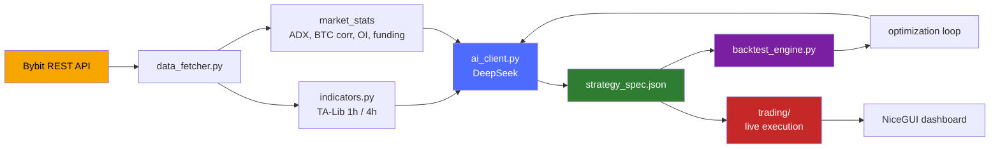

#### 1️⃣ Получение данных — `data_fetcher.py`

Загружает **15m и 1h klines** с пагинированным бэкфиллом и повторами с экспоненциальной задержкой, плюс глубину стакана, агрегированные публичные сделки, открытый интерес, ставку финансирования, соотношение long/short и индекс страха и жадности.

Поверх сырых свечей вычисляется `market_stats`:

- 24-часовой объём и изменение цены
- Дельта открытого интереса
- **Адаптивный порог ADX**, вычисляемый по последним пяти дням 1h-данных (ограничен диапазоном **12–30**)
- **Корреляция с BTC** по 24-часовым доходностям с 15-минутным кэшем, чтобы шесть символов не били по API шесть раз

Существует три разновидности пакетов:

| Пакет | Окно | Назначение |
|---|---|---|
| `morning_package` | Широкое (2 дня, до 64×15m свечей) | Полный контекстный анализ в начале сессии |
| `intraday_package` | Уже (8ч, до 30×15m свечей) | Периодическая переоценка в течение дня |
| `intraday_light` | Минимальное (2 свечи + свежая статистика) | Валидация отложенного сетапа или присмотр за позицией за долю стоимости токенов |


#### 2️⃣ Слой индикаторов — `indicators.py` + движок

TA-Lib для SMA 20/50, RSI 14, ATR 14, полос Боллинджера, MACD, ADX. VWAP с суточным сбросом. Классические уровни пивотов вычисляются по OHLC **предыдущего** дня, никогда текущего.

1h-свечи ресемплируются из 15m, и их признаки объединяются обратно через `merge_asof` — фильтруясь строго по столбцам `*_1h`, потому что слияние часового OHLCV молча заморозило бы 15m-закрытие внутри каждого часа и испортило бы каждый трейлинг-стоп.

**Слой 4h** добавляет ATR, скорость в единицах ATR, положение закрытия и флаг границы свечи.

Специально построенные серии дополняют картину:

- `low_32` / `high_32` — 32-барные экстремумы пробоя (сдвинуты, чтобы избежать заглядывания вперёд)
- `drop_2_atr` — импульс за 2 свечи в единицах ATR
- `activity` — отношение объёма × отношение ATR

#### 3️⃣ Слой ИИ — `ai_client.py`

| Метод | Роль |
|---|---|
| `init_symbol` | Выполняет до **5 итераций**, в которых модель может вызвать инструмент `web_search` для исследования монеты, после чего обязана вернуть JSON |
| `analyze` | Запрашивает структурированный JSON через `response_format`; автоматически исправляет любой таймфрейм, придуманный моделью, которого нет в данных |
| `optimize_strategy` | Принимает TRAIN/TEST-сводку бэктеста и возвращает пересмотренную спецификацию — с жёсткими защитными ограничениями, инжектируемыми в промпт (см. ниже) |
| `revise_init_strategy` | Перестраивает спецификацию после sanity-бэктеста |
| `chat_with_tools` | Многошаговый цикл вызова инструментов для интерактивного чата |


**Защитные ограничения, инжектируемые автоматически:**

- Если профит-фактор теста уже превышает **1.1**, логика входа **замораживается** — изменять можно только фильтры, управление и множители ATR
- Если сделок **менее 30**, модель обязана строить OR-группы `entry_any` вместо нагромождения условий на один вход

Каждый ответ проходит через `_safe_json_loads` — толерантный парсер, который снимает markdown-обёртки, комментарии и висячие запятые, прежде чем перейти к `json_repair`.

#### 4️⃣ Спецификация стратегии — `strategy_spec.py`

**Контракт** между моделью и движком. Каждая сторона (`long` / `short`) объявляет:

| Поле | Назначение |
|---|---|
| `entry` или `entry_any` | Список AND-групп (объединённых через OR) |
| `stop_loss_atr_mult` / `take_profit_atr_mult` | Риск на основе ATR с процентными фолбэками |
| `management` | Триггер безубытка, ATR-трейлинг, максимальное удержание в свечах, опциональные выходы при пробое уровня / потере тренда / развороте MACD |
| `filters` | Глобальные фильтры, применяемые к обеим сторонам |
| `risk_controls` | Пауза после серии убытков |


**Шесть примитивов условий:** `compare`, `cross`, `range`, `volume`, `slope`, `distance`.

Валидация **принципиальна**: каждая группа входа должна содержать объёмный фильтр, трендовый фильтр и подтверждение по уровню или импульсу, а также должны существовать и стоп, и тейк-профит — модель, забывшая их, получает спецификацию, отклонённую полностью и заменённую дефолтной.

#### 5️⃣ Движок бэктеста — `backtest_engine.py`

| Правило | Детали |
|---|---|
| **Тайминг сигнала** | Сигналы вычисляются на закрытии бара *i* и исполняются по **открытию бара *i+1*** — никакого жульничества на одном баре |
| **Проскальзывание** | **0.05%** против сделки на входе и на исполнении SL/TP; намеренно **не** на мягких выходах (которые исполняются по уже наблюдаемому закрытию) |
| **Комиссия** | 0.055% на сторону |
| **Управление позицией** | Выполняется на каждом баре; SL/TP проверяются внутри бара по high/low |


**Выходы:** полный список сделок со снимками входа (RSI, ADX, ATR, пивоты на момент входа), кривая equity и статистика — винрейт, профит-фактор, ожидание, максимальная просадка, средний выигрыш/проигрыш, разбивка long/short, счётчики активации кулдауна.

#### 6️⃣ Живое исполнение — `trading/`

Обнаружение сигналов, управление рисками, управление позициями, исполнение ордеров и ведение журнала сделок. Позиции и состояние риска сохраняются как JSON в `data/auto_trading/`.

Маршрутизация ордеров и источник данных управляются **двумя независимыми флагами**:

| Флаг | Управляет |
|---|---|
| `BYBIT_TESTNET` | Куда идут **ордера** |
| `BYBIT_DATA_TESTNET` | Откуда берутся **свечи** |


Это позволяет валидировать сигналы на реальной истории mainnet, в то время как ордера по-прежнему идут в testnet.

---

### 🧩 Ключевые компоненты с первого взгляда

| Файл | Строки | Ответственность |
|---|---|---|
| `config.py` | ~110 | Пути, API-ключи, символы, лимиты свечей, проскальзывание, флаги testnet |
| `data_fetcher.py` | ~775 | Bybit REST: klines, стакан, сделки, фундаментальные данные, новости, предвычисленная статистика |
| `indicators.py` | ~478 | Обёртки TA-Lib, ресемплинг 1h/4h, профиль объёма, пивоты |
| `ai_client.py` | ~856 | Клиент DeepSeek: init, analyze, optimize, revise, chat |
| `strategy_spec.py` | ~604 | DSL стратегии: оценщик, валидатор, дефолты, объяснитель |
| `backtest_engine.py` | ~865 | Детерминированная симуляция с проскальзыванием, комиссиями, управлением |
| `data_loader.py` | ~226 | Оффлайн-загрузчик CSV для `backtest_data/` |
| `trading/` | — | Живое исполнение: сигналы, риск, позиции, ордера, журнал |


---

### ✅ Что построено

- 🪙 **Мульти-символьная конфигурация** — 6 линейных бессрочных контрактов, каждый со своим состоянием, правилами, журналами и архивами
- 📡 **Три уровня пакетов данных**, настроенных для экономии токенов, плюс предвычисленная рыночная статистика и адаптивные пороги
- 📜 **Валидированный, версионируемый DSL стратегий** с обязательными фильтрами риска и движковыми дефолтами, заполняющими то, что модель упустила
- 🔁 **Полный цикл ИИ** — инициализация → sanity-бэктест → пересмотр → оптимизация → развёртывание — с автоматически инжектируемыми ограничениями против переобучения
- ⏱️ **Движок бэктеста без заглядывания вперёд** с проскальзыванием, комиссиями, управлением позицией и кулдауном после серии убытков
- 💾 **Оффлайн-путь данных**, читающий годовые 15m CSV (2023–2026) — обеспечивая долгосрочные исследования без обращения к бирже
- 🖥️ **Дашборд NiceGUI** для мониторинга, чата с моделью, запуска бэктестов и управления автоторговлей

---

### 🎯 Принципы проектирования

| Принцип | Почему это важно |
|---|---|
| **Разделение рассуждения и исполнения** | LLM креативна, но ненадёжна; движок глуп, но точен. Каждый делает то, в чём хорош |
| **Нулевое заглядывание вперёд** | Каждый индикатор сдвинут, каждый пивот использует вчерашние данные, каждый вход исполняется на следующем баре. Результаты бэктеста что-то значат |
| **Явный контракт риска** | Никакого входа без объёмного фильтра, трендового фильтра, подтверждения по уровню, стопа и тейк-профита |
| **Экономия токенов** | Три размера пакетов, предвычисленная статистика, урезанный контекст — так что реальный торговый цикл работает на реальном бюджете API |
| **Детерминированный повтор** | Тот же JSON + те же данные = те же сделки. Каждый раз |


---

### 🔧 Технологический стек

| Слой | Выбор |
|---|---|
| Язык | **Python 3.10+** |
| Биржа | **Bybit** (через `pybit`) |
| LLM | **DeepSeek** (через `openai` SDK) |
| Индикаторы | **TA-Lib** + **pandas** / **numpy** |
| UI | **NiceGUI** |
| Хранение | JSON-файлы + CSV-журналы |
| Данные бэктеста | Годовые 15m CSV в `backtest_data/` |


---
<a id="2-страницы-монет"></a>
## 2. 🪙 Страницы монет

### 💡 Что такое страница монеты

Страница монеты — это **кокпит для одного символа** — каждое действие, которое пользователь может совершить с одним активом, живёт здесь и больше нигде.

По умолчанию их шесть, по одной на каждую запись в `config.TRADING_PAIRS`:

```

XRPUSDT · HYPEUSDT · SOLUSDT · ETHUSDT · DOGEUSDT · ARBUSDT

```

Каждая полностью независима. Свой файл состояния, свои правила, свой журнал сделок, свой архив, свой автоцикл, свои убытки и кулдауны. Если одна монета сломана, остальные пять этого не замечают.

Страница организована вокруг четырёх вопросов:

| Вопрос | Где на него отвечают |
|----------|---------------------|
| 🧭 **Что делает рынок?** | Карточка анализа, карточка индикаторов, карточка сетапа/сигнала |
| 📜 **Какова стратегия этой монеты?** | Вкладка «Правила», `strategy_spec` в состоянии |
| 🎯 **Есть ли позиция?** | Карточка активной сделки, карточка входа, карточка совета по позиции |
| 📈 **Что произошло?** | Вкладка «Архив», журнал сделок, P&L за день |

---

### 🧭 Макет страницы

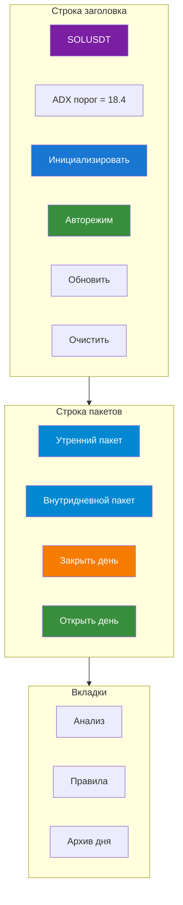

#### Строка заголовка

| Элемент | Что показывает / делает |
|---|---|
| **💰 {SYMBOL}** | Имя символа, всегда видимо |
| **ADX порог = X.X** | Живой адаптивный порог ADX из `state.market_stats.adx_threshold`; откатывается к *"ADX порог = 20 (по умолч.)"* при отсутствии |
| **🪄 Инициализировать** | Виден **только** когда `is_initialized == false`. Запускает полную ИИ-инициализацию |
| **🚀 Авторежим / ⏹ Остановить** | Переключает цикл AutoMode для этого символа — текст кнопки меняется в зависимости от `AutoModeState.get_state(symbol).is_running` |
| **🔄 Обновить** | Принудительно вызывает `refresh()` — перечитывает состояние с диска и перерисовывает каждую карточку |
| **🗑 Очистить** | Деструктивный сброс (требуется диалог подтверждения) — см. Очистка |

#### Строка пакетов

Четыре элемента управления дневным циклом, описаны в разделе Жизненный цикл дня.

---

### 📊 Вкладка 1: Анализ

Вид по умолчанию. Шесть карточек, которые обновляются вместе при каждом refresh.

#### 📊 Карточка анализа

Таблица ключ-значение, отрисовываемая из `state.last_analysis`:

| Поле | Источник |
|---|---|
| Время анализа | `analysis.timestamp_utc` |
| Цена | `analysis.current_price` |
| Изменение 24ч | `analysis.price_change_24h_pct` |
| Стакан | `analysis.orderbook_bias` |
| OI тренд | `analysis.oi_trend` |
| Funding rate | `analysis.funding_rate_status` |
| Fear & Greed | `analysis.fear_greed_state` |
| L/S Ratio | `analysis.long_short_ratio_signal` |
| Новости | `analysis.news_impact` |


Под таблицей — собственные слова модели: `📝 Сводка: {summary}`.

Карточка **пуста**, пока не отработает первый утренний или внутридневной пакет.

#### 📐 Карточка сетапа / сигнала

Показывает текущий тезис модели — но **только когда нет активной сделки** (открытая позиция подавляет карточку сетапа; свой собственный совет живёт в `position_advice_card`).

Порядок приоритета:

| Условие | Что отрисовывается |
|---|---|
| `last_signal.confidence_pct > 0` | 🚨 **СИГНАЛ** — живой, действенный вход |
| `last_setup` существует (нет активной сделки) | 📐 **СЕТАП** — условное наблюдение |
| Ни то, ни другое | Карточка скрыта |

Оба вида разделяют общую форму:

| Строка | Сигнал | Сетап |
|---|---|---|
| Тип | 🚨 СИГНАЛ | 📐 СЕТАП |
| Направление | `direction` | `direction` |
| Уверенность | `confidence_pct`% | `confidence_pct`% |
| Вход | `entry_price` или *"По рынку"* | то же |
| SL | `stop_loss` | `stop_loss` |
| TP | список `take_profit[]` | то же |
| Обоснование | `signal_rationale` | `rationale` |

Под таблицей — два списка:

- **Условия входа** — `entry_conditions[]` (сигнал) или `conditions[]` (сетап)
- **Условия отмены** — `cancel_conditions[]`

Каждый сетап и сигнал несёт **условия отмены**. Это не украшение: модели запрещено выдавать голое «покупай сейчас» без указания того, что инвалидировало бы идею.

#### 📈 Карточка индикаторов

Отрисовывает последние **5 значений** каждого числового ряда индикаторов плюс профиль объёма.

Столбцы строятся динамически из ключей `state.indicators` — каждый ряд со значением-списком получает свой столбец. Уровни пивотов и прочие скаляры появляются как есть. Метки времени берутся из `state.indicator_timestamps`, выровненные по индексу.

Под таблицей: **📊 Объёмный профиль (топ-5 уровней)** — пять верхних ценовых уровней по объёму, каждый с (цена, объём). Вот как выглядит «где рынок реально торговал» в виде таблицы.

Карточка скрыта, пока не доставлен первый пакет.

#### 🔴 Карточка активной сделки

Появляется только когда существует `state.active_trade`. Показывает:

| Поле | Содержание |
|---|---|
| Направление | `direction` (LONG/SHORT) |
| Цена входа | `entry_price` |
| Стоп-лосс | `stop_loss` |
| Тейк-профит | `take_profit[]` |
| Тип входа | `entry_type` (`manual` / `signal`) |


Два действия:

**✏️ Редактировать** → открывает диалог с полями нового SL и TP. При сохранении повторно запускает ИИ-анализ с `keep_history=False`, чтобы модель видела **новые** параметры как факт, а не как дельту. Карточка совета обновляется соответственно.

**🔒 Закрыть позицию** — закрывает по указанной вами цене:

| Вход | Опции |
|---|---|
| Цена выхода | Предзаполнена текущей ценой (загружается заново при refresh) |
| Причина | `manual` · `stop_loss` · `take_profit` |

При закрытии:

1. `result_pct` вычисляется из направления и цен
2. Сделка добавляется в `trade_journal.csv`
3. `active_trade` очищается
4. **Пост-закрытийный анализ** запускается с `error_analysis=True`, если `result_pct < 0`, чтобы модель проанализировала свою ошибку и могла предложить `new_rules`

Этот последний шаг тонок, но важен: система намеренно учится на убытках, а не только на прибылях.

#### ➕ Карточка входа

Форма ручной сделки. Появляется, когда **нет активной позиции**.

| Поле | Примечания |
|---|---|
| Направление | `long` / `short` |
| Цена входа | должна быть > 0 |
| Стоп-лосс | валидация в зависимости от направления |
| Тейк-профит | валидация в зависимости от направления |


**Правила валидации** (отклоняются с уведомлением при нарушении):

```
long:  stop_loss < entry_price  AND  take_profit > entry_price
short: stop_loss > entry_price  AND  take_profit < entry_price
```

При успешной отправке в одном действии происходят три вещи:

1. `active_trade` записывается в состояние
2. **AutoMode запускается в режиме `position_only`** — без догоняющего пакета, без утреннего пакета, потому что позиция уже существует и не нуждается в свежем прочтении графика с нуля
3. **Пост-входный анализ** выполняется на внутридневном пакете

Так что ручной вход никогда не является слепым: ИИ немедленно спрашивают *«что ты думаешь об этой позиции?»* и записывают ответ в `position_advice_card`.

#### 📋 Карточка совета по позиции

Заполняется, когда есть активная сделка **и** либо существует `last_position_update`, либо существует `last_analysis`. Живое прочтение модели по открытой позиции:

| Поле | Источник |
|---|---|
| Рекомендация | `last_position_update.advice` (например, *«перенести SL»*, *«частично зафиксировать»*, *«закрыть»*) |
| Новый стоп-лосс | `last_position_update.new_stop_loss` (опционально) |
| Частичная фиксация | `last_position_update.partial_take_profit_pct` (опционально) |

Ниже: **Условия закрытия** — `cancel_conditions[]` из текущего активного сигнала или сетапа, вновь выведенные как чек-лист.

---

### 📐 Вкладка 2: Правила

Два представления одного и того же, синхронизированные при сохранении.

#### Структурированный вид

`rules_table` разбивает текст правил на строки:

| Столбец | Содержание |
|---|---|
| № | Порядковый номер |
| Условие | Текст до первого `:` (или `---`) |
| Описание | Текст после |


Сначала идут торговые правила, затем разделительная строка (`=== РИСК-МЕНЕДЖМЕНТ ===`), затем правила риска.

Если `state.trading_rules_list` и `state.risk_management_rules_list` оба пусты, но `trading_rules.md` существует, страница **парсит файл** и заполняет оба списка — так что отредактированный вручную Markdown-файл становится полноценными структурированными данными при следующем refresh.

#### Markdown-вид

`rules_text_area` показывает полный исходный Markdown. Редактируемый, с одной кнопкой:

**💾 Сохранить правила** → при сохранении:

1. `cm.update_rules(new_rules)` — записывает `trading_rules.md`
2. `parse_rules_from_text()` разбивает на два списка
3. Оба списка записываются в `state.json`

С этого момента каждый промпт анализа включает обновлённые правила.

Это переопределение человеком в контуре. ИИ пишет свои собственные правила при инициализации и через `optimize_strategy`, но человек всегда может переписать их вручную, и ИИ будет их соблюдать при следующем вызове.

---

### 📦 Вкладка 3: Архив

Одна строка на заархивированный день:

| Столбец | Содержание |
|---|---|
| Дата | `YYYY-MM-DD` |
| P&L | Сумма `result_pct` по сделкам этого дня, отформатированная со знаком |
| Сделок | Количество сделок |


Клик по строке открывает модальное окно:

```
📅 Архив SOLUSDT — 2026-11-01
P
```

За этим: `load_archive_day(date)` вытягивает `state.json`, `trades.csv`, `morning_context.md`, `intraday_context.md` и `key_events.md` из папки дня.

Архив намеренно **только для чтения**. Чтобы перезапустить день, вы открываете новый день — архив это история.

---

### 🌅 Жизненный цикл дня

Каждая монета живёт внутри **24-часового дневного цикла**, отслеживаемого в `state.date` и ограниченного `state.day_closed`. Границы дня — UTC.
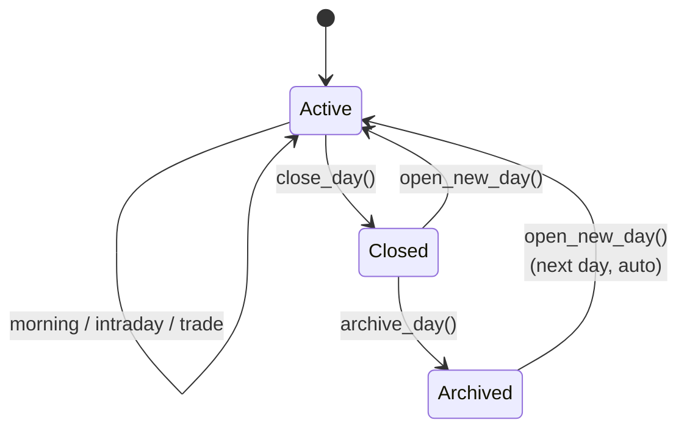
#### 🌅 Утренний пакет

Полноконтекстный анализ. При клике:

1. Отказывает, если день закрыт
2. Отказывает, если `is_initialized == false`
3. Загружает **утренний пакет** (2 дня 1h-свечей, до 64× 15m свечей, фундаментальные данные, стакан, сделки, новости, market_stats)
4. Вызывает `ai_client.analyze(...)` с `is_initial=False`
5. `process_ai_response(...)` записывает результат в состояние
6. Устанавливает `last_morning_update_utc`
7. Планирует UI-refresh

Именно это запускает тезис дня.

#### ⏱ Внутридневной пакет

Уже (30× 15m свечей, окно 8ч). Тот же поток, что утренний, но передаёт `morning_context` и `intraday_context`, чтобы модель могла *продолжить* разговор, а не начинать с нуля.

#### 🔒 Закрыть день

Односторонний переключатель:

- Останавливает `AutoModeState` для этого символа
- Архивирует день (`archive_day()` — если папка для этой даты уже существует, это пропускается)
- Устанавливает `state.day_closed = true`

Почему это существует: **остановленный день отличается от приостановленного авторежима**. Пауза позволяет циклу возобновиться; закрытие дня требует `open_day()` для возобновления торговли. Это заявление «на сегодня я закончил», а не «подожди немного».

Если день закрыт, все три из следующего отказываются запускаться:

- Утренний пакет
- Внутридневной пакет
- Запуск авторежима

#### 🔓 Открыть день

Создаёт новый день. Триггерит:

- `archive_day()` для *старого* дня (если ещё не заархивирован)
- Сброс `day_closed = false`
- Очистка **всего** временного контекста: `active_trade`, `last_signal`, `last_setup`, `last_analysis`, `last_update_utc`, `last_morning_update_utc`, `last_candle_time`, `morning_context`, `intraday_context`, `last_key_events`, `indicators`, `indicator_timestamps`
- Установка `state.date = today`

Что **сохраняется** через границу дня:

- `trading_rules_list`, `risk_management_rules_list` — правила переживают дни
- `strategy_spec` — спецификация переживает дни
- `is_initialized` — монета остаётся инициализированной
- Журнал сделок (`trade_journal.csv`) — история постоянна

Так что новый день — это *чистый аналитический лист*, а не *стирание*.

---

### 🪄 Инициализация

Единственное действие, превращающее пустую монету в торгуемую.
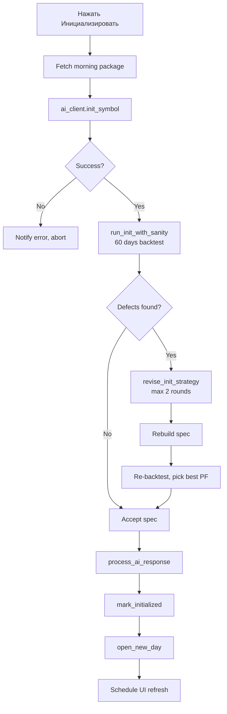
#### `run_init_with_sanity` — проверка реальностью за 60 дней

Прежде чем спецификация ИИ будет принята как окончательная, код прогоняет её по **последним 60 дням 15m-истории** и выдаёт числовой диагноз.

Диагностические проверки:

| Проверка | Порог | Сообщение при провале |
|---|---|---|
| Частота сделок | `< 1.5 сделок/неделю` | *"фильтры входа слишком жёсткие"* |
| Эдж | `PF < 1.0` **и** `expectancy < 0` | *"нет эджа"* |
| Быстрые убытки | `> 50% убытков` закрываются за ≤ 3 свечи | *"входы слишком поздние или стоп внутри шума"* |


Если срабатывает **любой** из них, текст передаётся в `revise_init_strategy` со специфическим чек-листом исправлений:

> *"Ослабь объёмный/RSI-фильтры и/или добавь вторую OR-группу входа (ретест/откат); цель 2-5 сделок в неделю."*
> *"При доле быстрых убытков > 50% входи раньше (ретест, а не догон) и/или расширь стоп до 2.5-4.0 x ATR15m."*
> *"Если WR ниже безубыточного порока, подними take_profit_atr_mult до 3-5."*

Модель получает **до 2 раундов пересмотра**. Если более поздний пересмотр имеет лучший PF, чем предыдущий лучший, сохраняется он. Если нет — выживает более ранняя спецификация.

Результат запоминается: `response.sanity_best_pf` — так что вы можете сразу после инициализации увидеть *«спецификация модели прошла с PF 1.32 на sanity-бэктесте»*.

Затем `_process_init_response` (в `ui/ai_handlers.py`):

1. `research` записывается в состояние
2. `strategy_spec` валидируется и обогащается через `ensure_engine_defaults()`
3. `trading_rules_list` и `risk_management_rules_list` записываются
4. `new_rules` записывается в `trading_rules.md`
5. `is_initialized = true`
6. Вызывается `open_new_day()`

После этого монета готова к работе: у неё есть спецификация, правила и свежий день.

#### Что если модель забудет `setup`?

`_ensure_safe_setup_fallback` в `ui/ai_handlers.py` ловит случай, когда модель возвращает `ANALYSIS` без setup/signal/position_update и активной сделки. Вместо того чтобы оставить UI пустым, он вставляет **плейсхолдер-сетап** с:

```json
{
  "direction": "long",
  "entry_price": 0,
  "stop_loss": 0,
  "take_profit": [],
  "confidence_pct": 0
}
```

Нулевая уверенность означает отсутствие сделки, но структура сохраняется — UI не падает, следующая итерация может её перезаписать, а причина задокументирована.

---

### 🚀 Авторежим — фоновый цикл

Переключается через **🚀 Авторежим** (становится **⏹ Остановить** при работе). Это **не** автоторговля; это управляемый ИИ цикл анализа, который продолжает выдавать сетапы/сигналы, но никогда не размещает ордера. Реальные ордера — Раздел 6.

#### Два режима запуска

| Режим | Триггер | Что делает |
|---|---|---|
| **`full`** | Кнопка 🚀 Авторежим | Догоняющий пакет + утренний пакет (если нужно) + цикл |
| **`position_only`** | `open_trade()` на странице монеты | **Пропускает** догоняющий и утренний пакеты, потому что ручной вход уже в полёте |


#### Загрузка полного режима

При запуске цикл:

1. **Архивирует вчера** (если дата перевалила) и открывает новый день
2. Отказывается запускаться, если день закрыт
3. **Догоняющая загрузка** — тянет пропущенные свечи с `last_update_utc` (или `last_morning_update_utc`)

- Если разрыв < 15 минут, догоняющая загрузка пропускается
- Иначе загружает 15m + 1h, вычисляет индикаторы, строит пакет формы `intraday_update` и отправляет в `analyze()` со свежей историей

4. **Утренний пакет** — если `last_morning_update_utc` раньше сегодняшней UTC-полуночи

- Доставляется через полный утренний поток
- `last_morning_update_utc` проставляется

5. Входит в **цикл свечей**

#### Цикл свечей

Ждёт **следующей 15-минутной границы** (минута 0, 15, 30 или 45), затем:

| Условие | Используемый пакет |
|---|---|
| `active_trade` существует **или** `last_setup` существует | `get_intraday_light_package()` — 2 свечи, дёшево |
| Ни то, ни другое | `get_intraday_package()` — 30 свечей, полный |


Затем `analyze()` → `process_ai_response()` → ждать следующей границы.

Ветка `intraday_light` — это экономия токенов в действии. Когда тезис уже в игре, вам не нужно 30 свечей, чтобы его валидировать — 2 свечи плюс свежий `market_stats` достаточно.

#### Что останавливает цикл

- `close_day()` — день закрыт
- `AutoModeState.stop(symbol)` — ручная остановка
- `day_closed == true` при любой проверке

---

### 🗑 Очистка — ядерный вариант

Диалог подтверждения защищает кнопку **🗑 Очистить**. При подтверждении `clear_coin_data(mode="all")`:

| Очищается | Сохраняется |
|---|---|
| `last_analysis`, `last_signal`, `last_setup` | `trade_journal.csv` |
| Все `last_*` метки времени | История папки архива |
| `morning_context`, `intraday_context` |  |
| `indicators`, `indicator_timestamps` |  |
| `last_key_events` |  |
| `trading_rules.md` |  |
| `behavior_rules.md` |  |
| `active_trade` |  |
| `is_initialized` → false |  |
| `strategy_spec` → null |  |
| `trading_rules_list`, `risk_management_rules_list` |  |
| `research` |  |


Также останавливает авторежим для символа.

UI-уведомление гласит **«Данные очищены (кроме журнала).»** — потому что журнал переживает, так что вы никогда случайно не потеряете историю сделок, только текущий тезис ИИ.

После очистки монета возвращается в **неинициализированное** состояние: кнопка **🪄 Инициализировать** возвращается, авторежим отказывается запускаться, и до того, как что-либо будет торговать, требуется свежая инициализация.

---

### 📁 Что живёт на диске по каждому символу

```
data/
└── SOLUSDT/
    ├── state.json              # каждое поле состояния, перечисленное выше
    ├── trading_rules.md        # правила для чтения человеком
```

Плюс на уровне `data/auto_trading/`

```
data/
├── risk_state.json       # дневные и месячные лимиты убытков
├── active_traders.json   # какие символы сейчас торгуют
├── positions/            # по одному JSON на символ
└── logs/                 # CSV и HTML логи, ротация по неделям
```

Каждая операция со страницы монеты пишет **в свой собственный слот** — ничего не протекает между символами.

---

### 🧠 Машина состояний рассуждения
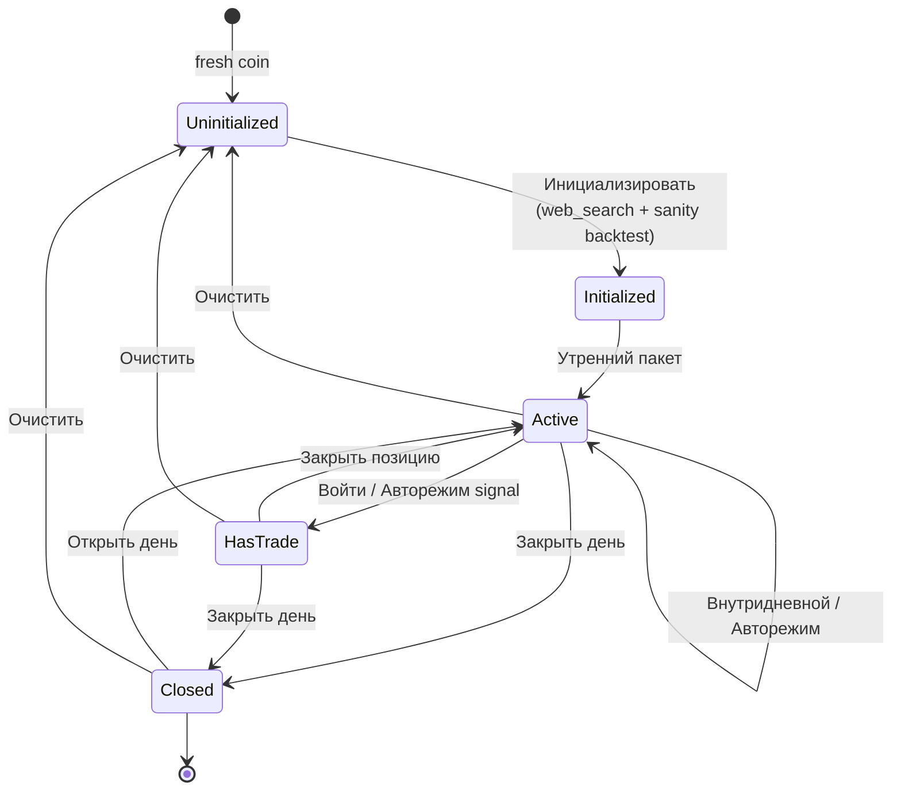
Каждая стрелка — это действие страницы. Монета никогда не прыгает сразу из «модель что-то написала» в «деньги под риском» — всегда есть анализ, sanity-бэктест и (если автоторговля включена) спецификация стратегии, провалидированная по истории.

---

### 🛡️ Свойства безопасности

| Свойство | Гарантия |
|---|---|
| **Изоляция символов** | Всё состояние посимвольно; сломанный SOLUSDT не может повлиять на XRPUSDT |
| **Дисциплина дня** | Закрытие дня требует `open_day` для возобновления — жёсткий шлагбаум «я закончил» |
| **Журнал навсегда** | 🗑 Очистка оставляет `trade_journal.csv` нетронутым |
| **Фолбэк-сетап** | Провал модели вернуть сетап даёт плейсхолдер с нулевой уверенностью, а не пустой UI |
| **Авторежим — не автоторговля** | 🚀 Авторежим выдаёт анализ, никогда ордера — они намеренно разделены |
| **Ручной вход ограничен** | Валидация сторон SL/TP предотвращает отправку «long со стопом выше входа» |
| **Пост-закрытийный анализ убытков** | Убыточные сделки дают `error_analysis=True` — модели предлагают самодиагностику |
| **Явная отмена** | Каждый сетап и сигнал несёт `cancel_conditions` — ничего не является вечным тезисом |


---

### 🎯 Что пользователь на самом деле делает на странице монеты

В приблизительном хронологическом порядке, за жизнь монеты:

| Момент | Действие |
|---|---|
| **Новая монета** | 🪄 Инициализировать → sanity-бэктест → принято |
| **Начало дня** | 🔓 Открыть день (авто при первом refresh) → 🌅 Утренний пакет |
| **В течение дня** | ⏱ Внутридневной пакет или включить 🚀 Авторежим и позволить циклу рулить |
| **Сигнал срабатывает** | Модель пишет `last_signal` → карточка 📐 Сетап / Сигнал показывает сетап → вы решаете ➕ Войти |
| **Открытая позиция** | Карточка 🔴 Активная позиция показывает её → ✏️ Редактировать (настроить SL/TP) или 🔒 Закрыть (выйти) |
| **Конец дня** | 🔒 Закрыть день → заархивирован |
| **Следующее утро** | 🔓 Открыть день → чистый аналитический лист |
| **Слабая работа** | Настроить правила в 📐 Правила или очистить + переинициализировать |
| **Желание начать заново** | 🗑 Очистить (правила сброшены, журнал сохранён) → 🪄 Инициализировать |


Страница монеты — это место, где человек решает *когда* и *стоит ли*; ИИ решает *что*. Удержание этих двух решений в разных руках — причина, по которой страница имеет и *редактор стратегии* (вкладка «Правила»), и *исполнитель стратегии* (карточка «Сетап») рядом друг с другом.

---
<a id="3-ии-чат"></a>
## 3. 💬 ИИ-чат

### 💡 Что это

Чат — это **диалоговое окно в ту же модель, что пишет ваши стратегии**, но со свободными руками.

Везде в остальном система модель зажата: она обязана вернуть строгий JSON, у неё одна попытка, и движок решает, что делать с ответом. В чате она может рассуждать на протяжении нескольких ходов, вытягивать данные инструментами и объяснять себя прозой. Это единственное место, где вы можете *спросить модель, что она думает*, без схемы, стоящей на пути.

Различие сделано намеренно:

| Аспект | Конвейер анализа | Чат |
|---------|-------------------|------|
| **Формат вывода** | Строгий JSON (`response_format={"type": "json_object"}`) | Свободная проза |
| **Ходы** | Один запрос → один ответ | До **5** раундов инструментов |
| **История** | Урезается до 7 сообщений или свежий контекст | Пересобирается с нуля при каждом вызове |
| **Инструменты** | Только `web_search`, только во время `init_symbol` | **12 инструментов** через `ToolExecutor` |
| **Температура** | 0.3 | **0.5** — более исследовательская |
| **Режим отказа** | Фолбэк-JSON, залогировано | Строка ошибки, возвращённая пользователю |

Разрыв в температуре не косметический. Анализ хочет наиболее вероятное прочтение графика. Чат хочет, чтобы модель действительно *думала вслух*.

---

### ⚙️ Как собирается ход чата

Каждое сообщение проходит через `ChatPage.send_message()` → `DeepSeekClient.chat_with_tools()`. По пути одно большое пользовательское сообщение собирается из помеченных блоков:

```

=== ЧАТ ОТ ПОЛЬЗОВАТЕЛЯ ===
Пара: SOLUSDT
СООБЩЕНИЕ ПОЛЬЗОВАТЕЛЯ: <your text>
У тебя есть доступ к инструментам (tools). Отвечай на русском языке.

--- УТРЕННИЙ КОНТЕКСТ ---        ← опционально
--- ПОСЛЕДНИЕ ВЫВОДЫ ---          ← опционально (внутридневной контекст)
--- ПОСЛЕДНИЙ АНАЛИЗ ---          ← опционально (JSON)
--- ПРАВИЛА ТОРГОВЛИ ---          ← опционально (trading_rules.md)
--- ПОВЕДЕНЧЕСКИЕ ПРАВИЛА ---     ← опционально (behavior_rules.md)
--- АКТИВНАЯ ПОЗИЦИЯ ---          ← опционально (active_trade JSON)
--- ИНДИКАТОРЫ (JSON) ---         ← когда доступно
--- НОВОСТИ ---                   ← опционально (или из кэша)
--- ПРЕДВЫЧИСЛЕННЫЕ МЕТРИКИ ---   ← когда доступно (market_stats)

```

Системный промпт — стандартный `SYSTEM_PROMPT`, тот же, что используется для анализа. Модель чата и модель анализа разделяют одно и то же мировоззрение — просто у них разные контракты вывода.

---

### 🧭 Определение символа

Чат **посимвольный**, хотя страница выглядит общей. Перед вызовом модели `ChatPage.detect_symbol()` сканирует сообщение на любой известный символ:

```python
for sym in self.memory.get_all_symbols():
    if re.search(r"\b" + re.escape(sym) + r"\b", message, re.IGNORECASE):
        return sym
```

Поведение:

| Случай | Результат |
|---|---|
| `"что думаешь про SOLUSDT?"` | Совпадение → продолжает с SOLUSDT |
| `"sol"`, `"Sol"`, `"sOlUsDt"` | Совпадение (без учёта регистра) — но только если в `TRADING_PAIRS` существует символ ровно с именем `SOL`. `SOLUSDT` **не** совпадёт с `sol` — граница стоит на `\bSOLUSDT\b` |
| Нет символа | Возвращает `None` → пользователь видит `❓ Не удалось определить монету.` |


Затем две защиты:

| Защита | Сообщение |
|---|---|
| `cm.is_initialized() == False` | `⚠️ Монета {symbol} не инициализирована.` |
| Символ не в `config.TRADING_PAIRS` | Молчаливый возврат — не должно происходить |


Если обе пройдены, чат загружает свежий **внутридневной пакет**, начиная с `last_candle_time`, чтобы у модели были актуальные данные и она не перечитывала свечи, которые уже видела.

---

### 🔁 Цикл вызова инструментов
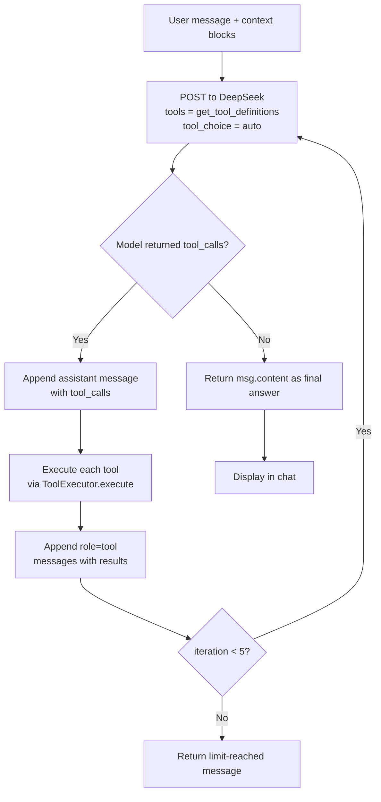
Свойства цикла (из `chat_with_tools`):

| Свойство | Значение |
|---|---|
| **Максимум итераций** | **5** (`max_iterations=5` передаётся из ChatPage) |
| **Выбор инструмента** | `"auto"` — модель решает, когда вызывать, а когда отвечать |
| **Температура** | 0.5 |
| **Максимум токенов** | 2000 |
| **Отсутствующий обработчик** | Возвращает `"Обработчик не задан."` — цикл всё равно завершается |
| **Исключение при вызове** | Перехватывается, логируется, возвращается как `"Ошибка: ..."` — чат не зависает |
| **Пустой ответ** | Возвращает `"Модель не ответила."` |
| **Лимит итераций** | Возвращает `"Достигнут лимит итераций инструментов."` |


Каждый результат инструмента добавляется как полноценное сообщение `role: "tool"` с соответствующим `tool_call_id` — так модель может связывать вызовы: *прочитать правила → прочитать сетап → предложить обновление → проверить*. Если инструмент падает, модель видит сбой и может отреагировать.

---

### 🧰 Набор инструментов — все 12

Объявлены в `tool_registry.get_tool_definitions()`, диспетчеризуются через `ToolExecutor.execute()`.

#### 📜 Правила

| Инструмент | Аргументы | Возвращает |
|---|---|---|
| `get_current_rules` | — | Полный текст `trading_rules.md` или *"Правила не созданы."* |
| `add_trading_rule` | `rule_text: str` | Дописывает в `trading_rules.md` **и** в `state.trading_rules_list` |
| `update_trading_rules` | `rules_text: str` | **Заменяет** все правила. Также очищает оба списка в состоянии (они будут перераспарсены при следующем чтении) |

`add_trading_rule` — «аддитивный» путь: модель может предложить новое правило, не уничтожая существующее. `update_trading_rules` — «переписывающий» путь: модель сначала должна вызвать `get_current_rules`, затем отправить полный новый текст.

#### 🎯 Сетап

| Инструмент | Аргументы | Возвращает |
|---|---|---|
| `get_current_setup` | — | Текущий сигнал (если `confidence_pct > 0`) или сетап, или *"Сетап отсутствует."* |
| `update_setup` | `direction`, `entry_price`, `stop_loss`, `take_profit[]`, `conditions[]`, `cancel_conditions[]`, `rationale` | Записывает новый `last_setup` в состояние с `confidence_pct = 0` |


`update_setup` намеренно ставит `confidence_pct = 0`. Сетап, написанный из чата, — это *набросок*, а не сигнал — UI показывает его как 📐, но цикл автоторговли никогда на него не отреагирует. Только конвейер анализа (утренний/внутридневной/авторежим) может поднять уверенность выше нуля.

#### 🔴 Позиция и анализ

| Инструмент | Аргументы | Возвращает |
|---|---|---|
| `get_market_analysis` | — | Последний анализ: цена, изменение за 24ч, смещение стакана, тренд OI, фандинг, F&G, влияние новостей, сводка |
| `get_active_trade` | — | Открытая позиция: направление, вход, SL, TP. Или *"Открытых позиций нет."* |
| `get_trade_stats` | — | Количество сделок, винрейт, суммарный P&L%, средний выигрыш%, средний проигрыш% |


Эти три позволяют модели рассуждать о *«работает ли мой существующий тезис?»* без необходимости повторно инжектировать полные контекстные блоки.

#### 📰 Новости

| Инструмент | Аргументы | Возвращает |
|---|---|---|
| `get_news` | — | Заголовки за последние 24ч, отформатированные |
| `get_news_analysis` | — | **Расширенные** новости: влияние сентимента (`positive`/`negative`/`neutral`), количество положительных/отрицательных плюс отформатированный список |


Оба кэшируются в экземпляре `ToolExecutor`:

```
self._news_cache_local      # для get_news
self._news_analysis_cache   # для get_news_analysis
```

Так что если модель вызывает `get_news`, затем `get_news_analysis`, RSS-ленты парсятся **один раз** — второй вызов бесплатен. Это важно, потому что хорошо воспитанная модель делает именно так: сначала получить, затем проанализировать.

#### 🧠 Поведенческие правила

| Инструмент | Аргументы | Возвращает |
|---|---|---|
| `get_behavior_rules` | — | Полный `behavior_rules.md` или *"Поведенческие правила отсутствуют."* |
| `add_behavior_rule` | `rule_text: str` | Дописывает в `behavior_rules.md` с UTC-меткой времени |

Поведенческие правила — это «слой дисциплины», отдельный от торговых правил, и соблюдаемый при каждом последующем анализе.

---

### 🧠 Что «инструмент» здесь на самом деле означает

Инструменты **пишут на диск**. `add_trading_rule` — не предложение, оно немедленно сохраняется в `data/SOLUSDT/trading_rules.md`. `update_setup` пишет в `state.json`. `add_behavior_rule` дописывает в `behavior_rules.md`.

Это фундаментальное отличие от конвейера анализа: **в чате модель имеет побочные эффекты**.

Компромисс был сделан осознанно:

| Риск | Смягчение |
|---|---|
| Модель галлюцинирует плохое правило | Пользователь видит правило в ответе чата и может отредактировать его на вкладке 📐 Правила |
| Модель перезаписывает правила | `update_trading_rules` — **деструктивная** замена, используется только после явного `get_current_rules` |
| Модель ставит «хороший сетап» из чата | `confidence_pct = 0` — ни одна автосделка не сработает |
| Модель портит состояние | `update_state()` трогает только конкретные ключи; остальные поля выживают |

Принцип проектирования: **чат может писать анализ и правила, но он не может писать сигналы**. Только конвейер анализа может поднять уверенность выше нуля, и только конвейер анализа питает автоторговлю.

---

### 🧵 Многопоточность и UI

Чат работает по **той же фоново-поточной схеме**, что и всё остальное в приложении:
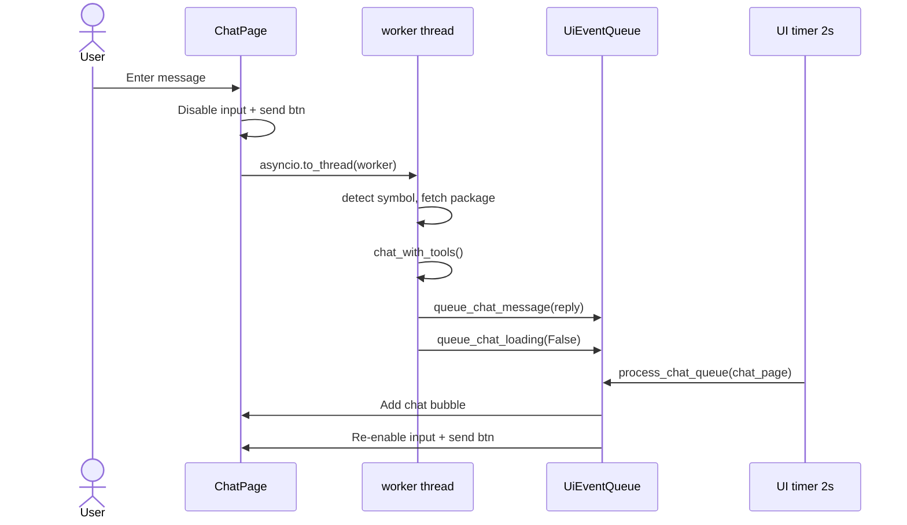
Ничто в рабочем потоке не трогает `ui.*` напрямую. Все обновления UI идут через `UiEventQueue`, который главный поток вычитывает каждые 2 секунды через `ui.timer(2.0, check_updates)`. Так что медленный ответ модели — или падение в середине ответа — никогда не замораживает UI.

Состояние `_set_loading_ui(True)` отключает и поле ввода, и кнопку «Отправить». Это намеренно: предотвращает постановку пользователем второго сообщения в очередь, пока первое ещё обрабатывается, что устроило бы гонку двух циклов `chat_with_tools` за одно и то же состояние.

---

### 🗑 Очистка чата

Одна кнопка: **🗑 Очистить чат**. Она:

1. Очищает `self.messages` (локальный список сообщений)
2. Очищает `chat_container` (визуальные пузыри сообщений)
3. Показывает уведомление *"Чат очищен."*

Чего она **не** делает:

- Не трогает `state.json`, `trading_rules.md` или какие-либо торговые данные
- Не очищает `ai_client.conversation_history` — но это не имеет значения для чата, потому что `chat_with_tools` **всегда** пересобирает список сообщений с нуля (см. ниже)

Так что очистка чата — чисто визуальная уборка. Это действие «начать свежую визуальную сессию», а не сброс состояния.

---

### 🧠 История разговора — намеренно без состояния

`chat_with_tools` **пересобирает `messages` с нуля при каждом вызове**:

```
messages = [
    {"role": "system", "content": SYSTEM_PROMPT},
    {"role": "user", "content": chat_msg},
]
```

На пути чата нет `self.conversation_history[pair].append(...)`. Единственное место, где история накапливается, — это `analyze()`, который урезает до 7 сообщений.

Почему: чат задуман как **не хранящий состояние и самодостаточный**. Контекст приходит из помеченных блоков (правила, позиция, индикаторы, новости), а не из того, что было сказано два хода назад. Это делает каждый вызов воспроизводимым — то же входное сообщение + то же состояние = тот же ответ, независимо от того, что ему предшествовало.

Компромисс: модель **не** помнит «что мы обсуждали пять минут назад». Если вы хотите, чтобы она помнила, вложите это в сообщение или обновите правила.

Преимущество: сессия чата никогда не может отравить себя. Плохое правило, придуманное моделью на 3-м ходу, не может пробраться на 10-й ход через историю — оно попадает в `trading_rules.md` и появляется как явный контекст, где вы можете его увидеть.

---

### 🎯 Для чего чат хорош

| Сценарий использования | Почему чат лучше конвейера |
|---|---|
| *"Почему модель отклонила этот сетап?"* | Он может пройти через свои собственные рассуждения и процитировать точные условия |
| *"Сравни RSI поведение SOL и ARB на прошлой неделе"* | Многошагово: получить, вычислить, сравнить, объяснить |
| *"Сформулируй pullback-вариант текущего breakout-правила"* | Итеративное уточнение в прозе до фиксации в JSON |
| *"Что сейчас говорит funding rate?"* | `get_market_analysis` → интерпретация |
| *"Объясни эту strategy_spec"* | Рендерит вывод `explain_conditions` как нарратив |
| *"Поищи новости по HYPE и скажи, меняет ли это тезис"* | `get_news_analysis` → рассуждение о сентименте |
| *"Добавь правило про запрет входа в первые 3 свечи после пробоя"* | `add_trading_rule` записывает его навсегда |

Для чего он **не** годится: решать открыть сделку. Этот путь всегда идёт через `strategy_spec` → `backtest_engine` → `trading/auto_trader.py`. Чат информирует; он не исполняет.

---

### 🛡️ Защитные ограничения

| Ограничение | Как |
|---|---|
| **Никакого исполнения ордеров** | У чата нет инструмента, который трогает `BybitExecutor`. Размещение ордеров живёт только в `trading/` |
| **Никакой инъекции сигналов** | `update_setup` ставит `confidence_pct = 0` — автоторговля его никогда не увидит |
| **Никакого протекания истории** | Сообщения пересобираются при каждом вызове — никакого загрязнения между ходами |
| **Ограниченное рассуждение** | `max_iterations=5` ограничивает цикл инструментов |
| **Языковой контракт** | Промпт предписывает ответы на русском языке |
| **Прозрачность ошибок** | Каждый путь отказа возвращает видимую строку, никогда пустой пузырь |
| **Явный контекст** | Правила, позиция, индикаторы передаются как помеченные блоки — модель не может «помнить» то, что ей не дали |

Различие имеет значение. Конвейер **анализа** безопасен по *формату* (строгий JSON, без инструментов). Конвейер **чата** безопасен по *области действия* — он может читать всё и писать анализ/правила, но два пути записи, которые могли бы повлиять на торговлю (`confidence_pct`, исполнение ордеров), структурно недостижимы отсюда.

---

### 🔗 Связь с остальной системой

```
                 ┌─────────────────────────┐
                 │   Same DeepSeek model   │
                 └───────────┬─────────────┘
                             │
              ┌──────────────┴──────────────┐
              ▼                             ▼
    ┌──────────────────┐          ┌──────────────────┐
    │  Analysis / Init │          │       Chat       │
    │  strict JSON     │          │  tools + prose   │
    │  1 shot          │          │  5 tool rounds   │
    │  temp 0.3        │          │  temp 0.5        │
    │  no disk writes  │          │  writes rules    │
    └────────┬─────────┘          └────────┬─────────┘
             │                             │
             ▼                             ▼
      strategy_spec                  rules + setup
             │                             │
             ▼                             │
      backtest_engine                      │
             │                             │
             ▼                             ▼
        trading/  ◄────── feeds next analysis cycle
```

Чат **информирует** конвейер анализа: правила, которые вы пишете через чат, становятся контекстом при следующем вызове `analyze()`. Но чат никогда не получает права *исполнять*. Эта граница обеспечивается структурой файлов — у чата нет пути импорта к `trading/executor.py`.

---

### 🧱 Константа, формирующая поведение

| Константа | Значение | Почему |
|---|---|---|
| `max_iterations` | **5** | Ниже 5 сложные цепочки инструментов проваливаются; выше 5 один застрявший запрос съедает много токенов |
| `temperature` | **0.5** | Более исследовательская, чем анализ (0.3), но не художественная проза (0.8) |
| `max_tokens` | **2000** | Достаточно для абзаца рассуждений плюс вызов инструмента, недостаточно для болтовни |
| UI refresh | **2 с** | Главный цикл событий для всех UI-очередей — сообщения чата появляются в пределах 2 с после прибытия |
| `hours_back` для новостей | **24 ч** | Достаточно широко, чтобы поймать двухдневное событие FUD, всё ещё закладываемое в цену |


---

### ✅ Что делает чат заслуживающим доверия

| Свойство | Как достигается |
|---|---|
| **Без состояния и воспроизводим** | Сообщения пересобираются при каждом вызове — никакого скрытого накопления |
| **Ограниченная стоимость** | `max_iterations=5`, `max_tokens=2000`, результаты инструментов кэшируются |
| **Видимые побочные эффекты** | Каждая запись правила попадает в `trading_rules.md` — вы можете её продиффить |
| **Не может двигать деньги** | Ни один инструмент не трогает `BybitExecutor` |
| **Не может подделать сигнал** | `update_setup` пишет `confidence_pct = 0` |
| **Выживает при медленной модели** | Фоновый поток + `UiEventQueue` + вычитывание главным потоком |
| **Выживает при сломанной модели** | Каждый путь исключения возвращает видимую строку |


Чат — это, в одном предложении: **шанс модели рассуждать свободно, отгороженный от шанса модели торговать**.

---
<a id="4-бэктестинг"></a>
## 4. 📊 Бэктестинг

### 💡 Что это

Два различных инструмента, разделяющих один движок:

1. **Детерминированный движок воспроизведения** (`backtest_engine.py`) — принимает `strategy_spec` и DataFrame свечей, возвращает каждую сделку, которую он бы совершил, плюс блок статистики. Без знаний о LLM. Одна и та же спецификация + одни и те же данные = одни и те же сделки каждый раз.
2. **Итеративный оптимизатор** (`optimization/*`) — оркестрирует многораундовый поиск лучшей спецификации: TRAIN/TEST walk-forward, скрининг архетипов, мутации под управлением ИИ, локальный числовой поиск, оценку робастности, holdout-гейт и сохранение в память. Оптимизатор использует движок как свою целевую функцию.

Всё остальное в этом разделе относится к обоим — они разделяют одну и ту же модель исполнения, модель издержек и стек индикаторов.

---

### 🎛️ UI-страница — `ui/pages/backtest_page.py`

Одноколоночные входы, две кнопки. Все поля видны всегда; нажатая кнопка решает, какой рабочий поток запускается.

#### Поля заголовка

| Поле | По умолчанию | Примечания |
|-------|---------|-------|
| **Монета** | Первый символ в `memory.get_all_symbols()` | Выпадающий список, обновляется при каждом `refresh()` |
| **Дата начала** | `now − 180 days` | `YYYY-MM-DD`, принудительно к 00:00:00 UTC |
| **Дата конца** | `now` | `YYYY-MM-DD`, принудительно к 23:59:59.999999 UTC |

Подпись гласит *"Формат дат: YYYY-MM-DD"*.

#### Торговые параметры

| Поле | По умолчанию | Назначение |
|-------|---------|---------|
| **Начальный капитал ($)** | 1000.0 | Передаётся в `run()` |
| **Комиссия на сторону (%)** | 0.05 | Удваивается внутри (вход + выход) |
| **Итераций оптимизации** | 10 | Количество раундов ИИ (используется только кнопкой оптимизации) |

Подпись: *"Win rate НЕ задаётся: критерий — положительный expectancy и Profit Factor на TRAIN и TEST."*

#### Параметры разбиения

| Поле | По умолчанию | Назначение |
|-------|---------|---------|
| **Начальная доля TRAIN (%)** | 70 | `train_ratio = 0.70` |
| **TEST-окон walk-forward** | 6 | Если > 1, разбить диапазон TEST на N последовательных окон с расширяющимся TRAIN |

Подпись: *"1 = один обычный TRAIN/TEST split. 3 = три последовательных TEST-окна с расширяющимся TRAIN."*

#### Переключатели поведения

| Чекбокс | По умолчанию | Эффект |
|----------|---------|--------|
| **Фаза 0: скрининг архетипов** | выкл. | Запускает скрининг архетипов на ~3-5 мин перед первой итерацией |
| **Заморозить входы** | выкл. | Блокирует `entry` / `entry_any` — оптимизатор может настраивать только стопы, тейки, трейлинг, фильтры |
| **Разрешать сохранение при weak_pass holdout** | из `app_settings` | Разрешить сохранение стратегии, которая прошла holdout лишь слабо |
| **Сид-архетип** | `memory` | `memory` (текущая спецификация), `auto` (скринер выбирает) или конкретное имя из `ARCHETYPES` |

Выпадающий список сида заполняется при инициализации из `optimization.archetypes.ARCHETYPES`. Если импорт падает, страница всё равно работает только с `memory` и `auto`.

#### Папка отчётов

| Поле | По умолчанию |
|-------|---------|
| **Папка для CSV-отчётов** | `data/backtests` |

Используется для экспорта XLSX (см. [Выходные файлы](#-выходные-файлы)) и для CSV по итерациям от оптимизатора.

#### Две кнопки

| Кнопка | Цвет | Что делает |
|--------|--------|--------------|
| **🚀 Одиночный бэктест** | secondary | `backtest_engine.run(...)` один раз с текущей спецификацией; отрисовывает сделка-за-сделкой |
| **♻️ Запустить оптимизацию** | positive | `backtest_optimizer.run(...)` — полный итеративный цикл |

Обе отключены во время выполнения; общий `status_label` показывает прогресс; результаты отрисовываются в `result_container`.

#### Аккордеон доступных серий

Раскрывающаяся таблица перечисляет каждый ряд 15m и 1h с однострочным описанием. Документация, не ввод.

---

### 🔍 Валидация до единой сделки

`_get_common_params()` отклоняет запуск, если:

| Проверка | Сообщение |
|-------|---------|
| Символ не выбран | *"Выберите монету."* |
| Неверный формат даты | *"Неверный формат даты. Используйте формат YYYY-MM-DD."* |
| Начало ≥ конца | *"Дата начала должна быть раньше даты конца."* |
| Период < 15 дней | *"Период должен быть не менее 15 дней: индикаторам требуется история."* |

Плюс одна **автоматическая коррекция**: если `start_date` предшествует `launchTime` инструмента (через `fetcher.get_symbol_launch_time()`), начало сдвигается вперёд и показывается предупреждение.

Внутри `run_on_dataframe()` есть ещё три шлагбаума:

| Проверка | Провал |
|-------|---------|
| Спецификация присутствует и валидна | Если отсутствует или невалидна → откат к `default_strategy_spec()`, устанавливается `spec_source = "default"` |
| DataFrame не пуст | `{"error": "Пустой DataFrame ..."}` |
| Минимум 60 свечей | `{"error": "Недостаточно свечей (N), нужно минимум 60"}` |

`spec_source` — предохранительный клапан: невалидный вывод модели никогда не заменяется молча. Вызывающий видит `"default"` и знает, что прогон — фолбэк.

---

### 🏗️ Построение индикаторов

Когда индикаторы отсутствуют, `_build_indicator_frame()` вычисляет полный стек за один проход. Всё **учитывает сдвиг** — ни один индикатор не видит будущую свечу.

#### Базовый слой 15m

| Группа | Ряды |
|-------|--------|
| Тренд | `sma_20`, `sma_50`, `adx_14`, `macd`, `macd_signal`, `macd_hist` |
| Импульс | `rsi_14` |
| Волатильность | `atr_14`, `bb_upper`, `bb_middle`, `bb_lower` |
| Референс | `vwap` — суточный сброс в 00:00 UTC |
| Уровни | `pivot`, `resistance_1..3`, `support_1..3` — OHLC **предыдущего дня** |
| Объём | `avg_volume_20`, `avg_volume_96` |

#### Специально построенные ряды

| Ряд | Формула | Почему |
|--------|---------|-----|
| `low_32` | `low.shift(1).rolling(32).min()` | 32-барный минимум пробоя; `shift(1)` блокирует заглядывание вперёд |
| `high_32` | `high.shift(1).rolling(32).max()` | 32-барный максимум пробоя |
| `drop_2_atr` | `close.diff(2) / atr_14` | Импульс за 2 свечи в единицах ATR |
| `candle_range` | `high − low` (`0 → NaN`) | Ширина внутри бара |
| `close_position` | `(close − low) / candle_range` | 0 = закрытие на минимуме, 1 = на максимуме |
| `vol_ratio` | `volume / avg_volume_96` | Относительный объём |
| `atr_ratio` | `atr_14 / atr_14.rolling(96, min_periods=24).mean()` | Относительная волатильность |
| `activity` | `vol_ratio × atr_ratio` | Композит аномальной активности |

#### Слой 1h

15m-свечи ресемплируются до 1h (`resample_15m_to_1h`, label=right, closed=right), затем `compute_1h_indicators()` запускает полный стек TA-Lib плюс суточные пивоты по часовому ряду. Объединяется обратно через `merge_asof(direction="backward")`.

**Критическая деталь:** слияние сохраняет **только столбцы `*_1h`**. Если бы часовой OHLCV тоже сливался, 15m `close`/`high`/`low` молча заморозились бы внутри каждого часа — каждый трейлинг-стоп, каждый мягкий выход, каждая внутрибарная проверка SL работали бы по устаревшей цене. Это был реальный баг в более ранней версии; фильтр — это исправление.

Если `len(df_1h) < 60`, все столбцы `*_1h` заполняются `NaN`, а не пропускаются — спецификация, ссылающаяся на `sma_50_1h`, просто никогда не сработает, а не упадёт.

#### Слой 4h

Ресемплируется из 15m: `atr_14_4h`, `avg_volume_20_4h`, `vel_1_4h`, `close_position_4h`, плюс флаг `is_4h_boundary`. При менее чем 3 часовых-в-4h бакетах эти столбцы — `NaN` / `0`.

---

### ⏱️ Модель исполнения

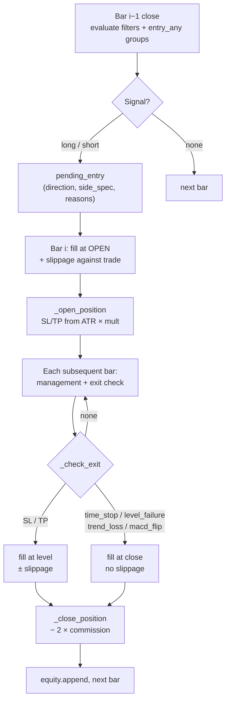

#### Контракт отсутствия заглядывания вперёд

| Правило | Реализация |
|---|---|
| **Сигнал на закрытии бара *i−1*** | `_entry_signal(side_spec, row, prev)` вычисляет условия по бару, который уже закрылся |
| **Исполнение на открытии бара *i*** | `entry_fill = raw_open × (1 ± eps)` |
| **Одна позиция за раз** | Пока `position is not None`, новые сигналы не вычисляются |
| **Конец периода** | Принудительное закрытие по закрытию последнего бара с `exit_reason: "end_of_period"` |
| **Первый бар пропускается** | Цикл начинается с `i=1` — у первого бара нет `prev` |
| **Фильтры проверяются перед входом** | Глобальные `filters` вычисляются на баре *i−1*; `False` обрывает обе стороны |


Это то, что отделяет реальный бэктест от упражнения по подгонке кривой. Сигналить на закрытии и исполнять по этому же закрытию — самый распространённый способ, которым бэктесты лгут.

---

### 💸 Издержки

| Издержка | По умолчанию | К чему применяется |
|---|---|---|
| **Комиссия** | 0.055% на сторону (`commission_pct=0.055`) | Вход **и** выход: `pnl_pct = (pnl_pct − 2 × commission/100) × 100` |
| **Проскальзывание** | 0.05% (`config.BACKTEST_SLIPPAGE_PCT`) | Вход (всегда), выходы по SL/TP (всегда) |
| **Мягкие выходы** | 0% | `time_stop`, `level_failure`, `trend_loss`, `macd_flip`, `end_of_period` |

Асимметрия намеренна. Исполнение стоп-лосса происходит *по уровню* — вживую вы исполняетесь чуть хуже него, поэтому бэктест должен вас наказывать. Мягкий выход происходит *по закрытию, которое вы уже видели* — вживую это рыночный ордер по наблюдаемой цене, поэтому проскальзывание там было бы двойным счётом.

Направление проскальзывания всегда против сделки:

```
long entry:   open × (1 + eps)
short entry:  open × (1 − eps)
long SL/TP:   level × (1 − eps)
short SL/TP:  level × (1 + eps)
```

Где `eps = slippage_pct / 100`, так что 0.05% → `0.0005`.

Оба настраиваются при каждом вызове. UI выставляет `commission_pct`; `slippage_pct` берётся из `config`, если не переопределён вызывающим. **Примечание:** оптимизатор не передаёт явный `slippage_pct`, поэтому наследует `config.BACKTEST_SLIPPAGE_PCT` — бэктест и оптимизатор видят одну и ту же модель проскальзывания.

---

### 🛡️ Управление позицией

Вычисляется на **каждом баре**, пока позиция открыта. Всё это выполняется *до* проверки выхода — стоп, перенесённый в безубыток на этом баре, может сработать на этом же баре.

#### 1. Перенос в безубыток — `move_to_breakeven_at_tp_pct`

Когда цена прошла долю пути до TP (например, `0.65` = 65%), стоп прыгает к входу ± `breakeven_offset_pct`. Смещение покрывает комиссии — «безубыточный» стоп ровно на входе всё равно небольшой убыток после комиссий.

Движется только в благоприятную сторону. Установленный безубыток нельзя отдать обратно.

#### 2. ATR-трейлинг — `trailing_atr_mult`

```
long:  new_sl = close − trailing_atr_mult × atr_14
short: new_sl = close + trailing_atr_mult × atr_14
```

Применяется, только если подтягивает стоп. `None` отключает. Если срабатывают и безубыток, и трейлинг, побеждает более узкий из двух.

#### 3. Жёсткие выходы — проверяются по high/low

| Направление | Стоп | Тейк |
|---|---|---|
| Long | `low <= stop_loss` | `high >= take_profit` |
| Short | `high >= stop_loss` | `low <= take_profit` |


Внутри бара, используя экстремумы бара. Если оба сработали бы на одном баре, **побеждает стоп** (проверяется первым).

#### 4. Мягкие выходы — проверяются по close

| Выход | Условие (long) | Условие (short) |
|---|---|---|
| `time_stop` | `bars_held >= max_hold_candles` | то же |
| `level_failure` | `close < level × (1 − buffer)` | `close > level × (1 + buffer)` |
| `trend_loss` | `close < sma_50` | `close > sma_50` |
| `macd_flip` | `macd_hist < 0` | `macd_hist > 0` |


`level_field` выбирает, какой уровень (`resistance_1` для long, `support_1` для short). `level_failure_buffer_pct` (по умолчанию 1.0%) предотвращает выход по одиночному фитилю.

Каждый мягкий выход индивидуально переключаем и **по умолчанию выключен** в `default_strategy_spec()`. Пробой уровня, в частности, был обнаружен режущим сделки в убыток ровно на уровне входа, прежде чем тезис успевал раскрыться.

#### 5. Построение SL/TP при входе

`_open_position()` вычисляет стоп и тейк:

1. **На основе ATR**: `stop_dist = stop_loss_atr_mult × atr_14`, `take_dist = take_profit_atr_mult × atr_14` — используется, когда `atr_14 > 0` и множитель задан
2. **Процентный фолбэк**: `stop_dist = entry × stop_loss_pct / 100`, `take_dist = entry × take_profit_pct[0] / 100`

Предпочтение ATR не эстетическое — фиксированный 2% стоп на SOL по $150 очень отличается от 2% на ARB по $0.60. ATR нормализует.

---

### 🚦 Кулдаун после серии убытков — `risk_controls`

Опциональный предохранитель, полностью внутри симуляции:

```
"risk_controls": {
  "enabled": true,
  "max_consecutive_losses": 4,
  "pause_candles_after_losses": 32,
  "max_losses_in_window": 6,
  "loss_window_trades": 10
}
```

Два независимых триггера, проверяются при каждом закрытии:

- **Серия** — `max_consecutive_losses` подряд
- **Окно** — `max_losses_in_window` в пределах последних `loss_window_trades`

При срабатывании `cooldown_until_index = i + pause_candles_after_losses`, и вычисление входа пропускается, пока индекс не догонит. Движок записывает:

| Статистика | Значение |
|---|---|
| `cooldown_activations` | Сколько раз сработал кулдаун |
| `skipped_candles_by_cooldown` | Бары, проведённые в кулдауне |


Точно та же логика зеркалируется в `trading/auto_trader.py` (`_get_risk_controls`, `_should_pause_after_loss`) с идентичными значениями по умолчанию — стратегия ведёт себя одинаково вживую и в бэктесте.

---

### 📤 Вывод

```
{
  "trades": [...],
  "equity_curve": [...],
  "stats": {...},
  "strategy_spec_used": {...},
  "spec_source": "ai" | "default",
  "start_date": ...,
  "end_date": ...,
}
```

#### Каждая сделка

| Поле | Содержание |
|---|---|
| `entry_time`, `exit_time` | Метки времени |
| `direction` | `"long"` / `"short"` |
| `entry_price`, `exit_price` | Цены исполнения (после проскальзывания) |
| `result_pct` | Чистый P&L после обеих комиссий |
| `exit_reason` | `stop_loss` · `take_profit` · `time_stop` · `level_failure` · `trend_loss` · `macd_flip` · `end_of_period` |
| `capital_after` | Скомпаундированный капитал после этой сделки |
| `entry_reasons` | По каждому условию `{text, passed, detail}` — фактические значения на входе |
| `entry_snapshot` | RSI, ADX, ATR, объём, SMA, MACD, VWAP, пивоты на входе |

`entry_reasons` и `entry_snapshot` — диагностическое золото. Они позволяют ответить *«были ли мои убытки сгруппированы при низком ADX?»* без повторного прогона. Это ровно те данные, которые потребляет `optimize_strategy`.

#### Блок статистики

| Метрика | Значение |
|---|---|
| `total_trades` | Количество |
| `win_rate` | % сделок с `result_pct > 0` |
| `total_pnl_pct` | Сумма доходностей сделок (справочно, не компаундировано) |
| `return_pct` | Компаундированная доходность на начальный капитал |
| `final_capital` | Конечный баланс |
| `max_drawdown_pct` | Пик-к-дну по **кривой equity** |
| `profit_factor` | Валовая прибыль / валовой убыток (`999.0`, когда убытков нет) |
| `avg_trade_pct` / `expectancy_pct` | Средняя доходность на сделку |
| `avg_win_pct` / `avg_loss_pct` | Средняя величина выигрыша / проигрыша |
| `long_trades` / `short_trades` | Разбивка по направлению |
| `risk_controls_enabled` | Был ли активен блок кулдауна |
| `cooldown_activations` | Сколько раз срабатывал |
| `skipped_candles_by_cooldown` | Бары, потерянные на кулдауны |


> ⚠️ **`max_drawdown_pct` — сделка-к-сделке, не внутрибарная.** Список equity получает запись только когда сделка закрывается; плавающая просадка открытой позиции невидима. Стратегия может показать 3% макс. DD, будучи на 20% под водой внутри позиции. Читайте вместе с `avg_loss_pct` и настройками управления.

> ⚠️ **`total_pnl_pct` ≠ `return_pct`.** Первое — сырая сумма процентных значений по сделкам; второе — компаундированное. Десять сделок по +1% = `total_pnl_pct = 10%`, но `return_pct ≈ 10.46%`. UI показывает оба явно.

---

### 📁 Выходные файлы

#### XLSX на каждый одиночный бэктест

На каждом одиночном бэктесте (не оптимизации) `export_backtest_to_xlsx()` записывает книгу из двух листов:

```
data/backtests/{SYMBOL}_backtest_{start}_{end}.xlsx
```

| Лист | Содержимое |
|---|---|
| **Статистика** | Заголовок (символ, spec_source, даты) + все строки метрик |
| **Сделки** | Полная таблица сделок с `entry_reasons`, сплющенными в один столбец |


Лист сделок имеет столбец `entry_reasons` для чтения человеком: каждое условие становится `✓ close > resistance_1 → close=1.234, resistance_1=1.230`. Один этот столбец стоит экспорта.

Ошибки экспорта перехватываются и логируются — сломанный экспорт никогда не мешает отрисовке списка сделок.

#### CSV по итерациям от оптимизатора

Для каждого оценённого кандидата:

```
data/backtests/{SYMBOL}_optimization_summary.csv      ← append, одна строка на итерацию
data/backtests/{SYMBOL}_iteration_{N}_{train|test}_trades.csv
```

`optimization_summary.csv` накапливает строку на итерацию со всеми метриками, `selection_score`, флагом `acceptable`, полным JSON `strategy_spec`, текстом правил и `changes_summary`.

#### Текстовый отчёт на прогон оптимизации

Один файл на прогон, записываемый **потоково**, чтобы сбой или отмена не потеряли данные:

```
optimization_reports/{SYMBOL}_{YYYYMMDD_HHMMSS}.txt
```

Содержит: базовую линию, экран Фазы 0 (если запускался), каждую пару промпт/ответ ИИ, разбивку баллов каждого кандидата, каждую оценку робастности, финального победителя и полную историю итераций. Тяжёлые массивы (`trades`, `fold_results`, `rejected_fingerprints`) заменяются на `<N элементов — полные данные в CSV>`; длинный текст (`reasoning`) обрезается на 500 символах. **Отчёт никогда не влияет на размер промпта или стоимость токенов.**

---

### 🔁 Цикл оптимизации — полный цикл

Кнопка **♻️ Запустить оптимизацию** вызывает `backtest_optimizer.run(...)`. Это самая сложная часть системы, и у неё **шесть независимых гейтов** между «идея существует» и «стратегия сохранена в память».
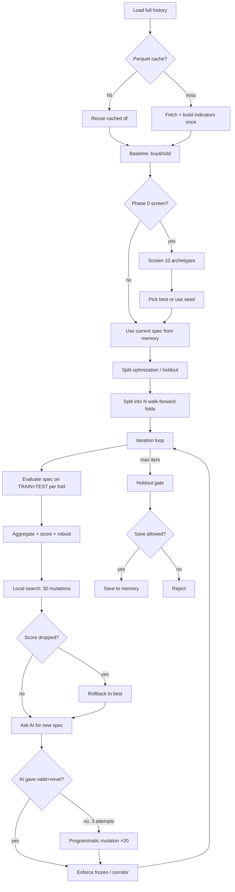
#### 1. Базовая линия — `buy_and_hold`

Прежде всего `optimization/baselines.py` вычисляет, что вернуло бы простое удержание монеты:

```
return_pct = (close[-1] / close[0] - 1) × 100
max_drawdown_pct = max peak-to-trough on price
```

Это логируется и сохраняется в отчёт как число, которое должна побить любая стратегия, чтобы быть хоть чего-то стоящей.

#### 2. Фаза 0 — скрининг архетипов

Опциональна, запускается чекбоксом `Фаза 0` **или установкой явного `seed_archetype`** (явный сид принудительно включает Фазу 0, чтобы её сетка была оценена).

`optimization/archetypes.py` определяет **10 фиксированных стратегий** в двух семействах. У каждой структура **жёстко закодирована** — открыто только 2-3 числовых параметра. Комментарий в файле называет это *«барьер переобучения: идею нельзя «переписать», можно лишь настроить риск под волатильность.»*

**Семейство тренд/импульс:**

| Имя | Идея | Настраиваемое |
|---|---|---|
| **A1_TREND_PULLBACK** | тренд 1h + откат к SMA20 на 15m | стоп, tp, множитель объёма |
| **A2_VOL_BREAKOUT** | пробой Боллинджера с фильтром ADX 1h | стоп, tp, порог ADX |
| **A3_MEAN_REVERSION** | экстремум RSI внутри тренда 1h | стоп, tp, порог RSI |
| **A4_TREND_MOMENTUM** | чистый тренд 1h (sma_50_1h + macd_hist_1h) | стоп, tp |
| **A5_STRONG_VOL_BREAKOUT** | 32-барный пробой с объёмом + close_position > 0.6 | стоп, tp, объём, удержание |
| **A6_SHORT_MOMENTUM** | ТОЛЬКО SHORT: `drop_2_atr < −2.0` + `volume > 2.0×` | стоп, tp, объём, удержание |

**Семейство возврата к среднему:**

| Имя | Идея | Настраиваемое |
|---|---|---|
| **R1_BB_MEAN_REVERSION** | пересечение обратно в BB, диапазон RSI, низкий ADX | стоп, tp, ADX |
| **R2_RSI_REVERSION** | экстремум RSI против VWAP, низкий ADX | стоп, tp, ADX, RSI |
| **R3_RANGE_BOUNDARIES** | закрытие внутри зоны support_1 / resistance_1, низкий ADX | стоп, tp, ADX |
| **R4_VWAP_REVERSION** | закрытие растянуто на 1-2.5% от VWAP, низкий ADX | стоп, tp, ADX |


`grid()` каждого архетипа выдаёт 8-36 комбинаций параметров. `screen_runner.run_screen()` прогоняет каждую комбинацию каждого архетипа, записывает лучшую по архетипу (по `return_pct`, требуя **≥ 10 сделок**) и возвращает таблицу плюс словарь `by_name`.

**Правило выбора:**

- **Явный сид** (`seed_archetype` из UI) → использовать безусловно, даже если он уступает buy&hold
- **Авто-режим** → использовать только архетип, побивающий buy&hold *и* имеющий `PF > 1.0`

**Две специальные механики в A6** (`_build_a6_short_momentum`):

| Механика | Эффект |
|---|---|
| `frozen_entries: True` | `_enforce_frozen_entries` оптимизатора принудительно восстановит `entry`/`entry_any` из этой базовой спецификации в любой кандидат ИИ |
| `exit_corridor` | `_enforce_exit_corridor` ограничивает `stop_loss_atr_mult ∈ [1.8, 2.2]`, `take_profit_atr_mult ∈ [1.3, 1.7]`, `max_hold_candles ∈ [6, 12]`; также принудительно ставит `trailing_atr_mult = None` и `move_to_breakeven_at_tp_pct = None` (измерено в лаборатории: оба вредят этому конкретному сигналу) |


Так A6 — «заблокированный лабораторией» архетип — оптимизатор может настраивать внутри коридора, но не может выйти за него и не может изменить условия входа.

#### 3. Загрузка данных с parquet-кэшем

`optimizer_data_utils.load_prepared_dataframe()`:

| Шаг | Поведение |
|---|---|
| **Путь parquet** | `data/ohlcv_cache/{SYMBOL}_15_{start}_{end}.parquet` |
| **Кэш пригоден** | Только если `end_date < today` — свежие диапазоны из кэша никогда не принимаются |
| **При промахе** | `fetcher.fetch_ohlcv()` → сохранить в parquet (best-effort, сбой игнорируется) |
| **Мин. свечей** | Возвращает ошибку, если `< 150` |
| **Индикаторы** | Вычисляются **один раз** здесь через `engine._build_indicator_frame()`, затем переиспользуются во всех итерациях |


**Это самое крупное решение по производительности в оптимизаторе**: загрузить один раз, вычислить индикаторы один раз, затем нарезать один и тот же DataFrame для каждого TRAIN и TEST окна в каждой итерации. Без этого 10 итераций × 6 фолдов × 2 (TRAIN+TEST) × 30 локальных мутаций были бы 3600+ сетевыми запросами.

#### 4. Разбиение optimization / holdout

`split_optimization_and_holdout()` резервирует **последние 15%** истории для финальной валидации:

| Параметр | Значение |
|---|---|
| `holdout_ratio` | **0.15** |
| `min_holdout_candles` | **500** (~5 дней) |
| `min_optimization_candles` | **3000** (~31 день) |


Если любой минимум не выполнен, **holdout отключается полностью**, и весь DataFrame идёт в оптимизацию. Это честно — нельзя валидировать на данных, которых у вас нет.

Оптимизатор **никогда не видит** DataFrame holdout во время итерации.

#### 5. Walk-forward разбиения

`make_splits()` строит фолды:

| `walk_forward_folds` | Поведение |
|---|---|
| **1** | Одно стандартное разбиение: TRAIN = первые `train_ratio`, TEST = остальное |
| **> 1** | TRAIN всегда начинается с `start_date` и **расширяется** перед каждым окном TEST; окна TEST — последовательные непересекающиеся срезы оставшегося диапазона |


`train_ratio` ограничивается диапазоном `[0.5, 0.9]`.

**Критическая тонкость:** каждое окно TEST начинается со своим собственным `initial_capital`. `return_pct` внутри фолда компаундируется от начала этого фолда; `_aggregate_fold_results` затем компаундирует `return_pct` по фолдам через `compounded *= (1 + ret/100)`. Компаундирование применяется ровно один раз на уровне — не удваивается.

#### 6. Поток на итерацию

Для каждой итерации `1..max_iterations`:

**a. Оценить текущую спецификацию** — `_evaluate_spec_on_splits()` запускает `engine.run_on_dataframe()` для TRAIN и TEST каждого фолда. Ошибки прерывают всю оптимизацию с причиной.

**b. Агрегировать результаты** — `_aggregate_fold_results()`:

| Статистика | Агрегация |
|---|---|
| **TRAIN** | Берётся **только из последнего фолда** (у которого самое большое окно TRAIN) |
| **TEST** | Все фолды конкатенируются: сделки объединяются, `return_pct` компаундируется, `max_drawdown_pct` = худшая по фолдам |
| **win_rate / avg_win / avg_loss / PF** | Пересчитываются по объединённому списку сделок |

**c. Балл** — `OptimizerScoring.compute_raw_selection_score_v2()`:

```
raw_score =
      3.0 × test_expectancy
    + 1.5 × (min(test_pf, 2.5) − 1
```

Бонус за количество сделок:

| `test_trades` | Бонус |
|---|---|
| `< 20` | **−5.0** (плоский штраф — переобучение) |
| `20..39` | `+0.10 × test_trades` |
| `≥ 40` | `+0.25 × test_trades` |


Штраф за `< 20` сделок намеренно брутален. Стратегия с PF 3.0 на 8 сделках не лучше, чем с PF 1.3 на 40 сделках, и скоринг это обеспечивает.

**d. Флаг acceptable** — `score_and_flags()` возвращает `(raw_score, acceptable, train_exp, test_exp)`, где:

```
acceptable = test_trades >= min_test_trades    
```

`MIN_ACCEPT_TEST_TRADES = 10` — жёсткий порог. Кандидат с меньшим числом сделок никогда не может стать `best`, каким бы хорошим ни был балл.

**e. Робастность по окнам** — `OptimizerRobustness.compute_window_robustness()` вычисляет отношения по окнам:

| Метрика | Значение |
|---|---|
| `profitable_windows_ratio` | Доля окон TEST с `return_pct > 0` |
| `positive_expectancy_windows_ratio` | Доля с `expectancy > 0` |
| `pf_pass_windows_ratio` | Доля с `PF > 1` |
| `median_window_return_pct` | Медиана по окнам |
| `worst_window_return_pct` | Худшее окно |
| `return_std` | Стд. отклонение доходностей |
| `stability_score` | 0..1, вычисляется по диагностикам выше |


**f. Оценка робастности** — `assess_window_robustness()` с порогами по умолчанию (из `optimizer_robustness.py`):

| Порог | Значение |
|---|---|
| `min_profitable_windows_ratio` | **2/3** |
| `min_positive_expectancy_windows_ratio` | **2/3** |
| `min_pf_pass_windows_ratio` | **2/3** |
| `min_median_window_return_pct` | **0.0** |
| `max_worst_window_return_pct` | **−5.0** |
| `min_stability_score` | **0.5** |


Статус:

- **`robust`** — все пороги выполнены → `passed=True, fragile=False`
- **`fragile`** — слабый проход (окна ≥ 2, все отношения ≥ 0.5, стабильность ≥ 0.35) → `passed=True, fragile=True`
- **`unstable`** — иначе → `passed=False`

**g. Мягкий штраф за окна** — `window_stability_penalty()` добавляет 0-3.0 к штрафу, применяемому к `raw_score`:

```
final_score = raw_score − window_penalty
```

Штрафы: `profitable < 50%` → +1.0; `50-67%` → +0.4; та же схема для отношений expectancy и PF; `worst < −10%` → +0.8; `std > 10%` → +0.6. Ограничен 3.0.

**h. Локальный поиск** — `OptimizerMutations.local_search()` выполняет до **30** мутаций (`LOCAL_SEARCH_MUTATIONS = 30`), сохраняя лучшую по `train_score` (`total_pnl − 0.5 × drawdown`). Каждая мутация — полный прогон TRAIN+TEST на каждом фолде. Если что-то бьёт базу, это записывается как `{iteration}-local` и становится базой для шага ИИ.

Типы мутаций (`mutate_numeric`):

| Тип условия | Мутация |
|---|---|
| `range` | min/max ± U(−8, 8), ограничено [0, 100], мин. ширина 5 |
| `volume` | `mult` ± U(−0.4, +0.3), мин. 0.8 |
| `compare` с `left='adx_14'` | `right` ± U(−6, 6), мин. 10 |
| операнд `{name, mult}` | `mult` ± U(−0.004, +0.004) |
| `stop_loss_atr_mult` | В коридоре [lo, hi]; иначе U(1.0, 2.5) |
| `take_profit_atr_mult` | В коридоре [lo, hi]; иначе U(2.0, 6.0) |
| `move_to_breakeven_at_tp_pct` | Без коридора: `choice([None, 0.3, 0.5, 0.7])` |
| `trailing_atr_mult` | Без коридора: `choice([None, 2.0, 2.5, 3.0, 3.5])` |
| `max_hold_candles` | Если коридор: `randint(lo, hi)` |

Входы мутируют, только если `frozen_entries` не установлен.

**i. Откат** — перед запросом у ИИ следующей спецификации код проверяет:

```
threshold = best.selection_score − max(1.0, abs(best.selection_score) ×
```

Так плохая итерация не отравляет следующую — оптимизатор всегда даёт ИИ свой лучший результат на текущий момент, а не последний.

**j. Предложение ИИ** — `optimize_strategy()` вызывается до **3 раз** на итерацию с усиливающимся `extra_instruction`. На каждой попытке:

1. `validate_strategy_spec(candidate)` — отклонить, если невалидна
2. `_inherit_engine_controls(candidate, base)` — скопировать `risk_controls`, `management`, `frozen_entries`, `exit_corridor` из базы, если отсутствуют
3. `_enforce_frozen_entries(candidate, base)` — если у базы есть `frozen_entries`, восстановить `entry`/`entry_any` базы в кандидат (параметры риска кандидата выживают)
4. `_enforce_exit_corridor(candidate, base)` — если у базы есть `exit_corridor`, ограничить стоп/tp/удержание; принудительно поставить трейлинг/безубыток в `None`
5. `ensure_engine_defaults(candidate)` — заполнить отсутствующие поля управления
6. Повторно применить `frozen_entries` и `exit_corridor` после дефолтов (дефолты могут их сбросить)
7. `_spec_fingerprint(candidate)` в `rejected_fingerprints`? Пропустить, повторить.

**k. Фолбэк** — если 3 попытки ИИ провалились, `PROGRAM_MUTATION_ATTEMPTS = 20` попыток `mutate_numeric(base)`, валидированных и фингерпринтнутых так же.

**l. Записать кандидата** — `record_candidate()`:

- Добавляет в `history` с полной разбивкой баллов, робастностью, мягкими предупреждениями
- Вызывает `OptimizerSummary.save_round()` → пишет в summary CSV и торговые CSV
- Логирует обильно через `emit()` (видимо в текстовом отчёте)
- Обновляет `best`, если `acceptable` **и** `score > best.score` **и** (новый робастен **или** побивает робастного лучшего на ≥ 10%)

Правило 10% — это гейт «fragile не может дешёво сместить robust» — fragile-кандидат, едва обходящий robust-лучшего, отклоняется.

**m. Повтор.** Если `iteration == max_iterations`, выйти.

#### 7. Holdout-гейт

После цикла, если `holdout_meta.enabled` и `holdout_df` не пуст, `OptimizerHoldout.evaluate_spec_on_holdout()` прогоняет победившую спецификацию один раз на периоде holdout.

`assess_holdout_quality()` классифицирует результат:

| Статус | Условие |
|---|---|
| **`passed`** | `trades ≥ 10` И `expectancy > 0` И `PF > 1.05` И `return > 0` |
| **`weak_pass`** | `5 ≤ trades < 10` И те же качественные гейты |
| **`failed`** | Иначе |

Обратите внимание на более строгий PF-гейт на holdout: **1.05**, а не 1.0. Стратегия, едва прошедшая TEST, не заслуживает называться провалидированной.

Сводка holdout также записывает `profit_concentration`, предупреждения (`мало сделок`, `DD > 10%`) и рекомендации.

#### 8. Гейт сохранения

`save_best_to_memory` записывает победителя в `data/{SYMBOL}/state.json` и `trading_rules.md` — **только** если всё это истинно:

| Гейт | Блокирует сохранение, если |
|---|---|
| `best is not None` | Приемлемого кандидата никогда не было |
| `holdout_meta.enabled` | Н/Д (holdout отключён → не блокер) |
| `holdout_status == "failed"` | **Да** — holdout провален |
| `holdout_status == "weak_pass"` И `not allow_weak_holdout_save` | **Да** — weak pass без явного разрешения |
| `holdout_status == "passed"` | Нет блока |
| `holdout disabled` | Нет блока |


Так `allow_weak_holdout_save=True` — *единственный* способ сохранить `weak_pass`. Это опт-ин — оператор решает, что 7 сделок при PF 1.2 на holdout «достаточно хороши на сейчас».

#### 9. Отчёт

`OptimizationReport` открывается в начале `run()` и пишется **потоково** на протяжении всего: каждая строка `emit()`, каждый промпт ИИ, каждый ответ ИИ, каждая разбивка баллов, каждый вердикт робастности, финальный победитель и вся история. Сбой в середине прогона оставляет пригодный частичный отчёт.

Полная структура, сохраняемая за прогон:

| Раздел | Содержание |
|---|---|
| Заголовок | Символ, метка времени, путь |
| Базовая линия | Buy&hold |
| Фаза 0 | Скрин архетипов (если запускался) |
| Каждая итерация | Входы для ИИ, ответ ИИ, оценка кандидата, вердикт робастности, разбивка баллов, мягкие предупреждения |
| Holdout | Результат финальной валидации |
| История | Каждый когда-либо оценённый кандидат |


---

### 🧱 Шесть независимых гейтов — прочтите это один раз и вы поймёте оптимизатор

Между «спецификация существует» и «спецификация сохранена в память» код проходит через **шесть** различных проверок. Они наслоены намеренно — каждый существует, потому что предыдущая версия системы была обманута чем-то.

| # | Гейт | Порог | Предохранитель |
|---|---|---|---|
| 1 | **Инъекция в промпт ИИ** (`ai_client._build_optimize_message`) | `test_pf > 1.1` → заморозить вход; `test_trades < 30` → принудительно `entry_any` | Только текст промпта — модель может проигнорировать, так что не жёсткий блок |
| 2 | **`acceptable`** (`optimizer_scoring.score_and_flags`) | `test_trades ≥ 10` И `train_exp > 0` И `test_exp > 0` И `train_pf > 1.0` И `test_pf > 1.0` | Кандидат не может стать `best` |
| 3 | **Робастность** (`optimizer_robustness.assess_window_robustness`) | ≥ 2/3 окон прибыльны, с положительным ожиданием, проходят PF; медиана ≥ 0; худшее ≥ −5%; стабильность ≥ 0.5 | `fragile` может пройти, но с ценой +10% балла против `robust`-лучшего |
| 4 | **Штраф за окна** (`optimizer_robustness.window_stability_penalty`) | 0-3.0 балла вычитается из raw score на основе согласованности окон | Влияет только на ранжирование — не жёстко отклоняет |
| 5 | **Holdout** (`optimizer_holdout.assess_holdout_quality`) | `trades ≥ 10`, `exp > 0`, `PF > 1.05`, `return > 0` для `passed`; 5-9 сделок → `weak_pass` | `failed` → жёсткий блок; `weak_pass` → блок, если не `allow_weak_holdout_save=True` |
| 6 | **Гейт сохранения** (в `run()`) | Лучший должен существовать; статус holdout не должен быть `failed`; `weak_pass` требует флага разрешения | Если любой гейт блокирует, ничего не сохраняется — монета сохраняет свою старую спецификацию |

Слои **не избыточны**. Гейт 1 формирует поиск, гейт 2 фильтрует очевидный мусор, гейт 3 вознаграждает стратегии, которые работают в *большинстве* окон, а не в одном, гейт 4 штрафует несогласованность, гейт 5 тестирует на данных, которых оптимизатор никогда не видел, гейт 6 блокирует сохранение, если что-либо выше провалилось.

---

### 🧪 Как выглядит реальный прогон оптимизации

Примерная форма прогона на 10 итераций, 6 фолдов:

| Фаза | Прибл. бэктестов | Время (типичное) |
|---|---|---|
| Загрузка данных + индикаторы | 1 | 10–30 с (с parquet) |
| Базовая линия | 1 | <1 с |
| Скрин Фазы 0 (опц.) | ~150 | 2–4 мин |
| 10 итераций × (12 оценок фолдов + 30 локальных × 12 оценок фолдов) | ~3600 | 5–15 мин |
| Holdout | 1 | <1 с |

`parquet`-кэш превращает второй прогон того же периода из «10 минут сети» в «мгновенно». 3600 бэктестов локальны — движок это чистый pandas по DataFrame, который он уже держит.

---

### 📁 Оффлайн-путь данных

`data_loader.py` читает годовые CSV из `backtest_data/`:

```
backtest_data/
└── SOLUSDT
```

| Функция | Возвращает |
|---|---|
| `get_available_symbols()` | `["ADAUSDT", "ARBUSDT", ...]` |
| `get_available_years(symbol)` | `[2023, 2024, 2025, 2026]` |
| `load_local_data(symbol, year, start_date, end_date)` | Нормализованный DataFrame |
| `load_first_available_data(preferred)` | `(symbol, year, df)` |


Загрузчик определяет разделитель, переименовывает `datetime_utc → timestamp`, приводит числовые к числам, отбрасывает непарсящиеся строки, сортирует по времени и извлекает год из имени файла. Если у символа несколько файлов за год, он предпочитает `15m`.

Также присутствуют: `funding/`, `long_short/`, `open_interest/` — используются исследованием, не текущим движком.

UI-страница **не** выставляет оффлайн-режим. Для оффлайн-исследования через UI либо передайте DataFrame в `run_on_dataframe()` напрямую, либо используйте исследовательскую лабораторию (см. Раздел 5).

---

### ✅ Как выглядит «хороший бэктест»

| Сигнал | Прочтение |
|---|---|
| `profit_factor > 1.1` на **TEST** | Единственное число, которое считается — TRAIN для подгонки |
| `total_trades >= 30` | Ниже этого PF — шум |
| `avg_win_pct / avg_loss_pct >= 2.5` | Выплата должна оправдывать винрейт ниже 50% |
| `max_drawdown_pct` приемлема против `avg_loss_pct` | DD должна быть кратна одиночному убытку, а не сдвигу режима |
| `cooldown_activations` низкое, но не нулевое | Предохранитель работает, не доминируя |
| `spec_source == "ai"` | Вы тестируете стратегию модели, а не фолбэк |
| `TRAIN WR − TEST WR < 15%` | Больший разрыв = переобучение (UI предупреждает выше этого) |
| `expectancy_pct > 0 on TEST` | Самая важная строка (UI предупреждает, если ≤ 0) |

Если любой из последних трёх проваливается, относитесь к результату как «перспективно, но не готово» и используйте оптимизацию для поиска лучшей точки.

---

### 🚫 Что движок не сделает

- **Никаких частичных исполнений, никакой симуляции книги заказов, никаких выплат финансирования** — только комиссия и проскальзывание
- **Никакого пирамидинга** — одна позиция за раз, полное распределение текущего капитала
- **Никаких ограничений шорта** — предполагается, что обе стороны всегда доступны
- **Никакого мульти-символьного портфеля** — один символ, один прогон
- **Никакой внутрибарной просадки** — см. примечание к `max_drawdown_pct`
- **Никакого принудительного walk-forward внутри движка** — разбиения TRAIN/TEST идут от оптимизатора

Знание границ важнее функций. Бэктест, говорящий PF 1.4 при этих допущениях — это **доказательство**, а не приговор.

---

### 🧱 Константы, формирующие поведение

| Константа | Значение | Источник |
|---|---|---|
| Комиссия по умолчанию | **0.055%** на сторону | `run()` по умолчанию (тейкер Bybit) |
| Проскальзывание по умолчанию | **0.05%** | `config.BACKTEST_SLIPPAGE_PCT` |
| Минимум свечей | **60** | Шлагбаум `run_on_dataframe()` |
| Минимальный период бэктеста | **15 дней** | `_get_common_params()` |
| `max_hold_candles` по умолчанию | **48** (12ч) | `auto_trader.DEFAULT_MAX_HOLD_CANDLES` |
| Множитель трейлинг-ATR по умолчанию | **2.0** | `auto_trader.DEFAULT_TRAILING_ATR_MULT` |
| `risk_controls` по умолчанию | 4 подряд / 32 свечи / 6 в 10 | `default_strategy_spec()` + `ensure_engine_defaults()` |
| `MIN_ACCEPT_TEST_TRADES` | **10** | `backtest_optimizer.py` |
| `LOCAL_SEARCH_MUTATIONS` | **30** | `optimizer_mutations.py` |
| `PROGRAM_MUTATION_ATTEMPTS` | **20** | `backtest_optimizer.py` |
| Попыток ИИ на итерацию | **3** | `backtest_optimizer.py` |
| Доля holdout | **15%** | `split_optimization_and_holdout()` |
| Мин. holdout свечей | **500** | то же |
| Мин. optimization свечей | **3000** | то же |
| Пороги отношений робастности | **2/3** каждый | `optimizer_robustness.py` |
| Худшее окно робастности | **−5.0%** | то же |
| Оценка стабильности робастности | **0.5** | то же |
| Смещение fragile→robust | **+10%** балла | `backtest_optimizer.record_candidate()` |
| Сделок для holdout `passed` | **≥ 10** | `optimizer_holdout.py` |
| Сделок для holdout `weak_pass` | **5..9** | то же |
| Порог `PF` для holdout | **> 1.05** | то же |
| Доля TRAIN по умолчанию | **70%** | UI |
| Walk-forward фолдов по умолчанию | **6** | UI |
| Лимит итераций в UI | **30** | `max=30` на поле итераций |


---

### 🛡️ Что делает бэктест здесь заслуживающим доверия

| Свойство | Как достигается |
|---|---|
| **Без жульничества на одном баре** | Сигнал на закрытии бара *i−1*, исполнение на открытии бара *i* |
| **Без утечки будущего в индикаторах** | Каждый скользящий индикатор использует `shift(1)`; пивоты используют вчерашний OHLC |
| **Реалистичные издержки** | Комиссия × 2 + проскальзывание против сделки на входе и SL/TP |
| **Намеренная асимметрия издержек** | Мягкие выходы без проскальзывания, потому что исполняются по уже наблюдаемому закрытию |
| **Детерминированный повтор** | Одна и та же спецификация + одни и те же данные = одни и те же сделки каждый раз |
| **Диагностируемые сделки** | `entry_reasons` + `entry_snapshot` на каждой сделке |
| **Шесть независимых анти-переобучающих гейтов** | Инъекция в промпт → acceptable → robust → penalty → holdout → save |
| **Одна и та же логика риска вживую и в бэктесте** | Код `risk_controls` намеренно дублирован в `auto_trader` с идентичными дефолтами |
| **Замороженные входы применяются принудительно, а не запрашиваются** | `_enforce_frozen_entries()` перезаписывает условия входа ИИ условиями базы |
| **Коридоры применяются принудительно, а не запрашиваются** | `_enforce_exit_corridor()` ограничивает выходы измеренными границами; трейлинг/безубыток принудительно обнулены для A6 |
| **Откат при регрессе** | `if score < best − max(1, |best|×0.3)` → база становится лучшим, а не последним |
| **Потоковый отчёт** | `OptimizationReport` пишет на диск при каждом `emit()`, выживает при сбоях |
| **Parquet-кэш честен** | Используется только для полных прошлых периодов — диапазон с сегодняшней датой всегда загружается заново |


---

```

</
<a id="5-лаборатория"></a>
## 5. 🧪 Лаборатория

### 💡 Что это

Лаборатория — это **исследовательская мастерская**, место, где торговые идеи рождаются, проходят стресс-тестирование и либо умирают, либо продвигаются в продакшен. Это не один экран. У неё **две поверхности** и **шестнадцать скриптов**, и разница между ними важна:

| Поверхность | Что делает | Для кого |
|---------|--------------|--------------|
| **🔬 UI-страница Lab** (`ui/pages/research_lab_page.py`) | Одна конкретная вещь: **портфельный бэктест** с несколькими стратегиями, символами, плечом и параметрами выхода. Производит график кривой equity + разбивку по годам + скачиваемый текстовый отчёт | Интерактивное использование из браузера |
| **🧪 CLI-лаборатории** (`research/*.py`, 16 скриптов) | Всё остальное: обнаружение сигналов, тюнинг выходов, арбитраж фандинга, сеточные стратегии, парный арбитраж, стресс-тесты | Разовые исследовательские прогоны, `python research/xxx_lab.py` |

Обе разделяют один и тот же базовый движок (`research/impulse_lab._simulate_fixed`), но служат разным целям. UI — для **валидации портфеля, который вы уже собрали**; CLI-скрипты — для **создания компонентов в первую очередь**.

Весь смысл существования Лаборатории: **ничто не идёт в продакшен только потому, что хорошо выглядело на одном графике**. Оно идёт туда, потому что выжило на нескольких наборах данных, нескольких годах, нескольких уровнях проскальзывания и (в случае сигнальных стратегий) конкретной лаборатории выходов.

---

### 🔬 UI-страница Lab — портфельная симуляция

Это то, что открывается, когда вы нажимаете **🔬 Лаборатория** в боковой панели.

#### Модель

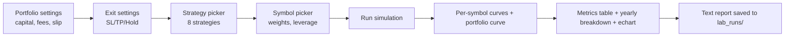

Каждый символ симулируется **независимо** — одна позиция за раз, без взаимодействия между символами. Кривая портфеля — это **сумма текущего капитала каждого символа** плюс нераспределённый кэш.

#### Параметры портфеля

| Поле | По умолчанию | Значение |
|---|---|---|
| **Начальный капитал** | 1000.0 USDT | Всего по всем символам |
| **Комиссия, % (round-trip)** | 0.11 | Применяется на сделку по полной позиции |
| **Проскальзывание, %** | 0.05 | Добавляется к комиссии для суммарной стоимости |
| **Реинвестировать прибыль** | вкл. | Если выкл., каждая сделка использует *выделенный* капитал, а не текущий |


Суммарная стоимость = `fee_pct + slippage_pct` — вычитается из сырой доходности каждой сделки.

#### Параметры выхода (общие для символов)

| Поле | По умолчанию | Значение |
|---|---|---|
| **Стоп-лосс (×ATR)** | 2.0 | Дистанция жёсткого стопа |
| **Тейк-профит (×ATR)** | 1.5 | Дистанция тейк-профита |
| **Макс. удержание (свечей)** | 8 | Время-стоп (8 × 15m = 2 ч) |


Обратите внимание на **короткий TP против широкого стопа** — выплата < 1 (1.5:2.0 = 0.75). Это не баг: моментум-шорт сигналы, составляющие портфель, склонны быстро достигать TP на продолжении, а широкий стоп защищает от отскока после дампа. Оптимальность этой асимметрии пришла непосредственно из `research/exit_lab.py` (см. ниже).

#### Выбор стратегий — 8 стратегий

Список чекбоксов строится из `STRATEGY_REGISTRY` в `portfolio_simulator.py`:

| Стратегия | Направление | Правило | Источник |
|---|---|---|---|
| **`mom2_short_t2.0`** | short | `vel_2 < −2.0` (падение > 2 ATR за 2 бара) | impulse_lab iter 4 |
| **`m2s2_vol1.5`** | short | `mom2` И `vol_ratio > 1.5` | impulse_lab iter 5 |
| **`m2s2_vol2.0`** | short | `mom2` И `vol_ratio > 2.0` | impulse_lab iter 5 — **лучший одиночный сигнал** |
| **`act_short`** | short | `activity > 3.0` И `vel_2 < −1.0` | portfolio_lab iter 1 |
| **`act_long`** | long | `activity > 3.0` И `vel_2 > 1.0` | portfolio_lab iter 1 |
| **`cont_long_t2.0`** | long | `vel_2 > 2.0` (восходящий импульс) | impulse_lab iter 6 |
| **`climax_bear`** | short | `range_atr > 1.5` И `vol_ratio > 2.0` И `close_position < 0.2` | impulse_lab iter 6 |
| **`climax_bull`** | long | `range_atr > 1.5` И `vol_ratio > 2.0` И `close_position > 0.8` | impulse_lab iter 6 |


По умолчанию отмечен: **`m2s2_vol2.0`** — единственный лучший сигнал из лабораторий.

Несколько выбранных стратегий объединяются как **один поток сигналов на символ, приоритет LONG сначала, затем SHORT** — соответствуя приоритету продакшен-движка. Если два сигнала срабатывают на одном баре, побеждает LONG. Если позиция уже открыта, более поздние сигналы отбрасываются — никакой новой позиции, пока текущая не закроется.

#### Выбор символов

Перечисляет символы из `backtest_data/` (через `get_available_symbols()`). Для каждого:

| Вход | По умолчанию |
|---|---|
| **Торговать** чекбокс | вкл. для `{ARBUSDT, DOGEUSDT, SOLUSDT}`, выкл. для остальных |
| **Доля капитала (%)** | 33.3 для трёх дефолтных |
| **Размер позиции (%)** | 50 |
| **Плечо** | 1.0 |


Эффективное плечо на капитал = `position_size_pct/100 × leverage`. При дефолтах 0.5 × 1 = 0.5× — половина выделенного капитала на сделку.

Ограничение: суммарный `capital_share_pct` должен быть ≤ 100%. Нераспределённый кэш отслеживается, но не торгуется — он лежит в кривой портфеля как постоянное аддитивное слагаемое.

#### Запуск

Нажмите **🚀 Запустить симуляцию**. Что происходит:

1. История каждого символа загружается один раз и кэшируется (`_PREPARED_CACHE`)
2. Индикаторы вычисляются один раз на символ через `engine._build_indicator_frame()`
3. Добавляются лабораторные признаки (`lab.add_features()` — набор признаков impulse_lab)
4. Вычисляются маски выбранных стратегий на подготовленном фрейме
5. Сделки симулируются **последовательно** — сигнал на баре *s*, исполнение на открытии *s+1*, выход по SL/TP/времени, одна позиция на символ, без перекрывающихся сигналов
6. Строятся кривые капитала по символам с `position_size × leverage × (result_pct/100)`
7. Кривая портфеля = сумма текущих капиталов + нераспределённое
8. Отрисовываются метрики, рисуется echart, сохраняется текстовый отчёт

Флаг **`bankrupt`** устанавливается на символ, если `final_capital <= 0` — система не обнуляет молча; она прекращает торговлю этим символом, как только капитал достигает нуля, и сообщает об этом.

#### Результаты

Отрисовываются вместе три секции:

**1. 📊 Итоги портфеля** — шесть карточек метрик:

| Карточка | Значение |
|---|---|
| Начальный капитал | `initial_capital` |
| Конечный капитал | сумма финалов по символам + нераспределённое |
| Общий P&L | `+` / `−` с $ и % |
| Монет / сделок | `len(symbols) / sum(trades)` |
| Макс. просадка (монета) | худшая просадка по символу |
| БАНКРОТСТВО | количество символов с `bankrupt=True` (показывается только при > 0) |


**2. 🪙 Результаты по монетам** — таблица со строками на символ:

| Столбец | Значение |
|---|---|
| Сделок | количество сделок |
| Win Rate | % прибыльных сделок |
| `exp_mean` | **средний результат сделки в % от цены входа**, до сайзинга и плеча. Это «качество самого сигнала» |
| Конечный капитал | конечный капитал этого символа |
| P&L | дельта `$` |
| P&L % | доходность `%` на выделенный капитал |


Столбец `exp_mean` намеренно выставляется с пояснительной подписью: *"exp_mean — средний результат одной сделки в % от цены входа (до учёта размера позиции и плеча). Показывает качество сигнала самого по себе."*

**3. 📅 Результаты по годам** — агрегирует все сделки по всем символам по `exit_time.year`, сообщая общее количество сделок, средний `exp_mean` и сумму `result_pct`.

**4. 📈 Кривые доходности** — линейный график ECharts:

| Серия | Цвет | Стиль |
|---|---|---|
| Каждый символ | один цвет из палитры | тонкая линия |
| Портфель | `#222` (тёмный) | линия **3px** |


Слайдер `dataZoom` внизу, ось x `time`, ось y `value`, масштабируется. Ось времени означает, что вы можете точно увидеть, когда символ обанкротился, если это произошло.

#### Текстовый отчёт

Каждая симуляция сохраняет полный отчёт в:

```
research/lab_runs/lab_{YYYYMMDD_HHMMSS}.txt
```

`save_simulation_report()` записывает структурированный текстовый файл с девятью разделами:

| Раздел | Содержимое |
|---|---|
| Заголовок | Метка времени, все параметры портфеля, все конфигурации монет |
| Итоги портфеля | Конечный капитал, P&L, все сделки, средний `exp_mean`, винрейт, лучшая/худшая сделка |
| Диагностика реализма | Суммарная стоимость на сделку, предупреждение о тейкере Bybit (0.20% round-trip), нераспределённый кэш |
| Результаты по монетам | Таблица со сделками, винрейтом, exp_mean, капиталом, P&L |
| Разбивка по годам | Год × {сделки, средний exp, сумма} |
| Разбивка по монетам и годам | `(symbol, year)` × {сделки, средний exp, сумма} |
| Статистика причин выхода | По символу: количество SL / TP / time |
| Предупреждения | Список ошибок |
| **Список сделок** | Каждая сделка: символ, стратегия, время входа/выхода, направление, цены, результат, баров удержания, причина выхода |


Список сделок — золото для отладки — вы можете проследить любую полосу убытков до конкретной стратегии и входа, которые её породили.

---

### 🧪 CLI-лаборатории — мастерская

Шестнадцать скриптов. Они делятся на шесть категорий:

#### 🔍 Обнаружение сигналов

**`impulse_lab.py`** — основа всего.

Это не лаборатория в смысле «запустить один бэктест». Это:

1. **Модуль инженерии признаков** (`add_features`) — 40+ столбцов сверх базовых индикаторов
2. **Симулятор с фиксированным выходом** (`_simulate_fixed`) — общий движок, который используют все остальные лаборатории
3. **Каталог сигналов** (`iteration_signals`) — 20+ кандидатных сигналов, оцениваемых против оракула
4. **Оракул** (`oracle_events`) — размечает бары по тому, последовал ли за ними «настоящий» импульс (движение ≥ 2.5 ATR, ER ≥ 0.45, в пределах 8 баров)

Ключевые признаки в `add_features`:

| Группа | Ряды |
|---|---|
| Позиция в диапазоне | `pos_in_range` (0..1 в пределах 96-барного диапазона) |
| Эффективность | `er_96` (Efficiency Ratio) |
| Объёмный импульс | `pos_vol_ratio` (среднее за 4 бара / среднее за 96 баров) |
| Импульс | `vel_2`, `vel_4`, `vel_8` (close.diff(k) / atr_14) |
| Внутри бара | `close_position`, `strong_bullish_close`, `strong_bearish_close` |
| Пробой | `brk32_long`, `brk32_short`, `brk32_vol_short`, `brk32_strong_short` |
| Состояние BB | `bb_width_pct`, `keltner_squeeze`, `squeeze_recent` |
| Серия | `streak_up`, `streak_dn` (5+ последовательных баров) |
| Спайк | `spike_up`, `spike_dn` (>3 ATR за 8 баров) |
| Дистанция | `dist_ema8_atr` |
| Диапазон | `range_atr` |
| Активность | `activity` = `vol_ratio × atr_ratio` |
| Позиционирование | `fund_z`, `oi_d4`, `ls_z` (из `positioning.py`) |


Сигнатура `_simulate_fixed`:

```
_simulate_fixed(d, idx, direction, sl_atr, tp_atr, max_hold,
                trail_atr=None, be_atr=None, cost=None)
```

**SL проверяется до TP** — так же, как в продакшене. Опциональный трейлинг (`trail_atr`) и безубыток (`be_atr`), которые включаются только когда high/low бара достигает триггера. Если `cost` равен `None`, используются `FEE_PCT + SLIPPAGE_PCT` из глобальных модулей (изменяемых — используются стресс-тестами).

Функция `_chase_diagnosis` заслуживает внимания: она сравнивает `entry_mode="signal_close"` (идеал, исполнение по закрытию бара сигнала) с `entry_mode="next_open"` (реалистично). Разница — **стоимость погони** — сколько эджа рынок съедает на переходе бара.

Выходы:

- `research/lab_report.txt` — текущий лог
- `research/leaderboard.txt` — рейтинги сигналов

**`swing_lab.py`** — обнаружение сигналов на 1h и 4h.

Тестирует четыре стратегии на старших таймфреймах:

1. **Trend Pullback** — цена выше/ниже SMA(50), откат к EMA(10), закрытие в благоприятной половине
2. **Breakout** — пробой канала Дончиана (20 баров)
3. **Momentum Bar** — vel_1 > 1 ATR + сильное закрытие, в согласии с трендом
4. **Momentum Any** — то же, что (3), но без трендового фильтра

Удержание: 1h → 72 бара (3 дня), 4h → 30 баров (5 дней). Оба сценария тейкера (0.28%) и мейкера (0.04%). Фильтр робастности: ≥ 6 наборов данных, ≥ 100 сделок, ≥ 60% положительных, средний exp > 0.

**`positioning.py`** — модуль признаков позиционирования без заглядывания вперёд.

Производит три ряда, которые объединяются в 15m-фрейм через `merge_asof(direction="backward")`:

| Признак | Источник | Формула |
|---|---|---|
| `fund_z` | `funding/funding_rate` | 96-периодный скользящий z-score ставки финансирования |
| `oi_d4` | `open_interest/open_interest` | `log(OI).diff(4)` — 4-часовое изменение OI в лог-единицах |
| `ls_z` | `long_short/long_short_ratio` | 96-периодный скользящий z-score от `log(L/S ratio)` |


**Критическое правило:** каждый признак должен использовать только записи с `timestamp <= T`. Обеспечивается через:

- Отдельный `merge_asof` на признак по его нативному временному штампу
- Валидация `MAX_AGE` — `fund_z` требует источник в пределах 30ч, `oi_d4` и `ls_z` — в пределах 6ч
- Возраст вычисляется по **naive-UTC numpy-массивам** — никаких багов сравнения часовых поясов

Без этого модуля никакой сигнал, учитывающий позиционирование, не мог бы существовать в лабораториях. Без проверки `MAX_AGE` устаревшая ставка финансирования трёхдневной давности молча протекла бы в текущий бар.

#### 🎯 Тюнинг выходов

**`exit_lab.py`** — лаборатория выходов.

Входной сигнал **заморожен**: `m2s2_vol2.0` (short, `vel_2 < −2.0` И `vol_ratio > 2.0`). Лаборатория варьирует **только** параметры выхода.

Трёхстадийная сетка:

| Стадия | Параметры | Комбинации |
|---|---|---|
| 1 | `sl ∈ {0.75, 1.0, 1.5, 2.0}` × `tp ∈ {1.5, 2.0, 3.0, 4.0}` × `hold ∈ {8, 16, 32, 64}` | 64 |
| 2 | Стадия 1 + `trail ∈ {1.0, 1.5, 2.0}` (hold=16 фикс.) | 45 |
| 3 | Стадия 2 + `be ∈ {0.5, 0.75, 1.0}` | 36 |
| **Итого** |  | **145** |


Каждая комбинация оценивается на **каждом (символ, год) наборе данных**. Агрегированные метрики: `n_datasets`, `trades_total`, `exp_mean`, `frac_pos`, `pf_mean`.

Вердикт **кросс-активный**: комбинация «хороша» только если она положительна на множестве наборов данных, а не только на одном. Именно поэтому вывод показывает `frac_pos` заметно — 0.85 означает, что 85% наборов данных имели положительное ожидание.

**Результат напрямую попал в продакшен.** Оптимум — `sl=2.0, tp=1.5, hold=8` — стал `exit_corridor` архетипа **A6_SHORT_MOMENTUM** в `optimization/archetypes.py`:

```
"exit_corridor": {
    "stop_loss_atr_mult": [1.8, 2.2],
    "take_profit_atr_mult": [1.3, 1.7],
    "max_hold_candles": [6, 12],
}
```

Оптимизатор может настраивать внутри коридора, но не может выйти за него — лаборатория уже доказала, что узкие стопы (0.75-1.0) выбиваются отскоком после дампа, а широкие стопы теряют слишком много на оригинальном сигнале.

Второе, более тонкое открытие из лаборатории также попало в продакшен: **трейлинг и безубыток вредны для этого конкретного сигнала**. Оба явно принудительно установлены в `null` в спецификации A6. Именно поэтому `_enforce_exit_corridor()` в `backtest_optimizer.py` принудительно ставит `trailing_atr_mult=None` и `move_to_breakeven_at_tp_pct=None` для спецификаций с exit-коридором — лаборатория так сказала, и оптимизатор не должен это переопределять.

**`swing_exit_lab.py`** — свинг-эквивалент.

Замороженный сигнал: `momentum_any_long` на 4H. Сетка:

| Параметр | Значения | Количество |
|---|---|---|
| `sl_atr` | 1.5, 2.0, 2.5, 3.0 | 4 |
| `tp_atr` | 2.0, 3.0, 4.0, 6.0, 8.0 | 5 |
| `max_hold` | 20, 30, 45, 60 баров 4H | 4 |
| `trail_atr` | None, 2.0, 3.0 | 3 |
| `be_atr` | None, 1.5 | 2 |
| **Итого** |  | **480** |


Данные делятся **60% train / буфер 30 баров / 40% test** — буфер предотвращает сделки, открытые в train, от перехода в окно test и загрязнения оценки. Топ-15 комбинаций из train повторно прогоняются на test. Комбинация «стабильна» только если у неё `train_exp > 0` **и** `test_exp > 0`.

#### 📊 Сеточные лаборатории стратегий

Эти две формируют двухшаговый процесс — сначала проверка, есть ли в данных сырьё для сетки, затем симуляция, только если оно есть.

**`grid_feasibility_lab.py`** — **Шаг 1: диагностика, без симуляции.**

Три независимых измерения на 15m и 1h данных:

| Измерение | Что вычисляет | Интерпретация |
|---|---|---|
| **Автокорреляция** (`acf_1..16`) | Автокорреляция лог-доходностей на лагах 1, 2, 4, 8, 16 | `acf < 0` → возврат к среднему, у сетки есть сырьё. `acf > 0` → тренд, сетка течёт |
| **Efficiency Ratio** (`er_*`) | `|Δnet| / path_length` по окнам 6ч/24ч/72ч/7д | `ER → 0` = пила (хорошо для сетки), `ER → 1` = тренд (плохо) |
| **Ёмкость зигзага** | Завершённые развороты амплитудой ≥ g%; макс. амплитуда = риск инвентаря | Число round-trip'ов = потенциал сетки; макс. амплитуда = сколько уровней вы накопите в худшем случае |


Вердикт по таймфрейму:

- ✅ если `acf < −0.02` И `ER(24h) < 0.30` → запустить Шаг 2
- ⚠️ если только ER низкий → сетка возможна, но нужен фильтр режима
- ❌ если данные трендовые → не запускать Шаг 2

Лаборатория явно предупреждает: *"net_per_year_pct — ВЕРХНЯЯ граница. Она НЕ учитывает убыток от накопления инвентаря в тренде. Реальный результат даст только ШАГ 2."*

**`grid_lab.py`** — **Шаг 2: полная симуляция сетки с переключением режимов.**

Три режима сравниваются на одних и тех же данных:

| Режим | Поведение |
|---|---|
| **A. naive_grid** | Сетка всегда активна — максимум плюса, максимум риска инвентаря |
| **B. flat_only** | Сетка только в флэт-режиме (ER < 0.15); в тренде → кэш |
| **C. hybrid** | Сетка во флэте; в тренде → follow long/short со стопом 3 ATR |


**Определение режима** — через Efficiency Ratio с гистерезисом:

- ER < 0.15 → флэт (сетка вкл.)
- ER > 0.25 → тренд (сетка выкл.)
- Между 0.15 и 0.25 → **сохранять предыдущее состояние** (это и есть гистерезис — предотвращает флип-флоп на шуме)

Параметры сетки **фиксированы** (не оптимизируются):

- `SPACING_PCT = 0.4%`
- `LEVELS_PER_SIDE = 10`
- `ORDER_SIZE_PCT = 1.0%` капитала на уровень
- Стоимость: мейкер 0.02% / тейкер 0.10% на сторону

Симулятор обрабатывает внутрибарное упорядочение пути: внутри бара цена проходится `open → low → high → close` (для закрытий вверх) или `open → high → low → close` (для закрытий вниз). Это означает, что сделки сетки срабатывают в правильной внутрибарной последовательности, а не только на закрытии бара.

Ключевые выходы:

- `realized_grid_pnl` — фактическая прибыль от завершённых циклов (не включая нереализованный убыток инвентаря)
- `grid_cycles` — количество завершённых round-trip'ов покупка→продажа
- `regime_switches` — сколько раз режим переключался
- `flat_time_pct` — % времени во флэте

Вердикт: если `realized_grid_pnl` положителен, но `annualized_pct` отрицателен, у сетки есть сырьё, но убытки инвентаря её убивают — это стандартный режим отказа сетки.

#### 💰 Лаборатории стратегий фандинга

Три отдельные лаборатории исследуют фандинг с разных сторон:

**`funding_arb_lab.py`** — v1: **идеальный хедж**.

Модель: шорт перп + лонг спот = дельта-нейтрально. Движения цены сокращаются. Доход = фандинг, получаемый каждые 8ч. Стоимость = комиссии входа/выхода.

Оцениваются пять стратегий:

| Стратегия | Логика |
|---|---|
| `always_in` | Всегда в позиции, собирать весь фандинг |
| `threshold_001` | Вход, когда funding > 0.01%, выход, когда < 0 |
| `threshold_003` | Вход, когда funding > 0.03%, выход, когда < 0.01% |
| `rolling_mean` | Вход, когда funding > 30-дневное скользящее среднее |
| `percentile_75` | Вход, когда funding > 75-й процентиль за последние 30 дней |


Стоимость: тейкер (0.31% round-trip) против мейкера (0.04% round-trip). Плечо фиксировано на 5× (`CAPITAL_EFFICIENCY = 5/6 = 83.3%`).

Пороги вердикта:

- ✅ если `avg_annual > 3.0%` И `frac_positive > 0.7`
- ⚠️ если `avg_annual > 0`, но ниже порогов
- ❌ если `avg_annual ≤ 0`

**`funding_arb_risk_lab.py`** — v2: **реалистичный базисный риск**.

Добавляет к v1:

1. **Модель базиса Орнштейна-Уленбека** — `dBasis = −θ·basis·dt + σ·dW`. Базис возвращается к среднему, но имеет стохастический шум. Параметры: `BASIS_VOL_DAILY = 0.008`, `BASIS_MEAN_REVERT = 0.1`
2. **Стоимость ребалансировки** — каждые 7 дней сброс базиса стоит `0.05%` (мейкер)
3. **Проверка ликвидации** — если `|basis| > LIQUIDATION_PRICE_MOVE/leverage = 20%/5 = 4%`, позиция ликвидируется (частичная потеря маржи)
4. **Монте-Карло** — 1000 симуляций с фиксированным сидом 42

Выход — **распределение** исходов по символу:

| Метрика | Значение |
|---|---|
| `mean_return_pct` | Средняя финальная доходность |
| `p5_return_pct` | 5-й процентиль — худший реалистичный случай |
| `p95_return_pct` | 95-й процентиль — лучший случай |
| `prob_loss` | Доля симуляций с отрицательной доходностью |
| `mean_max_dd_pct` | Средняя просадка по симуляциям |
| `p95_max_dd_pct` | 95-й процентиль просадки |
| `liquidation_rate` | Доля симуляций, где хотя бы одна ликвидация произошла |


Сравнение показывает **деградацию** относительно v1 (идеальной) — сколько теоретической доходности фандинга съедает базисный риск.

Вердикт:

- ✅ если `avg_annual > 3%` И `frac_positive > 0.7` И `avg_p5 > 0`
- ⚠️ если положительно, но ниже порогов
- ❌ иначе

**`funding_reload_lab.py`** — **тайминг** вокруг платежей фандинга.

Совершенно другая идея. Гипотеза: цена движется вокруг момента фандинга (00:00, 08:00, 16:00 UTC) из-за открытия/закрытия позиций:

| Стратегия | Когда | Направление | Обоснование |
|---|---|---|---|
| `pre_short` | До платежа, положительный фандинг | short | Лонги закрываются, чтобы не платить → давление вниз |
| `pre_long` | До платежа, отрицательный фандинг | long | Шорты закрываются, чтобы не платить → давление вверх |
| `post_long` | После платежа, положительный фандинг | long | Давление снято → лонги возвращаются → перезагрузка вверх |
| `post_short` | После платежа, отрицательный фандинг | short | Давление снято → шорты возвращаются → перезагрузка вниз |


Тайминг (выровнен с исполнением по следующему открытию в `_simulate_fixed`):

- `PRE`: сигнал на баре *i−2*, исполнение на открытии *i−1*, удержание 1 бар → выход ровно на платеже
- `POST`: сигнал на баре *i−1*, исполнение на открытии *i*, удержание 2 бара → выход через 30 мин после платежа

Четыре порога фандинга: 0.01%, 0.02%, 0.03%, 0.05%. Два сценария стоимости (тейкер/мейкер).

**Лаборатория явно отмечает:** симулятор моделирует **только ценовое действие**, а не сам платёж фандинга. Мы торгуем ценовой реакцией на фандинг, а не собираем фандинг.

Вердикт требует три условия: `exp_mean > 0` И `frac_pos ≥ 0.6` И `trades ≥ 100`.

#### 🔗 Парный арбитраж

**`pairs_arb_lab.py`** — статистический арбитраж на коинтегрированных парах.

Полный поток:

1. Загрузить данные всех символов, ресемплировать до **1h**
2. Для каждой пары (A, B) запустить **тест коинтеграции Энгла-Грейнджера** на **первых 50%** данных:

- Требуется `coint_pvalue < 0.05` для статуса «коинтегрирована»
- Дополнительный ADF-тест на остаточном спреде: `adf_pvalue < 0.05`
- Если оба пройдены, вычислить коэффициент хеджирования `β` через OLS: `log(A) = β·log(B) + const`

3. На **вторых 50%** (walk-forward) симулировать торговлю:

- `spread = log(A) − β·log(B)`
- `z = (spread − rolling_mean) / rolling_std` (окно 20 дней = 480ч)
- Вход: `|z| > 2.0` — шорт A / лонг B, если z > 0, наоборот, если z < 0
- Выход: `|z| < 0.5` (возврат к среднему) или `|z| > 4.0` (стоп)
- Стоимость: 0.10% на пару за round-trip (обе ноги, мейкер)

Выход:

- Полная таблица пар с `coint_pvalue`, `β`, `n_trades`, `win_rate`, `total_pnl_pct`, `annualized_pct`, `sharpe_like`
- «Робастное» подмножество: `n_trades ≥ 10` И `annualized > 1%` И `win_rate > 50%`

Вердикт честен:

- ✅ если найдены робастные пары — лучшая пара отображается со своей годовой доходностью и Sharpe
- ⚠️ если коинтегрированные пары есть, но не робастны (умирают на издержках/шуме)
- ❌ если ни одна пара не проходит тест коинтеграции на 1h вообще

#### 📦 Комбинация портфеля + стресс

**`portfolio_lab.py`** — портфель трёх лучших сигналов, стресс-тестированный против проскальзывания.

Три сигнала комбинируются равновесом (`exp_mean` усредняется по наборам данных, не суммируется):

- `m2s2_vol2.0` (вес 1/3)
- `act_short` (вес 1/3)
- `mom2_short_t2.0` (вес 1/3)

Параметры выхода — **оптимум лаборатории** из `exit_lab.py`: `sl=2.0, tp=1.5, hold=8`.

Четыре уровня проскальзывания стресс-тестируются: **0.0% → 0.03% → 0.05% → 0.10%** (round-trip сверх 0.11% комиссии).

Критерии прохождения:

- При `slip=0.05%`: `overall_exp ≥ 0.05%` И `all_years_positive=True`
- При `slip=0.10%`: `overall_exp > 0` (пессимистичный резерв)

Вердикт:

- ✅ если оба проходят
- ⚠️ если маргинально
- ❌ если портфель умирает под стрессом

**`portfolio_trios.py`** — поиск оптимальной тройки.

Берёт фиксированный набор из 6 альткоинов: `{ADA, ARB, AVAX, DOGE, SOL, XRP}` (явно исключает BTC, BNB, HYPE — вероятно, потому что BTC слишком коррелирован с альтами, а BNB/HYPE имеют короткую историю).

Перечисляет все **C(6,3) = 20** возможных троек. Для каждой вычисляет:

- Общий средний `exp` по всем наборам данных
- Долю положительных наборов данных
- Независимость от режима: **среднее каждого года должно быть положительным** (строже, чем общий средний в portfolio_lab)

Топ-10 троек ранжируются по `overall_exp`. Детальная годовая разбивка для топ-3. Рекомендация: если лучшая тройка независима от режима, «готово для production» — иначе «добавьте ещё монет для диверсификации».

**`stress_slippage.py`** — простейший стресс-тест.

Три сигнала × четыре уровня проскальзывания. Для каждой комбинации: средний `exp`, `frac_pos`, `pf_mean`, всего сделок. Без агрегации, без вердикта — просто числа по `signal × slippage`.

**`stress_slippage_exits.py`** — та же идея, но сравнивающая три конфигурации выхода на сигнал.

Два сигнала (`m2s2_vol2.0`, `m2s2_rsi_le30`) × три выхода (base / intraday / positional) × четыре проскальзывания. Тот же формат вывода, что и `stress_slippage`, но сгруппирован по конфигурации выхода.

Смысл этой лаборатории — ответить на конкретный вопрос: *работает ли сигнал всё ещё с широким стопом и длинным удержанием, или только с плотно настроенным оптимумом лаборатории?* Сигнал, работающий только при одной конкретной конфигурации выхода, переобучен.

---

### 🔄 Как открытия лаборатории становятся продакшен-стратегиями

Это самая важная сюжетная арка во всей системе. Лаборатории — не изолированные исследования — они **питают напрямую архетипы и портфельные стратегии**, которые управляют продакшен-торговлей.
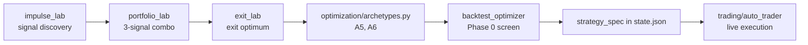
Конкретные трассировки:

| Открытие лаборатории | Где живёт в продакшене |
|---|---|
| `m2s2_vol2.0` (impulse_lab iter 5) — лучший одиночный short-сигнал | **`A6_SHORT_MOMENTUM`** архетип, сигнал `drop_2_atr < −2.0 И volume > 2.0×` |
| `low_32 / high_32` из impulse_lab iter 3 | **`A5_STRONG_VOL_BREAKOUT`** архетип + добавлены в `backtest_engine._build_indicator_frame` |
| `drop_2_atr` из impulse_lab iter 5 | **`A6_SHORT_MOMENTUM`** сигнал + добавлен в `backtest_engine._build_indicator_frame` |
| `activity = vol_ratio × atr_ratio` из portfolio_lab | Добавлен в `backtest_engine._build_indicator_frame` + выставлен в `strategy_spec.AVAILABLE_SERIES` |
| Оптимум выхода `sl=2.0, tp=1.5, hold=8` из exit_lab | **`A6.exit_corridor`**: `{[1.8, 2.2], [1.3, 1.7], [6, 12]}` |
| Трейлинг + безубыток вредны для моментум-шорта | `A6.management.trailing_atr_mult = None` + `_enforce_exit_corridor` принудительно ставит `None`, даже если ИИ пытается установить |
| `m2s2_vol2.0`, `act_short`, `mom2_short_t2.0` — портфель из 3 сигналов | **Реестр стратегий по умолчанию** в `research_lab_page.py` (m2s2_vol2.0 отмечен по умолчанию) |
| A6 SHORT-ONLY (длинный моментум никогда не прибылен) | Эмпирическая находка из impulse_lab iter 4 — A6 имеет **только** блок `short`, без `long` |


Эта трассируемость — весь смысл: **у каждого продакшен-архетипа есть задокументированное лабораторное происхождение**. Если стратегия начинает давать сбой вживую, путь трассировки:

1. Какой архетип? → `optimization/archetypes.py`
2. Какая лаборатория его породила? → комментарии в файле архетипа ссылаются на конкретные итерации
3. Перезапустить эту лабораторию на новых данных → держится ли находка?

Без лабораторий «почему мы построили стратегию именно так?» превращается в фольклор. С ними каждое решение трассируется до конкретного эксперимента.

---

### 🧱 Константы, формирующие поведение Лаборатории

| Константа | Значение | Источник |
|---|---|---|
| Комиссия по умолчанию (UI) | **0.11%** round-trip | `SimConfig.fee_pct` |
| Проскальзывание по умолчанию (UI) | **0.05%** round-trip | `SimConfig.slippage_pct` |
| SL / TP / удержание по умолчанию (UI) | **2.0 / 1.5 / 8** | Оптимум лаборатории из `exit_lab.py` |
| Стратегия по умолчанию отмечена | только `m2s2_vol2.0` | Лучший одиночный сигнал |
| Символы портфеля по умолчанию | `ARB, DOGE, SOL` | Дефолты `SymbolConfig` |
| Доля капитала по умолчанию | **33.3%** на символ | То же |
| Размер позиции по умолчанию | **50%** от выделенного | То же |
| Плечо по умолчанию | **1.0×** | То же |
| Каталог отчётов лаборатории | `research/lab_runs/` | `LAB_RUNS_DIR` |
| `impulse_lab.FEE_PCT` | **0.2%** round-trip | Дефолт модуля |
| `impulse_lab.SLIPPAGE_PCT` | **0.08%** round-trip | Дефолт стресса |
| `impulse_lab.H_DEFAULT` | **8 баров** | 2 ч |
| `impulse_lab.MOVE_ATR` | **2.5** | Порог оракула |
| `impulse_lab.ER_MIN` | **0.45** | Порог эффективности оракула |
| сетка `exit_lab` | **145 комбинаций** | 3 стадии |
| сетка `swing_exit_lab` | **480 комбинаций** | 4×5×4×3×2 |
| `grid_lab.SPACING_PCT` | **0.4%** | Лучшее из Шага 1 |
| `grid_lab.FLAT_THRESHOLD` | **0.15** (ER) | Граница режима |
| `grid_lab.TREND_THRESHOLD` | **0.25** (ER) | Граница режима (гистерезис) |
| `funding_arb_lab.LEVERAGE` | **5×** | Эффективность капитала 83.3% |
| `funding_arb_risk_lab.N_SIMULATIONS` | **1000** | Монте-Карло |
| `funding_arb_risk_lab.BASIS_VOL_DAILY` | **0.8%** | Допущение волатильности базиса |
| `pairs_arb_lab.COINT_PVALUE_THRESHOLD` | **0.05** | Энгл-Грейнджер |
| `pairs_arb_lab.ENTRY_Z / EXIT_Z / STOP_Z` | **2.0 / 0.5 / 4.0** | Пороги z-score |
| `portfolio_lab.SLIPS` | **0.0 / 0.03 / 0.05 / 0.10** | Уровни стресса |
| `portfolio_lab.STRESS_PASS_EXP` | **+0.05%** | Прохождение при slip=0.05% |
| `portfolio_trios.SYMBOLS` | **6 альткоинов** | Исключает BTC, BNB, HYPE |


---

### 🚫 Что Лаборатория не будет делать

- **Никакой живой торговли** — ничто в `research/` не трогает `BybitExecutor`
- **Никакого контроля риска** — лабораторный симулятор не применяет дневные/месячные лимиты убытков
- **Никакого распределения мульти-символьного портфеля** — каждый символ торгуется независимо; «портфель» — просто сумма независимых кривых
- **Никакой ребалансировки** — веса фиксируются при старте
- **Никаких платежей фандинга** — лабораторный движок не добавляет и не вычитает стоимость фандинга
- **Никакой аппроксимации перезагрузки фандинга** в UI — лаборатория перезагрузки фандинга только в CLI
- **Никаких частичных исполнений** — предполагаются полные исполнения по открытию или по уровню
- **Никакой симуляции книги заказов** — только комиссия + проскальзывание
- **Никакой межсимвольной корреляции** — два символа могут быть «диверсифицированы» в UI-лаборатории, будучи на 95% коррелированными в реальности

Последнее важно. UI-лаборатория с радостью сообщит о двух символах как независимых, даже если они двигаются идентично. Статистика честна *относительно сделок*; утверждение о диверсификации — ответственность пользователя за проверку.

---

### 🎯 Когда использовать Лабораторию, Бэктест или Оптимизацию

| Вопрос | Инструмент |
|---|---|
| *"Работает ли эта конкретная стратегия, которая у меня уже есть, на этих данных?"* | **Раздел 4 — Страница Бэктеста** (одиночный прогон, одна стратегия) |
| *"Могу ли я улучшить эту стратегию?"* | **Раздел 4 — Оптимизация** (итеративный поиск) |
| *"Что будет, если я торгую 3 символа этим портфелем стратегий одновременно?"* | **Раздел 5 — Страница Lab** (портфельная симуляция) |
| *"Есть ли хоть какой-то эдж в моментум-шортах на этой монете вообще?"* | **`impulse_lab.py`** (CLI) |
| *"Какой лучший выход для этого конкретного сигнала?"* | **`exit_lab.py`** (CLI) |
| *"Выживает ли сигнал при реалистичном проскальзывании?"* | **`stress_slippage.py`** (CLI) |
| *"Могу ли я собирать фандинг безрисково?"* | **`funding_arb_lab.py`** (CLI) |
| *"Какова реалистичная доходность фандинга после базисного риска?"* | **`funding_arb_risk_lab.py`** (CLI) |
| *"Есть ли коинтегрированная пара, которую я могу торговать?"* | **`pairs_arb_lab.py`** (CLI) |
| *"Какие 3 из этих 6 монет формируют лучший портфель?"* | **`portfolio_trios.py`** (CLI) |
| *"Стоит ли мне запускать сеточную стратегию?"* | **`grid_feasibility_lab.py`**, затем `grid_lab.py` (CLI) |
| *"Есть ли на старших таймфреймах лучшее отношение сигнал/шум?"* | **`swing_lab.py`** (CLI) |


Матрица решений не произвольна: UI-лаборатория — для **валидации на уровне портфеля**, все CLI-лаборатории — для **исследования компонентов**. Они отвечают на разные вопросы, и их не следует путать.

---

### 🧱 Что делает Лабораторию заслуживающей доверия

| Свойство | Как достигается |
|---|---|
| **Никаких выводов по одному набору данных** | Каждая лаборатория агрегирует `exp_mean`, `frac_pos`, `pf_mean` по множеству (символ, год) наборов данных |
| **Без заглядывания вперёд в позиционировании** | `merge_asof(direction="backward")` + проверка устаревания `MAX_AGE` на naive-UTC массивах |
| **Параметры выхода заморожены** | В `exit_lab` и `swing_exit_lab` входной сигнал фиксирован, варьируются только выходы |
| **Обнаружение сигналов отделено от тюнинга выходов** | Разные скрипты — нельзя случайно смешать две вещи |
| **Реалистичные издержки в каждом тесте** | Сценарии тейкера и мейкера запускаются отдельно; уровни стресса доходят до 0.10% |
| **Независимость от режима тестируется** | Годовая разбивка требуется быть полностью положительной для вердиктов портфеля |
| **Банкротство явное, а не молчаливое** | `bankrupt=True` по символу, когда капитал достигает нуля |
| **Отчёты сохраняются** | Каждая симуляция пишет структурированный текстовый файл с полным журналом сделок |
| **Эмпирические открытия замораживаются в архетипы** | Оптимумы лаборатории становятся `exit_corridor` в продакшен-спецификациях, а не просто документацией |
| **Открытия трассируются до конкретных итераций** | Комментарии в `archetypes.py` ссылаются на `impulse_lab iter N` |


Лаборатория — это место, где системе разрешено ошибаться. Каждая идея начинается здесь как гипотеза, умирает или выживает по числам, и только затем получает право влиять на стратегию, торгующую реальными деньгами.

---

<a id="6-автоторговля"></a>
## 6. 🤖 Автоторговля

### 💡 Что это

Автономный слой исполнения. Каждая другая часть системы производит *информацию*; эта часть производит *ордера*.

Автоторговля работает как **один фоновый поток на символ**, каждый полностью независим: собственное распределение капитала, собственная позиция, собственное дневное и месячное состояние убытков, собственный кулдаун, собственный JSON-файл состояния, собственные CSV- и HTML-логи. Шесть символов означает шесть потоков, и падение одного не может обрушить другие.

Дизайн намеренно скучен там, где это важно: **одна позиция на символ, максимум**. Никакого пирамидинга, никакого хеджирования, никакого усреднения вниз.

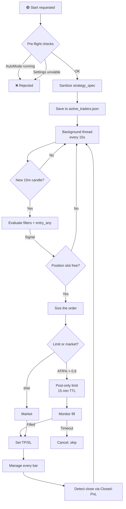

---

### 🏗️ Шесть модулей

Пакет `trading/` — не один файл со всем внутри. Каждый модуль имеет конкретную ответственность, и разделение — то, что делает его тестируемым.

| Модуль | Ответственность | Напрямую трогает |
|---|---|---|
| **`auto_trader.py`** | Оркестратор: главный цикл, маршрутизация сигналов, жизненный цикл позиции, персистентность | Всё ниже |
| **`executor.py`** | Низкоуровневый адаптер Bybit REST | `pybit.HTTP` |
| **`position_manager.py`** | Состояние позиции, вычисление TP/SL, мягкие выходы, финализация лимитного входа | `executor` |
| **`risk_manager.py`** | Дневные/месячные лимиты убытков, отслеживание текущего капитала | `risk_state.json` |
| **`signal_detector.py`** | Вычисление `strategy_spec` на текущих+предыдущих индикаторах | `strategy_spec` |
| **`trade_logger.py`** | CSV- и HTML-логи, недельная ротация, обновления SL, записи оптимизации | Диск |

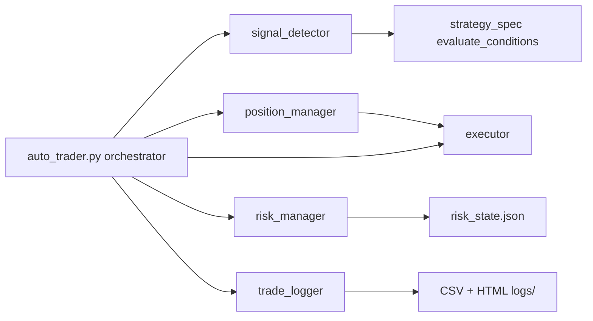
---

### ⚙️ Жизненный цикл

#### Запуск — предполётный шлагбаум

Запуск трейдера — не кнопка, переключающая булево значение. `AutoTraderSymbol.start()` выполняет **четыре** проверки, прежде чем будет создан хоть один поток:

| # | Проверка | Поведение при провале |
|---|---|---|
| 1 | **AutoMode не запущен** для этого символа | Отклонить с предупреждением — два цикла, борющихся за один символ, произвели бы дублирующие ордера |
| 2 | **Санитизация спецификации** — заполнить `max_hold_candles`, `trailing_atr_mult`, если отсутствуют | Залогировать исключение, продолжить — санитизация приятна, но не шлагбаум |
| 3 | **`validate_symbol_settings()`** — пробьёт ли вычисленный номинал `minNotionalValue` Bybit при этом плече? | **Отклонить запуск** — не крутить цикл, который будет отклонять каждый ордер |
| 4 | **Ещё не запущен** | Молчаливый `False` |


Только после прохождения всех четырёх `is_running = True`, конфиг записывается в `active_traders.json`, и запускается демон-поток.

3-я проверка существует, потому что трейдер, стартующий с `position_size_pct × capital × leverage < min_notional`, вошёл бы в бесконечный цикл отклонённых ордеров. Предпроверка ловит это за 200 мс вместо первого сигнала (который может быть через часы).

#### Цикл — 15-секундный такт, 4-минутное обновление данных

Главный цикл просыпается каждые **15 секунд**. Этот такт — для быстрого мониторинга позиции, а не для генерации сигналов:

| Что | Частота | Почему |
|---|---|---|
| Тик цикла | **15 с** | Быстро ловить SL/TP и исполнения |
| Полная загрузка 15m-истории | ≤ каждые **240 с** | ~10-12 REST-вызовов на загрузку; чаще — нарушение лимита Bybit (`10006`) |
| Вычисление сигналов | Только на новой **закрытой 15m-свече** | Сигналы на открытой свече — заглядывание вперёд |
| Управление позицией | Только на новой 15m-свече | Безубыток/трейлинг — решения по каждому бару |

Между загрузками цикл обслуживает из кэша. Если загрузка падает и кэш старше **30 минут**, итерация выбрасывает `ConnectionError` — трейдер выживает (см. обработка ошибок), но перестаёт генерировать новые сигналы, пока данные не вернутся.

#### Остановка — пять разновидностей

| Триггер | Закрыть позиции сначала? | Записанная причина |
|---|---|---|
| Пользователь жмёт ⏹ | Нет (`close_positions=False`) | `manual` |
| Достигнут дневной лимит убытков | **Да** — `_close_all_positions(reason="daily_loss_limit")` | `daily_loss_limit` |
| 60 последовательных не-сетевых ошибок | Нет | `repeated_errors` |
| Нет `strategy_spec` для символа | Нет | `no_strategy` |
| Недостаточный баланс при попытке ордера | Нет | `insufficient_balance` |

При остановке символ удаляется из `_active_traders` **и** из `active_traders.json` — он не перезапустится автоматически при следующем запуске приложения.

---

### 🛡️ Санитизация спецификации при запуске

Перед началом торговли `_sanitize_strategy_spec()` закрывает два пробела, которые LLM чаще всего оставляет:

| Поле | По умолчанию | Когда |
|---|---|---|
| `management.max_hold_candles` | **48** (48 × 15m = 12 ч) | Если отсутствует или `None` |
| `management.trailing_atr_mult` | **2.0** | Только если у стратегии **нет другого** механизма управления (нет триггера безубытка, нет `exit_on_*`, нет явного `max_hold_candles`) |

Второе правило имеет тонкую проверку `had_explicit_max_hold`: если модель намеренно поставила время-стоп, это считается намеренным управлением — трейлинг **не** навязывается сверху, потому что это молча превратило бы свинг-стратегию в скальпера и закрывало бы сделки на нормальных откатах.

Каждое изменение логируется (`SPEC_SANITIZED`), показывается в UI и записывается обратно в `state.json`. Санитизация **никогда** не перезаписывает существующее значение.

---

### 📐 Executor — адаптер Bybit

`trading/executor.py` — тонкая обёртка вокруг `pybit`. Его задача — не быть умным, а быть **скучным и пуленепробиваемым**.

#### Открытые эндпоинты

| Метод | Назначение |
|---|---|
| `get_instrument_info(symbol)` | `tickSize`, `qtyStep`, `minOrderQty`, `maxOrderQty`, `minNotionalValue` |
| `get_wallet_balance()` / `get_usdt_balance()` | Баланс UTA 2.0 (падает через `availableToWithdraw → walletBalance → equity`) |
| `get_position_info(symbol)` | Открытые позиции по символу |
| `set_leverage(symbol, leverage)` | Плечо для обеих сторон |
| `switch_margin_mode(symbol, mode)` | Изолированная ↔ кросс |
| `place_market_order()` | Рыночный ордер с опциональными прикреплёнными TP/SL |
| `place_limit_order()` | Post-only лимит |
| `cancel_order()` / `cancel_all_orders()` | Отмена по id / всех |
| `get_open_orders()` | Текущие открытые ордера |
| `get_order_info(order_id)` | Статус ордера по id (с повтором) |
| `get_closed_pnl(symbol, limit)` | Записи Closed-PnL |
| `get_best_bid_ask(symbol)` | Вершина книги |
| `set_trading_stop()` | Обновление SL/TP на открытой позиции |
| `get_ticker_price()` | Текущая последняя цена |
| `get_fee_rates(symbol)` | Ставки тейкера / мейкера (возвращает **проценты**, не доли) |
| `calculate_position_size(...)` | qty из капитала/плеча/цены + проверка min-notional |
| `validate_symbol_settings(...)` | Предполётная проверка жизнеспособности |
| `round_quantity()` / `round_price()` | Округление вниз до шага |

#### Три защитных паттерна, которые важны

**1. `get_instruments_info` — три повтора с фолбэком на кэш**

Тестнет Bybit периодически возвращает транзиторные `10016` (Internal System Error) и `10000` (Server Timeout). Адаптер повторяет 3 раза с экспоненциальной задержкой (1с, 2с). Если все падают, но кэш имеет данные от более раннего успешного вызова, **используется кэш** — `tickSize` и `qtyStep` не меняются по инструменту, так что устаревшие данные приемлемы. Без этого один сбой заставил бы каждый последующий ордер провалиться.

**2. `set_trading_stop` — `34040` — это успех, а не провал**

Когда SL уже установлен ровно в запрошенное значение, Bybit возвращает `34040: not modified`. Адаптер трактует это как успех — потому что цель (SL находится по этой цене) достигнута. Без этой проверки трейдер логировал бы ошибку каждую свечу для позиции, чей SL уже корректен.

**3. `calculate_position_size` — проверяет `minNotionalValue`**

После вычисления qty из `capital × leverage / entry_price` и округления до `qtyStep`, адаптер вычисляет `notional = qty × entry_price`. Если `notional < minNotionalValue` (по умолчанию $5 на Bybit), он возвращает **конкретную ошибку** вместо того, чтобы позволить Bybit отклонить ордер при размещении:

> *"Размер позиции X контрактов (Y USDT) меньше минимальной стоимости ордера Z USDT для {symbol}. Увеличьте выделенный капитал, размер позиции или плечо."*

Именно это ловит `validate_symbol_settings` при запуске — та же проверка, но в предполётное время с текущей ценой.

#### `place_limit_order` — обработка PostOnly

```
if ret_code == 110016:  # "would be taker"
   
```

Возвращает структурированный маркер, чтобы `position_manager.open_position_limit` мог повторить **на один тик глубже** в книге. Если повтор тоже отклонён, вызывающий откатывается к рынку.

---

### 🎯 Position manager — TP/SL, мягкие выходы, лимитные входы

`trading/position_manager.py` владеет жизненным циклом позиции.

#### Ключи снимка позиции

При входе `SNAPSHOT_KEYS` захватывает 16 индикаторов для пост-фактум анализа:

```
close, rsi_14, adx_14, volume,
```

Они попадают в `trade.entry_snapshot` — то же диагностическое золото, что и снимок движка бэктеста.

#### Вычисление TP/SL — с жёсткими защитными ограничениями

`_compute_tp_sl()` предпочитает ATR (конкретно `atr_14_4h` для свинг-стратегий, `atr_14` иначе), откатывается к процентам, но затем применяет **два жёстких лимита**:

| Лимит | Значение | Почему |
|---|---|---|
| **`MAX_STOP_PCT`** | **2.5%** от входа | ATR может взорваться в 10-20× на выбросах OHLCV (особенно на тестнете); неограниченный SL был бы абсурдным |
| **`MAX_TAKE_PCT`** | **10.0%** от входа | Та же причина, с противоположной стороны |


Оба лимита сохраняют направление (long SL всё ещё ниже входа и т.д.) — они просто ограничивают расстояние. Вычисление затем округляется до `tickSize` через `executor.round_price()`. Без округления Bybit отклонил бы `set_trading_stop`, и позиция осталась бы **вообще без всякой защиты**.

#### Мягкие выходы против жёстких

Модуль резко различает два вида выхода:

| Тип выхода | Кто исполняет | Путь обнаружения |
|---|---|---|
| **SL / TP** | **Bybit** (ордер на бирже) | Обнаруживается через `get_position_info` (позиция исчезает) |
| **Время / уровень / тренд / macd** | **Этот процесс** (reduce-only рыночный ордер) | `check_soft_exit()` → `_close_by_soft_exit()` |

`check_soft_exit()` — публичный вход для мягких выходов, вызывается из `auto_trader._apply_live_management()`. Он **отделён от `_check_exit()`**, потому что `_check_exit` включает жёсткие выходы (используется в бэктесте и юнит-тестах), в то время как живая торговля **никогда** не должна переоценивать жёсткий SL, который биржа уже обеспечивает.

Время-стоп в живой торговле:

```
def _compute_bars_held(pos, row):
    entry_d
```

`bars_held` вычисляется из `entry_candle_ts` (метки времени **бара сигнала**, а не времени исполнения) — потому что `max_hold_candles` в спецификации измеряется от сигнала, совпадая с движком бэктеста.

#### Жизненный цикл лимитного входа

`open_position_limit()`:

1. Убедиться, что нет существующей позиции на бирже — отказать, если есть (`position_already_exists_on_exchange`)
2. Получить лучший бид/аск через `get_best_bid_ask()`
3. Для long: `limit_price = best_bid + offset_ticks × tick_size`; для short: `best_ask - offset_ticks`
4. Разместить post-only лимит
5. Если отклонён как `110016` (был бы тейкером): сдвинуть на 1 тик глубже и повторить один раз
6. Вернуть `(True, order_id, limit_price)` — позиция **ещё не в `self.positions`**

Фактическая позиция входит в состояние только после запуска `finalize_limit_entry()`, который происходит, когда `auto_trader._monitor_pending_limit_orders()` видит исполнение ордера.

#### `sync_with_exchange` — только сироты, без удалений

Единственная наиболее важная асимметрия: `sync_with_exchange` **добавляет** позиции-сироты (найденные на бирже, но не локально), но никогда не **удаляет** локальные. Удаление — работа `_detect_closed_positions`, который знает, как логировать события CLOSE и тянуть записи Closed-PnL. Удаление здесь молча выбросило бы сделки из журнала.

---

### 💰 Risk manager — отслеживание капитала с живым пересчётом

`trading/risk_manager.py` намеренно прост в концепции и строг в деталях.

#### Правило текущего капитала

Лимиты вычисляются от `current_capital`, **не** от `initial_capital`:

```
pnl_usdt = position_value_usdt * (pnl_pct / 100.0)
self.current_capital += pnl_usdt
```

Так что если монета начинает с 300 USDT и теряет 30, следующий дневной лимит вычисляется от 270, а не 300. Это модель «просадка от текущего, не от старта» — она никогда не позволяет серии убытков скомпаундироваться в смертельный удар.

#### Обнаружение изменения настроек

Когда пользователь меняет `capital_share_pct` (или что-либо ещё, меняющее `allocated_capital`), сохранённый `initial_capital` в `risk_state.json` больше не совпадает с тем, что получает конструктор. `_load_state` обрабатывает это:

```
delta = float(self.initial_capital) - float(stored
```

Смысл: **накопленный P&L сохраняется, база перебазируется**. Если у вас было 100 базы, 105 текущего, и вы удваиваете распределение до 200, вы получаете 205 текущего. Без этого изменение настроек молча сбросило бы историю P&L.

#### Потокобезопасность

`_state_file_lock = threading.Lock()` сериализует доступ к файлу между символами. Без него два трейдера, одновременно завершающих сделку, могли бы оба прочитать `risk_state.json`, оба записать свою версию, и обновление одного символа было бы потеряно. Блокировка на уровне модуля, потому что файл общий.

Атомарная запись через `tmp.replace(STATE_FILE)`.

#### Два флага, один сброс у каждого

| Флаг | Устанавливается при | Сбрасывается при |
|---|---|---|
| `daily_stop_triggered` | Срабатывании `should_stop_daily()` | Новый UTC-день (в `_check_rollover`) |
| `monthly_optimization_triggered` | Срабатывании `should_optimize_monthly()` | Новый месяц (в `_check_rollover`) или `reset_monthly_optimization_flag()` |


Флаги предотвращают срабатывание одного и того же триггера на каждой итерации цикла. `reset_monthly_optimization_flag` существует, чтобы *вторая* оптимизация в том же месяце могла сработать, если убыток продолжается после первой — `_run_optimization` автотрейдера его не сбрасывает, но он может быть сброшен извне, если ситуация потребует.

---

### 🔍 Signal detector

`trading/signal_detector.py` намеренно минимален — 90 строк, делающих ровно одну вещь:

```
if filters and not evaluate_conditions(filters, current, prev):
    return []

matched_long
```

`_check_entry` зеркалит `backtest_engine._entry_signal` **точно**:

1. Если `entry_any` — непустой список → перебрать каждую группу, вернуть первую, что прошла
2. Иначе если `entry` — непустой список → вернуть его, если он проходит
3. Иначе вернуть `None`

Это не совпадение. Движок бэктеста и живой детектор разделяют одну и ту же семантику вычисления, так что стратегия, которая в бэктесте даёт 100 сделок, породит ровно те же сигналы вживую. Любое расхождение между ними обесценило бы каждый результат бэктеста — именно поэтому этот модуль существует вообще, вместо логики детектора внутри `auto_trader`.

---

### 📝 Trade logger — недельная ротация с поисковым HTML

`trading/trade_logger.py` пишет четыре CSV-файла и два HTML-файла на символ на неделю.

#### Ротация

Файлы ротируются **недельно** по ISO-неделе, а не ежемесячно:

```
data/auto_trading/logs/{SYMBOL}_trades_2026_W44.csv
data/
```

Суффикс недели: `_week_suffix()` возвращает `f"{iso.year}_W{iso.week:02d}"`. Новый файл создаётся автоматически на границе недели — без ручной очистки, без роста CSV за пределы того, что может открыть текстовый редактор.

#### CSV-файлы

| Файл | Одна строка на | Столбцы |
|---|---|---|
| `_trades_` | Закрытую сделку | timestamp, position_id, entry/exit time, direction, prices, qty, position_value_usdt, result_pct, pnl_usdt, exit_reason, stop_loss, take_profit, **initial** stop/take, entry_reasons, entry_type |
| `_events_` | Событие | timestamp, event_type, message, details |
| `_sl_updates_` | Перемещение SL | timestamp, position_id, direction, old_sl, new_sl, delta, reason, extra (JSON) |
| `_optimization_` | Прогон оптимизации | timestamp, trigger_reason, iterations, test_* metrics, holdout_* metrics, new_strategy_saved, notes |

Столбцы `initial_stop_loss` / `initial_take_profit` существенны — текущий `stop_loss` в строке сделки мог переместиться трижды через трейлинг, и именно начальное значение говорит вам, был ли у *тезиса* запас.

Файл `sl_updates` существует отдельно, потому что иначе это превратило бы `trades` в отношение многие-к-одному. Если трейдер двигает SL 40 раз на одной позиции, строка сделки всё равно одна строка, а 40 перемещений SL — это их собственный CSV с `position_id`, ссылающимся обратно.

#### HTML-лог событий

Файл `_events_*.html` — то, что делает лог действительно читаемым. Он рендерит каждое событие с:

- **Цветовой классификацией** — `OPEN` зелёный, `CLOSE_LOSS` красный, `SIGNAL_CHECK` фиолетовый, `MGMT` бирюзовый, `NETWORK` оранжевый
- **Панелью фильтров** — липкий заголовок с выбором даты и выпадающим списком типа события, связанный с клиентским JavaScript
- **Разделителями групп** — визуальный разделитель вставляется, когда ключ `group` меняется. `auto_trader._log_event()` передаёт `str(self.last_candle_time)` как `group`, так что все события одного 15m-бара (фильтры + LONG + SHORT + деталь сигнала) сворачиваются в один визуальный блок
- **Рендерингом `<pre>` для деталей** — диагностика `SIGNAL_CHECK` сохраняет форматирование с `\n` и множественными условиями

Панель фильтров вызывает `applyFilters()`, которая проходит DOM один раз и скрывает как несовпадающие события, так и пустые разделители групп. `collectEventTypes()` на `DOMContentLoaded` заполняет выпадающий список из фактически присутствующих типов событий.

#### Как реально выглядит «одна строка»

Событие `SIGNAL_CHECK` для свечи, выстрелившей short, выглядит так в HTML:

```
2026-11-02 14:00:00 UTC
```

Все пять событий (FILTERS, SHORT SIGNAL, ORDER) разделяют один `group` (`2026-11-02 14:00:00`) и появляются под одним разделителем. Без ключа группы это были бы пять отдельных разделителей, и история была бы нечитаемой.

---

### 🎯 Сайзинг ордера и вход

#### Сайзинг

```
allocated_capital = total
```

Затем округляется до `qtyStep` **вниз** (никогда вверх — округление вверх превысило бы намеченный размер). Если полученный `notional < minNotionalValue`, конкретная причина логируется, и сигнал пропускается с уведомлением уровня `warning`.

#### Рынок против лимита

`_should_use_limit_entry()` читает текущий ATR как процент от цены:

| Условие | Тип входа | Комиссия |
|---|---|---|
| `atr / close × 100 > 0.8%` | **Post-only лимит** | Мейкер (~0.02%) |
| иначе | **Рынок** | Тейкер (~0.055%) |


Порог 0.8% — эвристика для режима волатильности: на медленных 15m-стратегиях лимитный ордер, размещённый рядом с текущей ценой, вероятно исполнится и сэкономит значимые комиссии. На волатильных движениях неисполненный лимитный ордер — это просто упущенная сделка — так что рынок безопаснее.

#### Мониторинг лимитного ордера

Каждый открытый лимитный ордер живёт в `_pending_limit_orders` и опрашивается на каждой итерации цикла:

| Статус на бирже | Действие |
|---|---|
| `New`, `PartiallyFilled` | Продолжать ждать |
| `Filled` | Вызвать `finalize_limit_entry()` с фактическим исполненным qty и `avgPrice`, затем разместить TP/SL |
| `Cancelled` | Отбросить ордер, залогировать `ORDER_CANCELLED` |
| **Возраст > 900 с** | Отменить через `executor.cancel_order()`, залогировать `ORDER_TIMEOUT` |


При перезапуске приложения **любые** ожидающие лимитные ордера в состоянии автоматически отменяются — код не доверяет тому, что рыночный контекст или спецификация всё ещё те же после перезапуска, и предпочтёт упустить сделку, чем переоткрыть её на устаревших рассуждениях.

---

### 🎯 Управление позицией, пока она открыта

На каждой закрытой 15m-свече, для каждой не-сиротской позиции, `_apply_management_to_position()` пересчитывает стоп и отправляет на биржу обновление, если он сдвинулся.

#### Безубыток

Когда цена прошла `move_to_breakeven_at_tp_pct` пути до TP, стоп прыгает к `entry × (1 ± breakeven_offset_pct / 100)`. Смещение существует, чтобы покрыть round-trip комиссию — «безубыточный» стоп ровно на входе всё равно небольшой убыток после комиссий.

Движется только в благоприятную сторону. Уже установленный безубыток нельзя отдать обратно.

#### ATR-трейлинг

```
long:  new_sl = close − trailing_atr_mult × atr_14
short: new_sl = close + trailing_atr_mult × at
```

Применяется, только если подтягивает стоп (long: поднимает; short: опускает). `None` отключает. Если безубыток и трейлинг срабатывают на одном баре, побеждает более узкий из двух.

#### Четыре защиты перед отправкой `set_trading_stop`

Это не декорации — каждая соответствует реальному режиму отказа Bybit:

| Защита | Причина |
|---|---|
| **`tickSize` должен быть доступен** | Если отсутствует, мы пропускаем бар, а не отправляем неокруглённый SL, который Bybit отклонит — лучше повторить на следующей свече, чем врать в UI, что SL обновлён |
| **Сначала округлить, потом сравнить** | Сравнение сырых `88.8798` с `88.88` до округления заставляло Bybit не видеть изменения на округлённом значении и отвечать `34040` каждый бар. Теперь мы сравниваем округлённое значение |
| **SL должен быть на правильной стороне цены** | `10001` — ошибка «неправильной стороны» Bybit. Мы проверяем `new_sl < close` (long) / `new_sl > close` (short), используя close свечи как прокси цены — без дополнительного запроса тикера |
| **TP не тронут** | Обновляется только стоп; тейк-профит, установленный при входе, остаётся фиксированным |


Каждое успешное обновление стопа пишется в CSV `sl_updates` с `position_id` и полем `reason` (`breakeven`, `trailing` или `breakeven+trailing`) — так что пост-мортем может однозначно связать каждое перемещение SL с конкретной сделкой.

#### Мягкие выходы

Отдельно от SL/TP, `check_soft_exit()` может триггерить немедленное рыночное закрытие:

| Выход | Long | Short |
|---|---|---|
| `time_stop` | `bars_held >= max_hold_candles` | то же |
| `level_failure` | `close < level × (1 − buffer)` | `close > level × (1 + buffer)` |
| `trend_loss` | `close < sma_50` | `close > sma_50` |
| `macd_flip` | `macd_hist < 0` | `macd_hist > 0` |

Каждый индивидуально переключаем и **по умолчанию выключен** в `default_strategy_spec()`. При срабатывании `_close_by_soft_exit()` отправляет reduce-only рыночный ордер и регистрирует сделку точно так же, как при обычном закрытии — включая учёт кулдауна.

---

### 💰 PnL, комиссии и сопоставление Closed-PnL

Поле `closedPnl` Bybit **не включает торговые комиссии**. Поэтому живой код вычитает их вручную:

```
pnl_pct -= 2.0 * self._t
```

Сам тейкерский сбор не захардкожен — `_setup_leverage()` вызывает `executor.get_fee_rates(symbol)` и сохраняет реальное значение из вашего аккаунта (как процент, не долю). Если этот вызов падает, используется консервативный дефолт **0.055%**, и расхождение логируется.

#### Сопоставление записи Closed-PnL

Когда биржа сообщает, что позиции нет (размер < 50% локального qty), `_register_closed_position()` находит соответствующую запись Closed-PnL:

| Фильтр | Правило |
|---|---|
| **Сторона** | `Buy` для long, `Sell` для short |
| **Отношение qty** | В пределах ±50% от локального qty |
| **Метка времени** | Не раньше `entry_time − 60s` |
| **Дедупликация** | `orderId` не должен уже быть в `_consumed_closed_pnl_ids` |


Если найдено лучшее совпадение, используются реальные `closedPnl`, `avgExitPrice` и `avgEntryPrice`. Если нет, код откатывается к цене тикера — ухудшенный, но честный результат, отражённый в логе.

Множество `_consumed_closed_pnl_ids` **сохраняется** между перезапусками. Иначе сбой сети, закрывший сделку, пока бот был офлайн, мог бы привести к двойному учёту одной и той же записи Closed-PnL при следующем запуске.

#### Вывод причины выхода

Биржа не говорит *почему* позиция закрылась. `_infer_exit_reason()` сравнивает цену выхода с известными уровнями:

| Цена выхода ≈ | Причина |
|---|---|
| Текущий `stop_loss`, и ≈ вход (±0.2%) | `breakeven` |
| Текущий `stop_loss`, не ≈ вход | `stop_loss` |
| Текущий `take_profit` | `take_profit` |
| Ни то, ни другое | `manual_or_other` |


Допуск 0.2% для обнаружения безубытка важен: когда трейлинг поднимает SL ровно до `entry × (1 + 0.001)`, выход там выглядит как `stop_loss` для наивного сравнения. Допуск заставляет его классифицироваться как `breakeven`, что и ожидает увидеть пользователь.

---

### 🛑 Лимиты риска

Три независимых механизма остановки, все обеспечиваются самим трейдером:

#### Дневной лимит убытков

Триггерится `risk_manager.should_stop_daily(unrealized)`. Считает **реализованный + нереализованный** — открытая позиция глубоко в убытке может сработать до закрытия позиции.

При срабатывании:

1. `_close_all_positions(reason="daily_loss_limit")`
2. `stop(reason="daily_loss_limit")`
3. Красное уведомление: *"Позиции закрыты, торговля остановлена. Для возобновления нажмите «Начать торговлю»"*

Символ **не** возобновляется сам. Дневной лимит требует ручного подтверждения — весь смысл в том, чтобы оператор это увидел.

#### Месячный лимит убытков → автооптимизация

Триггерится `should_optimize_monthly()`. Это более мягкая остановка:

1. `is_optimizing = True`
2. Мониторинг открытой позиции продолжается — существующие сделки не бросаются
3. **Фоновый поток** запускает `backtest_optimizer.run()` по `optimization_days_back` истории с `optimization_iterations` и `walk_forward_folds`
4. Результат передаётся с `save_best_to_memory=True` — если выигрывает лучшая стратегия, она попадает в `state.json` символа
5. `is_optimizing = False`, и цикл возобновляется, либо с улучшенной спецификацией, либо со старой

Цель дизайна: убыточный месяц должен не просто останавливать торговлю, а триггерить систему *учиться*. Но она также никогда не блокирует трейдера — мониторинг продолжает работать, и оптимизация вне потока.

Результат оптимизации также логируется в `optimization_YYYY_Www.csv` через `trade_logger.log_optimization()`, так что лог содержит и событие-триггер, и исход.

#### Кулдаун после серии убытков (из `risk_controls`)

Та же логика, что в `backtest_engine._should_pause_after_loss()`:

```
"risk_controls": {
 
```

Два триггера, как и в бэктесте: N убытков подряд или M убытков в последних K сделках. При срабатывании `_cooldown_remaining = pause_candles_after_losses`, и `_process_signals()` уменьшает его на каждой свече и возвращается рано — никаких входов во время кулдауна.

Состояние кулдауна сохраняется с состоянием позиции, но с **24-часовым отсечением устаревания**:

> Если бот был выключен более 24 часов, `consecutive_losses`, `recent_loss_flags` и `cooldown_remaining` сбрасываются при загрузке. Обоснование: кулдаун тикает в свечах, а когда бот выключен, свечи не считаются — так что трёхдневный кулдаун «осталось 90 свечей» бессмысленен, а «3 убытка подряд» с прошлой недели — уже не серия.

---

### 🔁 Персистентность и восстановление после перезапуска

Всё состояние трейдера переживает перезапуск приложения через один JSON-файл:

```
data/auto_trading/positions/SOLUSDT.json
```

Содержимое:

| Ключ | Назначение |
|---|---|
| `positions` | Полный список позиций со всем состоянием управления, SL/TP, снимками входа |
| `pending_limit_orders` | Открытые лимитные ордера (авто-отменяются при загрузке) |
| `consumed_closed_pnl_ids` | Множество дедупликации для сопоставления Closed-PnL |
| `risk_controls_state` | `consecutive_losses`, `recent_loss_flags`, `cooldown_remaining` |
| `saved_at` | ISO-метка времени — управляет проверкой устаревания |


Запись атомарна: `.json.tmp` → `os.replace()`. Сбой в середине записи не может оставить испорченный файл состояния.

При загрузке:

1. Позиции валидируются на наличие требуемых полей (`position_id`, `direction`, `entry_price`, `qty`, `stop_loss`, `take_profit`, `entry_time`). Невалидные записи пропускаются с предупреждением.
2. Восстановленные позиции **не** помечаются как сироты — они наши, с реальными SL/TP на бирже.
3. Потреблённые ID Closed-PnL восстанавливаются.
4. `risk_controls_state` восстанавливается, только если `saved_at` свежий (< 24ч).
5. Каждый сохранённый `bybit_order_id` проверяется один раз на бирже. Любой, что `Cancelled`, `Rejected` или `Deactivated`, производит `STATE_WARNING` — пользователю сообщается, что нужно проверить позицию вручную.

Отдельно `active_traders.json` помнит, какие символы торговали. `nicegui_app._restore_auto_traders()` читает его при запуске приложения (с таймером 10с, чтобы сервисы прогрелись) и заново создаёт каждый трейдер с его сохранённым конфигом.

---

### 🚨 Обработка ошибок — самое важное проектное решение

Цикл различает два вида отказов и обращается с ними совершенно по-разному:

#### `ConnectionError` — сетевой сбой

| Поведение |
|---|
| Торговля **не** останавливается |
| Экспоненциальная задержка: 15 → 30 → 60 → 120 → 240 → 300 → 300 с верхний предел |
| `_non_network_errors` сбрасывается в 0 (сетевой сбой «не считается» к порогу багов) |
| Существующие позиции продолжают управляться, как только соединение возвращается |


Логика: сетевой сбой — не баг в вашей стратегии, это интернет, будучи интернетом. Останавливать трейдер из-за икоты Binance было бы хуже, чем бесполезно, потому что открытые позиции остались бы без присмотра. Трейдер должен пытаться бесконечно, вежливо отступать и восстанавливаться.

#### Любое другое `Exception` — баг

| Поведение |
|---|
| `_non_network_errors += 1` |
| Логируется с полным трассировочным стеком |
| Сон 60 с, повтор |
| **После 60 последовательных не-сетевых ошибок** трейдер останавливает себя с красным уведомлением |


Логика: если код сломан, повторять бесконечно — просто заполнять лог. Шестьдесят ошибок дают достаточное время для разрешения транзиторной проблемы (изменение формы полезной нагрузки, разовая ошибка парсинга), при этом ловя реальный баг примерно за час.

Это разница между устойчивой системой и раздражающей.

---

### 📊 Состояние UI и пульс

`get_state()` возвращает всё, что рендерит страница Автоторговли:

| Группа | Поля |
|---|---|
| Жизненный цикл | `is_running`, `is_optimizing`, `status_message` |
| Пульс | `last_iteration_utc`, `last_candle_time`, `last_price`, `last_indicators_summary`, `candles_processed`, `_last_iteration_ts` |
| Позиции | `open_positions`, `allocated_capital`, `current_capital` |
| PnL | `daily_pnl`, `daily_pnl_pct`, `monthly_pnl`, `monthly_pnl_pct` |
| Лимиты | `daily_loss_limit`, `monthly_loss_limit` |
| Лог | `log_lines[-20:]` |


Поле **`_last_iteration_ts`** — то, что UI использует для проверки устаревания: если трейдер показывает `is_running = True`, но `now − _last_iteration_ts > 120 с`, UI переключает статус на 🟡 *"Нет данных (ошибка сети?)"* — потому что живой трейдер, не тикнувший за две минуты, нездоров, что бы ни говорил булевый флаг.

---

### 🔍 Диагностика сигналов — и куда они попадают

Одна функция, которая окупается в первый же раз, когда что-то не срабатывает.

На каждой свече `_log_signal_diagnostics()` пишет полный блок:

```
SIGNAL_CHECK [group = 2026-11-02 14:00
```

Каждое событие пишется **и** в `events.csv`, **и** в `events.html`. В HTML все события одной свечи разделяют ключ `group`, так что весь блок визуально сворачивается в одну фиолетовую секцию — больше никакой прокрутки через стену спама `SIGNAL_CHECK`, чтобы найти ту, что выстрелила.

---

### 🧯 Позиции-сироты

Позиция, которая существует на бирже, но не в локальном файле состояния — после сбоя, ручного открытия с другого устройства или стёртого файла состояния — это **сирота**.

| Поведение | |
|---|---|
| **Синхронизируется внутрь** через `position_manager.sync_with_exchange()` | Так что `open_positions` в UI отражает реальность |
| **Не управляется** — `_apply_live_management` пропускает `is_orphan = True` | Нет реальных SL/TP для управления; навязывание трейлинга позиции неизвестного происхождения могло бы усугубить проблему |
| **Обнаруживается как закрытая** нормально | Как только биржа сообщает размер обратно к 0, это логируется как любое другое закрытие |
| **`tpsl_error = "external_position_detected"`** | Явно маркирует источник в state.json |

Так сирота не остаётся неуправляемой навсегда *случайно* — она остаётся неуправляемой *намеренно*, чтобы пользователь её увидел и решил, вместо того чтобы бот угадывал, что делать со сделкой, которую он не открывал.

---

### 🧱 Константы, формирующие поведение

| Константа | Значение | Источник | Почему это число |
|---|---|---|---|
| `MAX_POSITIONS_PER_SYMBOL` | **1** | `auto_trader.py` | Без пирамидинга; один тезис на монету |
| `NETWORK_RETRY_LIMIT` | **60** | `auto_trader.py` | Порог багов — ниже транзиторный шум; выше неисправимый цикл |
| `DATA_FETCH_MIN_INTERVAL_SEC` | **240 с** | `auto_trader.py` | Ниже лимита Bybit с запасом |
| `DEFAULT_TRAILING_ATR_MULT` | **2.0** | `auto_trader.py` | Стандартное расстояние тренд-следования |
| `DEFAULT_MAX_HOLD_CANDLES` | **48** (12 ч) | `auto_trader.py` | Порог устаревания тезиса |
| `RISK_CONTROLS_MAX_STALENESS_HOURS` | **24** | `auto_trader.py` | Кулдаун такой давности — уже не кулдаун |
| Сон цикла | **15 с** | `auto_trader.py` | Достаточно быстро для SL/TP, достаточно медленно для лимита |
| Предел задержки | **300 с** | `auto_trader.py` | 15 → 30 → 60 → 120 → 240 → 300 |
| TTL лимитного входа | **900 с** (15 мин) | `auto_trader.py` | Одна свеча принятия |
| ATR-шлагбаум лимитного входа | **0.8%** | `auto_trader.py` | Эвристика 15m-диапазон против 4h-диапазона |
| `MAX_STOP_PCT` (лимит исполнителя) | **2.5%** от входа | `position_manager.py` | Безопасность от выбросов ATR |
| `MAX_TAKE_PCT` (лимит исполнителя) | **10.0%** от входа | `position_manager.py` | То же |
| Повторы `get_instruments_info` | **3** с задержкой 1с/2с | `executor.py` | Транзиторные ошибки тестнета |
| Дефолт тейкерского сбора | **0.055%** | `executor.py` | Фолбэк, если `get_fee_rates` падает |
| Дефолт `minNotionalValue` | **5.0 USDT** | `executor.py` | Дефолт Bybit для линейных |


---

### ✅ Что делает автоторговлю заслуживающей доверия

| Свойство | Как достигается |
|---|---|
| **Детерминированный сайзинг** | Явная формула, округление `qtyStep` **вниз**, проверка `minNotionalValue` с причиной |
| **Та же математика риска, что в бэктесте** | Логика `risk_controls` продублирована построчно из `backtest_engine._should_pause_after_loss` |
| **Та же математика PnL, что в бэктесте** | Тейкерский сбор вычитается точно как в `_close_position` |
| **То же вычисление сигналов, что в бэктесте** | `signal_detector._check_entry` зеркалит `backtest_engine._entry_signal` |
| **Без жульничества на одном баре** | Сигналы только на **закрытых** свечах |
| **Без дублирования логирования сделок** | Сохраняемые `consumed_closed_pnl_ids` |
| **Без двойного управления позицией** | Защита `_last_managed_candle_ts` на позицию |
| **Без молчаливых отказов ордеров** | Каждый отклонённый ордер, каждое неудачное обновление SL, каждый таймаут логируется с причиной |
| **Без молчаливых взрывов ATR** | Лимиты `MAX_STOP_PCT` / `MAX_TAKE_PCT` предотвращают 20% SL от одного спайкового бара |
| **Без молчаливого неокруглённого SL** | Защита `tickSize` пропускает бар, а не отправляет неокруглённое значение, которое Bybit отклонит |
| **Выживает при интернете** | Сетевые ошибки никогда не останавливают торговлю; задержка ограничена и вежлива |
| **Выживает при перезапусках** | Полное состояние на диске, атомарные записи, плавное восстановление позиций, ордеров, кулдаунов, множества дедупликации |
| **Выживает при изменении настроек** | `current_capital` перебазируется с дельтой `initial_capital`, P&L сохраняется |
| **Никогда не ставит против себя** | Конфликт AutoMode блокируется при запуске; дневной лимит требует ручного повторного входа |
| **Каждое движение трассируется** | CSV `sl_updates` связывает каждое изменение SL с `position_id`; CSV `trades` несёт начальный и текущий SL/TP |

Результат — система, где, если сделка происходит, вы можете восстановить точно почему — от лога сигнала через спецификацию в файл состояния позиции, вплоть до записи Closed-PnL, которая её сопоставила. Эта трассируемость — весь смысл разделения рассуждения и исполнения.

---

### 🎯 Ежедневная жизнь живой сделки

Одна позиция, от начала до конца:
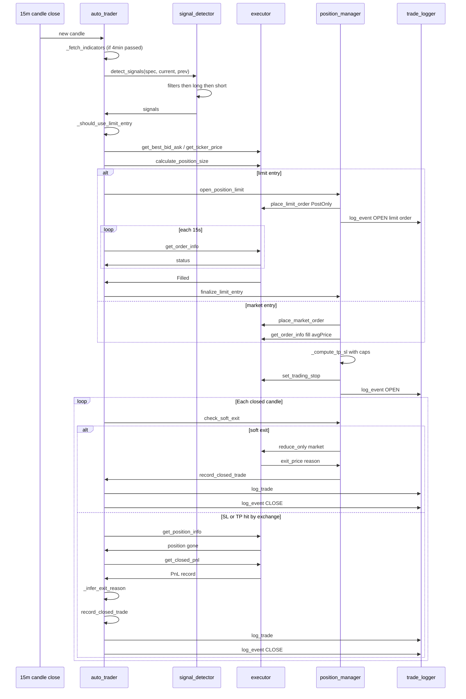
Каждая стрелка на этой диаграмме — место, где что-то может пойти не так. Ценность `trading/` как пяти сфокусированных модулей вместо одного файла на 2500 строк в том, что у каждой стрелки есть ровно один владелец, и когда что-то падает, вы точно знаете, какой модуль смотреть.

---

```

</BDS:
