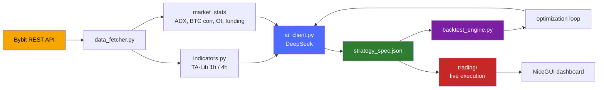
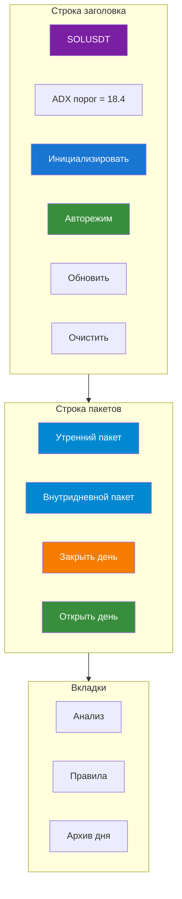
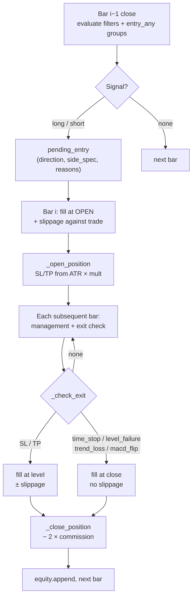

# 🧠 Крипто-торговая система

> **Генерация стратегий на основе LLM. Детерминированное исполнение. Нулевое заглядывание вперёд.**


---

## 📑 Оглавление

| # | Раздел | Что вы найдёте |
|---|---------|------------------|
| **1** | [🔭 Обзор проекта](#1-обзор-проекта) | Что представляет собой система, как работает конвейер, что построено |
| **2** | [🪙 Страницы монет](#2-страницы-монет) | Полный обзор страницы одной монеты — каждая панель и действие |
| **3** | [💬 ИИ-чат](#3-ии-чат) | Диалоговый интерфейс и полный набор инструментов, которые может вызывать модель |
| **4** | [📊 Бэктестинг](#4-бэктестинг) | Воспроизведение стратегии по истории — входы, модель исполнения, выходы |
| **5** | [🧪 Лаборатория](#5-лаборатория) | Рабочее пространство для исследований и оптимизации — эксперименты, режимы, итерации |
| **6** | [🤖 Автоторговля](#6-автоторговля) | Живые сигналы, контроль рисков, исполнение ордеров, отслеживание позиций |

---

<a id="1-обзор-проекта"></a>
## 1. 🔭 Обзор проекта

### 💡 Что это

**Автономная крипто-торговая система для линейных бессрочных контрактов Bybit**, написанная на Python, построенная вокруг одного центрального принципа:

> *Позвольте большой языковой модели делать рассуждения, но никогда не позволяйте ей напрямую трогать деньги.*

LLM (DeepSeek) изучает рынок, пишет торговые правила на естественном языке и — что принципиально — выдаёт **машиночитаемую спецификацию стратегии** в строгом JSON. Всё, что решает, состоится ли сделка или как она будет закрыта, исполняется детерминированным движком, который понимает только этот JSON. **Модель предлагает; движок распоряжается.**

Именно это разделение делает систему тестируемой. Стратегия, придуманная моделью для XRP, может быть воспроизведена по годам 15-минутных свечей за секунды, оценена, отклонена, переписана и переоценена — без единого ордера, достигающего биржи.

---

### ⚙️ Как это работает



#### 1️⃣ Получение данных — `data_fetcher.py`

Загружает **15m и 1h klines** с пагинированным бэкфиллом и повторами с экспоненциальной задержкой, плюс глубину стакана, агрегированные публичные сделки, открытый интерес, ставку финансирования, соотношение long/short и индекс страха и жадности.

Поверх сырых свечей вычисляется `market_stats`:

- 24-часовой объём и изменение цены
- Дельта открытого интереса
- **Адаптивный порог ADX**, вычисляемый по последним пяти дням 1h-данных (ограничен диапазоном **12–30**)
- **Корреляция с BTC** по 24-часовым доходностям с 15-минутным кэшем, чтобы шесть символов не били по API шесть раз

Существует три разновидности пакетов:

| Пакет ↕▾ ↕▾ | Окно ↕▾ ↕▾ | Назначение ↕▾ ↕▾ |
|---|---|---|
| −−`morning_package` | Широкое (2 дня, до 64×15m свечей) | Полный контекстный анализ в начале сессии |
| −−`intraday_package` | Уже (8ч, до 30×15m свечей) | Периодическая переоценка в течение дня |
| −−`intraday_light` | Минимальное (2 свечи + свежая статистика) | Валидация отложенного сетапа или присмотр за позицией за долю стоимости токенов |
| −⚙ |  |  |
⚙

#### 2️⃣ Слой индикаторов — `indicators.py` + движок

TA-Lib для SMA 20/50, RSI 14, ATR 14, полос Боллинджера, MACD, ADX. VWAP с суточным сбросом. Классические уровни пивотов вычисляются по OHLC **предыдущего** дня, никогда текущего.

1h-свечи ресемплируются из 15m, и их признаки объединяются обратно через `merge_asof` — фильтруясь строго по столбцам `*_1h`, потому что слияние часового OHLCV молча заморозило бы 15m-закрытие внутри каждого часа и испортило бы каждый трейлинг-стоп.

**Слой 4h** добавляет ATR, скорость в единицах ATR, положение закрытия и флаг границы свечи.

Специально построенные серии дополняют картину:

- `low_32` / `high_32` — 32-барные экстремумы пробоя (сдвинуты, чтобы избежать заглядывания вперёд)
- `drop_2_atr` — импульс за 2 свечи в единицах ATR
- `activity` — отношение объёма × отношение ATR

#### 3️⃣ Слой ИИ — `ai_client.py`

| Метод ↕▾ ↕▾ | Роль ↕▾ ↕▾ |
|---|---|
| −−`init_symbol` | Выполняет до **5 итераций**, в которых модель может вызвать инструмент `web_search` для исследования монеты, после чего обязана вернуть JSON |
| −−`analyze` | Запрашивает структурированный JSON через `response_format`; автоматически исправляет любой таймфрейм, придуманный моделью, которого нет в данных |
| −−`optimize_strategy` | Принимает TRAIN/TEST-сводку бэктеста и возвращает пересмотренную спецификацию — с жёсткими защитными ограничениями, инжектируемыми в промпт (см. ниже) |
| −−`revise_init_strategy` | Перестраивает спецификацию после sanity-бэктеста |
| −−`chat_with_tools` | Многошаговый цикл вызова инструментов для интерактивного чата |
| −⚙ |  |
⚙

**Защитные ограничения, инжектируемые автоматически:**

- Если профит-фактор теста уже превышает **1.1**, логика входа **замораживается** — изменять можно только фильтры, управление и множители ATR
- Если сделок **менее 30**, модель обязана строить OR-группы `entry_any` вместо нагромождения условий на один вход

Каждый ответ проходит через `_safe_json_loads` — толерантный парсер, который снимает markdown-обёртки, комментарии и висячие запятые, прежде чем перейти к `json_repair`.

#### 4️⃣ Спецификация стратегии — `strategy_spec.py`

**Контракт** между моделью и движком. Каждая сторона (`long` / `short`) объявляет:

| Поле ↕▾ ↕▾ | Назначение ↕▾ ↕▾ |
|---|---|
| −−`entry` или `entry_any` | Список AND-групп (объединённых через OR) |
| −−`stop_loss_atr_mult` / `take_profit_atr_mult` | Риск на основе ATR с процентными фолбэками |
| −−`management` | Триггер безубытка, ATR-трейлинг, максимальное удержание в свечах, опциональные выходы при пробое уровня / потере тренда / развороте MACD |
| −−`filters` | Глобальные фильтры, применяемые к обеим сторонам |
| −−`risk_controls` | Пауза после серии убытков |
| −⚙ |  |
⚙

**Шесть примитивов условий:** `compare`, `cross`, `range`, `volume`, `slope`, `distance`.

Валидация **принципиальна**: каждая группа входа должна содержать объёмный фильтр, трендовый фильтр и подтверждение по уровню или импульсу, а также должны существовать и стоп, и тейк-профит — модель, забывшая их, получает спецификацию, отклонённую полностью и заменённую дефолтной.

#### 5️⃣ Движок бэктеста — `backtest_engine.py`

| Правило ↕▾ ↕▾ | Детали ↕▾ ↕▾ |
|---|---|
| −−**Тайминг сигнала** | Сигналы вычисляются на закрытии бара *i* и исполняются по **открытию бара *i+1*** — никакого жульничества на одном баре |
| −−**Проскальзывание** | **0.05%** против сделки на входе и на исполнении SL/TP; намеренно **не** на мягких выходах (которые исполняются по уже наблюдаемому закрытию) |
| −−**Комиссия** | 0.055% на сторону |
| −−**Управление позицией** | Выполняется на каждом баре; SL/TP проверяются внутри бара по high/low |
| −⚙ |  |
⚙

**Выходы:** полный список сделок со снимками входа (RSI, ADX, ATR, пивоты на момент входа), кривая equity и статистика — винрейт, профит-фактор, ожидание, максимальная просадка, средний выигрыш/проигрыш, разбивка long/short, счётчики активации кулдауна.

#### 6️⃣ Живое исполнение — `trading/`

Обнаружение сигналов, управление рисками, управление позициями, исполнение ордеров и ведение журнала сделок. Позиции и состояние риска сохраняются как JSON в `data/auto_trading/`.

Маршрутизация ордеров и источник данных управляются **двумя независимыми флагами**:

| Флаг ↕▾ ↕▾ | Управляет ↕▾ ↕▾ |
|---|---|
| −−`BYBIT_TESTNET` | Куда идут **ордера** |
| −−`BYBIT_DATA_TESTNET` | Откуда берутся **свечи** |
| −⚙ |  |
⚙

Это позволяет валидировать сигналы на реальной истории mainnet, в то время как ордера по-прежнему идут в testnet.

---

### 🧩 Ключевые компоненты с первого взгляда

| Файл ↕▾ ↕▾ | Строки ↕▾ ↕▾ | Ответственность ↕▾ ↕▾ |
|---|---|---|
| −−`config.py` | ~110 | Пути, API-ключи, символы, лимиты свечей, проскальзывание, флаги testnet |
| −−`data_fetcher.py` | ~775 | Bybit REST: klines, стакан, сделки, фундаментальные данные, новости, предвычисленная статистика |
| −−`indicators.py` | ~478 | Обёртки TA-Lib, ресемплинг 1h/4h, профиль объёма, пивоты |
| −−`ai_client.py` | ~856 | Клиент DeepSeek: init, analyze, optimize, revise, chat |
| −−`strategy_spec.py` | ~604 | DSL стратегии: оценщик, валидатор, дефолты, объяснитель |
| −−`backtest_engine.py` | ~865 | Детерминированная симуляция с проскальзыванием, комиссиями, управлением |
| −−`data_loader.py` | ~226 | Оффлайн-загрузчик CSV для `backtest_data/` |
| −−`trading/` | — | Живое исполнение: сигналы, риск, позиции, ордера, журнал |
| −⚙ |  |  |
⚙

---

### ✅ Что построено

- 🪙 **Мульти-символьная конфигурация** — 6 линейных бессрочных контрактов, каждый со своим состоянием, правилами, журналами и архивами
- 📡 **Три уровня пакетов данных**, настроенных для экономии токенов, плюс предвычисленная рыночная статистика и адаптивные пороги
- 📜 **Валидированный, версионируемый DSL стратегий** с обязательными фильтрами риска и движковыми дефолтами, заполняющими то, что модель упустила
- 🔁 **Полный цикл ИИ** — инициализация → sanity-бэктест → пересмотр → оптимизация → развёртывание — с автоматически инжектируемыми ограничениями против переобучения
- ⏱️ **Движок бэктеста без заглядывания вперёд** с проскальзыванием, комиссиями, управлением позицией и кулдауном после серии убытков
- 💾 **Оффлайн-путь данных**, читающий годовые 15m CSV (2023–2026) — обеспечивая долгосрочные исследования без обращения к бирже
- 🖥️ **Дашборд NiceGUI** для мониторинга, чата с моделью, запуска бэктестов и управления автоторговлей

---

### 🎯 Принципы проектирования

| Принцип ↕▾ ↕▾ | Почему это важно ↕▾ ↕▾ |
|---|---|
| −−**Разделение рассуждения и исполнения** | LLM креативна, но ненадёжна; движок глуп, но точен. Каждый делает то, в чём хорош |
| −−**Нулевое заглядывание вперёд** | Каждый индикатор сдвинут, каждый пивот использует вчерашние данные, каждый вход исполняется на следующем баре. Результаты бэктеста что-то значат |
| −−**Явный контракт риска** | Никакого входа без объёмного фильтра, трендового фильтра, подтверждения по уровню, стопа и тейк-профита |
| −−**Экономия токенов** | Три размера пакетов, предвычисленная статистика, урезанный контекст — так что реальный торговый цикл работает на реальном бюджете API |
| −−**Детерминированный повтор** | Тот же JSON + те же данные = те же сделки. Каждый раз |
| −⚙ |  |
⚙

---

### 🔧 Технологический стек

| Слой ↕▾ ↕▾ | Выбор ↕▾ ↕▾ |
|---|---|
| −−Язык | **Python 3.10+** |
| −−Биржа | **Bybit** (через `pybit`) |
| −−LLM | **DeepSeek** (через `openai` SDK) |
| −−Индикаторы | **TA-Lib** + **pandas** / **numpy** |
| −−UI | **NiceGUI** |
| −−Хранение | JSON-файлы + CSV-журналы |
| −−Данные бэктеста | Годовые 15m CSV в `backtest_data/` |
| −⚙ |  |
⚙

---
<a id="2-страницы-монет"></a>
## 2. 🪙 Страницы монет

### 💡 Что такое страница монеты

Страница монеты — это **кокпит для одного символа** — каждое действие, которое пользователь может совершить с одним активом, живёт здесь и больше нигде.

По умолчанию их шесть, по одной на каждую запись в `config.TRADING_PAIRS`:

```

XRPUSDT · HYPEUSDT · SOLUSDT · ETHUSDT · DOGEUSDT · ARBUSDT

```

Каждая полностью независима. Свой файл состояния, свои правила, свой журнал сделок, свой архив, свой автоцикл, свои убытки и кулдауны. Если одна монета сломана, остальные пять этого не замечают.

Страница организована вокруг четырёх вопросов:

| Вопрос | Где на него отвечают |
|----------|---------------------|
| 🧭 **Что делает рынок?** | Карточка анализа, карточка индикаторов, карточка сетапа/сигнала |
| 📜 **Какова стратегия этой монеты?** | Вкладка «Правила», `strategy_spec` в состоянии |
| 🎯 **Есть ли позиция?** | Карточка активной сделки, карточка входа, карточка совета по позиции |
| 📈 **Что произошло?** | Вкладка «Архив», журнал сделок, P&L за день |

---

### 🧭 Макет страницы



#### Строка заголовка

| Элемент | Что показывает / делает |
|---|---|
| **💰 {SYMBOL}** | Имя символа, всегда видимо |
| **ADX порог = X.X** | Живой адаптивный порог ADX из `state.market_stats.adx_threshold`; откатывается к *"ADX порог = 20 (по умолч.)"* при отсутствии |
| **🪄 Инициализировать** | Виден **только** когда `is_initialized == false`. Запускает полную ИИ-инициализацию |
| **🚀 Авторежим / ⏹ Остановить** | Переключает цикл AutoMode для этого символа — текст кнопки меняется в зависимости от `AutoModeState.get_state(symbol).is_running` |
| **🔄 Обновить** | Принудительно вызывает `refresh()` — перечитывает состояние с диска и перерисовывает каждую карточку |
| **🗑 Очистить** | Деструктивный сброс (требуется диалог подтверждения) — см. Очистка |

#### Строка пакетов

Четыре элемента управления дневным циклом, описаны в разделе Жизненный цикл дня.

---

### 📊 Вкладка 1: Анализ

Вид по умолчанию. Шесть карточек, которые обновляются вместе при каждом refresh.

#### 📊 Карточка анализа

Таблица ключ-значение, отрисовываемая из `state.last_analysis`:

| Поле ↕▾ | Источник ↕▾ |
|---|---|
| −Время анализа | `analysis.timestamp_utc` |
| Цена | `analysis.current_price` |
| Изменение 24ч | `analysis.price_change_24h_pct` |
| Стакан | `analysis.orderbook_bias` |
| OI тренд | `analysis.oi_trend` |
| Funding rate | `analysis.funding_rate_status` |
| Fear & Greed | `analysis.fear_greed_state` |
| L/S Ratio | `analysis.long_short_ratio_signal` |
| Новости | `analysis.news_impact` |
| ⚙ |  |

Под таблицей — собственные слова модели: `📝 Сводка: {summary}`.

Карточка **пуста**, пока не отработает первый утренний или внутридневной пакет.

#### 📐 Карточка сетапа / сигнала

Показывает текущий тезис модели — но **только когда нет активной сделки** (открытая позиция подавляет карточку сетапа; свой собственный совет живёт в `position_advice_card`).

Порядок приоритета:

| Условие | Что отрисовывается |
|---|---|
| `last_signal.confidence_pct > 0` | 🚨 **СИГНАЛ** — живой, действенный вход |
| `last_setup` существует (нет активной сделки) | 📐 **СЕТАП** — условное наблюдение |
| Ни то, ни другое | Карточка скрыта |

Оба вида разделяют общую форму:

| Строка | Сигнал | Сетап |
|---|---|---|
| Тип | 🚨 СИГНАЛ | 📐 СЕТАП |
| Направление | `direction` | `direction` |
| Уверенность | `confidence_pct`% | `confidence_pct`% |
| Вход | `entry_price` или *"По рынку"* | то же |
| SL | `stop_loss` | `stop_loss` |
| TP | список `take_profit[]` | то же |
| Обоснование | `signal_rationale` | `rationale` |

Под таблицей — два списка:

- **Условия входа** — `entry_conditions[]` (сигнал) или `conditions[]` (сетап)
- **Условия отмены** — `cancel_conditions[]`

Каждый сетап и сигнал несёт **условия отмены**. Это не украшение: модели запрещено выдавать голое «покупай сейчас» без указания того, что инвалидировало бы идею.

#### 📈 Карточка индикаторов

Отрисовывает последние **5 значений** каждого числового ряда индикаторов плюс профиль объёма.

Столбцы строятся динамически из ключей `state.indicators` — каждый ряд со значением-списком получает свой столбец. Уровни пивотов и прочие скаляры появляются как есть. Метки времени берутся из `state.indicator_timestamps`, выровненные по индексу.

Под таблицей: **📊 Объёмный профиль (топ-5 уровней)** — пять верхних ценовых уровней по объёму, каждый с (цена, объём). Вот как выглядит «где рынок реально торговал» в виде таблицы.

Карточка скрыта, пока не доставлен первый пакет.

#### 🔴 Карточка активной сделки

Появляется только когда существует `state.active_trade`. Показывает:

| Поле ↕▾ | Содержание ↕▾ |
|---|---|
| −Направление | `direction` (LONG/SHORT) |
| Цена входа | `entry_price` |
| Стоп-лосс | `stop_loss` |
| Тейк-профит | `take_profit[]` |
| Тип входа | `entry_type` (`manual` / `signal`) |
| ⚙ |  |

Два действия:

**✏️ Редактировать** → открывает диалог с полями нового SL и TP. При сохранении повторно запускает ИИ-анализ с `keep_history=False`, чтобы модель видела **новые** параметры как факт, а не как дельту. Карточка совета обновляется соответственно.

**🔒 Закрыть позицию** — закрывает по указанной вами цене:

| Вход ↕▾ | Опции ↕▾ |
|---|---|
| −Цена выхода | Предзаполнена текущей ценой (загружается заново при refresh) |
| Причина | `manual` · `stop_loss` · `take_profit` |
⚙

При закрытии:

1. `result_pct` вычисляется из направления и цен
2. Сделка добавляется в `trade_journal.csv`
3. `active_trade` очищается
4. **Пост-закрытийный анализ** запускается с `error_analysis=True`, если `result_pct < 0`, чтобы модель проанализировала свою ошибку и могла предложить `new_rules`

Этот последний шаг тонок, но важен: система намеренно учится на убытках, а не только на прибылях.

#### ➕ Карточка входа

Форма ручной сделки. Появляется, когда **нет активной позиции**.

| Поле ↕▾ ↕▾ | Примечания ↕▾ ↕▾ |
|---|---|
| −−Направление | `long` / `short` |
| −Цена входа | должна быть > 0 |
| Стоп-лосс | валидация в зависимости от направления |
| Тейк-профит | валидация в зависимости от направления |
| ⚙ |  |
⚙

**Правила валидации** (отклоняются с уведомлением при нарушении):

```
long:  stop_loss < entry_price  AND  take_profit > entry_price
short: stop_loss > entry_price  AND  take_profit < entry_price
```

При успешной отправке в одном действии происходят три вещи:

1. `active_trade` записывается в состояние
2. **AutoMode запускается в режиме `position_only`** — без догоняющего пакета, без утреннего пакета, потому что позиция уже существует и не нуждается в свежем прочтении графика с нуля
3. **Пост-входный анализ** выполняется на внутридневном пакете

Так что ручной вход никогда не является слепым: ИИ немедленно спрашивают *«что ты думаешь об этой позиции?»* и записывают ответ в `position_advice_card`.

#### 📋 Карточка совета по позиции

Заполняется, когда есть активная сделка **и** либо существует `last_position_update`, либо существует `last_analysis`. Живое прочтение модели по открытой позиции:

| Поле ↕▾ | Источник ↕▾ |
|---|---|
| −Рекомендация | `last_position_update.advice` (например, *«перенести SL»*, *«частично зафиксировать»*, *«закрыть»*) |
| Новый стоп-лосс | `last_position_update.new_stop_loss` (опционально) |
| Частичная фиксация | `last_position_update.partial_take_profit_pct` (опционально) |
⚙

Ниже: **Условия закрытия** — `cancel_conditions[]` из текущего активного сигнала или сетапа, вновь выведенные как чек-лист.

---

### 📐 Вкладка 2: Правила

Два представления одного и того же, синхронизированные при сохранении.

#### Структурированный вид

`rules_table` разбивает текст правил на строки:

| Столбец ↕▾ | Содержание ↕▾ |
|---|---|
| −№ | Порядковый номер |
| −Условие | Текст до первого `:` (или `---`) |
| Описание | Текст после |
| ⚙ |  |

Сначала идут торговые правила, затем разделительная строка (`=== РИСК-МЕНЕДЖМЕНТ ===`), затем правила риска.

Если `state.trading_rules_list` и `state.risk_management_rules_list` оба пусты, но `trading_rules.md` существует, страница **парсит файл** и заполняет оба списка — так что отредактированный вручную Markdown-файл становится полноценными структурированными данными при следующем refresh.

#### Markdown-вид

`rules_text_area` показывает полный исходный Markdown. Редактируемый, с одной кнопкой:

**💾 Сохранить правила** → при сохранении:

1. `cm.update_rules(new_rules)` — записывает `trading_rules.md`
2. `parse_rules_from_text()` разбивает на два списка
3. Оба списка записываются в `state.json`

С этого момента каждый промпт анализа включает обновлённые правила.

Это переопределение человеком в контуре. ИИ пишет свои собственные правила при инициализации и через `optimize_strategy`, но человек всегда может переписать их вручную, и ИИ будет их соблюдать при следующем вызове.

---

### 📦 Вкладка 3: Архив

Одна строка на заархивированный день:

| Столбец ↕▾ | Содержание ↕▾ |
|---|---|
| −Дата | `YYYY-MM-DD` |
| −P&L | Сумма `result_pct` по сделкам этого дня, отформатированная со знаком |
| −Сделок | Количество сделок |
| ⚙ |  |

Клик по строке открывает модальное окно:

```
📅 Архив SOLUSDT — 2026-11-01
P
```

За этим: `load_archive_day(date)` вытягивает `state.json`, `trades.csv`, `morning_context.md`, `intraday_context.md` и `key_events.md` из папки дня.

Архив намеренно **только для чтения**. Чтобы перезапустить день, вы открываете новый день — архив это история.

---

### 🌅 Жизненный цикл дня

Каждая монета живёт внутри **24-часового дневного цикла**, отслеживаемого в `state.date` и ограниченного `state.day_closed`. Границы дня — UTC.
This diagram is empty.<svg id="mermaid-svg-1" width="100%" xmlns="http://www.w3.org/2000/svg" class="statediagram mermaid-svg" viewBox="-17.8 -17.8 610.0921874999999 391.6" role="graphics-document document" height="100%" style="max-width: 100%; display: block; transform-origin: 0px 0px; user-select: none;"><style>#mermaid-svg-1{font-family:"trebuchet ms",verdana,arial,sans-serif;font-size:16px;fill:#333;}@keyframes edge-animation-frame{from{stroke-dashoffset:0;}}@keyframes dash{to{stroke-dashoffset:0;}}#mermaid-svg-1 .edge-animation-slow{stroke-dasharray:9,5!important;stroke-dashoffset:900;animation:dash 50s linear infinite;stroke-linecap:round;}#mermaid-svg-1 .edge-animation-fast{stroke-dasharray:9,5!important;stroke-dashoffset:900;animation:dash 20s linear infinite;stroke-linecap:round;}#mermaid-svg-1 .error-icon{fill:#552222;}#mermaid-svg-1 .error-text{fill:#552222;stroke:#552222;}#mermaid-svg-1 .edge-thickness-normal{stroke-width:1px;}#mermaid-svg-1 .edge-thickness-thick{stroke-width:3.5px;}#mermaid-svg-1 .edge-pattern-solid{stroke-dasharray:0;}#mermaid-svg-1 .edge-thickness-invisible{stroke-width:0;fill:none;}#mermaid-svg-1 .edge-pattern-dashed{stroke-dasharray:3;}#mermaid-svg-1 .edge-pattern-dotted{stroke-dasharray:2;}#mermaid-svg-1 .marker{fill:#333333;stroke:#333333;}#mermaid-svg-1 .marker.cross{stroke:#333333;}#mermaid-svg-1 svg{font-family:"trebuchet ms",verdana,arial,sans-serif;font-size:16px;}#mermaid-svg-1 p{margin:0;}#mermaid-svg-1 defs #statediagram-barbEnd{fill:#333333;stroke:#333333;}#mermaid-svg-1 g.stateGroup text{fill:#9370DB;stroke:none;font-size:10px;}#mermaid-svg-1 g.stateGroup text{fill:#333;stroke:none;font-size:10px;}#mermaid-svg-1 g.stateGroup .state-title{font-weight:bolder;fill:#131300;}#mermaid-svg-1 g.stateGroup rect{fill:#ECECFF;stroke:#9370DB;}#mermaid-svg-1 g.stateGroup line{stroke:#333333;stroke-width:1;}#mermaid-svg-1 .transition{stroke:#333333;stroke-width:1;fill:none;}#mermaid-svg-1 .stateGroup .composit{fill:white;border-bottom:1px;}#mermaid-svg-1 .stateGroup .alt-composit{fill:#e0e0e0;border-bottom:1px;}#mermaid-svg-1 .state-note{stroke:#aaaa33;fill:#fff5ad;}#mermaid-svg-1 .state-note text{fill:black;stroke:none;font-size:10px;}#mermaid-svg-1 .stateLabel .box{stroke:none;stroke-width:0;fill:#ECECFF;opacity:0.5;}#mermaid-svg-1 .edgeLabel .label rect{fill:#ECECFF;opacity:0.5;}#mermaid-svg-1 .edgeLabel{background-color:rgba(232,232,232, 0.8);text-align:center;}#mermaid-svg-1 .edgeLabel p{background-color:rgba(232,232,232, 0.8);}#mermaid-svg-1 .edgeLabel rect{opacity:0.5;background-color:rgba(232,232,232, 0.8);fill:rgba(232,232,232, 0.8);}#mermaid-svg-1 .edgeLabel .label text{fill:#333;}#mermaid-svg-1 .label div .edgeLabel{color:#333;}#mermaid-svg-1 .stateLabel text{fill:#131300;font-size:10px;font-weight:bold;}#mermaid-svg-1 .node circle.state-start{fill:#333333;stroke:#333333;}#mermaid-svg-1 .node .fork-join{fill:#333333;stroke:#333333;}#mermaid-svg-1 .node circle.state-end{fill:#9370DB;stroke:white;stroke-width:1.5;}#mermaid-svg-1 .end-state-inner{fill:white;stroke-width:1.5;}#mermaid-svg-1 .node rect{fill:#ECECFF;stroke:#9370DB;stroke-width:1px;}#mermaid-svg-1 .node polygon{fill:#ECECFF;stroke:#9370DB;stroke-width:1px;}#mermaid-svg-1 #statediagram-barbEnd{fill:#333333;}#mermaid-svg-1 .statediagram-cluster rect{fill:#ECECFF;stroke:#9370DB;stroke-width:1px;}#mermaid-svg-1 .cluster-label,#mermaid-svg-1 .nodeLabel{color:#131300;}#mermaid-svg-1 .statediagram-cluster rect.outer{rx:5px;ry:5px;}#mermaid-svg-1 .statediagram-state .divider{stroke:#9370DB;}#mermaid-svg-1 .statediagram-state .title-state{rx:5px;ry:5px;}#mermaid-svg-1 .statediagram-cluster.statediagram-cluster .inner{fill:white;}#mermaid-svg-1 .statediagram-cluster.statediagram-cluster-alt .inner{fill:#f0f0f0;}#mermaid-svg-1 .statediagram-cluster .inner{rx:0;ry:0;}#mermaid-svg-1 .statediagram-state rect.basic{rx:5px;ry:5px;}#mermaid-svg-1 .statediagram-state rect.divider{stroke-dasharray:10,10;fill:#f0f0f0;}#mermaid-svg-1 .note-edge{stroke-dasharray:5;}#mermaid-svg-1 .statediagram-note rect{fill:#fff5ad;stroke:#aaaa33;stroke-width:1px;rx:0;ry:0;}#mermaid-svg-1 .statediagram-note rect{fill:#fff5ad;stroke:#aaaa33;stroke-width:1px;rx:0;ry:0;}#mermaid-svg-1 .statediagram-note text{fill:black;}#mermaid-svg-1 .statediagram-note .nodeLabel{color:black;}#mermaid-svg-1 .statediagram .edgeLabel{color:red;}#mermaid-svg-1 #dependencyStart,#mermaid-svg-1 #dependencyEnd{fill:#333333;stroke:#333333;stroke-width:1;}#mermaid-svg-1 .statediagramTitleText{text-anchor:middle;font-size:18px;fill:#333;}#mermaid-svg-1 :root{--mermaid-font-family:"trebuchet ms",verdana,arial,sans-serif;}</style><g><defs><marker id="mermaid-svg-1_stateDiagram-barbEnd" refX="19" refY="7" markerWidth="20" markerHeight="14" markerUnits="userSpaceOnUse" orient="auto"><path d="M 19,7 L9,13 L14,7 L9,1 Z"></path></marker></defs><g class="root"><g class="clusters"></g><g class="edgePaths"><path d="M285.211,22L285.211,26.167C285.211,30.333,285.211,38.667,285.294,47.083C285.378,55.5,285.544,64,285.628,68.25L285.711,72.5" id="edge0" class="edge-thickness-normal edge-pattern-solid transition" style="fill:none;" marker-end="url(#mermaid-svg-1_stateDiagram-barbEnd)"></path><path d="M255.294,102.076L230.105,109.897C204.917,117.717,154.539,133.359,129.35,151.338C104.161,169.317,104.161,189.633,104.161,199.792L104.161,209.95" id="Active-cyclic-special-1" class="edge-thickness-normal edge-pattern-solid transition" style="fill:none;"></path><path d="M104.161,210.05L104.161,220.208C104.161,230.367,104.161,250.683,113.833,270.333C123.505,289.984,142.849,308.967,152.52,318.459L162.192,327.951" id="Active-cyclic-special-mid" class="edge-thickness-normal edge-pattern-solid transition" style="fill:none;"></path><path d="M162.292,327.951L171.964,318.459C181.636,308.967,200.979,289.984,210.651,270.325C220.323,250.667,220.323,230.333,220.323,210C220.323,189.667,220.323,169.333,227.426,153.083C234.53,136.833,248.736,124.667,255.84,118.583L262.943,112.5" id="Active-cyclic-special-2" class="edge-thickness-normal edge-pattern-solid transition" style="fill:none;" marker-end="url(#mermaid-svg-1_stateDiagram-barbEnd)"></path><path d="M285.711,112.5L285.628,118.583C285.544,124.667,285.378,136.833,292.095,149.833C298.813,162.833,312.416,176.667,319.217,183.583L326.018,190.5" id="edge2" class="edge-thickness-normal edge-pattern-solid transition" style="fill:none;" marker-end="url(#mermaid-svg-1_stateDiagram-barbEnd)"></path><path d="M345.68,230.5L345.596,237.25C345.513,244,345.346,257.5,352.138,270.5C358.929,283.5,372.678,296,379.553,302.25L386.427,308.5" id="edge3" class="edge-thickness-normal edge-pattern-solid transition" style="fill:none;" marker-end="url(#mermaid-svg-1_stateDiagram-barbEnd)"></path><path d="M443.282,308.546L453.976,302.289C464.67,296.031,486.058,283.515,496.751,267.091C507.445,250.667,507.445,230.333,507.445,210C507.445,189.667,507.445,169.333,475.559,151.05C443.673,132.767,379.9,116.534,348.014,108.418L316.128,100.301" id="edge4" class="edge-thickness-normal edge-pattern-solid transition" style="fill:none;" marker-end="url(#mermaid-svg-1_stateDiagram-barbEnd)"></path><path d="M365.342,190.5L371.976,183.583C378.611,176.667,391.879,162.833,383.677,148.909C375.475,134.985,345.801,120.97,330.964,113.963L316.128,106.955" id="edge5" class="edge-thickness-normal edge-pattern-solid transition" style="fill:none;" marker-end="url(#mermaid-svg-1_stateDiagram-barbEnd)"></path></g><g class="edgeLabels"><g class="edgeLabel"><g class="label" transform="translate(0, 0)"><foreignObject width="0" height="0"><div xmlns="http://www.w3.org/1999/xhtml" class="labelBkg" style="display: table-cell; white-space: nowrap; line-height: 1.5; max-width: 200px; text-align: center;"><span class="edgeLabel"></span></div></foreignObject></g></g><g class="edgeLabel"><g class="label" transform="translate(0, 0)"><foreignObject width="0" height="0"><div xmlns="http://www.w3.org/1999/xhtml" class="labelBkg" style="display: table-cell; white-space: nowrap; line-height: 1.5; max-width: 200px; text-align: center;"><span class="edgeLabel"></span></div></foreignObject></g></g><g class="edgeLabel" transform="translate(104.16146087646484, 271)"><g class="label" transform="translate(-96.16146087646484, -12)"><foreignObject width="192.3229217529297" height="24"><div xmlns="http://www.w3.org/1999/xhtml" class="labelBkg" style="display: table-cell; white-space: nowrap; line-height: 1.5; max-width: 200px; text-align: center;"><span class="edgeLabel"><p>morning / intraday / trade</p></span></div></foreignObject></g></g><g class="edgeLabel"><g class="label" transform="translate(0, 0)"><foreignObject width="0" height="0"><div xmlns="http://www.w3.org/1999/xhtml" class="labelBkg" style="display: table-cell; white-space: nowrap; line-height: 1.5; max-width: 200px; text-align: center;"><span class="edgeLabel"></span></div></foreignObject></g></g><g class="edgeLabel" transform="translate(285.2109432220459, 149)"><g class="label" transform="translate(-40.890625, -12)"><foreignObject width="81.78125" height="24"><div xmlns="http://www.w3.org/1999/xhtml" class="labelBkg" style="display: table-cell; white-space: nowrap; line-height: 1.5; max-width: 200px; text-align: center;"><span class="edgeLabel"><p>close_day()</p></span></div></foreignObject></g></g><g class="edgeLabel" transform="translate(345.1796932220459, 271)"><g class="label" transform="translate(-48.88541793823242, -12)"><foreignObject width="97.77083587646484" height="24"><div xmlns="http://www.w3.org/1999/xhtml" class="labelBkg" style="display: table-cell; white-space: nowrap; line-height: 1.5; max-width: 200px; text-align: center;"><span class="edgeLabel"><p>archive_day()</p></span></div></foreignObject></g></g><g class="edgeLabel" transform="translate(507.4453182220459, 210)"><g class="label" transform="translate(-59.046875, -24)"><foreignObject width="118.09375" height="48"><div xmlns="http://www.w3.org/1999/xhtml" class="labelBkg" style="display: table-cell; white-space: nowrap; line-height: 1.5; max-width: 200px; text-align: center;"><span class="edgeLabel"><p>open_new_day()<br>(next day, auto)</p></span></div></foreignObject></g></g><g class="edgeLabel" transform="translate(405.1484432220459, 149)"><g class="label" transform="translate(-59.046875, -12)"><foreignObject width="118.09375" height="24"><div xmlns="http://www.w3.org/1999/xhtml" class="labelBkg" style="display: table-cell; white-space: nowrap; line-height: 1.5; max-width: 200px; text-align: center;"><span class="edgeLabel"><p>open_new_day()</p></span></div></foreignObject></g></g></g><g class="nodes"><g class="node default" id="state-root_start-0" transform="translate(285.2109432220459, 15)"><circle class="state-start" r="7" width="14" height="14"></circle></g><g class="node  statediagram-state" id="state-Active-5" transform="translate(285.2109432220459, 92)"><g class="basic label-container outer-path"><path d="M-25.416667938232422 -20 C-7.6462323721992185 -20, 10.124203193833985 -20, 25.416667938232422 -20 C25.416667938232422 -20, 25.416667938232422 -20, 25.416667938232422 -20 C25.566360115333243 -19.993808685757795, 25.716052292434064 -19.987617371515594, 25.829564665594084 -19.982922465033347 C25.9930221394509 -19.962547512165447, 26.156479613307717 -19.942172559297546, 26.239640889636092 -19.931806517013612 C26.401413126330084 -19.897886445984483, 26.56318536302408 -19.86396637495535, 26.64409537393642 -19.847001329696653 C26.772517300748273 -19.808768465574992, 26.90093922756013 -19.770535601453336, 27.04016528425584 -19.729086208503173 C27.174705211577145 -19.676588565956294, 27.309245138898447 -19.62409092340942, 27.42514506149727 -19.578866633275286 C27.532154057756223 -19.526553122698925, 27.639163054015174 -19.474239612122567, 27.79640490341779 -19.397368756032446 C27.92605775592465 -19.32011242488761, 28.055710608431507 -19.242856093742777, 28.151408728844558 -19.185832391312644 C28.2457673356005 -19.118461641004878, 28.34012594235644 -19.05109089069711, 28.487731501680763 -18.94570254698197 C28.61290083583045 -18.839689528710796, 28.73807016998014 -18.733676510439626, 28.803075796361128 -18.678619553365657 C28.878346725065754 -18.60334862466103, 28.953617653770376 -18.52807769595641, 29.09528749159808 -18.386407858128706 C29.177865780402744 -18.288907856775463, 29.26044406920741 -18.19140785542222, 29.36237048521439 -18.07106356344834 C29.44658410848743 -17.953115045350902, 29.53079773176047 -17.835166527253463, 29.602500329545066 -17.734740790612136 C29.660504103453682 -17.63739789803656, 29.718507877362295 -17.54005500546098, 29.814036694264868 -17.37973696518537 C29.882167106209923 -17.24037398004776, 29.95029751815498 -17.10101099491015, 29.995534571507708 -17.008477123264846 C30.033085145240282 -16.912243250356315, 30.070635718972856 -16.816009377447784, 30.145754146735595 -16.623497346023417 C30.177002455860087 -16.518536125890645, 30.20825076498458 -16.413574905757873, 30.263669267929075 -16.227427435703994 C30.288892355937403 -16.10713301297321, 30.314115443945727 -15.986838590242426, 30.348474455246034 -15.82297295140367 C30.35922987032195 -15.736687943041236, 30.369985285397867 -15.650402934678802, 30.39959040326577 -15.412896727361662 C30.404407991819898 -15.296418175178356, 30.40922558037403 -15.17993962299505, 30.416667938232422 -15 C30.416667938232422 -15, 30.416667938232422 -15, 30.416667938232422 -15 C30.416667938232422 -4.888595920743409, 30.416667938232422 5.222808158513182, 30.416667938232422 15 C30.416667938232422 15, 30.416667938232422 15, 30.416667938232422 15 C30.410221130642224 15.155869436726174, 30.403774323052023 15.311738873452349, 30.39959040326577 15.412896727361662 C30.386869769660752 15.514947644898278, 30.37414913605573 15.616998562434894, 30.348474455246034 15.822972951403669 C30.331191135360548 15.90540088361441, 30.313907815475062 15.98782881582515, 30.263669267929075 16.227427435703994 C30.230399314615166 16.339179238967205, 30.197129361301258 16.450931042230412, 30.145754146735595 16.623497346023417 C30.103870224007622 16.730836640634998, 30.061986301279646 16.83817593524658, 29.995534571507708 17.008477123264846 C29.925431507734025 17.15187523221319, 29.855328443960342 17.295273341161533, 29.814036694264868 17.379736965185366 C29.730155440869368 17.520507871768913, 29.646274187473868 17.66127877835246, 29.602500329545066 17.734740790612133 C29.549762615367737 17.808604555087562, 29.497024901190407 17.882468319562992, 29.36237048521439 18.07106356344834 C29.273875742944625 18.175549108207772, 29.185381000674862 18.2800346529672, 29.09528749159808 18.386407858128706 C29.033595691181315 18.44809965854547, 28.971903890764548 18.509791458962237, 28.803075796361128 18.678619553365657 C28.711619945489282 18.756078707841045, 28.62016409461744 18.833537862316437, 28.487731501680763 18.94570254698197 C28.41034639477921 19.000954451326944, 28.33296128787766 19.056206355671918, 28.151408728844558 19.185832391312644 C28.02159344618036 19.263185509822975, 27.89177816351616 19.34053862833331, 27.79640490341779 19.397368756032446 C27.688373718135942 19.450181984372076, 27.58034253285409 19.502995212711706, 27.42514506149727 19.578866633275286 C27.32257265692247 19.618890509738975, 27.220000252347674 19.65891438620266, 27.04016528425584 19.729086208503173 C26.88241447518527 19.776050659185437, 26.724663666114708 19.8230151098677, 26.64409537393642 19.847001329696653 C26.533833133705674 19.870120890239868, 26.423570893474924 19.893240450783082, 26.239640889636092 19.931806517013612 C26.11545744377891 19.947285967396713, 25.99127399792173 19.962765417779814, 25.829564665594084 19.982922465033347 C25.73329888500369 19.986904047170434, 25.637033104413298 19.99088562930752, 25.416667938232422 20 C25.416667938232422 20, 25.416667938232422 20, 25.416667938232422 20 C7.313002077432337 20, -10.790663783367748 20, -25.416667938232422 20 C-25.416667938232422 20, -25.416667938232422 20, -25.416667938232422 20 C-25.52657904642021 19.99545404293879, -25.636490154608 19.990908085877578, -25.829564665594084 19.982922465033347 C-25.965848900615516 19.965934652853942, -26.10213313563695 19.948946840674537, -26.239640889636092 19.931806517013612 C-26.367982996761963 19.904896007035482, -26.49632510388783 19.877985497057356, -26.644095373936416 19.847001329696653 C-26.756339787671386 19.813584719891136, -26.868584201406357 19.78016811008562, -27.04016528425584 19.729086208503173 C-27.186243840234333 19.672086179082847, -27.33232239621283 19.615086149662517, -27.42514506149727 19.578866633275286 C-27.54094988841101 19.5222531031111, -27.65675471532475 19.465639572946912, -27.79640490341779 19.397368756032446 C-27.929424472547684 19.318106297222304, -28.062444041677573 19.238843838412162, -28.151408728844554 19.185832391312644 C-28.283898124529856 19.09123678099139, -28.41638752021516 18.99664117067014, -28.487731501680763 18.94570254698197 C-28.59227335720993 18.85716011192306, -28.696815212739097 18.768617676864153, -28.803075796361128 18.67861955336566 C-28.873437435751935 18.608257913974853, -28.94379907514274 18.537896274584046, -29.09528749159808 18.386407858128706 C-29.199617740457715 18.26322536606883, -29.303947989317347 18.14004287400896, -29.362370485214388 18.07106356344834 C-29.428137938237352 17.978950514257342, -29.493905391260316 17.886837465066343, -29.602500329545066 17.734740790612133 C-29.650231410057497 17.65463770197245, -29.697962490569928 17.574534613332773, -29.814036694264868 17.37973696518537 C-29.867246062416772 17.27089546296584, -29.920455430568676 17.16205396074631, -29.995534571507708 17.00847712326485 C-30.035746055586344 16.90542392157888, -30.075957539664977 16.80237071989291, -30.145754146735595 16.623497346023417 C-30.187786761824935 16.482312280694867, -30.22981937691427 16.34112721536632, -30.263669267929075 16.227427435703994 C-30.289950893052612 16.10208461798004, -30.316232518176154 15.976741800256084, -30.348474455246034 15.82297295140367 C-30.36567307912488 15.684997485581675, -30.382871703003726 15.54702201975968, -30.39959040326577 15.412896727361664 C-30.40524465284004 15.27618957674181, -30.41089890241431 15.139482426121956, -30.416667938232422 15 C-30.416667938232422 15, -30.416667938232422 15, -30.416667938232422 15 C-30.416667938232422 5.11971112863848, -30.416667938232422 -4.76057774272304, -30.416667938232422 -15 C-30.416667938232422 -15, -30.416667938232422 -15, -30.416667938232422 -15 C-30.410884490022756 -15.139830885622528, -30.40510104181309 -15.279661771245058, -30.39959040326577 -15.41289672736166 C-30.389352901846802 -15.495026788294778, -30.379115400427835 -15.577156849227897, -30.348474455246034 -15.822972951403669 C-30.328057137238083 -15.920347606032252, -30.307639819230133 -16.017722260660832, -30.263669267929075 -16.227427435703994 C-30.228523943641616 -16.345478499026402, -30.193378619354156 -16.463529562348814, -30.145754146735595 -16.623497346023417 C-30.08594378924174 -16.7767781555969, -30.026133431747883 -16.93005896517038, -29.99553457150771 -17.008477123264846 C-29.945657567602165 -17.110502165467775, -29.895780563696615 -17.2125272076707, -29.814036694264868 -17.379736965185366 C-29.7564673764153 -17.476350746418092, -29.69889805856574 -17.572964527650818, -29.602500329545066 -17.734740790612133 C-29.51044147109954 -17.863677244233028, -29.418382612654018 -17.992613697853923, -29.36237048521439 -18.07106356344834 C-29.2928735220718 -18.153118472777805, -29.22337655892921 -18.235173382107266, -29.095287491598082 -18.386407858128706 C-28.978461080160887 -18.5032342695659, -28.861634668723692 -18.620060681003096, -28.803075796361128 -18.678619553365657 C-28.7160807911373 -18.75230056430133, -28.629085785913475 -18.825981575237, -28.487731501680763 -18.945702546981966 C-28.379722804022517 -19.022819274869036, -28.271714106364268 -19.099936002756106, -28.151408728844558 -19.185832391312644 C-28.045215382276385 -19.249109891107064, -27.939022035708213 -19.31238739090149, -27.796404903417788 -19.397368756032446 C-27.677906227407302 -19.45529922877287, -27.559407551396816 -19.513229701513293, -27.425145061497272 -19.578866633275286 C-27.314224216224087 -19.622148081408096, -27.203303370950906 -19.665429529540905, -27.040165284255842 -19.729086208503173 C-26.935245692093112 -19.760322124444027, -26.83032609993038 -19.791558040384878, -26.644095373936416 -19.847001329696653 C-26.525458296388912 -19.871876908963767, -26.406821218841404 -19.896752488230884, -26.239640889636096 -19.931806517013612 C-26.112079699742946 -19.947707002751713, -25.984518509849796 -19.96360748848981, -25.829564665594084 -19.982922465033347 C-25.67520476143011 -19.989306837894944, -25.520844857266134 -19.99569121075654, -25.416667938232422 -20 C-25.416667938232422 -20, -25.416667938232422 -20, -25.416667938232422 -20" stroke="none" stroke-width="0" fill="#ECECFF" style=""></path><path d="M-25.416667938232422 -20 C-13.379534640540005 -20, -1.3424013428475874 -20, 25.416667938232422 -20 M-25.416667938232422 -20 C-8.103530054964931 -20, 9.209607828302559 -20, 25.416667938232422 -20 M25.416667938232422 -20 C25.416667938232422 -20, 25.416667938232422 -20, 25.416667938232422 -20 M25.416667938232422 -20 C25.416667938232422 -20, 25.416667938232422 -20, 25.416667938232422 -20 M25.416667938232422 -20 C25.519294909726142 -19.99575531706099, 25.62192188121986 -19.991510634121976, 25.829564665594084 -19.982922465033347 M25.416667938232422 -20 C25.535056174372116 -19.995103426333177, 25.653444410511813 -19.990206852666358, 25.829564665594084 -19.982922465033347 M25.829564665594084 -19.982922465033347 C25.985742428340924 -19.963454927208993, 26.141920191087767 -19.943987389384638, 26.239640889636092 -19.931806517013612 M25.829564665594084 -19.982922465033347 C25.93181502310543 -19.970176971261406, 26.034065380616774 -19.95743147748946, 26.239640889636092 -19.931806517013612 M26.239640889636092 -19.931806517013612 C26.3848585216189 -19.901357581570775, 26.530076153601705 -19.870908646127937, 26.64409537393642 -19.847001329696653 M26.239640889636092 -19.931806517013612 C26.359887363524866 -19.906593482820206, 26.48013383741364 -19.881380448626796, 26.64409537393642 -19.847001329696653 M26.64409537393642 -19.847001329696653 C26.740393150343063 -19.818332239518874, 26.836690926749704 -19.789663149341095, 27.04016528425584 -19.729086208503173 M26.64409537393642 -19.847001329696653 C26.753760419363278 -19.81435263110764, 26.863425464790136 -19.781703932518624, 27.04016528425584 -19.729086208503173 M27.04016528425584 -19.729086208503173 C27.17873213808729 -19.675017254356078, 27.317298991918744 -19.620948300208983, 27.42514506149727 -19.578866633275286 M27.04016528425584 -19.729086208503173 C27.165186345250888 -19.680302839122607, 27.290207406245937 -19.631519469742045, 27.42514506149727 -19.578866633275286 M27.42514506149727 -19.578866633275286 C27.547204666191472 -19.51919532857802, 27.669264270885677 -19.459524023880753, 27.79640490341779 -19.397368756032446 M27.42514506149727 -19.578866633275286 C27.571612685678154 -19.507262974942307, 27.71808030985904 -19.43565931660933, 27.79640490341779 -19.397368756032446 M27.79640490341779 -19.397368756032446 C27.87310954145199 -19.351662712534473, 27.949814179486186 -19.3059566690365, 28.151408728844558 -19.185832391312644 M27.79640490341779 -19.397368756032446 C27.894198415668413 -19.339096471079433, 27.991991927919038 -19.28082418612642, 28.151408728844558 -19.185832391312644 M28.151408728844558 -19.185832391312644 C28.233926267380472 -19.12691600121488, 28.316443805916382 -19.06799961111712, 28.487731501680763 -18.94570254698197 M28.151408728844558 -19.185832391312644 C28.226456678749468 -19.132249184989654, 28.301504628654378 -19.078665978666663, 28.487731501680763 -18.94570254698197 M28.487731501680763 -18.94570254698197 C28.60753392324262 -18.844235071803272, 28.727336344804474 -18.742767596624574, 28.803075796361128 -18.678619553365657 M28.487731501680763 -18.94570254698197 C28.58388361797454 -18.864265858589317, 28.680035734268316 -18.782829170196663, 28.803075796361128 -18.678619553365657 M28.803075796361128 -18.678619553365657 C28.88516821665886 -18.596527133067923, 28.967260636956595 -18.51443471277019, 29.09528749159808 -18.386407858128706 M28.803075796361128 -18.678619553365657 C28.891071146829393 -18.59062420289739, 28.97906649729766 -18.502628852429126, 29.09528749159808 -18.386407858128706 M29.09528749159808 -18.386407858128706 C29.199103780998968 -18.26383219685509, 29.302920070399857 -18.141256535581476, 29.36237048521439 -18.07106356344834 M29.09528749159808 -18.386407858128706 C29.15905991306268 -18.311111902386557, 29.222832334527283 -18.23581594664441, 29.36237048521439 -18.07106356344834 M29.36237048521439 -18.07106356344834 C29.436100746489547 -17.967797907389986, 29.509831007764703 -17.864532251331628, 29.602500329545066 -17.734740790612136 M29.36237048521439 -18.07106356344834 C29.418341009267486 -17.99267196702224, 29.47431153332058 -17.914280370596142, 29.602500329545066 -17.734740790612136 M29.602500329545066 -17.734740790612136 C29.676395109281092 -17.610729349269153, 29.750289889017118 -17.486717907926174, 29.814036694264868 -17.37973696518537 M29.602500329545066 -17.734740790612136 C29.65828308422419 -17.641125249236246, 29.714065838903316 -17.547509707860353, 29.814036694264868 -17.37973696518537 M29.814036694264868 -17.37973696518537 C29.864186965310907 -17.27715294611217, 29.91433723635695 -17.174568927038973, 29.995534571507708 -17.008477123264846 M29.814036694264868 -17.37973696518537 C29.853208978762158 -17.29960877651972, 29.892381263259445 -17.21948058785407, 29.995534571507708 -17.008477123264846 M29.995534571507708 -17.008477123264846 C30.032006251026676 -16.91500821925861, 30.068477930545644 -16.821539315252373, 30.145754146735595 -16.623497346023417 M29.995534571507708 -17.008477123264846 C30.049151688863 -16.87106822788983, 30.102768806218293 -16.733659332514815, 30.145754146735595 -16.623497346023417 M30.145754146735595 -16.623497346023417 C30.192245333373947 -16.467336202854323, 30.2387365200123 -16.311175059685233, 30.263669267929075 -16.227427435703994 M30.145754146735595 -16.623497346023417 C30.169771952119913 -16.54282295983483, 30.193789757504234 -16.462148573646243, 30.263669267929075 -16.227427435703994 M30.263669267929075 -16.227427435703994 C30.293056861018876 -16.087271577507025, 30.322444454108677 -15.947115719310055, 30.348474455246034 -15.82297295140367 M30.263669267929075 -16.227427435703994 C30.28159934835475 -16.14191496103749, 30.299529428780424 -16.05640248637098, 30.348474455246034 -15.82297295140367 M30.348474455246034 -15.82297295140367 C30.366705613066028 -15.676714011711308, 30.384936770886018 -15.530455072018945, 30.39959040326577 -15.412896727361662 M30.348474455246034 -15.82297295140367 C30.36506794074638 -15.689852190833033, 30.38166142624672 -15.556731430262397, 30.39959040326577 -15.412896727361662 M30.39959040326577 -15.412896727361662 C30.403875175934203 -15.309300475575888, 30.40815994860264 -15.205704223790114, 30.416667938232422 -15 M30.39959040326577 -15.412896727361662 C30.403008621617637 -15.330251827283893, 30.406426839969505 -15.247606927206125, 30.416667938232422 -15 M30.416667938232422 -15 C30.416667938232422 -15, 30.416667938232422 -15, 30.416667938232422 -15 M30.416667938232422 -15 C30.416667938232422 -15, 30.416667938232422 -15, 30.416667938232422 -15 M30.416667938232422 -15 C30.416667938232422 -5.423362942682077, 30.416667938232422 4.153274114635845, 30.416667938232422 15 M30.416667938232422 -15 C30.416667938232422 -6.852675261346251, 30.416667938232422 1.2946494773074981, 30.416667938232422 15 M30.416667938232422 15 C30.416667938232422 15, 30.416667938232422 15, 30.416667938232422 15 M30.416667938232422 15 C30.416667938232422 15, 30.416667938232422 15, 30.416667938232422 15 M30.416667938232422 15 C30.410446320061578 15.150424858543797, 30.404224701890733 15.300849717087594, 30.39959040326577 15.412896727361662 M30.416667938232422 15 C30.41296277030597 15.089582701141852, 30.40925760237952 15.179165402283704, 30.39959040326577 15.412896727361662 M30.39959040326577 15.412896727361662 C30.380540272864177 15.565725851054665, 30.361490142462582 15.718554974747668, 30.348474455246034 15.822972951403669 M30.39959040326577 15.412896727361662 C30.38431222361947 15.535465484516878, 30.369034043973173 15.658034241672095, 30.348474455246034 15.822972951403669 M30.348474455246034 15.822972951403669 C30.317559592049925 15.970412694735229, 30.286644728853815 16.11785243806679, 30.263669267929075 16.227427435703994 M30.348474455246034 15.822972951403669 C30.33066386343345 15.907915558743468, 30.312853271620863 15.992858166083268, 30.263669267929075 16.227427435703994 M30.263669267929075 16.227427435703994 C30.225167014444438 16.356754225435516, 30.1866647609598 16.48608101516704, 30.145754146735595 16.623497346023417 M30.263669267929075 16.227427435703994 C30.225001822587938 16.357309095100465, 30.1863343772468 16.48719075449694, 30.145754146735595 16.623497346023417 M30.145754146735595 16.623497346023417 C30.09705776377712 16.748295479924256, 30.048361380818644 16.873093613825098, 29.995534571507708 17.008477123264846 M30.145754146735595 16.623497346023417 C30.097718478349744 16.74660221359326, 30.049682809963898 16.869707081163106, 29.995534571507708 17.008477123264846 M29.995534571507708 17.008477123264846 C29.923304612258367 17.156225866446878, 29.85107465300902 17.303974609628913, 29.814036694264868 17.379736965185366 M29.995534571507708 17.008477123264846 C29.94693530037964 17.107888521296342, 29.89833602925157 17.207299919327838, 29.814036694264868 17.379736965185366 M29.814036694264868 17.379736965185366 C29.73457007616031 17.51309915781931, 29.65510345805575 17.646461350453254, 29.602500329545066 17.734740790612133 M29.814036694264868 17.379736965185366 C29.73294149641801 17.51583226727448, 29.651846298571154 17.651927569363597, 29.602500329545066 17.734740790612133 M29.602500329545066 17.734740790612133 C29.547842096396938 17.81129440926768, 29.49318386324881 17.88784802792323, 29.36237048521439 18.07106356344834 M29.602500329545066 17.734740790612133 C29.544593689927087 17.815844085607516, 29.486687050309108 17.896947380602896, 29.36237048521439 18.07106356344834 M29.36237048521439 18.07106356344834 C29.303057909442536 18.141093789331315, 29.24374533367068 18.21112401521429, 29.09528749159808 18.386407858128706 M29.36237048521439 18.07106356344834 C29.28347282769481 18.164217851655053, 29.204575170175225 18.25737213986177, 29.09528749159808 18.386407858128706 M29.09528749159808 18.386407858128706 C29.014286611294487 18.467408738432297, 28.933285730990896 18.54840961873589, 28.803075796361128 18.678619553365657 M29.09528749159808 18.386407858128706 C29.02116922425798 18.460526125468803, 28.947050956917888 18.534644392808897, 28.803075796361128 18.678619553365657 M28.803075796361128 18.678619553365657 C28.68056491368383 18.782380978094128, 28.55805403100653 18.8861424028226, 28.487731501680763 18.94570254698197 M28.803075796361128 18.678619553365657 C28.68371322344462 18.779714495744745, 28.564350650528112 18.880809438123837, 28.487731501680763 18.94570254698197 M28.487731501680763 18.94570254698197 C28.403146685054317 19.006094945266398, 28.31856186842787 19.066487343550826, 28.151408728844558 19.185832391312644 M28.487731501680763 18.94570254698197 C28.41837632730617 18.995221189700253, 28.349021152931577 19.044739832418532, 28.151408728844558 19.185832391312644 M28.151408728844558 19.185832391312644 C28.067983230353448 19.235543198385024, 27.98455773186234 19.285254005457404, 27.79640490341779 19.397368756032446 M28.151408728844558 19.185832391312644 C28.050665062127155 19.245862586762858, 27.949921395409753 19.305892782213075, 27.79640490341779 19.397368756032446 M27.79640490341779 19.397368756032446 C27.687867315999654 19.450429549291275, 27.579329728581516 19.50349034255011, 27.42514506149727 19.578866633275286 M27.79640490341779 19.397368756032446 C27.692500552536824 19.448164497967895, 27.588596201655857 19.498960239903344, 27.42514506149727 19.578866633275286 M27.42514506149727 19.578866633275286 C27.343048323298472 19.610900879926337, 27.260951585099676 19.642935126577385, 27.04016528425584 19.729086208503173 M27.42514506149727 19.578866633275286 C27.32691097267691 19.617197693678595, 27.22867688385655 19.6555287540819, 27.04016528425584 19.729086208503173 M27.04016528425584 19.729086208503173 C26.907475857394676 19.76858956243584, 26.774786430533513 19.808092916368505, 26.64409537393642 19.847001329696653 M27.04016528425584 19.729086208503173 C26.88243871416371 19.7760434429289, 26.72471214407158 19.823000677354624, 26.64409537393642 19.847001329696653 M26.64409537393642 19.847001329696653 C26.52667076490941 19.87162268104941, 26.4092461558824 19.896244032402166, 26.239640889636092 19.931806517013612 M26.64409537393642 19.847001329696653 C26.536128468605504 19.869639609122483, 26.42816156327459 19.892277888548314, 26.239640889636092 19.931806517013612 M26.239640889636092 19.931806517013612 C26.149105526714962 19.943091738232756, 26.058570163793828 19.954376959451896, 25.829564665594084 19.982922465033347 M26.239640889636092 19.931806517013612 C26.09934225935593 19.949294723040172, 25.959043629075765 19.966782929066735, 25.829564665594084 19.982922465033347 M25.829564665594084 19.982922465033347 C25.695683204373005 19.988459843229585, 25.56180174315192 19.99399722142582, 25.416667938232422 20 M25.829564665594084 19.982922465033347 C25.72868968600426 19.987094685051204, 25.627814706414437 19.99126690506906, 25.416667938232422 20 M25.416667938232422 20 C25.416667938232422 20, 25.416667938232422 20, 25.416667938232422 20 M25.416667938232422 20 C25.416667938232422 20, 25.416667938232422 20, 25.416667938232422 20 M25.416667938232422 20 C15.131672448070828 20, 4.846676957909235 20, -25.416667938232422 20 M25.416667938232422 20 C9.008169646486028 20, -7.400328645260366 20, -25.416667938232422 20 M-25.416667938232422 20 C-25.416667938232422 20, -25.416667938232422 20, -25.416667938232422 20 M-25.416667938232422 20 C-25.416667938232422 20, -25.416667938232422 20, -25.416667938232422 20 M-25.416667938232422 20 C-25.518968959621116 19.995768798457053, -25.62126998100981 19.99153759691411, -25.829564665594084 19.982922465033347 M-25.416667938232422 20 C-25.54924265907621 19.994516668985558, -25.68181737992 19.989033337971115, -25.829564665594084 19.982922465033347 M-25.829564665594084 19.982922465033347 C-25.967110209561326 19.96577743085781, -26.104655753528565 19.94863239668227, -26.239640889636092 19.931806517013612 M-25.829564665594084 19.982922465033347 C-25.954822412087044 19.967309103215648, -26.080080158580003 19.951695741397952, -26.239640889636092 19.931806517013612 M-26.239640889636092 19.931806517013612 C-26.37603686774924 19.903207287873713, -26.512432845862385 19.87460805873381, -26.644095373936416 19.847001329696653 M-26.239640889636092 19.931806517013612 C-26.345976604251454 19.909510262313805, -26.452312318866817 19.887214007614002, -26.644095373936416 19.847001329696653 M-26.644095373936416 19.847001329696653 C-26.760982469504214 19.81220253362372, -26.87786956507201 19.777403737550785, -27.04016528425584 19.729086208503173 M-26.644095373936416 19.847001329696653 C-26.765556261222006 19.810840856832158, -26.8870171485076 19.774680383967663, -27.04016528425584 19.729086208503173 M-27.04016528425584 19.729086208503173 C-27.177395494798947 19.67553881418565, -27.314625705342053 19.621991419868127, -27.42514506149727 19.578866633275286 M-27.04016528425584 19.729086208503173 C-27.122044363043422 19.69713689281793, -27.203923441831005 19.665187577132684, -27.42514506149727 19.578866633275286 M-27.42514506149727 19.578866633275286 C-27.572723259635595 19.50672004841744, -27.72030145777392 19.434573463559595, -27.79640490341779 19.397368756032446 M-27.42514506149727 19.578866633275286 C-27.51975058905167 19.532616809061228, -27.614356116606075 19.48636698484717, -27.79640490341779 19.397368756032446 M-27.79640490341779 19.397368756032446 C-27.89871722938357 19.336403842556344, -28.001029555349348 19.27543892908024, -28.151408728844554 19.185832391312644 M-27.79640490341779 19.397368756032446 C-27.87411546022515 19.35106331504848, -27.951826017032506 19.30475787406452, -28.151408728844554 19.185832391312644 M-28.151408728844554 19.185832391312644 C-28.25497829654253 19.11188514129749, -28.358547864240506 19.03793789128233, -28.487731501680763 18.94570254698197 M-28.151408728844554 19.185832391312644 C-28.2623964918686 19.106588651637146, -28.37338425489265 19.02734491196165, -28.487731501680763 18.94570254698197 M-28.487731501680763 18.94570254698197 C-28.569298213588215 18.876619065963983, -28.65086492549567 18.80753558494599, -28.803075796361128 18.67861955336566 M-28.487731501680763 18.94570254698197 C-28.610064421913457 18.84209184875548, -28.73239734214615 18.738481150528987, -28.803075796361128 18.67861955336566 M-28.803075796361128 18.67861955336566 C-28.86685708847438 18.61483826125241, -28.930638380587627 18.551056969139157, -29.09528749159808 18.386407858128706 M-28.803075796361128 18.67861955336566 C-28.890758661445698 18.590936688281086, -28.97844152653027 18.503253823196516, -29.09528749159808 18.386407858128706 M-29.09528749159808 18.386407858128706 C-29.153300188262463 18.317912396607795, -29.211312884926844 18.24941693508688, -29.362370485214388 18.07106356344834 M-29.09528749159808 18.386407858128706 C-29.166104353418714 18.30279454737487, -29.236921215239352 18.219181236621033, -29.362370485214388 18.07106356344834 M-29.362370485214388 18.07106356344834 C-29.44499111445696 17.955346172310282, -29.52761174369953 17.839628781172223, -29.602500329545066 17.734740790612133 M-29.362370485214388 18.07106356344834 C-29.422791081330153 17.98643925330184, -29.48321167744592 17.901814943155337, -29.602500329545066 17.734740790612133 M-29.602500329545066 17.734740790612133 C-29.65864371187736 17.64052003794503, -29.714787094209658 17.54629928527793, -29.814036694264868 17.37973696518537 M-29.602500329545066 17.734740790612133 C-29.66921529978284 17.62277862430085, -29.735930270020617 17.510816457989566, -29.814036694264868 17.37973696518537 M-29.814036694264868 17.37973696518537 C-29.86769509031311 17.269976961723046, -29.921353486361348 17.160216958260722, -29.995534571507708 17.00847712326485 M-29.814036694264868 17.37973696518537 C-29.872845720329323 17.259441179626528, -29.93165474639378 17.13914539406769, -29.995534571507708 17.00847712326485 M-29.995534571507708 17.00847712326485 C-30.055481785010155 16.85484558180026, -30.1154289985126 16.701214040335667, -30.145754146735595 16.623497346023417 M-29.995534571507708 17.00847712326485 C-30.02766515135142 16.926133504251776, -30.059795731195134 16.843789885238703, -30.145754146735595 16.623497346023417 M-30.145754146735595 16.623497346023417 C-30.175367386426114 16.52402822730669, -30.204980626116633 16.424559108589964, -30.263669267929075 16.227427435703994 M-30.145754146735595 16.623497346023417 C-30.192862550970222 16.46526300549397, -30.23997095520485 16.30702866496452, -30.263669267929075 16.227427435703994 M-30.263669267929075 16.227427435703994 C-30.29189326551156 16.09282101894728, -30.320117263094048 15.958214602190568, -30.348474455246034 15.82297295140367 M-30.263669267929075 16.227427435703994 C-30.297445466002532 16.066341360599083, -30.33122166407599 15.905255285494171, -30.348474455246034 15.82297295140367 M-30.348474455246034 15.82297295140367 C-30.367970559922053 15.666566011910282, -30.387466664598072 15.510159072416892, -30.39959040326577 15.412896727361664 M-30.348474455246034 15.82297295140367 C-30.368307013119903 15.663866825799369, -30.388139570993772 15.504760700195067, -30.39959040326577 15.412896727361664 M-30.39959040326577 15.412896727361664 C-30.403011008069797 15.330194128190398, -30.406431612873824 15.24749152901913, -30.416667938232422 15 M-30.39959040326577 15.412896727361664 C-30.406153191256458 15.254223143087627, -30.412715979247146 15.09554955881359, -30.416667938232422 15 M-30.416667938232422 15 C-30.416667938232422 15, -30.416667938232422 15, -30.416667938232422 15 M-30.416667938232422 15 C-30.416667938232422 15, -30.416667938232422 15, -30.416667938232422 15 M-30.416667938232422 15 C-30.416667938232422 5.6492745108461, -30.416667938232422 -3.7014509783078005, -30.416667938232422 -15 M-30.416667938232422 15 C-30.416667938232422 4.354726499705265, -30.416667938232422 -6.29054700058947, -30.416667938232422 -15 M-30.416667938232422 -15 C-30.416667938232422 -15, -30.416667938232422 -15, -30.416667938232422 -15 M-30.416667938232422 -15 C-30.416667938232422 -15, -30.416667938232422 -15, -30.416667938232422 -15 M-30.416667938232422 -15 C-30.411884005136706 -15.115664838221443, -30.407100072040986 -15.231329676442886, -30.39959040326577 -15.41289672736166 M-30.416667938232422 -15 C-30.41310350663992 -15.086180010307208, -30.409539075047423 -15.172360020614416, -30.39959040326577 -15.41289672736166 M-30.39959040326577 -15.41289672736166 C-30.384484425620776 -15.534083998910075, -30.36937844797578 -15.65527127045849, -30.348474455246034 -15.822972951403669 M-30.39959040326577 -15.41289672736166 C-30.383908838263213 -15.538701631945143, -30.368227273260658 -15.664506536528625, -30.348474455246034 -15.822972951403669 M-30.348474455246034 -15.822972951403669 C-30.32674063653806 -15.926626285775262, -30.305006817830087 -16.030279620146853, -30.263669267929075 -16.227427435703994 M-30.348474455246034 -15.822972951403669 C-30.33068155326435 -15.907831192071342, -30.31288865128266 -15.992689432739017, -30.263669267929075 -16.227427435703994 M-30.263669267929075 -16.227427435703994 C-30.239497276371726 -16.3086197241184, -30.21532528481438 -16.389812012532804, -30.145754146735595 -16.623497346023417 M-30.263669267929075 -16.227427435703994 C-30.219354126118372 -16.3762793731409, -30.175038984307673 -16.52513131057781, -30.145754146735595 -16.623497346023417 M-30.145754146735595 -16.623497346023417 C-30.111578724251988 -16.711081447595475, -30.07740330176838 -16.798665549167534, -29.99553457150771 -17.008477123264846 M-30.145754146735595 -16.623497346023417 C-30.102519359409662 -16.734298609897102, -30.05928457208373 -16.84509987377079, -29.99553457150771 -17.008477123264846 M-29.99553457150771 -17.008477123264846 C-29.929159577009475 -17.144249344622118, -29.86278458251124 -17.28002156597939, -29.814036694264868 -17.379736965185366 M-29.99553457150771 -17.008477123264846 C-29.94941242199391 -17.102821488045585, -29.90329027248011 -17.197165852826323, -29.814036694264868 -17.379736965185366 M-29.814036694264868 -17.379736965185366 C-29.764830839843185 -17.46231504378773, -29.715624985421503 -17.544893122390093, -29.602500329545066 -17.734740790612133 M-29.814036694264868 -17.379736965185366 C-29.754680233917945 -17.479349958510937, -29.695323773571026 -17.57896295183651, -29.602500329545066 -17.734740790612133 M-29.602500329545066 -17.734740790612133 C-29.528612026290464 -17.8382277982351, -29.454723723035862 -17.941714805858066, -29.36237048521439 -18.07106356344834 M-29.602500329545066 -17.734740790612133 C-29.50739347348352 -17.867946230508664, -29.412286617421973 -18.001151670405196, -29.36237048521439 -18.07106356344834 M-29.36237048521439 -18.07106356344834 C-29.307115197202183 -18.13630335872562, -29.25185990918997 -18.2015431540029, -29.095287491598082 -18.386407858128706 M-29.36237048521439 -18.07106356344834 C-29.273218296110375 -18.176325354218157, -29.18406610700636 -18.281587144987977, -29.095287491598082 -18.386407858128706 M-29.095287491598082 -18.386407858128706 C-29.035131845099674 -18.446563504627115, -28.974976198601265 -18.50671915112552, -28.803075796361128 -18.678619553365657 M-29.095287491598082 -18.386407858128706 C-28.986381825744157 -18.495313523982627, -28.877476159890236 -18.60421918983655, -28.803075796361128 -18.678619553365657 M-28.803075796361128 -18.678619553365657 C-28.679096760124835 -18.78362444072922, -28.555117723888543 -18.888629328092783, -28.487731501680763 -18.945702546981966 M-28.803075796361128 -18.678619553365657 C-28.722745692094446 -18.746655681137693, -28.642415587827763 -18.81469180890973, -28.487731501680763 -18.945702546981966 M-28.487731501680763 -18.945702546981966 C-28.41411510081251 -18.99826364693843, -28.340498699944252 -19.050824746894893, -28.151408728844558 -19.185832391312644 M-28.487731501680763 -18.945702546981966 C-28.372158157574557 -19.028220328620606, -28.256584813468347 -19.110738110259245, -28.151408728844558 -19.185832391312644 M-28.151408728844558 -19.185832391312644 C-28.078441459044377 -19.22931144672424, -28.005474189244197 -19.272790502135837, -27.796404903417788 -19.397368756032446 M-28.151408728844558 -19.185832391312644 C-28.018634188746034 -19.26494884451148, -27.88585964864751 -19.34406529771032, -27.796404903417788 -19.397368756032446 M-27.796404903417788 -19.397368756032446 C-27.712677475683176 -19.438300601292696, -27.628950047948564 -19.479232446552945, -27.425145061497272 -19.578866633275286 M-27.796404903417788 -19.397368756032446 C-27.696221708244117 -19.446345335792234, -27.59603851307045 -19.49532191555202, -27.425145061497272 -19.578866633275286 M-27.425145061497272 -19.578866633275286 C-27.291593832589754 -19.63097848450395, -27.15804260368224 -19.68309033573261, -27.040165284255842 -19.729086208503173 M-27.425145061497272 -19.578866633275286 C-27.285744842607826 -19.63326076747708, -27.14634462371838 -19.687654901678872, -27.040165284255842 -19.729086208503173 M-27.040165284255842 -19.729086208503173 C-26.91431920094511 -19.766552210788834, -26.78847311763438 -19.8040182130745, -26.644095373936416 -19.847001329696653 M-27.040165284255842 -19.729086208503173 C-26.91695222163999 -19.765768326564732, -26.793739159024135 -19.80245044462629, -26.644095373936416 -19.847001329696653 M-26.644095373936416 -19.847001329696653 C-26.539603741745196 -19.86891092097331, -26.435112109553977 -19.890820512249967, -26.239640889636096 -19.931806517013612 M-26.644095373936416 -19.847001329696653 C-26.49488214323362 -19.878288054089904, -26.34566891253083 -19.909574778483158, -26.239640889636096 -19.931806517013612 M-26.239640889636096 -19.931806517013612 C-26.11568604766511 -19.947257471952014, -25.991731205694126 -19.962708426890416, -25.829564665594084 -19.982922465033347 M-26.239640889636096 -19.931806517013612 C-26.136107878681894 -19.94471189337047, -26.032574867727696 -19.95761726972733, -25.829564665594084 -19.982922465033347 M-25.829564665594084 -19.982922465033347 C-25.73270926543836 -19.986928434016047, -25.635853865282634 -19.990934402998743, -25.416667938232422 -20 M-25.829564665594084 -19.982922465033347 C-25.74316357624193 -19.986496040522784, -25.65676248688978 -19.99006961601222, -25.416667938232422 -20 M-25.416667938232422 -20 C-25.416667938232422 -20, -25.416667938232422 -20, -25.416667938232422 -20 M-25.416667938232422 -20 C-25.416667938232422 -20, -25.416667938232422 -20, -25.416667938232422 -20" stroke="#9370DB" stroke-width="1.3" fill="none" stroke-dasharray="0 0" style=""></path></g><g class="label" style="" transform="translate(-22.416667938232422, -12)"><rect></rect><foreignObject width="44.833335876464844" height="24"><div xmlns="http://www.w3.org/1999/xhtml" style="display: table-cell; white-space: nowrap; line-height: 1.5; max-width: 200px; text-align: center;"><span class="nodeLabel"><p>Active</p></span></div></foreignObject></g></g><g class="node  statediagram-state" id="state-Closed-5" transform="translate(345.1796932220459, 210)"><g class="basic label-container outer-path"><path d="M-26.5 -20 C-10.328980571397334 -20, 5.842038857205331 -20, 26.5 -20 C26.5 -20, 26.5 -20, 26.5 -20 C26.613650323718698 -19.995299387840443, 26.7273006474374 -19.990598775680887, 26.912896727361662 -19.982922465033347 C26.99786776922042 -19.972330835711308, 27.08283881107918 -19.961739206389264, 27.32297295140367 -19.931806517013612 C27.459087320955256 -19.90326633497973, 27.59520169050684 -19.874726152945843, 27.727427435703998 -19.847001329696653 C27.87759169626432 -19.8022954923645, 28.02775595682465 -19.757589655032348, 28.123497346023417 -19.729086208503173 C28.275546290147286 -19.669756526399347, 28.427595234271156 -19.610426844295517, 28.508477123264846 -19.578866633275286 C28.618911136123504 -19.524878734111265, 28.729345148982166 -19.470890834947248, 28.87973696518537 -19.397368756032446 C28.972408084377207 -19.342148754826006, 29.065079203569045 -19.286928753619566, 29.234740790612136 -19.185832391312644 C29.31555944471896 -19.12812898138287, 29.39637809882578 -19.070425571453093, 29.57106356344834 -18.94570254698197 C29.67728870671346 -18.855734439934636, 29.783513849978576 -18.7657663328873, 29.886407858128706 -18.678619553365657 C29.98489144580536 -18.580135965689003, 30.083375033482017 -18.481652378012345, 30.178619553365657 -18.386407858128706 C30.25774101437194 -18.292989325644566, 30.336862475378226 -18.199570793160426, 30.44570254698197 -18.07106356344834 C30.532613863513774 -17.94933669085449, 30.619525180045578 -17.82760981826064, 30.685832391312644 -17.734740790612136 C30.742944336968264 -17.6388945789588, 30.800056282623885 -17.54304836730547, 30.897368756032446 -17.37973696518537 C30.969695791884813 -17.231789648637957, 31.04202282773718 -17.083842332090544, 31.078866633275286 -17.008477123264846 C31.134229255164446 -16.866594883150288, 31.189591877053605 -16.724712643035726, 31.229086208503173 -16.623497346023417 C31.264969909866853 -16.50296611782138, 31.300853611230536 -16.382434889619343, 31.347001329696653 -16.227427435703994 C31.375763794655086 -16.090252950274344, 31.40452625961352 -15.953078464844692, 31.431806517013612 -15.82297295140367 C31.4438596476704 -15.726277057086838, 31.45591277832719 -15.629581162770005, 31.482922465033347 -15.412896727361662 C31.488315808921715 -15.282497694632912, 31.493709152810084 -15.152098661904162, 31.5 -15 C31.5 -15, 31.5 -15, 31.5 -15 C31.5 -8.430317519660798, 31.5 -1.860635039321597, 31.5 15 C31.5 15, 31.5 15, 31.5 15 C31.4947345913006 15.127305845044397, 31.489469182601194 15.254611690088796, 31.482922465033347 15.412896727361662 C31.469120803762053 15.5236201582849, 31.45531914249076 15.634343589208136, 31.431806517013612 15.822972951403669 C31.413603882368484 15.909785296747424, 31.39540124772336 15.99659764209118, 31.347001329696653 16.227427435703994 C31.306228119399833 16.364382234903996, 31.26545490910301 16.501337034103994, 31.229086208503173 16.623497346023417 C31.182548240063962 16.74276393758325, 31.13601027162475 16.86203052914308, 31.078866633275286 17.008477123264846 C31.018441873842903 17.132077944253712, 30.958017114410524 17.25567876524258, 30.897368756032446 17.379736965185366 C30.844633501142617 17.468238142018688, 30.791898246252785 17.55673931885201, 30.685832391312644 17.734740790612133 C30.59049653210126 17.86826696937624, 30.495160672889877 18.001793148140347, 30.44570254698197 18.07106356344834 C30.38501232103651 18.142720377817646, 30.324322095091052 18.214377192186955, 30.178619553365657 18.386407858128706 C30.068203192107568 18.496824219386795, 29.95778683084948 18.607240580644884, 29.886407858128706 18.678619553365657 C29.779239326641495 18.76938666947943, 29.672070795154283 18.8601537855932, 29.57106356344834 18.94570254698197 C29.443014811662287 19.03712759849966, 29.314966059876234 19.128552650017348, 29.234740790612136 19.185832391312644 C29.101495664889903 19.26522925267894, 28.968250539167673 19.344626114045237, 28.87973696518537 19.397368756032446 C28.76965909883055 19.45118254578, 28.65958123247573 19.50499633552755, 28.508477123264846 19.578866633275286 C28.356683126241087 19.638096834711952, 28.204889129217324 19.697327036148618, 28.123497346023417 19.729086208503173 C28.022218901488856 19.75923810782809, 27.920940456954295 19.789390007153006, 27.727427435703998 19.847001329696653 C27.61208525964249 19.87118604077326, 27.496743083580984 19.895370751849867, 27.32297295140367 19.931806517013612 C27.18339889387936 19.949204405140346, 27.043824836355054 19.96660229326708, 26.912896727361662 19.982922465033347 C26.803091085301276 19.98746405998326, 26.69328544324089 19.992005654933177, 26.5 20 C26.5 20, 26.5 20, 26.5 20 C12.537146832567846 20, -1.4257063348643086 20, -26.5 20 C-26.5 20, -26.5 20, -26.5 20 C-26.614417903698705 19.995267640497634, -26.728835807397413 19.990535280995267, -26.912896727361662 19.982922465033347 C-27.01552505610805 19.97012985719609, -27.11815338485444 19.957337249358833, -27.32297295140367 19.931806517013612 C-27.479325830236263 19.899022765833596, -27.63567870906886 19.866239014653576, -27.727427435703994 19.847001329696653 C-27.882706807240723 19.800772657847194, -28.037986178777448 19.75454398599774, -28.123497346023417 19.729086208503173 C-28.26650740218817 19.673283511425623, -28.409517458352926 19.617480814348074, -28.508477123264846 19.578866633275286 C-28.630491249461198 19.51921756166086, -28.75250537565755 19.459568490046433, -28.87973696518537 19.397368756032446 C-29.000554938585204 19.325376870156028, -29.12137291198504 19.253384984279613, -29.234740790612133 19.185832391312644 C-29.317476955783246 19.126759904797638, -29.400213120954362 19.06768741828263, -29.57106356344834 18.94570254698197 C-29.66916950577149 18.86261105235457, -29.767275448094633 18.77951955772717, -29.886407858128706 18.67861955336566 C-29.99420609160471 18.570821319889653, -30.102004325080717 18.46302308641365, -30.178619553365657 18.386407858128706 C-30.26299642083663 18.28678427895692, -30.3473732883076 18.18716069978513, -30.445702546981966 18.07106356344834 C-30.508660658233072 17.98288524222583, -30.571618769484175 17.89470692100332, -30.685832391312644 17.734740790612133 C-30.74101099842312 17.642139139676672, -30.796189605533595 17.549537488741212, -30.897368756032446 17.37973696518537 C-30.956652055909522 17.25847103703657, -31.015935355786596 17.13720510888777, -31.078866633275286 17.00847712326485 C-31.134862784120255 16.864971287584172, -31.190858934965227 16.721465451903494, -31.229086208503173 16.623497346023417 C-31.25882350501458 16.523611527790752, -31.288560801525986 16.423725709558088, -31.347001329696653 16.227427435703994 C-31.371004127162447 16.11295284543501, -31.395006924628245 15.998478255166026, -31.431806517013612 15.82297295140367 C-31.44602105209211 15.708937252227111, -31.460235587170608 15.594901553050551, -31.482922465033347 15.412896727361664 C-31.487761895215975 15.295890093289191, -31.492601325398606 15.178883459216719, -31.5 15 C-31.5 15, -31.5 15, -31.5 15 C-31.5 6.606741946630336, -31.5 -1.7865161067393274, -31.5 -15 C-31.5 -15, -31.5 -15, -31.5 -15 C-31.493680529303063 -15.152790714498186, -31.48736105860613 -15.305581428996371, -31.482922465033347 -15.41289672736166 C-31.468956510459687 -15.524938196581745, -31.454990555886027 -15.63697966580183, -31.431806517013612 -15.822972951403669 C-31.40678791636042 -15.942292129218616, -31.38176931570723 -16.061611307033562, -31.347001329696653 -16.227427435703994 C-31.301527601162288 -16.380170997345616, -31.256053872627923 -16.532914558987237, -31.229086208503173 -16.623497346023417 C-31.170588194921066 -16.77341490639291, -31.112090181338957 -16.923332466762407, -31.07886663327529 -17.008477123264846 C-31.02865459124106 -17.111187496913967, -30.97844254920683 -17.213897870563088, -30.897368756032446 -17.379736965185366 C-30.828953822742847 -17.49455203760233, -30.760538889453247 -17.60936711001929, -30.685832391312644 -17.734740790612133 C-30.636951951299967 -17.803202106482054, -30.58807151128729 -17.871663422351975, -30.44570254698197 -18.07106356344834 C-30.377196709338705 -18.151948253112025, -30.30869087169544 -18.23283294277571, -30.17861955336566 -18.386407858128706 C-30.104246389133284 -18.460781022361083, -30.029873224900907 -18.535154186593456, -29.886407858128706 -18.678619553365657 C-29.791828044079423 -18.758724569686184, -29.69724823003014 -18.838829586006714, -29.57106356344834 -18.945702546981966 C-29.483351896377997 -19.008327473572482, -29.395640229307656 -19.070952400162994, -29.234740790612136 -19.185832391312644 C-29.13967627868372 -19.24247854503514, -29.044611766755303 -19.299124698757637, -28.879736965185366 -19.397368756032446 C-28.742220525117467 -19.464596447099716, -28.60470408504957 -19.531824138166986, -28.50847712326485 -19.578866633275286 C-28.360371875720794 -19.63665748019849, -28.212266628176742 -19.694448327121695, -28.12349734602342 -19.729086208503173 C-28.037321890163305 -19.754741753286805, -27.951146434303187 -19.780397298070437, -27.727427435703994 -19.847001329696653 C-27.643947107986836 -19.864505313714982, -27.560466780269678 -19.882009297733312, -27.322972951403674 -19.931806517013612 C-27.198627486701163 -19.94730616302472, -27.074282021998652 -19.96280580903583, -26.912896727361662 -19.982922465033347 C-26.754765327979108 -19.989462828091046, -26.596633928596557 -19.996003191148745, -26.5 -20 C-26.5 -20, -26.5 -20, -26.5 -20" stroke="none" stroke-width="0" fill="#ECECFF" style=""></path><path d="M-26.5 -20 C-10.424068629612481 -20, 5.651862740775037 -20, 26.5 -20 M-26.5 -20 C-9.791753648109655 -20, 6.9164927037806905 -20, 26.5 -20 M26.5 -20 C26.5 -20, 26.5 -20, 26.5 -20 M26.5 -20 C26.5 -20, 26.5 -20, 26.5 -20 M26.5 -20 C26.601536039369087 -19.995800438347427, 26.703072078738174 -19.991600876694854, 26.912896727361662 -19.982922465033347 M26.5 -20 C26.659037016238297 -19.99342218035208, 26.818074032476595 -19.986844360704158, 26.912896727361662 -19.982922465033347 M26.912896727361662 -19.982922465033347 C27.043259189165227 -19.96667280111576, 27.17362165096879 -19.950423137198175, 27.32297295140367 -19.931806517013612 M26.912896727361662 -19.982922465033347 C27.032961082366757 -19.967956458789505, 27.153025437371856 -19.952990452545666, 27.32297295140367 -19.931806517013612 M27.32297295140367 -19.931806517013612 C27.46446765214928 -19.90213819816224, 27.605962352894892 -19.87246987931087, 27.727427435703998 -19.847001329696653 M27.32297295140367 -19.931806517013612 C27.422797674884837 -19.9108754735902, 27.522622398366003 -19.889944430166786, 27.727427435703998 -19.847001329696653 M27.727427435703998 -19.847001329696653 C27.862912601054706 -19.80666564835352, 27.998397766405414 -19.766329967010385, 28.123497346023417 -19.729086208503173 M27.727427435703998 -19.847001329696653 C27.87572866231484 -19.80285014160247, 28.024029888925686 -19.758698953508283, 28.123497346023417 -19.729086208503173 M28.123497346023417 -19.729086208503173 C28.260217648535225 -19.67573778091688, 28.396937951047033 -19.622389353330586, 28.508477123264846 -19.578866633275286 M28.123497346023417 -19.729086208503173 C28.217167843767417 -19.692535866863633, 28.310838341511413 -19.655985525224093, 28.508477123264846 -19.578866633275286 M28.508477123264846 -19.578866633275286 C28.656370448751627 -19.50656599204412, 28.804263774238407 -19.434265350812954, 28.87973696518537 -19.397368756032446 M28.508477123264846 -19.578866633275286 C28.6569273253753 -19.506293751651622, 28.805377527485753 -19.433720870027962, 28.87973696518537 -19.397368756032446 M28.87973696518537 -19.397368756032446 C28.97972077577223 -19.337791336558297, 29.079704586359085 -19.27821391708415, 29.234740790612136 -19.185832391312644 M28.87973696518537 -19.397368756032446 C28.987041894985182 -19.333428896401134, 29.094346824784996 -19.269489036769823, 29.234740790612136 -19.185832391312644 M29.234740790612136 -19.185832391312644 C29.316613706236282 -19.127376253127498, 29.39848662186043 -19.06892011494235, 29.57106356344834 -18.94570254698197 M29.234740790612136 -19.185832391312644 C29.322405023370795 -19.123241332169716, 29.41006925612945 -19.060650273026788, 29.57106356344834 -18.94570254698197 M29.57106356344834 -18.94570254698197 C29.663155268096606 -18.86770485182906, 29.75524697274487 -18.78970715667615, 29.886407858128706 -18.678619553365657 M29.57106356344834 -18.94570254698197 C29.68597830228606 -18.848374727905604, 29.800893041123782 -18.751046908829235, 29.886407858128706 -18.678619553365657 M29.886407858128706 -18.678619553365657 C29.96821172336932 -18.596815688125044, 30.050015588609927 -18.515011822884436, 30.178619553365657 -18.386407858128706 M29.886407858128706 -18.678619553365657 C29.989252661154513 -18.57577475033985, 30.09209746418032 -18.472929947314043, 30.178619553365657 -18.386407858128706 M30.178619553365657 -18.386407858128706 C30.276340942502816 -18.271028431998293, 30.374062331639973 -18.155649005867883, 30.44570254698197 -18.07106356344834 M30.178619553365657 -18.386407858128706 C30.25493482170257 -18.296302591068468, 30.33125009003948 -18.206197324008226, 30.44570254698197 -18.07106356344834 M30.44570254698197 -18.07106356344834 C30.526773791798036 -17.957516220219002, 30.607845036614105 -17.843968876989663, 30.685832391312644 -17.734740790612136 M30.44570254698197 -18.07106356344834 C30.5254505055113 -17.959369597979904, 30.605198464040633 -17.847675632511464, 30.685832391312644 -17.734740790612136 M30.685832391312644 -17.734740790612136 C30.73025028825425 -17.660197941430773, 30.774668185195853 -17.58565509224941, 30.897368756032446 -17.37973696518537 M30.685832391312644 -17.734740790612136 C30.751081787760743 -17.62523817447072, 30.816331184208842 -17.515735558329308, 30.897368756032446 -17.37973696518537 M30.897368756032446 -17.37973696518537 C30.947258530001303 -17.27768580140043, 30.997148303970157 -17.175634637615488, 31.078866633275286 -17.008477123264846 M30.897368756032446 -17.37973696518537 C30.96518743347277 -17.24101164316926, 31.033006110913092 -17.102286321153148, 31.078866633275286 -17.008477123264846 M31.078866633275286 -17.008477123264846 C31.116162137835417 -16.912896936622165, 31.153457642395548 -16.817316749979483, 31.229086208503173 -16.623497346023417 M31.078866633275286 -17.008477123264846 C31.12136204742933 -16.89957071043558, 31.16385746158337 -16.790664297606313, 31.229086208503173 -16.623497346023417 M31.229086208503173 -16.623497346023417 C31.262742800034584 -16.510446847880516, 31.296399391565995 -16.397396349737615, 31.347001329696653 -16.227427435703994 M31.229086208503173 -16.623497346023417 C31.2714874463418 -16.48107409870621, 31.313888684180426 -16.338650851389, 31.347001329696653 -16.227427435703994 M31.347001329696653 -16.227427435703994 C31.368973576876655 -16.122636983807542, 31.390945824056658 -16.01784653191109, 31.431806517013612 -15.82297295140367 M31.347001329696653 -16.227427435703994 C31.3742874779684 -16.097293827407782, 31.40157362624015 -15.967160219111568, 31.431806517013612 -15.82297295140367 M31.431806517013612 -15.82297295140367 C31.45021762581836 -15.675270360107433, 31.468628734623113 -15.527567768811195, 31.482922465033347 -15.412896727361662 M31.431806517013612 -15.82297295140367 C31.448253659303482 -15.69102622503351, 31.464700801593352 -15.559079498663351, 31.482922465033347 -15.412896727361662 M31.482922465033347 -15.412896727361662 C31.488311055609767 -15.282612619120027, 31.493699646186187 -15.15232851087839, 31.5 -15 M31.482922465033347 -15.412896727361662 C31.489177840466333 -15.26165569346878, 31.495433215899318 -15.110414659575898, 31.5 -15 M31.5 -15 C31.5 -15, 31.5 -15, 31.5 -15 M31.5 -15 C31.5 -15, 31.5 -15, 31.5 -15 M31.5 -15 C31.5 -7.688178161571663, 31.5 -0.3763563231433267, 31.5 15 M31.5 -15 C31.5 -5.036848754327952, 31.5 4.926302491344096, 31.5 15 M31.5 15 C31.5 15, 31.5 15, 31.5 15 M31.5 15 C31.5 15, 31.5 15, 31.5 15 M31.5 15 C31.49496954675988 15.121625145786394, 31.48993909351976 15.243250291572789, 31.482922465033347 15.412896727361662 M31.5 15 C31.49377720571397 15.150453294387264, 31.48755441142794 15.300906588774525, 31.482922465033347 15.412896727361662 M31.482922465033347 15.412896727361662 C31.46376157749148 15.566614397029635, 31.44460068994961 15.720332066697607, 31.431806517013612 15.822972951403669 M31.482922465033347 15.412896727361662 C31.467682984821863 15.535155019413208, 31.45244350461038 15.657413311464754, 31.431806517013612 15.822972951403669 M31.431806517013612 15.822972951403669 C31.402932232496475 15.960680728762524, 31.374057947979338 16.09838850612138, 31.347001329696653 16.227427435703994 M31.431806517013612 15.822972951403669 C31.41267220634664 15.914228663443156, 31.393537895679675 16.00548437548264, 31.347001329696653 16.227427435703994 M31.347001329696653 16.227427435703994 C31.32064357555288 16.315961571226918, 31.294285821409108 16.40449570674984, 31.229086208503173 16.623497346023417 M31.347001329696653 16.227427435703994 C31.303282999100997 16.374274719606827, 31.25956466850534 16.521122003509664, 31.229086208503173 16.623497346023417 M31.229086208503173 16.623497346023417 C31.176081682596074 16.759336304065645, 31.123077156688975 16.895175262107877, 31.078866633275286 17.008477123264846 M31.229086208503173 16.623497346023417 C31.177306907718723 16.756196321183438, 31.125527606934273 16.888895296343456, 31.078866633275286 17.008477123264846 M31.078866633275286 17.008477123264846 C31.039722910249626 17.08854688850647, 31.000579187223963 17.168616653748096, 30.897368756032446 17.379736965185366 M31.078866633275286 17.008477123264846 C31.01212470138527 17.144999927053917, 30.945382769495254 17.28152273084299, 30.897368756032446 17.379736965185366 M30.897368756032446 17.379736965185366 C30.845869056013573 17.466164613402007, 30.7943693559947 17.552592261618653, 30.685832391312644 17.734740790612133 M30.897368756032446 17.379736965185366 C30.8417106135695 17.473143380279364, 30.786052471106558 17.566549795373362, 30.685832391312644 17.734740790612133 M30.685832391312644 17.734740790612133 C30.601332354279595 17.853090456139682, 30.516832317246546 17.97144012166723, 30.44570254698197 18.07106356344834 M30.685832391312644 17.734740790612133 C30.604353290013663 17.848859372388, 30.52287418871468 17.962977954163865, 30.44570254698197 18.07106356344834 M30.44570254698197 18.07106356344834 C30.365861372226494 18.165331860350417, 30.286020197471018 18.25960015725249, 30.178619553365657 18.386407858128706 M30.44570254698197 18.07106356344834 C30.388895882591672 18.138135065353985, 30.33208921820138 18.205206567259633, 30.178619553365657 18.386407858128706 M30.178619553365657 18.386407858128706 C30.094348378693915 18.470679032800447, 30.010077204022174 18.55495020747219, 29.886407858128706 18.678619553365657 M30.178619553365657 18.386407858128706 C30.1071765865839 18.457850824910462, 30.035733619802144 18.52929379169222, 29.886407858128706 18.678619553365657 M29.886407858128706 18.678619553365657 C29.798189653894354 18.753336561016766, 29.70997144966 18.828053568667872, 29.57106356344834 18.94570254698197 M29.886407858128706 18.678619553365657 C29.790959925300132 18.759459828786472, 29.695511992471562 18.84030010420729, 29.57106356344834 18.94570254698197 M29.57106356344834 18.94570254698197 C29.47280987815185 19.01585432991417, 29.37455619285536 19.086006112846373, 29.234740790612136 19.185832391312644 M29.57106356344834 18.94570254698197 C29.467613967439693 19.019564138857362, 29.36416437143105 19.09342573073275, 29.234740790612136 19.185832391312644 M29.234740790612136 19.185832391312644 C29.103896627397592 19.263798589558355, 28.97305246418305 19.341764787804067, 28.87973696518537 19.397368756032446 M29.234740790612136 19.185832391312644 C29.134809283191554 19.24537864486444, 29.03487777577097 19.304924898416235, 28.87973696518537 19.397368756032446 M28.87973696518537 19.397368756032446 C28.78864080109339 19.441902956990273, 28.697544637001414 19.4864371579481, 28.508477123264846 19.578866633275286 M28.87973696518537 19.397368756032446 C28.76141291234874 19.455213860705026, 28.643088859512105 19.513058965377606, 28.508477123264846 19.578866633275286 M28.508477123264846 19.578866633275286 C28.358593564423295 19.63735137942002, 28.208710005581743 19.695836125564757, 28.123497346023417 19.729086208503173 M28.508477123264846 19.578866633275286 C28.416441737820225 19.614778952115753, 28.3244063523756 19.65069127095622, 28.123497346023417 19.729086208503173 M28.123497346023417 19.729086208503173 C28.017633403953784 19.760603269592448, 27.91176946188415 19.79212033068172, 27.727427435703998 19.847001329696653 M28.123497346023417 19.729086208503173 C27.986774619976238 19.769790327628897, 27.85005189392906 19.810494446754618, 27.727427435703998 19.847001329696653 M27.727427435703998 19.847001329696653 C27.6136606538265 19.870855715349613, 27.499893871949002 19.894710101002573, 27.32297295140367 19.931806517013612 M27.727427435703998 19.847001329696653 C27.63994316023195 19.86534485327392, 27.552458884759904 19.883688376851193, 27.32297295140367 19.931806517013612 M27.32297295140367 19.931806517013612 C27.237479356825524 19.942463282464196, 27.151985762247378 19.95312004791478, 26.912896727361662 19.982922465033347 M27.32297295140367 19.931806517013612 C27.201853796266825 19.94690400395676, 27.080734641129975 19.962001490899908, 26.912896727361662 19.982922465033347 M26.912896727361662 19.982922465033347 C26.80225567798244 19.987498612685556, 26.691614628603215 19.992074760337765, 26.5 20 M26.912896727361662 19.982922465033347 C26.779628870449557 19.988434464367636, 26.646361013537447 19.993946463701924, 26.5 20 M26.5 20 C26.5 20, 26.5 20, 26.5 20 M26.5 20 C26.5 20, 26.5 20, 26.5 20 M26.5 20 C13.798941758454692 20, 1.0978835169093841 20, -26.5 20 M26.5 20 C14.002787882707558 20, 1.5055757654151165 20, -26.5 20 M-26.5 20 C-26.5 20, -26.5 20, -26.5 20 M-26.5 20 C-26.5 20, -26.5 20, -26.5 20 M-26.5 20 C-26.60537073097423 19.99564183432944, -26.71074146194846 19.99128366865888, -26.912896727361662 19.982922465033347 M-26.5 20 C-26.644696409900327 19.99401531221763, -26.789392819800653 19.98803062443526, -26.912896727361662 19.982922465033347 M-26.912896727361662 19.982922465033347 C-27.073279724532853 19.96293074528465, -27.233662721704043 19.942939025535953, -27.32297295140367 19.931806517013612 M-26.912896727361662 19.982922465033347 C-27.015172046532374 19.97017385979381, -27.117447365703086 19.95742525455427, -27.32297295140367 19.931806517013612 M-27.32297295140367 19.931806517013612 C-27.435143318815765 19.908286864273823, -27.547313686227856 19.88476721153403, -27.727427435703994 19.847001329696653 M-27.32297295140367 19.931806517013612 C-27.41163888626446 19.913215225517586, -27.500304821125248 19.89462393402156, -27.727427435703994 19.847001329696653 M-27.727427435703994 19.847001329696653 C-27.837250178472072 19.814305682575025, -27.94707292124015 19.781610035453397, -28.123497346023417 19.729086208503173 M-27.727427435703994 19.847001329696653 C-27.884994080559583 19.800091707076714, -28.04256072541517 19.753182084456775, -28.123497346023417 19.729086208503173 M-28.123497346023417 19.729086208503173 C-28.21068342170328 19.695066096204645, -28.297869497383143 19.661045983906117, -28.508477123264846 19.578866633275286 M-28.123497346023417 19.729086208503173 C-28.269531330689517 19.67210357086291, -28.41556531535562 19.61512093322265, -28.508477123264846 19.578866633275286 M-28.508477123264846 19.578866633275286 C-28.600552950315766 19.533853504280046, -28.692628777366686 19.488840375284806, -28.87973696518537 19.397368756032446 M-28.508477123264846 19.578866633275286 C-28.631850432676824 19.518553097475497, -28.755223742088802 19.458239561675704, -28.87973696518537 19.397368756032446 M-28.87973696518537 19.397368756032446 C-28.996617774159457 19.327722910931577, -29.11349858313355 19.258077065830708, -29.234740790612133 19.185832391312644 M-28.87973696518537 19.397368756032446 C-29.014028305489802 19.31734848608972, -29.14831964579424 19.237328216146995, -29.234740790612133 19.185832391312644 M-29.234740790612133 19.185832391312644 C-29.339358593992554 19.11113671540552, -29.443976397372975 19.036441039498403, -29.57106356344834 18.94570254698197 M-29.234740790612133 19.185832391312644 C-29.362373533954838 19.094704364114477, -29.490006277297542 19.003576336916314, -29.57106356344834 18.94570254698197 M-29.57106356344834 18.94570254698197 C-29.652777931716457 18.87649400740577, -29.734492299984574 18.807285467829576, -29.886407858128706 18.67861955336566 M-29.57106356344834 18.94570254698197 C-29.648618828874444 18.880016587825146, -29.72617409430055 18.814330628668326, -29.886407858128706 18.67861955336566 M-29.886407858128706 18.67861955336566 C-29.975491498090904 18.58953591340346, -30.0645751380531 18.50045227344126, -30.178619553365657 18.386407858128706 M-29.886407858128706 18.67861955336566 C-29.982662754128146 18.58236465736622, -30.078917650127586 18.48610976136678, -30.178619553365657 18.386407858128706 M-30.178619553365657 18.386407858128706 C-30.250780266252253 18.301207865419524, -30.322940979138853 18.21600787271034, -30.445702546981966 18.07106356344834 M-30.178619553365657 18.386407858128706 C-30.264398454111436 18.285128901397396, -30.350177354857216 18.183849944666086, -30.445702546981966 18.07106356344834 M-30.445702546981966 18.07106356344834 C-30.50713220375462 17.985025975918386, -30.56856186052727 17.89898838838843, -30.685832391312644 17.734740790612133 M-30.445702546981966 18.07106356344834 C-30.520209565079483 17.96670999177065, -30.594716583176996 17.86235642009296, -30.685832391312644 17.734740790612133 M-30.685832391312644 17.734740790612133 C-30.731897960569622 17.657432790503734, -30.7779635298266 17.580124790395338, -30.897368756032446 17.37973696518537 M-30.685832391312644 17.734740790612133 C-30.75273319737138 17.622466751552963, -30.81963400343012 17.51019271249379, -30.897368756032446 17.37973696518537 M-30.897368756032446 17.37973696518537 C-30.954677116014015 17.262510841162918, -31.01198547599558 17.145284717140466, -31.078866633275286 17.00847712326485 M-30.897368756032446 17.37973696518537 C-30.938683996044578 17.2952252909508, -30.979999236056713 17.210713616716227, -31.078866633275286 17.00847712326485 M-31.078866633275286 17.00847712326485 C-31.136571118468062 16.860593201867488, -31.194275603660834 16.712709280470126, -31.229086208503173 16.623497346023417 M-31.078866633275286 17.00847712326485 C-31.119156359224515 16.905223404849508, -31.159446085173744 16.801969686434166, -31.229086208503173 16.623497346023417 M-31.229086208503173 16.623497346023417 C-31.265298576652146 16.50186214554999, -31.301510944801116 16.38022694507656, -31.347001329696653 16.227427435703994 M-31.229086208503173 16.623497346023417 C-31.257898635714362 16.526718109008545, -31.286711062925555 16.42993887199367, -31.347001329696653 16.227427435703994 M-31.347001329696653 16.227427435703994 C-31.36906235723132 16.12221357088083, -31.39112338476599 16.016999706057668, -31.431806517013612 15.82297295140367 M-31.347001329696653 16.227427435703994 C-31.368529541957532 16.124754683442518, -31.390057754218414 16.02208193118104, -31.431806517013612 15.82297295140367 M-31.431806517013612 15.82297295140367 C-31.443084197811707 15.732498081293688, -31.454361878609802 15.642023211183705, -31.482922465033347 15.412896727361664 M-31.431806517013612 15.82297295140367 C-31.44589228069865 15.70997031703058, -31.459978044383686 15.596967682657489, -31.482922465033347 15.412896727361664 M-31.482922465033347 15.412896727361664 C-31.489144750294805 15.26245574005384, -31.495367035556264 15.112014752746015, -31.5 15 M-31.482922465033347 15.412896727361664 C-31.489585948538465 15.251788550012632, -31.496249432043584 15.0906803726636, -31.5 15 M-31.5 15 C-31.5 15, -31.5 15, -31.5 15 M-31.5 15 C-31.5 15, -31.5 15, -31.5 15 M-31.5 15 C-31.5 3.4105902171389104, -31.5 -8.17881956572218, -31.5 -15 M-31.5 15 C-31.5 3.272064477918155, -31.5 -8.45587104416369, -31.5 -15 M-31.5 -15 C-31.5 -15, -31.5 -15, -31.5 -15 M-31.5 -15 C-31.5 -15, -31.5 -15, -31.5 -15 M-31.5 -15 C-31.495183251866937 -15.11645823267532, -31.490366503733874 -15.232916465350641, -31.482922465033347 -15.41289672736166 M-31.5 -15 C-31.493439856516307 -15.158609645989827, -31.486879713032614 -15.317219291979654, -31.482922465033347 -15.41289672736166 M-31.482922465033347 -15.41289672736166 C-31.467407427123415 -15.537365673130166, -31.45189238921348 -15.66183461889867, -31.431806517013612 -15.822972951403669 M-31.482922465033347 -15.41289672736166 C-31.46998606472926 -15.516678627040974, -31.457049664425167 -15.620460526720287, -31.431806517013612 -15.822972951403669 M-31.431806517013612 -15.822972951403669 C-31.406891507322243 -15.94179808126745, -31.381976497630877 -16.060623211131233, -31.347001329696653 -16.227427435703994 M-31.431806517013612 -15.822972951403669 C-31.413585430151937 -15.90987329940345, -31.39536434329026 -15.996773647403232, -31.347001329696653 -16.227427435703994 M-31.347001329696653 -16.227427435703994 C-31.317192182897777 -16.32755459479801, -31.2873830360989 -16.42768175389202, -31.229086208503173 -16.623497346023417 M-31.347001329696653 -16.227427435703994 C-31.306813667054787 -16.362415415001347, -31.266626004412924 -16.497403394298704, -31.229086208503173 -16.623497346023417 M-31.229086208503173 -16.623497346023417 C-31.18438229125809 -16.738063667201757, -31.139678374013005 -16.852629988380098, -31.07886663327529 -17.008477123264846 M-31.229086208503173 -16.623497346023417 C-31.193036264791896 -16.715885433784152, -31.156986321080616 -16.808273521544887, -31.07886663327529 -17.008477123264846 M-31.07886663327529 -17.008477123264846 C-31.009400469510446 -17.150572432421843, -30.939934305745606 -17.292667741578835, -30.897368756032446 -17.379736965185366 M-31.07886663327529 -17.008477123264846 C-31.020177628993157 -17.128527400343867, -30.961488624711023 -17.248577677422883, -30.897368756032446 -17.379736965185366 M-30.897368756032446 -17.379736965185366 C-30.81849524310566 -17.512103798901858, -30.73962173017887 -17.64447063261835, -30.685832391312644 -17.734740790612133 M-30.897368756032446 -17.379736965185366 C-30.81752743901271 -17.513727983735112, -30.73768612199298 -17.647719002284855, -30.685832391312644 -17.734740790612133 M-30.685832391312644 -17.734740790612133 C-30.630992389930537 -17.81154899151936, -30.57615238854843 -17.888357192426586, -30.44570254698197 -18.07106356344834 M-30.685832391312644 -17.734740790612133 C-30.60451070027115 -17.848638905605046, -30.52318900922965 -17.96253702059796, -30.44570254698197 -18.07106356344834 M-30.44570254698197 -18.07106356344834 C-30.390799076931994 -18.135887968042542, -30.33589560688202 -18.20071237263674, -30.17861955336566 -18.386407858128706 M-30.44570254698197 -18.07106356344834 C-30.33892026758329 -18.197141162494997, -30.23213798818461 -18.323218761541657, -30.17861955336566 -18.386407858128706 M-30.17861955336566 -18.386407858128706 C-30.089998527330774 -18.475028884163592, -30.001377501295888 -18.563649910198475, -29.886407858128706 -18.678619553365657 M-30.17861955336566 -18.386407858128706 C-30.080104917335852 -18.484922494158514, -29.981590281306044 -18.583437130188322, -29.886407858128706 -18.678619553365657 M-29.886407858128706 -18.678619553365657 C-29.775594440606387 -18.772473730479323, -29.664781023084068 -18.86632790759299, -29.57106356344834 -18.945702546981966 M-29.886407858128706 -18.678619553365657 C-29.78326742301429 -18.765975045879543, -29.68012698789987 -18.853330538393426, -29.57106356344834 -18.945702546981966 M-29.57106356344834 -18.945702546981966 C-29.45918016508845 -19.025585757996144, -29.34729676672856 -19.10546896901032, -29.234740790612136 -19.185832391312644 M-29.57106356344834 -18.945702546981966 C-29.487512758160356 -19.005356675360833, -29.40396195287237 -19.065010803739696, -29.234740790612136 -19.185832391312644 M-29.234740790612136 -19.185832391312644 C-29.101877087110477 -19.265001974367596, -28.96901338360882 -19.34417155742255, -28.879736965185366 -19.397368756032446 M-29.234740790612136 -19.185832391312644 C-29.131251156633848 -19.247498828094365, -29.027761522655563 -19.30916526487609, -28.879736965185366 -19.397368756032446 M-28.879736965185366 -19.397368756032446 C-28.753960388326693 -19.45885717769591, -28.62818381146802 -19.520345599359377, -28.50847712326485 -19.578866633275286 M-28.879736965185366 -19.397368756032446 C-28.78234577049961 -19.44498040992469, -28.684954575813858 -19.492592063816932, -28.50847712326485 -19.578866633275286 M-28.50847712326485 -19.578866633275286 C-28.39024243852947 -19.625001950422124, -28.272007753794085 -19.671137267568962, -28.12349734602342 -19.729086208503173 M-28.50847712326485 -19.578866633275286 C-28.392163876657385 -19.62425220293806, -28.275850630049916 -19.669637772600833, -28.12349734602342 -19.729086208503173 M-28.12349734602342 -19.729086208503173 C-28.034322310349275 -19.75563476688891, -27.94514727467513 -19.78218332527465, -27.727427435703994 -19.847001329696653 M-28.12349734602342 -19.729086208503173 C-27.983025794730647 -19.77090640126047, -27.842554243437878 -19.812726594017764, -27.727427435703994 -19.847001329696653 M-27.727427435703994 -19.847001329696653 C-27.624291827893046 -19.8686265925605, -27.521156220082098 -19.890251855424346, -27.322972951403674 -19.931806517013612 M-27.727427435703994 -19.847001329696653 C-27.60396653074457 -19.872888359208805, -27.48050562578515 -19.89877538872096, -27.322972951403674 -19.931806517013612 M-27.322972951403674 -19.931806517013612 C-27.198109968310025 -19.947370671624903, -27.073246985216375 -19.962934826236193, -26.912896727361662 -19.982922465033347 M-27.322972951403674 -19.931806517013612 C-27.21252952797907 -19.9455732753866, -27.102086104554463 -19.959340033759588, -26.912896727361662 -19.982922465033347 M-26.912896727361662 -19.982922465033347 C-26.80191939184444 -19.98751252158311, -26.690942056327213 -19.99210257813287, -26.5 -20 M-26.912896727361662 -19.982922465033347 C-26.78510048316095 -19.988208156791888, -26.657304238960236 -19.993493848550433, -26.5 -20 M-26.5 -20 C-26.5 -20, -26.5 -20, -26.5 -20 M-26.5 -20 C-26.5 -20, -26.5 -20, -26.5 -20" stroke="#9370DB" stroke-width="1.3" fill="none" stroke-dasharray="0 0" style=""></path></g><g class="label" style="" transform="translate(-23.5, -12)"><rect></rect><foreignObject width="47" height="24"><div xmlns="http://www.w3.org/1999/xhtml" style="display: table-cell; white-space: nowrap; line-height: 1.5; max-width: 200px; text-align: center;"><span class="nodeLabel"><p>Closed</p></span></div></foreignObject></g></g><g class="node  statediagram-state" id="state-Archived-4" transform="translate(407.9531307220459, 328)"><g class="basic label-container outer-path"><path d="M-34.18229293823242 -20 C-14.016305209773648 -20, 6.149682518685125 -20, 34.18229293823242 -20 C34.18229293823242 -20, 34.18229293823242 -20, 34.18229293823242 -20 C34.33466884078995 -19.99369768605184, 34.48704474334749 -19.987395372103677, 34.595189665594084 -19.982922465033347 C34.733939867545004 -19.96562727039674, 34.87269006949592 -19.948332075760135, 35.00526588963609 -19.931806517013612 C35.086939532222104 -19.914681355030684, 35.16861317480812 -19.897556193047752, 35.409720373936416 -19.847001329696653 C35.50303426396048 -19.81922058098401, 35.59634815398455 -19.79143983227137, 35.80579028425584 -19.729086208503173 C35.931898796165555 -19.67987851445898, 36.05800730807526 -19.630670820414785, 36.19077006149727 -19.578866633275286 C36.283683467035395 -19.533444037108303, 36.37659687257353 -19.48802144094132, 36.56202990341779 -19.397368756032446 C36.68486801820543 -19.32417312716852, 36.80770613299306 -19.2509774983046, 36.91703372884456 -19.185832391312644 C36.996950145378996 -19.128773166627834, 37.076866561913434 -19.07171394194302, 37.25335650168076 -18.94570254698197 C37.3480308775164 -18.865517440913795, 37.442705253352045 -18.785332334845624, 37.56870079636113 -18.678619553365657 C37.64773811436287 -18.599582235363908, 37.726775432364626 -18.520544917362162, 37.86091249159808 -18.386407858128706 C37.96414252666133 -18.26452438604357, 38.06737256172457 -18.142640913958434, 38.12799548521439 -18.07106356344834 C38.207060596917444 -17.960325984466042, 38.2861257086205 -17.849588405483743, 38.368125329545066 -17.734740790612136 C38.44664455819116 -17.602968522634264, 38.525163786837254 -17.471196254656395, 38.57966169426487 -17.37973696518537 C38.64350296516253 -17.249147558292428, 38.70734423606019 -17.118558151399487, 38.76115957150771 -17.008477123264846 C38.805605439766104 -16.894572124961794, 38.8500513080245 -16.78066712665874, 38.9113791467356 -16.623497346023417 C38.93537973534865 -16.54288078995012, 38.959380323961696 -16.46226423387683, 39.029294267929075 -16.227427435703994 C39.061415409206695 -16.074234688401617, 39.093536550484316 -15.92104194109924, 39.114099455246034 -15.82297295140367 C39.13309776599138 -15.670559549413767, 39.15209607673672 -15.518146147423861, 39.16521540326577 -15.412896727361662 C39.17073730798086 -15.279389380422234, 39.176259212695946 -15.145882033482806, 39.18229293823242 -15 C39.18229293823242 -15, 39.18229293823242 -15, 39.18229293823242 -15 C39.18229293823242 -7.1894022376969176, 39.18229293823242 0.6211955246061649, 39.18229293823242 15 C39.18229293823242 15, 39.18229293823242 15, 39.18229293823242 15 C39.17873808045837 15.085948536718305, 39.17518322268433 15.171897073436613, 39.16521540326577 15.412896727361662 C39.154134371314775 15.501793987746995, 39.143053339363775 15.590691248132329, 39.114099455246034 15.822972951403669 C39.096351294366016 15.907617811973081, 39.078603133486 15.992262672542493, 39.029294267929075 16.227427435703994 C38.99656654183957 16.337357929825775, 38.963838815750066 16.44728842394755, 38.9113791467356 16.623497346023417 C38.872038754656586 16.724318130240075, 38.832698362577574 16.825138914456737, 38.76115957150771 17.008477123264846 C38.71850490001414 17.095728648387016, 38.675850228520574 17.182980173509186, 38.57966169426487 17.379736965185366 C38.52973786734822 17.463519957101823, 38.47981404043156 17.547302949018285, 38.368125329545066 17.734740790612133 C38.294453625958965 17.837924431524026, 38.22078192237286 17.941108072435924, 38.12799548521439 18.07106356344834 C38.05622204748941 18.15580630123824, 37.984448609764435 18.240549039028142, 37.86091249159808 18.386407858128706 C37.7819726246076 18.46534772511919, 37.70303275761711 18.544287592109676, 37.56870079636113 18.678619553365657 C37.492704856103906 18.742984831472743, 37.41670891584669 18.80735010957983, 37.25335650168076 18.94570254698197 C37.16048038106054 19.01201482253351, 37.06760426044031 19.078327098085047, 36.91703372884456 19.185832391312644 C36.80070785656997 19.25514756591462, 36.684381984295385 19.324462740516598, 36.56202990341779 19.397368756032446 C36.481700080880486 19.436639613323106, 36.401370258343185 19.47591047061377, 36.19077006149727 19.578866633275286 C36.05964729688998 19.630030894793524, 35.928524532282694 19.68119515631176, 35.80579028425584 19.729086208503173 C35.688315031970205 19.76406010641762, 35.57083977968456 19.799034004332068, 35.409720373936416 19.847001329696653 C35.30527316505631 19.868901606384483, 35.20082595617621 19.890801883072314, 35.00526588963609 19.931806517013612 C34.85998773579482 19.94991542000476, 34.714709581953535 19.968024322995912, 34.595189665594084 19.982922465033347 C34.48528503662711 19.987468154112, 34.37538040766013 19.99201384319066, 34.18229293823242 20 C34.18229293823242 20, 34.18229293823242 20, 34.18229293823242 20 C18.939714664415796 20, 3.697136390599173 20, -34.18229293823242 20 C-34.18229293823242 20, -34.18229293823242 20, -34.18229293823242 20 C-34.26727677099219 19.996485042676824, -34.352260603751965 19.992970085353647, -34.595189665594084 19.982922465033347 C-34.730849892111074 19.966012435432905, -34.86651011862806 19.949102405832463, -35.00526588963609 19.931806517013612 C-35.08766256050224 19.91452975194279, -35.170059231368384 19.897252986871965, -35.409720373936416 19.847001329696653 C-35.562092958357034 19.801638045866202, -35.71446554277766 19.75627476203575, -35.80579028425584 19.729086208503173 C-35.93593136913423 19.678304999603807, -36.06607245401262 19.62752379070444, -36.19077006149727 19.578866633275286 C-36.31129636799117 19.519944912392674, -36.43182267448507 19.461023191510066, -36.56202990341779 19.397368756032446 C-36.67208465123891 19.33179036051446, -36.782139399060036 19.266211964996476, -36.91703372884456 19.185832391312644 C-36.985317818964894 19.137078488053042, -37.05360190908523 19.088324584793437, -37.25335650168076 18.94570254698197 C-37.36669074432829 18.84971333989573, -37.48002498697581 18.753724132809484, -37.56870079636113 18.67861955336566 C-37.67305907358148 18.57426127614531, -37.77741735080182 18.46990299892496, -37.86091249159808 18.386407858128706 C-37.94230236390018 18.29031101748859, -38.02369223620228 18.19421417684848, -38.12799548521439 18.07106356344834 C-38.210782481430925 17.955113160865384, -38.29356947764745 17.83916275828243, -38.368125329545066 17.734740790612133 C-38.43734378231359 17.618577238517926, -38.506562235082114 17.50241368642372, -38.579661694264864 17.37973696518537 C-38.631516677300176 17.27366590200306, -38.68337166033548 17.16759483882075, -38.761159571507704 17.00847712326485 C-38.7956771744056 16.92001608844713, -38.83019477730348 16.83155505362941, -38.9113791467356 16.623497346023417 C-38.94010638170427 16.527004264706925, -38.96883361667294 16.43051118339043, -39.029294267929075 16.227427435703994 C-39.053736402384814 16.11085755125168, -39.078178536840554 15.994287666799368, -39.114099455246034 15.82297295140367 C-39.1312299690965 15.685543896327047, -39.14836048294696 15.548114841250424, -39.16521540326577 15.412896727361664 C-39.17020709220426 15.292208815977876, -39.17519878114275 15.17152090459409, -39.18229293823242 15 C-39.18229293823242 15, -39.18229293823242 15, -39.18229293823242 15 C-39.18229293823242 5.216074493487673, -39.18229293823242 -4.567851013024654, -39.18229293823242 -15 C-39.18229293823242 -15, -39.18229293823242 -15, -39.18229293823242 -15 C-39.178789086441725 -15.084715325740124, -39.17528523465103 -15.169430651480248, -39.16521540326577 -15.41289672736166 C-39.14654510392278 -15.562678667302384, -39.1278748045798 -15.712460607243106, -39.114099455246034 -15.822972951403669 C-39.09524717699121 -15.912883589192177, -39.07639489873638 -16.002794226980686, -39.029294267929075 -16.227427435703994 C-38.988599700491335 -16.364118078196807, -38.94790513305359 -16.500808720689623, -38.9113791467356 -16.623497346023417 C-38.85438653855129 -16.76955688300399, -38.79739393036698 -16.915616419984563, -38.76115957150771 -17.008477123264846 C-38.719104300613566 -17.094502554863674, -38.67704902971941 -17.1805279864625, -38.57966169426487 -17.379736965185366 C-38.53478337726504 -17.455052498922356, -38.48990506026521 -17.530368032659347, -38.368125329545066 -17.734740790612133 C-38.30226098339398 -17.826989547072717, -38.23639663724288 -17.9192383035333, -38.12799548521439 -18.07106356344834 C-38.02187804367823 -18.19635618991403, -37.91576060214206 -18.32164881637972, -37.86091249159808 -18.386407858128706 C-37.7601447088802 -18.487175640846587, -37.65937692616232 -18.587943423564464, -37.56870079636113 -18.678619553365657 C-37.500915452648506 -18.736030810925996, -37.43313010893588 -18.793442068486335, -37.25335650168076 -18.945702546981966 C-37.16648886194594 -19.007724849637796, -37.079621222211124 -19.06974715229363, -36.91703372884456 -19.185832391312644 C-36.8015448180586 -19.25464884511773, -36.68605590727265 -19.323465298922816, -36.56202990341779 -19.397368756032446 C-36.46111620199067 -19.446702458538468, -36.360202500563545 -19.496036161044493, -36.19077006149727 -19.578866633275286 C-36.05876862151822 -19.63037375498752, -35.92676718153917 -19.68188087669975, -35.80579028425584 -19.729086208503173 C-35.726015169856524 -19.752836289076154, -35.6462400554572 -19.776586369649134, -35.409720373936416 -19.847001329696653 C-35.25729989269613 -19.878960543809175, -35.10487941145585 -19.910919757921697, -35.00526588963609 -19.931806517013612 C-34.89830107884349 -19.945139666774217, -34.79133626805088 -19.958472816534822, -34.595189665594084 -19.982922465033347 C-34.49986803502433 -19.986864996836722, -34.404546404454564 -19.9908075286401, -34.18229293823242 -20 C-34.18229293823242 -20, -34.18229293823242 -20, -34.18229293823242 -20" stroke="none" stroke-width="0" fill="#ECECFF" style=""></path><path d="M-34.18229293823242 -20 C-8.81986739958727 -20, 16.54255813905788 -20, 34.18229293823242 -20 M-34.18229293823242 -20 C-13.346524312703341 -20, 7.48924431282574 -20, 34.18229293823242 -20 M34.18229293823242 -20 C34.18229293823242 -20, 34.18229293823242 -20, 34.18229293823242 -20 M34.18229293823242 -20 C34.18229293823242 -20, 34.18229293823242 -20, 34.18229293823242 -20 M34.18229293823242 -20 C34.34566093202048 -19.993243049795588, 34.509028925808536 -19.986486099591176, 34.595189665594084 -19.982922465033347 M34.18229293823242 -20 C34.29061185263918 -19.995519896560694, 34.39893076704594 -19.991039793121388, 34.595189665594084 -19.982922465033347 M34.595189665594084 -19.982922465033347 C34.73450013245464 -19.965557433448584, 34.873810599315206 -19.948192401863825, 35.00526588963609 -19.931806517013612 M34.595189665594084 -19.982922465033347 C34.729744222917304 -19.96615025695418, 34.864298780240524 -19.949378048875012, 35.00526588963609 -19.931806517013612 M35.00526588963609 -19.931806517013612 C35.149951428544725 -19.901469149756014, 35.29463696745336 -19.871131782498416, 35.409720373936416 -19.847001329696653 M35.00526588963609 -19.931806517013612 C35.128544417668216 -19.905957727921784, 35.25182294570035 -19.880108938829952, 35.409720373936416 -19.847001329696653 M35.409720373936416 -19.847001329696653 C35.52445095856319 -19.812844554747617, 35.63918154318997 -19.77868777979858, 35.80579028425584 -19.729086208503173 M35.409720373936416 -19.847001329696653 C35.52185059871604 -19.813618715416062, 35.63398082349566 -19.780236101135472, 35.80579028425584 -19.729086208503173 M35.80579028425584 -19.729086208503173 C35.940822554324875 -19.676396453219983, 36.07585482439391 -19.623706697936793, 36.19077006149727 -19.578866633275286 M35.80579028425584 -19.729086208503173 C35.939902120990624 -19.676755607421505, 36.07401395772541 -19.624425006339834, 36.19077006149727 -19.578866633275286 M36.19077006149727 -19.578866633275286 C36.31777320517306 -19.516778579633172, 36.444776348848855 -19.454690525991058, 36.56202990341779 -19.397368756032446 M36.19077006149727 -19.578866633275286 C36.336079645791514 -19.507829106145994, 36.48138923008576 -19.436791579016703, 36.56202990341779 -19.397368756032446 M36.56202990341779 -19.397368756032446 C36.663231574085394 -19.337065649464904, 36.764433244753 -19.27676254289736, 36.91703372884456 -19.185832391312644 M36.56202990341779 -19.397368756032446 C36.64417652747194 -19.34841999271833, 36.726323151526096 -19.29947122940422, 36.91703372884456 -19.185832391312644 M36.91703372884456 -19.185832391312644 C36.98744445598355 -19.135560098406298, 37.05785518312254 -19.085287805499956, 37.25335650168076 -18.94570254698197 M36.91703372884456 -19.185832391312644 C37.051111208139034 -19.090102911088266, 37.1851886874335 -18.994373430863888, 37.25335650168076 -18.94570254698197 M37.25335650168076 -18.94570254698197 C37.352976829970956 -18.861328432867257, 37.45259715826115 -18.776954318752544, 37.56870079636113 -18.678619553365657 M37.25335650168076 -18.94570254698197 C37.376305554566294 -18.841570011017613, 37.49925460745182 -18.73743747505326, 37.56870079636113 -18.678619553365657 M37.56870079636113 -18.678619553365657 C37.65252059579548 -18.594799753931305, 37.73634039522983 -18.510979954496957, 37.86091249159808 -18.386407858128706 M37.56870079636113 -18.678619553365657 C37.673346812135996 -18.573973537590792, 37.77799282791086 -18.469327521815927, 37.86091249159808 -18.386407858128706 M37.86091249159808 -18.386407858128706 C37.965228409764876 -18.26324228628589, 38.06954432793168 -18.140076714443076, 38.12799548521439 -18.07106356344834 M37.86091249159808 -18.386407858128706 C37.93572813027303 -18.298073200464557, 38.010543768947976 -18.209738542800412, 38.12799548521439 -18.07106356344834 M38.12799548521439 -18.07106356344834 C38.19457857750042 -17.97780814039143, 38.26116166978645 -17.88455271733452, 38.368125329545066 -17.734740790612136 M38.12799548521439 -18.07106356344834 C38.1945615274854 -17.97783202042328, 38.261127569756404 -17.88460047739822, 38.368125329545066 -17.734740790612136 M38.368125329545066 -17.734740790612136 C38.43026681523329 -17.63045392170313, 38.49240830092151 -17.526167052794126, 38.57966169426487 -17.37973696518537 M38.368125329545066 -17.734740790612136 C38.41458414324167 -17.65677284118212, 38.461042956938265 -17.57880489175211, 38.57966169426487 -17.37973696518537 M38.57966169426487 -17.37973696518537 C38.6398166982668 -17.256687937749074, 38.699971702268726 -17.13363891031278, 38.76115957150771 -17.008477123264846 M38.57966169426487 -17.37973696518537 C38.6207057793325 -17.29577994725511, 38.661749864400136 -17.21182292932485, 38.76115957150771 -17.008477123264846 M38.76115957150771 -17.008477123264846 C38.810696788614436 -16.88152411612197, 38.86023400572115 -16.75457110897909, 38.9113791467356 -16.623497346023417 M38.76115957150771 -17.008477123264846 C38.80028292797734 -16.908212553645566, 38.83940628444697 -16.80794798402629, 38.9113791467356 -16.623497346023417 M38.9113791467356 -16.623497346023417 C38.94235973088198 -16.519435398240073, 38.973340315028366 -16.415373450456727, 39.029294267929075 -16.227427435703994 M38.9113791467356 -16.623497346023417 C38.956902175594536 -16.47058818751064, 39.002425204453466 -16.317679028997862, 39.029294267929075 -16.227427435703994 M39.029294267929075 -16.227427435703994 C39.061245819683066 -16.07504349792723, 39.09319737143705 -15.922659560150462, 39.114099455246034 -15.82297295140367 M39.029294267929075 -16.227427435703994 C39.04941210828797 -16.131481055476332, 39.06952994864685 -16.03553467524867, 39.114099455246034 -15.82297295140367 M39.114099455246034 -15.82297295140367 C39.128553200095055 -15.707018198717382, 39.14300694494408 -15.591063446031093, 39.16521540326577 -15.412896727361662 M39.114099455246034 -15.82297295140367 C39.127731221888624 -15.713612495256873, 39.141362988531206 -15.604252039110076, 39.16521540326577 -15.412896727361662 M39.16521540326577 -15.412896727361662 C39.1713620308193 -15.264284974780217, 39.17750865837284 -15.115673222198772, 39.18229293823242 -15 M39.16521540326577 -15.412896727361662 C39.16930155480792 -15.314102691656018, 39.17338770635008 -15.215308655950373, 39.18229293823242 -15 M39.18229293823242 -15 C39.18229293823242 -15, 39.18229293823242 -15, 39.18229293823242 -15 M39.18229293823242 -15 C39.18229293823242 -15, 39.18229293823242 -15, 39.18229293823242 -15 M39.18229293823242 -15 C39.18229293823242 -3.2830156946155533, 39.18229293823242 8.433968610768893, 39.18229293823242 15 M39.18229293823242 -15 C39.18229293823242 -8.348616767104318, 39.18229293823242 -1.697233534208637, 39.18229293823242 15 M39.18229293823242 15 C39.18229293823242 15, 39.18229293823242 15, 39.18229293823242 15 M39.18229293823242 15 C39.18229293823242 15, 39.18229293823242 15, 39.18229293823242 15 M39.18229293823242 15 C39.178074967955006 15.101981118882444, 39.17385699767759 15.20396223776489, 39.16521540326577 15.412896727361662 M39.18229293823242 15 C39.17626601623249 15.145717539135292, 39.17023909423255 15.291435078270583, 39.16521540326577 15.412896727361662 M39.16521540326577 15.412896727361662 C39.154497827994916 15.498878166975393, 39.14378025272406 15.584859606589124, 39.114099455246034 15.822972951403669 M39.16521540326577 15.412896727361662 C39.14966404029698 15.537657089870939, 39.13411267732819 15.662417452380213, 39.114099455246034 15.822972951403669 M39.114099455246034 15.822972951403669 C39.08464114592354 15.963466070779242, 39.05518283660104 16.103959190154818, 39.029294267929075 16.227427435703994 M39.114099455246034 15.822972951403669 C39.09588720254947 15.909831167338087, 39.07767494985291 15.996689383272505, 39.029294267929075 16.227427435703994 M39.029294267929075 16.227427435703994 C39.00095741271232 16.322609254548237, 38.97262055749557 16.417791073392475, 38.9113791467356 16.623497346023417 M39.029294267929075 16.227427435703994 C38.99461687955807 16.34390672998958, 38.959939491187065 16.460386024275167, 38.9113791467356 16.623497346023417 M38.9113791467356 16.623497346023417 C38.877582720306144 16.710110163950972, 38.84378629387669 16.79672298187853, 38.76115957150771 17.008477123264846 M38.9113791467356 16.623497346023417 C38.87383038698641 16.71972657009094, 38.836281627237234 16.815955794158466, 38.76115957150771 17.008477123264846 M38.76115957150771 17.008477123264846 C38.71247502543457 17.10806295398453, 38.663790479361424 17.20764878470421, 38.57966169426487 17.379736965185366 M38.76115957150771 17.008477123264846 C38.715709896289006 17.101445919888615, 38.6702602210703 17.194414716512384, 38.57966169426487 17.379736965185366 M38.57966169426487 17.379736965185366 C38.51799491248985 17.483227178137117, 38.456328130714816 17.586717391088868, 38.368125329545066 17.734740790612133 M38.57966169426487 17.379736965185366 C38.5003896348029 17.512772646287925, 38.42111757534092 17.645808327390487, 38.368125329545066 17.734740790612133 M38.368125329545066 17.734740790612133 C38.311562460816695 17.813962017375182, 38.254999592088325 17.893183244138232, 38.12799548521439 18.07106356344834 M38.368125329545066 17.734740790612133 C38.315991065440784 17.807759370673264, 38.26385680133651 17.880777950734394, 38.12799548521439 18.07106356344834 M38.12799548521439 18.07106356344834 C38.03315235927104 18.183044630647444, 37.93830923332769 18.295025697846548, 37.86091249159808 18.386407858128706 M38.12799548521439 18.07106356344834 C38.05025157525105 18.162855624489495, 37.972507665287715 18.254647685530646, 37.86091249159808 18.386407858128706 M37.86091249159808 18.386407858128706 C37.76024173153581 18.48707861819098, 37.65957097147353 18.587749378253253, 37.56870079636113 18.678619553365657 M37.86091249159808 18.386407858128706 C37.75378461614759 18.493535733579197, 37.6466567406971 18.600663609029688, 37.56870079636113 18.678619553365657 M37.56870079636113 18.678619553365657 C37.446948556922415 18.781738440047093, 37.3251963174837 18.884857326728525, 37.25335650168076 18.94570254698197 M37.56870079636113 18.678619553365657 C37.45440115112448 18.775426414736113, 37.34010150588783 18.87223327610657, 37.25335650168076 18.94570254698197 M37.25335650168076 18.94570254698197 C37.16209778722948 19.01086001672511, 37.0708390727782 19.07601748646825, 36.91703372884456 19.185832391312644 M37.25335650168076 18.94570254698197 C37.13124082307397 19.032891465671295, 37.00912514446718 19.120080384360616, 36.91703372884456 19.185832391312644 M36.91703372884456 19.185832391312644 C36.78752881967143 19.263000567365168, 36.658023910498294 19.340168743417692, 36.56202990341779 19.397368756032446 M36.91703372884456 19.185832391312644 C36.81691833512378 19.245488217315998, 36.716802941403 19.305144043319356, 36.56202990341779 19.397368756032446 M36.56202990341779 19.397368756032446 C36.41749715978458 19.468026508903886, 36.272964416151375 19.53868426177533, 36.19077006149727 19.578866633275286 M36.56202990341779 19.397368756032446 C36.45984295627538 19.447324910439914, 36.35765600913297 19.49728106484738, 36.19077006149727 19.578866633275286 M36.19077006149727 19.578866633275286 C36.054049685674066 19.632215089467774, 35.917329309850864 19.685563545660266, 35.80579028425584 19.729086208503173 M36.19077006149727 19.578866633275286 C36.07596527481666 19.623663600048097, 35.96116048813605 19.66846056682091, 35.80579028425584 19.729086208503173 M35.80579028425584 19.729086208503173 C35.651534552728656 19.77501012951789, 35.497278821201476 19.820934050532614, 35.409720373936416 19.847001329696653 M35.80579028425584 19.729086208503173 C35.68771934215787 19.764237450958532, 35.569648400059904 19.799388693413892, 35.409720373936416 19.847001329696653 M35.409720373936416 19.847001329696653 C35.29098939759367 19.871896597470702, 35.17225842125093 19.896791865244754, 35.00526588963609 19.931806517013612 M35.409720373936416 19.847001329696653 C35.319877658771055 19.86583936607507, 35.230034943605695 19.884677402453484, 35.00526588963609 19.931806517013612 M35.00526588963609 19.931806517013612 C34.881267407801566 19.947262911655333, 34.75726892596703 19.962719306297053, 34.595189665594084 19.982922465033347 M35.00526588963609 19.931806517013612 C34.84172024528602 19.952192460322035, 34.67817460093595 19.972578403630457, 34.595189665594084 19.982922465033347 M34.595189665594084 19.982922465033347 C34.51011404880548 19.986441218572036, 34.425038432016876 19.989959972110725, 34.18229293823242 20 M34.595189665594084 19.982922465033347 C34.452765898936065 19.988813155595917, 34.310342132278045 19.994703846158483, 34.18229293823242 20 M34.18229293823242 20 C34.18229293823242 20, 34.18229293823242 20, 34.18229293823242 20 M34.18229293823242 20 C34.18229293823242 20, 34.18229293823242 20, 34.18229293823242 20 M34.18229293823242 20 C16.392787606665973 20, -1.3967177249004763 20, -34.18229293823242 20 M34.18229293823242 20 C12.505479560013164 20, -9.171333818206094 20, -34.18229293823242 20 M-34.18229293823242 20 C-34.18229293823242 20, -34.18229293823242 20, -34.18229293823242 20 M-34.18229293823242 20 C-34.18229293823242 20, -34.18229293823242 20, -34.18229293823242 20 M-34.18229293823242 20 C-34.33896748415873 19.993519892846965, -34.495642030085044 19.98703978569393, -34.595189665594084 19.982922465033347 M-34.18229293823242 20 C-34.270582818735996 19.996348303530677, -34.35887269923956 19.992696607061355, -34.595189665594084 19.982922465033347 M-34.595189665594084 19.982922465033347 C-34.72921132699782 19.96621668236127, -34.86323298840155 19.949510899689194, -35.00526588963609 19.931806517013612 M-34.595189665594084 19.982922465033347 C-34.70826490417326 19.96882765124346, -34.82134014275244 19.954732837453573, -35.00526588963609 19.931806517013612 M-35.00526588963609 19.931806517013612 C-35.1393097573389 19.903700473563774, -35.27335362504171 19.87559443011394, -35.409720373936416 19.847001329696653 M-35.00526588963609 19.931806517013612 C-35.14031343719205 19.903490024029264, -35.27536098474801 19.87517353104491, -35.409720373936416 19.847001329696653 M-35.409720373936416 19.847001329696653 C-35.51598585814492 19.815364724333158, -35.62225134235343 19.783728118969666, -35.80579028425584 19.729086208503173 M-35.409720373936416 19.847001329696653 C-35.51722349521131 19.81499626381426, -35.624726616486214 19.782991197931867, -35.80579028425584 19.729086208503173 M-35.80579028425584 19.729086208503173 C-35.9536896335955 19.67137570330863, -36.10158898293516 19.613665198114088, -36.19077006149727 19.578866633275286 M-35.80579028425584 19.729086208503173 C-35.92801393447955 19.681394392192797, -36.050237584703254 19.633702575882424, -36.19077006149727 19.578866633275286 M-36.19077006149727 19.578866633275286 C-36.33512161862586 19.508297457088577, -36.479473175754464 19.43772828090187, -36.56202990341779 19.397368756032446 M-36.19077006149727 19.578866633275286 C-36.26673049892854 19.5417318382032, -36.342690936359816 19.504597043131113, -36.56202990341779 19.397368756032446 M-36.56202990341779 19.397368756032446 C-36.659484971078754 19.33929814028136, -36.756940038739714 19.28122752453028, -36.91703372884456 19.185832391312644 M-36.56202990341779 19.397368756032446 C-36.6730579559124 19.331210396813653, -36.784086008407016 19.26505203759486, -36.91703372884456 19.185832391312644 M-36.91703372884456 19.185832391312644 C-36.99312286140751 19.131505794860324, -37.06921199397046 19.077179198408007, -37.25335650168076 18.94570254698197 M-36.91703372884456 19.185832391312644 C-36.99334618790251 19.13134634280768, -37.06965864696046 19.07686029430272, -37.25335650168076 18.94570254698197 M-37.25335650168076 18.94570254698197 C-37.34886378106566 18.864812007591926, -37.44437106045056 18.783921468201886, -37.56870079636113 18.67861955336566 M-37.25335650168076 18.94570254698197 C-37.34642824003323 18.866874805622498, -37.43949997838569 18.788047064263022, -37.56870079636113 18.67861955336566 M-37.56870079636113 18.67861955336566 C-37.671952358264704 18.57536799146208, -37.77520392016828 18.472116429558504, -37.86091249159808 18.386407858128706 M-37.56870079636113 18.67861955336566 C-37.66652497649217 18.580795373234615, -37.76434915662321 18.482971193103573, -37.86091249159808 18.386407858128706 M-37.86091249159808 18.386407858128706 C-37.936224300520145 18.297487373360784, -38.011536109442204 18.20856688859286, -38.12799548521439 18.07106356344834 M-37.86091249159808 18.386407858128706 C-37.96371351770283 18.265030915963713, -38.06651454380758 18.143653973798724, -38.12799548521439 18.07106356344834 M-38.12799548521439 18.07106356344834 C-38.208802214563974 17.957886697180726, -38.28960894391356 17.84470983091311, -38.368125329545066 17.734740790612133 M-38.12799548521439 18.07106356344834 C-38.19903037399524 17.97157301145353, -38.27006526277609 17.87208245945872, -38.368125329545066 17.734740790612133 M-38.368125329545066 17.734740790612133 C-38.41292041060391 17.659564944807773, -38.457715491662746 17.584389099003413, -38.579661694264864 17.37973696518537 M-38.368125329545066 17.734740790612133 C-38.410494934794585 17.66363541842081, -38.452864540044104 17.592530046229484, -38.579661694264864 17.37973696518537 M-38.579661694264864 17.37973696518537 C-38.626289644867704 17.284357967739975, -38.67291759547055 17.188978970294585, -38.761159571507704 17.00847712326485 M-38.579661694264864 17.37973696518537 C-38.62849785499531 17.279841001727174, -38.677334015725755 17.17994503826898, -38.761159571507704 17.00847712326485 M-38.761159571507704 17.00847712326485 C-38.81789830777506 16.86306820424728, -38.87463704404241 16.717659285229715, -38.9113791467356 16.623497346023417 M-38.761159571507704 17.00847712326485 C-38.80426062679994 16.898018585220786, -38.84736168209216 16.78756004717672, -38.9113791467356 16.623497346023417 M-38.9113791467356 16.623497346023417 C-38.944096323561986 16.513602286251817, -38.976813500388374 16.403707226480215, -39.029294267929075 16.227427435703994 M-38.9113791467356 16.623497346023417 C-38.94090092697273 16.52433543419529, -38.97042270720986 16.42517352236716, -39.029294267929075 16.227427435703994 M-39.029294267929075 16.227427435703994 C-39.06139003498897 16.07435570359502, -39.09348580204887 15.921283971486044, -39.114099455246034 15.82297295140367 M-39.029294267929075 16.227427435703994 C-39.05797019834452 16.090665652434044, -39.08664612875996 15.95390386916409, -39.114099455246034 15.82297295140367 M-39.114099455246034 15.82297295140367 C-39.125844328356266 15.728750044395557, -39.13758920146649 15.634527137387446, -39.16521540326577 15.412896727361664 M-39.114099455246034 15.82297295140367 C-39.13291530855384 15.672023308963036, -39.15173116186165 15.5210736665224, -39.16521540326577 15.412896727361664 M-39.16521540326577 15.412896727361664 C-39.1704087912255 15.287332183258634, -39.175602179185226 15.161767639155606, -39.18229293823242 15 M-39.16521540326577 15.412896727361664 C-39.16927534575023 15.314736368247587, -39.17333528823469 15.216576009133512, -39.18229293823242 15 M-39.18229293823242 15 C-39.18229293823242 15, -39.18229293823242 15, -39.18229293823242 15 M-39.18229293823242 15 C-39.18229293823242 15, -39.18229293823242 15, -39.18229293823242 15 M-39.18229293823242 15 C-39.18229293823242 6.592069531369166, -39.18229293823242 -1.815860937261668, -39.18229293823242 -15 M-39.18229293823242 15 C-39.18229293823242 7.30721771582855, -39.18229293823242 -0.3855645683429003, -39.18229293823242 -15 M-39.18229293823242 -15 C-39.18229293823242 -15, -39.18229293823242 -15, -39.18229293823242 -15 M-39.18229293823242 -15 C-39.18229293823242 -15, -39.18229293823242 -15, -39.18229293823242 -15 M-39.18229293823242 -15 C-39.17808214637665 -15.101807560648707, -39.173871354520884 -15.203615121297412, -39.16521540326577 -15.41289672736166 M-39.18229293823242 -15 C-39.17845366454049 -15.092825079611288, -39.17461439084856 -15.185650159222577, -39.16521540326577 -15.41289672736166 M-39.16521540326577 -15.41289672736166 C-39.15370988060671 -15.505199452253574, -39.14220435794766 -15.597502177145486, -39.114099455246034 -15.822972951403669 M-39.16521540326577 -15.41289672736166 C-39.1511275142094 -15.525916412465165, -39.13703962515304 -15.638936097568669, -39.114099455246034 -15.822972951403669 M-39.114099455246034 -15.822972951403669 C-39.086424935045244 -15.954958790362278, -39.05875041484445 -16.086944629320886, -39.029294267929075 -16.227427435703994 M-39.114099455246034 -15.822972951403669 C-39.091290931384776 -15.93175178967777, -39.06848240752352 -16.04053062795187, -39.029294267929075 -16.227427435703994 M-39.029294267929075 -16.227427435703994 C-38.98650662687659 -16.371148588537572, -38.943718985824106 -16.514869741371154, -38.9113791467356 -16.623497346023417 M-39.029294267929075 -16.227427435703994 C-39.00158012434924 -16.320517603030662, -38.9738659807694 -16.41360777035733, -38.9113791467356 -16.623497346023417 M-38.9113791467356 -16.623497346023417 C-38.87487806632093 -16.717041598067745, -38.838376985906265 -16.81058585011207, -38.76115957150771 -17.008477123264846 M-38.9113791467356 -16.623497346023417 C-38.851923313140716 -16.77586958871107, -38.79246747954584 -16.928241831398726, -38.76115957150771 -17.008477123264846 M-38.76115957150771 -17.008477123264846 C-38.71447437659245 -17.103973215822876, -38.66778918167719 -17.199469308380905, -38.57966169426487 -17.379736965185366 M-38.76115957150771 -17.008477123264846 C-38.717202105336135 -17.09839355749537, -38.67324463916456 -17.188309991725898, -38.57966169426487 -17.379736965185366 M-38.57966169426487 -17.379736965185366 C-38.51964217279473 -17.48046271865289, -38.459622651324594 -17.581188472120413, -38.368125329545066 -17.734740790612133 M-38.57966169426487 -17.379736965185366 C-38.520082930101566 -17.47972303245181, -38.460504165938254 -17.579709099718254, -38.368125329545066 -17.734740790612133 M-38.368125329545066 -17.734740790612133 C-38.30671136563019 -17.820756398927234, -38.24529740171531 -17.90677200724234, -38.12799548521439 -18.07106356344834 M-38.368125329545066 -17.734740790612133 C-38.316526221127475 -17.8070098384985, -38.264927112709884 -17.879278886384874, -38.12799548521439 -18.07106356344834 M-38.12799548521439 -18.07106356344834 C-38.03631324726048 -18.179312577250503, -37.94463100930656 -18.28756159105266, -37.86091249159808 -18.386407858128706 M-38.12799548521439 -18.07106356344834 C-38.04173860008371 -18.17290687527648, -37.95548171495304 -18.27475018710462, -37.86091249159808 -18.386407858128706 M-37.86091249159808 -18.386407858128706 C-37.76648951291553 -18.480830836811258, -37.672066534232975 -18.575253815493806, -37.56870079636113 -18.678619553365657 M-37.86091249159808 -18.386407858128706 C-37.77984555523837 -18.467474794488417, -37.698778618878656 -18.548541730848132, -37.56870079636113 -18.678619553365657 M-37.56870079636113 -18.678619553365657 C-37.48074064291421 -18.7531180031485, -37.392780489467306 -18.827616452931345, -37.25335650168076 -18.945702546981966 M-37.56870079636113 -18.678619553365657 C-37.44901397508272 -18.779989120098612, -37.32932715380431 -18.881358686831568, -37.25335650168076 -18.945702546981966 M-37.25335650168076 -18.945702546981966 C-37.15794361979722 -19.013826035262653, -37.06253073791368 -19.08194952354334, -36.91703372884456 -19.185832391312644 M-37.25335650168076 -18.945702546981966 C-37.15188957024821 -19.018148543558826, -37.050422638815654 -19.090594540135683, -36.91703372884456 -19.185832391312644 M-36.91703372884456 -19.185832391312644 C-36.81486870772975 -19.246709530149577, -36.71270368661495 -19.307586668986506, -36.56202990341779 -19.397368756032446 M-36.91703372884456 -19.185832391312644 C-36.81852276924134 -19.244532182095103, -36.720011809638116 -19.303231972877565, -36.56202990341779 -19.397368756032446 M-36.56202990341779 -19.397368756032446 C-36.44216705910681 -19.45596613001772, -36.322304214795835 -19.514563504003, -36.19077006149727 -19.578866633275286 M-36.56202990341779 -19.397368756032446 C-36.47197532548339 -19.44139375654568, -36.38192074754899 -19.48541875705891, -36.19077006149727 -19.578866633275286 M-36.19077006149727 -19.578866633275286 C-36.0447713852392 -19.63583549353198, -35.898772708981134 -19.692804353788677, -35.80579028425584 -19.729086208503173 M-36.19077006149727 -19.578866633275286 C-36.10580743270919 -19.612019153904406, -36.02084480392111 -19.645171674533525, -35.80579028425584 -19.729086208503173 M-35.80579028425584 -19.729086208503173 C-35.69297022094853 -19.762674196611655, -35.58015015764123 -19.796262184720142, -35.409720373936416 -19.847001329696653 M-35.80579028425584 -19.729086208503173 C-35.676994877522326 -19.767430262415015, -35.54819947078881 -19.805774316326854, -35.409720373936416 -19.847001329696653 M-35.409720373936416 -19.847001329696653 C-35.31882189227183 -19.866060737030775, -35.22792341060723 -19.8851201443649, -35.00526588963609 -19.931806517013612 M-35.409720373936416 -19.847001329696653 C-35.27027405282005 -19.876240148505627, -35.13082773170369 -19.9054789673146, -35.00526588963609 -19.931806517013612 M-35.00526588963609 -19.931806517013612 C-34.86174605791269 -19.94969624538134, -34.71822622618929 -19.967585973749067, -34.595189665594084 -19.982922465033347 M-35.00526588963609 -19.931806517013612 C-34.878325731078554 -19.947629591276456, -34.75138557252102 -19.963452665539304, -34.595189665594084 -19.982922465033347 M-34.595189665594084 -19.982922465033347 C-34.502471083169624 -19.98675733396905, -34.40975250074517 -19.99059220290475, -34.18229293823242 -20 M-34.595189665594084 -19.982922465033347 C-34.443844993186815 -19.989182126986996, -34.29250032077955 -19.995441788940642, -34.18229293823242 -20 M-34.18229293823242 -20 C-34.18229293823242 -20, -34.18229293823242 -20, -34.18229293823242 -20 M-34.18229293823242 -20 C-34.18229293823242 -20, -34.18229293823242 -20, -34.18229293823242 -20" stroke="#9370DB" stroke-width="1.3" fill="none" stroke-dasharray="0 0" style=""></path></g><g class="label" style="" transform="translate(-31.182292938232422, -12)"><rect></rect><foreignObject width="62.364585876464844" height="24"><div xmlns="http://www.w3.org/1999/xhtml" style="display: table-cell; white-space: nowrap; line-height: 1.5; max-width: 200px; text-align: center;"><span class="nodeLabel"><p>Archived</p></span></div></foreignObject></g></g><g class="label edgeLabel" id="Active---Active---1" transform="translate(104.16146087646484, 210)"><rect width="0.1" height="0.1"></rect><g class="label" style="" transform="translate(0, 0)"><rect></rect><foreignObject width="0" height="0"><div xmlns="http://www.w3.org/1999/xhtml" style="display: table-cell; white-space: nowrap; line-height: 1.5; max-width: 10px; text-align: center;"><span class="nodeLabel"></span></div></foreignObject></g></g><g class="label edgeLabel" id="Active---Active---2" transform="translate(162.24219131469727, 328)"><rect width="0.1" height="0.1"></rect><g class="label" style="" transform="translate(0, 0)"><rect></rect><foreignObject width="0" height="0"><div xmlns="http://www.w3.org/1999/xhtml" style="display: table-cell; white-space: nowrap; line-height: 1.5; max-width: 10px; text-align: center;"><span class="nodeLabel"></span></div></foreignObject></g></g></g></g></g></svg>
#### 🌅 Утренний пакет

Полноконтекстный анализ. При клике:

1. Отказывает, если день закрыт
2. Отказывает, если `is_initialized == false`
3. Загружает **утренний пакет** (2 дня 1h-свечей, до 64× 15m свечей, фундаментальные данные, стакан, сделки, новости, market_stats)
4. Вызывает `ai_client.analyze(...)` с `is_initial=False`
5. `process_ai_response(...)` записывает результат в состояние
6. Устанавливает `last_morning_update_utc`
7. Планирует UI-refresh

Именно это запускает тезис дня.

#### ⏱ Внутридневной пакет

Уже (30× 15m свечей, окно 8ч). Тот же поток, что утренний, но передаёт `morning_context` и `intraday_context`, чтобы модель могла *продолжить* разговор, а не начинать с нуля.

#### 🔒 Закрыть день

Односторонний переключатель:

- Останавливает `AutoModeState` для этого символа
- Архивирует день (`archive_day()` — если папка для этой даты уже существует, это пропускается)
- Устанавливает `state.day_closed = true`

Почему это существует: **остановленный день отличается от приостановленного авторежима**. Пауза позволяет циклу возобновиться; закрытие дня требует `open_day()` для возобновления торговли. Это заявление «на сегодня я закончил», а не «подожди немного».

Если день закрыт, все три из следующего отказываются запускаться:

- Утренний пакет
- Внутридневной пакет
- Запуск авторежима

#### 🔓 Открыть день

Создаёт новый день. Триггерит:

- `archive_day()` для *старого* дня (если ещё не заархивирован)
- Сброс `day_closed = false`
- Очистка **всего** временного контекста: `active_trade`, `last_signal`, `last_setup`, `last_analysis`, `last_update_utc`, `last_morning_update_utc`, `last_candle_time`, `morning_context`, `intraday_context`, `last_key_events`, `indicators`, `indicator_timestamps`
- Установка `state.date = today`

Что **сохраняется** через границу дня:

- `trading_rules_list`, `risk_management_rules_list` — правила переживают дни
- `strategy_spec` — спецификация переживает дни
- `is_initialized` — монета остаётся инициализированной
- Журнал сделок (`trade_journal.csv`) — история постоянна

Так что новый день — это *чистый аналитический лист*, а не *стирание*.

---

### 🪄 Инициализация

Единственное действие, превращающее пустую монету в торгуемую.
This diagram is empty.<svg id="mermaid-svg-6" width="100%" xmlns="http://www.w3.org/2000/svg" class="flowchart mermaid-svg" viewBox="-27.98828125 -27.98828125 615.7421875 1739.3411865234375" role="graphics-document document" height="100%" style="max-width: 100%; display: block; transform-origin: 0px 0px; user-select: none;"><style>#mermaid-svg-6{font-family:"trebuchet ms",verdana,arial,sans-serif;font-size:16px;fill:#333;}@keyframes edge-animation-frame{from{stroke-dashoffset:0;}}@keyframes dash{to{stroke-dashoffset:0;}}#mermaid-svg-6 .edge-animation-slow{stroke-dasharray:9,5!important;stroke-dashoffset:900;animation:dash 50s linear infinite;stroke-linecap:round;}#mermaid-svg-6 .edge-animation-fast{stroke-dasharray:9,5!important;stroke-dashoffset:900;animation:dash 20s linear infinite;stroke-linecap:round;}#mermaid-svg-6 .error-icon{fill:#552222;}#mermaid-svg-6 .error-text{fill:#552222;stroke:#552222;}#mermaid-svg-6 .edge-thickness-normal{stroke-width:1px;}#mermaid-svg-6 .edge-thickness-thick{stroke-width:3.5px;}#mermaid-svg-6 .edge-pattern-solid{stroke-dasharray:0;}#mermaid-svg-6 .edge-thickness-invisible{stroke-width:0;fill:none;}#mermaid-svg-6 .edge-pattern-dashed{stroke-dasharray:3;}#mermaid-svg-6 .edge-pattern-dotted{stroke-dasharray:2;}#mermaid-svg-6 .marker{fill:#333333;stroke:#333333;}#mermaid-svg-6 .marker.cross{stroke:#333333;}#mermaid-svg-6 svg{font-family:"trebuchet ms",verdana,arial,sans-serif;font-size:16px;}#mermaid-svg-6 p{margin:0;}#mermaid-svg-6 .label{font-family:"trebuchet ms",verdana,arial,sans-serif;color:#333;}#mermaid-svg-6 .cluster-label text{fill:#333;}#mermaid-svg-6 .cluster-label span{color:#333;}#mermaid-svg-6 .cluster-label span p{background-color:transparent;}#mermaid-svg-6 .label text,#mermaid-svg-6 span{fill:#333;color:#333;}#mermaid-svg-6 .node rect,#mermaid-svg-6 .node circle,#mermaid-svg-6 .node ellipse,#mermaid-svg-6 .node polygon,#mermaid-svg-6 .node path{fill:#ECECFF;stroke:#9370DB;stroke-width:1px;}#mermaid-svg-6 .rough-node .label text,#mermaid-svg-6 .node .label text,#mermaid-svg-6 .image-shape .label,#mermaid-svg-6 .icon-shape .label{text-anchor:middle;}#mermaid-svg-6 .node .katex path{fill:#000;stroke:#000;stroke-width:1px;}#mermaid-svg-6 .rough-node .label,#mermaid-svg-6 .node .label,#mermaid-svg-6 .image-shape .label,#mermaid-svg-6 .icon-shape .label{text-align:center;}#mermaid-svg-6 .node.clickable{cursor:pointer;}#mermaid-svg-6 .root .anchor path{fill:#333333!important;stroke-width:0;stroke:#333333;}#mermaid-svg-6 .arrowheadPath{fill:#333333;}#mermaid-svg-6 .edgePath .path{stroke:#333333;stroke-width:2.0px;}#mermaid-svg-6 .flowchart-link{stroke:#333333;fill:none;}#mermaid-svg-6 .edgeLabel{background-color:rgba(232,232,232, 0.8);text-align:center;}#mermaid-svg-6 .edgeLabel p{background-color:rgba(232,232,232, 0.8);}#mermaid-svg-6 .edgeLabel rect{opacity:0.5;background-color:rgba(232,232,232, 0.8);fill:rgba(232,232,232, 0.8);}#mermaid-svg-6 .labelBkg{background-color:rgba(232, 232, 232, 0.5);}#mermaid-svg-6 .cluster rect{fill:#ffffde;stroke:#aaaa33;stroke-width:1px;}#mermaid-svg-6 .cluster text{fill:#333;}#mermaid-svg-6 .cluster span{color:#333;}#mermaid-svg-6 div.mermaidTooltip{position:absolute;text-align:center;max-width:200px;padding:2px;font-family:"trebuchet ms",verdana,arial,sans-serif;font-size:12px;background:hsl(80, 100%, 96.2745098039%);border:1px solid #aaaa33;border-radius:2px;pointer-events:none;z-index:100;}#mermaid-svg-6 .flowchartTitleText{text-anchor:middle;font-size:18px;fill:#333;}#mermaid-svg-6 rect.text{fill:none;stroke-width:0;}#mermaid-svg-6 .icon-shape,#mermaid-svg-6 .image-shape{background-color:rgba(232,232,232, 0.8);text-align:center;}#mermaid-svg-6 .icon-shape p,#mermaid-svg-6 .image-shape p{background-color:rgba(232,232,232, 0.8);padding:2px;}#mermaid-svg-6 .icon-shape rect,#mermaid-svg-6 .image-shape rect{opacity:0.5;background-color:rgba(232,232,232, 0.8);fill:rgba(232,232,232, 0.8);}#mermaid-svg-6 .label-icon{display:inline-block;height:1em;overflow:visible;vertical-align:-0.125em;}#mermaid-svg-6 .node .label-icon path{fill:currentColor;stroke:revert;stroke-width:revert;}#mermaid-svg-6 :root{--mermaid-font-family:"trebuchet ms",verdana,arial,sans-serif;}</style><g><marker id="mermaid-svg-6_flowchart-v2-pointEnd" class="marker flowchart-v2" viewBox="0 0 10 10" refX="5" refY="5" markerUnits="userSpaceOnUse" markerWidth="8" markerHeight="8" orient="auto"><path d="M 0 0 L 10 5 L 0 10 z" class="arrowMarkerPath" style="stroke-width: 1; stroke-dasharray: 1, 0;"></path></marker><marker id="mermaid-svg-6_flowchart-v2-pointStart" class="marker flowchart-v2" viewBox="0 0 10 10" refX="4.5" refY="5" markerUnits="userSpaceOnUse" markerWidth="8" markerHeight="8" orient="auto"><path d="M 0 5 L 10 10 L 10 0 z" class="arrowMarkerPath" style="stroke-width: 1; stroke-dasharray: 1, 0;"></path></marker><marker id="mermaid-svg-6_flowchart-v2-circleEnd" class="marker flowchart-v2" viewBox="0 0 10 10" refX="11" refY="5" markerUnits="userSpaceOnUse" markerWidth="11" markerHeight="11" orient="auto"><circle cx="5" cy="5" r="5" class="arrowMarkerPath" style="stroke-width: 1; stroke-dasharray: 1, 0;"></circle></marker><marker id="mermaid-svg-6_flowchart-v2-circleStart" class="marker flowchart-v2" viewBox="0 0 10 10" refX="-1" refY="5" markerUnits="userSpaceOnUse" markerWidth="11" markerHeight="11" orient="auto"><circle cx="5" cy="5" r="5" class="arrowMarkerPath" style="stroke-width: 1; stroke-dasharray: 1, 0;"></circle></marker><marker id="mermaid-svg-6_flowchart-v2-crossEnd" class="marker cross flowchart-v2" viewBox="0 0 11 11" refX="12" refY="5.2" markerUnits="userSpaceOnUse" markerWidth="11" markerHeight="11" orient="auto"><path d="M 1,1 l 9,9 M 10,1 l -9,9" class="arrowMarkerPath" style="stroke-width: 2; stroke-dasharray: 1, 0;"></path></marker><marker id="mermaid-svg-6_flowchart-v2-crossStart" class="marker cross flowchart-v2" viewBox="0 0 11 11" refX="-1" refY="5.2" markerUnits="userSpaceOnUse" markerWidth="11" markerHeight="11" orient="auto"><path d="M 1,1 l 9,9 M 10,1 l -9,9" class="arrowMarkerPath" style="stroke-width: 2; stroke-dasharray: 1, 0;"></path></marker><g class="root"><g class="clusters"></g><g class="edgePaths"><path d="M228.156,62L228.156,66.167C228.156,70.333,228.156,78.667,228.156,86.333C228.156,94,228.156,101,228.156,104.5L228.156,108" id="L_A_B_0" class="edge-thickness-normal edge-pattern-solid edge-thickness-normal edge-pattern-solid flowchart-link" style="" marker-end="url(#mermaid-svg-6_flowchart-v2-pointEnd)"></path><path d="M228.156,166L228.156,170.167C228.156,174.333,228.156,182.667,228.156,190.333C228.156,198,228.156,205,228.156,208.5L228.156,212" id="L_B_C_0" class="edge-thickness-normal edge-pattern-solid edge-thickness-normal edge-pattern-solid flowchart-link" style="" marker-end="url(#mermaid-svg-6_flowchart-v2-pointEnd)"></path><path d="M228.156,270L228.156,274.167C228.156,278.333,228.156,286.667,228.227,294.417C228.297,302.167,228.437,309.334,228.508,312.917L228.578,316.501" id="L_C_D_0" class="edge-thickness-normal edge-pattern-solid edge-thickness-normal edge-pattern-solid flowchart-link" style="" marker-end="url(#mermaid-svg-6_flowchart-v2-pointEnd)"></path><path d="M196.204,401.891L180.769,413.383C165.334,424.876,134.464,447.86,119.029,466.852C103.594,485.844,103.594,500.844,103.594,508.344L103.594,515.844" id="L_D_E_0" class="edge-thickness-normal edge-pattern-solid edge-thickness-normal edge-pattern-solid flowchart-link" style="" marker-end="url(#mermaid-svg-6_flowchart-v2-pointEnd)"></path><path d="M261.109,401.891L276.377,413.383C291.645,424.876,322.182,447.86,337.45,464.852C352.719,481.844,352.719,492.844,352.719,498.344L352.719,503.844" id="L_D_F_0" class="edge-thickness-normal edge-pattern-solid edge-thickness-normal edge-pattern-solid flowchart-link" style="" marker-end="url(#mermaid-svg-6_flowchart-v2-pointEnd)"></path><path d="M352.719,585.844L352.719,590.01C352.719,594.177,352.719,602.51,352.789,610.261C352.859,618.011,353,625.178,353.07,628.761L353.14,632.345" id="L_F_G_0" class="edge-thickness-normal edge-pattern-solid edge-thickness-normal edge-pattern-solid flowchart-link" style="" marker-end="url(#mermaid-svg-6_flowchart-v2-pointEnd)"></path><path d="M321.271,763.917L313.51,775.325C305.749,786.733,290.226,809.549,282.465,833.623C274.703,857.698,274.703,883.031,274.703,906.365C274.703,929.698,274.703,951.031,274.703,970.365C274.703,989.698,274.703,1007.031,274.703,1024.365C274.703,1041.698,274.703,1059.031,274.703,1076.365C274.703,1093.698,274.703,1111.031,274.703,1128.365C274.703,1145.698,274.703,1163.031,280.4,1175.495C286.096,1187.958,297.489,1195.552,303.186,1199.349L308.882,1203.146" id="L_G_H_0" class="edge-thickness-normal edge-pattern-solid edge-thickness-normal edge-pattern-solid flowchart-link" style="" marker-end="url(#mermaid-svg-6_flowchart-v2-pointEnd)"></path><path d="M385.166,763.917L392.761,775.325C400.355,786.733,415.545,809.549,423.14,826.457C430.734,843.365,430.734,854.365,430.734,859.865L430.734,865.365" id="L_G_I_0" class="edge-thickness-normal edge-pattern-solid edge-thickness-normal edge-pattern-solid flowchart-link" style="" marker-end="url(#mermaid-svg-6_flowchart-v2-pointEnd)"></path><path d="M430.734,947.365L430.734,951.531C430.734,955.698,430.734,964.031,430.734,971.698C430.734,979.365,430.734,986.365,430.734,989.865L430.734,993.365" id="L_I_J_0" class="edge-thickness-normal edge-pattern-solid edge-thickness-normal edge-pattern-solid flowchart-link" style="" marker-end="url(#mermaid-svg-6_flowchart-v2-pointEnd)"></path><path d="M430.734,1051.365L430.734,1055.531C430.734,1059.698,430.734,1068.031,430.734,1075.698C430.734,1083.365,430.734,1090.365,430.734,1093.865L430.734,1097.365" id="L_J_K_0" class="edge-thickness-normal edge-pattern-solid edge-thickness-normal edge-pattern-solid flowchart-link" style="" marker-end="url(#mermaid-svg-6_flowchart-v2-pointEnd)"></path><path d="M430.734,1155.365L430.734,1159.531C430.734,1163.698,430.734,1172.031,425.038,1179.995C419.341,1187.958,407.948,1195.552,402.252,1199.349L396.555,1203.146" id="L_K_H_0" class="edge-thickness-normal edge-pattern-solid edge-thickness-normal edge-pattern-solid flowchart-link" style="" marker-end="url(#mermaid-svg-6_flowchart-v2-pointEnd)"></path><path d="M352.719,1259.365L352.719,1263.531C352.719,1267.698,352.719,1276.031,352.719,1283.698C352.719,1291.365,352.719,1298.365,352.719,1301.865L352.719,1305.365" id="L_H_L_0" class="edge-thickness-normal edge-pattern-solid edge-thickness-normal edge-pattern-solid flowchart-link" style="" marker-end="url(#mermaid-svg-6_flowchart-v2-pointEnd)"></path><path d="M352.719,1363.365L352.719,1367.531C352.719,1371.698,352.719,1380.031,352.719,1387.698C352.719,1395.365,352.719,1402.365,352.719,1405.865L352.719,1409.365" id="L_L_M_0" class="edge-thickness-normal edge-pattern-solid edge-thickness-normal edge-pattern-solid flowchart-link" style="" marker-end="url(#mermaid-svg-6_flowchart-v2-pointEnd)"></path><path d="M352.719,1467.365L352.719,1471.531C352.719,1475.698,352.719,1484.031,352.719,1491.698C352.719,1499.365,352.719,1506.365,352.719,1509.865L352.719,1513.365" id="L_M_N_0" class="edge-thickness-normal edge-pattern-solid edge-thickness-normal edge-pattern-solid flowchart-link" style="" marker-end="url(#mermaid-svg-6_flowchart-v2-pointEnd)"></path><path d="M352.719,1571.365L352.719,1575.531C352.719,1579.698,352.719,1588.031,352.719,1595.698C352.719,1603.365,352.719,1610.365,352.719,1613.865L352.719,1617.365" id="L_N_O_0" class="edge-thickness-normal edge-pattern-solid edge-thickness-normal edge-pattern-solid flowchart-link" style="" marker-end="url(#mermaid-svg-6_flowchart-v2-pointEnd)"></path></g><g class="edgeLabels"><g class="edgeLabel"><g class="label" transform="translate(0, 0)"><foreignObject width="0" height="0"><div xmlns="http://www.w3.org/1999/xhtml" class="labelBkg" style="display: table-cell; white-space: nowrap; line-height: 1.5; max-width: 200px; text-align: center;"><span class="edgeLabel"></span></div></foreignObject></g></g><g class="edgeLabel"><g class="label" transform="translate(0, 0)"><foreignObject width="0" height="0"><div xmlns="http://www.w3.org/1999/xhtml" class="labelBkg" style="display: table-cell; white-space: nowrap; line-height: 1.5; max-width: 200px; text-align: center;"><span class="edgeLabel"></span></div></foreignObject></g></g><g class="edgeLabel"><g class="label" transform="translate(0, 0)"><foreignObject width="0" height="0"><div xmlns="http://www.w3.org/1999/xhtml" class="labelBkg" style="display: table-cell; white-space: nowrap; line-height: 1.5; max-width: 200px; text-align: center;"><span class="edgeLabel"></span></div></foreignObject></g></g><g class="edgeLabel" transform="translate(103.59375, 470.84375)"><g class="label" transform="translate(-9.401041984558105, -12)"><foreignObject width="18.80208396911621" height="24"><div xmlns="http://www.w3.org/1999/xhtml" class="labelBkg" style="display: table-cell; white-space: nowrap; line-height: 1.5; max-width: 200px; text-align: center;"><span class="edgeLabel"><p>No</p></span></div></foreignObject></g></g><g class="edgeLabel" transform="translate(352.71875, 470.84375)"><g class="label" transform="translate(-11.328125, -12)"><foreignObject width="22.65625" height="24"><div xmlns="http://www.w3.org/1999/xhtml" class="labelBkg" style="display: table-cell; white-space: nowrap; line-height: 1.5; max-width: 200px; text-align: center;"><span class="edgeLabel"><p>Yes</p></span></div></foreignObject></g></g><g class="edgeLabel"><g class="label" transform="translate(0, 0)"><foreignObject width="0" height="0"><div xmlns="http://www.w3.org/1999/xhtml" class="labelBkg" style="display: table-cell; white-space: nowrap; line-height: 1.5; max-width: 200px; text-align: center;"><span class="edgeLabel"></span></div></foreignObject></g></g><g class="edgeLabel" transform="translate(274.703125, 1024.3645782470703)"><g class="label" transform="translate(-9.401041984558105, -12)"><foreignObject width="18.80208396911621" height="24"><div xmlns="http://www.w3.org/1999/xhtml" class="labelBkg" style="display: table-cell; white-space: nowrap; line-height: 1.5; max-width: 200px; text-align: center;"><span class="edgeLabel"><p>No</p></span></div></foreignObject></g></g><g class="edgeLabel" transform="translate(430.734375, 832.3645782470703)"><g class="label" transform="translate(-11.328125, -12)"><foreignObject width="22.65625" height="24"><div xmlns="http://www.w3.org/1999/xhtml" class="labelBkg" style="display: table-cell; white-space: nowrap; line-height: 1.5; max-width: 200px; text-align: center;"><span class="edgeLabel"><p>Yes</p></span></div></foreignObject></g></g><g class="edgeLabel"><g class="label" transform="translate(0, 0)"><foreignObject width="0" height="0"><div xmlns="http://www.w3.org/1999/xhtml" class="labelBkg" style="display: table-cell; white-space: nowrap; line-height: 1.5; max-width: 200px; text-align: center;"><span class="edgeLabel"></span></div></foreignObject></g></g><g class="edgeLabel"><g class="label" transform="translate(0, 0)"><foreignObject width="0" height="0"><div xmlns="http://www.w3.org/1999/xhtml" class="labelBkg" style="display: table-cell; white-space: nowrap; line-height: 1.5; max-width: 200px; text-align: center;"><span class="edgeLabel"></span></div></foreignObject></g></g><g class="edgeLabel"><g class="label" transform="translate(0, 0)"><foreignObject width="0" height="0"><div xmlns="http://www.w3.org/1999/xhtml" class="labelBkg" style="display: table-cell; white-space: nowrap; line-height: 1.5; max-width: 200px; text-align: center;"><span class="edgeLabel"></span></div></foreignObject></g></g><g class="edgeLabel"><g class="label" transform="translate(0, 0)"><foreignObject width="0" height="0"><div xmlns="http://www.w3.org/1999/xhtml" class="labelBkg" style="display: table-cell; white-space: nowrap; line-height: 1.5; max-width: 200px; text-align: center;"><span class="edgeLabel"></span></div></foreignObject></g></g><g class="edgeLabel"><g class="label" transform="translate(0, 0)"><foreignObject width="0" height="0"><div xmlns="http://www.w3.org/1999/xhtml" class="labelBkg" style="display: table-cell; white-space: nowrap; line-height: 1.5; max-width: 200px; text-align: center;"><span class="edgeLabel"></span></div></foreignObject></g></g><g class="edgeLabel"><g class="label" transform="translate(0, 0)"><foreignObject width="0" height="0"><div xmlns="http://www.w3.org/1999/xhtml" class="labelBkg" style="display: table-cell; white-space: nowrap; line-height: 1.5; max-width: 200px; text-align: center;"><span class="edgeLabel"></span></div></foreignObject></g></g><g class="edgeLabel"><g class="label" transform="translate(0, 0)"><foreignObject width="0" height="0"><div xmlns="http://www.w3.org/1999/xhtml" class="labelBkg" style="display: table-cell; white-space: nowrap; line-height: 1.5; max-width: 200px; text-align: center;"><span class="edgeLabel"></span></div></foreignObject></g></g></g><g class="nodes"><g class="node default" id="flowchart-A-0" transform="translate(228.15625, 35)"><rect class="basic label-container" style="" x="-128.875" y="-27" width="257.75" height="54"></rect><g class="label" style="" transform="translate(-98.875, -12)"><rect></rect><foreignObject width="197.75" height="24"><div xmlns="http://www.w3.org/1999/xhtml" style="display: table-cell; white-space: nowrap; line-height: 1.5; max-width: 200px; text-align: center;"><span class="nodeLabel"><p>Нажать Инициализировать</p></span></div></foreignObject></g></g><g class="node default" id="flowchart-B-1" transform="translate(228.15625, 139)"><rect class="basic label-container" style="" x="-113.20833587646484" y="-27" width="226.4166717529297" height="54"></rect><g class="label" style="" transform="translate(-83.20833587646484, -12)"><rect></rect><foreignObject width="166.4166717529297" height="24"><div xmlns="http://www.w3.org/1999/xhtml" style="display: table-cell; white-space: nowrap; line-height: 1.5; max-width: 200px; text-align: center;"><span class="nodeLabel"><p>Fetch morning package</p></span></div></foreignObject></g></g><g class="node default" id="flowchart-C-3" transform="translate(228.15625, 243)"><rect class="basic label-container" style="" x="-105.359375" y="-27" width="210.71875" height="54"></rect><g class="label" style="" transform="translate(-75.359375, -12)"><rect></rect><foreignObject width="150.71875" height="24"><div xmlns="http://www.w3.org/1999/xhtml" style="display: table-cell; white-space: nowrap; line-height: 1.5; max-width: 200px; text-align: center;"><span class="nodeLabel"><p>ai_client.init_symbol</p></span></div></foreignObject></g></g><g class="node default" id="flowchart-D-5" transform="translate(228.15625, 376.921875)"><polygon points="56.921875,0 113.84375,-56.921875 56.921875,-113.84375 0,-56.921875" class="label-container" transform="translate(-56.421875, 56.921875)"></polygon><g class="label" style="" transform="translate(-29.921875, -12)"><rect></rect><foreignObject width="59.84375" height="24"><div xmlns="http://www.w3.org/1999/xhtml" style="display: table-cell; white-space: nowrap; line-height: 1.5; max-width: 200px; text-align: center;"><span class="nodeLabel"><p>Success?</p></span></div></foreignObject></g></g><g class="node default" id="flowchart-E-7" transform="translate(103.59375, 546.84375)"><rect class="basic label-container" style="" x="-95.59375" y="-27" width="191.1875" height="54"></rect><g class="label" style="" transform="translate(-65.59375, -12)"><rect></rect><foreignObject width="131.1875" height="24"><div xmlns="http://www.w3.org/1999/xhtml" style="display: table-cell; white-space: nowrap; line-height: 1.5; max-width: 200px; text-align: center;"><span class="nodeLabel"><p>Notify error, abort</p></span></div></foreignObject></g></g><g class="node default" id="flowchart-F-9" transform="translate(352.71875, 546.84375)"><rect class="basic label-container" style="" x="-103.53125" y="-39" width="207.0625" height="78"></rect><g class="label" style="" transform="translate(-73.53125, -24)"><rect></rect><foreignObject width="147.0625" height="48"><div xmlns="http://www.w3.org/1999/xhtml" style="display: table-cell; white-space: nowrap; line-height: 1.5; max-width: 200px; text-align: center;"><span class="nodeLabel"><p>run_init_with_sanity<br>60 days backtest</p></span></div></foreignObject></g></g><g class="node default" id="flowchart-G-11" transform="translate(352.71875, 715.6041641235352)"><polygon points="79.76041793823242,0 159.52083587646484,-79.76041793823242 79.76041793823242,-159.52083587646484 0,-79.76041793823242" class="label-container" transform="translate(-79.26041793823242, 79.76041793823242)"></polygon><g class="label" style="" transform="translate(-52.76041793823242, -12)"><rect></rect><foreignObject width="105.52083587646484" height="24"><div xmlns="http://www.w3.org/1999/xhtml" style="display: table-cell; white-space: nowrap; line-height: 1.5; max-width: 200px; text-align: center;"><span class="nodeLabel"><p>Defects found?</p></span></div></foreignObject></g></g><g class="node default" id="flowchart-H-13" transform="translate(352.71875, 1232.3645782470703)"><rect class="basic label-container" style="" x="-73.0625" y="-27" width="146.125" height="54"></rect><g class="label" style="" transform="translate(-43.0625, -12)"><rect></rect><foreignObject width="86.125" height="24"><div xmlns="http://www.w3.org/1999/xhtml" style="display: table-cell; white-space: nowrap; line-height: 1.5; max-width: 200px; text-align: center;"><span class="nodeLabel"><p>Accept spec</p></span></div></foreignObject></g></g><g class="node default" id="flowchart-I-15" transform="translate(430.734375, 908.3645782470703)"><rect class="basic label-container" style="" x="-100.98958587646484" y="-39" width="201.9791717529297" height="78"></rect><g class="label" style="" transform="translate(-70.98958587646484, -24)"><rect></rect><foreignObject width="141.9791717529297" height="48"><div xmlns="http://www.w3.org/1999/xhtml" style="display: table-cell; white-space: nowrap; line-height: 1.5; max-width: 200px; text-align: center;"><span class="nodeLabel"><p>revise_init_strategy<br>max 2 rounds</p></span></div></foreignObject></g></g><g class="node default" id="flowchart-J-17" transform="translate(430.734375, 1024.3645782470703)"><rect class="basic label-container" style="" x="-75.05208587646484" y="-27" width="150.1041717529297" height="54"></rect><g class="label" style="" transform="translate(-45.052085876464844, -12)"><rect></rect><foreignObject width="90.10417175292969" height="24"><div xmlns="http://www.w3.org/1999/xhtml" style="display: table-cell; white-space: nowrap; line-height: 1.5; max-width: 200px; text-align: center;"><span class="nodeLabel"><p>Rebuild spec</p></span></div></foreignObject></g></g><g class="node default" id="flowchart-K-19" transform="translate(430.734375, 1128.3645782470703)"><rect class="basic label-container" style="" x="-121.03125" y="-27" width="242.0625" height="54"></rect><g class="label" style="" transform="translate(-91.03125, -12)"><rect></rect><foreignObject width="182.0625" height="24"><div xmlns="http://www.w3.org/1999/xhtml" style="display: table-cell; white-space: nowrap; line-height: 1.5; max-width: 200px; text-align: center;"><span class="nodeLabel"><p>Re-backtest, pick best PF</p></span></div></foreignObject></g></g><g class="node default" id="flowchart-L-23" transform="translate(352.71875, 1336.3645782470703)"><rect class="basic label-container" style="" x="-102.96875" y="-27" width="205.9375" height="54"></rect><g class="label" style="" transform="translate(-72.96875, -12)"><rect></rect><foreignObject width="145.9375" height="24"><div xmlns="http://www.w3.org/1999/xhtml" style="display: table-cell; white-space: nowrap; line-height: 1.5; max-width: 200px; text-align: center;"><span class="nodeLabel"><p>process_ai_response</p></span></div></foreignObject></g></g><g class="node default" id="flowchart-M-25" transform="translate(352.71875, 1440.3645782470703)"><rect class="basic label-container" style="" x="-88.03125" y="-27" width="176.0625" height="54"></rect><g class="label" style="" transform="translate(-58.03125, -12)"><rect></rect><foreignObject width="116.0625" height="24"><div xmlns="http://www.w3.org/1999/xhtml" style="display: table-cell; white-space: nowrap; line-height: 1.5; max-width: 200px; text-align: center;"><span class="nodeLabel"><p>mark_initialized</p></span></div></foreignObject></g></g><g class="node default" id="flowchart-N-27" transform="translate(352.71875, 1544.3645782470703)"><rect class="basic label-container" style="" x="-83.171875" y="-27" width="166.34375" height="54"></rect><g class="label" style="" transform="translate(-53.171875, -12)"><rect></rect><foreignObject width="106.34375" height="24"><div xmlns="http://www.w3.org/1999/xhtml" style="display: table-cell; white-space: nowrap; line-height: 1.5; max-width: 200px; text-align: center;"><span class="nodeLabel"><p>open_new_day</p></span></div></foreignObject></g></g><g class="node default" id="flowchart-O-29" transform="translate(352.71875, 1648.3645782470703)"><rect class="basic label-container" style="" x="-99.84375" y="-27" width="199.6875" height="54"></rect><g class="label" style="" transform="translate(-69.84375, -12)"><rect></rect><foreignObject width="139.6875" height="24"><div xmlns="http://www.w3.org/1999/xhtml" style="display: table-cell; white-space: nowrap; line-height: 1.5; max-width: 200px; text-align: center;"><span class="nodeLabel"><p>Schedule UI refresh</p></span></div></foreignObject></g></g></g></g></g></svg>
#### `run_init_with_sanity` — проверка реальностью за 60 дней

Прежде чем спецификация ИИ будет принята как окончательная, код прогоняет её по **последним 60 дням 15m-истории** и выдаёт числовой диагноз.

Диагностические проверки:

| Проверка ↕▾ | Порог ↕▾ | Сообщение при провале ↕▾ |
|---|---|---|
| −Частота сделок | `< 1.5 сделок/неделю` | *"фильтры входа слишком жёсткие"* |
| −Эдж | `PF < 1.0` **и** `expectancy < 0` | *"нет эджа"* |
| −Быстрые убытки | `> 50% убытков` закрываются за ≤ 3 свечи | *"входы слишком поздние или стоп внутри шума"* |
| ⚙ |  |  |

Если срабатывает **любой** из них, текст передаётся в `revise_init_strategy` со специфическим чек-листом исправлений:

> *"Ослабь объёмный/RSI-фильтры и/или добавь вторую OR-группу входа (ретест/откат); цель 2-5 сделок в неделю."*
> *"При доле быстрых убытков > 50% входи раньше (ретест, а не догон) и/или расширь стоп до 2.5-4.0 x ATR15m."*
> *"Если WR ниже безубыточного порока, подними take_profit_atr_mult до 3-5."*

Модель получает **до 2 раундов пересмотра**. Если более поздний пересмотр имеет лучший PF, чем предыдущий лучший, сохраняется он. Если нет — выживает более ранняя спецификация.

Результат запоминается: `response.sanity_best_pf` — так что вы можете сразу после инициализации увидеть *«спецификация модели прошла с PF 1.32 на sanity-бэктесте»*.

Затем `_process_init_response` (в `ui/ai_handlers.py`):

1. `research` записывается в состояние
2. `strategy_spec` валидируется и обогащается через `ensure_engine_defaults()`
3. `trading_rules_list` и `risk_management_rules_list` записываются
4. `new_rules` записывается в `trading_rules.md`
5. `is_initialized = true`
6. Вызывается `open_new_day()`

После этого монета готова к работе: у неё есть спецификация, правила и свежий день.

#### Что если модель забудет `setup`?

`_ensure_safe_setup_fallback` в `ui/ai_handlers.py` ловит случай, когда модель возвращает `ANALYSIS` без setup/signal/position_update и активной сделки. Вместо того чтобы оставить UI пустым, он вставляет **плейсхолдер-сетап** с:

```
{
  "direction
```

Нулевая уверенность означает отсутствие сделки, но структура сохраняется — UI не падает, следующая итерация может её перезаписать, а причина задокументирована.

---

### 🚀 Авторежим — фоновый цикл

Переключается через **🚀 Авторежим** (становится **⏹ Остановить** при работе). Это **не** автоторговля; это управляемый ИИ цикл анализа, который продолжает выдавать сетапы/сигналы, но никогда не размещает ордера. Реальные ордера — Раздел 6.

#### Два режима запуска

| Режим ↕▾ ↕▾ | Триггер ↕▾ ↕▾ | Что делает ↕▾ ↕▾ |
|---|---|---|
| −−**`full`** | Кнопка 🚀 Авторежим | Догоняющий пакет + утренний пакет (если нужно) + цикл |
| −**`position_only`** | `open_trade()` на странице монеты | **Пропускает** догоняющий и утренний пакеты, потому что ручной вход уже в полёте |
| ⚙ |  |  |
⚙

#### Загрузка полного режима

При запуске цикл:

1. **Архивирует вчера** (если дата перевалила) и открывает новый день
2. Отказывается запускаться, если день закрыт
3. **Догоняющая загрузка** — тянет пропущенные свечи с `last_update_utc` (или `last_morning_update_utc`)

- Если разрыв < 15 минут, догоняющая загрузка пропускается
- Иначе загружает 15m + 1h, вычисляет индикаторы, строит пакет формы `intraday_update` и отправляет в `analyze()` со свежей историей

4. **Утренний пакет** — если `last_morning_update_utc` раньше сегодняшней UTC-полуночи

- Доставляется через полный утренний поток
- `last_morning_update_utc` проставляется

5. Входит в **цикл свечей**

#### Цикл свечей

Ждёт **следующей 15-минутной границы** (минута 0, 15, 30 или 45), затем:

| Условие ↕▾ | Используемый пакет ↕▾ |
|---|---|
| −`active_trade` существует **или** `last_setup` существует | `get_intraday_light_package()` — 2 свечи, дёшево |
| −Ни то, ни другое | `get_intraday_package()` — 30 свечей, полный |
| ⚙ |  |

Затем `analyze()` → `process_ai_response()` → ждать следующей границы.

Ветка `intraday_light` — это экономия токенов в действии. Когда тезис уже в игре, вам не нужно 30 свечей, чтобы его валидировать — 2 свечи плюс свежий `market_stats` достаточно.

#### Что останавливает цикл

- `close_day()` — день закрыт
- `AutoModeState.stop(symbol)` — ручная остановка
- `day_closed == true` при любой проверке

---

### 🗑 Очистка — ядерный вариант

Диалог подтверждения защищает кнопку **🗑 Очистить**. При подтверждении `clear_coin_data(mode="all")`:

| Очищается ↕▾ ↕▾ | Сохраняется ↕▾ ↕▾ |
|---|---|
| −−`last_analysis`, `last_signal`, `last_setup` | `trade_journal.csv` |
| −Все `last_*` метки времени | История папки архива |
| `morning_context`, `intraday_context` |  |
| `indicators`, `indicator_timestamps` |  |
| `last_key_events` |  |
| `trading_rules.md` |  |
| `behavior_rules.md` |  |
| `active_trade` |  |
| `is_initialized` → false |  |
| `strategy_spec` → null |  |
| `trading_rules_list`, `risk_management_rules_list` |  |
| `research` |  |
| ⚙ |  |
⚙

Также останавливает авторежим для символа.

UI-уведомление гласит **«Данные очищены (кроме журнала).»** — потому что журнал переживает, так что вы никогда случайно не потеряете историю сделок, только текущий тезис ИИ.

После очистки монета возвращается в **неинициализированное** состояние: кнопка **🪄 Инициализировать** возвращается, авторежим отказывается запускаться, и до того, как что-либо будет торговать, требуется свежая инициализация.

---

### 📁 Что живёт на диске по каждому символу

```
data/
└── SOLUSDT/
    ├── state.json              # каждое поле состояния, перечисленное выше
    ├── trading_rules.md        # правила для чтения человеком
```

Плюс на уровне `data/auto_trading/`:

```
data
```

Каждая операция со страницы монеты пишет **в свой собственный слот** — ничего не протекает между символами.

---

### 🧠 Машина состояний рассуждения
This diagram is empty.<svg id="mermaid-svg-10" width="100%" xmlns="http://www.w3.org/2000/svg" class="statediagram mermaid-svg" viewBox="-36.800000000000004 -36.800000000000004 898.9671874999999 809.5999999999999" role="graphics-document document" height="100%" style="max-width: 100%; display: block; transform-origin: 0px 0px; user-select: none;"><style>#mermaid-svg-10{font-family:"trebuchet ms",verdana,arial,sans-serif;font-size:16px;fill:#333;}@keyframes edge-animation-frame{from{stroke-dashoffset:0;}}@keyframes dash{to{stroke-dashoffset:0;}}#mermaid-svg-10 .edge-animation-slow{stroke-dasharray:9,5!important;stroke-dashoffset:900;animation:dash 50s linear infinite;stroke-linecap:round;}#mermaid-svg-10 .edge-animation-fast{stroke-dasharray:9,5!important;stroke-dashoffset:900;animation:dash 20s linear infinite;stroke-linecap:round;}#mermaid-svg-10 .error-icon{fill:#552222;}#mermaid-svg-10 .error-text{fill:#552222;stroke:#552222;}#mermaid-svg-10 .edge-thickness-normal{stroke-width:1px;}#mermaid-svg-10 .edge-thickness-thick{stroke-width:3.5px;}#mermaid-svg-10 .edge-pattern-solid{stroke-dasharray:0;}#mermaid-svg-10 .edge-thickness-invisible{stroke-width:0;fill:none;}#mermaid-svg-10 .edge-pattern-dashed{stroke-dasharray:3;}#mermaid-svg-10 .edge-pattern-dotted{stroke-dasharray:2;}#mermaid-svg-10 .marker{fill:#333333;stroke:#333333;}#mermaid-svg-10 .marker.cross{stroke:#333333;}#mermaid-svg-10 svg{font-family:"trebuchet ms",verdana,arial,sans-serif;font-size:16px;}#mermaid-svg-10 p{margin:0;}#mermaid-svg-10 defs #statediagram-barbEnd{fill:#333333;stroke:#333333;}#mermaid-svg-10 g.stateGroup text{fill:#9370DB;stroke:none;font-size:10px;}#mermaid-svg-10 g.stateGroup text{fill:#333;stroke:none;font-size:10px;}#mermaid-svg-10 g.stateGroup .state-title{font-weight:bolder;fill:#131300;}#mermaid-svg-10 g.stateGroup rect{fill:#ECECFF;stroke:#9370DB;}#mermaid-svg-10 g.stateGroup line{stroke:#333333;stroke-width:1;}#mermaid-svg-10 .transition{stroke:#333333;stroke-width:1;fill:none;}#mermaid-svg-10 .stateGroup .composit{fill:white;border-bottom:1px;}#mermaid-svg-10 .stateGroup .alt-composit{fill:#e0e0e0;border-bottom:1px;}#mermaid-svg-10 .state-note{stroke:#aaaa33;fill:#fff5ad;}#mermaid-svg-10 .state-note text{fill:black;stroke:none;font-size:10px;}#mermaid-svg-10 .stateLabel .box{stroke:none;stroke-width:0;fill:#ECECFF;opacity:0.5;}#mermaid-svg-10 .edgeLabel .label rect{fill:#ECECFF;opacity:0.5;}#mermaid-svg-10 .edgeLabel{background-color:rgba(232,232,232, 0.8);text-align:center;}#mermaid-svg-10 .edgeLabel p{background-color:rgba(232,232,232, 0.8);}#mermaid-svg-10 .edgeLabel rect{opacity:0.5;background-color:rgba(232,232,232, 0.8);fill:rgba(232,232,232, 0.8);}#mermaid-svg-10 .edgeLabel .label text{fill:#333;}#mermaid-svg-10 .label div .edgeLabel{color:#333;}#mermaid-svg-10 .stateLabel text{fill:#131300;font-size:10px;font-weight:bold;}#mermaid-svg-10 .node circle.state-start{fill:#333333;stroke:#333333;}#mermaid-svg-10 .node .fork-join{fill:#333333;stroke:#333333;}#mermaid-svg-10 .node circle.state-end{fill:#9370DB;stroke:white;stroke-width:1.5;}#mermaid-svg-10 .end-state-inner{fill:white;stroke-width:1.5;}#mermaid-svg-10 .node rect{fill:#ECECFF;stroke:#9370DB;stroke-width:1px;}#mermaid-svg-10 .node polygon{fill:#ECECFF;stroke:#9370DB;stroke-width:1px;}#mermaid-svg-10 #statediagram-barbEnd{fill:#333333;}#mermaid-svg-10 .statediagram-cluster rect{fill:#ECECFF;stroke:#9370DB;stroke-width:1px;}#mermaid-svg-10 .cluster-label,#mermaid-svg-10 .nodeLabel{color:#131300;}#mermaid-svg-10 .statediagram-cluster rect.outer{rx:5px;ry:5px;}#mermaid-svg-10 .statediagram-state .divider{stroke:#9370DB;}#mermaid-svg-10 .statediagram-state .title-state{rx:5px;ry:5px;}#mermaid-svg-10 .statediagram-cluster.statediagram-cluster .inner{fill:white;}#mermaid-svg-10 .statediagram-cluster.statediagram-cluster-alt .inner{fill:#f0f0f0;}#mermaid-svg-10 .statediagram-cluster .inner{rx:0;ry:0;}#mermaid-svg-10 .statediagram-state rect.basic{rx:5px;ry:5px;}#mermaid-svg-10 .statediagram-state rect.divider{stroke-dasharray:10,10;fill:#f0f0f0;}#mermaid-svg-10 .note-edge{stroke-dasharray:5;}#mermaid-svg-10 .statediagram-note rect{fill:#fff5ad;stroke:#aaaa33;stroke-width:1px;rx:0;ry:0;}#mermaid-svg-10 .statediagram-note rect{fill:#fff5ad;stroke:#aaaa33;stroke-width:1px;rx:0;ry:0;}#mermaid-svg-10 .statediagram-note text{fill:black;}#mermaid-svg-10 .statediagram-note .nodeLabel{color:black;}#mermaid-svg-10 .statediagram .edgeLabel{color:red;}#mermaid-svg-10 #dependencyStart,#mermaid-svg-10 #dependencyEnd{fill:#333333;stroke:#333333;stroke-width:1;}#mermaid-svg-10 .statediagramTitleText{text-anchor:middle;font-size:18px;fill:#333;}#mermaid-svg-10 :root{--mermaid-font-family:"trebuchet ms",verdana,arial,sans-serif;}</style><g><defs><marker id="mermaid-svg-10_stateDiagram-barbEnd" refX="19" refY="7" markerWidth="20" markerHeight="14" markerUnits="userSpaceOnUse" orient="auto"><path d="M 19,7 L9,13 L14,7 L9,1 Z"></path></marker></defs><g class="root"><g class="clusters"></g><g class="edgePaths"><path d="M212.914,22L212.914,28.167C212.914,34.333,212.914,46.667,212.997,59.083C213.081,71.5,213.247,84,213.331,90.25L213.414,96.5" id="edge0" class="edge-thickness-normal edge-pattern-solid transition" style="fill:none;" marker-end="url(#mermaid-svg-10_stateDiagram-barbEnd)"></path><path d="M266.82,128.55L317.667,139.959C368.513,151.367,470.206,174.183,521.135,195.842C572.065,217.5,572.232,238,572.315,248.25L572.398,258.5" id="edge1" class="edge-thickness-normal edge-pattern-solid transition" style="fill:none;" marker-end="url(#mermaid-svg-10_stateDiagram-barbEnd)"></path><path d="M572.398,298.5L572.315,304.583C572.232,310.667,572.065,322.833,565.574,335.167C559.083,347.5,546.267,360,539.859,366.25L533.451,372.5" id="edge2" class="edge-thickness-normal edge-pattern-solid transition" style="fill:none;" marker-end="url(#mermaid-svg-10_stateDiagram-barbEnd)"></path><path d="M542.815,400.938L571.907,408.948C600.999,416.959,659.183,432.979,688.275,450.481C717.367,467.983,717.367,486.967,717.367,496.458L717.367,505.95" id="Active-cyclic-special-1" class="edge-thickness-normal edge-pattern-solid transition" style="fill:none;"></path><path d="M717.367,506.05L717.367,517.542C717.367,529.033,717.367,552.017,714.376,575C711.385,597.983,705.404,620.967,702.413,632.458L699.422,643.95" id="Active-cyclic-special-mid" class="edge-thickness-normal edge-pattern-solid transition" style="fill:none;"></path><path d="M699.359,643.966L682.36,632.472C665.362,620.977,631.364,597.989,614.366,574.994C597.367,552,597.367,529,597.367,508C597.367,487,597.367,468,587.947,452.246C578.527,436.491,559.688,423.982,550.268,417.728L540.848,411.473" id="Active-cyclic-special-2" class="edge-thickness-normal edge-pattern-solid transition" style="fill:none;" marker-end="url(#mermaid-svg-10_stateDiagram-barbEnd)"></path><path d="M482.465,409.635L470.774,416.195C459.083,422.756,435.702,435.878,401.973,449.798C368.245,463.718,324.169,478.436,302.132,485.795L280.094,493.154" id="edge4" class="edge-thickness-normal edge-pattern-solid transition" style="fill:none;" marker-end="url(#mermaid-svg-10_stateDiagram-barbEnd)"></path><path d="M237.462,486.5L236.746,480.25C236.03,474,234.597,461.5,275.35,446.87C316.103,432.24,399.043,415.48,440.512,407.1L481.982,398.72" id="edge5" class="edge-thickness-normal edge-pattern-solid transition" style="fill:none;" marker-end="url(#mermaid-svg-10_stateDiagram-barbEnd)"></path><path d="M517.835,412.5L519.428,418.583C521.021,424.667,524.207,436.833,525.8,452.417C527.393,468,527.393,487,527.393,508C527.393,529,527.393,552,473.166,574.07C418.939,596.139,310.485,617.279,256.258,627.848L202.031,638.418" id="edge6" class="edge-thickness-normal edge-pattern-solid transition" style="fill:none;" marker-end="url(#mermaid-svg-10_stateDiagram-barbEnd)"></path><path d="M153.928,624.5L147.065,616.25C140.202,608,126.476,591.5,119.613,571.75C112.75,552,112.75,529,112.75,508C112.75,487,112.75,468,174.289,449.807C235.827,431.615,358.905,414.229,420.443,405.536L481.982,396.844" id="edge7" class="edge-thickness-normal edge-pattern-solid transition" style="fill:none;" marker-end="url(#mermaid-svg-10_stateDiagram-barbEnd)"></path><path d="M239.516,526.5L239.432,534.583C239.349,542.667,239.182,558.833,231.017,575.167C222.853,591.5,206.69,608,198.608,616.25L190.527,624.5" id="edge8" class="edge-thickness-normal edge-pattern-solid transition" style="fill:none;" marker-end="url(#mermaid-svg-10_stateDiagram-barbEnd)"></path><path d="M481.982,386.701L437.137,378.084C392.293,369.467,302.603,352.234,257.759,334.117C212.914,316,212.914,297,212.914,274C212.914,251,212.914,224,212.997,200.417C213.081,176.833,213.247,156.667,213.331,146.583L213.414,136.5" id="edge9" class="edge-thickness-normal edge-pattern-solid transition" style="fill:none;" marker-end="url(#mermaid-svg-10_stateDiagram-barbEnd)"></path><path d="M139.371,627.699L123.153,618.916C106.935,610.133,74.499,592.566,58.281,572.283C42.063,552,42.063,529,42.063,508C42.063,487,42.063,468,42.063,449C42.063,430,42.063,411,42.063,392C42.063,373,42.063,354,42.063,335C42.063,316,42.063,297,42.063,274C42.063,251,42.063,224,63.59,200.417C85.118,176.833,128.173,156.667,149.701,146.583L171.228,136.5" id="edge10" class="edge-thickness-normal edge-pattern-solid transition" style="fill:none;" marker-end="url(#mermaid-svg-10_stateDiagram-barbEnd)"></path><path d="M206.121,486.5L195.741,480.25C185.361,474,164.601,461.5,154.221,445.75C143.841,430,143.841,411,143.841,392C143.841,373,143.841,354,143.841,335C143.841,316,143.841,297,143.841,274C143.841,251,143.841,224,152.594,200.417C161.347,176.833,178.853,156.667,187.606,146.583L196.359,136.5" id="edge11" class="edge-thickness-normal edge-pattern-solid transition" style="fill:none;" marker-end="url(#mermaid-svg-10_stateDiagram-barbEnd)"></path><path d="M170.531,664.5L170.448,668.583C170.365,672.667,170.198,680.833,170.115,689.083C170.031,697.333,170.031,705.667,170.031,709.833L170.031,714" id="edge12" class="edge-thickness-normal edge-pattern-solid transition" style="fill:none;" marker-end="url(#mermaid-svg-10_stateDiagram-barbEnd)"></path></g><g class="edgeLabels"><g class="edgeLabel" transform="translate(212.9140625, 59)"><g class="label" transform="translate(-35.359375, -12)"><foreignObject width="70.71875" height="24"><div xmlns="http://www.w3.org/1999/xhtml" class="labelBkg" style="display: table-cell; white-space: nowrap; line-height: 1.5; max-width: 200px; text-align: center;"><span class="edgeLabel"><p>fresh coin</p></span></div></foreignObject></g></g><g class="edgeLabel" transform="translate(571.8984489440918, 197)"><g class="label" transform="translate(-100, -36)"><foreignObject width="200" height="72"><div xmlns="http://www.w3.org/1999/xhtml" class="labelBkg" style="display: table; white-space: break-spaces; line-height: 1.5; max-width: 200px; text-align: center; width: 200px;"><span class="edgeLabel"><p>Инициализировать<br>(web_search + sanity backtest)</p></span></div></foreignObject></g></g><g class="edgeLabel" transform="translate(571.8984489440918, 335)"><g class="label" transform="translate(-58.18229293823242, -12)"><foreignObject width="116.36458587646484" height="24"><div xmlns="http://www.w3.org/1999/xhtml" class="labelBkg" style="display: table-cell; white-space: nowrap; line-height: 1.5; max-width: 200px; text-align: center;"><span class="edgeLabel"><p>Утренний пакет</p></span></div></foreignObject></g></g><g class="edgeLabel"><g class="label" transform="translate(0, 0)"><foreignObject width="0" height="0"><div xmlns="http://www.w3.org/1999/xhtml" class="labelBkg" style="display: table-cell; white-space: nowrap; line-height: 1.5; max-width: 200px; text-align: center;"><span class="edgeLabel"></span></div></foreignObject></g></g><g class="edgeLabel" transform="translate(717.3672027587891, 575)"><g class="label" transform="translate(-100, -24)"><foreignObject width="200" height="48"><div xmlns="http://www.w3.org/1999/xhtml" class="labelBkg" style="display: table; white-space: break-spaces; line-height: 1.5; max-width: 200px; text-align: center; width: 200px;"><span class="edgeLabel"><p>Внутридневной / Авторежим</p></span></div></foreignObject></g></g><g class="edgeLabel"><g class="label" transform="translate(0, 0)"><foreignObject width="0" height="0"><div xmlns="http://www.w3.org/1999/xhtml" class="labelBkg" style="display: table-cell; white-space: nowrap; line-height: 1.5; max-width: 200px; text-align: center;"><span class="edgeLabel"></span></div></foreignObject></g></g><g class="edgeLabel" transform="translate(384.3541, 458.33864)"><g class="label" transform="translate(-95.07292175292969, -12)"><foreignObject width="190.14584350585938" height="24"><div xmlns="http://www.w3.org/1999/xhtml" class="labelBkg" style="display: table-cell; white-space: nowrap; line-height: 1.5; max-width: 200px; text-align: center;"><span class="edgeLabel"><p>Войти / Авторежим signal</p></span></div></foreignObject></g></g><g class="edgeLabel" transform="translate(339.07407, 427.5982)"><g class="label" transform="translate(-64.08333587646484, -12)"><foreignObject width="128.1666717529297" height="24"><div xmlns="http://www.w3.org/1999/xhtml" class="labelBkg" style="display: table-cell; white-space: nowrap; line-height: 1.5; max-width: 200px; text-align: center;"><span class="edgeLabel"><p>Закрыть позицию</p></span></div></foreignObject></g></g><g class="edgeLabel" transform="translate(527.3932418823242, 506)"><g class="label" transform="translate(-49.973960876464844, -12)"><foreignObject width="99.94792175292969" height="24"><div xmlns="http://www.w3.org/1999/xhtml" class="labelBkg" style="display: table-cell; white-space: nowrap; line-height: 1.5; max-width: 200px; text-align: center;"><span class="edgeLabel"><p>Закрыть день</p></span></div></foreignObject></g></g><g class="edgeLabel" transform="translate(112.75, 506)"><g class="label" transform="translate(-50.6875, -12)"><foreignObject width="101.375" height="24"><div xmlns="http://www.w3.org/1999/xhtml" class="labelBkg" style="display: table-cell; white-space: nowrap; line-height: 1.5; max-width: 200px; text-align: center;"><span class="edgeLabel"><p>Открыть день</p></span></div></foreignObject></g></g><g class="edgeLabel" transform="translate(239.015625, 575)"><g class="label" transform="translate(-49.973960876464844, -12)"><foreignObject width="99.94792175292969" height="24"><div xmlns="http://www.w3.org/1999/xhtml" class="labelBkg" style="display: table-cell; white-space: nowrap; line-height: 1.5; max-width: 200px; text-align: center;"><span class="edgeLabel"><p>Закрыть день</p></span></div></foreignObject></g></g><g class="edgeLabel" transform="translate(212.9140625, 278)"><g class="label" transform="translate(-34.0625, -12)"><foreignObject width="68.125" height="24"><div xmlns="http://www.w3.org/1999/xhtml" class="labelBkg" style="display: table-cell; white-space: nowrap; line-height: 1.5; max-width: 200px; text-align: center;"><span class="edgeLabel"><p>Очистить</p></span></div></foreignObject></g></g><g class="edgeLabel" transform="translate(42.0625, 392)"><g class="label" transform="translate(-34.0625, -12)"><foreignObject width="68.125" height="24"><div xmlns="http://www.w3.org/1999/xhtml" class="labelBkg" style="display: table-cell; white-space: nowrap; line-height: 1.5; max-width: 200px; text-align: center;"><span class="edgeLabel"><p>Очистить</p></span></div></foreignObject></g></g><g class="edgeLabel" transform="translate(143.84114456176758, 335)"><g class="label" transform="translate(-34.0625, -12)"><foreignObject width="68.125" height="24"><div xmlns="http://www.w3.org/1999/xhtml" class="labelBkg" style="display: table-cell; white-space: nowrap; line-height: 1.5; max-width: 200px; text-align: center;"><span class="edgeLabel"><p>Очистить</p></span></div></foreignObject></g></g><g class="edgeLabel"><g class="label" transform="translate(0, 0)"><foreignObject width="0" height="0"><div xmlns="http://www.w3.org/1999/xhtml" class="labelBkg" style="display: table-cell; white-space: nowrap; line-height: 1.5; max-width: 200px; text-align: center;"><span class="edgeLabel"></span></div></foreignObject></g></g></g><g class="nodes"><g class="node default" id="state-root_start-0" transform="translate(212.9140625, 15)"><circle class="state-start" r="7" width="14" height="14"></circle></g><g class="node  statediagram-state" id="state-Uninitialized-11" transform="translate(212.9140625, 116)"><g class="basic label-container outer-path"><path d="M-48.40625 -20 C-26.950715326671588 -20, -5.495180653343176 -20, 48.40625 -20 C48.40625 -20, 48.40625 -20, 48.40625 -20 C48.492038699746864 -19.996451753131993, 48.57782739949373 -19.99290350626399, 48.81914672736166 -19.982922465033347 C48.97616735788493 -19.96334986385023, 49.13318798840821 -19.94377726266711, 49.22922295140367 -19.931806517013612 C49.382372371491066 -19.899694460497628, 49.535521791578454 -19.867582403981643, 49.633677435703994 -19.847001329696653 C49.78722986131577 -19.801286791924866, 49.94078228692755 -19.75557225415308, 50.02974734602342 -19.729086208503173 C50.14009768875265 -19.686027371153802, 50.25044803148187 -19.642968533804428, 50.414727123264846 -19.578866633275286 C50.499005533333694 -19.53766542916506, 50.58328394340255 -19.496464225054833, 50.785986965185366 -19.397368756032446 C50.884606502845386 -19.338604266771327, 50.9832260405054 -19.279839777510205, 51.140990790612136 -19.185832391312644 C51.27387634579197 -19.09095392854893, 51.4067619009718 -18.99607546578522, 51.47731356344834 -18.94570254698197 C51.54816710842495 -18.885692655508073, 51.619020653401556 -18.82568276403418, 51.792657858128706 -18.678619553365657 C51.89129865610223 -18.579978755392133, 51.98993945407575 -18.48133795741861, 52.08486955336566 -18.386407858128706 C52.156701112453064 -18.30159649657586, 52.22853267154047 -18.216785135023017, 52.35195254698197 -18.07106356344834 C52.43380719788704 -17.956418991722288, 52.515661848792114 -17.841774419996234, 52.592082391312644 -17.734740790612136 C52.66845751807296 -17.606566789875753, 52.74483264483329 -17.478392789139367, 52.80361875603245 -17.37973696518537 C52.8657734710131 -17.252597463562125, 52.92792818599375 -17.125457961938878, 52.98511663327529 -17.008477123264846 C53.0429317712363 -16.860309623126152, 53.10074690919731 -16.712142122987455, 53.135336208503176 -16.623497346023417 C53.166161286492994 -16.519957734212444, 53.19698636448281 -16.41641812240147, 53.25325132969665 -16.227427435703994 C53.27882888723714 -16.105442470255667, 53.30440644477762 -15.98345750480734, 53.33805651701361 -15.82297295140367 C53.354715922041706 -15.689323353316032, 53.37137532706979 -15.555673755228392, 53.38917246503335 -15.412896727361662 C53.39341451581906 -15.310333395467314, 53.397656566604766 -15.207770063572966, 53.40625 -15 C53.40625 -15, 53.40625 -15, 53.40625 -15 C53.40625 -4.471881228754675, 53.40625 6.056237542490649, 53.40625 15 C53.40625 15, 53.40625 15, 53.40625 15 C53.40072631366317 15.133550422581715, 53.395202627326334 15.26710084516343, 53.38917246503335 15.412896727361662 C53.374759778354715 15.52852209205593, 53.360347091676076 15.644147456750199, 53.33805651701361 15.822972951403669 C53.31469465270709 15.934390791270852, 53.291332788400574 16.045808631138033, 53.25325132969665 16.227427435703994 C53.21623351898317 16.351768070061265, 53.17921570826968 16.476108704418536, 53.135336208503176 16.623497346023417 C53.09115056117314 16.736735455241757, 53.04696491384309 16.849973564460097, 52.98511663327529 17.008477123264846 C52.934927037388924 17.111141582584647, 52.88473744150255 17.213806041904448, 52.80361875603245 17.379736965185366 C52.748382858003346 17.472434762687875, 52.69314695997425 17.565132560190385, 52.592082391312644 17.734740790612133 C52.5347503007607 17.81503937957209, 52.47741821020875 17.89533796853205, 52.35195254698197 18.07106356344834 C52.257091377804585 18.18306593425362, 52.16223020862719 18.295068305058894, 52.08486955336566 18.386407858128706 C52.00991223757843 18.46136517391593, 51.93495492179121 18.536322489703153, 51.792657858128706 18.678619553365657 C51.70981795181824 18.748781375036543, 51.62697804550776 18.81894319670743, 51.47731356344834 18.94570254698197 C51.37213409362454 19.020799245021724, 51.26695462380073 19.09589594306148, 51.140990790612136 19.185832391312644 C51.06067313766886 19.23369132439885, 50.980355484725585 19.28155025748506, 50.785986965185366 19.397368756032446 C50.656777793974015 19.460535270821264, 50.52756862276267 19.52370178561008, 50.414727123264846 19.578866633275286 C50.28374046280993 19.62997778678847, 50.15275380235501 19.681088940301652, 50.02974734602342 19.729086208503173 C49.87723099324479 19.774492294028267, 49.72471464046616 19.819898379553358, 49.633677435703994 19.847001329696653 C49.54173391409286 19.866279858864903, 49.449790392481724 19.885558388033154, 49.22922295140367 19.931806517013612 C49.10159034303654 19.94771590505521, 48.973957734669405 19.963625293096808, 48.81914672736166 19.982922465033347 C48.69098142188169 19.98822342127931, 48.56281611640172 19.993524377525276, 48.40625 20 C48.40625 20, 48.40625 20, 48.40625 20 C13.960540608614416 20, -20.48516878277117 20, -48.40625 20 C-48.40625 20, -48.40625 20, -48.40625 20 C-48.54725053986003 19.994168174533222, -48.688251079720054 19.988336349066447, -48.81914672736166 19.982922465033347 C-48.91238147757306 19.971300765539375, -49.00561622778445 19.959679066045403, -49.22922295140367 19.931806517013612 C-49.38863460801677 19.89838140757771, -49.54804626462987 19.864956298141802, -49.633677435703994 19.847001329696653 C-49.7140472201275 19.823074208186846, -49.79441700455101 19.79914708667704, -50.02974734602342 19.729086208503173 C-50.14915189501523 19.682494408906962, -50.26855644400704 19.635902609310747, -50.414727123264846 19.578866633275286 C-50.54662794837451 19.514384249077356, -50.67852877348416 19.449901864879426, -50.785986965185366 19.397368756032446 C-50.88751825541525 19.336869238837888, -50.98904954564513 19.27636972164333, -51.140990790612136 19.185832391312644 C-51.25514603131553 19.104327116042484, -51.36930127201894 19.022821840772327, -51.47731356344834 18.94570254698197 C-51.552601795095235 18.881936667492337, -51.627890026742136 18.818170788002703, -51.792657858128706 18.67861955336566 C-51.88491777540762 18.586359636086744, -51.97717769268654 18.494099718807824, -52.08486955336566 18.386407858128706 C-52.13940603852353 18.322016751777834, -52.193942523681415 18.257625645426963, -52.35195254698197 18.07106356344834 C-52.41781891839936 17.978811970425813, -52.483685289816755 17.88656037740328, -52.592082391312644 17.734740790612133 C-52.67280933449063 17.599263499598106, -52.753536277668616 17.463786208584075, -52.80361875603244 17.37973696518537 C-52.862244653564964 17.25981577502593, -52.92087055109749 17.139894584866493, -52.98511663327528 17.00847712326485 C-53.04076949848631 16.86585105326508, -53.09642236369734 16.723224983265307, -53.135336208503176 16.623497346023417 C-53.172754218339186 16.49781246650943, -53.210172228175196 16.372127586995443, -53.25325132969665 16.227427435703994 C-53.282941923215425 16.08582650219832, -53.3126325167342 15.944225568692646, -53.33805651701361 15.82297295140367 C-53.35783716615043 15.664283262150615, -53.37761781528725 15.505593572897558, -53.38917246503335 15.412896727361664 C-53.39434645338024 15.28780122265272, -53.39952044172713 15.162705717943775, -53.40625 15 C-53.40625 15, -53.40625 15, -53.40625 15 C-53.40625 6.1067511627423965, -53.40625 -2.786497674515207, -53.40625 -15 C-53.40625 -15, -53.40625 -15, -53.40625 -15 C-53.401689868120876 -15.110253823687396, -53.39712973624175 -15.22050764737479, -53.38917246503335 -15.41289672736166 C-53.36979983348868 -15.568313107207107, -53.35042720194401 -15.723729487052552, -53.33805651701361 -15.822972951403669 C-53.31575663278949 -15.929325976014239, -53.29345674856537 -16.03567900062481, -53.25325132969665 -16.227427435703994 C-53.22070118535775 -16.336761443240157, -53.18815104101884 -16.44609545077632, -53.135336208503176 -16.623497346023417 C-53.09039304092919 -16.738676813246038, -53.04544987335521 -16.85385628046866, -52.98511663327529 -17.008477123264846 C-52.919342673705536 -17.143019908025252, -52.85356871413578 -17.277562692785654, -52.80361875603245 -17.379736965185366 C-52.7427654217628 -17.481862037081708, -52.68191208749314 -17.583987108978054, -52.592082391312644 -17.734740790612133 C-52.541619582088884 -17.805418352456, -52.491156772865125 -17.87609591429987, -52.35195254698197 -18.07106356344834 C-52.29211196780649 -18.14171720177196, -52.232271388631005 -18.21237084009558, -52.08486955336566 -18.386407858128706 C-52.023232423051525 -18.448044988442838, -51.96159529273739 -18.509682118756967, -51.792657858128706 -18.678619553365657 C-51.71830679037564 -18.741591695525976, -51.64395572262258 -18.804563837686295, -51.47731356344834 -18.945702546981966 C-51.344125092849104 -19.040797287198124, -51.21093662224986 -19.13589202741428, -51.140990790612136 -19.185832391312644 C-51.03942141937145 -19.246354599864347, -50.93785204813076 -19.30687680841605, -50.785986965185366 -19.397368756032446 C-50.68045758275283 -19.44895892748534, -50.57492820032029 -19.500549098938233, -50.414727123264846 -19.578866633275286 C-50.33609045544578 -19.60955075627458, -50.25745378762671 -19.640234879273876, -50.02974734602342 -19.729086208503173 C-49.89329921235534 -19.76970857793568, -49.756851078687255 -19.81033094736819, -49.633677435703994 -19.847001329696653 C-49.54711282812514 -19.865152019194987, -49.46054822054628 -19.88330270869332, -49.22922295140367 -19.931806517013612 C-49.083308038511525 -19.94999479193768, -48.93739312561938 -19.968183066861744, -48.81914672736166 -19.982922465033347 C-48.67290303590385 -19.988971148854315, -48.526659344446045 -19.995019832675283, -48.40625 -20 C-48.40625 -20, -48.40625 -20, -48.40625 -20" stroke="none" stroke-width="0" fill="#ECECFF" style=""></path><path d="M-48.40625 -20 C-27.262960306800853 -20, -6.119670613601706 -20, 48.40625 -20 M-48.40625 -20 C-28.497242553814306 -20, -8.588235107628613 -20, 48.40625 -20 M48.40625 -20 C48.40625 -20, 48.40625 -20, 48.40625 -20 M48.40625 -20 C48.40625 -20, 48.40625 -20, 48.40625 -20 M48.40625 -20 C48.51240928669916 -19.995609219423404, 48.61856857339831 -19.991218438846808, 48.81914672736166 -19.982922465033347 M48.40625 -20 C48.54769627148324 -19.99414973893692, 48.68914254296647 -19.988299477873838, 48.81914672736166 -19.982922465033347 M48.81914672736166 -19.982922465033347 C48.908087517248575 -19.971836007135636, 48.997028307135494 -19.960749549237928, 49.22922295140367 -19.931806517013612 M48.81914672736166 -19.982922465033347 C48.92172920169341 -19.970135572942915, 49.02431167602515 -19.957348680852483, 49.22922295140367 -19.931806517013612 M49.22922295140367 -19.931806517013612 C49.3271549338408 -19.91127233965304, 49.42508691627794 -19.890738162292465, 49.633677435703994 -19.847001329696653 M49.22922295140367 -19.931806517013612 C49.3281118193302 -19.91107170186481, 49.42700068725674 -19.890336886716007, 49.633677435703994 -19.847001329696653 M49.633677435703994 -19.847001329696653 C49.723258608109624 -19.820331859167208, 49.81283978051525 -19.793662388637763, 50.02974734602342 -19.729086208503173 M49.633677435703994 -19.847001329696653 C49.74380403081106 -19.81421522181433, 49.85393062591813 -19.781429113932003, 50.02974734602342 -19.729086208503173 M50.02974734602342 -19.729086208503173 C50.151100800449164 -19.68173394364683, 50.27245425487491 -19.634381678790486, 50.414727123264846 -19.578866633275286 M50.02974734602342 -19.729086208503173 C50.14474136971084 -19.684215401221163, 50.25973539339827 -19.639344593939157, 50.414727123264846 -19.578866633275286 M50.414727123264846 -19.578866633275286 C50.4950302690178 -19.539608817469816, 50.57533341477076 -19.500351001664345, 50.785986965185366 -19.397368756032446 M50.414727123264846 -19.578866633275286 C50.50988034420699 -19.532349058079216, 50.60503356514914 -19.485831482883146, 50.785986965185366 -19.397368756032446 M50.785986965185366 -19.397368756032446 C50.871389943025754 -19.346479627029726, 50.95679292086615 -19.295590498027003, 51.140990790612136 -19.185832391312644 M50.785986965185366 -19.397368756032446 C50.9018911162887 -19.32830487270426, 51.01779526739204 -19.25924098937607, 51.140990790612136 -19.185832391312644 M51.140990790612136 -19.185832391312644 C51.222276472751275 -19.127795529776986, 51.303562154890415 -19.069758668241324, 51.47731356344834 -18.94570254698197 M51.140990790612136 -19.185832391312644 C51.27261858346399 -19.0918519535904, 51.40424637631584 -18.997871515868155, 51.47731356344834 -18.94570254698197 M51.47731356344834 -18.94570254698197 C51.5849424626278 -18.85454551932236, 51.69257136180726 -18.763388491662752, 51.792657858128706 -18.678619553365657 M51.47731356344834 -18.94570254698197 C51.60249604499445 -18.83967839343404, 51.727678526540565 -18.73365423988611, 51.792657858128706 -18.678619553365657 M51.792657858128706 -18.678619553365657 C51.86604068989547 -18.605236721598892, 51.939423521662235 -18.53185388983213, 52.08486955336566 -18.386407858128706 M51.792657858128706 -18.678619553365657 C51.8956585588203 -18.575618852674065, 51.99865925951189 -18.47261815198247, 52.08486955336566 -18.386407858128706 M52.08486955336566 -18.386407858128706 C52.18433673256784 -18.26896718156351, 52.28380391177002 -18.151526504998312, 52.35195254698197 -18.07106356344834 M52.08486955336566 -18.386407858128706 C52.17275281498948 -18.282644287203684, 52.2606360766133 -18.17888071627866, 52.35195254698197 -18.07106356344834 M52.35195254698197 -18.07106356344834 C52.42450701939048 -17.969444702160544, 52.497061491798995 -17.86782584087275, 52.592082391312644 -17.734740790612136 M52.35195254698197 -18.07106356344834 C52.420339715843355 -17.975281373933385, 52.48872688470473 -17.879499184418428, 52.592082391312644 -17.734740790612136 M52.592082391312644 -17.734740790612136 C52.64323117093038 -17.64890206281582, 52.69437995054811 -17.563063335019503, 52.80361875603245 -17.37973696518537 M52.592082391312644 -17.734740790612136 C52.641925040391335 -17.65109403268578, 52.691767689470026 -17.567447274759424, 52.80361875603245 -17.37973696518537 M52.80361875603245 -17.37973696518537 C52.876199282985105 -17.2312711243045, 52.94877980993776 -17.082805283423628, 52.98511663327529 -17.008477123264846 M52.80361875603245 -17.37973696518537 C52.84890606315377 -17.28710029781338, 52.89419337027508 -17.194463630441398, 52.98511663327529 -17.008477123264846 M52.98511663327529 -17.008477123264846 C53.028378460677395 -16.89760656161499, 53.0716402880795 -16.786735999965128, 53.135336208503176 -16.623497346023417 M52.98511663327529 -17.008477123264846 C53.01858050911807 -16.922716559449892, 53.05204438496084 -16.836955995634938, 53.135336208503176 -16.623497346023417 M53.135336208503176 -16.623497346023417 C53.18188586327699 -16.467139811849222, 53.228435518050794 -16.31078227767503, 53.25325132969665 -16.227427435703994 M53.135336208503176 -16.623497346023417 C53.17578637421813 -16.487627634446405, 53.21623653993308 -16.351757922869393, 53.25325132969665 -16.227427435703994 M53.25325132969665 -16.227427435703994 C53.28053632939434 -16.09729930520867, 53.30782132909202 -15.967171174713343, 53.33805651701361 -15.82297295140367 M53.25325132969665 -16.227427435703994 C53.282353306839696 -16.08863374241827, 53.31145528398273 -15.949840049132549, 53.33805651701361 -15.82297295140367 M53.33805651701361 -15.82297295140367 C53.35097072544038 -15.719369085422406, 53.363884933867155 -15.615765219441139, 53.38917246503335 -15.412896727361662 M53.33805651701361 -15.82297295140367 C53.35053007956399 -15.722904154302691, 53.36300364211437 -15.622835357201712, 53.38917246503335 -15.412896727361662 M53.38917246503335 -15.412896727361662 C53.39453362336326 -15.283275869690382, 53.39989478169317 -15.153655012019101, 53.40625 -15 M53.38917246503335 -15.412896727361662 C53.39425655481077 -15.289974769666403, 53.39934064458819 -15.167052811971141, 53.40625 -15 M53.40625 -15 C53.40625 -15, 53.40625 -15, 53.40625 -15 M53.40625 -15 C53.40625 -15, 53.40625 -15, 53.40625 -15 M53.40625 -15 C53.40625 -4.693436833814253, 53.40625 5.613126332371493, 53.40625 15 M53.40625 -15 C53.40625 -7.293377622371206, 53.40625 0.41324475525758864, 53.40625 15 M53.40625 15 C53.40625 15, 53.40625 15, 53.40625 15 M53.40625 15 C53.40625 15, 53.40625 15, 53.40625 15 M53.40625 15 C53.40153553417994 15.113985274347966, 53.396821068359884 15.22797054869593, 53.38917246503335 15.412896727361662 M53.40625 15 C53.40179104213676 15.107807661513858, 53.397332084273515 15.215615323027718, 53.38917246503335 15.412896727361662 M53.38917246503335 15.412896727361662 C53.371682457174174 15.553209812792149, 53.35419244931501 15.693522898222637, 53.33805651701361 15.822972951403669 M53.38917246503335 15.412896727361662 C53.37790341234039 15.503302378746126, 53.366634359647435 15.593708030130589, 53.33805651701361 15.822972951403669 M53.33805651701361 15.822972951403669 C53.318170904049346 15.917811788400739, 53.29828529108507 16.012650625397807, 53.25325132969665 16.227427435703994 M53.33805651701361 15.822972951403669 C53.31629876027001 15.926740451502184, 53.2945410035264 16.0305079516007, 53.25325132969665 16.227427435703994 M53.25325132969665 16.227427435703994 C53.220301182186894 16.33810503020682, 53.18735103467713 16.448782624709647, 53.135336208503176 16.623497346023417 M53.25325132969665 16.227427435703994 C53.222718177796004 16.32998648506642, 53.19218502589536 16.432545534428847, 53.135336208503176 16.623497346023417 M53.135336208503176 16.623497346023417 C53.10057164296666 16.712591291841317, 53.06580707743015 16.801685237659214, 52.98511663327529 17.008477123264846 M53.135336208503176 16.623497346023417 C53.08229402376869 16.759432815368896, 53.0292518390342 16.895368284714372, 52.98511663327529 17.008477123264846 M52.98511663327529 17.008477123264846 C52.93139251160849 17.118371570628803, 52.8776683899417 17.228266017992762, 52.80361875603245 17.379736965185366 M52.98511663327529 17.008477123264846 C52.932821717047176 17.115448084176528, 52.880526800819055 17.222419045088213, 52.80361875603245 17.379736965185366 M52.80361875603245 17.379736965185366 C52.72607505425201 17.50987208784511, 52.64853135247157 17.64000721050486, 52.592082391312644 17.734740790612133 M52.80361875603245 17.379736965185366 C52.72355559872529 17.51410027977401, 52.64349244141814 17.648463594362653, 52.592082391312644 17.734740790612133 M52.592082391312644 17.734740790612133 C52.522148513831404 17.832689280335426, 52.452214636350156 17.93063777005872, 52.35195254698197 18.07106356344834 M52.592082391312644 17.734740790612133 C52.52151684662214 17.833573985307943, 52.45095130193163 17.932407180003754, 52.35195254698197 18.07106356344834 M52.35195254698197 18.07106356344834 C52.25792327413963 18.182083716106852, 52.16389400129729 18.293103868765364, 52.08486955336566 18.386407858128706 M52.35195254698197 18.07106356344834 C52.27455705854095 18.16244424397545, 52.19716157009992 18.253824924502563, 52.08486955336566 18.386407858128706 M52.08486955336566 18.386407858128706 C51.993150390888786 18.478127020605573, 51.90143122841192 18.569846183082444, 51.792657858128706 18.678619553365657 M52.08486955336566 18.386407858128706 C51.9961476994187 18.475129712075667, 51.907425845471735 18.563851566022628, 51.792657858128706 18.678619553365657 M51.792657858128706 18.678619553365657 C51.704846911636615 18.75299163130403, 51.617035965144524 18.827363709242405, 51.47731356344834 18.94570254698197 M51.792657858128706 18.678619553365657 C51.706675934779156 18.751442527722507, 51.6206940114296 18.824265502079356, 51.47731356344834 18.94570254698197 M51.47731356344834 18.94570254698197 C51.39170532637654 19.006825653419625, 51.30609708930474 19.06794875985728, 51.140990790612136 19.185832391312644 M51.47731356344834 18.94570254698197 C51.38172224132984 19.013953439141623, 51.28613091921134 19.082204331301273, 51.140990790612136 19.185832391312644 M51.140990790612136 19.185832391312644 C51.03159309402641 19.251019269275563, 50.92219539744068 19.316206147238482, 50.785986965185366 19.397368756032446 M51.140990790612136 19.185832391312644 C51.04835785814624 19.241029638169394, 50.955724925680336 19.29622688502614, 50.785986965185366 19.397368756032446 M50.785986965185366 19.397368756032446 C50.669259184626064 19.454433490740048, 50.55253140406677 19.51149822544765, 50.414727123264846 19.578866633275286 M50.785986965185366 19.397368756032446 C50.64557388105059 19.466012530095785, 50.5051607969158 19.534656304159125, 50.414727123264846 19.578866633275286 M50.414727123264846 19.578866633275286 C50.26310439083727 19.638030007059147, 50.1114816584097 19.697193380843007, 50.02974734602342 19.729086208503173 M50.414727123264846 19.578866633275286 C50.271540158346895 19.63473836036254, 50.12835319342895 19.69061008744979, 50.02974734602342 19.729086208503173 M50.02974734602342 19.729086208503173 C49.87634743397732 19.774755341019187, 49.72294752193123 19.820424473535205, 49.633677435703994 19.847001329696653 M50.02974734602342 19.729086208503173 C49.943988331879005 19.754617773216374, 49.85822931773459 19.780149337929572, 49.633677435703994 19.847001329696653 M49.633677435703994 19.847001329696653 C49.514662718647855 19.871956091641945, 49.39564800159172 19.89691085358724, 49.22922295140367 19.931806517013612 M49.633677435703994 19.847001329696653 C49.492663578842155 19.876568826187988, 49.35164972198032 19.906136322679323, 49.22922295140367 19.931806517013612 M49.22922295140367 19.931806517013612 C49.08477328117781 19.949812149629796, 48.94032361095195 19.967817782245984, 48.81914672736166 19.982922465033347 M49.22922295140367 19.931806517013612 C49.10042731016881 19.947860876950987, 48.97163166893396 19.963915236888358, 48.81914672736166 19.982922465033347 M48.81914672736166 19.982922465033347 C48.68581029781609 19.988437300552736, 48.55247386827051 19.993952136072124, 48.40625 20 M48.81914672736166 19.982922465033347 C48.71464036029931 19.987244880348065, 48.61013399323697 19.991567295662783, 48.40625 20 M48.40625 20 C48.40625 20, 48.40625 20, 48.40625 20 M48.40625 20 C48.40625 20, 48.40625 20, 48.40625 20 M48.40625 20 C12.480019853406134 20, -23.446210293187733 20, -48.40625 20 M48.40625 20 C20.74560847176304 20, -6.9150330564739235 20, -48.40625 20 M-48.40625 20 C-48.40625 20, -48.40625 20, -48.40625 20 M-48.40625 20 C-48.40625 20, -48.40625 20, -48.40625 20 M-48.40625 20 C-48.5200190848735 19.995294475842748, -48.633788169747014 19.990588951685492, -48.81914672736166 19.982922465033347 M-48.40625 20 C-48.49389283348227 19.996375065593437, -48.58153566696454 19.992750131186877, -48.81914672736166 19.982922465033347 M-48.81914672736166 19.982922465033347 C-48.978536535152294 19.96305454621183, -49.137926342942926 19.94318662739031, -49.22922295140367 19.931806517013612 M-48.81914672736166 19.982922465033347 C-48.90364851177247 19.972389328591195, -48.988150296183264 19.961856192149042, -49.22922295140367 19.931806517013612 M-49.22922295140367 19.931806517013612 C-49.38761312223938 19.89859559062192, -49.54600329307509 19.86538466423023, -49.633677435703994 19.847001329696653 M-49.22922295140367 19.931806517013612 C-49.37217949342632 19.901831682279393, -49.515136035448975 19.871856847545175, -49.633677435703994 19.847001329696653 M-49.633677435703994 19.847001329696653 C-49.770558536049215 19.806250060499536, -49.90743963639444 19.765498791302424, -50.02974734602342 19.729086208503173 M-49.633677435703994 19.847001329696653 C-49.72450420060359 19.819961030214902, -49.81533096550319 19.792920730733147, -50.02974734602342 19.729086208503173 M-50.02974734602342 19.729086208503173 C-50.179368266056805 19.670703944339394, -50.3289891860902 19.61232168017562, -50.414727123264846 19.578866633275286 M-50.02974734602342 19.729086208503173 C-50.10975274565418 19.697868004693643, -50.18975814528494 19.666649800884116, -50.414727123264846 19.578866633275286 M-50.414727123264846 19.578866633275286 C-50.53920667412507 19.518012288985314, -50.663686224985284 19.45715794469534, -50.785986965185366 19.397368756032446 M-50.414727123264846 19.578866633275286 C-50.553763939843314 19.510895675422546, -50.69280075642179 19.442924717569806, -50.785986965185366 19.397368756032446 M-50.785986965185366 19.397368756032446 C-50.875690677760524 19.343916945373202, -50.96539439033569 19.290465134713955, -51.140990790612136 19.185832391312644 M-50.785986965185366 19.397368756032446 C-50.89404772849019 19.332978517389606, -51.00210849179503 19.26858827874677, -51.140990790612136 19.185832391312644 M-51.140990790612136 19.185832391312644 C-51.21135642323357 19.13559229527299, -51.281722055855 19.085352199233338, -51.47731356344834 18.94570254698197 M-51.140990790612136 19.185832391312644 C-51.24424231216997 19.112112221876885, -51.34749383372782 19.038392052441125, -51.47731356344834 18.94570254698197 M-51.47731356344834 18.94570254698197 C-51.585145614950505 18.854373458081923, -51.69297766645266 18.763044369181877, -51.792657858128706 18.67861955336566 M-51.47731356344834 18.94570254698197 C-51.5602342055377 18.87547234559444, -51.64315484762705 18.805242144206908, -51.792657858128706 18.67861955336566 M-51.792657858128706 18.67861955336566 C-51.902112994579205 18.569164416915157, -52.01156813102971 18.459709280464654, -52.08486955336566 18.386407858128706 M-51.792657858128706 18.67861955336566 C-51.85448211446816 18.616795297026204, -51.91630637080762 18.55497104068675, -52.08486955336566 18.386407858128706 M-52.08486955336566 18.386407858128706 C-52.14220698064734 18.318709685661375, -52.19954440792902 18.25101151319404, -52.35195254698197 18.07106356344834 M-52.08486955336566 18.386407858128706 C-52.17679240804278 18.27787474869829, -52.2687152627199 18.169341639267873, -52.35195254698197 18.07106356344834 M-52.35195254698197 18.07106356344834 C-52.43316560163492 17.95731760318459, -52.51437865628786 17.84357164292084, -52.592082391312644 17.734740790612133 M-52.35195254698197 18.07106356344834 C-52.44542190382133 17.940151583910556, -52.53889126066068 17.80923960437277, -52.592082391312644 17.734740790612133 M-52.592082391312644 17.734740790612133 C-52.67313736121043 17.598712999732395, -52.754192331108214 17.46268520885266, -52.80361875603244 17.37973696518537 M-52.592082391312644 17.734740790612133 C-52.65128577217834 17.63538469780341, -52.71048915304404 17.53602860499469, -52.80361875603244 17.37973696518537 M-52.80361875603244 17.37973696518537 C-52.86693223324299 17.250227177535475, -52.93024571045354 17.120717389885577, -52.98511663327528 17.00847712326485 M-52.80361875603244 17.37973696518537 C-52.85134602972624 17.282109266415382, -52.89907330342003 17.184481567645395, -52.98511663327528 17.00847712326485 M-52.98511663327528 17.00847712326485 C-53.01913018563452 16.921307859268566, -53.053143737993764 16.834138595272282, -53.135336208503176 16.623497346023417 M-52.98511663327528 17.00847712326485 C-53.02717400774541 16.900693309934898, -53.069231382215534 16.792909496604945, -53.135336208503176 16.623497346023417 M-53.135336208503176 16.623497346023417 C-53.16580551527702 16.52115274866163, -53.19627482205087 16.418808151299846, -53.25325132969665 16.227427435703994 M-53.135336208503176 16.623497346023417 C-53.161157196897335 16.53676617487147, -53.186978185291494 16.450035003719528, -53.25325132969665 16.227427435703994 M-53.25325132969665 16.227427435703994 C-53.281755146388726 16.091486500420206, -53.310258963080805 15.95554556513642, -53.33805651701361 15.82297295140367 M-53.25325132969665 16.227427435703994 C-53.28135408998601 16.093399226111504, -53.30945685027537 15.959371016519015, -53.33805651701361 15.82297295140367 M-53.33805651701361 15.82297295140367 C-53.35653187220463 15.67475494531991, -53.37500722739564 15.526536939236149, -53.38917246503335 15.412896727361664 M-53.33805651701361 15.82297295140367 C-53.35509765955293 15.686260875102406, -53.37213880209225 15.549548798801142, -53.38917246503335 15.412896727361664 M-53.38917246503335 15.412896727361664 C-53.3928180200536 15.324755333406424, -53.39646357507386 15.236613939451184, -53.40625 15 M-53.38917246503335 15.412896727361664 C-53.39420543462895 15.291210741708943, -53.399238404224555 15.169524756056223, -53.40625 15 M-53.40625 15 C-53.40625 15, -53.40625 15, -53.40625 15 M-53.40625 15 C-53.40625 15, -53.40625 15, -53.40625 15 M-53.40625 15 C-53.40625 3.12077331626708, -53.40625 -8.75845336746584, -53.40625 -15 M-53.40625 15 C-53.40625 7.943667194427564, -53.40625 0.8873343888551286, -53.40625 -15 M-53.40625 -15 C-53.40625 -15, -53.40625 -15, -53.40625 -15 M-53.40625 -15 C-53.40625 -15, -53.40625 -15, -53.40625 -15 M-53.40625 -15 C-53.40280512702603 -15.083289349423444, -53.39936025405206 -15.16657869884689, -53.38917246503335 -15.41289672736166 M-53.40625 -15 C-53.40270764881225 -15.085646155340433, -53.399165297624506 -15.171292310680867, -53.38917246503335 -15.41289672736166 M-53.38917246503335 -15.41289672736166 C-53.37232685548038 -15.548040145899039, -53.355481245927415 -15.683183564436417, -53.33805651701361 -15.822972951403669 M-53.38917246503335 -15.41289672736166 C-53.37405335596296 -15.53418934539293, -53.358934246892574 -15.655481963424199, -53.33805651701361 -15.822972951403669 M-53.33805651701361 -15.822972951403669 C-53.31045107264436 -15.954629352615509, -53.28284562827511 -16.08628575382735, -53.25325132969665 -16.227427435703994 M-53.33805651701361 -15.822972951403669 C-53.30586905886233 -15.97648197837935, -53.273681600711036 -16.12999100535503, -53.25325132969665 -16.227427435703994 M-53.25325132969665 -16.227427435703994 C-53.2261128156208 -16.31858409760988, -53.19897430154495 -16.409740759515767, -53.135336208503176 -16.623497346023417 M-53.25325132969665 -16.227427435703994 C-53.21988782311381 -16.339493478858262, -53.186524316530964 -16.451559522012534, -53.135336208503176 -16.623497346023417 M-53.135336208503176 -16.623497346023417 C-53.09342150542059 -16.73091552392332, -53.051506802338 -16.83833370182322, -52.98511663327529 -17.008477123264846 M-53.135336208503176 -16.623497346023417 C-53.07787658153641 -16.77075374956792, -53.02041695456964 -16.918010153112427, -52.98511663327529 -17.008477123264846 M-52.98511663327529 -17.008477123264846 C-52.94044019949532 -17.099864229244776, -52.89576376571535 -17.191251335224706, -52.80361875603245 -17.379736965185366 M-52.98511663327529 -17.008477123264846 C-52.9143247743595 -17.15328418519632, -52.84353291544372 -17.298091247127797, -52.80361875603245 -17.379736965185366 M-52.80361875603245 -17.379736965185366 C-52.72040998943112 -17.519379293310088, -52.637201222829795 -17.659021621434814, -52.592082391312644 -17.734740790612133 M-52.80361875603245 -17.379736965185366 C-52.7561944812878 -17.459325167311945, -52.70877020654314 -17.538913369438525, -52.592082391312644 -17.734740790612133 M-52.592082391312644 -17.734740790612133 C-52.50270259295704 -17.859924987113345, -52.41332279460144 -17.985109183614554, -52.35195254698197 -18.07106356344834 M-52.592082391312644 -17.734740790612133 C-52.50079344028073 -17.86259892180753, -52.40950448924882 -17.990457053002928, -52.35195254698197 -18.07106356344834 M-52.35195254698197 -18.07106356344834 C-52.24525961947627 -18.197035664914303, -52.13856669197058 -18.323007766380265, -52.08486955336566 -18.386407858128706 M-52.35195254698197 -18.07106356344834 C-52.26817713020606 -18.169977011126345, -52.184401713430155 -18.268890458804353, -52.08486955336566 -18.386407858128706 M-52.08486955336566 -18.386407858128706 C-51.97644890624324 -18.494828505251125, -51.86802825912082 -18.603249152373543, -51.792657858128706 -18.678619553365657 M-52.08486955336566 -18.386407858128706 C-51.99308358618798 -18.478193825306384, -51.9012976190103 -18.56997979248406, -51.792657858128706 -18.678619553365657 M-51.792657858128706 -18.678619553365657 C-51.678266578776814 -18.77550402487281, -51.56387529942492 -18.872388496379962, -51.47731356344834 -18.945702546981966 M-51.792657858128706 -18.678619553365657 C-51.67159086044442 -18.78115806988594, -51.55052386276012 -18.88369658640622, -51.47731356344834 -18.945702546981966 M-51.47731356344834 -18.945702546981966 C-51.40009643713639 -19.00083451549122, -51.32287931082444 -19.055966484000475, -51.140990790612136 -19.185832391312644 M-51.47731356344834 -18.945702546981966 C-51.372344093675444 -19.020649307867274, -51.26737462390255 -19.095596068752585, -51.140990790612136 -19.185832391312644 M-51.140990790612136 -19.185832391312644 C-51.001993877163144 -19.268656574243423, -50.86299696371415 -19.351480757174198, -50.785986965185366 -19.397368756032446 M-51.140990790612136 -19.185832391312644 C-51.035529202633995 -19.248673857631083, -50.93006761465585 -19.311515323949525, -50.785986965185366 -19.397368756032446 M-50.785986965185366 -19.397368756032446 C-50.65383077562727 -19.461975980302157, -50.521674586069174 -19.526583204571867, -50.414727123264846 -19.578866633275286 M-50.785986965185366 -19.397368756032446 C-50.64027380867481 -19.468603577596266, -50.49456065216425 -19.539838399160082, -50.414727123264846 -19.578866633275286 M-50.414727123264846 -19.578866633275286 C-50.27959539482371 -19.6315951973357, -50.14446366638257 -19.68432376139611, -50.02974734602342 -19.729086208503173 M-50.414727123264846 -19.578866633275286 C-50.302234634705734 -19.622761338521272, -50.189742146146614 -19.66665604376726, -50.02974734602342 -19.729086208503173 M-50.02974734602342 -19.729086208503173 C-49.943214367823984 -19.754848192298887, -49.85668138962455 -19.7806101760946, -49.633677435703994 -19.847001329696653 M-50.02974734602342 -19.729086208503173 C-49.88940629021677 -19.770867551070992, -49.74906523441012 -19.812648893638816, -49.633677435703994 -19.847001329696653 M-49.633677435703994 -19.847001329696653 C-49.51673039759814 -19.871522544957468, -49.39978335949228 -19.896043760218284, -49.22922295140367 -19.931806517013612 M-49.633677435703994 -19.847001329696653 C-49.52047311427341 -19.870737779795896, -49.40726879284283 -19.894474229895142, -49.22922295140367 -19.931806517013612 M-49.22922295140367 -19.931806517013612 C-49.10190091270515 -19.94767719258639, -48.974578874006625 -19.963547868159168, -48.81914672736166 -19.982922465033347 M-49.22922295140367 -19.931806517013612 C-49.14244986374715 -19.942622771110088, -49.05567677609064 -19.953439025206567, -48.81914672736166 -19.982922465033347 M-48.81914672736166 -19.982922465033347 C-48.71200788929718 -19.9873537601541, -48.604869051232704 -19.991785055274853, -48.40625 -20 M-48.81914672736166 -19.982922465033347 C-48.71315762582267 -19.987306206699653, -48.60716852428368 -19.991689948365956, -48.40625 -20 M-48.40625 -20 C-48.40625 -20, -48.40625 -20, -48.40625 -20 M-48.40625 -20 C-48.40625 -20, -48.40625 -20, -48.40625 -20" stroke="#9370DB" stroke-width="1.3" fill="none" stroke-dasharray="0 0" style=""></path></g><g class="label" style="" transform="translate(-45.40625, -12)"><rect></rect><foreignObject width="90.8125" height="24"><div xmlns="http://www.w3.org/1999/xhtml" style="display: table-cell; white-space: nowrap; line-height: 1.5; max-width: 200px; text-align: center;"><span class="nodeLabel"><p>Uninitialized</p></span></div></foreignObject></g></g><g class="node  statediagram-state" id="state-Initialized-2" transform="translate(571.8984489440918, 278)"><g class="basic label-container outer-path"><path d="M-38.796875 -20 C-17.541195803050897 -20, 3.714483393898206 -20, 38.796875 -20 C38.796875 -20, 38.796875 -20, 38.796875 -20 C38.94298329750916 -19.993956916114172, 39.08909159501831 -19.987913832228344, 39.20977172736166 -19.982922465033347 C39.36746963409546 -19.963265441458628, 39.525167540829244 -19.943608417883908, 39.61984795140367 -19.931806517013612 C39.70665265126215 -19.91360548545817, 39.79345735112063 -19.895404453902724, 40.024302435703994 -19.847001329696653 C40.12283349834083 -19.817667361401067, 40.22136456097766 -19.788333393105486, 40.42037234602342 -19.729086208503173 C40.545323679675505 -19.680330046816263, 40.67027501332758 -19.631573885129352, 40.805352123264846 -19.578866633275286 C40.93107838261668 -19.517402810342002, 41.056804641968526 -19.455938987408718, 41.176611965185366 -19.397368756032446 C41.3070392168835 -19.319650983128305, 41.43746646858164 -19.241933210224165, 41.531615790612136 -19.185832391312644 C41.63492032526524 -19.112074371254383, 41.73822485991835 -19.038316351196123, 41.86793856344834 -18.94570254698197 C41.948639862539984 -18.877352033230107, 42.02934116163163 -18.809001519478244, 42.183282858128706 -18.678619553365657 C42.25343981868316 -18.608462592811197, 42.323596779237626 -18.53830563225674, 42.47549455336566 -18.386407858128706 C42.57852762611343 -18.264756939010013, 42.6815606988612 -18.14310601989132, 42.74257754698197 -18.07106356344834 C42.80713238415542 -17.980648888426657, 42.87168722132888 -17.890234213404973, 42.982707391312644 -17.734740790612136 C43.04406053682446 -17.631776927223875, 43.10541368233628 -17.528813063835614, 43.19424375603245 -17.37973696518537 C43.2476509530891 -17.27049079747323, 43.30105815014574 -17.161244629761086, 43.37574163327529 -17.008477123264846 C43.42996123596334 -16.86952419031121, 43.48418083865139 -16.73057125735757, 43.525961208503176 -16.623497346023417 C43.55724983956371 -16.518400686894942, 43.58853847062424 -16.413304027766472, 43.64387632969665 -16.227427435703994 C43.66908355042676 -16.10720868749302, 43.69429077115688 -15.986989939282049, 43.72868151701361 -15.82297295140367 C43.74730043480905 -15.673603218451548, 43.76591935260449 -15.524233485499426, 43.77979746503335 -15.412896727361662 C43.78451853070092 -15.298751883412665, 43.7892395963685 -15.184607039463668, 43.796875 -15 C43.796875 -15, 43.796875 -15, 43.796875 -15 C43.796875 -6.073624953231835, 43.796875 2.8527500935363292, 43.796875 15 C43.796875 15, 43.796875 15, 43.796875 15 C43.79296084420901 15.094635561844091, 43.78904668841803 15.189271123688185, 43.77979746503335 15.412896727361662 C43.76883413412824 15.50084973448879, 43.757870803223135 15.588802741615918, 43.72868151701361 15.822972951403669 C43.70540103951675 15.934002639777153, 43.6821205620199 16.045032328150636, 43.64387632969665 16.227427435703994 C43.612444830700916 16.333003979767582, 43.58101333170518 16.43858052383117, 43.525961208503176 16.623497346023417 C43.471999194933424 16.761790134643462, 43.418037181363665 16.90008292326351, 43.37574163327529 17.008477123264846 C43.33097061025824 17.100057714621798, 43.286199587241185 17.191638305978746, 43.19424375603245 17.379736965185366 C43.11291086604892 17.516231166148927, 43.0315779760654 17.652725367112485, 42.982707391312644 17.734740790612133 C42.894337565262056 17.85851043288725, 42.80596773921147 17.982280075162368, 42.74257754698197 18.07106356344834 C42.64496667105495 18.186312506878103, 42.547355795127935 18.30156145030787, 42.47549455336566 18.386407858128706 C42.38085169857246 18.48105071292191, 42.28620884377925 18.57569356771511, 42.183282858128706 18.678619553365657 C42.07672019141778 18.768873528189395, 41.97015752470685 18.859127503013138, 41.86793856344834 18.94570254698197 C41.799134276988276 18.994827863289302, 41.73032999052821 19.043953179596638, 41.531615790612136 19.185832391312644 C41.456148736148144 19.23080099506849, 41.380681681684145 19.27576959882433, 41.176611965185366 19.397368756032446 C41.06857502823042 19.450184796193717, 40.960538091275474 19.503000836354985, 40.805352123264846 19.578866633275286 C40.71836385764743 19.612809559847932, 40.63137559203001 19.646752486420574, 40.42037234602342 19.729086208503173 C40.2816566197374 19.770383669507638, 40.142940893451375 19.811681130512103, 40.024302435703994 19.847001329696653 C39.91067703314757 19.870826071223334, 39.797051630591156 19.894650812750015, 39.61984795140367 19.931806517013612 C39.46275371194646 19.951388293540777, 39.30565947248926 19.970970070067942, 39.20977172736166 19.982922465033347 C39.055225123897586 19.989314559835115, 38.900678520433516 19.99570665463688, 38.796875 20 C38.796875 20, 38.796875 20, 38.796875 20 C12.669802982760693 20, -13.457269034478614 20, -38.796875 20 C-38.796875 20, -38.796875 20, -38.796875 20 C-38.882218106891415 19.996470182988823, -38.96756121378283 19.992940365977645, -39.20977172736166 19.982922465033347 C-39.34364805681103 19.96623479797049, -39.4775243862604 19.949547130907632, -39.61984795140367 19.931806517013612 C-39.71640579363265 19.91156046655551, -39.812963635861635 19.89131441609741, -40.024302435703994 19.847001329696653 C-40.180308920848326 19.8005561867472, -40.33631540599266 19.75411104379775, -40.42037234602342 19.729086208503173 C-40.54475829457421 19.680550660767377, -40.669144243125 19.63201511303158, -40.805352123264846 19.578866633275286 C-40.9092530841371 19.528072548614112, -41.01315404500935 19.477278463952935, -41.176611965185366 19.397368756032446 C-41.30782170582165 19.31918472092617, -41.43903144645794 19.2410006858199, -41.531615790612136 19.185832391312644 C-41.66605913172 19.089841690774357, -41.80050247282786 18.99385099023607, -41.86793856344834 18.94570254698197 C-41.935021457803636 18.888886233679013, -42.00210435215894 18.832069920376057, -42.183282858128706 18.67861955336566 C-42.25273429547456 18.60916811601981, -42.32218573282041 18.539716678673955, -42.47549455336566 18.386407858128706 C-42.54955192663154 18.298968482741298, -42.62360929989742 18.21152910735389, -42.74257754698197 18.07106356344834 C-42.834207351412665 17.94272803736466, -42.925837155843354 17.814392511280975, -42.982707391312644 17.734740790612133 C-43.03226512051207 17.651572189938836, -43.08182284971151 17.56840358926554, -43.19424375603244 17.37973696518537 C-43.25311685873958 17.25931010875895, -43.31198996144672 17.138883252332533, -43.37574163327528 17.00847712326485 C-43.43213658909704 16.863949238021767, -43.4885315449188 16.719421352778685, -43.525961208503176 16.623497346023417 C-43.561373280335474 16.504550293492045, -43.59678535216777 16.385603240960673, -43.64387632969665 16.227427435703994 C-43.6727847549593 16.08955683366359, -43.701693180221945 15.951686231623185, -43.72868151701361 15.82297295140367 C-43.741966700622534 15.716392947684524, -43.755251884231456 15.609812943965377, -43.77979746503335 15.412896727361664 C-43.78613061760294 15.259775215681334, -43.79246377017254 15.106653704001003, -43.796875 15 C-43.796875 15, -43.796875 15, -43.796875 15 C-43.796875 7.972184522410958, -43.796875 0.9443690448219169, -43.796875 -15 C-43.796875 -15, -43.796875 -15, -43.796875 -15 C-43.79033767529158 -15.158057938869845, -43.783800350583164 -15.31611587773969, -43.77979746503335 -15.41289672736166 C-43.76159326172163 -15.558939425286002, -43.74338905840991 -15.704982123210344, -43.72868151701361 -15.822972951403669 C-43.69800419164491 -15.969279824889332, -43.66732686627621 -16.115586698374997, -43.64387632969665 -16.227427435703994 C-43.605038090797144 -16.35788278055033, -43.566199851897636 -16.488338125396666, -43.525961208503176 -16.623497346023417 C-43.49269071378056 -16.708762316501428, -43.45942021905794 -16.79402728697944, -43.37574163327529 -17.008477123264846 C-43.334803697282986 -17.09221700979101, -43.29386576129068 -17.175956896317178, -43.19424375603245 -17.379736965185366 C-43.14669844295569 -17.459528295842482, -43.099153129878935 -17.539319626499598, -42.982707391312644 -17.734740790612133 C-42.907789654681864 -17.839669609387276, -42.83287191805108 -17.94459842816242, -42.74257754698197 -18.07106356344834 C-42.63779832929759 -18.194776151997907, -42.533019111613214 -18.31848874054747, -42.47549455336566 -18.386407858128706 C-42.39516234678031 -18.466740064714052, -42.314830140194964 -18.5470722712994, -42.183282858128706 -18.678619553365657 C-42.084016681476555 -18.76269371634354, -41.9847505048244 -18.846767879321423, -41.86793856344834 -18.945702546981966 C-41.73469075050967 -19.040839656814104, -41.601442937570994 -19.13597676664624, -41.531615790612136 -19.185832391312644 C-41.406664085936576 -19.26028744638377, -41.281712381261016 -19.334742501454894, -41.176611965185366 -19.397368756032446 C-41.07836383642458 -19.445399339466736, -40.980115707663785 -19.493429922901026, -40.805352123264846 -19.578866633275286 C-40.679334790632694 -19.62803874905497, -40.55331745800055 -19.677210864834656, -40.42037234602342 -19.729086208503173 C-40.30345290006716 -19.76389463570404, -40.18653345411089 -19.798703062904906, -40.024302435703994 -19.847001329696653 C-39.936704345383006 -19.86536871773818, -39.84910625506202 -19.883736105779704, -39.61984795140367 -19.931806517013612 C-39.45972954536081 -19.95176525551256, -39.299611139317946 -19.971723994011505, -39.20977172736166 -19.982922465033347 C-39.12232384635849 -19.98653933614573, -39.03487596535531 -19.99015620725811, -38.796875 -20 C-38.796875 -20, -38.796875 -20, -38.796875 -20" stroke="none" stroke-width="0" fill="#ECECFF" style=""></path><path d="M-38.796875 -20 C-7.9251309106864625 -20, 22.946613178627075 -20, 38.796875 -20 M-38.796875 -20 C-13.05561510785509 -20, 12.68564478428982 -20, 38.796875 -20 M38.796875 -20 C38.796875 -20, 38.796875 -20, 38.796875 -20 M38.796875 -20 C38.796875 -20, 38.796875 -20, 38.796875 -20 M38.796875 -20 C38.93119840724272 -19.994444342781097, 39.065521814485436 -19.9888886855622, 39.20977172736166 -19.982922465033347 M38.796875 -20 C38.94557297829246 -19.99384980612468, 39.09427095658493 -19.987699612249358, 39.20977172736166 -19.982922465033347 M39.20977172736166 -19.982922465033347 C39.29942418422384 -19.971747297939682, 39.389076641086014 -19.960572130846018, 39.61984795140367 -19.931806517013612 M39.20977172736166 -19.982922465033347 C39.29300752307456 -19.972547133917818, 39.376243318787445 -19.962171802802292, 39.61984795140367 -19.931806517013612 M39.61984795140367 -19.931806517013612 C39.752914616716225 -19.903905371358135, 39.88598128202877 -19.87600422570266, 40.024302435703994 -19.847001329696653 M39.61984795140367 -19.931806517013612 C39.74748399388974 -19.905044053222042, 39.875120036375804 -19.87828158943047, 40.024302435703994 -19.847001329696653 M40.024302435703994 -19.847001329696653 C40.15501475788889 -19.808086585328713, 40.285727080073784 -19.769171840960773, 40.42037234602342 -19.729086208503173 M40.024302435703994 -19.847001329696653 C40.16223443677422 -19.805937193798176, 40.30016643784445 -19.764873057899695, 40.42037234602342 -19.729086208503173 M40.42037234602342 -19.729086208503173 C40.530907477500655 -19.685955266360576, 40.6414426089779 -19.642824324217983, 40.805352123264846 -19.578866633275286 M40.42037234602342 -19.729086208503173 C40.501457636109784 -19.697446630130294, 40.582542926196155 -19.66580705175741, 40.805352123264846 -19.578866633275286 M40.805352123264846 -19.578866633275286 C40.87989612792759 -19.542424289989572, 40.95444013259033 -19.505981946703855, 41.176611965185366 -19.397368756032446 M40.805352123264846 -19.578866633275286 C40.89076623463398 -19.537110218630794, 40.97618034600312 -19.495353803986305, 41.176611965185366 -19.397368756032446 M41.176611965185366 -19.397368756032446 C41.2709130639377 -19.3411774978251, 41.36521416269003 -19.28498623961775, 41.531615790612136 -19.185832391312644 M41.176611965185366 -19.397368756032446 C41.27472918218371 -19.33890358491689, 41.37284639918206 -19.280438413801328, 41.531615790612136 -19.185832391312644 M41.531615790612136 -19.185832391312644 C41.60676407134531 -19.132177550155152, 41.68191235207848 -19.078522708997657, 41.86793856344834 -18.94570254698197 M41.531615790612136 -19.185832391312644 C41.65615091010033 -19.096916025036826, 41.78068602958853 -19.007999658761012, 41.86793856344834 -18.94570254698197 M41.86793856344834 -18.94570254698197 C41.96090216331342 -18.86696639424935, 42.05386576317849 -18.78823024151673, 42.183282858128706 -18.678619553365657 M41.86793856344834 -18.94570254698197 C41.959831015947884 -18.867873609790642, 42.05172346844742 -18.79004467259931, 42.183282858128706 -18.678619553365657 M42.183282858128706 -18.678619553365657 C42.249862015167416 -18.612040396326947, 42.316441172206126 -18.545461239288237, 42.47549455336566 -18.386407858128706 M42.183282858128706 -18.678619553365657 C42.2592102968392 -18.602692114655166, 42.33513773554969 -18.526764675944676, 42.47549455336566 -18.386407858128706 M42.47549455336566 -18.386407858128706 C42.571465397974634 -18.273095296017118, 42.66743624258361 -18.15978273390553, 42.74257754698197 -18.07106356344834 M42.47549455336566 -18.386407858128706 C42.57074474555915 -18.273946168716247, 42.66599493775265 -18.161484479303788, 42.74257754698197 -18.07106356344834 M42.74257754698197 -18.07106356344834 C42.8217460119018 -17.96018122927934, 42.90091447682163 -17.84929889511034, 42.982707391312644 -17.734740790612136 M42.74257754698197 -18.07106356344834 C42.79070736448265 -18.003653559818645, 42.83883718198333 -17.93624355618895, 42.982707391312644 -17.734740790612136 M42.982707391312644 -17.734740790612136 C43.03494241363077 -17.64707911235294, 43.087177435948895 -17.55941743409375, 43.19424375603245 -17.37973696518537 M42.982707391312644 -17.734740790612136 C43.05779068155365 -17.608734771285427, 43.13287397179466 -17.48272875195872, 43.19424375603245 -17.37973696518537 M43.19424375603245 -17.37973696518537 C43.24780402279126 -17.270177688392895, 43.30136428955006 -17.160618411600417, 43.37574163327529 -17.008477123264846 M43.19424375603245 -17.37973696518537 C43.232977521007825 -17.300505782539062, 43.2717112859832 -17.221274599892755, 43.37574163327529 -17.008477123264846 M43.37574163327529 -17.008477123264846 C43.4340092677457 -16.85914997395842, 43.492276902216105 -16.70982282465199, 43.525961208503176 -16.623497346023417 M43.37574163327529 -17.008477123264846 C43.427365216760364 -16.876177217341542, 43.47898880024544 -16.743877311418238, 43.525961208503176 -16.623497346023417 M43.525961208503176 -16.623497346023417 C43.554669571839405 -16.527067653402902, 43.58337793517563 -16.43063796078239, 43.64387632969665 -16.227427435703994 M43.525961208503176 -16.623497346023417 C43.570555763947226 -16.473706874736212, 43.61515031939127 -16.32391640344901, 43.64387632969665 -16.227427435703994 M43.64387632969665 -16.227427435703994 C43.66648600113654 -16.119596968114305, 43.68909567257643 -16.01176650052461, 43.72868151701361 -15.82297295140367 M43.64387632969665 -16.227427435703994 C43.67526436628836 -16.07773102497087, 43.70665240288007 -15.928034614237745, 43.72868151701361 -15.82297295140367 M43.72868151701361 -15.82297295140367 C43.74497687830531 -15.692243883729523, 43.76127223959701 -15.561514816055373, 43.77979746503335 -15.412896727361662 M43.72868151701361 -15.82297295140367 C43.74749563899252 -15.67203719849936, 43.76630976097143 -15.52110144559505, 43.77979746503335 -15.412896727361662 M43.77979746503335 -15.412896727361662 C43.78421873861012 -15.306000187891144, 43.7886400121869 -15.199103648420623, 43.796875 -15 M43.77979746503335 -15.412896727361662 C43.78483446810682 -15.291113221205224, 43.7898714711803 -15.169329715048784, 43.796875 -15 M43.796875 -15 C43.796875 -15, 43.796875 -15, 43.796875 -15 M43.796875 -15 C43.796875 -15, 43.796875 -15, 43.796875 -15 M43.796875 -15 C43.796875 -8.518268165200997, 43.796875 -2.0365363304019954, 43.796875 15 M43.796875 -15 C43.796875 -8.670887985176956, 43.796875 -2.341775970353911, 43.796875 15 M43.796875 15 C43.796875 15, 43.796875 15, 43.796875 15 M43.796875 15 C43.796875 15, 43.796875 15, 43.796875 15 M43.796875 15 C43.791169159790556 15.13795449717586, 43.78546331958111 15.275908994351719, 43.77979746503335 15.412896727361662 M43.796875 15 C43.792707519109314 15.10076039805908, 43.78854003821862 15.20152079611816, 43.77979746503335 15.412896727361662 M43.77979746503335 15.412896727361662 C43.76138214232692 15.560633124562957, 43.742966819620506 15.70836952176425, 43.72868151701361 15.822972951403669 M43.77979746503335 15.412896727361662 C43.762429828427386 15.55222809292994, 43.745062191821425 15.691559458498217, 43.72868151701361 15.822972951403669 M43.72868151701361 15.822972951403669 C43.700211662397145 15.958751914121754, 43.67174180778067 16.09453087683984, 43.64387632969665 16.227427435703994 M43.72868151701361 15.822972951403669 C43.71134390216734 15.905659828156104, 43.69400628732108 15.988346704908537, 43.64387632969665 16.227427435703994 M43.64387632969665 16.227427435703994 C43.596768433505346 16.385660069746013, 43.54966053731404 16.543892703788035, 43.525961208503176 16.623497346023417 M43.64387632969665 16.227427435703994 C43.6128220654709 16.33173687051133, 43.58176780124514 16.436046305318666, 43.525961208503176 16.623497346023417 M43.525961208503176 16.623497346023417 C43.49316227591018 16.70755380633662, 43.460363343317184 16.79161026664982, 43.37574163327529 17.008477123264846 M43.525961208503176 16.623497346023417 C43.472475158081785 16.76057034563425, 43.41898910766039 16.897643345245083, 43.37574163327529 17.008477123264846 M43.37574163327529 17.008477123264846 C43.3162127221124 17.13024545732898, 43.2566838109495 17.252013791393114, 43.19424375603245 17.379736965185366 M43.37574163327529 17.008477123264846 C43.325792361130716 17.110649992513498, 43.275843088986136 17.21282286176215, 43.19424375603245 17.379736965185366 M43.19424375603245 17.379736965185366 C43.11944201422324 17.5052704852779, 43.04464027241403 17.630804005370436, 42.982707391312644 17.734740790612133 M43.19424375603245 17.379736965185366 C43.14033582545226 17.47020614575466, 43.08642789487207 17.560675326323953, 42.982707391312644 17.734740790612133 M42.982707391312644 17.734740790612133 C42.91622891000515 17.827849696877387, 42.84975042869767 17.920958603142644, 42.74257754698197 18.07106356344834 M42.982707391312644 17.734740790612133 C42.92190066887204 17.81990590432513, 42.86109394643144 17.905071018038125, 42.74257754698197 18.07106356344834 M42.74257754698197 18.07106356344834 C42.639572929117776 18.19268088594948, 42.53656831125358 18.314298208450616, 42.47549455336566 18.386407858128706 M42.74257754698197 18.07106356344834 C42.68605051190629 18.137804907646096, 42.629523476830606 18.204546251843855, 42.47549455336566 18.386407858128706 M42.47549455336566 18.386407858128706 C42.37524856961421 18.486653841880152, 42.275002585862765 18.5868998256316, 42.183282858128706 18.678619553365657 M42.47549455336566 18.386407858128706 C42.37579383063381 18.486108580860552, 42.276093107901964 18.5858093035924, 42.183282858128706 18.678619553365657 M42.183282858128706 18.678619553365657 C42.097574183921274 18.751211097504452, 42.01186550971384 18.823802641643244, 41.86793856344834 18.94570254698197 M42.183282858128706 18.678619553365657 C42.08303789574008 18.76352270557536, 41.982792933351455 18.848425857785067, 41.86793856344834 18.94570254698197 M41.86793856344834 18.94570254698197 C41.78509723654641 19.004850117529607, 41.702255909644485 19.063997688077244, 41.531615790612136 19.185832391312644 M41.86793856344834 18.94570254698197 C41.77713380330569 19.01053589957852, 41.686329043163035 19.075369252175072, 41.531615790612136 19.185832391312644 M41.531615790612136 19.185832391312644 C41.43532810821406 19.243207396433498, 41.33904042581598 19.300582401554355, 41.176611965185366 19.397368756032446 M41.531615790612136 19.185832391312644 C41.45761630251426 19.229926515325342, 41.383616814416385 19.274020639338044, 41.176611965185366 19.397368756032446 M41.176611965185366 19.397368756032446 C41.039766141158104 19.46426860289445, 40.90292031713085 19.531168449756453, 40.805352123264846 19.578866633275286 M41.176611965185366 19.397368756032446 C41.086469979239745 19.441436487718565, 40.996327993294116 19.485504219404685, 40.805352123264846 19.578866633275286 M40.805352123264846 19.578866633275286 C40.707323246747094 19.61711761958964, 40.609294370229335 19.65536860590399, 40.42037234602342 19.729086208503173 M40.805352123264846 19.578866633275286 C40.66077779995669 19.635279709286266, 40.51620347664853 19.691692785297246, 40.42037234602342 19.729086208503173 M40.42037234602342 19.729086208503173 C40.32123435904552 19.758600866003786, 40.222096372067625 19.7881155235044, 40.024302435703994 19.847001329696653 M40.42037234602342 19.729086208503173 C40.28576497463705 19.76916055926049, 40.151157603250674 19.80923491001781, 40.024302435703994 19.847001329696653 M40.024302435703994 19.847001329696653 C39.92732550497013 19.867335253773515, 39.83034857423626 19.887669177850377, 39.61984795140367 19.931806517013612 M40.024302435703994 19.847001329696653 C39.88465083828466 19.87628319042011, 39.744999240865326 19.905565051143565, 39.61984795140367 19.931806517013612 M39.61984795140367 19.931806517013612 C39.53244009958961 19.942701894379812, 39.44503224777555 19.953597271746013, 39.20977172736166 19.982922465033347 M39.61984795140367 19.931806517013612 C39.525471975609996 19.943570470128062, 39.431095999816314 19.955334423242515, 39.20977172736166 19.982922465033347 M39.20977172736166 19.982922465033347 C39.054463347874595 19.989346067124487, 38.899154968387535 19.995769669215623, 38.796875 20 M39.20977172736166 19.982922465033347 C39.067708747867485 19.98879823332844, 38.92564576837331 19.99467400162353, 38.796875 20 M38.796875 20 C38.796875 20, 38.796875 20, 38.796875 20 M38.796875 20 C38.796875 20, 38.796875 20, 38.796875 20 M38.796875 20 C21.99077594764453 20, 5.1846768952890585 20, -38.796875 20 M38.796875 20 C9.035571017503212 20, -20.725732964993576 20, -38.796875 20 M-38.796875 20 C-38.796875 20, -38.796875 20, -38.796875 20 M-38.796875 20 C-38.796875 20, -38.796875 20, -38.796875 20 M-38.796875 20 C-38.91293211622465 19.995199842166056, -39.028989232449305 19.99039968433211, -39.20977172736166 19.982922465033347 M-38.796875 20 C-38.89823280002801 19.995807810381105, -38.99959060005602 19.99161562076221, -39.20977172736166 19.982922465033347 M-39.20977172736166 19.982922465033347 C-39.34387444908976 19.966206578202375, -39.47797717081785 19.949490691371405, -39.61984795140367 19.931806517013612 M-39.20977172736166 19.982922465033347 C-39.30113523452862 19.971534015741618, -39.392498741695576 19.960145566449885, -39.61984795140367 19.931806517013612 M-39.61984795140367 19.931806517013612 C-39.70115551829235 19.914758113032608, -39.782463085181035 19.897709709051604, -40.024302435703994 19.847001329696653 M-39.61984795140367 19.931806517013612 C-39.74406767017235 19.905760380977163, -39.86828738894103 19.879714244940715, -40.024302435703994 19.847001329696653 M-40.024302435703994 19.847001329696653 C-40.178215419473375 19.80117944911052, -40.332128403242756 19.75535756852439, -40.42037234602342 19.729086208503173 M-40.024302435703994 19.847001329696653 C-40.12711407315866 19.816392979062822, -40.22992571061332 19.785784628428992, -40.42037234602342 19.729086208503173 M-40.42037234602342 19.729086208503173 C-40.56735912495392 19.671731789387263, -40.714345903884414 19.614377370271352, -40.805352123264846 19.578866633275286 M-40.42037234602342 19.729086208503173 C-40.52634916329289 19.68773392608383, -40.632325980562364 19.646381643664487, -40.805352123264846 19.578866633275286 M-40.805352123264846 19.578866633275286 C-40.90084013918309 19.532185386788623, -40.99632815510133 19.48550414030196, -41.176611965185366 19.397368756032446 M-40.805352123264846 19.578866633275286 C-40.92077992933629 19.52243741736981, -41.03620773540773 19.466008201464337, -41.176611965185366 19.397368756032446 M-41.176611965185366 19.397368756032446 C-41.27836080358614 19.33673960826513, -41.38010964198691 19.276110460497815, -41.531615790612136 19.185832391312644 M-41.176611965185366 19.397368756032446 C-41.29055016904778 19.32947632298955, -41.4044883729102 19.261583889946653, -41.531615790612136 19.185832391312644 M-41.531615790612136 19.185832391312644 C-41.59929516057469 19.137510249946914, -41.66697453053724 19.08918810858118, -41.86793856344834 18.94570254698197 M-41.531615790612136 19.185832391312644 C-41.64662801424611 19.10371524199073, -41.76164023788008 19.021598092668818, -41.86793856344834 18.94570254698197 M-41.86793856344834 18.94570254698197 C-41.95996716854813 18.8677582944205, -42.05199577364792 18.78981404185903, -42.183282858128706 18.67861955336566 M-41.86793856344834 18.94570254698197 C-41.97250406101551 18.85714008813829, -42.07706955858268 18.76857762929461, -42.183282858128706 18.67861955336566 M-42.183282858128706 18.67861955336566 C-42.275812113020876 18.58609029847349, -42.36834136791305 18.49356104358132, -42.47549455336566 18.386407858128706 M-42.183282858128706 18.67861955336566 C-42.25447176209651 18.607430649397855, -42.32566066606431 18.536241745430054, -42.47549455336566 18.386407858128706 M-42.47549455336566 18.386407858128706 C-42.55176001822877 18.296361393918865, -42.62802548309188 18.20631492970902, -42.74257754698197 18.07106356344834 M-42.47549455336566 18.386407858128706 C-42.54470171934959 18.304695111657914, -42.61390888533352 18.22298236518712, -42.74257754698197 18.07106356344834 M-42.74257754698197 18.07106356344834 C-42.81867544824233 17.96448182126532, -42.89477334950269 17.8579000790823, -42.982707391312644 17.734740790612133 M-42.74257754698197 18.07106356344834 C-42.79259998240445 18.001002783489056, -42.84262241782693 17.930942003529772, -42.982707391312644 17.734740790612133 M-42.982707391312644 17.734740790612133 C-43.04062067442416 17.637549761188684, -43.09853395753568 17.540358731765235, -43.19424375603244 17.37973696518537 M-42.982707391312644 17.734740790612133 C-43.0271207960486 17.660205480324578, -43.071534200784555 17.585670170037027, -43.19424375603244 17.37973696518537 M-43.19424375603244 17.37973696518537 C-43.264932403556635 17.235141025529874, -43.33562105108082 17.090545085874382, -43.37574163327528 17.00847712326485 M-43.19424375603244 17.37973696518537 C-43.23073761218303 17.30508758927333, -43.26723146833362 17.230438213361293, -43.37574163327528 17.00847712326485 M-43.37574163327528 17.00847712326485 C-43.415914465534335 16.905522977703022, -43.456087297793395 16.802568832141194, -43.525961208503176 16.623497346023417 M-43.37574163327528 17.00847712326485 C-43.41047777086543 16.919456032029608, -43.44521390845557 16.830434940794362, -43.525961208503176 16.623497346023417 M-43.525961208503176 16.623497346023417 C-43.55508644264445 16.52566740905173, -43.58421167678572 16.42783747208005, -43.64387632969665 16.227427435703994 M-43.525961208503176 16.623497346023417 C-43.550304517747435 16.54172961164241, -43.5746478269917 16.459961877261403, -43.64387632969665 16.227427435703994 M-43.64387632969665 16.227427435703994 C-43.674031523629004 16.083610721222826, -43.704186717561356 15.939794006741657, -43.72868151701361 15.82297295140367 M-43.64387632969665 16.227427435703994 C-43.67101032640035 16.09801947150974, -43.698144323104046 15.968611507315488, -43.72868151701361 15.82297295140367 M-43.72868151701361 15.82297295140367 C-43.741881902135006 15.717073241113793, -43.75508228725641 15.611173530823914, -43.77979746503335 15.412896727361664 M-43.72868151701361 15.82297295140367 C-43.741541854201124 15.71980126589122, -43.75440219138864 15.616629580378772, -43.77979746503335 15.412896727361664 M-43.77979746503335 15.412896727361664 C-43.785092260569286 15.28488037411712, -43.79038705610522 15.156864020872579, -43.796875 15 M-43.77979746503335 15.412896727361664 C-43.784332593726354 15.30324742497916, -43.78886772241936 15.193598122596656, -43.796875 15 M-43.796875 15 C-43.796875 15, -43.796875 15, -43.796875 15 M-43.796875 15 C-43.796875 15, -43.796875 15, -43.796875 15 M-43.796875 15 C-43.796875 6.27972688010143, -43.796875 -2.44054623979714, -43.796875 -15 M-43.796875 15 C-43.796875 3.070766284731473, -43.796875 -8.858467430537054, -43.796875 -15 M-43.796875 -15 C-43.796875 -15, -43.796875 -15, -43.796875 -15 M-43.796875 -15 C-43.796875 -15, -43.796875 -15, -43.796875 -15 M-43.796875 -15 C-43.79132802166591 -15.134113571154346, -43.78578104333182 -15.268227142308692, -43.77979746503335 -15.41289672736166 M-43.796875 -15 C-43.79323810687991 -15.087931968517683, -43.78960121375983 -15.175863937035365, -43.77979746503335 -15.41289672736166 M-43.77979746503335 -15.41289672736166 C-43.76459407542115 -15.534865483617592, -43.74939068580895 -15.656834239873524, -43.72868151701361 -15.822972951403669 M-43.77979746503335 -15.41289672736166 C-43.76027196247121 -15.569539510551621, -43.74074645990907 -15.726182293741584, -43.72868151701361 -15.822972951403669 M-43.72868151701361 -15.822972951403669 C-43.6985692729227 -15.966584828698375, -43.668457028831774 -16.110196705993083, -43.64387632969665 -16.227427435703994 M-43.72868151701361 -15.822972951403669 C-43.69745398184201 -15.971903895764378, -43.6662264466704 -16.120834840125088, -43.64387632969665 -16.227427435703994 M-43.64387632969665 -16.227427435703994 C-43.605365713805064 -16.35678231426533, -43.566855097913475 -16.486137192826668, -43.525961208503176 -16.623497346023417 M-43.64387632969665 -16.227427435703994 C-43.61373832332031 -16.328659214646883, -43.58360031694398 -16.429890993589773, -43.525961208503176 -16.623497346023417 M-43.525961208503176 -16.623497346023417 C-43.46832834429274 -16.77119771857379, -43.41069548008231 -16.918898091124166, -43.37574163327529 -17.008477123264846 M-43.525961208503176 -16.623497346023417 C-43.49319364061529 -16.707473425486324, -43.46042607272741 -16.79144950494923, -43.37574163327529 -17.008477123264846 M-43.37574163327529 -17.008477123264846 C-43.330203677663484 -17.101626500319, -43.284665722051685 -17.194775877373154, -43.19424375603245 -17.379736965185366 M-43.37574163327529 -17.008477123264846 C-43.32307702602425 -17.116204299250864, -43.270412418773205 -17.22393147523688, -43.19424375603245 -17.379736965185366 M-43.19424375603245 -17.379736965185366 C-43.15074073561264 -17.45274445345864, -43.107237715192824 -17.525751941731915, -42.982707391312644 -17.734740790612133 M-43.19424375603245 -17.379736965185366 C-43.10963553889366 -17.52172787434461, -43.025027321754884 -17.663718783503853, -42.982707391312644 -17.734740790612133 M-42.982707391312644 -17.734740790612133 C-42.89618868570687 -17.855917777390438, -42.80966998010109 -17.977094764168744, -42.74257754698197 -18.07106356344834 M-42.982707391312644 -17.734740790612133 C-42.918945189082216 -17.82404531132281, -42.85518298685179 -17.913349832033486, -42.74257754698197 -18.07106356344834 M-42.74257754698197 -18.07106356344834 C-42.68533173153641 -18.138653570025156, -42.62808591609085 -18.20624357660197, -42.47549455336566 -18.386407858128706 M-42.74257754698197 -18.07106356344834 C-42.649336583204054 -18.181152961353266, -42.55609561942613 -18.291242359258195, -42.47549455336566 -18.386407858128706 M-42.47549455336566 -18.386407858128706 C-42.37892204546545 -18.482980366028915, -42.28234953756524 -18.579552873929124, -42.183282858128706 -18.678619553365657 M-42.47549455336566 -18.386407858128706 C-42.41417389637961 -18.447728515114754, -42.35285323939356 -18.5090491721008, -42.183282858128706 -18.678619553365657 M-42.183282858128706 -18.678619553365657 C-42.09516332894205 -18.753252987514472, -42.007043799755394 -18.82788642166329, -41.86793856344834 -18.945702546981966 M-42.183282858128706 -18.678619553365657 C-42.07561783290748 -18.76980717822187, -41.96795280768625 -18.860994803078086, -41.86793856344834 -18.945702546981966 M-41.86793856344834 -18.945702546981966 C-41.74407857355873 -19.034136879989433, -41.62021858366912 -19.1225712129969, -41.531615790612136 -19.185832391312644 M-41.86793856344834 -18.945702546981966 C-41.759637785004614 -19.023027816541543, -41.65133700656089 -19.10035308610112, -41.531615790612136 -19.185832391312644 M-41.531615790612136 -19.185832391312644 C-41.39069956353096 -19.269800236929374, -41.249783336449774 -19.3537680825461, -41.176611965185366 -19.397368756032446 M-41.531615790612136 -19.185832391312644 C-41.42753474255922 -19.24785123439095, -41.323453694506306 -19.309870077469256, -41.176611965185366 -19.397368756032446 M-41.176611965185366 -19.397368756032446 C-41.03624713227608 -19.465988941509, -40.89588229936679 -19.53460912698555, -40.805352123264846 -19.578866633275286 M-41.176611965185366 -19.397368756032446 C-41.093751484230545 -19.437876776837562, -41.010891003275724 -19.47838479764268, -40.805352123264846 -19.578866633275286 M-40.805352123264846 -19.578866633275286 C-40.724071607439285 -19.610582388967988, -40.64279109161372 -19.64229814466069, -40.42037234602342 -19.729086208503173 M-40.805352123264846 -19.578866633275286 C-40.69979905700274 -19.620053567538463, -40.59424599074063 -19.661240501801636, -40.42037234602342 -19.729086208503173 M-40.42037234602342 -19.729086208503173 C-40.30902864533677 -19.762234664415942, -40.197684944650106 -19.795383120328708, -40.024302435703994 -19.847001329696653 M-40.42037234602342 -19.729086208503173 C-40.339694732503304 -19.753104974705717, -40.259017118983195 -19.777123740908262, -40.024302435703994 -19.847001329696653 M-40.024302435703994 -19.847001329696653 C-39.87751520317897 -19.877779375764202, -39.73072797065395 -19.908557421831752, -39.61984795140367 -19.931806517013612 M-40.024302435703994 -19.847001329696653 C-39.92223937346411 -19.868401703403396, -39.82017631122423 -19.889802077110144, -39.61984795140367 -19.931806517013612 M-39.61984795140367 -19.931806517013612 C-39.483958258519785 -19.948745149566857, -39.348068565635906 -19.965683782120106, -39.20977172736166 -19.982922465033347 M-39.61984795140367 -19.931806517013612 C-39.531388398174975 -19.942832988824435, -39.44292884494627 -19.953859460635254, -39.20977172736166 -19.982922465033347 M-39.20977172736166 -19.982922465033347 C-39.10820683397653 -19.98712322009685, -39.00664194059141 -19.991323975160356, -38.796875 -20 M-39.20977172736166 -19.982922465033347 C-39.072140883916354 -19.988614918825476, -38.934510040471054 -19.9943073726176, -38.796875 -20 M-38.796875 -20 C-38.796875 -20, -38.796875 -20, -38.796875 -20 M-38.796875 -20 C-38.796875 -20, -38.796875 -20, -38.796875 -20" stroke="#9370DB" stroke-width="1.3" fill="none" stroke-dasharray="0 0" style=""></path></g><g class="label" style="" transform="translate(-35.796875, -12)"><rect></rect><foreignObject width="71.59375" height="24"><div xmlns="http://www.w3.org/1999/xhtml" style="display: table-cell; white-space: nowrap; line-height: 1.5; max-width: 200px; text-align: center;"><span class="nodeLabel"><p>Initialized</p></span></div></foreignObject></g></g><g class="node  statediagram-state" id="state-Active-9" transform="translate(511.8984489440918, 392)"><g class="basic label-container outer-path"><path d="M-25.416667938232422 -20 C-8.748949390150162 -20, 7.918769157932097 -20, 25.416667938232422 -20 C25.416667938232422 -20, 25.416667938232422 -20, 25.416667938232422 -20 C25.52780208978921 -19.995403457490866, 25.63893624134599 -19.990806914981732, 25.829564665594084 -19.982922465033347 C25.96524830715305 -19.966009516750965, 26.10093194871202 -19.949096568468587, 26.239640889636092 -19.931806517013612 C26.38433484651988 -19.901467384692236, 26.52902880340367 -19.87112825237086, 26.64409537393642 -19.847001329696653 C26.75396166364051 -19.814292718090464, 26.8638279533446 -19.781584106484274, 27.04016528425584 -19.729086208503173 C27.14320912058102 -19.688878378799657, 27.246252956906197 -19.648670549096142, 27.42514506149727 -19.578866633275286 C27.52420128726818 -19.530440995285176, 27.623257513039093 -19.48201535729507, 27.79640490341779 -19.397368756032446 C27.892249199078847 -19.340257952060412, 27.988093494739907 -19.28314714808838, 28.151408728844558 -19.185832391312644 C28.23668359324622 -19.124947308386478, 28.321958457647884 -19.06406222546031, 28.487731501680763 -18.94570254698197 C28.6132333684242 -18.839407887970463, 28.738735235167642 -18.73311322895896, 28.803075796361128 -18.678619553365657 C28.866500826379568 -18.615194523347217, 28.929925856398004 -18.55176949332878, 29.09528749159808 -18.386407858128706 C29.193774517380906 -18.270124446518945, 29.292261543163733 -18.153841034909185, 29.36237048521439 -18.07106356344834 C29.412879010420216 -18.000321972387724, 29.46338753562604 -17.929580381327106, 29.602500329545066 -17.734740790612136 C29.667998209523763 -17.624821165300528, 29.73349608950246 -17.51490153998892, 29.814036694264868 -17.37973696518537 C29.88015271340892 -17.244494486382205, 29.94626873255297 -17.109252007579038, 29.995534571507708 -17.008477123264846 C30.03375765948652 -16.910519744053527, 30.071980747465325 -16.812562364842208, 30.145754146735595 -16.623497346023417 C30.172954186015357 -16.53213402460051, 30.200154225295123 -16.440770703177606, 30.263669267929075 -16.227427435703994 C30.292161510000213 -16.091541702318704, 30.32065375207135 -15.955655968933417, 30.348474455246034 -15.82297295140367 C30.36393165761712 -15.69896798958352, 30.379388859988207 -15.574963027763369, 30.39959040326577 -15.412896727361662 C30.40321413174118 -15.325283050606446, 30.40683786021659 -15.23766937385123, 30.416667938232422 -15 C30.416667938232422 -15, 30.416667938232422 -15, 30.416667938232422 -15 C30.416667938232422 -5.4267706584925115, 30.416667938232422 4.146458683014977, 30.416667938232422 15 C30.416667938232422 15, 30.416667938232422 15, 30.416667938232422 15 C30.41001982115622 15.160736651351725, 30.403371704080016 15.321473302703447, 30.39959040326577 15.412896727361662 C30.387489216210927 15.50997815275086, 30.375388029156085 15.607059578140056, 30.348474455246034 15.822972951403669 C30.316649720029908 15.97475207337796, 30.284824984813778 16.126531195352253, 30.263669267929075 16.227427435703994 C30.23108867000677 16.33686373502362, 30.19850807208447 16.44630003434325, 30.145754146735595 16.623497346023417 C30.0996381313804 16.74168256450625, 30.0535221160252 16.85986778298908, 29.995534571507708 17.008477123264846 C29.94831700015533 17.105062209230887, 29.901099428802958 17.20164729519693, 29.814036694264868 17.379736965185366 C29.761328298026875 17.468193067385016, 29.708619901788882 17.556649169584663, 29.602500329545066 17.734740790612133 C29.515412118025072 17.856715420052264, 29.428323906505078 17.978690049492396, 29.36237048521439 18.07106356344834 C29.302684110200616 18.141535133262277, 29.24299773518684 18.212006703076213, 29.09528749159808 18.386407858128706 C28.990196378375376 18.491498971351408, 28.88510526515267 18.596590084574114, 28.803075796361128 18.678619553365657 C28.719649732159606 18.749277825446192, 28.63622366795808 18.819936097526725, 28.487731501680763 18.94570254698197 C28.401038030388527 19.00760049575997, 28.31434455909629 19.06949844453797, 28.151408728844558 19.185832391312644 C28.011379348700853 19.269271790857022, 27.871349968557148 19.3527111904014, 27.79640490341779 19.397368756032446 C27.69984363490914 19.4445746837394, 27.603282366400492 19.491780611446355, 27.42514506149727 19.578866633275286 C27.338709306037664 19.612593969715352, 27.252273550578064 19.646321306155414, 27.04016528425584 19.729086208503173 C26.927796196357505 19.76253993541529, 26.815427108459172 19.795993662327408, 26.64409537393642 19.847001329696653 C26.50648019773556 19.875856197792775, 26.3688650215347 19.904711065888893, 26.239640889636092 19.931806517013612 C26.15359755297747 19.942531807743066, 26.067554216318847 19.953257098472516, 25.829564665594084 19.982922465033347 C25.6757326897785 19.98928500261694, 25.521900713962918 19.995647540200526, 25.416667938232422 20 C25.416667938232422 20, 25.416667938232422 20, 25.416667938232422 20 C5.320836787828927 20, -14.774994362574567 20, -25.416667938232422 20 C-25.416667938232422 20, -25.416667938232422 20, -25.416667938232422 20 C-25.518055479278683 19.995806580283492, -25.619443020324944 19.99161316056698, -25.829564665594084 19.982922465033347 C-25.95753489501051 19.966970992571845, -26.085505124426934 19.95101952011034, -26.239640889636092 19.931806517013612 C-26.374104528454936 19.903612456816507, -26.508568167273783 19.875418396619402, -26.644095373936416 19.847001329696653 C-26.770703641997248 19.80930841517949, -26.89731191005808 19.77161550066233, -27.04016528425584 19.729086208503173 C-27.146246359497102 19.687693244496995, -27.25232743473837 19.64630028049082, -27.42514506149727 19.578866633275286 C-27.52926129235909 19.527967309528897, -27.63337752322091 19.477067985782508, -27.79640490341779 19.397368756032446 C-27.928505601794257 19.318653825347088, -28.060606300170726 19.239938894661726, -28.151408728844554 19.185832391312644 C-28.218954498339208 19.137605638847546, -28.286500267833866 19.08937888638245, -28.487731501680763 18.94570254698197 C-28.592725701347014 18.8567769959818, -28.697719901013265 18.767851444981634, -28.803075796361128 18.67861955336566 C-28.88650510587669 18.595190243850098, -28.969934415392252 18.511760934334532, -29.09528749159808 18.386407858128706 C-29.18960003745971 18.275053245648323, -29.28391258332134 18.16369863316794, -29.362370485214388 18.07106356344834 C-29.424528650138548 17.98400563676716, -29.486686815062704 17.896947710085982, -29.602500329545066 17.734740790612133 C-29.65191449153191 17.651813126809156, -29.701328653518758 17.568885463006175, -29.814036694264868 17.37973696518537 C-29.864761434024782 17.27597785157586, -29.915486173784693 17.172218737966347, -29.995534571507708 17.00847712326485 C-30.04777030419745 16.87460841338178, -30.10000603688719 16.740739703498708, -30.145754146735595 16.623497346023417 C-30.180519390010318 16.506722952318142, -30.21528463328504 16.389948558612872, -30.263669267929075 16.227427435703994 C-30.28487214166713 16.12630629400593, -30.30607501540518 16.025185152307863, -30.348474455246034 15.82297295140367 C-30.365050141630334 15.68999498372999, -30.38162582801463 15.55701701605631, -30.39959040326577 15.412896727361664 C-30.40564433732583 15.266526096826112, -30.411698271385887 15.12015546629056, -30.416667938232422 15 C-30.416667938232422 15, -30.416667938232422 15, -30.416667938232422 15 C-30.416667938232422 3.519009751257638, -30.416667938232422 -7.961980497484724, -30.416667938232422 -15 C-30.416667938232422 -15, -30.416667938232422 -15, -30.416667938232422 -15 C-30.410342567294162 -15.152933369181007, -30.4040171963559 -15.305866738362013, -30.39959040326577 -15.41289672736166 C-30.383356029405814 -15.543136525117264, -30.367121655545862 -15.673376322872869, -30.348474455246034 -15.822972951403669 C-30.314919168238397 -15.983005453324804, -30.281363881230757 -16.14303795524594, -30.263669267929075 -16.227427435703994 C-30.23138511509183 -16.335867993535462, -30.199100962254587 -16.444308551366927, -30.145754146735595 -16.623497346023417 C-30.10455604441459 -16.7290790335648, -30.063357942093585 -16.834660721106182, -29.99553457150771 -17.008477123264846 C-29.955532245360295 -17.0903031892638, -29.915529919212876 -17.172129255262757, -29.814036694264868 -17.379736965185366 C-29.743215262238273 -17.49859066357876, -29.672393830211682 -17.617444361972154, -29.602500329545066 -17.734740790612133 C-29.513333156782966 -17.859627186440623, -29.42416598402087 -17.984513582269113, -29.36237048521439 -18.07106356344834 C-29.263629839614065 -18.18764642341078, -29.16488919401374 -18.304229283373218, -29.095287491598082 -18.386407858128706 C-29.01472923907573 -18.466966110651057, -28.93417098655338 -18.547524363173405, -28.803075796361128 -18.678619553365657 C-28.69115326620195 -18.77341310096519, -28.579230736042774 -18.868206648564726, -28.487731501680763 -18.945702546981966 C-28.354594064124036 -19.040760850306114, -28.221456626567306 -19.135819153630262, -28.151408728844558 -19.185832391312644 C-28.01726290169006 -19.265765954238283, -27.883117074535562 -19.345699517163922, -27.796404903417788 -19.397368756032446 C-27.659110355095017 -19.464487970835464, -27.521815806772246 -19.53160718563848, -27.425145061497272 -19.578866633275286 C-27.295510197501084 -19.629450314173464, -27.165875333504893 -19.680033995071643, -27.040165284255842 -19.729086208503173 C-26.88776480650866 -19.774457796536737, -26.735364328761477 -19.819829384570298, -26.644095373936416 -19.847001329696653 C-26.516239645877093 -19.873809856708966, -26.38838391781777 -19.900618383721284, -26.239640889636096 -19.931806517013612 C-26.091623601233664 -19.95025685277174, -25.943606312831236 -19.96870718852987, -25.829564665594084 -19.982922465033347 C-25.676956635677875 -19.98923437984008, -25.524348605761663 -19.995546294646815, -25.416667938232422 -20 C-25.416667938232422 -20, -25.416667938232422 -20, -25.416667938232422 -20" stroke="none" stroke-width="0" fill="#ECECFF" style=""></path><path d="M-25.416667938232422 -20 C-7.677232151943414 -20, 10.062203634345593 -20, 25.416667938232422 -20 M-25.416667938232422 -20 C-10.940457476582605 -20, 3.5357529850672123 -20, 25.416667938232422 -20 M25.416667938232422 -20 C25.416667938232422 -20, 25.416667938232422 -20, 25.416667938232422 -20 M25.416667938232422 -20 C25.416667938232422 -20, 25.416667938232422 -20, 25.416667938232422 -20 M25.416667938232422 -20 C25.537334959864236 -19.995009175068045, 25.658001981496046 -19.99001835013609, 25.829564665594084 -19.982922465033347 M25.416667938232422 -20 C25.562803744757375 -19.99395577833286, 25.708939551282324 -19.987911556665722, 25.829564665594084 -19.982922465033347 M25.829564665594084 -19.982922465033347 C25.973464413938466 -19.964985380108203, 26.117364162282843 -19.94704829518306, 26.239640889636092 -19.931806517013612 M25.829564665594084 -19.982922465033347 C25.961564027281383 -19.966468761758037, 26.09356338896868 -19.95001505848273, 26.239640889636092 -19.931806517013612 M26.239640889636092 -19.931806517013612 C26.34182338552998 -19.91038110070308, 26.444005881423873 -19.88895568439255, 26.64409537393642 -19.847001329696653 M26.239640889636092 -19.931806517013612 C26.394919071075158 -19.89924810618042, 26.550197252514224 -19.86668969534723, 26.64409537393642 -19.847001329696653 M26.64409537393642 -19.847001329696653 C26.79768627345323 -19.801275337747064, 26.951277172970045 -19.755549345797473, 27.04016528425584 -19.729086208503173 M26.64409537393642 -19.847001329696653 C26.78105632073124 -19.806226289181556, 26.918017267526054 -19.765451248666462, 27.04016528425584 -19.729086208503173 M27.04016528425584 -19.729086208503173 C27.157917299284634 -19.68313922966028, 27.275669314313426 -19.63719225081739, 27.42514506149727 -19.578866633275286 M27.04016528425584 -19.729086208503173 C27.11914056033206 -19.698269960151936, 27.19811583640828 -19.667453711800704, 27.42514506149727 -19.578866633275286 M27.42514506149727 -19.578866633275286 C27.5071151629868 -19.538793892467204, 27.58908526447633 -19.498721151659126, 27.79640490341779 -19.397368756032446 M27.42514506149727 -19.578866633275286 C27.540343833728286 -19.5225493851917, 27.6555426059593 -19.466232137108115, 27.79640490341779 -19.397368756032446 M27.79640490341779 -19.397368756032446 C27.93420343318381 -19.315258654781015, 28.07200196294983 -19.233148553529585, 28.151408728844558 -19.185832391312644 M27.79640490341779 -19.397368756032446 C27.886599407469976 -19.343624497130534, 27.976793911522165 -19.289880238228623, 28.151408728844558 -19.185832391312644 M28.151408728844558 -19.185832391312644 C28.251102854729826 -19.114652153567725, 28.35079698061509 -19.043471915822803, 28.487731501680763 -18.94570254698197 M28.151408728844558 -19.185832391312644 C28.259316232261007 -19.108787914725497, 28.367223735677456 -19.03174343813835, 28.487731501680763 -18.94570254698197 M28.487731501680763 -18.94570254698197 C28.553993646149397 -18.889581373373748, 28.620255790618028 -18.833460199765526, 28.803075796361128 -18.678619553365657 M28.487731501680763 -18.94570254698197 C28.577631414828588 -18.869561204536865, 28.66753132797641 -18.793419862091763, 28.803075796361128 -18.678619553365657 M28.803075796361128 -18.678619553365657 C28.907094787444766 -18.57460056228202, 29.0111137785284 -18.470581571198384, 29.09528749159808 -18.386407858128706 M28.803075796361128 -18.678619553365657 C28.904500862235828 -18.577194487490956, 29.005925928110525 -18.47576942161626, 29.09528749159808 -18.386407858128706 M29.09528749159808 -18.386407858128706 C29.164077503163117 -18.305187644949598, 29.232867514728156 -18.22396743177049, 29.36237048521439 -18.07106356344834 M29.09528749159808 -18.386407858128706 C29.18302185185338 -18.282820094717287, 29.270756212108676 -18.179232331305865, 29.36237048521439 -18.07106356344834 M29.36237048521439 -18.07106356344834 C29.413702804494783 -17.999168176997664, 29.465035123775177 -17.927272790546986, 29.602500329545066 -17.734740790612136 M29.36237048521439 -18.07106356344834 C29.412170207950133 -18.001314712014885, 29.46196993068588 -17.931565860581426, 29.602500329545066 -17.734740790612136 M29.602500329545066 -17.734740790612136 C29.670411616175212 -17.62077094634782, 29.738322902805354 -17.506801102083507, 29.814036694264868 -17.37973696518537 M29.602500329545066 -17.734740790612136 C29.68377090731855 -17.598351163029914, 29.765041485092038 -17.461961535447692, 29.814036694264868 -17.37973696518537 M29.814036694264868 -17.37973696518537 C29.85322900870387 -17.299567804619073, 29.89242132314287 -17.21939864405278, 29.995534571507708 -17.008477123264846 M29.814036694264868 -17.37973696518537 C29.882545059317962 -17.239600864608196, 29.95105342437106 -17.099464764031026, 29.995534571507708 -17.008477123264846 M29.995534571507708 -17.008477123264846 C30.031920062708345 -16.915229100988185, 30.068305553908978 -16.821981078711524, 30.145754146735595 -16.623497346023417 M29.995534571507708 -17.008477123264846 C30.034334937506582 -16.909040307280826, 30.07313530350546 -16.80960349129681, 30.145754146735595 -16.623497346023417 M30.145754146735595 -16.623497346023417 C30.17864802857584 -16.513008744573003, 30.211541910416084 -16.40252014312259, 30.263669267929075 -16.227427435703994 M30.145754146735595 -16.623497346023417 C30.17148339682766 -16.53707431839637, 30.197212646919727 -16.450651290769322, 30.263669267929075 -16.227427435703994 M30.263669267929075 -16.227427435703994 C30.289021020406686 -16.106519383981645, 30.3143727728843 -15.9856113322593, 30.348474455246034 -15.82297295140367 M30.263669267929075 -16.227427435703994 C30.287218295829742 -16.115116971725648, 30.31076732373041 -16.0028065077473, 30.348474455246034 -15.82297295140367 M30.348474455246034 -15.82297295140367 C30.363745348824054 -15.700462646521832, 30.379016242402074 -15.577952341639993, 30.39959040326577 -15.412896727361662 M30.348474455246034 -15.82297295140367 C30.359222357172122 -15.736748217069845, 30.369970259098206 -15.65052348273602, 30.39959040326577 -15.412896727361662 M30.39959040326577 -15.412896727361662 C30.40349977853488 -15.318376747880043, 30.407409153803993 -15.223856768398425, 30.416667938232422 -15 M30.39959040326577 -15.412896727361662 C30.404160452194475 -15.302403131521878, 30.40873050112318 -15.191909535682093, 30.416667938232422 -15 M30.416667938232422 -15 C30.416667938232422 -15, 30.416667938232422 -15, 30.416667938232422 -15 M30.416667938232422 -15 C30.416667938232422 -15, 30.416667938232422 -15, 30.416667938232422 -15 M30.416667938232422 -15 C30.416667938232422 -3.8713436912645847, 30.416667938232422 7.257312617470831, 30.416667938232422 15 M30.416667938232422 -15 C30.416667938232422 -8.46785478317898, 30.416667938232422 -1.9357095663579607, 30.416667938232422 15 M30.416667938232422 15 C30.416667938232422 15, 30.416667938232422 15, 30.416667938232422 15 M30.416667938232422 15 C30.416667938232422 15, 30.416667938232422 15, 30.416667938232422 15 M30.416667938232422 15 C30.41007555273057 15.15938918611704, 30.403483167228725 15.318778372234078, 30.39959040326577 15.412896727361662 M30.416667938232422 15 C30.411534727679243 15.12410958855621, 30.406401517126067 15.24821917711242, 30.39959040326577 15.412896727361662 M30.39959040326577 15.412896727361662 C30.38245539705887 15.550361822238692, 30.365320390851966 15.68782691711572, 30.348474455246034 15.822972951403669 M30.39959040326577 15.412896727361662 C30.38346762992162 15.54224121318635, 30.36734485657747 15.671585699011036, 30.348474455246034 15.822972951403669 M30.348474455246034 15.822972951403669 C30.318428494642625 15.966268708250958, 30.288382534039215 16.109564465098245, 30.263669267929075 16.227427435703994 M30.348474455246034 15.822972951403669 C30.32734751720642 15.923731939149564, 30.3062205791668 16.024490926895457, 30.263669267929075 16.227427435703994 M30.263669267929075 16.227427435703994 C30.224620547179004 16.358589776623713, 30.18557182642893 16.48975211754343, 30.145754146735595 16.623497346023417 M30.263669267929075 16.227427435703994 C30.233372193090297 16.329193516193754, 30.20307511825152 16.430959596683515, 30.145754146735595 16.623497346023417 M30.145754146735595 16.623497346023417 C30.109937663549207 16.715287125735873, 30.074121180362823 16.807076905448326, 29.995534571507708 17.008477123264846 M30.145754146735595 16.623497346023417 C30.10030773223481 16.739966524586812, 30.054861317734023 16.856435703150208, 29.995534571507708 17.008477123264846 M29.995534571507708 17.008477123264846 C29.926613790024447 17.14945683513376, 29.857693008541183 17.290436547002667, 29.814036694264868 17.379736965185366 M29.995534571507708 17.008477123264846 C29.923552407322152 17.155718993542315, 29.851570243136596 17.302960863819788, 29.814036694264868 17.379736965185366 M29.814036694264868 17.379736965185366 C29.764978477631956 17.462067275609144, 29.715920260999045 17.54439758603292, 29.602500329545066 17.734740790612133 M29.814036694264868 17.379736965185366 C29.73922096720428 17.505293955558034, 29.664405240143694 17.630850945930703, 29.602500329545066 17.734740790612133 M29.602500329545066 17.734740790612133 C29.544281700409677 17.816281054114633, 29.486063071274287 17.89782131761713, 29.36237048521439 18.07106356344834 M29.602500329545066 17.734740790612133 C29.52441341446221 17.844108319983977, 29.446326499379357 17.953475849355822, 29.36237048521439 18.07106356344834 M29.36237048521439 18.07106356344834 C29.257797067310516 18.19453316465622, 29.153223649406637 18.3180027658641, 29.09528749159808 18.386407858128706 M29.36237048521439 18.07106356344834 C29.26572420363269 18.185173612486672, 29.169077922050988 18.299283661525003, 29.09528749159808 18.386407858128706 M29.09528749159808 18.386407858128706 C28.98535155880632 18.496343790920463, 28.875415626014565 18.60627972371222, 28.803075796361128 18.678619553365657 M29.09528749159808 18.386407858128706 C29.022304363798703 18.45939098592808, 28.949321235999328 18.532374113727457, 28.803075796361128 18.678619553365657 M28.803075796361128 18.678619553365657 C28.695987726868665 18.76931852164612, 28.5888996573762 18.86001748992658, 28.487731501680763 18.94570254698197 M28.803075796361128 18.678619553365657 C28.700059907412285 18.765869560658135, 28.59704401846344 18.85311956795061, 28.487731501680763 18.94570254698197 M28.487731501680763 18.94570254698197 C28.388852301928193 19.016300938651657, 28.289973102175626 19.086899330321348, 28.151408728844558 19.185832391312644 M28.487731501680763 18.94570254698197 C28.376895428345602 19.024837982301296, 28.26605935501044 19.10397341762062, 28.151408728844558 19.185832391312644 M28.151408728844558 19.185832391312644 C28.053794911085586 19.243997601589832, 27.956181093326613 19.30216281186702, 27.79640490341779 19.397368756032446 M28.151408728844558 19.185832391312644 C28.06698856813155 19.236135888422353, 27.982568407418537 19.286439385532066, 27.79640490341779 19.397368756032446 M27.79640490341779 19.397368756032446 C27.708722352598084 19.440234143149702, 27.621039801778377 19.48309953026696, 27.42514506149727 19.578866633275286 M27.79640490341779 19.397368756032446 C27.71780267306906 19.435795044965417, 27.639200442720327 19.47422133389839, 27.42514506149727 19.578866633275286 M27.42514506149727 19.578866633275286 C27.296005741099492 19.62925695246134, 27.16686642070172 19.679647271647394, 27.04016528425584 19.729086208503173 M27.42514506149727 19.578866633275286 C27.311846214490785 19.623075980563804, 27.198547367484302 19.667285327852326, 27.04016528425584 19.729086208503173 M27.04016528425584 19.729086208503173 C26.926760775841718 19.76284819345869, 26.813356267427594 19.796610178414213, 26.64409537393642 19.847001329696653 M27.04016528425584 19.729086208503173 C26.943957821771853 19.75772841106122, 26.847750359287872 19.786370613619265, 26.64409537393642 19.847001329696653 M26.64409537393642 19.847001329696653 C26.563157518327195 19.863972213374325, 26.48221966271797 19.880943097051997, 26.239640889636092 19.931806517013612 M26.64409537393642 19.847001329696653 C26.52803210287074 19.871337238495812, 26.411968831805062 19.89567314729497, 26.239640889636092 19.931806517013612 M26.239640889636092 19.931806517013612 C26.0931553723652 19.950065917699316, 25.946669855094306 19.968325318385016, 25.829564665594084 19.982922465033347 M26.239640889636092 19.931806517013612 C26.10142395413549 19.949035240056507, 25.963207018634886 19.9662639630994, 25.829564665594084 19.982922465033347 M25.829564665594084 19.982922465033347 C25.6967311553519 19.98841649965648, 25.563897645109716 19.993910534279618, 25.416667938232422 20 M25.829564665594084 19.982922465033347 C25.734264201799 19.98686412137245, 25.63896373800392 19.990805777711547, 25.416667938232422 20 M25.416667938232422 20 C25.416667938232422 20, 25.416667938232422 20, 25.416667938232422 20 M25.416667938232422 20 C25.416667938232422 20, 25.416667938232422 20, 25.416667938232422 20 M25.416667938232422 20 C6.922402152117577 20, -11.571863633997268 20, -25.416667938232422 20 M25.416667938232422 20 C14.859268507874635 20, 4.301869077516848 20, -25.416667938232422 20 M-25.416667938232422 20 C-25.416667938232422 20, -25.416667938232422 20, -25.416667938232422 20 M-25.416667938232422 20 C-25.416667938232422 20, -25.416667938232422 20, -25.416667938232422 20 M-25.416667938232422 20 C-25.511220551270895 19.996089274996994, -25.60577316430937 19.992178549993987, -25.829564665594084 19.982922465033347 M-25.416667938232422 20 C-25.548521582779657 19.994546492921792, -25.68037522732689 19.989092985843584, -25.829564665594084 19.982922465033347 M-25.829564665594084 19.982922465033347 C-25.92871744321799 19.97056308419171, -26.027870220841898 19.958203703350073, -26.239640889636092 19.931806517013612 M-25.829564665594084 19.982922465033347 C-25.969982220183304 19.965419435107123, -26.11039977477252 19.947916405180898, -26.239640889636092 19.931806517013612 M-26.239640889636092 19.931806517013612 C-26.32836224981262 19.913203604050977, -26.417083609989145 19.894600691088346, -26.644095373936416 19.847001329696653 M-26.239640889636092 19.931806517013612 C-26.371043104897556 19.904254369833467, -26.50244532015902 19.876702222653325, -26.644095373936416 19.847001329696653 M-26.644095373936416 19.847001329696653 C-26.75176119017274 19.814947827425645, -26.859427006409064 19.78289432515464, -27.04016528425584 19.729086208503173 M-26.644095373936416 19.847001329696653 C-26.754662809936626 19.81408397779405, -26.86523024593684 19.781166625891444, -27.04016528425584 19.729086208503173 M-27.04016528425584 19.729086208503173 C-27.19320399910177 19.669370316665145, -27.3462427139477 19.609654424827117, -27.42514506149727 19.578866633275286 M-27.04016528425584 19.729086208503173 C-27.1638042871926 19.6808421198504, -27.287443290129367 19.632598031197627, -27.42514506149727 19.578866633275286 M-27.42514506149727 19.578866633275286 C-27.522483966144854 19.531280542425034, -27.61982287079244 19.48369445157478, -27.79640490341779 19.397368756032446 M-27.42514506149727 19.578866633275286 C-27.51738833347311 19.533771645444276, -27.609631605448953 19.48867665761326, -27.79640490341779 19.397368756032446 M-27.79640490341779 19.397368756032446 C-27.898489703379497 19.336539418627172, -28.0005745033412 19.275710081221902, -28.151408728844554 19.185832391312644 M-27.79640490341779 19.397368756032446 C-27.884650284001285 19.344785922623515, -27.972895664584783 19.29220308921459, -28.151408728844554 19.185832391312644 M-28.151408728844554 19.185832391312644 C-28.2581190931018 19.109642655656412, -28.364829457359047 19.033452920000176, -28.487731501680763 18.94570254698197 M-28.151408728844554 19.185832391312644 C-28.246945395280882 19.117620522560006, -28.34248206171721 19.04940865380737, -28.487731501680763 18.94570254698197 M-28.487731501680763 18.94570254698197 C-28.565290526093186 18.88001340412614, -28.64284955050561 18.814324261270304, -28.803075796361128 18.67861955336566 M-28.487731501680763 18.94570254698197 C-28.611212600596314 18.841119391016438, -28.734693699511865 18.736536235050906, -28.803075796361128 18.67861955336566 M-28.803075796361128 18.67861955336566 C-28.885965766974724 18.59572958275206, -28.968855737588324 18.512839612138464, -29.09528749159808 18.386407858128706 M-28.803075796361128 18.67861955336566 C-28.878025895260283 18.603669454466505, -28.952975994159434 18.52871935556735, -29.09528749159808 18.386407858128706 M-29.09528749159808 18.386407858128706 C-29.178304189771502 18.28839022781189, -29.261320887944926 18.190372597495077, -29.362370485214388 18.07106356344834 M-29.09528749159808 18.386407858128706 C-29.182373584674956 18.283585502328513, -29.269459677751833 18.18076314652832, -29.362370485214388 18.07106356344834 M-29.362370485214388 18.07106356344834 C-29.425408723991275 17.982773016643346, -29.488446962768162 17.89448246983835, -29.602500329545066 17.734740790612133 M-29.362370485214388 18.07106356344834 C-29.42339263470998 17.985596725371686, -29.48441478420557 17.90012988729503, -29.602500329545066 17.734740790612133 M-29.602500329545066 17.734740790612133 C-29.66593610128857 17.628281829441686, -29.729371873032072 17.52182286827124, -29.814036694264868 17.37973696518537 M-29.602500329545066 17.734740790612133 C-29.66503492023497 17.629794206388567, -29.727569510924877 17.524847622165005, -29.814036694264868 17.37973696518537 M-29.814036694264868 17.37973696518537 C-29.87018457906022 17.26488463109772, -29.926332463855573 17.150032297010068, -29.995534571507708 17.00847712326485 M-29.814036694264868 17.37973696518537 C-29.869368400290014 17.2665541514569, -29.92470010631516 17.153371337728434, -29.995534571507708 17.00847712326485 M-29.995534571507708 17.00847712326485 C-30.033704404958684 16.910656223711598, -30.07187423840966 16.812835324158346, -30.145754146735595 16.623497346023417 M-29.995534571507708 17.00847712326485 C-30.0322924476422 16.914274760192942, -30.069050323776693 16.820072397121034, -30.145754146735595 16.623497346023417 M-30.145754146735595 16.623497346023417 C-30.169419525398364 16.544006740325287, -30.19308490406113 16.46451613462716, -30.263669267929075 16.227427435703994 M-30.145754146735595 16.623497346023417 C-30.177455705993523 16.517013685529434, -30.209157265251452 16.41053002503545, -30.263669267929075 16.227427435703994 M-30.263669267929075 16.227427435703994 C-30.296284709919917 16.071877260202, -30.328900151910755 15.916327084700006, -30.348474455246034 15.82297295140367 M-30.263669267929075 16.227427435703994 C-30.290378730967245 16.100044165401606, -30.31708819400541 15.972660895099217, -30.348474455246034 15.82297295140367 M-30.348474455246034 15.82297295140367 C-30.36000456939693 15.730472941975144, -30.37153468354783 15.637972932546619, -30.39959040326577 15.412896727361664 M-30.348474455246034 15.82297295140367 C-30.360959818027588 15.722809487287192, -30.373445180809142 15.622646023170711, -30.39959040326577 15.412896727361664 M-30.39959040326577 15.412896727361664 C-30.40380992733579 15.310878041237665, -30.408029451405806 15.208859355113663, -30.416667938232422 15 M-30.39959040326577 15.412896727361664 C-30.40332860551783 15.322515329864489, -30.407066807769894 15.232133932367315, -30.416667938232422 15 M-30.416667938232422 15 C-30.416667938232422 15, -30.416667938232422 15, -30.416667938232422 15 M-30.416667938232422 15 C-30.416667938232422 15, -30.416667938232422 15, -30.416667938232422 15 M-30.416667938232422 15 C-30.416667938232422 6.995390268920364, -30.416667938232422 -1.0092194621592725, -30.416667938232422 -15 M-30.416667938232422 15 C-30.416667938232422 7.9829935523910365, -30.416667938232422 0.965987104782073, -30.416667938232422 -15 M-30.416667938232422 -15 C-30.416667938232422 -15, -30.416667938232422 -15, -30.416667938232422 -15 M-30.416667938232422 -15 C-30.416667938232422 -15, -30.416667938232422 -15, -30.416667938232422 -15 M-30.416667938232422 -15 C-30.411067459839803 -15.135407083310783, -30.405466981447184 -15.270814166621566, -30.39959040326577 -15.41289672736166 M-30.416667938232422 -15 C-30.410424356223043 -15.150955895199234, -30.40418077421366 -15.301911790398467, -30.39959040326577 -15.41289672736166 M-30.39959040326577 -15.41289672736166 C-30.382877282165193 -15.546977261097153, -30.366164161064614 -15.681057794832643, -30.348474455246034 -15.822972951403669 M-30.39959040326577 -15.41289672736166 C-30.382787043617096 -15.547701197256016, -30.365983683968423 -15.682505667150371, -30.348474455246034 -15.822972951403669 M-30.348474455246034 -15.822972951403669 C-30.320490534333015 -15.9564343900215, -30.292506613419995 -16.08989582863933, -30.263669267929075 -16.227427435703994 M-30.348474455246034 -15.822972951403669 C-30.317982760455006 -15.968394512068995, -30.287491065663982 -16.113816072734323, -30.263669267929075 -16.227427435703994 M-30.263669267929075 -16.227427435703994 C-30.22016862526485 -16.37354351873448, -30.176667982600627 -16.51965960176496, -30.145754146735595 -16.623497346023417 M-30.263669267929075 -16.227427435703994 C-30.216607605612587 -16.385504772898006, -30.169545943296097 -16.54358211009202, -30.145754146735595 -16.623497346023417 M-30.145754146735595 -16.623497346023417 C-30.09517390161335 -16.753123404880522, -30.044593656491106 -16.882749463737625, -29.99553457150771 -17.008477123264846 M-30.145754146735595 -16.623497346023417 C-30.11147626354923 -16.711344031872294, -30.07719838036286 -16.79919071772117, -29.99553457150771 -17.008477123264846 M-29.99553457150771 -17.008477123264846 C-29.932135828741192 -17.13816132439721, -29.868737085974672 -17.267845525529573, -29.814036694264868 -17.379736965185366 M-29.99553457150771 -17.008477123264846 C-29.93554678136264 -17.131184109289936, -29.875558991217567 -17.253891095315026, -29.814036694264868 -17.379736965185366 M-29.814036694264868 -17.379736965185366 C-29.731026197562684 -17.51904655348658, -29.6480157008605 -17.65835614178779, -29.602500329545066 -17.734740790612133 M-29.814036694264868 -17.379736965185366 C-29.751487284395296 -17.48470841920131, -29.688937874525724 -17.589679873217257, -29.602500329545066 -17.734740790612133 M-29.602500329545066 -17.734740790612133 C-29.518998611240335 -17.851692223763283, -29.435496892935603 -17.968643656914434, -29.36237048521439 -18.07106356344834 M-29.602500329545066 -17.734740790612133 C-29.53422778129927 -17.830362443966475, -29.46595523305347 -17.925984097320818, -29.36237048521439 -18.07106356344834 M-29.36237048521439 -18.07106356344834 C-29.2959228937327 -18.149518086461157, -29.22947530225101 -18.227972609473973, -29.095287491598082 -18.386407858128706 M-29.36237048521439 -18.07106356344834 C-29.296075519359896 -18.14933788172365, -29.2297805535054 -18.22761219999896, -29.095287491598082 -18.386407858128706 M-29.095287491598082 -18.386407858128706 C-29.02718651725779 -18.454508832468996, -28.9590855429175 -18.52260980680929, -28.803075796361128 -18.678619553365657 M-29.095287491598082 -18.386407858128706 C-28.98770409575391 -18.49399125397288, -28.880120699909735 -18.601574649817053, -28.803075796361128 -18.678619553365657 M-28.803075796361128 -18.678619553365657 C-28.716618143973644 -18.751845449664472, -28.63016049158616 -18.825071345963288, -28.487731501680763 -18.945702546981966 M-28.803075796361128 -18.678619553365657 C-28.689164830859156 -18.775097219793167, -28.575253865357187 -18.871574886220674, -28.487731501680763 -18.945702546981966 M-28.487731501680763 -18.945702546981966 C-28.36795053938477 -19.031224510265506, -28.248169577088778 -19.116746473549043, -28.151408728844558 -19.185832391312644 M-28.487731501680763 -18.945702546981966 C-28.37830858247179 -19.0238290096484, -28.268885663262818 -19.10195547231483, -28.151408728844558 -19.185832391312644 M-28.151408728844558 -19.185832391312644 C-28.014485753166856 -19.267420775569235, -27.877562777489153 -19.349009159825826, -27.796404903417788 -19.397368756032446 M-28.151408728844558 -19.185832391312644 C-28.073850710202798 -19.232046939278785, -27.996292691561035 -19.278261487244926, -27.796404903417788 -19.397368756032446 M-27.796404903417788 -19.397368756032446 C-27.68625619312792 -19.45121717926947, -27.576107482838054 -19.505065602506498, -27.425145061497272 -19.578866633275286 M-27.796404903417788 -19.397368756032446 C-27.66794022516994 -19.460171310389136, -27.53947554692209 -19.522973864745822, -27.425145061497272 -19.578866633275286 M-27.425145061497272 -19.578866633275286 C-27.27429236146585 -19.637729539485782, -27.123439661434432 -19.69659244569628, -27.040165284255842 -19.729086208503173 M-27.425145061497272 -19.578866633275286 C-27.336493694575086 -19.6134585039908, -27.247842327652897 -19.64805037470631, -27.040165284255842 -19.729086208503173 M-27.040165284255842 -19.729086208503173 C-26.938385746079717 -19.759387289868773, -26.83660620790359 -19.78968837123437, -26.644095373936416 -19.847001329696653 M-27.040165284255842 -19.729086208503173 C-26.90689935721768 -19.768761193974786, -26.77363343017952 -19.8084361794464, -26.644095373936416 -19.847001329696653 M-26.644095373936416 -19.847001329696653 C-26.560096335196253 -19.864614075979162, -26.47609729645609 -19.882226822261668, -26.239640889636096 -19.931806517013612 M-26.644095373936416 -19.847001329696653 C-26.515350007779343 -19.873996394201942, -26.38660464162227 -19.900991458707235, -26.239640889636096 -19.931806517013612 M-26.239640889636096 -19.931806517013612 C-26.104106141220186 -19.948700905785067, -25.968571392804275 -19.96559529455652, -25.829564665594084 -19.982922465033347 M-26.239640889636096 -19.931806517013612 C-26.117653269316037 -19.947012258028952, -25.99566564899598 -19.96221799904429, -25.829564665594084 -19.982922465033347 M-25.829564665594084 -19.982922465033347 C-25.713095655231058 -19.98773965893487, -25.59662664486803 -19.992556852836397, -25.416667938232422 -20 M-25.829564665594084 -19.982922465033347 C-25.684029735984016 -19.988941834247452, -25.538494806373947 -19.994961203461557, -25.416667938232422 -20 M-25.416667938232422 -20 C-25.416667938232422 -20, -25.416667938232422 -20, -25.416667938232422 -20 M-25.416667938232422 -20 C-25.416667938232422 -20, -25.416667938232422 -20, -25.416667938232422 -20" stroke="#9370DB" stroke-width="1.3" fill="none" stroke-dasharray="0 0" style=""></path></g><g class="label" style="" transform="translate(-22.416667938232422, -12)"><rect></rect><foreignObject width="44.833335876464844" height="24"><div xmlns="http://www.w3.org/1999/xhtml" style="display: table-cell; white-space: nowrap; line-height: 1.5; max-width: 200px; text-align: center;"><span class="nodeLabel"><p>Active</p></span></div></foreignObject></g></g><g class="node  statediagram-state" id="state-HasTrade-11" transform="translate(239.015625, 506)"><g class="basic label-container outer-path"><path d="M-35.578125 -20 C-8.063246920861097 -20, 19.451631158277806 -20, 35.578125 -20 C35.578125 -20, 35.578125 -20, 35.578125 -20 C35.67225175603338 -19.996106888573014, 35.766378512066765 -19.992213777146024, 35.99102172736166 -19.982922465033347 C36.1202291507275 -19.966816776506874, 36.24943657409334 -19.950711087980405, 36.40109795140367 -19.931806517013612 C36.535842978095005 -19.903553455984124, 36.67058800478633 -19.875300394954635, 36.805552435703994 -19.847001329696653 C36.91464442650042 -19.81452323686293, 37.02373641729685 -19.782045144029205, 37.20162234602342 -19.729086208503173 C37.3555823458089 -19.669010830166208, 37.50954234559437 -19.60893545182924, 37.586602123264846 -19.578866633275286 C37.68914007350745 -19.528738883908176, 37.79167802375005 -19.478611134541065, 37.957861965185366 -19.397368756032446 C38.08410933278047 -19.32214165343881, 38.21035670037558 -19.246914550845172, 38.312865790612136 -19.185832391312644 C38.39916258526597 -19.124217664210732, 38.485459379919796 -19.062602937108824, 38.64918856344834 -18.94570254698197 C38.76719480620233 -18.84575635765232, 38.88520104895632 -18.745810168322667, 38.964532858128706 -18.678619553365657 C39.02961574473886 -18.613536666755497, 39.094698631349026 -18.548453780145337, 39.25674455336566 -18.386407858128706 C39.3495975596616 -18.27677652075718, 39.44245056595755 -18.167145183385657, 39.52382754698197 -18.07106356344834 C39.572518380303244 -18.002867808272793, 39.62120921362452 -17.93467205309725, 39.763957391312644 -17.734740790612136 C39.840664787427265 -17.60600916995067, 39.91737218354188 -17.4772775492892, 39.97549375603245 -17.37973696518537 C40.03578797469993 -17.256403169599103, 40.09608219336741 -17.133069374012837, 40.15699163327529 -17.008477123264846 C40.199184193602974 -16.900346858274037, 40.241376753930666 -16.792216593283225, 40.307211208503176 -16.623497346023417 C40.33095614865715 -16.543739497987172, 40.354701088811126 -16.463981649950927, 40.42512632969665 -16.227427435703994 C40.453612427486185 -16.091571005741372, 40.48209852527572 -15.955714575778751, 40.50993151701361 -15.82297295140367 C40.520795380081 -15.735817922146236, 40.531659243148376 -15.648662892888801, 40.56104746503335 -15.412896727361662 C40.56559094090047 -15.30304560891596, 40.570134416767594 -15.193194490470258, 40.578125 -15 C40.578125 -15, 40.578125 -15, 40.578125 -15 C40.578125 -7.540408764768976, 40.578125 -0.08081752953795274, 40.578125 15 C40.578125 15, 40.578125 15, 40.578125 15 C40.57420311244728 15.094822498607789, 40.57028122489455 15.189644997215577, 40.56104746503335 15.412896727361662 C40.542390065671945 15.562575177570828, 40.52373266631055 15.712253627779996, 40.50993151701361 15.822972951403669 C40.4890742836232 15.922445658696017, 40.46821705023278 16.021918365988363, 40.42512632969665 16.227427435703994 C40.39172293281176 16.339627468020936, 40.35831953592687 16.451827500337874, 40.307211208503176 16.623497346023417 C40.26888567821328 16.72171726237773, 40.230560147923384 16.819937178732044, 40.15699163327529 17.008477123264846 C40.08864501998675 17.14828235531919, 40.02029840669821 17.288087587373532, 39.97549375603245 17.379736965185366 C39.89499354832756 17.514833744978933, 39.814493340622676 17.649930524772504, 39.763957391312644 17.734740790612133 C39.67104638565555 17.86487075066226, 39.578135379998464 17.995000710712386, 39.52382754698197 18.07106356344834 C39.469779979074595 18.134877406292357, 39.41573241116721 18.198691249136374, 39.25674455336566 18.386407858128706 C39.14736710047339 18.495785311020974, 39.03798964758112 18.60516276391324, 38.964532858128706 18.678619553365657 C38.88627103544871 18.74490393599078, 38.80800921276871 18.8111883186159, 38.64918856344834 18.94570254698197 C38.52933222991871 19.031278324291982, 38.40947589638907 19.11685410160199, 38.312865790612136 19.185832391312644 C38.227925550196034 19.236445788659694, 38.14298530977994 19.287059186006744, 37.957861965185366 19.397368756032446 C37.82792076705961 19.460893136973343, 37.697979568933846 19.52441751791424, 37.586602123264846 19.578866633275286 C37.507475825700354 19.609741810394105, 37.42834952813587 19.640616987512928, 37.20162234602342 19.729086208503173 C37.08345838735597 19.764265143191086, 36.965294428688516 19.799444077878995, 36.805552435703994 19.847001329696653 C36.696821483768105 19.869799812848658, 36.58809053183222 19.892598296000664, 36.40109795140367 19.931806517013612 C36.31694563953235 19.94229609174915, 36.23279332766103 19.952785666484683, 35.99102172736166 19.982922465033347 C35.888683366770074 19.987155210937146, 35.786345006178486 19.99138795684095, 35.578125 20 C35.578125 20, 35.578125 20, 35.578125 20 C18.764423862704643 20, 1.9507227254092854 20, -35.578125 20 C-35.578125 20, -35.578125 20, -35.578125 20 C-35.667319474083655 19.99631088926345, -35.75651394816731 19.992621778526903, -35.99102172736166 19.982922465033347 C-36.085743879531975 19.97111536107855, -36.18046603170229 19.95930825712375, -36.40109795140367 19.931806517013612 C-36.54029219463194 19.902620553379567, -36.6794864378602 19.873434589745525, -36.805552435703994 19.847001329696653 C-36.95641459353315 19.802087719345423, -37.10727675136229 19.75717410899419, -37.20162234602342 19.729086208503173 C-37.349890921721666 19.67123163073644, -37.498159497419906 19.613377052969707, -37.586602123264846 19.578866633275286 C-37.68236219300104 19.532052387781246, -37.778122262737234 19.48523814228721, -37.957861965185366 19.397368756032446 C-38.04761662762823 19.34388658584177, -38.13737129007109 19.290404415651093, -38.312865790612136 19.185832391312644 C-38.38192045356486 19.136528309625554, -38.45097511651758 19.087224227938467, -38.64918856344834 18.94570254698197 C-38.75588953103202 18.855331437294094, -38.862590498615695 18.764960327606214, -38.964532858128706 18.67861955336566 C-39.0261424378686 18.617009973625763, -39.0877520176085 18.555400393885865, -39.25674455336566 18.386407858128706 C-39.35775394140372 18.26714629903177, -39.45876332944179 18.147884739934828, -39.52382754698197 18.07106356344834 C-39.58132277029567 17.990536492839524, -39.638817993609365 17.91000942223071, -39.763957391312644 17.734740790612133 C-39.81901310443131 17.642345382406006, -39.87406881754998 17.549949974199876, -39.97549375603244 17.37973696518537 C-40.04373753436695 17.24014208539166, -40.11198131270145 17.100547205597948, -40.15699163327528 17.00847712326485 C-40.21616087067043 16.856839363689435, -40.275330108065575 16.70520160411402, -40.307211208503176 16.623497346023417 C-40.34319436801351 16.502632043795693, -40.37917752752385 16.381766741567972, -40.42512632969665 16.227427435703994 C-40.443358833562776 16.14047263751322, -40.4615913374289 16.053517839322446, -40.50993151701361 15.82297295140367 C-40.528798211183506 15.67161543960799, -40.54766490535339 15.520257927812311, -40.56104746503335 15.412896727361664 C-40.56700842302155 15.268774050987487, -40.57296938100974 15.124651374613308, -40.578125 15 C-40.578125 15, -40.578125 15, -40.578125 15 C-40.578125 5.353098623398743, -40.578125 -4.293802753202513, -40.578125 -15 C-40.578125 -15, -40.578125 -15, -40.578125 -15 C-40.57166917513831 -15.156087454250159, -40.565213350276615 -15.312174908500317, -40.56104746503335 -15.41289672736166 C-40.54851621025924 -15.513428358669588, -40.53598495548513 -15.613959989977515, -40.50993151701361 -15.822972951403669 C-40.47923328375573 -15.969379539185152, -40.44853505049786 -16.115786126966633, -40.42512632969665 -16.227427435703994 C-40.39889830420976 -16.31552582034972, -40.372670278722865 -16.403624204995445, -40.307211208503176 -16.623497346023417 C-40.262414898518266 -16.738300449500894, -40.21761858853335 -16.85310355297837, -40.15699163327529 -17.008477123264846 C-40.09703071174311 -17.13112914866381, -40.03706979021093 -17.25378117406277, -39.97549375603245 -17.379736965185366 C-39.91230130764859 -17.485787577069846, -39.849108859264724 -17.59183818895433, -39.763957391312644 -17.734740790612133 C-39.679442991404315 -17.853110572598144, -39.594928591495986 -17.97148035458416, -39.52382754698197 -18.07106356344834 C-39.454100889147824 -18.153389672787654, -39.38437423131368 -18.235715782126967, -39.25674455336566 -18.386407858128706 C-39.194571173694065 -18.448581237800298, -39.132397794022474 -18.51075461747189, -38.964532858128706 -18.678619553365657 C-38.84523727770283 -18.77965775599949, -38.72594169727695 -18.880695958633325, -38.64918856344834 -18.945702546981966 C-38.57458492107897 -18.998968523821965, -38.499981278709605 -19.052234500661967, -38.312865790612136 -19.185832391312644 C-38.19536661982754 -19.25584670007533, -38.07786744904294 -19.325861008838018, -37.957861965185366 -19.397368756032446 C-37.84916588173187 -19.45050703328152, -37.74046979827837 -19.503645310530597, -37.586602123264846 -19.578866633275286 C-37.496546443674895 -19.614006468494157, -37.40649076408494 -19.649146303713028, -37.20162234602342 -19.729086208503173 C-37.10993234440014 -19.756383504692423, -37.018242342776865 -19.783680800881672, -36.805552435703994 -19.847001329696653 C-36.689318359252844 -19.871373052618964, -36.573084282801695 -19.895744775541274, -36.40109795140367 -19.931806517013612 C-36.2700092591879 -19.948146705457674, -36.13892056697214 -19.96448689390174, -35.99102172736166 -19.982922465033347 C-35.87056385622203 -19.98790463943696, -35.750105985082385 -19.992886813840567, -35.578125 -20 C-35.578125 -20, -35.578125 -20, -35.578125 -20" stroke="none" stroke-width="0" fill="#ECECFF" style=""></path><path d="M-35.578125 -20 C-13.102380824398654 -20, 9.373363351202691 -20, 35.578125 -20 M-35.578125 -20 C-19.412750842728915 -20, -3.24737668545783 -20, 35.578125 -20 M35.578125 -20 C35.578125 -20, 35.578125 -20, 35.578125 -20 M35.578125 -20 C35.578125 -20, 35.578125 -20, 35.578125 -20 M35.578125 -20 C35.667960985857576 -19.996284356140215, 35.75779697171515 -19.99256871228043, 35.99102172736166 -19.982922465033347 M35.578125 -20 C35.74292749008385 -19.99318371858992, 35.90772998016771 -19.98636743717984, 35.99102172736166 -19.982922465033347 M35.99102172736166 -19.982922465033347 C36.09566203813636 -19.969879063897803, 36.200302348911066 -19.956835662762263, 36.40109795140367 -19.931806517013612 M35.99102172736166 -19.982922465033347 C36.10746147492722 -19.96840826563567, 36.22390122249277 -19.953894066237993, 36.40109795140367 -19.931806517013612 M36.40109795140367 -19.931806517013612 C36.48238750857033 -19.91476188927421, 36.563677065737 -19.897717261534805, 36.805552435703994 -19.847001329696653 M36.40109795140367 -19.931806517013612 C36.533771234026496 -19.90398785503426, 36.66644451664932 -19.876169193054906, 36.805552435703994 -19.847001329696653 M36.805552435703994 -19.847001329696653 C36.887859809107475 -19.822497362954618, 36.97016718251095 -19.797993396212583, 37.20162234602342 -19.729086208503173 M36.805552435703994 -19.847001329696653 C36.93842473141017 -19.807443533350007, 37.071297027116344 -19.767885737003365, 37.20162234602342 -19.729086208503173 M37.20162234602342 -19.729086208503173 C37.29217365299458 -19.69375297888003, 37.382724959965735 -19.65841974925689, 37.586602123264846 -19.578866633275286 M37.20162234602342 -19.729086208503173 C37.30178307086467 -19.69000337239167, 37.401943795705925 -19.650920536280164, 37.586602123264846 -19.578866633275286 M37.586602123264846 -19.578866633275286 C37.681306445239784 -19.532568511412016, 37.77601076721473 -19.48627038954875, 37.957861965185366 -19.397368756032446 M37.586602123264846 -19.578866633275286 C37.69734232594654 -19.524729047027883, 37.80808252862824 -19.47059146078048, 37.957861965185366 -19.397368756032446 M37.957861965185366 -19.397368756032446 C38.06275950014349 -19.334863392360845, 38.16765703510161 -19.272358028689244, 38.312865790612136 -19.185832391312644 M37.957861965185366 -19.397368756032446 C38.04305197256613 -19.34660652987864, 38.12824197994691 -19.295844303724827, 38.312865790612136 -19.185832391312644 M38.312865790612136 -19.185832391312644 C38.39822061024713 -19.124890221447135, 38.48357542988212 -19.063948051581622, 38.64918856344834 -18.94570254698197 M38.312865790612136 -19.185832391312644 C38.42678583270654 -19.104495044621597, 38.54070587480094 -19.023157697930547, 38.64918856344834 -18.94570254698197 M38.64918856344834 -18.94570254698197 C38.73354098941528 -18.8742596865082, 38.81789341538222 -18.80281682603443, 38.964532858128706 -18.678619553365657 M38.64918856344834 -18.94570254698197 C38.75303071192875 -18.85775273356356, 38.85687286040916 -18.769802920145157, 38.964532858128706 -18.678619553365657 M38.964532858128706 -18.678619553365657 C39.04585327551285 -18.597299135981512, 39.127173692896996 -18.51597871859737, 39.25674455336566 -18.386407858128706 M38.964532858128706 -18.678619553365657 C39.05888615187181 -18.58426625962255, 39.15323944561492 -18.48991296587944, 39.25674455336566 -18.386407858128706 M39.25674455336566 -18.386407858128706 C39.32154224290078 -18.309901370663137, 39.38633993243592 -18.233394883197573, 39.52382754698197 -18.07106356344834 M39.25674455336566 -18.386407858128706 C39.34029381212787 -18.2877614347129, 39.42384307089007 -18.18911501129709, 39.52382754698197 -18.07106356344834 M39.52382754698197 -18.07106356344834 C39.60510613885615 -17.95722581259508, 39.68638473073034 -17.843388061741816, 39.763957391312644 -17.734740790612136 M39.52382754698197 -18.07106356344834 C39.602802541666286 -17.960452201203932, 39.6817775363506 -17.84984083895952, 39.763957391312644 -17.734740790612136 M39.763957391312644 -17.734740790612136 C39.8426928738866 -17.602605601716363, 39.92142835646055 -17.47047041282059, 39.97549375603245 -17.37973696518537 M39.763957391312644 -17.734740790612136 C39.822490860637764 -17.636508954429072, 39.88102432996288 -17.538277118246004, 39.97549375603245 -17.37973696518537 M39.97549375603245 -17.37973696518537 C40.01649631859503 -17.295864882896748, 40.05749888115762 -17.21199280060813, 40.15699163327529 -17.008477123264846 M39.97549375603245 -17.37973696518537 C40.03613535996698 -17.255692581677696, 40.096776963901505 -17.131648198170023, 40.15699163327529 -17.008477123264846 M40.15699163327529 -17.008477123264846 C40.207703211421524 -16.8785144867131, 40.258414789567766 -16.748551850161356, 40.307211208503176 -16.623497346023417 M40.15699163327529 -17.008477123264846 C40.1992027347122 -16.900299341483443, 40.241413836149114 -16.79212155970204, 40.307211208503176 -16.623497346023417 M40.307211208503176 -16.623497346023417 C40.33347875131266 -16.535266225030945, 40.35974629412215 -16.44703510403847, 40.42512632969665 -16.227427435703994 M40.307211208503176 -16.623497346023417 C40.35359319262873 -16.467703007628913, 40.39997517675429 -16.31190866923441, 40.42512632969665 -16.227427435703994 M40.42512632969665 -16.227427435703994 C40.44731936410104 -16.12158400125065, 40.46951239850543 -16.015740566797305, 40.50993151701361 -15.82297295140367 M40.42512632969665 -16.227427435703994 C40.45374592469542 -16.090934328356113, 40.48236551969419 -15.954441221008231, 40.50993151701361 -15.82297295140367 M40.50993151701361 -15.82297295140367 C40.523770316464805 -15.711951580499475, 40.53760911591599 -15.60093020959528, 40.56104746503335 -15.412896727361662 M40.50993151701361 -15.82297295140367 C40.526225720724966 -15.692253170384603, 40.54251992443631 -15.561533389365536, 40.56104746503335 -15.412896727361662 M40.56104746503335 -15.412896727361662 C40.565888385206044 -15.295854068650666, 40.57072930537875 -15.178811409939668, 40.578125 -15 M40.56104746503335 -15.412896727361662 C40.567472303922855 -15.257558444847087, 40.573897142812356 -15.102220162332511, 40.578125 -15 M40.578125 -15 C40.578125 -15, 40.578125 -15, 40.578125 -15 M40.578125 -15 C40.578125 -15, 40.578125 -15, 40.578125 -15 M40.578125 -15 C40.578125 -5.487890653153039, 40.578125 4.024218693693921, 40.578125 15 M40.578125 -15 C40.578125 -4.887880929618969, 40.578125 5.224238140762061, 40.578125 15 M40.578125 15 C40.578125 15, 40.578125 15, 40.578125 15 M40.578125 15 C40.578125 15, 40.578125 15, 40.578125 15 M40.578125 15 C40.573953010190436 15.100869413666405, 40.56978102038088 15.201738827332811, 40.56104746503335 15.412896727361662 M40.578125 15 C40.57401611184739 15.099343756263432, 40.569907223694784 15.198687512526863, 40.56104746503335 15.412896727361662 M40.56104746503335 15.412896727361662 C40.54394544158056 15.550097219041643, 40.526843418127775 15.687297710721623, 40.50993151701361 15.822972951403669 M40.56104746503335 15.412896727361662 C40.5447050191228 15.544003530037418, 40.528362573212256 15.675110332713173, 40.50993151701361 15.822972951403669 M40.50993151701361 15.822972951403669 C40.47972377112908 15.967040297637345, 40.44951602524455 16.11110764387102, 40.42512632969665 16.227427435703994 M40.50993151701361 15.822972951403669 C40.47730041212414 15.978597826694548, 40.44466930723467 16.13422270198543, 40.42512632969665 16.227427435703994 M40.42512632969665 16.227427435703994 C40.394115977293 16.331589373300933, 40.363105624889336 16.43575131089787, 40.307211208503176 16.623497346023417 M40.42512632969665 16.227427435703994 C40.386674378465166 16.356585263145583, 40.34822242723369 16.48574309058717, 40.307211208503176 16.623497346023417 M40.307211208503176 16.623497346023417 C40.25683994100554 16.75258784112828, 40.20646867350789 16.881678336233144, 40.15699163327529 17.008477123264846 M40.307211208503176 16.623497346023417 C40.27541962652941 16.704972187952947, 40.24362804455564 16.786447029882478, 40.15699163327529 17.008477123264846 M40.15699163327529 17.008477123264846 C40.08823911771723 17.14911264168235, 40.01948660215917 17.289748160099855, 39.97549375603245 17.379736965185366 M40.15699163327529 17.008477123264846 C40.11107729418088 17.10239640503842, 40.06516295508647 17.196315686811992, 39.97549375603245 17.379736965185366 M39.97549375603245 17.379736965185366 C39.892864007548376 17.51840757553055, 39.81023425906431 17.657078185875733, 39.763957391312644 17.734740790612133 M39.97549375603245 17.379736965185366 C39.92075921642088 17.47159337470066, 39.86602467680932 17.56344978421595, 39.763957391312644 17.734740790612133 M39.763957391312644 17.734740790612133 C39.69848740332558 17.82643721409809, 39.633017415338514 17.91813363758405, 39.52382754698197 18.07106356344834 M39.763957391312644 17.734740790612133 C39.677560178852524 17.85574761565256, 39.591162966392396 17.97675444069299, 39.52382754698197 18.07106356344834 M39.52382754698197 18.07106356344834 C39.45645338562606 18.1506120854444, 39.38907922427015 18.23016060744046, 39.25674455336566 18.386407858128706 M39.52382754698197 18.07106356344834 C39.44542220451376 18.163636576372294, 39.367016862045546 18.256209589296244, 39.25674455336566 18.386407858128706 M39.25674455336566 18.386407858128706 C39.16908915236942 18.474063259124943, 39.08143375137318 18.56171866012118, 38.964532858128706 18.678619553365657 M39.25674455336566 18.386407858128706 C39.161470639414595 18.481681772079764, 39.06619672546354 18.57695568603082, 38.964532858128706 18.678619553365657 M38.964532858128706 18.678619553365657 C38.897090855875724 18.735740015543232, 38.82964885362275 18.792860477720808, 38.64918856344834 18.94570254698197 M38.964532858128706 18.678619553365657 C38.85257188865489 18.773445657403975, 38.74061091918108 18.868271761442294, 38.64918856344834 18.94570254698197 M38.64918856344834 18.94570254698197 C38.54758607939091 19.01824532627275, 38.44598359533348 19.090788105563533, 38.312865790612136 19.185832391312644 M38.64918856344834 18.94570254698197 C38.55478371292327 19.013106314706278, 38.460378862398194 19.080510082430585, 38.312865790612136 19.185832391312644 M38.312865790612136 19.185832391312644 C38.186246089692894 19.26128135641088, 38.05962638877365 19.33673032150912, 37.957861965185366 19.397368756032446 M38.312865790612136 19.185832391312644 C38.174542918239155 19.26825493294077, 38.036220045866166 19.350677474568897, 37.957861965185366 19.397368756032446 M37.957861965185366 19.397368756032446 C37.84485814221179 19.452612958809485, 37.73185431923822 19.50785716158653, 37.586602123264846 19.578866633275286 M37.957861965185366 19.397368756032446 C37.87267910128755 19.439012120676846, 37.787496237389746 19.480655485321243, 37.586602123264846 19.578866633275286 M37.586602123264846 19.578866633275286 C37.4687839068653 19.624839443973205, 37.35096569046575 19.670812254671127, 37.20162234602342 19.729086208503173 M37.586602123264846 19.578866633275286 C37.4639827904363 19.626712845417178, 37.34136345760775 19.67455905755907, 37.20162234602342 19.729086208503173 M37.20162234602342 19.729086208503173 C37.121552420774776 19.75292405806875, 37.04148249552613 19.77676190763433, 36.805552435703994 19.847001329696653 M37.20162234602342 19.729086208503173 C37.116386466390544 19.754462029324394, 37.031150586757676 19.779837850145615, 36.805552435703994 19.847001329696653 M36.805552435703994 19.847001329696653 C36.67616472071165 19.874131080589194, 36.546777005719306 19.901260831481736, 36.40109795140367 19.931806517013612 M36.805552435703994 19.847001329696653 C36.69218236606075 19.870772533541416, 36.5788122964175 19.894543737386183, 36.40109795140367 19.931806517013612 M36.40109795140367 19.931806517013612 C36.30292273977909 19.94404404438051, 36.20474752815451 19.95628157174741, 35.99102172736166 19.982922465033347 M36.40109795140367 19.931806517013612 C36.31373050609181 19.942696857714566, 36.226363060779946 19.95358719841552, 35.99102172736166 19.982922465033347 M35.99102172736166 19.982922465033347 C35.90344647019392 19.986544604462864, 35.815871213026185 19.990166743892384, 35.578125 20 M35.99102172736166 19.982922465033347 C35.87233404763926 19.987831423778363, 35.75364636791686 19.992740382523376, 35.578125 20 M35.578125 20 C35.578125 20, 35.578125 20, 35.578125 20 M35.578125 20 C35.578125 20, 35.578125 20, 35.578125 20 M35.578125 20 C15.086136099590949 20, -5.405852800818103 20, -35.578125 20 M35.578125 20 C10.117311463569951 20, -15.343502072860097 20, -35.578125 20 M-35.578125 20 C-35.578125 20, -35.578125 20, -35.578125 20 M-35.578125 20 C-35.578125 20, -35.578125 20, -35.578125 20 M-35.578125 20 C-35.70430938708229 19.994780975145012, -35.83049377416457 19.989561950290025, -35.99102172736166 19.982922465033347 M-35.578125 20 C-35.67671328310686 19.99592235844828, -35.775301566213706 19.99184471689656, -35.99102172736166 19.982922465033347 M-35.99102172736166 19.982922465033347 C-36.107691603631146 19.96837958012264, -36.22436147990062 19.953836695211937, -36.40109795140367 19.931806517013612 M-35.99102172736166 19.982922465033347 C-36.14205656662966 19.964095991952085, -36.29309140589767 19.945269518870823, -36.40109795140367 19.931806517013612 M-36.40109795140367 19.931806517013612 C-36.53001649979661 19.904775140012053, -36.65893504818955 19.877743763010493, -36.805552435703994 19.847001329696653 M-36.40109795140367 19.931806517013612 C-36.50014540819317 19.911038449277058, -36.59919286498267 19.890270381540507, -36.805552435703994 19.847001329696653 M-36.805552435703994 19.847001329696653 C-36.943391272719644 19.80596492993894, -37.081230109735294 19.76492853018123, -37.20162234602342 19.729086208503173 M-36.805552435703994 19.847001329696653 C-36.91652820151632 19.81396241274195, -37.02750396732865 19.78092349578725, -37.20162234602342 19.729086208503173 M-37.20162234602342 19.729086208503173 C-37.33731915334292 19.676137149980207, -37.47301596066241 19.623188091457237, -37.586602123264846 19.578866633275286 M-37.20162234602342 19.729086208503173 C-37.34598898471843 19.672754171279713, -37.49035562341345 19.616422134056258, -37.586602123264846 19.578866633275286 M-37.586602123264846 19.578866633275286 C-37.73439084418053 19.50661713010286, -37.88217956509621 19.434367626930435, -37.957861965185366 19.397368756032446 M-37.586602123264846 19.578866633275286 C-37.66784676519597 19.53914854803457, -37.74909140712709 19.499430462793857, -37.957861965185366 19.397368756032446 M-37.957861965185366 19.397368756032446 C-38.07206578121759 19.329318052489903, -38.18626959724981 19.26126734894736, -38.312865790612136 19.185832391312644 M-37.957861965185366 19.397368756032446 C-38.05511025118661 19.33942135540597, -38.152358537187865 19.2814739547795, -38.312865790612136 19.185832391312644 M-38.312865790612136 19.185832391312644 C-38.43034867922247 19.101951221103405, -38.547831567832795 19.01807005089417, -38.64918856344834 18.94570254698197 M-38.312865790612136 19.185832391312644 C-38.41868128519413 19.11028158032393, -38.52449677977612 19.03473076933522, -38.64918856344834 18.94570254698197 M-38.64918856344834 18.94570254698197 C-38.72277272805105 18.883379938657104, -38.79635689265375 18.821057330332238, -38.964532858128706 18.67861955336566 M-38.64918856344834 18.94570254698197 C-38.74638497774031 18.863381383302176, -38.84358139203229 18.781060219622383, -38.964532858128706 18.67861955336566 M-38.964532858128706 18.67861955336566 C-39.08068703613917 18.562465375355195, -39.19684121414963 18.44631119734473, -39.25674455336566 18.386407858128706 M-38.964532858128706 18.67861955336566 C-39.05496831817638 18.588184093317988, -39.14540377822405 18.497748633270316, -39.25674455336566 18.386407858128706 M-39.25674455336566 18.386407858128706 C-39.34058579551656 18.287416690577302, -39.42442703766747 18.1884255230259, -39.52382754698197 18.07106356344834 M-39.25674455336566 18.386407858128706 C-39.3113666063315 18.321915722057877, -39.365988659297344 18.25742358598705, -39.52382754698197 18.07106356344834 M-39.52382754698197 18.07106356344834 C-39.60658096164365 17.95516019475938, -39.68933437630533 17.839256826070415, -39.763957391312644 17.734740790612133 M-39.52382754698197 18.07106356344834 C-39.59173927538263 17.97594726973036, -39.659651003783296 17.880830976012373, -39.763957391312644 17.734740790612133 M-39.763957391312644 17.734740790612133 C-39.82813186352611 17.627042130097188, -39.89230633573957 17.519343469582243, -39.97549375603244 17.37973696518537 M-39.763957391312644 17.734740790612133 C-39.82581926847363 17.63092316535739, -39.887681145634616 17.527105540102646, -39.97549375603244 17.37973696518537 M-39.97549375603244 17.37973696518537 C-40.04150149837066 17.244715970128624, -40.107509240708865 17.10969497507188, -40.15699163327528 17.00847712326485 M-39.97549375603244 17.37973696518537 C-40.03160746719548 17.264954534379925, -40.08772117835851 17.150172103574484, -40.15699163327528 17.00847712326485 M-40.15699163327528 17.00847712326485 C-40.21247921161639 16.86627464720925, -40.2679667899575 16.72407217115365, -40.307211208503176 16.623497346023417 M-40.15699163327528 17.00847712326485 C-40.199892586420766 16.898531403072674, -40.24279353956625 16.788585682880502, -40.307211208503176 16.623497346023417 M-40.307211208503176 16.623497346023417 C-40.35275069880953 16.470532894483455, -40.398290189115876 16.317568442943493, -40.42512632969665 16.227427435703994 M-40.307211208503176 16.623497346023417 C-40.348583512236694 16.484530227441955, -40.389955815970204 16.345563108860496, -40.42512632969665 16.227427435703994 M-40.42512632969665 16.227427435703994 C-40.44998569317645 16.108867694792405, -40.47484505665626 15.990307953880817, -40.50993151701361 15.82297295140367 M-40.42512632969665 16.227427435703994 C-40.45560675143683 16.082059638683457, -40.48608717317701 15.93669184166292, -40.50993151701361 15.82297295140367 M-40.50993151701361 15.82297295140367 C-40.520159634159725 15.740918175529844, -40.53038775130584 15.658863399656017, -40.56104746503335 15.412896727361664 M-40.50993151701361 15.82297295140367 C-40.52309187325976 15.717394371615168, -40.5362522295059 15.611815791826663, -40.56104746503335 15.412896727361664 M-40.56104746503335 15.412896727361664 C-40.566852474441745 15.272544540016662, -40.572657483850136 15.132192352671662, -40.578125 15 M-40.56104746503335 15.412896727361664 C-40.56595572084824 15.29422604292271, -40.570863976663134 15.175555358483757, -40.578125 15 M-40.578125 15 C-40.578125 15, -40.578125 15, -40.578125 15 M-40.578125 15 C-40.578125 15, -40.578125 15, -40.578125 15 M-40.578125 15 C-40.578125 8.293728737074833, -40.578125 1.5874574741496676, -40.578125 -15 M-40.578125 15 C-40.578125 8.71786115161903, -40.578125 2.435722303238059, -40.578125 -15 M-40.578125 -15 C-40.578125 -15, -40.578125 -15, -40.578125 -15 M-40.578125 -15 C-40.578125 -15, -40.578125 -15, -40.578125 -15 M-40.578125 -15 C-40.57186124401184 -15.151443657035509, -40.56559748802369 -15.302887314071016, -40.56104746503335 -15.41289672736166 M-40.578125 -15 C-40.573742780475264 -15.105952299548868, -40.569360560950535 -15.211904599097736, -40.56104746503335 -15.41289672736166 M-40.56104746503335 -15.41289672736166 C-40.54343999535185 -15.554152146886246, -40.525832525670346 -15.69540756641083, -40.50993151701361 -15.822972951403669 M-40.56104746503335 -15.41289672736166 C-40.54263022628727 -15.560648495935993, -40.524212987541205 -15.708400264510326, -40.50993151701361 -15.822972951403669 M-40.50993151701361 -15.822972951403669 C-40.48847216747283 -15.925317282293483, -40.46701281793204 -16.027661613183298, -40.42512632969665 -16.227427435703994 M-40.50993151701361 -15.822972951403669 C-40.48531059229481 -15.940395525720046, -40.46068966757601 -16.057818100036425, -40.42512632969665 -16.227427435703994 M-40.42512632969665 -16.227427435703994 C-40.38984469606958 -16.345936354027263, -40.354563062442516 -16.46444527235053, -40.307211208503176 -16.623497346023417 M-40.42512632969665 -16.227427435703994 C-40.388073884042385 -16.351884406776627, -40.35102143838811 -16.476341377849256, -40.307211208503176 -16.623497346023417 M-40.307211208503176 -16.623497346023417 C-40.25706948861086 -16.75199956103342, -40.20692776871855 -16.880501776043417, -40.15699163327529 -17.008477123264846 M-40.307211208503176 -16.623497346023417 C-40.25572982448068 -16.755432825956667, -40.20424844045819 -16.887368305889915, -40.15699163327529 -17.008477123264846 M-40.15699163327529 -17.008477123264846 C-40.09128989806202 -17.142872170742695, -40.02558816284876 -17.277267218220548, -39.97549375603245 -17.379736965185366 M-40.15699163327529 -17.008477123264846 C-40.11126929946682 -17.10200365194848, -40.06554696565834 -17.195530180632108, -39.97549375603245 -17.379736965185366 M-39.97549375603245 -17.379736965185366 C-39.8913093283915 -17.521016663801188, -39.807124900750544 -17.662296362417006, -39.763957391312644 -17.734740790612133 M-39.97549375603245 -17.379736965185366 C-39.91061385290831 -17.48861949152024, -39.84573394978417 -17.597502017855113, -39.763957391312644 -17.734740790612133 M-39.763957391312644 -17.734740790612133 C-39.67795223989993 -17.855198499989935, -39.59194708848722 -17.97565620936774, -39.52382754698197 -18.07106356344834 M-39.763957391312644 -17.734740790612133 C-39.68840688618646 -17.840555856807, -39.61285638106028 -17.94637092300187, -39.52382754698197 -18.07106356344834 M-39.52382754698197 -18.07106356344834 C-39.45154637210653 -18.156405785358995, -39.37926519723108 -18.24174800726965, -39.25674455336566 -18.386407858128706 M-39.52382754698197 -18.07106356344834 C-39.43266166814351 -18.17870291319492, -39.34149578930506 -18.286342262941496, -39.25674455336566 -18.386407858128706 M-39.25674455336566 -18.386407858128706 C-39.18237573200401 -18.46077667949035, -39.10800691064237 -18.535145500851996, -38.964532858128706 -18.678619553365657 M-39.25674455336566 -18.386407858128706 C-39.17945381394979 -18.46369859754457, -39.10216307453393 -18.540989336960436, -38.964532858128706 -18.678619553365657 M-38.964532858128706 -18.678619553365657 C-38.843770433796195 -18.780900109415615, -38.72300800946369 -18.88318066546557, -38.64918856344834 -18.945702546981966 M-38.964532858128706 -18.678619553365657 C-38.85752966917555 -18.76924663149646, -38.75052648022239 -18.859873709627266, -38.64918856344834 -18.945702546981966 M-38.64918856344834 -18.945702546981966 C-38.52102428380676 -19.03721008380307, -38.392860004165186 -19.12871762062418, -38.312865790612136 -19.185832391312644 M-38.64918856344834 -18.945702546981966 C-38.51757398422111 -19.039673550357566, -38.385959404993876 -19.13364455373317, -38.312865790612136 -19.185832391312644 M-38.312865790612136 -19.185832391312644 C-38.20714498676043 -19.248828316765447, -38.10142418290872 -19.311824242218254, -37.957861965185366 -19.397368756032446 M-38.312865790612136 -19.185832391312644 C-38.1963960378505 -19.255233300075787, -38.07992628508887 -19.324634208838933, -37.957861965185366 -19.397368756032446 M-37.957861965185366 -19.397368756032446 C-37.85257426181301 -19.4488407777922, -37.747286558440656 -19.500312799551953, -37.586602123264846 -19.578866633275286 M-37.957861965185366 -19.397368756032446 C-37.83943051814182 -19.455266362533617, -37.72099907109827 -19.513163969034792, -37.586602123264846 -19.578866633275286 M-37.586602123264846 -19.578866633275286 C-37.462368051661684 -19.62734291844222, -37.338133980058515 -19.675819203609155, -37.20162234602342 -19.729086208503173 M-37.586602123264846 -19.578866633275286 C-37.45259181081031 -19.631157619459874, -37.31858149835577 -19.68344860564446, -37.20162234602342 -19.729086208503173 M-37.20162234602342 -19.729086208503173 C-37.10032179633629 -19.75924468881714, -36.999021246649164 -19.789403169131113, -36.805552435703994 -19.847001329696653 M-37.20162234602342 -19.729086208503173 C-37.08671385888695 -19.7632959473241, -36.971805371750484 -19.79750568614503, -36.805552435703994 -19.847001329696653 M-36.805552435703994 -19.847001329696653 C-36.67348770750321 -19.874692391232056, -36.54142297930244 -19.90238345276746, -36.40109795140367 -19.931806517013612 M-36.805552435703994 -19.847001329696653 C-36.66312334127799 -19.876865570299838, -36.520694246851974 -19.906729810903027, -36.40109795140367 -19.931806517013612 M-36.40109795140367 -19.931806517013612 C-36.254328023630265 -19.950101369431483, -36.10755809585686 -19.96839622184935, -35.99102172736166 -19.982922465033347 M-36.40109795140367 -19.931806517013612 C-36.27843023180764 -19.947097032315295, -36.15576251221161 -19.962387547616977, -35.99102172736166 -19.982922465033347 M-35.99102172736166 -19.982922465033347 C-35.84946101669612 -19.98877745933602, -35.70790030603057 -19.994632453638694, -35.578125 -20 M-35.99102172736166 -19.982922465033347 C-35.885746989595674 -19.987276660395445, -35.78047225182969 -19.991630855757546, -35.578125 -20 M-35.578125 -20 C-35.578125 -20, -35.578125 -20, -35.578125 -20 M-35.578125 -20 C-35.578125 -20, -35.578125 -20, -35.578125 -20" stroke="#9370DB" stroke-width="1.3" fill="none" stroke-dasharray="0 0" style=""></path></g><g class="label" style="" transform="translate(-32.578125, -12)"><rect></rect><foreignObject width="65.15625" height="24"><div xmlns="http://www.w3.org/1999/xhtml" style="display: table-cell; white-space: nowrap; line-height: 1.5; max-width: 200px; text-align: center;"><span class="nodeLabel"><p>HasTrade</p></span></div></foreignObject></g></g><g class="node  statediagram-state" id="state-Closed-12" transform="translate(170.03125, 644)"><g class="basic label-container outer-path"><path d="M-26.5 -20 C-10.608271138761344 -20, 5.283457722477312 -20, 26.5 -20 C26.5 -20, 26.5 -20, 26.5 -20 C26.650590420357382 -19.993771534141892, 26.80118084071476 -19.987543068283788, 26.912896727361662 -19.982922465033347 C27.041951668018754 -19.9668357834567, 27.171006608675846 -19.950749101880053, 27.32297295140367 -19.931806517013612 C27.41575647028816 -19.912351858938706, 27.508539989172647 -19.8928972008638, 27.727427435703998 -19.847001329696653 C27.82512388171152 -19.817915837537303, 27.922820327719045 -19.788830345377956, 28.123497346023417 -19.729086208503173 C28.24310936745627 -19.682413452909252, 28.36272138888912 -19.635740697315327, 28.508477123264846 -19.578866633275286 C28.630113073401166 -19.519402440671108, 28.75174902353749 -19.459938248066933, 28.87973696518537 -19.397368756032446 C28.979430874494323 -19.337964080224882, 29.07912478380328 -19.27855940441732, 29.234740790612136 -19.185832391312644 C29.340168057847837 -19.110558769321408, 29.44559532508354 -19.035285147330168, 29.57106356344834 -18.94570254698197 C29.641337230970965 -18.88618378665886, 29.71161089849359 -18.826665026335757, 29.886407858128706 -18.678619553365657 C29.983871224648112 -18.58115618684625, 30.08133459116752 -18.483692820326844, 30.178619553365657 -18.386407858128706 C30.272547546531364 -18.275507286158433, 30.36647553969707 -18.16460671418816, 30.44570254698197 -18.07106356344834 C30.509981825442633 -17.98103483241718, 30.574261103903297 -17.89100610138602, 30.685832391312644 -17.734740790612136 C30.746480537138087 -17.632960069356045, 30.807128682963533 -17.531179348099954, 30.897368756032446 -17.37973696518537 C30.964087510236123 -17.243261572111493, 31.0308062644398 -17.106786179037613, 31.078866633275286 -17.008477123264846 C31.137628785595645 -16.857882633324365, 31.196390937916007 -16.707288143383888, 31.229086208503173 -16.623497346023417 C31.26664416013621 -16.49734241029919, 31.304202111769246 -16.37118747457496, 31.347001329696653 -16.227427435703994 C31.36669748045326 -16.133492185408603, 31.386393631209874 -16.03955693511321, 31.431806517013612 -15.82297295140367 C31.443538228508434 -15.728855633076916, 31.45526994000326 -15.634738314750162, 31.482922465033347 -15.412896727361662 C31.4871948684413 -15.309599536721578, 31.491467271849256 -15.206302346081491, 31.5 -15 C31.5 -15, 31.5 -15, 31.5 -15 C31.5 -7.303933273662185, 31.5 0.3921334526756297, 31.5 15 C31.5 15, 31.5 15, 31.5 15 C31.494196755001344 15.140309527850595, 31.488393510002687 15.280619055701191, 31.482922465033347 15.412896727361662 C31.471137592728642 15.50744052675798, 31.45935272042394 15.601984326154296, 31.431806517013612 15.822972951403669 C31.40732971421262 15.939708176776094, 31.38285291141163 16.05644340214852, 31.347001329696653 16.227427435703994 C31.30844516609578 16.356935306323923, 31.269889002494907 16.486443176943855, 31.229086208503173 16.623497346023417 C31.180379373441514 16.748322266369023, 31.13167253837986 16.87314718671463, 31.078866633275286 17.008477123264846 C31.02235309918786 17.12407740493423, 30.965839565100435 17.239677686603613, 30.897368756032446 17.379736965185366 C30.814531079594477 17.518756523661263, 30.73169340315651 17.657776082137165, 30.685832391312644 17.734740790612133 C30.60629642155015 17.846137847339087, 30.526760451787656 17.95753490406604, 30.44570254698197 18.07106356344834 C30.373206716144846 18.156659229174036, 30.30071088530772 18.242254894899734, 30.178619553365657 18.386407858128706 C30.07828084406193 18.486746567432434, 29.9779421347582 18.58708527673616, 29.886407858128706 18.678619553365657 C29.76469136968766 18.781708160496635, 29.642974881246616 18.884796767627613, 29.57106356344834 18.94570254698197 C29.447929151824813 19.033618827064814, 29.324794740201284 19.12153510714766, 29.234740790612136 19.185832391312644 C29.093276467105728 19.2701268315095, 28.951812143599323 19.354421271706354, 28.87973696518537 19.397368756032446 C28.745308025421842 19.46308706017456, 28.61087908565831 19.528805364316675, 28.508477123264846 19.578866633275286 C28.427684243901954 19.610392112629803, 28.34689136453906 19.64191759198432, 28.123497346023417 19.729086208503173 C28.004641700680573 19.76447106723639, 27.885786055337732 19.799855925969606, 27.727427435703998 19.847001329696653 C27.630852444727516 19.867250975868984, 27.534277453751038 19.887500622041316, 27.32297295140367 19.931806517013612 C27.204870646284867 19.94652795399418, 27.08676834116606 19.96124939097475, 26.912896727361662 19.982922465033347 C26.8030000430047 19.9874678255205, 26.693103358647736 19.992013186007657, 26.5 20 C26.5 20, 26.5 20, 26.5 20 C6.940772581881841 20, -12.618454836236317 20, -26.5 20 C-26.5 20, -26.5 20, -26.5 20 C-26.646174704689418 19.993954169492877, -26.792349409378836 19.987908338985758, -26.912896727361662 19.982922465033347 C-27.057711526945837 19.96487131909011, -27.202526326530013 19.94682017314688, -27.32297295140367 19.931806517013612 C-27.448855239752195 19.905411776795187, -27.57473752810072 19.879017036576762, -27.727427435703994 19.847001329696653 C-27.85668138428811 19.808520761961173, -27.98593533287222 19.770040194225697, -28.123497346023417 19.729086208503173 C-28.22257251197178 19.690426958786112, -28.32164767792014 19.65176770906905, -28.508477123264846 19.578866633275286 C-28.640597178537288 19.514277073981425, -28.77271723380973 19.449687514687565, -28.87973696518537 19.397368756032446 C-29.005566567792357 19.322390587339132, -29.131396170399345 19.24741241864582, -29.234740790612133 19.185832391312644 C-29.336566136020302 19.11313049207584, -29.438391481428468 19.040428592839035, -29.57106356344834 18.94570254698197 C-29.687457187633342 18.847122175909483, -29.803850811818343 18.748541804837, -29.886407858128706 18.67861955336566 C-29.99937428743632 18.56565312405804, -30.11234071674394 18.452686694750426, -30.178619553365657 18.386407858128706 C-30.283985090828853 18.262003003124413, -30.389350628292053 18.137598148120116, -30.445702546981966 18.07106356344834 C-30.514995686411446 17.974012483202955, -30.584288825840925 17.876961402957573, -30.685832391312644 17.734740790612133 C-30.75803406991397 17.613570739592035, -30.830235748515296 17.492400688571937, -30.897368756032446 17.37973696518537 C-30.94276364172691 17.286880242324763, -30.988158527421376 17.194023519464153, -31.078866633275286 17.00847712326485 C-31.11716951210337 16.910315257632014, -31.155472390931454 16.812153391999182, -31.229086208503173 16.623497346023417 C-31.265361305136505 16.501651444285187, -31.301636401769837 16.37980554254696, -31.347001329696653 16.227427435703994 C-31.372391897124114 16.1063342669974, -31.39778246455158 15.985241098290805, -31.431806517013612 15.82297295140367 C-31.4453312305888 15.714471325413658, -31.458855944163986 15.605969699423646, -31.482922465033347 15.412896727361664 C-31.48912880717488 15.262841209154304, -31.49533514931641 15.112785690946946, -31.5 15 C-31.5 15, -31.5 15, -31.5 15 C-31.5 3.675393345586812, -31.5 -7.649213308826376, -31.5 -15 C-31.5 -15, -31.5 -15, -31.5 -15 C-31.49376972619288 -15.150634132534359, -31.48753945238576 -15.301268265068716, -31.482922465033347 -15.41289672736166 C-31.466856849183433 -15.5417826688314, -31.450791233333522 -15.67066861030114, -31.431806517013612 -15.822972951403669 C-31.40090592081415 -15.970344652308185, -31.370005324614688 -16.1177163532127, -31.347001329696653 -16.227427435703994 C-31.306539176124343 -16.363337413784073, -31.266077022552032 -16.499247391864152, -31.229086208503173 -16.623497346023417 C-31.19833646352656 -16.702302188557216, -31.167586718549945 -16.78110703109101, -31.07886663327529 -17.008477123264846 C-31.017876594913414 -17.133234240785622, -30.956886556551535 -17.2579913583064, -30.897368756032446 -17.379736965185366 C-30.81523152676772 -17.51758102163191, -30.733094297502998 -17.655425078078448, -30.685832391312644 -17.734740790612133 C-30.59339949747621 -17.864201113392898, -30.500966603639775 -17.993661436173667, -30.44570254698197 -18.07106356344834 C-30.363472358380196 -18.16815256366867, -30.281242169778423 -18.265241563889, -30.17861955336566 -18.386407858128706 C-30.072585780639134 -18.492441630855232, -29.966552007912604 -18.59847540358176, -29.886407858128706 -18.678619553365657 C-29.810043040227637 -18.743297254900277, -29.733678222326567 -18.807974956434897, -29.57106356344834 -18.945702546981966 C-29.488143304171217 -19.00490647416228, -29.405223044894093 -19.06411040134259, -29.234740790612136 -19.185832391312644 C-29.117095070282268 -19.255934024649992, -28.9994493499524 -19.326035657987337, -28.879736965185366 -19.397368756032446 C-28.77871394650636 -19.446755900486462, -28.677690927827353 -19.496143044940478, -28.50847712326485 -19.578866633275286 C-28.385133260984976 -19.626995557686374, -28.2617893987051 -19.67512448209746, -28.12349734602342 -19.729086208503173 C-28.00384744594616 -19.76470752711589, -27.8841975458689 -19.800328845728604, -27.727427435703994 -19.847001329696653 C-27.629060538026337 -19.86762669919348, -27.530693640348677 -19.888252068690303, -27.322972951403674 -19.931806517013612 C-27.215853820560604 -19.945158902748446, -27.10873468971753 -19.958511288483283, -26.912896727361662 -19.982922465033347 C-26.778060998930805 -19.98849931201333, -26.643225270499947 -19.994076158993316, -26.5 -20 C-26.5 -20, -26.5 -20, -26.5 -20" stroke="none" stroke-width="0" fill="#ECECFF" style=""></path><path d="M-26.5 -20 C-14.895560560337264 -20, -3.2911211206745286 -20, 26.5 -20 M-26.5 -20 C-13.870162158545416 -20, -1.2403243170908311 -20, 26.5 -20 M26.5 -20 C26.5 -20, 26.5 -20, 26.5 -20 M26.5 -20 C26.5 -20, 26.5 -20, 26.5 -20 M26.5 -20 C26.603294235163318 -19.995727718831468, 26.706588470326636 -19.99145543766294, 26.912896727361662 -19.982922465033347 M26.5 -20 C26.588081848031432 -19.996356907817372, 26.676163696062865 -19.992713815634744, 26.912896727361662 -19.982922465033347 M26.912896727361662 -19.982922465033347 C27.036658342457866 -19.967495595799768, 27.160419957554073 -19.95206872656619, 27.32297295140367 -19.931806517013612 M26.912896727361662 -19.982922465033347 C27.068514671314688 -19.96352470854887, 27.224132615267717 -19.94412695206439, 27.32297295140367 -19.931806517013612 M27.32297295140367 -19.931806517013612 C27.477144160023848 -19.899480213972286, 27.631315368644028 -19.867153910930956, 27.727427435703998 -19.847001329696653 M27.32297295140367 -19.931806517013612 C27.42278429018005 -19.910878280067667, 27.522595628956434 -19.889950043121722, 27.727427435703998 -19.847001329696653 M27.727427435703998 -19.847001329696653 C27.875569408199993 -19.80289755360667, 28.023711380695993 -19.75879377751669, 28.123497346023417 -19.729086208503173 M27.727427435703998 -19.847001329696653 C27.863044747463494 -19.806626306663073, 27.998662059222987 -19.76625128362949, 28.123497346023417 -19.729086208503173 M28.123497346023417 -19.729086208503173 C28.221070558399806 -19.691013022888516, 28.318643770776198 -19.652939837273863, 28.508477123264846 -19.578866633275286 M28.123497346023417 -19.729086208503173 C28.274708857729674 -19.670083293542692, 28.425920369435932 -19.611080378582212, 28.508477123264846 -19.578866633275286 M28.508477123264846 -19.578866633275286 C28.586461958584223 -19.540742170380565, 28.6644467939036 -19.502617707485843, 28.87973696518537 -19.397368756032446 M28.508477123264846 -19.578866633275286 C28.639659112176044 -19.514735666681347, 28.770841101087242 -19.450604700087407, 28.87973696518537 -19.397368756032446 M28.87973696518537 -19.397368756032446 C28.998326183241687 -19.326704920079578, 29.116915401298005 -19.25604108412671, 29.234740790612136 -19.185832391312644 M28.87973696518537 -19.397368756032446 C29.002539596562528 -19.32419427069184, 29.125342227939687 -19.251019785351236, 29.234740790612136 -19.185832391312644 M29.234740790612136 -19.185832391312644 C29.331289755831893 -19.116897755120764, 29.427838721051646 -19.047963118928887, 29.57106356344834 -18.94570254698197 M29.234740790612136 -19.185832391312644 C29.332959478338843 -19.115705596164986, 29.43117816606555 -19.045578801017324, 29.57106356344834 -18.94570254698197 M29.57106356344834 -18.94570254698197 C29.63674418138468 -18.890073901222614, 29.702424799321026 -18.83444525546326, 29.886407858128706 -18.678619553365657 M29.57106356344834 -18.94570254698197 C29.63719135513494 -18.88969516437562, 29.70331914682154 -18.83368778176927, 29.886407858128706 -18.678619553365657 M29.886407858128706 -18.678619553365657 C29.96276607859903 -18.60226133289533, 30.039124299069353 -18.52590311242501, 30.178619553365657 -18.386407858128706 M29.886407858128706 -18.678619553365657 C29.950755199997804 -18.61427221149656, 30.015102541866902 -18.54992486962746, 30.178619553365657 -18.386407858128706 M30.178619553365657 -18.386407858128706 C30.24562869724909 -18.307290311448018, 30.312637841132524 -18.228172764767333, 30.44570254698197 -18.07106356344834 M30.178619553365657 -18.386407858128706 C30.261476281208534 -18.288579104424265, 30.34433300905141 -18.190750350719824, 30.44570254698197 -18.07106356344834 M30.44570254698197 -18.07106356344834 C30.51847597773947 -17.969138031911903, 30.59124940849697 -17.867212500375466, 30.685832391312644 -17.734740790612136 M30.44570254698197 -18.07106356344834 C30.496705367852133 -17.999629668234967, 30.547708188722293 -17.928195773021592, 30.685832391312644 -17.734740790612136 M30.685832391312644 -17.734740790612136 C30.730571877297674 -17.65965824538002, 30.7753113632827 -17.5845757001479, 30.897368756032446 -17.37973696518537 M30.685832391312644 -17.734740790612136 C30.77026441375086 -17.5930455743131, 30.854696436189073 -17.451350358014057, 30.897368756032446 -17.37973696518537 M30.897368756032446 -17.37973696518537 C30.944755297249124 -17.282806245837477, 30.9921418384658 -17.185875526489585, 31.078866633275286 -17.008477123264846 M30.897368756032446 -17.37973696518537 C30.96126781143484 -17.249029358198744, 31.025166866837235 -17.118321751212118, 31.078866633275286 -17.008477123264846 M31.078866633275286 -17.008477123264846 C31.126663983878824 -16.885983011827204, 31.17446133448236 -16.76348890038956, 31.229086208503173 -16.623497346023417 M31.078866633275286 -17.008477123264846 C31.133466041227905 -16.868550832838142, 31.188065449180524 -16.728624542411442, 31.229086208503173 -16.623497346023417 M31.229086208503173 -16.623497346023417 C31.257976860516468 -16.526455356529976, 31.286867512529764 -16.429413367036535, 31.347001329696653 -16.227427435703994 M31.229086208503173 -16.623497346023417 C31.25661056130198 -16.531044674692694, 31.284134914100783 -16.438592003361975, 31.347001329696653 -16.227427435703994 M31.347001329696653 -16.227427435703994 C31.371068186984576 -16.112647330134077, 31.395135044272504 -15.997867224564162, 31.431806517013612 -15.82297295140367 M31.347001329696653 -16.227427435703994 C31.380779658830697 -16.06633119710511, 31.414557987964738 -15.90523495850623, 31.431806517013612 -15.82297295140367 M31.431806517013612 -15.82297295140367 C31.443673429566132 -15.72777098647689, 31.455540342118653 -15.63256902155011, 31.482922465033347 -15.412896727361662 M31.431806517013612 -15.82297295140367 C31.448354164893832 -15.690219921823202, 31.464901812774052 -15.557466892242733, 31.482922465033347 -15.412896727361662 M31.482922465033347 -15.412896727361662 C31.48799464637753 -15.290262689036647, 31.49306682772171 -15.16762865071163, 31.5 -15 M31.482922465033347 -15.412896727361662 C31.48748920476194 -15.302483140604002, 31.492055944490527 -15.192069553846341, 31.5 -15 M31.5 -15 C31.5 -15, 31.5 -15, 31.5 -15 M31.5 -15 C31.5 -15, 31.5 -15, 31.5 -15 M31.5 -15 C31.5 -5.296929169225324, 31.5 4.406141661549352, 31.5 15 M31.5 -15 C31.5 -4.912116731771107, 31.5 5.175766536457786, 31.5 15 M31.5 15 C31.5 15, 31.5 15, 31.5 15 M31.5 15 C31.5 15, 31.5 15, 31.5 15 M31.5 15 C31.494395136450613 15.135513106626275, 31.48879027290123 15.271026213252552, 31.482922465033347 15.412896727361662 M31.5 15 C31.493226477663566 15.163768670998804, 31.486452955327135 15.327537341997608, 31.482922465033347 15.412896727361662 M31.482922465033347 15.412896727361662 C31.46795318938125 15.532987311100525, 31.452983913729156 15.65307789483939, 31.431806517013612 15.822972951403669 M31.482922465033347 15.412896727361662 C31.46623882472115 15.546740752319598, 31.449555184408947 15.680584777277533, 31.431806517013612 15.822972951403669 M31.431806517013612 15.822972951403669 C31.410167983100795 15.926171851749391, 31.388529449187978 16.029370752095115, 31.347001329696653 16.227427435703994 M31.431806517013612 15.822972951403669 C31.401855020127762 15.965818190123723, 31.371903523241908 16.10866342884378, 31.347001329696653 16.227427435703994 M31.347001329696653 16.227427435703994 C31.316145606439353 16.331069983153924, 31.285289883182053 16.434712530603857, 31.229086208503173 16.623497346023417 M31.347001329696653 16.227427435703994 C31.30731247851552 16.36073993683944, 31.267623627334387 16.494052437974887, 31.229086208503173 16.623497346023417 M31.229086208503173 16.623497346023417 C31.188775454982633 16.726804953485555, 31.148464701462093 16.83011256094769, 31.078866633275286 17.008477123264846 M31.229086208503173 16.623497346023417 C31.1811492838254 16.746349155157425, 31.133212359147628 16.869200964291434, 31.078866633275286 17.008477123264846 M31.078866633275286 17.008477123264846 C31.026891713453576 17.114793521065035, 30.974916793631866 17.22110991886522, 30.897368756032446 17.379736965185366 M31.078866633275286 17.008477123264846 C31.02948520931694 17.10948844048293, 30.980103785358594 17.210499757701015, 30.897368756032446 17.379736965185366 M30.897368756032446 17.379736965185366 C30.813568734462123 17.520371547176577, 30.729768712891804 17.661006129167788, 30.685832391312644 17.734740790612133 M30.897368756032446 17.379736965185366 C30.819447835153735 17.510505143173866, 30.741526914275024 17.641273321162362, 30.685832391312644 17.734740790612133 M30.685832391312644 17.734740790612133 C30.619734917770266 17.827316062299847, 30.55363744422789 17.91989133398756, 30.44570254698197 18.07106356344834 M30.685832391312644 17.734740790612133 C30.6292676835027 17.81396459316919, 30.572702975692756 17.893188395726245, 30.44570254698197 18.07106356344834 M30.44570254698197 18.07106356344834 C30.386987025777696 18.140388848335448, 30.32827150457342 18.209714133222555, 30.178619553365657 18.386407858128706 M30.44570254698197 18.07106356344834 C30.390496510678982 18.136245207342427, 30.33529047437599 18.20142685123651, 30.178619553365657 18.386407858128706 M30.178619553365657 18.386407858128706 C30.072928075981974 18.49209933551239, 29.967236598598287 18.597790812896076, 29.886407858128706 18.678619553365657 M30.178619553365657 18.386407858128706 C30.06738011296072 18.497647298533643, 29.956140672555783 18.60888673893858, 29.886407858128706 18.678619553365657 M29.886407858128706 18.678619553365657 C29.769456227802674 18.777672531531778, 29.652504597476643 18.8767255096979, 29.57106356344834 18.94570254698197 M29.886407858128706 18.678619553365657 C29.77479594497182 18.773150021783994, 29.663184031814932 18.867680490202332, 29.57106356344834 18.94570254698197 M29.57106356344834 18.94570254698197 C29.44768159175368 19.033795581558252, 29.32429962005902 19.121888616134534, 29.234740790612136 19.185832391312644 M29.57106356344834 18.94570254698197 C29.47046987240975 19.017525061901317, 29.369876181371165 19.08934757682066, 29.234740790612136 19.185832391312644 M29.234740790612136 19.185832391312644 C29.12878546038475 19.248968064152347, 29.022830130157363 19.31210373699205, 28.87973696518537 19.397368756032446 M29.234740790612136 19.185832391312644 C29.162363581521458 19.228959846858235, 29.08998637243078 19.272087302403822, 28.87973696518537 19.397368756032446 M28.87973696518537 19.397368756032446 C28.769199037867256 19.45140745588018, 28.658661110549147 19.505446155727917, 28.508477123264846 19.578866633275286 M28.87973696518537 19.397368756032446 C28.745867139568364 19.462813725923795, 28.61199731395136 19.528258695815143, 28.508477123264846 19.578866633275286 M28.508477123264846 19.578866633275286 C28.419654827026775 19.613525200816824, 28.330832530788708 19.64818376835836, 28.123497346023417 19.729086208503173 M28.508477123264846 19.578866633275286 C28.421845614629017 19.61267035284174, 28.33521410599319 19.646474072408193, 28.123497346023417 19.729086208503173 M28.123497346023417 19.729086208503173 C28.015418097274946 19.761262794965898, 27.907338848526475 19.79343938142862, 27.727427435703998 19.847001329696653 M28.123497346023417 19.729086208503173 C27.98283705619103 19.770962591158245, 27.84217676635864 19.812838973813317, 27.727427435703998 19.847001329696653 M27.727427435703998 19.847001329696653 C27.570306073748615 19.879946214842807, 27.41318471179323 19.912891099988965, 27.32297295140367 19.931806517013612 M27.727427435703998 19.847001329696653 C27.612386646615597 19.871122846570447, 27.4973458575272 19.89524436344424, 27.32297295140367 19.931806517013612 M27.32297295140367 19.931806517013612 C27.208165689509762 19.94611722728453, 27.093358427615854 19.960427937555448, 26.912896727361662 19.982922465033347 M27.32297295140367 19.931806517013612 C27.19291500931901 19.948018222587823, 27.062857067234344 19.964229928162034, 26.912896727361662 19.982922465033347 M26.912896727361662 19.982922465033347 C26.813069513690216 19.987051349132262, 26.713242300018774 19.991180233231177, 26.5 20 M26.912896727361662 19.982922465033347 C26.781738343670757 19.988347215909826, 26.65057995997985 19.99377196678631, 26.5 20 M26.5 20 C26.5 20, 26.5 20, 26.5 20 M26.5 20 C26.5 20, 26.5 20, 26.5 20 M26.5 20 C8.701491876793572 20, -9.097016246412856 20, -26.5 20 M26.5 20 C10.536824660761711 20, -5.426350678476577 20, -26.5 20 M-26.5 20 C-26.5 20, -26.5 20, -26.5 20 M-26.5 20 C-26.5 20, -26.5 20, -26.5 20 M-26.5 20 C-26.597727628382177 19.995957955391003, -26.69545525676435 19.991915910782005, -26.912896727361662 19.982922465033347 M-26.5 20 C-26.597604715656868 19.995963039098925, -26.69520943131373 19.991926078197853, -26.912896727361662 19.982922465033347 M-26.912896727361662 19.982922465033347 C-27.013711988900937 19.97035585578777, -27.11452725044021 19.957789246542195, -27.32297295140367 19.931806517013612 M-26.912896727361662 19.982922465033347 C-27.056627656807965 19.965006423361903, -27.200358586254268 19.947090381690458, -27.32297295140367 19.931806517013612 M-27.32297295140367 19.931806517013612 C-27.435479302472423 19.908216415909312, -27.547985653541172 19.884626314805008, -27.727427435703994 19.847001329696653 M-27.32297295140367 19.931806517013612 C-27.407719983624858 19.914036932991056, -27.492467015846046 19.8962673489685, -27.727427435703994 19.847001329696653 M-27.727427435703994 19.847001329696653 C-27.82030934941883 19.819349185903313, -27.913191263133665 19.791697042109977, -28.123497346023417 19.729086208503173 M-27.727427435703994 19.847001329696653 C-27.882836570711234 19.80073402558821, -28.038245705718474 19.754466721479766, -28.123497346023417 19.729086208503173 M-28.123497346023417 19.729086208503173 C-28.25220113451052 19.67886583439602, -28.380904922997622 19.62864546028887, -28.508477123264846 19.578866633275286 M-28.123497346023417 19.729086208503173 C-28.222989216960485 19.690264359994956, -28.32248108789755 19.65144251148674, -28.508477123264846 19.578866633275286 M-28.508477123264846 19.578866633275286 C-28.612657621056012 19.527935891341592, -28.71683811884718 19.477005149407894, -28.87973696518537 19.397368756032446 M-28.508477123264846 19.578866633275286 C-28.61094350635113 19.528773870958986, -28.713409889437415 19.478681108642682, -28.87973696518537 19.397368756032446 M-28.87973696518537 19.397368756032446 C-28.97701450373246 19.339403924672094, -29.074292042279545 19.281439093311747, -29.234740790612133 19.185832391312644 M-28.87973696518537 19.397368756032446 C-28.97993182188239 19.337665580372775, -29.080126678579404 19.277962404713108, -29.234740790612133 19.185832391312644 M-29.234740790612133 19.185832391312644 C-29.32433188535465 19.12186557915624, -29.41392298009717 19.05789876699983, -29.57106356344834 18.94570254698197 M-29.234740790612133 19.185832391312644 C-29.368211802525554 19.090535920475578, -29.501682814438976 18.99523944963851, -29.57106356344834 18.94570254698197 M-29.57106356344834 18.94570254698197 C-29.67259838536892 18.85970693947515, -29.774133207289502 18.77371133196833, -29.886407858128706 18.67861955336566 M-29.57106356344834 18.94570254698197 C-29.659701310542435 18.870630204654383, -29.748339057636525 18.7955578623268, -29.886407858128706 18.67861955336566 M-29.886407858128706 18.67861955336566 C-29.96781617498938 18.597211236504982, -30.049224491850058 18.515802919644308, -30.178619553365657 18.386407858128706 M-29.886407858128706 18.67861955336566 C-29.984806337834836 18.58022107365953, -30.083204817540963 18.4818225939534, -30.178619553365657 18.386407858128706 M-30.178619553365657 18.386407858128706 C-30.285080433077805 18.260709734974867, -30.391541312789958 18.135011611821025, -30.445702546981966 18.07106356344834 M-30.178619553365657 18.386407858128706 C-30.239452230510704 18.314582851945865, -30.300284907655747 18.242757845763027, -30.445702546981966 18.07106356344834 M-30.445702546981966 18.07106356344834 C-30.538428431966878 17.941192881031743, -30.63115431695179 17.81132219861514, -30.685832391312644 17.734740790612133 M-30.445702546981966 18.07106356344834 C-30.53617071899452 17.94435500479544, -30.626638891007076 17.817646446142543, -30.685832391312644 17.734740790612133 M-30.685832391312644 17.734740790612133 C-30.742131478867577 17.64025873086552, -30.798430566422514 17.5457766711189, -30.897368756032446 17.37973696518537 M-30.685832391312644 17.734740790612133 C-30.761879479574162 17.607117309509178, -30.837926567835677 17.479493828406227, -30.897368756032446 17.37973696518537 M-30.897368756032446 17.37973696518537 C-30.934692603866843 17.303389814147764, -30.97201645170124 17.227042663110158, -31.078866633275286 17.00847712326485 M-30.897368756032446 17.37973696518537 C-30.961657175579123 17.248232901111464, -31.0259455951258 17.116728837037563, -31.078866633275286 17.00847712326485 M-31.078866633275286 17.00847712326485 C-31.12653254076797 16.8863198716503, -31.17419844826065 16.76416262003575, -31.229086208503173 16.623497346023417 M-31.078866633275286 17.00847712326485 C-31.117122479364703 16.910435792210993, -31.155378325454123 16.81239446115714, -31.229086208503173 16.623497346023417 M-31.229086208503173 16.623497346023417 C-31.260803692372935 16.51696019570118, -31.292521176242698 16.41042304537894, -31.347001329696653 16.227427435703994 M-31.229086208503173 16.623497346023417 C-31.257035415984973 16.52961761296822, -31.28498462346677 16.43573787991302, -31.347001329696653 16.227427435703994 M-31.347001329696653 16.227427435703994 C-31.3665230885545 16.134323898511433, -31.38604484741235 16.041220361318874, -31.431806517013612 15.82297295140367 M-31.347001329696653 16.227427435703994 C-31.370862046037608 16.113630461390983, -31.394722762378567 15.999833487077973, -31.431806517013612 15.82297295140367 M-31.431806517013612 15.82297295140367 C-31.45037886351224 15.673976835341902, -31.46895121001086 15.524980719280132, -31.482922465033347 15.412896727361664 M-31.431806517013612 15.82297295140367 C-31.451280404221286 15.666744250911611, -31.47075429142896 15.51051555041955, -31.482922465033347 15.412896727361664 M-31.482922465033347 15.412896727361664 C-31.487744633752406 15.296307437000227, -31.492566802471462 15.17971814663879, -31.5 15 M-31.482922465033347 15.412896727361664 C-31.487774429464764 15.295587043094036, -31.49262639389618 15.178277358826406, -31.5 15 M-31.5 15 C-31.5 15, -31.5 15, -31.5 15 M-31.5 15 C-31.5 15, -31.5 15, -31.5 15 M-31.5 15 C-31.5 6.793170011303696, -31.5 -1.4136599773926086, -31.5 -15 M-31.5 15 C-31.5 7.780936634861453, -31.5 0.5618732697229056, -31.5 -15 M-31.5 -15 C-31.5 -15, -31.5 -15, -31.5 -15 M-31.5 -15 C-31.5 -15, -31.5 -15, -31.5 -15 M-31.5 -15 C-31.49347224006737 -15.157826683912466, -31.48694448013474 -15.31565336782493, -31.482922465033347 -15.41289672736166 M-31.5 -15 C-31.49624868120576 -15.090698526248454, -31.49249736241152 -15.181397052496909, -31.482922465033347 -15.41289672736166 M-31.482922465033347 -15.41289672736166 C-31.47017517510971 -15.515161494448366, -31.45742788518607 -15.61742626153507, -31.431806517013612 -15.822972951403669 M-31.482922465033347 -15.41289672736166 C-31.462826698868128 -15.57411443391937, -31.442730932702908 -15.735332140477077, -31.431806517013612 -15.822972951403669 M-31.431806517013612 -15.822972951403669 C-31.414164979234236 -15.907109303088792, -31.39652344145486 -15.991245654773914, -31.347001329696653 -16.227427435703994 M-31.431806517013612 -15.822972951403669 C-31.404873037763654 -15.951424604010038, -31.37793955851369 -16.079876256616405, -31.347001329696653 -16.227427435703994 M-31.347001329696653 -16.227427435703994 C-31.322762483128347 -16.308844286141717, -31.298523636560038 -16.39026113657944, -31.229086208503173 -16.623497346023417 M-31.347001329696653 -16.227427435703994 C-31.30782703532332 -16.35901157098901, -31.26865274094999 -16.490595706274032, -31.229086208503173 -16.623497346023417 M-31.229086208503173 -16.623497346023417 C-31.185298270739406 -16.735716212975902, -31.14151033297564 -16.847935079928387, -31.07886663327529 -17.008477123264846 M-31.229086208503173 -16.623497346023417 C-31.179451685710756 -16.750699726266614, -31.129817162918343 -16.87790210650981, -31.07886663327529 -17.008477123264846 M-31.07886663327529 -17.008477123264846 C-31.022354747003337 -17.1240740342738, -30.965842860731385 -17.239670945282754, -30.897368756032446 -17.379736965185366 M-31.07886663327529 -17.008477123264846 C-31.035229187148015 -17.097738946031786, -30.991591741020745 -17.187000768798725, -30.897368756032446 -17.379736965185366 M-30.897368756032446 -17.379736965185366 C-30.82725547365032 -17.497402235134818, -30.757142191268198 -17.61506750508427, -30.685832391312644 -17.734740790612133 M-30.897368756032446 -17.379736965185366 C-30.835372807111913 -17.483779591884108, -30.77337685819138 -17.58782221858285, -30.685832391312644 -17.734740790612133 M-30.685832391312644 -17.734740790612133 C-30.607783511737576 -17.84405504794076, -30.529734632162505 -17.953369305269387, -30.44570254698197 -18.07106356344834 M-30.685832391312644 -17.734740790612133 C-30.60526070777479 -17.84758845473762, -30.52468902423693 -17.960436118863104, -30.44570254698197 -18.07106356344834 M-30.44570254698197 -18.07106356344834 C-30.36943841104095 -18.161108458602833, -30.29317427509993 -18.251153353757324, -30.17861955336566 -18.386407858128706 M-30.44570254698197 -18.07106356344834 C-30.380720413215826 -18.147787823805956, -30.315738279449686 -18.224512084163575, -30.17861955336566 -18.386407858128706 M-30.17861955336566 -18.386407858128706 C-30.087519525994956 -18.47750788549941, -29.996419498624252 -18.56860791287011, -29.886407858128706 -18.678619553365657 M-30.17861955336566 -18.386407858128706 C-30.102153912440883 -18.462873499053483, -30.025688271516106 -18.53933913997826, -29.886407858128706 -18.678619553365657 M-29.886407858128706 -18.678619553365657 C-29.764200902425287 -18.78212356507796, -29.64199394672187 -18.885627576790267, -29.57106356344834 -18.945702546981966 M-29.886407858128706 -18.678619553365657 C-29.778368600102432 -18.770124137239577, -29.670329342076162 -18.861628721113497, -29.57106356344834 -18.945702546981966 M-29.57106356344834 -18.945702546981966 C-29.469839402060124 -19.017975209078784, -29.368615240671907 -19.090247871175603, -29.234740790612136 -19.185832391312644 M-29.57106356344834 -18.945702546981966 C-29.47378373156829 -19.01515901193936, -29.376503899688235 -19.084615476896754, -29.234740790612136 -19.185832391312644 M-29.234740790612136 -19.185832391312644 C-29.12742693236704 -19.249777571142562, -29.02011307412194 -19.31372275097248, -28.879736965185366 -19.397368756032446 M-29.234740790612136 -19.185832391312644 C-29.11207765418303 -19.25892375570611, -28.989414517753918 -19.332015120099577, -28.879736965185366 -19.397368756032446 M-28.879736965185366 -19.397368756032446 C-28.80324062371446 -19.434765538625445, -28.72674428224355 -19.472162321218445, -28.50847712326485 -19.578866633275286 M-28.879736965185366 -19.397368756032446 C-28.75936713147258 -19.456213982033542, -28.63899729775979 -19.515059208034643, -28.50847712326485 -19.578866633275286 M-28.50847712326485 -19.578866633275286 C-28.370130934778537 -19.632849483537516, -28.23178474629222 -19.68683233379975, -28.12349734602342 -19.729086208503173 M-28.50847712326485 -19.578866633275286 C-28.358281095991593 -19.63747330498042, -28.20808506871834 -19.696079976685557, -28.12349734602342 -19.729086208503173 M-28.12349734602342 -19.729086208503173 C-27.999773884097184 -19.765920279023057, -27.876050422170945 -19.802754349542937, -27.727427435703994 -19.847001329696653 M-28.12349734602342 -19.729086208503173 C-28.030665555547095 -19.756723429961866, -27.93783376507077 -19.784360651420563, -27.727427435703994 -19.847001329696653 M-27.727427435703994 -19.847001329696653 C-27.607564606452577 -19.8721339220688, -27.48770177720116 -19.897266514440947, -27.322972951403674 -19.931806517013612 M-27.727427435703994 -19.847001329696653 C-27.592485348638277 -19.875295709941557, -27.457543261572557 -19.90359009018646, -27.322972951403674 -19.931806517013612 M-27.322972951403674 -19.931806517013612 C-27.168664594576097 -19.95104103363314, -27.014356237748522 -19.970275550252666, -26.912896727361662 -19.982922465033347 M-27.322972951403674 -19.931806517013612 C-27.22455022258133 -19.944074897367038, -27.126127493758982 -19.95634327772046, -26.912896727361662 -19.982922465033347 M-26.912896727361662 -19.982922465033347 C-26.816277390897568 -19.98691867034954, -26.719658054433474 -19.990914875665727, -26.5 -20 M-26.912896727361662 -19.982922465033347 C-26.77952444859995 -19.988438783287283, -26.646152169838235 -19.993955101541218, -26.5 -20 M-26.5 -20 C-26.5 -20, -26.5 -20, -26.5 -20 M-26.5 -20 C-26.5 -20, -26.5 -20, -26.5 -20" stroke="#9370DB" stroke-width="1.3" fill="none" stroke-dasharray="0 0" style=""></path></g><g class="label" style="" transform="translate(-23.5, -12)"><rect></rect><foreignObject width="47" height="24"><div xmlns="http://www.w3.org/1999/xhtml" style="display: table-cell; white-space: nowrap; line-height: 1.5; max-width: 200px; text-align: center;"><span class="nodeLabel"><p>Closed</p></span></div></foreignObject></g></g><g class="node default" id="state-root_end-12" transform="translate(170.03125, 721)"><g><path d="M7 0 C7 0.40517908122283747, 6.964012880168563 0.816513743121899, 6.893654271085456 1.2155372436685123 C6.823295662002349 1.6145607442151257, 6.716427752933756 2.013397210557766, 6.5778483455013586 2.394141003279681 C6.439268938068961 2.7748847960015954, 6.26476736710249 3.149104622578984, 6.062177826491071 3.4999999999999996 C5.859588285879653 3.8508953774210153, 5.622755194947063 4.189128084166967, 5.362311101832846 4.499513267805774 C5.10186700871863 4.809898451444582, 4.809898451444583 5.10186700871863, 4.499513267805775 5.362311101832846 C4.189128084166968 5.622755194947063, 3.8508953774210166 5.859588285879652, 3.500000000000001 6.06217782649107 C3.149104622578985 6.264767367102489, 2.7748847960015963 6.439268938068961, 2.3941410032796817 6.5778483455013586 C2.013397210557767 6.716427752933756, 1.6145607442151264 6.823295662002349, 1.2155372436685128 6.893654271085456 C0.8165137431218992 6.964012880168563, 0.4051790812228379 7, 4.286263797015736e-16 7 C-0.405179081222837 7, -0.8165137431218985 6.964012880168563, -1.2155372436685121 6.893654271085456 C-1.6145607442151257 6.823295662002349, -2.0133972105577667 6.716427752933756, -2.394141003279681 6.5778483455013586 C-2.774884796001595 6.439268938068961, -3.149104622578983 6.26476736710249, -3.4999999999999982 6.062177826491071 C-3.8508953774210135 5.859588285879653, -4.189128084166966 5.6227551949470636, -4.499513267805773 5.362311101832848 C-4.809898451444581 5.101867008718632, -5.101867008718628 4.809898451444586, -5.3623111018328435 4.499513267805779 C-5.622755194947059 4.189128084166971, -5.859588285879649 3.8508953774210206, -6.062177826491068 3.5000000000000053 C-6.264767367102486 3.14910462257899, -6.439268938068958 2.774884796001602, -6.577848345501356 2.394141003279688 C-6.716427752933754 2.0133972105577738, -6.823295662002347 1.614560744215134, -6.893654271085454 1.215537243668521 C-6.9640128801685615 0.816513743121908, -6.999999999999999 0.4051790812228472, -7 1.0183126166254463e-14 C-7.000000000000001 -0.40517908122282686, -6.964012880168565 -0.8165137431218878, -6.893654271085459 -1.215537243668501 C-6.823295662002352 -1.6145607442151142, -6.716427752933759 -2.0133972105577542, -6.577848345501363 -2.394141003279669 C-6.439268938068967 -2.7748847960015834, -6.264767367102496 -3.149104622578972, -6.062177826491078 -3.4999999999999876 C-5.859588285879661 -3.8508953774210033, -5.6227551949470715 -4.1891280841669545, -5.362311101832856 -4.499513267805763 C-5.10186700871864 -4.809898451444571, -4.809898451444594 -5.10186700871862, -4.499513267805787 -5.362311101832836 C-4.189128084166979 -5.622755194947053, -3.850895377421028 -5.859588285879643, -3.5000000000000133 -6.062177826491062 C-3.1491046225789985 -6.264767367102482, -2.774884796001611 -6.439268938068954, -2.3941410032796973 -6.577848345501353 C-2.0133972105577835 -6.716427752933752, -1.6145607442151435 -6.823295662002345, -1.2155372436685306 -6.893654271085453 C-0.8165137431219176 -6.9640128801685615, -0.40517908122285695 -6.999999999999999, -1.9937625952807352e-14 -7 C0.4051790812228171 -7.000000000000001, 0.8165137431218781 -6.964012880168565, 1.2155372436684913 -6.89365427108546 C1.6145607442151044 -6.823295662002354, 2.013397210557745 -6.716427752933763, 2.3941410032796595 -6.5778483455013665 C2.774884796001574 -6.43926893806897, 3.149104622578963 -6.2647673671025, 3.499999999999979 -6.062177826491083 C3.8508953774209953 -5.859588285879665, 4.189128084166947 -5.622755194947077, 4.499513267805756 -5.362311101832862 C4.809898451444564 -5.1018670087186475, 5.101867008718613 -4.809898451444602, 5.362311101832829 -4.499513267805796 C5.622755194947046 -4.189128084166989, 5.859588285879637 -3.8508953774210393, 6.062177826491056 -3.500000000000025 C6.2647673671024755 -3.1491046225790105, 6.439268938068949 -2.774884796001623, 6.577848345501348 -2.3941410032797092 C6.716427752933747 -2.0133972105577955, 6.823295662002342 -1.6145607442151562, 6.893654271085451 -1.2155372436685434 C6.96401288016856 -0.8165137431219307, 6.982275711847575 -0.2025895406114567, 7 -3.2800750208310675e-14 C7.017724288152425 0.2025895406113911, 7.017724288152424 -0.2025895406114242, 7 0" stroke="none" stroke-width="0" fill="#ECECFF" style=""></path><path d="M7 0 C7 0.40517908122283747, 6.964012880168563 0.816513743121899, 6.893654271085456 1.2155372436685123 C6.823295662002349 1.6145607442151257, 6.716427752933756 2.013397210557766, 6.5778483455013586 2.394141003279681 C6.439268938068961 2.7748847960015954, 6.26476736710249 3.149104622578984, 6.062177826491071 3.4999999999999996 C5.859588285879653 3.8508953774210153, 5.622755194947063 4.189128084166967, 5.362311101832846 4.499513267805774 C5.10186700871863 4.809898451444582, 4.809898451444583 5.10186700871863, 4.499513267805775 5.362311101832846 C4.189128084166968 5.622755194947063, 3.8508953774210166 5.859588285879652, 3.500000000000001 6.06217782649107 C3.149104622578985 6.264767367102489, 2.7748847960015963 6.439268938068961, 2.3941410032796817 6.5778483455013586 C2.013397210557767 6.716427752933756, 1.6145607442151264 6.823295662002349, 1.2155372436685128 6.893654271085456 C0.8165137431218992 6.964012880168563, 0.4051790812228379 7, 4.286263797015736e-16 7 C-0.405179081222837 7, -0.8165137431218985 6.964012880168563, -1.2155372436685121 6.893654271085456 C-1.6145607442151257 6.823295662002349, -2.0133972105577667 6.716427752933756, -2.394141003279681 6.5778483455013586 C-2.774884796001595 6.439268938068961, -3.149104622578983 6.26476736710249, -3.4999999999999982 6.062177826491071 C-3.8508953774210135 5.859588285879653, -4.189128084166966 5.6227551949470636, -4.499513267805773 5.362311101832848 C-4.809898451444581 5.101867008718632, -5.101867008718628 4.809898451444586, -5.3623111018328435 4.499513267805779 C-5.622755194947059 4.189128084166971, -5.859588285879649 3.8508953774210206, -6.062177826491068 3.5000000000000053 C-6.264767367102486 3.14910462257899, -6.439268938068958 2.774884796001602, -6.577848345501356 2.394141003279688 C-6.716427752933754 2.0133972105577738, -6.823295662002347 1.614560744215134, -6.893654271085454 1.215537243668521 C-6.9640128801685615 0.816513743121908, -6.999999999999999 0.4051790812228472, -7 1.0183126166254463e-14 C-7.000000000000001 -0.40517908122282686, -6.964012880168565 -0.8165137431218878, -6.893654271085459 -1.215537243668501 C-6.823295662002352 -1.6145607442151142, -6.716427752933759 -2.0133972105577542, -6.577848345501363 -2.394141003279669 C-6.439268938068967 -2.7748847960015834, -6.264767367102496 -3.149104622578972, -6.062177826491078 -3.4999999999999876 C-5.859588285879661 -3.8508953774210033, -5.6227551949470715 -4.1891280841669545, -5.362311101832856 -4.499513267805763 C-5.10186700871864 -4.809898451444571, -4.809898451444594 -5.10186700871862, -4.499513267805787 -5.362311101832836 C-4.189128084166979 -5.622755194947053, -3.850895377421028 -5.859588285879643, -3.5000000000000133 -6.062177826491062 C-3.1491046225789985 -6.264767367102482, -2.774884796001611 -6.439268938068954, -2.3941410032796973 -6.577848345501353 C-2.0133972105577835 -6.716427752933752, -1.6145607442151435 -6.823295662002345, -1.2155372436685306 -6.893654271085453 C-0.8165137431219176 -6.9640128801685615, -0.40517908122285695 -6.999999999999999, -1.9937625952807352e-14 -7 C0.4051790812228171 -7.000000000000001, 0.8165137431218781 -6.964012880168565, 1.2155372436684913 -6.89365427108546 C1.6145607442151044 -6.823295662002354, 2.013397210557745 -6.716427752933763, 2.3941410032796595 -6.5778483455013665 C2.774884796001574 -6.43926893806897, 3.149104622578963 -6.2647673671025, 3.499999999999979 -6.062177826491083 C3.8508953774209953 -5.859588285879665, 4.189128084166947 -5.622755194947077, 4.499513267805756 -5.362311101832862 C4.809898451444564 -5.1018670087186475, 5.101867008718613 -4.809898451444602, 5.362311101832829 -4.499513267805796 C5.622755194947046 -4.189128084166989, 5.859588285879637 -3.8508953774210393, 6.062177826491056 -3.500000000000025 C6.2647673671024755 -3.1491046225790105, 6.439268938068949 -2.774884796001623, 6.577848345501348 -2.3941410032797092 C6.716427752933747 -2.0133972105577955, 6.823295662002342 -1.6145607442151562, 6.893654271085451 -1.2155372436685434 C6.96401288016856 -0.8165137431219307, 6.982275711847575 -0.2025895406114567, 7 -3.2800750208310675e-14 C7.017724288152425 0.2025895406113911, 7.017724288152424 -0.2025895406114242, 7 0" stroke="#333333" stroke-width="2" fill="none" stroke-dasharray="0 0" style=""></path><g><path d="M2.5 0 C2.5 0.14470681472244193, 2.487147457203058 0.29161205111496386, 2.46201938253052 0.4341204441673258 C2.436891307857982 0.5766288372196877, 2.3987241974763416 0.7190704323420595, 2.3492315519647713 0.8550503583141718 C2.299738906453201 0.991030284286284, 2.2374169168223177 1.124680222349637, 2.165063509461097 1.2499999999999998 C2.092710102099876 1.3753197776503625, 2.0081268553382365 1.496117172916774, 1.915111107797445 1.6069690242163481 C1.8220953602566536 1.7178208755159223, 1.7178208755159226 1.8220953602566536, 1.6069690242163484 1.915111107797445 C1.4961171729167742 2.0081268553382365, 1.375319777650363 2.0927101020998755, 1.2500000000000002 2.1650635094610964 C1.1246802223496375 2.2374169168223172, 0.9910302842862845 2.2997389064532, 0.8550503583141721 2.349231551964771 C0.7190704323420597 2.3987241974763416, 0.576628837219688 2.436891307857982, 0.43412044416732604 2.46201938253052 C0.291612051114964 2.487147457203058, 0.14470681472244212 2.5, 1.5308084989341916e-16 2.5 C-0.1447068147224418 2.5, -0.2916120511149638 2.487147457203058, -0.43412044416732576 2.46201938253052 C-0.5766288372196877 2.436891307857982, -0.7190704323420595 2.3987241974763416, -0.8550503583141718 2.3492315519647713 C-0.991030284286284 2.299738906453201, -1.124680222349637 2.2374169168223177, -1.2499999999999996 2.165063509461097 C-1.375319777650362 2.092710102099876, -1.4961171729167733 2.008126855338237, -1.6069690242163475 1.9151111077974459 C-1.7178208755159217 1.8220953602566548, -1.822095360256653 1.7178208755159234, -1.9151111077974443 1.6069690242163495 C-2.0081268553382357 1.4961171729167755, -2.0927101020998746 1.3753197776503645, -2.1650635094610955 1.250000000000002 C-2.2374169168223164 1.1246802223496395, -2.2997389064531992 0.9910302842862865, -2.34923155196477 0.8550503583141743 C-2.3987241974763407 0.7190704323420621, -2.436891307857981 0.5766288372196907, -2.4620193825305194 0.434120444167329 C-2.487147457203058 0.29161205111496724, -2.5 0.14470681472244545, -2.5 3.636830773662308e-15 C-2.5 -0.14470681472243818, -2.4871474572030587 -0.2916120511149599, -2.4620193825305208 -0.4341204441673218 C-2.436891307857983 -0.5766288372196837, -2.398724197476343 -0.7190704323420553, -2.3492315519647726 -0.8550503583141675 C-2.2997389064532023 -0.9910302842862798, -2.23741691682232 -1.1246802223496328, -2.165063509461099 -1.2499999999999956 C-2.092710102099878 -1.3753197776503583, -2.00812685533824 -1.4961171729167695, -1.9151111077974488 -1.606969024216344 C-1.8220953602566576 -1.7178208755159183, -1.7178208755159263 -1.82209536025665, -1.6069690242163523 -1.9151111077974416 C-1.4961171729167784 -2.0081268553382334, -1.3753197776503672 -2.0927101020998724, -1.2500000000000047 -2.1650635094610937 C-1.1246802223496422 -2.237416916822315, -0.9910302842862897 -2.299738906453198, -0.8550503583141776 -2.3492315519647686 C-0.7190704323420656 -2.3987241974763394, -0.5766288372196942 -2.4368913078579806, -0.43412044416733236 -2.462019382530519 C-0.29161205111497057 -2.4871474572030574, -0.1447068147224489 -2.4999999999999996, -7.120580697431198e-15 -2.5 C0.14470681472243463 -2.5000000000000004, 0.29161205111495647 -2.487147457203059, 0.4341204441673183 -2.4620193825305217 C0.5766288372196802 -2.436891307857984, 0.7190704323420518 -2.3987241974763442, 0.8550503583141642 -2.349231551964774 C0.9910302842862766 -2.2997389064532037, 1.1246802223496295 -2.2374169168223212, 1.2499999999999925 -2.165063509461101 C1.3753197776503554 -2.0927101020998804, 1.4961171729167668 -2.008126855338242, 1.6069690242163412 -1.915111107797451 C1.7178208755159157 -1.82209536025666, 1.8220953602566472 -1.7178208755159294, 1.915111107797439 -1.6069690242163557 C2.0081268553382308 -1.496117172916782, 2.09271010209987 -1.3753197776503712, 2.1650635094610915 -1.2500000000000089 C2.237416916822313 -1.1246802223496466, 2.299738906453196 -0.9910302842862939, 2.3492315519647673 -0.855050358314182 C2.3987241974763385 -0.71907043234207, 2.4368913078579792 -0.5766288372196986, 2.462019382530518 -0.4341204441673369 C2.487147457203057 -0.29161205111497523, 2.4936698970884197 -0.07235340736123454, 2.5 -1.1714553645825241e-14 C2.5063301029115803 0.07235340736121111, 2.50633010291158 -0.07235340736122292, 2.5 0" stroke="none" stroke-width="0" fill="#9370DB" style=""></path><path d="M2.5 0 C2.5 0.14470681472244193, 2.487147457203058 0.29161205111496386, 2.46201938253052 0.4341204441673258 C2.436891307857982 0.5766288372196877, 2.3987241974763416 0.7190704323420595, 2.3492315519647713 0.8550503583141718 C2.299738906453201 0.991030284286284, 2.2374169168223177 1.124680222349637, 2.165063509461097 1.2499999999999998 C2.092710102099876 1.3753197776503625, 2.0081268553382365 1.496117172916774, 1.915111107797445 1.6069690242163481 C1.8220953602566536 1.7178208755159223, 1.7178208755159226 1.8220953602566536, 1.6069690242163484 1.915111107797445 C1.4961171729167742 2.0081268553382365, 1.375319777650363 2.0927101020998755, 1.2500000000000002 2.1650635094610964 C1.1246802223496375 2.2374169168223172, 0.9910302842862845 2.2997389064532, 0.8550503583141721 2.349231551964771 C0.7190704323420597 2.3987241974763416, 0.576628837219688 2.436891307857982, 0.43412044416732604 2.46201938253052 C0.291612051114964 2.487147457203058, 0.14470681472244212 2.5, 1.5308084989341916e-16 2.5 C-0.1447068147224418 2.5, -0.2916120511149638 2.487147457203058, -0.43412044416732576 2.46201938253052 C-0.5766288372196877 2.436891307857982, -0.7190704323420595 2.3987241974763416, -0.8550503583141718 2.3492315519647713 C-0.991030284286284 2.299738906453201, -1.124680222349637 2.2374169168223177, -1.2499999999999996 2.165063509461097 C-1.375319777650362 2.092710102099876, -1.4961171729167733 2.008126855338237, -1.6069690242163475 1.9151111077974459 C-1.7178208755159217 1.8220953602566548, -1.822095360256653 1.7178208755159234, -1.9151111077974443 1.6069690242163495 C-2.0081268553382357 1.4961171729167755, -2.0927101020998746 1.3753197776503645, -2.1650635094610955 1.250000000000002 C-2.2374169168223164 1.1246802223496395, -2.2997389064531992 0.9910302842862865, -2.34923155196477 0.8550503583141743 C-2.3987241974763407 0.7190704323420621, -2.436891307857981 0.5766288372196907, -2.4620193825305194 0.434120444167329 C-2.487147457203058 0.29161205111496724, -2.5 0.14470681472244545, -2.5 3.636830773662308e-15 C-2.5 -0.14470681472243818, -2.4871474572030587 -0.2916120511149599, -2.4620193825305208 -0.4341204441673218 C-2.436891307857983 -0.5766288372196837, -2.398724197476343 -0.7190704323420553, -2.3492315519647726 -0.8550503583141675 C-2.2997389064532023 -0.9910302842862798, -2.23741691682232 -1.1246802223496328, -2.165063509461099 -1.2499999999999956 C-2.092710102099878 -1.3753197776503583, -2.00812685533824 -1.4961171729167695, -1.9151111077974488 -1.606969024216344 C-1.8220953602566576 -1.7178208755159183, -1.7178208755159263 -1.82209536025665, -1.6069690242163523 -1.9151111077974416 C-1.4961171729167784 -2.0081268553382334, -1.3753197776503672 -2.0927101020998724, -1.2500000000000047 -2.1650635094610937 C-1.1246802223496422 -2.237416916822315, -0.9910302842862897 -2.299738906453198, -0.8550503583141776 -2.3492315519647686 C-0.7190704323420656 -2.3987241974763394, -0.5766288372196942 -2.4368913078579806, -0.43412044416733236 -2.462019382530519 C-0.29161205111497057 -2.4871474572030574, -0.1447068147224489 -2.4999999999999996, -7.120580697431198e-15 -2.5 C0.14470681472243463 -2.5000000000000004, 0.29161205111495647 -2.487147457203059, 0.4341204441673183 -2.4620193825305217 C0.5766288372196802 -2.436891307857984, 0.7190704323420518 -2.3987241974763442, 0.8550503583141642 -2.349231551964774 C0.9910302842862766 -2.2997389064532037, 1.1246802223496295 -2.2374169168223212, 1.2499999999999925 -2.165063509461101 C1.3753197776503554 -2.0927101020998804, 1.4961171729167668 -2.008126855338242, 1.6069690242163412 -1.915111107797451 C1.7178208755159157 -1.82209536025666, 1.8220953602566472 -1.7178208755159294, 1.915111107797439 -1.6069690242163557 C2.0081268553382308 -1.496117172916782, 2.09271010209987 -1.3753197776503712, 2.1650635094610915 -1.2500000000000089 C2.237416916822313 -1.1246802223496466, 2.299738906453196 -0.9910302842862939, 2.3492315519647673 -0.855050358314182 C2.3987241974763385 -0.71907043234207, 2.4368913078579792 -0.5766288372196986, 2.462019382530518 -0.4341204441673369 C2.487147457203057 -0.29161205111497523, 2.4936698970884197 -0.07235340736123454, 2.5 -1.1714553645825241e-14 C2.5063301029115803 0.07235340736121111, 2.50633010291158 -0.07235340736122292, 2.5 0" stroke="#9370DB" stroke-width="2" fill="none" stroke-dasharray="0 0" style=""></path></g></g></g><g class="label edgeLabel" id="Active---Active---1" transform="translate(717.3672027587891, 506)"><rect width="0.1" height="0.1"></rect><g class="label" style="" transform="translate(0, 0)"><rect></rect><foreignObject width="0" height="0"><div xmlns="http://www.w3.org/1999/xhtml" style="display: table-cell; white-space: nowrap; line-height: 1.5; max-width: 10px; text-align: center;"><span class="nodeLabel"></span></div></foreignObject></g></g><g class="label edgeLabel" id="Active---Active---2" transform="translate(699.4088706970215, 644)"><rect width="0.1" height="0.1"></rect><g class="label" style="" transform="translate(0, 0)"><rect></rect><foreignObject width="0" height="0"><div xmlns="http://www.w3.org/1999/xhtml" style="display: table-cell; white-space: nowrap; line-height: 1.5; max-width: 10px; text-align: center;"><span class="nodeLabel"></span></div></foreignObject></g></g></g></g></g></svg>
Каждая стрелка — это действие страницы. Монета никогда не прыгает сразу из «модель что-то написала» в «деньги под риском» — всегда есть анализ, sanity-бэктест и (если автоторговля включена) спецификация стратегии, провалидированная по истории.

---

### 🛡️ Свойства безопасности

| Свойство ↕▾ ↕▾ | Гарантия ↕▾ ↕▾ |
|---|---|
| −−**Изоляция символов** | Всё состояние посимвольно; сломанный SOLUSDT не может повлиять на XRPUSDT |
| −**Дисциплина дня** | Закрытие дня требует `open_day` для возобновления — жёсткий шлагбаум «я закончил» |
| −**Журнал навсегда** | 🗑 Очистка оставляет `trade_journal.csv` нетронутым |
| −**Фолбэк-сетап** | Провал модели вернуть сетап даёт плейсхолдер с нулевой уверенностью, а не пустой UI |
| −**Авторежим — не автоторговля** | 🚀 Авторежим выдаёт анализ, никогда ордера — они намеренно разделены |
| −**Ручной вход ограничен** | Валидация сторон SL/TP предотвращает отправку «long со стопом выше входа» |
| −**Пост-закрытийный анализ убытков** | Убыточные сделки дают `error_analysis=True` — модели предлагают самодиагностику |
| −**Явная отмена** | Каждый сетап и сигнал несёт `cancel_conditions` — ничего не является вечным тезисом |
| ⚙ |  |
⚙

---

### 🎯 Что пользователь на самом деле делает на странице монеты

В приблизительном хронологическом порядке, за жизнь монеты:

| Момент ↕▾ ↕▾ | Действие ↕▾ ↕▾ |
|---|---|
| −−**Новая монета** | 🪄 Инициализировать → sanity-бэктест → принято |
| −**Начало дня** | 🔓 Открыть день (авто при первом refresh) → 🌅 Утренний пакет |
| −**В течение дня** | ⏱ Внутридневной пакет или включить 🚀 Авторежим и позволить циклу рулить |
| **Сигнал срабатывает** | Модель пишет `last_signal` → карточка 📐 Сетап / Сигнал показывает сетап → вы решаете ➕ Войти |
| **Открытая позиция** | Карточка 🔴 Активная позиция показывает её → ✏️ Редактировать (настроить SL/TP) или 🔒 Закрыть (выйти) |
| **Конец дня** | 🔒 Закрыть день → заархивирован |
| **Следующее утро** | 🔓 Открыть день → чистый аналитический лист |
| **Слабая работа** | Настроить правила в 📐 Правила или очистить + переинициализировать |
| **Желание начать заново** | 🗑 Очистить (правила сброшены, журнал сохранён) → 🪄 Инициализировать |
| ⚙ |  |
⚙

Страница монеты — это место, где человек решает *когда* и *стоит ли*; ИИ решает *что*. Удержание этих двух решений в разных руках — причина, по которой страница имеет и *редактор стратегии* (вкладка «Правила»), и *исполнитель стратегии* (карточка «Сетап») рядом друг с другом.

---
<a id="3-ии-чат"></a>
## 3. 💬 ИИ-чат

### 💡 Что это

Чат — это **диалоговое окно в ту же модель, что пишет ваши стратегии**, но со свободными руками.

Везде в остальном система модель зажата: она обязана вернуть строгий JSON, у неё одна попытка, и движок решает, что делать с ответом. В чате она может рассуждать на протяжении нескольких ходов, вытягивать данные инструментами и объяснять себя прозой. Это единственное место, где вы можете *спросить модель, что она думает*, без схемы, стоящей на пути.

Различие сделано намеренно:

| Аспект | Конвейер анализа | Чат |
|---------|-------------------|------|
| **Формат вывода** | Строгий JSON (`response_format={"type": "json_object"}`) | Свободная проза |
| **Ходы** | Один запрос → один ответ | До **5** раундов инструментов |
| **История** | Урезается до 7 сообщений или свежий контекст | Пересобирается с нуля при каждом вызове |
| **Инструменты** | Только `web_search`, только во время `init_symbol` | **12 инструментов** через `ToolExecutor` |
| **Температура** | 0.3 | **0.5** — более исследовательская |
| **Режим отказа** | Фолбэк-JSON, залогировано | Строка ошибки, возвращённая пользователю |

Разрыв в температуре не косметический. Анализ хочет наиболее вероятное прочтение графика. Чат хочет, чтобы модель действительно *думала вслух*.

---

### ⚙️ Как собирается ход чата

Каждое сообщение проходит через `ChatPage.send_message()` → `DeepSeekClient.chat_with_tools()`. По пути одно большое пользовательское сообщение собирается из помеченных блоков:

```

=== ЧАТ ОТ ПОЛЬЗОВАТЕЛЯ ===
Пара: SOLUSDT
СООБЩЕНИЕ ПОЛЬЗОВАТЕЛЯ: <your text>
У тебя есть доступ к инструментам (tools). Отвечай на русском языке.

--- УТРЕННИЙ КОНТЕКСТ ---        ← опционально
--- ПОСЛЕДНИЕ ВЫВОДЫ ---          ← опционально (внутридневной контекст)
--- ПОСЛЕДНИЙ АНАЛИЗ ---          ← опционально (JSON)
--- ПРАВИЛА ТОРГОВЛИ ---          ← опционально (trading_rules.md)
--- ПОВЕДЕНЧЕСКИЕ ПРАВИЛА ---     ← опционально (behavior_rules.md)
--- АКТИВНАЯ ПОЗИЦИЯ ---          ← опционально (active_trade JSON)
--- ИНДИКАТОРЫ (JSON) ---         ← когда доступно
--- НОВОСТИ ---                   ← опционально (или из кэша)
--- ПРЕДВЫЧИСЛЕННЫЕ МЕТРИКИ ---   ← когда доступно (market_stats)

```

Системный промпт — стандартный `SYSTEM_PROMPT`, тот же, что используется для анализа. Модель чата и модель анализа разделяют одно и то же мировоззрение — просто у них разные контракты вывода.

---

### 🧭 Определение символа

Чат **посимвольный**, хотя страница выглядит общей. Перед вызовом модели `ChatPage.detect_symbol()` сканирует сообщение на любой известный символ:

```python
for sym in self.memory.get_all_symbols():
    if re.search(r"\b" + re.escape(sym) + r"\b", message, re.IGNORECASE):
        return sym
```

Поведение:

| Случай ↕▾ | Результат ↕▾ |
|---|---|
| −`"что думаешь про SOLUSDT?"` | Совпадение → продолжает с SOLUSDT |
| `"sol"`, `"Sol"`, `"sOlUsDt"` | Совпадение (без учёта регистра) — но только если в `TRADING_PAIRS` существует символ ровно с именем `SOL`. `SOLUSDT` **не** совпадёт с `sol` — граница стоит на `\bSOLUSDT\b` |
| Нет символа | Возвращает `None` → пользователь видит `❓ Не удалось определить монету.` |
| ⚙ |  |

Затем две защиты:

| Защита ↕▾ ↕▾ | Сообщение ↕▾ ↕▾ |
|---|---|
| −−`cm.is_initialized() == False` | `⚠️ Монета {symbol} не инициализирована.` |
| Символ не в `config.TRADING_PAIRS` | Молчаливый возврат — не должно происходить |
| ⚙ |  |
⚙

Если обе пройдены, чат загружает свежий **внутридневной пакет**, начиная с `last_candle_time`, чтобы у модели были актуальные данные и она не перечитывала свечи, которые уже видела.

---

### 🔁 Цикл вызова инструментов
This diagram is empty.<svg id="mermaid-svg-13" width="100%" xmlns="http://www.w3.org/2000/svg" class="flowchart mermaid-svg" viewBox="-30.899218750000003 -30.899218750000003 679.7828125000001 1383.902685546875" role="graphics-document document" height="100%" style="max-width: 100%; display: block; transform-origin: 0px 0px; user-select: none;"><style>#mermaid-svg-13{font-family:"trebuchet ms",verdana,arial,sans-serif;font-size:16px;fill:#333;}@keyframes edge-animation-frame{from{stroke-dashoffset:0;}}@keyframes dash{to{stroke-dashoffset:0;}}#mermaid-svg-13 .edge-animation-slow{stroke-dasharray:9,5!important;stroke-dashoffset:900;animation:dash 50s linear infinite;stroke-linecap:round;}#mermaid-svg-13 .edge-animation-fast{stroke-dasharray:9,5!important;stroke-dashoffset:900;animation:dash 20s linear infinite;stroke-linecap:round;}#mermaid-svg-13 .error-icon{fill:#552222;}#mermaid-svg-13 .error-text{fill:#552222;stroke:#552222;}#mermaid-svg-13 .edge-thickness-normal{stroke-width:1px;}#mermaid-svg-13 .edge-thickness-thick{stroke-width:3.5px;}#mermaid-svg-13 .edge-pattern-solid{stroke-dasharray:0;}#mermaid-svg-13 .edge-thickness-invisible{stroke-width:0;fill:none;}#mermaid-svg-13 .edge-pattern-dashed{stroke-dasharray:3;}#mermaid-svg-13 .edge-pattern-dotted{stroke-dasharray:2;}#mermaid-svg-13 .marker{fill:#333333;stroke:#333333;}#mermaid-svg-13 .marker.cross{stroke:#333333;}#mermaid-svg-13 svg{font-family:"trebuchet ms",verdana,arial,sans-serif;font-size:16px;}#mermaid-svg-13 p{margin:0;}#mermaid-svg-13 .label{font-family:"trebuchet ms",verdana,arial,sans-serif;color:#333;}#mermaid-svg-13 .cluster-label text{fill:#333;}#mermaid-svg-13 .cluster-label span{color:#333;}#mermaid-svg-13 .cluster-label span p{background-color:transparent;}#mermaid-svg-13 .label text,#mermaid-svg-13 span{fill:#333;color:#333;}#mermaid-svg-13 .node rect,#mermaid-svg-13 .node circle,#mermaid-svg-13 .node ellipse,#mermaid-svg-13 .node polygon,#mermaid-svg-13 .node path{fill:#ECECFF;stroke:#9370DB;stroke-width:1px;}#mermaid-svg-13 .rough-node .label text,#mermaid-svg-13 .node .label text,#mermaid-svg-13 .image-shape .label,#mermaid-svg-13 .icon-shape .label{text-anchor:middle;}#mermaid-svg-13 .node .katex path{fill:#000;stroke:#000;stroke-width:1px;}#mermaid-svg-13 .rough-node .label,#mermaid-svg-13 .node .label,#mermaid-svg-13 .image-shape .label,#mermaid-svg-13 .icon-shape .label{text-align:center;}#mermaid-svg-13 .node.clickable{cursor:pointer;}#mermaid-svg-13 .root .anchor path{fill:#333333!important;stroke-width:0;stroke:#333333;}#mermaid-svg-13 .arrowheadPath{fill:#333333;}#mermaid-svg-13 .edgePath .path{stroke:#333333;stroke-width:2.0px;}#mermaid-svg-13 .flowchart-link{stroke:#333333;fill:none;}#mermaid-svg-13 .edgeLabel{background-color:rgba(232,232,232, 0.8);text-align:center;}#mermaid-svg-13 .edgeLabel p{background-color:rgba(232,232,232, 0.8);}#mermaid-svg-13 .edgeLabel rect{opacity:0.5;background-color:rgba(232,232,232, 0.8);fill:rgba(232,232,232, 0.8);}#mermaid-svg-13 .labelBkg{background-color:rgba(232, 232, 232, 0.5);}#mermaid-svg-13 .cluster rect{fill:#ffffde;stroke:#aaaa33;stroke-width:1px;}#mermaid-svg-13 .cluster text{fill:#333;}#mermaid-svg-13 .cluster span{color:#333;}#mermaid-svg-13 div.mermaidTooltip{position:absolute;text-align:center;max-width:200px;padding:2px;font-family:"trebuchet ms",verdana,arial,sans-serif;font-size:12px;background:hsl(80, 100%, 96.2745098039%);border:1px solid #aaaa33;border-radius:2px;pointer-events:none;z-index:100;}#mermaid-svg-13 .flowchartTitleText{text-anchor:middle;font-size:18px;fill:#333;}#mermaid-svg-13 rect.text{fill:none;stroke-width:0;}#mermaid-svg-13 .icon-shape,#mermaid-svg-13 .image-shape{background-color:rgba(232,232,232, 0.8);text-align:center;}#mermaid-svg-13 .icon-shape p,#mermaid-svg-13 .image-shape p{background-color:rgba(232,232,232, 0.8);padding:2px;}#mermaid-svg-13 .icon-shape rect,#mermaid-svg-13 .image-shape rect{opacity:0.5;background-color:rgba(232,232,232, 0.8);fill:rgba(232,232,232, 0.8);}#mermaid-svg-13 .label-icon{display:inline-block;height:1em;overflow:visible;vertical-align:-0.125em;}#mermaid-svg-13 .node .label-icon path{fill:currentColor;stroke:revert;stroke-width:revert;}#mermaid-svg-13 :root{--mermaid-font-family:"trebuchet ms",verdana,arial,sans-serif;}</style><g><marker id="mermaid-svg-13_flowchart-v2-pointEnd" class="marker flowchart-v2" viewBox="0 0 10 10" refX="5" refY="5" markerUnits="userSpaceOnUse" markerWidth="8" markerHeight="8" orient="auto"><path d="M 0 0 L 10 5 L 0 10 z" class="arrowMarkerPath" style="stroke-width: 1; stroke-dasharray: 1, 0;"></path></marker><marker id="mermaid-svg-13_flowchart-v2-pointStart" class="marker flowchart-v2" viewBox="0 0 10 10" refX="4.5" refY="5" markerUnits="userSpaceOnUse" markerWidth="8" markerHeight="8" orient="auto"><path d="M 0 5 L 10 10 L 10 0 z" class="arrowMarkerPath" style="stroke-width: 1; stroke-dasharray: 1, 0;"></path></marker><marker id="mermaid-svg-13_flowchart-v2-circleEnd" class="marker flowchart-v2" viewBox="0 0 10 10" refX="11" refY="5" markerUnits="userSpaceOnUse" markerWidth="11" markerHeight="11" orient="auto"><circle cx="5" cy="5" r="5" class="arrowMarkerPath" style="stroke-width: 1; stroke-dasharray: 1, 0;"></circle></marker><marker id="mermaid-svg-13_flowchart-v2-circleStart" class="marker flowchart-v2" viewBox="0 0 10 10" refX="-1" refY="5" markerUnits="userSpaceOnUse" markerWidth="11" markerHeight="11" orient="auto"><circle cx="5" cy="5" r="5" class="arrowMarkerPath" style="stroke-width: 1; stroke-dasharray: 1, 0;"></circle></marker><marker id="mermaid-svg-13_flowchart-v2-crossEnd" class="marker cross flowchart-v2" viewBox="0 0 11 11" refX="12" refY="5.2" markerUnits="userSpaceOnUse" markerWidth="11" markerHeight="11" orient="auto"><path d="M 1,1 l 9,9 M 10,1 l -9,9" class="arrowMarkerPath" style="stroke-width: 2; stroke-dasharray: 1, 0;"></path></marker><marker id="mermaid-svg-13_flowchart-v2-crossStart" class="marker cross flowchart-v2" viewBox="0 0 11 11" refX="-1" refY="5.2" markerUnits="userSpaceOnUse" markerWidth="11" markerHeight="11" orient="auto"><path d="M 1,1 l 9,9 M 10,1 l -9,9" class="arrowMarkerPath" style="stroke-width: 2; stroke-dasharray: 1, 0;"></path></marker><g class="root"><g class="clusters"></g><g class="edgePaths"><path d="M364.742,86L364.742,90.167C364.742,94.333,364.742,102.667,364.742,110.333C364.742,118,364.742,125,364.742,128.5L364.742,132" id="L_A_B_0" class="edge-thickness-normal edge-pattern-solid edge-thickness-normal edge-pattern-solid flowchart-link" style="" marker-end="url(#mermaid-svg-13_flowchart-v2-pointEnd)"></path><path d="M309.38,238L304.857,242.167C300.334,246.333,291.288,254.667,286.835,262.417C282.383,270.167,282.523,277.334,282.594,280.917L282.664,284.501" id="L_B_C_0" class="edge-thickness-normal edge-pattern-solid edge-thickness-normal edge-pattern-solid flowchart-link" style="" marker-end="url(#mermaid-svg-13_flowchart-v2-pointEnd)"></path><path d="M223.335,472.405L207.917,488.39C192.499,504.374,161.664,536.343,146.246,557.828C130.828,579.313,130.828,590.313,130.828,595.813L130.828,601.313" id="L_C_D_0" class="edge-thickness-normal edge-pattern-solid edge-thickness-normal edge-pattern-solid flowchart-link" style="" marker-end="url(#mermaid-svg-13_flowchart-v2-pointEnd)"></path><path d="M130.828,683.313L130.828,689.479C130.828,695.646,130.828,707.979,130.828,719.646C130.828,731.313,130.828,742.313,130.828,747.813L130.828,753.313" id="L_D_E_0" class="edge-thickness-normal edge-pattern-solid edge-thickness-normal edge-pattern-solid flowchart-link" style="" marker-end="url(#mermaid-svg-13_flowchart-v2-pointEnd)"></path><path d="M130.828,835.313L130.828,839.479C130.828,843.646,130.828,851.979,130.828,859.646C130.828,867.313,130.828,874.313,130.828,877.813L130.828,881.313" id="L_E_F_0" class="edge-thickness-normal edge-pattern-solid edge-thickness-normal edge-pattern-solid flowchart-link" style="" marker-end="url(#mermaid-svg-13_flowchart-v2-pointEnd)"></path><path d="M130.828,963.313L130.828,967.479C130.828,971.646,130.828,979.979,160.582,996.836C190.336,1013.693,249.844,1039.073,279.598,1051.763L309.352,1064.454" id="L_F_G_0" class="edge-thickness-normal edge-pattern-solid edge-thickness-normal edge-pattern-solid flowchart-link" style="" marker-end="url(#mermaid-svg-13_flowchart-v2-pointEnd)"></path><path d="M417.453,1066.023L447.653,1053.071C477.854,1040.119,538.255,1014.216,568.456,990.598C598.656,966.979,598.656,945.646,598.656,924.313C598.656,902.979,598.656,881.646,598.656,860.313C598.656,838.979,598.656,817.646,598.656,794.313C598.656,770.979,598.656,745.646,598.656,720.313C598.656,694.979,598.656,669.646,598.656,644.313C598.656,618.979,598.656,593.646,598.656,554.536C598.656,515.427,598.656,462.542,598.656,411.656C598.656,360.771,598.656,311.885,581.721,281.94C564.786,251.995,530.916,240.991,513.981,235.489L497.046,229.986" id="L_G_B_0" class="edge-thickness-normal edge-pattern-solid edge-thickness-normal edge-pattern-solid flowchart-link" style="" marker-end="url(#mermaid-svg-13_flowchart-v2-pointEnd)"></path><path d="M365.242,1162.604L365.159,1168.688C365.076,1174.771,364.909,1186.938,364.826,1198.521C364.742,1210.104,364.742,1221.104,364.742,1226.604L364.742,1232.104" id="L_G_H_0" class="edge-thickness-normal edge-pattern-solid edge-thickness-normal edge-pattern-solid flowchart-link" style="" marker-end="url(#mermaid-svg-13_flowchart-v2-pointEnd)"></path><path d="M342.15,472.405L357.401,488.39C372.652,504.374,403.154,536.343,418.405,557.828C433.656,579.313,433.656,590.313,433.656,595.813L433.656,601.313" id="L_C_I_0" class="edge-thickness-normal edge-pattern-solid edge-thickness-normal edge-pattern-solid flowchart-link" style="" marker-end="url(#mermaid-svg-13_flowchart-v2-pointEnd)"></path><path d="M433.656,683.313L433.656,689.479C433.656,695.646,433.656,707.979,433.656,721.646C433.656,735.313,433.656,750.313,433.656,757.813L433.656,765.313" id="L_I_J_0" class="edge-thickness-normal edge-pattern-solid edge-thickness-normal edge-pattern-solid flowchart-link" style="" marker-end="url(#mermaid-svg-13_flowchart-v2-pointEnd)"></path></g><g class="edgeLabels"><g class="edgeLabel"><g class="label" transform="translate(0, 0)"><foreignObject width="0" height="0"><div xmlns="http://www.w3.org/1999/xhtml" class="labelBkg" style="display: table-cell; white-space: nowrap; line-height: 1.5; max-width: 200px; text-align: center;"><span class="edgeLabel"></span></div></foreignObject></g></g><g class="edgeLabel"><g class="label" transform="translate(0, 0)"><foreignObject width="0" height="0"><div xmlns="http://www.w3.org/1999/xhtml" class="labelBkg" style="display: table-cell; white-space: nowrap; line-height: 1.5; max-width: 200px; text-align: center;"><span class="edgeLabel"></span></div></foreignObject></g></g><g class="edgeLabel" transform="translate(130.828125, 568.3125)"><g class="label" transform="translate(-11.328125, -12)"><foreignObject width="22.65625" height="24"><div xmlns="http://www.w3.org/1999/xhtml" class="labelBkg" style="display: table-cell; white-space: nowrap; line-height: 1.5; max-width: 200px; text-align: center;"><span class="edgeLabel"><p>Yes</p></span></div></foreignObject></g></g><g class="edgeLabel"><g class="label" transform="translate(0, 0)"><foreignObject width="0" height="0"><div xmlns="http://www.w3.org/1999/xhtml" class="labelBkg" style="display: table-cell; white-space: nowrap; line-height: 1.5; max-width: 200px; text-align: center;"><span class="edgeLabel"></span></div></foreignObject></g></g><g class="edgeLabel"><g class="label" transform="translate(0, 0)"><foreignObject width="0" height="0"><div xmlns="http://www.w3.org/1999/xhtml" class="labelBkg" style="display: table-cell; white-space: nowrap; line-height: 1.5; max-width: 200px; text-align: center;"><span class="edgeLabel"></span></div></foreignObject></g></g><g class="edgeLabel"><g class="label" transform="translate(0, 0)"><foreignObject width="0" height="0"><div xmlns="http://www.w3.org/1999/xhtml" class="labelBkg" style="display: table-cell; white-space: nowrap; line-height: 1.5; max-width: 200px; text-align: center;"><span class="edgeLabel"></span></div></foreignObject></g></g><g class="edgeLabel" transform="translate(598.65625, 720.3125)"><g class="label" transform="translate(-11.328125, -12)"><foreignObject width="22.65625" height="24"><div xmlns="http://www.w3.org/1999/xhtml" class="labelBkg" style="display: table-cell; white-space: nowrap; line-height: 1.5; max-width: 200px; text-align: center;"><span class="edgeLabel"><p>Yes</p></span></div></foreignObject></g></g><g class="edgeLabel" transform="translate(364.7421875, 1199.1041717529297)"><g class="label" transform="translate(-9.401041984558105, -12)"><foreignObject width="18.80208396911621" height="24"><div xmlns="http://www.w3.org/1999/xhtml" class="labelBkg" style="display: table-cell; white-space: nowrap; line-height: 1.5; max-width: 200px; text-align: center;"><span class="edgeLabel"><p>No</p></span></div></foreignObject></g></g><g class="edgeLabel" transform="translate(433.65625, 568.3125)"><g class="label" transform="translate(-9.401041984558105, -12)"><foreignObject width="18.80208396911621" height="24"><div xmlns="http://www.w3.org/1999/xhtml" class="labelBkg" style="display: table-cell; white-space: nowrap; line-height: 1.5; max-width: 200px; text-align: center;"><span class="edgeLabel"><p>No</p></span></div></foreignObject></g></g><g class="edgeLabel"><g class="label" transform="translate(0, 0)"><foreignObject width="0" height="0"><div xmlns="http://www.w3.org/1999/xhtml" class="labelBkg" style="display: table-cell; white-space: nowrap; line-height: 1.5; max-width: 200px; text-align: center;"><span class="edgeLabel"></span></div></foreignObject></g></g></g><g class="nodes"><g class="node default" id="flowchart-A-0" transform="translate(364.7421875, 47)"><rect class="basic label-container" style="" x="-130" y="-39" width="260" height="78"></rect><g class="label" style="" transform="translate(-100, -24)"><rect></rect><foreignObject width="200" height="48"><div xmlns="http://www.w3.org/1999/xhtml" style="display: table; white-space: break-spaces; line-height: 1.5; max-width: 200px; text-align: center; width: 200px;"><span class="nodeLabel"><p>User message + context blocks</p></span></div></foreignObject></g></g><g class="node default" id="flowchart-B-1" transform="translate(364.7421875, 187)"><rect class="basic label-container" style="" x="-128.5" y="-51" width="257" height="102"></rect><g class="label" style="" transform="translate(-98.5, -36)"><rect></rect><foreignObject width="197" height="72"><div xmlns="http://www.w3.org/1999/xhtml" style="display: table-cell; white-space: nowrap; line-height: 1.5; max-width: 200px; text-align: center;"><span class="nodeLabel"><p>POST to DeepSeek<br>tools = get_tool_definitions<br>tool_choice = auto</p></span></div></foreignObject></g></g><g class="node default" id="flowchart-C-3" transform="translate(282.2421875, 409.65625)"><polygon points="121.65625,0 243.3125,-121.65625 121.65625,-243.3125 0,-121.65625" class="label-container" transform="translate(-121.15625, 121.65625)"></polygon><g class="label" style="" transform="translate(-94.65625, -12)"><rect></rect><foreignObject width="189.3125" height="24"><div xmlns="http://www.w3.org/1999/xhtml" style="display: table-cell; white-space: nowrap; line-height: 1.5; max-width: 200px; text-align: center;"><span class="nodeLabel"><p>Model returned tool_calls?</p></span></div></foreignObject></g></g><g class="node default" id="flowchart-D-5" transform="translate(130.828125, 644.3125)"><rect class="basic label-container" style="" x="-122.828125" y="-39" width="245.65625" height="78"></rect><g class="label" style="" transform="translate(-92.828125, -24)"><rect></rect><foreignObject width="185.65625" height="48"><div xmlns="http://www.w3.org/1999/xhtml" style="display: table-cell; white-space: nowrap; line-height: 1.5; max-width: 200px; text-align: center;"><span class="nodeLabel"><p>Append assistant message<br>with tool_calls</p></span></div></foreignObject></g></g><g class="node default" id="flowchart-E-7" transform="translate(130.828125, 796.3125)"><rect class="basic label-container" style="" x="-119.296875" y="-39" width="238.59375" height="78"></rect><g class="label" style="" transform="translate(-89.296875, -24)"><rect></rect><foreignObject width="178.59375" height="48"><div xmlns="http://www.w3.org/1999/xhtml" style="display: table-cell; white-space: nowrap; line-height: 1.5; max-width: 200px; text-align: center;"><span class="nodeLabel"><p>Execute each tool<br>via ToolExecutor.execute</p></span></div></foreignObject></g></g><g class="node default" id="flowchart-F-9" transform="translate(130.828125, 924.3125)"><rect class="basic label-container" style="" x="-107.75" y="-39" width="215.5" height="78"></rect><g class="label" style="" transform="translate(-77.75, -24)"><rect></rect><foreignObject width="155.5" height="48"><div xmlns="http://www.w3.org/1999/xhtml" style="display: table-cell; white-space: nowrap; line-height: 1.5; max-width: 200px; text-align: center;"><span class="nodeLabel"><p>Append role=tool<br>messages with results</p></span></div></foreignObject></g></g><g class="node default" id="flowchart-G-11" transform="translate(364.7421875, 1087.7083358764648)"><polygon points="74.39583587646484,0 148.7916717529297,-74.39583587646484 74.39583587646484,-148.7916717529297 0,-74.39583587646484" class="label-container" transform="translate(-73.89583587646484, 74.39583587646484)"></polygon><g class="label" style="" transform="translate(-47.395835876464844, -12)"><rect></rect><foreignObject width="94.79167175292969" height="24"><div xmlns="http://www.w3.org/1999/xhtml" style="display: table-cell; white-space: nowrap; line-height: 1.5; max-width: 200px; text-align: center;"><span class="nodeLabel"><p>iteration &lt; 5?</p></span></div></foreignObject></g></g><g class="node default" id="flowchart-H-15" transform="translate(364.7421875, 1275.1041717529297)"><rect class="basic label-container" style="" x="-130" y="-39" width="260" height="78"></rect><g class="label" style="" transform="translate(-100, -24)"><rect></rect><foreignObject width="200" height="48"><div xmlns="http://www.w3.org/1999/xhtml" style="display: table; white-space: break-spaces; line-height: 1.5; max-width: 200px; text-align: center; width: 200px;"><span class="nodeLabel"><p>Return limit-reached message</p></span></div></foreignObject></g></g><g class="node default" id="flowchart-I-17" transform="translate(433.65625, 644.3125)"><rect class="basic label-container" style="" x="-130" y="-39" width="260" height="78"></rect><g class="label" style="" transform="translate(-100, -24)"><rect></rect><foreignObject width="200" height="48"><div xmlns="http://www.w3.org/1999/xhtml" style="display: table; white-space: break-spaces; line-height: 1.5; max-width: 200px; text-align: center; width: 200px;"><span class="nodeLabel"><p>Return msg.content as final answer</p></span></div></foreignObject></g></g><g class="node default" id="flowchart-J-19" transform="translate(433.65625, 796.3125)"><rect class="basic label-container" style="" x="-82.57291793823242" y="-27" width="165.14583587646484" height="54"></rect><g class="label" style="" transform="translate(-52.57291793823242, -12)"><rect></rect><foreignObject width="105.14583587646484" height="24"><div xmlns="http://www.w3.org/1999/xhtml" style="display: table-cell; white-space: nowrap; line-height: 1.5; max-width: 200px; text-align: center;"><span class="nodeLabel"><p>Display in chat</p></span></div></foreignObject></g></g></g></g></g></svg>
Свойства цикла (из `chat_with_tools`):

| Свойство ↕▾ | Значение ↕▾ |
|---|---|
| −**Максимум итераций** | **5** (`max_iterations=5` передаётся из ChatPage) |
| **Выбор инструмента** | `"auto"` — модель решает, когда вызывать, а когда отвечать |
| **Температура** | 0.5 |
| **Максимум токенов** | 2000 |
| **Отсутствующий обработчик** | Возвращает `"Обработчик не задан."` — цикл всё равно завершается |
| **Исключение при вызове** | Перехватывается, логируется, возвращается как `"Ошибка: ..."` — чат не зависает |
| **Пустой ответ** | Возвращает `"Модель не ответила."` |
| **Лимит итераций** | Возвращает `"Достигнут лимит итераций инструментов."` |
| ⚙ |  |

Каждый результат инструмента добавляется как полноценное сообщение `role: "tool"` с соответствующим `tool_call_id` — так модель может связывать вызовы: *прочитать правила → прочитать сетап → предложить обновление → проверить*. Если инструмент падает, модель видит сбой и может отреагировать.

---

### 🧰 Набор инструментов — все 12

Объявлены в `tool_registry.get_tool_definitions()`, диспетчеризуются через `ToolExecutor.execute()`.

#### 📜 Правила

| Инструмент | Аргументы | Возвращает |
|---|---|---|
| `get_current_rules` | — | Полный текст `trading_rules.md` или *"Правила не созданы."* |
| `add_trading_rule` | `rule_text: str` | Дописывает в `trading_rules.md` **и** в `state.trading_rules_list` |
| `update_trading_rules` | `rules_text: str` | **Заменяет** все правила. Также очищает оба списка в состоянии (они будут перераспарсены при следующем чтении) |

`add_trading_rule` — «аддитивный» путь: модель может предложить новое правило, не уничтожая существующее. `update_trading_rules` — «переписывающий» путь: модель сначала должна вызвать `get_current_rules`, затем отправить полный новый текст.

#### 🎯 Сетап

| Инструмент ↕▾ | Аргументы ↕▾ | Возвращает ↕▾ |
|---|---|---|
| −`get_current_setup` | — | Текущий сигнал (если `confidence_pct > 0`) или сетап, или *"Сетап отсутствует."* |
| `update_setup` | `direction`, `entry_price`, `stop_loss`, `take_profit[]`, `conditions[]`, `cancel_conditions[]`, `rationale` | Записывает новый `last_setup` в состояние с `confidence_pct = 0` |
| ⚙ |  |  |

`update_setup` намеренно ставит `confidence_pct = 0`. Сетап, написанный из чата, — это *набросок*, а не сигнал — UI показывает его как 📐, но цикл автоторговли никогда на него не отреагирует. Только конвейер анализа (утренний/внутридневной/авторежим) может поднять уверенность выше нуля.

#### 🔴 Позиция и анализ

| Инструмент ↕▾ | Аргументы ↕▾ | Возвращает ↕▾ |
|---|---|---|
| −`get_market_analysis` | — | Последний анализ: цена, изменение за 24ч, смещение стакана, тренд OI, фандинг, F&G, влияние новостей, сводка |
| `get_active_trade` | — | Открытая позиция: направление, вход, SL, TP. Или *"Открытых позиций нет."* |
| `get_trade_stats` | — | Количество сделок, винрейт, суммарный P&L%, средний выигрыш%, средний проигрыш% |
| ⚙ |  |  |

Эти три позволяют модели рассуждать о *«работает ли мой существующий тезис?»* без необходимости повторно инжектировать полные контекстные блоки.

#### 📰 Новости

| Инструмент ↕▾ ↕▾ | Аргументы ↕▾ ↕▾ | Возвращает ↕▾ ↕▾ |
|---|---|---|
| −−`get_news` | — | Заголовки за последние 24ч, отформатированные |
| `get_news_analysis` | — | **Расширенные** новости: влияние сентимента (`positive`/`negative`/`neutral`), количество положительных/отрицательных плюс отформатированный список |
| ⚙ |  |  |
⚙

Оба кэшируются в экземпляре `ToolExecutor`:

```
self._news_cache_local      # для get_news
self._news_analysis_cache   # для get_news_analysis
```

Так что если модель вызывает `get_news`, затем `get_news_analysis`, RSS-ленты парсятся **один раз** — второй вызов бесплатен. Это важно, потому что хорошо воспитанная модель делает именно так: сначала получить, затем проанализировать.

#### 🧠 Поведенческие правила

| Инструмент | Аргументы | Возвращает |
|---|---|---|
| `get_behavior_rules` | — | Полный `behavior_rules.md` или *"Поведенческие правила отсутствуют."* |
| `add_behavior_rule` | `rule_text: str` | Дописывает в `behavior_rules.md` с UTC-меткой времени |

Поведенческие правила — это «слой дисциплины», отдельный от торговых правил, и соблюдаемый при каждом последующем анализе.

---

### 🧠 Что «инструмент» здесь на самом деле означает

Инструменты **пишут на диск**. `add_trading_rule` — не предложение, оно немедленно сохраняется в `data/SOLUSDT/trading_rules.md`. `update_setup` пишет в `state.json`. `add_behavior_rule` дописывает в `behavior_rules.md`.

Это фундаментальное отличие от конвейера анализа: **в чате модель имеет побочные эффекты**.

Компромисс был сделан осознанно:

| Риск ↕▾ | Смягчение ↕▾ |
|---|---|
| −Модель галлюцинирует плохое правило | Пользователь видит правило в ответе чата и может отредактировать его на вкладке 📐 Правила |
| Модель перезаписывает правила | `update_trading_rules` — **деструктивная** замена, используется только после явного `get_current_rules` |
| Модель ставит «хороший сетап» из чата | `confidence_pct = 0` — ни одна автосделка не сработает |
| Модель портит состояние | `update_state()` трогает только конкретные ключи; остальные поля выживают |
⚙

Принцип проектирования: **чат может писать анализ и правила, но он не может писать сигналы**. Только конвейер анализа может поднять уверенность выше нуля, и только конвейер анализа питает автоторговлю.

---

### 🧵 Многопоточность и UI

Чат работает по **той же фоново-поточной схеме**, что и всё остальное в приложении:
This diagram is empty.<svg id="mermaid-svg-18" width="100%" xmlns="http://www.w3.org/2000/svg" viewBox="-87.05000000000001 -47.050000000000004 1390.1 815.0999999999999" role="graphics-document document" height="100%" class="undefined mermaid-svg" style="max-width: 100%; display: block; transform-origin: 0px 0px; user-select: none;"><g><rect x="1066" y="655" fill="#eaeaea" stroke="#666" width="150" height="65" name="M" rx="3" ry="3" class="actor actor-bottom"></rect><text x="1141" y="687.5" dominant-baseline="central" alignment-baseline="central" class="actor actor-box" style="text-anchor: middle; font-size: 16px; font-weight: 400;"><tspan x="1141" dy="0">UI timer 2s</tspan></text></g><g><rect x="751" y="655" fill="#eaeaea" stroke="#666" width="150" height="65" name="Q" rx="3" ry="3" class="actor actor-bottom"></rect><text x="826" y="687.5" dominant-baseline="central" alignment-baseline="central" class="actor actor-box" style="text-anchor: middle; font-size: 16px; font-weight: 400;"><tspan x="826" dy="0">UiEventQueue</tspan></text></g><g><rect x="468" y="655" fill="#eaeaea" stroke="#666" width="150" height="65" name="W" rx="3" ry="3" class="actor actor-bottom"></rect><text x="543" y="687.5" dominant-baseline="central" alignment-baseline="central" class="actor actor-box" style="text-anchor: middle; font-size: 16px; font-weight: 400;"><tspan x="543" dy="0">worker thread</tspan></text></g><g><rect x="200" y="655" fill="#eaeaea" stroke="#666" width="150" height="65" name="UI" rx="3" ry="3" class="actor actor-bottom"></rect><text x="275" y="687.5" dominant-baseline="central" alignment-baseline="central" class="actor actor-box" style="text-anchor: middle; font-size: 16px; font-weight: 400;"><tspan x="275" dy="0">ChatPage</tspan></text></g><g></g><g><line id="actor21" x1="1141" y1="65" x2="1141" y2="655" class="actor-line 200" stroke-width="0.5px" stroke="#999" name="M"></line><g id="root-21"><rect x="1066" y="0" fill="#eaeaea" stroke="#666" width="150" height="65" name="M" rx="3" ry="3" class="actor actor-top"></rect><text x="1141" y="32.5" dominant-baseline="central" alignment-baseline="central" class="actor actor-box" style="text-anchor: middle; font-size: 16px; font-weight: 400;"><tspan x="1141" dy="0">UI timer 2s</tspan></text></g></g><g><line id="actor20" x1="826" y1="65" x2="826" y2="655" class="actor-line 200" stroke-width="0.5px" stroke="#999" name="Q"></line><g id="root-20"><rect x="751" y="0" fill="#eaeaea" stroke="#666" width="150" height="65" name="Q" rx="3" ry="3" class="actor actor-top"></rect><text x="826" y="32.5" dominant-baseline="central" alignment-baseline="central" class="actor actor-box" style="text-anchor: middle; font-size: 16px; font-weight: 400;"><tspan x="826" dy="0">UiEventQueue</tspan></text></g></g><g><line id="actor19" x1="543" y1="65" x2="543" y2="655" class="actor-line 200" stroke-width="0.5px" stroke="#999" name="W"></line><g id="root-19"><rect x="468" y="0" fill="#eaeaea" stroke="#666" width="150" height="65" name="W" rx="3" ry="3" class="actor actor-top"></rect><text x="543" y="32.5" dominant-baseline="central" alignment-baseline="central" class="actor actor-box" style="text-anchor: middle; font-size: 16px; font-weight: 400;"><tspan x="543" dy="0">worker thread</tspan></text></g></g><g><line id="actor18" x1="275" y1="65" x2="275" y2="655" class="actor-line 200" stroke-width="0.5px" stroke="#999" name="UI"></line><g id="root-18"><rect x="200" y="0" fill="#eaeaea" stroke="#666" width="150" height="65" name="UI" rx="3" ry="3" class="actor actor-top"></rect><text x="275" y="32.5" dominant-baseline="central" alignment-baseline="central" class="actor actor-box" style="text-anchor: middle; font-size: 16px; font-weight: 400;"><tspan x="275" dy="0">ChatPage</tspan></text></g></g><g><line id="actor17" x1="75" y1="80" x2="75" y2="655" class="actor-line 200" stroke-width="0.5px" stroke="#999" name="U"></line></g><style>#mermaid-svg-18{font-family:"trebuchet ms",verdana,arial,sans-serif;font-size:16px;fill:#333;}@keyframes edge-animation-frame{from{stroke-dashoffset:0;}}@keyframes dash{to{stroke-dashoffset:0;}}#mermaid-svg-18 .edge-animation-slow{stroke-dasharray:9,5!important;stroke-dashoffset:900;animation:dash 50s linear infinite;stroke-linecap:round;}#mermaid-svg-18 .edge-animation-fast{stroke-dasharray:9,5!important;stroke-dashoffset:900;animation:dash 20s linear infinite;stroke-linecap:round;}#mermaid-svg-18 .error-icon{fill:#552222;}#mermaid-svg-18 .error-text{fill:#552222;stroke:#552222;}#mermaid-svg-18 .edge-thickness-normal{stroke-width:1px;}#mermaid-svg-18 .edge-thickness-thick{stroke-width:3.5px;}#mermaid-svg-18 .edge-pattern-solid{stroke-dasharray:0;}#mermaid-svg-18 .edge-thickness-invisible{stroke-width:0;fill:none;}#mermaid-svg-18 .edge-pattern-dashed{stroke-dasharray:3;}#mermaid-svg-18 .edge-pattern-dotted{stroke-dasharray:2;}#mermaid-svg-18 .marker{fill:#333333;stroke:#333333;}#mermaid-svg-18 .marker.cross{stroke:#333333;}#mermaid-svg-18 svg{font-family:"trebuchet ms",verdana,arial,sans-serif;font-size:16px;}#mermaid-svg-18 p{margin:0;}#mermaid-svg-18 .actor{stroke:hsl(259.6261682243, 59.7765363128%, 87.9019607843%);fill:#ECECFF;}#mermaid-svg-18 text.actor&gt;tspan{fill:black;stroke:none;}#mermaid-svg-18 .actor-line{stroke:hsl(259.6261682243, 59.7765363128%, 87.9019607843%);}#mermaid-svg-18 .messageLine0{stroke-width:1.5;stroke-dasharray:none;stroke:#333;}#mermaid-svg-18 .messageLine1{stroke-width:1.5;stroke-dasharray:2,2;stroke:#333;}#mermaid-svg-18 #arrowhead path{fill:#333;stroke:#333;}#mermaid-svg-18 .sequenceNumber{fill:white;}#mermaid-svg-18 #sequencenumber{fill:#333;}#mermaid-svg-18 #crosshead path{fill:#333;stroke:#333;}#mermaid-svg-18 .messageText{fill:#333;stroke:none;}#mermaid-svg-18 .labelBox{stroke:hsl(259.6261682243, 59.7765363128%, 87.9019607843%);fill:#ECECFF;}#mermaid-svg-18 .labelText,#mermaid-svg-18 .labelText&gt;tspan{fill:black;stroke:none;}#mermaid-svg-18 .loopText,#mermaid-svg-18 .loopText&gt;tspan{fill:black;stroke:none;}#mermaid-svg-18 .loopLine{stroke-width:2px;stroke-dasharray:2,2;stroke:hsl(259.6261682243, 59.7765363128%, 87.9019607843%);fill:hsl(259.6261682243, 59.7765363128%, 87.9019607843%);}#mermaid-svg-18 .note{stroke:#aaaa33;fill:#fff5ad;}#mermaid-svg-18 .noteText,#mermaid-svg-18 .noteText&gt;tspan{fill:black;stroke:none;}#mermaid-svg-18 .activation0{fill:#f4f4f4;stroke:#666;}#mermaid-svg-18 .activation1{fill:#f4f4f4;stroke:#666;}#mermaid-svg-18 .activation2{fill:#f4f4f4;stroke:#666;}#mermaid-svg-18 .actorPopupMenu{position:absolute;}#mermaid-svg-18 .actorPopupMenuPanel{position:absolute;fill:#ECECFF;box-shadow:0px 8px 16px 0px rgba(0,0,0,0.2);filter:drop-shadow(3px 5px 2px rgb(0 0 0 / 0.4));}#mermaid-svg-18 .actor-man line{stroke:hsl(259.6261682243, 59.7765363128%, 87.9019607843%);fill:#ECECFF;}#mermaid-svg-18 .actor-man circle,#mermaid-svg-18 line{stroke:hsl(259.6261682243, 59.7765363128%, 87.9019607843%);fill:#ECECFF;stroke-width:2px;}#mermaid-svg-18 :root{--mermaid-font-family:"trebuchet ms",verdana,arial,sans-serif;}</style><g></g><defs><symbol id="computer" width="24" height="24"><path transform="scale(.5)" d="M2 2v13h20v-13h-20zm18 11h-16v-9h16v9zm-10.228 6l.466-1h3.524l.467 1h-4.457zm14.228 3h-24l2-6h2.104l-1.33 4h18.45l-1.297-4h2.073l2 6zm-5-10h-14v-7h14v7z"></path></symbol></defs><defs><symbol id="database" fill-rule="evenodd" clip-rule="evenodd"><path transform="scale(.5)" d="M12.258.001l.256.004.255.005.253.008.251.01.249.012.247.015.246.016.242.019.241.02.239.023.236.024.233.027.231.028.229.031.225.032.223.034.22.036.217.038.214.04.211.041.208.043.205.045.201.046.198.048.194.05.191.051.187.053.183.054.18.056.175.057.172.059.168.06.163.061.16.063.155.064.15.066.074.033.073.033.071.034.07.034.069.035.068.035.067.035.066.035.064.036.064.036.062.036.06.036.06.037.058.037.058.037.055.038.055.038.053.038.052.038.051.039.05.039.048.039.047.039.045.04.044.04.043.04.041.04.04.041.039.041.037.041.036.041.034.041.033.042.032.042.03.042.029.042.027.042.026.043.024.043.023.043.021.043.02.043.018.044.017.043.015.044.013.044.012.044.011.045.009.044.007.045.006.045.004.045.002.045.001.045v17l-.001.045-.002.045-.004.045-.006.045-.007.045-.009.044-.011.045-.012.044-.013.044-.015.044-.017.043-.018.044-.02.043-.021.043-.023.043-.024.043-.026.043-.027.042-.029.042-.03.042-.032.042-.033.042-.034.041-.036.041-.037.041-.039.041-.04.041-.041.04-.043.04-.044.04-.045.04-.047.039-.048.039-.05.039-.051.039-.052.038-.053.038-.055.038-.055.038-.058.037-.058.037-.06.037-.06.036-.062.036-.064.036-.064.036-.066.035-.067.035-.068.035-.069.035-.07.034-.071.034-.073.033-.074.033-.15.066-.155.064-.16.063-.163.061-.168.06-.172.059-.175.057-.18.056-.183.054-.187.053-.191.051-.194.05-.198.048-.201.046-.205.045-.208.043-.211.041-.214.04-.217.038-.22.036-.223.034-.225.032-.229.031-.231.028-.233.027-.236.024-.239.023-.241.02-.242.019-.246.016-.247.015-.249.012-.251.01-.253.008-.255.005-.256.004-.258.001-.258-.001-.256-.004-.255-.005-.253-.008-.251-.01-.249-.012-.247-.015-.245-.016-.243-.019-.241-.02-.238-.023-.236-.024-.234-.027-.231-.028-.228-.031-.226-.032-.223-.034-.22-.036-.217-.038-.214-.04-.211-.041-.208-.043-.204-.045-.201-.046-.198-.048-.195-.05-.19-.051-.187-.053-.184-.054-.179-.056-.176-.057-.172-.059-.167-.06-.164-.061-.159-.063-.155-.064-.151-.066-.074-.033-.072-.033-.072-.034-.07-.034-.069-.035-.068-.035-.067-.035-.066-.035-.064-.036-.063-.036-.062-.036-.061-.036-.06-.037-.058-.037-.057-.037-.056-.038-.055-.038-.053-.038-.052-.038-.051-.039-.049-.039-.049-.039-.046-.039-.046-.04-.044-.04-.043-.04-.041-.04-.04-.041-.039-.041-.037-.041-.036-.041-.034-.041-.033-.042-.032-.042-.03-.042-.029-.042-.027-.042-.026-.043-.024-.043-.023-.043-.021-.043-.02-.043-.018-.044-.017-.043-.015-.044-.013-.044-.012-.044-.011-.045-.009-.044-.007-.045-.006-.045-.004-.045-.002-.045-.001-.045v-17l.001-.045.002-.045.004-.045.006-.045.007-.045.009-.044.011-.045.012-.044.013-.044.015-.044.017-.043.018-.044.02-.043.021-.043.023-.043.024-.043.026-.043.027-.042.029-.042.03-.042.032-.042.033-.042.034-.041.036-.041.037-.041.039-.041.04-.041.041-.04.043-.04.044-.04.046-.04.046-.039.049-.039.049-.039.051-.039.052-.038.053-.038.055-.038.056-.038.057-.037.058-.037.06-.037.061-.036.062-.036.063-.036.064-.036.066-.035.067-.035.068-.035.069-.035.07-.034.072-.034.072-.033.074-.033.151-.066.155-.064.159-.063.164-.061.167-.06.172-.059.176-.057.179-.056.184-.054.187-.053.19-.051.195-.05.198-.048.201-.046.204-.045.208-.043.211-.041.214-.04.217-.038.22-.036.223-.034.226-.032.228-.031.231-.028.234-.027.236-.024.238-.023.241-.02.243-.019.245-.016.247-.015.249-.012.251-.01.253-.008.255-.005.256-.004.258-.001.258.001zm-9.258 20.499v.01l.001.021.003.021.004.022.005.021.006.022.007.022.009.023.01.022.011.023.012.023.013.023.015.023.016.024.017.023.018.024.019.024.021.024.022.025.023.024.024.025.052.049.056.05.061.051.066.051.07.051.075.051.079.052.084.052.088.052.092.052.097.052.102.051.105.052.11.052.114.051.119.051.123.051.127.05.131.05.135.05.139.048.144.049.147.047.152.047.155.047.16.045.163.045.167.043.171.043.176.041.178.041.183.039.187.039.19.037.194.035.197.035.202.033.204.031.209.03.212.029.216.027.219.025.222.024.226.021.23.02.233.018.236.016.24.015.243.012.246.01.249.008.253.005.256.004.259.001.26-.001.257-.004.254-.005.25-.008.247-.011.244-.012.241-.014.237-.016.233-.018.231-.021.226-.021.224-.024.22-.026.216-.027.212-.028.21-.031.205-.031.202-.034.198-.034.194-.036.191-.037.187-.039.183-.04.179-.04.175-.042.172-.043.168-.044.163-.045.16-.046.155-.046.152-.047.148-.048.143-.049.139-.049.136-.05.131-.05.126-.05.123-.051.118-.052.114-.051.11-.052.106-.052.101-.052.096-.052.092-.052.088-.053.083-.051.079-.052.074-.052.07-.051.065-.051.06-.051.056-.05.051-.05.023-.024.023-.025.021-.024.02-.024.019-.024.018-.024.017-.024.015-.023.014-.024.013-.023.012-.023.01-.023.01-.022.008-.022.006-.022.006-.022.004-.022.004-.021.001-.021.001-.021v-4.127l-.077.055-.08.053-.083.054-.085.053-.087.052-.09.052-.093.051-.095.05-.097.05-.1.049-.102.049-.105.048-.106.047-.109.047-.111.046-.114.045-.115.045-.118.044-.12.043-.122.042-.124.042-.126.041-.128.04-.13.04-.132.038-.134.038-.135.037-.138.037-.139.035-.142.035-.143.034-.144.033-.147.032-.148.031-.15.03-.151.03-.153.029-.154.027-.156.027-.158.026-.159.025-.161.024-.162.023-.163.022-.165.021-.166.02-.167.019-.169.018-.169.017-.171.016-.173.015-.173.014-.175.013-.175.012-.177.011-.178.01-.179.008-.179.008-.181.006-.182.005-.182.004-.184.003-.184.002h-.37l-.184-.002-.184-.003-.182-.004-.182-.005-.181-.006-.179-.008-.179-.008-.178-.01-.176-.011-.176-.012-.175-.013-.173-.014-.172-.015-.171-.016-.17-.017-.169-.018-.167-.019-.166-.02-.165-.021-.163-.022-.162-.023-.161-.024-.159-.025-.157-.026-.156-.027-.155-.027-.153-.029-.151-.03-.15-.03-.148-.031-.146-.032-.145-.033-.143-.034-.141-.035-.14-.035-.137-.037-.136-.037-.134-.038-.132-.038-.13-.04-.128-.04-.126-.041-.124-.042-.122-.042-.12-.044-.117-.043-.116-.045-.113-.045-.112-.046-.109-.047-.106-.047-.105-.048-.102-.049-.1-.049-.097-.05-.095-.05-.093-.052-.09-.051-.087-.052-.085-.053-.083-.054-.08-.054-.077-.054v4.127zm0-5.654v.011l.001.021.003.021.004.021.005.022.006.022.007.022.009.022.01.022.011.023.012.023.013.023.015.024.016.023.017.024.018.024.019.024.021.024.022.024.023.025.024.024.052.05.056.05.061.05.066.051.07.051.075.052.079.051.084.052.088.052.092.052.097.052.102.052.105.052.11.051.114.051.119.052.123.05.127.051.131.05.135.049.139.049.144.048.147.048.152.047.155.046.16.045.163.045.167.044.171.042.176.042.178.04.183.04.187.038.19.037.194.036.197.034.202.033.204.032.209.03.212.028.216.027.219.025.222.024.226.022.23.02.233.018.236.016.24.014.243.012.246.01.249.008.253.006.256.003.259.001.26-.001.257-.003.254-.006.25-.008.247-.01.244-.012.241-.015.237-.016.233-.018.231-.02.226-.022.224-.024.22-.025.216-.027.212-.029.21-.03.205-.032.202-.033.198-.035.194-.036.191-.037.187-.039.183-.039.179-.041.175-.042.172-.043.168-.044.163-.045.16-.045.155-.047.152-.047.148-.048.143-.048.139-.05.136-.049.131-.05.126-.051.123-.051.118-.051.114-.052.11-.052.106-.052.101-.052.096-.052.092-.052.088-.052.083-.052.079-.052.074-.051.07-.052.065-.051.06-.05.056-.051.051-.049.023-.025.023-.024.021-.025.02-.024.019-.024.018-.024.017-.024.015-.023.014-.023.013-.024.012-.022.01-.023.01-.023.008-.022.006-.022.006-.022.004-.021.004-.022.001-.021.001-.021v-4.139l-.077.054-.08.054-.083.054-.085.052-.087.053-.09.051-.093.051-.095.051-.097.05-.1.049-.102.049-.105.048-.106.047-.109.047-.111.046-.114.045-.115.044-.118.044-.12.044-.122.042-.124.042-.126.041-.128.04-.13.039-.132.039-.134.038-.135.037-.138.036-.139.036-.142.035-.143.033-.144.033-.147.033-.148.031-.15.03-.151.03-.153.028-.154.028-.156.027-.158.026-.159.025-.161.024-.162.023-.163.022-.165.021-.166.02-.167.019-.169.018-.169.017-.171.016-.173.015-.173.014-.175.013-.175.012-.177.011-.178.009-.179.009-.179.007-.181.007-.182.005-.182.004-.184.003-.184.002h-.37l-.184-.002-.184-.003-.182-.004-.182-.005-.181-.007-.179-.007-.179-.009-.178-.009-.176-.011-.176-.012-.175-.013-.173-.014-.172-.015-.171-.016-.17-.017-.169-.018-.167-.019-.166-.02-.165-.021-.163-.022-.162-.023-.161-.024-.159-.025-.157-.026-.156-.027-.155-.028-.153-.028-.151-.03-.15-.03-.148-.031-.146-.033-.145-.033-.143-.033-.141-.035-.14-.036-.137-.036-.136-.037-.134-.038-.132-.039-.13-.039-.128-.04-.126-.041-.124-.042-.122-.043-.12-.043-.117-.044-.116-.044-.113-.046-.112-.046-.109-.046-.106-.047-.105-.048-.102-.049-.1-.049-.097-.05-.095-.051-.093-.051-.09-.051-.087-.053-.085-.052-.083-.054-.08-.054-.077-.054v4.139zm0-5.666v.011l.001.02.003.022.004.021.005.022.006.021.007.022.009.023.01.022.011.023.012.023.013.023.015.023.016.024.017.024.018.023.019.024.021.025.022.024.023.024.024.025.052.05.056.05.061.05.066.051.07.051.075.052.079.051.084.052.088.052.092.052.097.052.102.052.105.051.11.052.114.051.119.051.123.051.127.05.131.05.135.05.139.049.144.048.147.048.152.047.155.046.16.045.163.045.167.043.171.043.176.042.178.04.183.04.187.038.19.037.194.036.197.034.202.033.204.032.209.03.212.028.216.027.219.025.222.024.226.021.23.02.233.018.236.017.24.014.243.012.246.01.249.008.253.006.256.003.259.001.26-.001.257-.003.254-.006.25-.008.247-.01.244-.013.241-.014.237-.016.233-.018.231-.02.226-.022.224-.024.22-.025.216-.027.212-.029.21-.03.205-.032.202-.033.198-.035.194-.036.191-.037.187-.039.183-.039.179-.041.175-.042.172-.043.168-.044.163-.045.16-.045.155-.047.152-.047.148-.048.143-.049.139-.049.136-.049.131-.051.126-.05.123-.051.118-.052.114-.051.11-.052.106-.052.101-.052.096-.052.092-.052.088-.052.083-.052.079-.052.074-.052.07-.051.065-.051.06-.051.056-.05.051-.049.023-.025.023-.025.021-.024.02-.024.019-.024.018-.024.017-.024.015-.023.014-.024.013-.023.012-.023.01-.022.01-.023.008-.022.006-.022.006-.022.004-.022.004-.021.001-.021.001-.021v-4.153l-.077.054-.08.054-.083.053-.085.053-.087.053-.09.051-.093.051-.095.051-.097.05-.1.049-.102.048-.105.048-.106.048-.109.046-.111.046-.114.046-.115.044-.118.044-.12.043-.122.043-.124.042-.126.041-.128.04-.13.039-.132.039-.134.038-.135.037-.138.036-.139.036-.142.034-.143.034-.144.033-.147.032-.148.032-.15.03-.151.03-.153.028-.154.028-.156.027-.158.026-.159.024-.161.024-.162.023-.163.023-.165.021-.166.02-.167.019-.169.018-.169.017-.171.016-.173.015-.173.014-.175.013-.175.012-.177.01-.178.01-.179.009-.179.007-.181.006-.182.006-.182.004-.184.003-.184.001-.185.001-.185-.001-.184-.001-.184-.003-.182-.004-.182-.006-.181-.006-.179-.007-.179-.009-.178-.01-.176-.01-.176-.012-.175-.013-.173-.014-.172-.015-.171-.016-.17-.017-.169-.018-.167-.019-.166-.02-.165-.021-.163-.023-.162-.023-.161-.024-.159-.024-.157-.026-.156-.027-.155-.028-.153-.028-.151-.03-.15-.03-.148-.032-.146-.032-.145-.033-.143-.034-.141-.034-.14-.036-.137-.036-.136-.037-.134-.038-.132-.039-.13-.039-.128-.041-.126-.041-.124-.041-.122-.043-.12-.043-.117-.044-.116-.044-.113-.046-.112-.046-.109-.046-.106-.048-.105-.048-.102-.048-.1-.05-.097-.049-.095-.051-.093-.051-.09-.052-.087-.052-.085-.053-.083-.053-.08-.054-.077-.054v4.153zm8.74-8.179l-.257.004-.254.005-.25.008-.247.011-.244.012-.241.014-.237.016-.233.018-.231.021-.226.022-.224.023-.22.026-.216.027-.212.028-.21.031-.205.032-.202.033-.198.034-.194.036-.191.038-.187.038-.183.04-.179.041-.175.042-.172.043-.168.043-.163.045-.16.046-.155.046-.152.048-.148.048-.143.048-.139.049-.136.05-.131.05-.126.051-.123.051-.118.051-.114.052-.11.052-.106.052-.101.052-.096.052-.092.052-.088.052-.083.052-.079.052-.074.051-.07.052-.065.051-.06.05-.056.05-.051.05-.023.025-.023.024-.021.024-.02.025-.019.024-.018.024-.017.023-.015.024-.014.023-.013.023-.012.023-.01.023-.01.022-.008.022-.006.023-.006.021-.004.022-.004.021-.001.021-.001.021.001.021.001.021.004.021.004.022.006.021.006.023.008.022.01.022.01.023.012.023.013.023.014.023.015.024.017.023.018.024.019.024.02.025.021.024.023.024.023.025.051.05.056.05.06.05.065.051.07.052.074.051.079.052.083.052.088.052.092.052.096.052.101.052.106.052.11.052.114.052.118.051.123.051.126.051.131.05.136.05.139.049.143.048.148.048.152.048.155.046.16.046.163.045.168.043.172.043.175.042.179.041.183.04.187.038.191.038.194.036.198.034.202.033.205.032.21.031.212.028.216.027.22.026.224.023.226.022.231.021.233.018.237.016.241.014.244.012.247.011.25.008.254.005.257.004.26.001.26-.001.257-.004.254-.005.25-.008.247-.011.244-.012.241-.014.237-.016.233-.018.231-.021.226-.022.224-.023.22-.026.216-.027.212-.028.21-.031.205-.032.202-.033.198-.034.194-.036.191-.038.187-.038.183-.04.179-.041.175-.042.172-.043.168-.043.163-.045.16-.046.155-.046.152-.048.148-.048.143-.048.139-.049.136-.05.131-.05.126-.051.123-.051.118-.051.114-.052.11-.052.106-.052.101-.052.096-.052.092-.052.088-.052.083-.052.079-.052.074-.051.07-.052.065-.051.06-.05.056-.05.051-.05.023-.025.023-.024.021-.024.02-.025.019-.024.018-.024.017-.023.015-.024.014-.023.013-.023.012-.023.01-.023.01-.022.008-.022.006-.023.006-.021.004-.022.004-.021.001-.021.001-.021-.001-.021-.001-.021-.004-.021-.004-.022-.006-.021-.006-.023-.008-.022-.01-.022-.01-.023-.012-.023-.013-.023-.014-.023-.015-.024-.017-.023-.018-.024-.019-.024-.02-.025-.021-.024-.023-.024-.023-.025-.051-.05-.056-.05-.06-.05-.065-.051-.07-.052-.074-.051-.079-.052-.083-.052-.088-.052-.092-.052-.096-.052-.101-.052-.106-.052-.11-.052-.114-.052-.118-.051-.123-.051-.126-.051-.131-.05-.136-.05-.139-.049-.143-.048-.148-.048-.152-.048-.155-.046-.16-.046-.163-.045-.168-.043-.172-.043-.175-.042-.179-.041-.183-.04-.187-.038-.191-.038-.194-.036-.198-.034-.202-.033-.205-.032-.21-.031-.212-.028-.216-.027-.22-.026-.224-.023-.226-.022-.231-.021-.233-.018-.237-.016-.241-.014-.244-.012-.247-.011-.25-.008-.254-.005-.257-.004-.26-.001-.26.001z"></path></symbol></defs><defs><symbol id="clock" width="24" height="24"><path transform="scale(.5)" d="M12 2c5.514 0 10 4.486 10 10s-4.486 10-10 10-10-4.486-10-10 4.486-10 10-10zm0-2c-6.627 0-12 5.373-12 12s5.373 12 12 12 12-5.373 12-12-5.373-12-12-12zm5.848 12.459c.202.038.202.333.001.372-1.907.361-6.045 1.111-6.547 1.111-.719 0-1.301-.582-1.301-1.301 0-.512.77-5.447 1.125-7.445.034-.192.312-.181.343.014l.985 6.238 5.394 1.011z"></path></symbol></defs><defs><marker id="arrowhead" refX="7.9" refY="5" markerUnits="userSpaceOnUse" markerWidth="12" markerHeight="12" orient="auto-start-reverse"><path d="M -1 0 L 10 5 L 0 10 z"></path></marker></defs><defs><marker id="crosshead" markerWidth="15" markerHeight="8" orient="auto" refX="4" refY="4.5"><path fill="none" stroke="#000000" stroke-width="1pt" d="M 1,2 L 6,7 M 6,2 L 1,7" style="stroke-dasharray: 0, 0;"></path></marker></defs><defs><marker id="filled-head" refX="15.5" refY="7" markerWidth="20" markerHeight="28" orient="auto"><path d="M 18,7 L9,13 L14,7 L9,1 Z"></path></marker></defs><defs><marker id="sequencenumber" refX="15" refY="15" markerWidth="60" markerHeight="40" orient="auto"><circle cx="15" cy="15" r="6"></circle></marker></defs><g class="actor-man actor-top" name="U"><line id="actor-man-torso17" x1="75" y1="25" x2="75" y2="45"></line><line id="actor-man-arms17" x1="57" y1="33" x2="93" y2="33"></line><line x1="57" y1="60" x2="75" y2="45"></line><line x1="75" y1="45" x2="91" y2="60"></line><circle cx="75" cy="10" r="15" width="150" height="65"></circle><text x="75" y="67.5" dominant-baseline="central" alignment-baseline="central" class="actor actor-man" style="text-anchor: middle; font-size: 16px; font-weight: 400;"><tspan x="75" dy="0">User</tspan></text></g><text x="174" y="80" text-anchor="middle" dominant-baseline="middle" alignment-baseline="middle" class="messageText" dy="1em" style="font-size: 16px; font-weight: 400;">Enter message</text><line x1="76" y1="113" x2="271" y2="113" class="messageLine0" stroke-width="2" stroke="none" marker-end="url(#arrowhead)" style="fill: none;"></line><text x="276" y="128" text-anchor="middle" dominant-baseline="middle" alignment-baseline="middle" class="messageText" dy="1em" style="font-size: 16px; font-weight: 400;">Disable input + send btn</text><path d="M 276,161 C 336,151 336,191 276,181" class="messageLine0" stroke-width="2" stroke="none" marker-end="url(#arrowhead)" style="fill: none;"></path><text x="408" y="206" text-anchor="middle" dominant-baseline="middle" alignment-baseline="middle" class="messageText" dy="1em" style="font-size: 16px; font-weight: 400;">asyncio.to_thread(worker)</text><line x1="276" y1="239" x2="539" y2="239" class="messageLine0" stroke-width="2" stroke="none" marker-end="url(#arrowhead)" style="fill: none;"></line><text x="544" y="254" text-anchor="middle" dominant-baseline="middle" alignment-baseline="middle" class="messageText" dy="1em" style="font-size: 16px; font-weight: 400;">detect symbol, fetch package</text><path d="M 544,287 C 604,277 604,317 544,307" class="messageLine0" stroke-width="2" stroke="none" marker-end="url(#arrowhead)" style="fill: none;"></path><text x="544" y="332" text-anchor="middle" dominant-baseline="middle" alignment-baseline="middle" class="messageText" dy="1em" style="font-size: 16px; font-weight: 400;">chat_with_tools()</text><path d="M 544,365 C 604,355 604,395 544,385" class="messageLine0" stroke-width="2" stroke="none" marker-end="url(#arrowhead)" style="fill: none;"></path><text x="683" y="410" text-anchor="middle" dominant-baseline="middle" alignment-baseline="middle" class="messageText" dy="1em" style="font-size: 16px; font-weight: 400;">queue_chat_message(reply)</text><line x1="544" y1="443" x2="822" y2="443" class="messageLine0" stroke-width="2" stroke="none" marker-end="url(#arrowhead)" style="fill: none;"></line><text x="683" y="458" text-anchor="middle" dominant-baseline="middle" alignment-baseline="middle" class="messageText" dy="1em" style="font-size: 16px; font-weight: 400;">queue_chat_loading(False)</text><line x1="544" y1="491" x2="822" y2="491" class="messageLine0" stroke-width="2" stroke="none" marker-end="url(#arrowhead)" style="fill: none;"></line><text x="985" y="506" text-anchor="middle" dominant-baseline="middle" alignment-baseline="middle" class="messageText" dy="1em" style="font-size: 16px; font-weight: 400;">process_chat_queue(chat_page)</text><line x1="1140" y1="539" x2="830" y2="539" class="messageLine0" stroke-width="2" stroke="none" marker-end="url(#arrowhead)" style="fill: none;"></line><text x="552" y="554" text-anchor="middle" dominant-baseline="middle" alignment-baseline="middle" class="messageText" dy="1em" style="font-size: 16px; font-weight: 400;">Add chat bubble</text><line x1="825" y1="587" x2="279" y2="587" class="messageLine0" stroke-width="2" stroke="none" marker-end="url(#arrowhead)" style="fill: none;"></line><text x="552" y="602" text-anchor="middle" dominant-baseline="middle" alignment-baseline="middle" class="messageText" dy="1em" style="font-size: 16px; font-weight: 400;">Re-enable input + send btn</text><line x1="825" y1="635" x2="279" y2="635" class="messageLine0" stroke-width="2" stroke="none" marker-end="url(#arrowhead)" style="fill: none;"></line><g class="actor-man actor-bottom" name="U"><line id="actor-man-torso21" x1="75" y1="680" x2="75" y2="700"></line><line id="actor-man-arms21" x1="57" y1="688" x2="93" y2="688"></line><line x1="57" y1="715" x2="75" y2="700"></line><line x1="75" y1="700" x2="91" y2="715"></line><circle cx="75" cy="665" r="15" width="150" height="65"></circle><text x="75" y="722.5" dominant-baseline="central" alignment-baseline="central" class="actor actor-man" style="text-anchor: middle; font-size: 16px; font-weight: 400;"><tspan x="75" dy="0">User</tspan></text></g></svg>
Ничто в рабочем потоке не трогает `ui.*` напрямую. Все обновления UI идут через `UiEventQueue`, который главный поток вычитывает каждые 2 секунды через `ui.timer(2.0, check_updates)`. Так что медленный ответ модели — или падение в середине ответа — никогда не замораживает UI.

Состояние `_set_loading_ui(True)` отключает и поле ввода, и кнопку «Отправить». Это намеренно: предотвращает постановку пользователем второго сообщения в очередь, пока первое ещё обрабатывается, что устроило бы гонку двух циклов `chat_with_tools` за одно и то же состояние.

---

### 🗑 Очистка чата

Одна кнопка: **🗑 Очистить чат**. Она:

1. Очищает `self.messages` (локальный список сообщений)
2. Очищает `chat_container` (визуальные пузыри сообщений)
3. Показывает уведомление *"Чат очищен."*

Чего она **не** делает:

- Не трогает `state.json`, `trading_rules.md` или какие-либо торговые данные
- Не очищает `ai_client.conversation_history` — но это не имеет значения для чата, потому что `chat_with_tools` **всегда** пересобирает список сообщений с нуля (см. ниже)

Так что очистка чата — чисто визуальная уборка. Это действие «начать свежую визуальную сессию», а не сброс состояния.

---

### 🧠 История разговора — намеренно без состояния

`chat_with_tools` **пересобирает `messages` с нуля при каждом вызове**:

```
messages = [
    {"role": "system", "content": SYSTEM_PROMPT},
    {"role": "user", "content": chat_msg},
]
```

На пути чата нет `self.conversation_history[pair].append(...)`. Единственное место, где история накапливается, — это `analyze()`, который урезает до 7 сообщений.

Почему: чат задуман как **не хранящий состояние и самодостаточный**. Контекст приходит из помеченных блоков (правила, позиция, индикаторы, новости), а не из того, что было сказано два хода назад. Это делает каждый вызов воспроизводимым — то же входное сообщение + то же состояние = тот же ответ, независимо от того, что ему предшествовало.

Компромисс: модель **не** помнит «что мы обсуждали пять минут назад». Если вы хотите, чтобы она помнила, вложите это в сообщение или обновите правила.

Преимущество: сессия чата никогда не может отравить себя. Плохое правило, придуманное моделью на 3-м ходу, не может пробраться на 10-й ход через историю — оно попадает в `trading_rules.md` и появляется как явный контекст, где вы можете его увидеть.

---

### 🎯 Для чего чат хорош

| Сценарий использования ↕▾ | Почему чат лучше конвейера ↕▾ |
|---|---|
| −*"Почему модель отклонила этот сетап?"* | Он может пройти через свои собственные рассуждения и процитировать точные условия |
| *"Сравни RSI поведение SOL и ARB на прошлой неделе"* | Многошагово: получить, вычислить, сравнить, объяснить |
| *"Сформулируй pullback-вариант текущего breakout-правила"* | Итеративное уточнение в прозе до фиксации в JSON |
| *"Что сейчас говорит funding rate?"* | `get_market_analysis` → интерпретация |
| *"Объясни эту strategy_spec"* | Рендерит вывод `explain_conditions` как нарратив |
| *"Поищи новости по HYPE и скажи, меняет ли это тезис"* | `get_news_analysis` → рассуждение о сентименте |
| *"Добавь правило про запрет входа в первые 3 свечи после пробоя"* | `add_trading_rule` записывает его навсегда |
⚙

Для чего он **не** годится: решать открыть сделку. Этот путь всегда идёт через `strategy_spec` → `backtest_engine` → `trading/auto_trader.py`. Чат информирует; он не исполняет.

---

### 🛡️ Защитные ограничения

| Ограничение ↕▾ | Как ↕▾ |
|---|---|
| −**Никакого исполнения ордеров** | У чата нет инструмента, который трогает `BybitExecutor`. Размещение ордеров живёт только в `trading/` |
| **Никакой инъекции сигналов** | `update_setup` ставит `confidence_pct = 0` — автоторговля его никогда не увидит |
| **Никакого протекания истории** | Сообщения пересобираются при каждом вызове — никакого загрязнения между ходами |
| **Ограниченное рассуждение** | `max_iterations=5` ограничивает цикл инструментов |
| **Языковой контракт** | Промпт предписывает ответы на русском языке |
| **Прозрачность ошибок** | Каждый путь отказа возвращает видимую строку, никогда пустой пузырь |
| **Явный контекст** | Правила, позиция, индикаторы передаются как помеченные блоки — модель не может «помнить» то, что ей не дали |
⚙

Различие имеет значение. Конвейер **анализа** безопасен по *формату* (строгий JSON, без инструментов). Конвейер **чата** безопасен по *области действия* — он может читать всё и писать анализ/правила, но два пути записи, которые могли бы повлиять на торговлю (`confidence_pct`, исполнение ордеров), структурно недостижимы отсюда.

---

### 🔗 Связь с остальной системой

```
                 ┌─────────────────────────┐
                 │   Same DeepSeek model   │
                 └───────────┬─────────────┘
                             │
              ┌──────────────┴──────────────┐
              ▼                             ▼
    ┌──────────────────┐          ┌──────────────────┐
    │  Analysis / Init │          │       Chat       │
    │  strict JSON     │          │  tools + prose   │
    │  1 shot          │          │  5 tool rounds   │
    │  temp 0.3        │          │  temp 0.5        │
    │  no disk writes  │          │  writes rules    │
    └────────┬─────────┘          └────────┬─────────┘
             │                             │
             ▼                             ▼
      strategy_spec                  rules + setup
             │                             │
             ▼                             │
      backtest_engine                      │
             │                             │
             ▼                             ▼
        trading/  ◄────── feeds next analysis cycle
```

Чат **информирует** конвейер анализа: правила, которые вы пишете через чат, становятся контекстом при следующем вызове `analyze()`. Но чат никогда не получает права *исполнять*. Эта граница обеспечивается структурой файлов — у чата нет пути импорта к `trading/executor.py`.

---

### 🧱 Константа, формирующая поведение

| Константа ↕▾ ↕▾ | Значение ↕▾ ↕▾ | Почему ↕▾ ↕▾ |
|---|---|---|
| −−`max_iterations` | **5** | Ниже 5 сложные цепочки инструментов проваливаются; выше 5 один застрявший запрос съедает много токенов |
| `temperature` | **0.5** | Более исследовательская, чем анализ (0.3), но не художественная проза (0.8) |
| `max_tokens` | **2000** | Достаточно для абзаца рассуждений плюс вызов инструмента, недостаточно для болтовни |
| UI refresh | **2 с** | Главный цикл событий для всех UI-очередей — сообщения чата появляются в пределах 2 с после прибытия |
| `hours_back` для новостей | **24 ч** | Достаточно широко, чтобы поймать двухдневное событие FUD, всё ещё закладываемое в цену |
| ⚙ |  |  |
⚙

---

### ✅ Что делает чат заслуживающим доверия

| Свойство ↕▾ | Как достигается ↕▾ |
|---|---|
| −**Без состояния и воспроизводим** | Сообщения пересобираются при каждом вызове — никакого скрытого накопления |
| **Ограниченная стоимость** | `max_iterations=5`, `max_tokens=2000`, результаты инструментов кэшируются |
| **Видимые побочные эффекты** | Каждая запись правила попадает в `trading_rules.md` — вы можете её продиффить |
| **Не может двигать деньги** | Ни один инструмент не трогает `BybitExecutor` |
| **Не может подделать сигнал** | `update_setup` пишет `confidence_pct = 0` |
| **Выживает при медленной модели** | Фоновый поток + `UiEventQueue` + вычитывание главным потоком |
| **Выживает при сломанной модели** | Каждый путь исключения возвращает видимую строку |
| ⚙ |  |

Чат — это, в одном предложении: **шанс модели рассуждать свободно, отгороженный от шанса модели торговать**.

---
<a id="4-бэктестинг"></a>
## 4. 📊 Бэктестинг

### 💡 Что это

Два различных инструмента, разделяющих один движок:

1. **Детерминированный движок воспроизведения** (`backtest_engine.py`) — принимает `strategy_spec` и DataFrame свечей, возвращает каждую сделку, которую он бы совершил, плюс блок статистики. Без знаний о LLM. Одна и та же спецификация + одни и те же данные = одни и те же сделки каждый раз.
2. **Итеративный оптимизатор** (`optimization/*`) — оркестрирует многораундовый поиск лучшей спецификации: TRAIN/TEST walk-forward, скрининг архетипов, мутации под управлением ИИ, локальный числовой поиск, оценку робастности, holdout-гейт и сохранение в память. Оптимизатор использует движок как свою целевую функцию.

Всё остальное в этом разделе относится к обоим — они разделяют одну и ту же модель исполнения, модель издержек и стек индикаторов.

---

### 🎛️ UI-страница — `ui/pages/backtest_page.py`

Одноколоночные входы, две кнопки. Все поля видны всегда; нажатая кнопка решает, какой рабочий поток запускается.

#### Поля заголовка

| Поле | По умолчанию | Примечания |
|-------|---------|-------|
| **Монета** | Первый символ в `memory.get_all_symbols()` | Выпадающий список, обновляется при каждом `refresh()` |
| **Дата начала** | `now − 180 days` | `YYYY-MM-DD`, принудительно к 00:00:00 UTC |
| **Дата конца** | `now` | `YYYY-MM-DD`, принудительно к 23:59:59.999999 UTC |

Подпись гласит *"Формат дат: YYYY-MM-DD"*.

#### Торговые параметры

| Поле | По умолчанию | Назначение |
|-------|---------|---------|
| **Начальный капитал ($)** | 1000.0 | Передаётся в `run()` |
| **Комиссия на сторону (%)** | 0.05 | Удваивается внутри (вход + выход) |
| **Итераций оптимизации** | 10 | Количество раундов ИИ (используется только кнопкой оптимизации) |

Подпись: *"Win rate НЕ задаётся: критерий — положительный expectancy и Profit Factor на TRAIN и TEST."*

#### Параметры разбиения

| Поле | По умолчанию | Назначение |
|-------|---------|---------|
| **Начальная доля TRAIN (%)** | 70 | `train_ratio = 0.70` |
| **TEST-окон walk-forward** | 6 | Если > 1, разбить диапазон TEST на N последовательных окон с расширяющимся TRAIN |

Подпись: *"1 = один обычный TRAIN/TEST split. 3 = три последовательных TEST-окна с расширяющимся TRAIN."*

#### Переключатели поведения

| Чекбокс | По умолчанию | Эффект |
|----------|---------|--------|
| **Фаза 0: скрининг архетипов** | выкл. | Запускает скрининг архетипов на ~3-5 мин перед первой итерацией |
| **Заморозить входы** | выкл. | Блокирует `entry` / `entry_any` — оптимизатор может настраивать только стопы, тейки, трейлинг, фильтры |
| **Разрешать сохранение при weak_pass holdout** | из `app_settings` | Разрешить сохранение стратегии, которая прошла holdout лишь слабо |
| **Сид-архетип** | `memory` | `memory` (текущая спецификация), `auto` (скринер выбирает) или конкретное имя из `ARCHETYPES` |

Выпадающий список сида заполняется при инициализации из `optimization.archetypes.ARCHETYPES`. Если импорт падает, страница всё равно работает только с `memory` и `auto`.

#### Папка отчётов

| Поле | По умолчанию |
|-------|---------|
| **Папка для CSV-отчётов** | `data/backtests` |

Используется для экспорта XLSX (см. [Выходные файлы](#-выходные-файлы)) и для CSV по итерациям от оптимизатора.

#### Две кнопки

| Кнопка | Цвет | Что делает |
|--------|--------|--------------|
| **🚀 Одиночный бэктест** | secondary | `backtest_engine.run(...)` один раз с текущей спецификацией; отрисовывает сделка-за-сделкой |
| **♻️ Запустить оптимизацию** | positive | `backtest_optimizer.run(...)` — полный итеративный цикл |

Обе отключены во время выполнения; общий `status_label` показывает прогресс; результаты отрисовываются в `result_container`.

#### Аккордеон доступных серий

Раскрывающаяся таблица перечисляет каждый ряд 15m и 1h с однострочным описанием. Документация, не ввод.

---

### 🔍 Валидация до единой сделки

`_get_common_params()` отклоняет запуск, если:

| Проверка | Сообщение |
|-------|---------|
| Символ не выбран | *"Выберите монету."* |
| Неверный формат даты | *"Неверный формат даты. Используйте формат YYYY-MM-DD."* |
| Начало ≥ конца | *"Дата начала должна быть раньше даты конца."* |
| Период < 15 дней | *"Период должен быть не менее 15 дней: индикаторам требуется история."* |

Плюс одна **автоматическая коррекция**: если `start_date` предшествует `launchTime` инструмента (через `fetcher.get_symbol_launch_time()`), начало сдвигается вперёд и показывается предупреждение.

Внутри `run_on_dataframe()` есть ещё три шлагбаума:

| Проверка | Провал |
|-------|---------|
| Спецификация присутствует и валидна | Если отсутствует или невалидна → откат к `default_strategy_spec()`, устанавливается `spec_source = "default"` |
| DataFrame не пуст | `{"error": "Пустой DataFrame ..."}` |
| Минимум 60 свечей | `{"error": "Недостаточно свечей (N), нужно минимум 60"}` |

`spec_source` — предохранительный клапан: невалидный вывод модели никогда не заменяется молча. Вызывающий видит `"default"` и знает, что прогон — фолбэк.

---

### 🏗️ Построение индикаторов

Когда индикаторы отсутствуют, `_build_indicator_frame()` вычисляет полный стек за один проход. Всё **учитывает сдвиг** — ни один индикатор не видит будущую свечу.

#### Базовый слой 15m

| Группа | Ряды |
|-------|--------|
| Тренд | `sma_20`, `sma_50`, `adx_14`, `macd`, `macd_signal`, `macd_hist` |
| Импульс | `rsi_14` |
| Волатильность | `atr_14`, `bb_upper`, `bb_middle`, `bb_lower` |
| Референс | `vwap` — суточный сброс в 00:00 UTC |
| Уровни | `pivot`, `resistance_1..3`, `support_1..3` — OHLC **предыдущего дня** |
| Объём | `avg_volume_20`, `avg_volume_96` |

#### Специально построенные ряды

| Ряд | Формула | Почему |
|--------|---------|-----|
| `low_32` | `low.shift(1).rolling(32).min()` | 32-барный минимум пробоя; `shift(1)` блокирует заглядывание вперёд |
| `high_32` | `high.shift(1).rolling(32).max()` | 32-барный максимум пробоя |
| `drop_2_atr` | `close.diff(2) / atr_14` | Импульс за 2 свечи в единицах ATR |
| `candle_range` | `high − low` (`0 → NaN`) | Ширина внутри бара |
| `close_position` | `(close − low) / candle_range` | 0 = закрытие на минимуме, 1 = на максимуме |
| `vol_ratio` | `volume / avg_volume_96` | Относительный объём |
| `atr_ratio` | `atr_14 / atr_14.rolling(96, min_periods=24).mean()` | Относительная волатильность |
| `activity` | `vol_ratio × atr_ratio` | Композит аномальной активности |

#### Слой 1h

15m-свечи ресемплируются до 1h (`resample_15m_to_1h`, label=right, closed=right), затем `compute_1h_indicators()` запускает полный стек TA-Lib плюс суточные пивоты по часовому ряду. Объединяется обратно через `merge_asof(direction="backward")`.

**Критическая деталь:** слияние сохраняет **только столбцы `*_1h`**. Если бы часовой OHLCV тоже сливался, 15m `close`/`high`/`low` молча заморозились бы внутри каждого часа — каждый трейлинг-стоп, каждый мягкий выход, каждая внутрибарная проверка SL работали бы по устаревшей цене. Это был реальный баг в более ранней версии; фильтр — это исправление.

Если `len(df_1h) < 60`, все столбцы `*_1h` заполняются `NaN`, а не пропускаются — спецификация, ссылающаяся на `sma_50_1h`, просто никогда не сработает, а не упадёт.

#### Слой 4h

Ресемплируется из 15m: `atr_14_4h`, `avg_volume_20_4h`, `vel_1_4h`, `close_position_4h`, плюс флаг `is_4h_boundary`. При менее чем 3 часовых-в-4h бакетах эти столбцы — `NaN` / `0`.

---

### ⏱️ Модель исполнения



#### Контракт отсутствия заглядывания вперёд

| Правило ↕▾ ↕▾ | Реализация ↕▾ ↕▾ |
|---|---|
| −−**Сигнал на закрытии бара *i−1*** | `_entry_signal(side_spec, row, prev)` вычисляет условия по бару, который уже закрылся |
| −**Исполнение на открытии бара *i*** | `entry_fill = raw_open × (1 ± eps)` |
| −**Одна позиция за раз** | Пока `position is not None`, новые сигналы не вычисляются |
| −**Конец периода** | Принудительное закрытие по закрытию последнего бара с `exit_reason: "end_of_period"` |
| −**Первый бар пропускается** | Цикл начинается с `i=1` — у первого бара нет `prev` |
| **Фильтры проверяются перед входом** | Глобальные `filters` вычисляются на баре *i−1*; `False` обрывает обе стороны |
| ⚙ |  |
⚙

Это то, что отделяет реальный бэктест от упражнения по подгонке кривой. Сигналить на закрытии и исполнять по этому же закрытию — самый распространённый способ, которым бэктесты лгут.

---

### 💸 Издержки

| Издержка ↕▾ | По умолчанию ↕▾ | К чему применяется ↕▾ |
|---|---|---|
| −**Комиссия** | 0.055% на сторону (`commission_pct=0.055`) | Вход **и** выход: `pnl_pct = (pnl_pct − 2 × commission/100) × 100` |
| −**Проскальзывание** | 0.05% (`config.BACKTEST_SLIPPAGE_PCT`) | Вход (всегда), выходы по SL/TP (всегда) |
| −**Мягкие выходы** | 0% | `time_stop`, `level_failure`, `trend_loss`, `macd_flip`, `end_of_period` |
⚙

Асимметрия намеренна. Исполнение стоп-лосса происходит *по уровню* — вживую вы исполняетесь чуть хуже него, поэтому бэктест должен вас наказывать. Мягкий выход происходит *по закрытию, которое вы уже видели* — вживую это рыночный ордер по наблюдаемой цене, поэтому проскальзывание там было бы двойным счётом.

Направление проскальзывания всегда против сделки:

```
long entry:   open × (1 + eps)
short entry:  open × (1 − eps)
long SL/TP:   level × (1 − eps)
short SL/TP:  level × (1 + eps)
```

Где `eps = slippage_pct / 100`, так что 0.05% → `0.0005`.

Оба настраиваются при каждом вызове. UI выставляет `commission_pct`; `slippage_pct` берётся из `config`, если не переопределён вызывающим. **Примечание:** оптимизатор не передаёт явный `slippage_pct`, поэтому наследует `config.BACKTEST_SLIPPAGE_PCT` — бэктест и оптимизатор видят одну и ту же модель проскальзывания.

---

### 🛡️ Управление позицией

Вычисляется на **каждом баре**, пока позиция открыта. Всё это выполняется *до* проверки выхода — стоп, перенесённый в безубыток на этом баре, может сработать на этом же баре.

#### 1. Перенос в безубыток — `move_to_breakeven_at_tp_pct`

Когда цена прошла долю пути до TP (например, `0.65` = 65%), стоп прыгает к входу ± `breakeven_offset_pct`. Смещение покрывает комиссии — «безубыточный» стоп ровно на входе всё равно небольшой убыток после комиссий.

Движется только в благоприятную сторону. Установленный безубыток нельзя отдать обратно.

#### 2. ATR-трейлинг — `trailing_atr_mult`

```
long:  new_sl = close − trailing_atr_mult × atr_14
short: new_sl = close + trailing_atr_mult × atr_14
```

Применяется, только если подтягивает стоп. `None` отключает. Если срабатывают и безубыток, и трейлинг, побеждает более узкий из двух.

#### 3. Жёсткие выходы — проверяются по high/low

| Направление ↕▾ | Стоп ↕▾ | Тейк ↕▾ |
|---|---|---|
| −Long | `low <= stop_loss` | `high >= take_profit` |
| Short | `high >= stop_loss` | `low <= take_profit` |
| ⚙ |  |  |

Внутри бара, используя экстремумы бара. Если оба сработали бы на одном баре, **побеждает стоп** (проверяется первым).

#### 4. Мягкие выходы — проверяются по close

| Выход ↕▾ ↕▾ | Условие (long) ↕▾ ↕▾ | Условие (short) ↕▾ ↕▾ |
|---|---|---|
| −−`time_stop` | `bars_held >= max_hold_candles` | то же |
| −`level_failure` | `close < level × (1 − buffer)` | `close > level × (1 + buffer)` |
| −`trend_loss` | `close < sma_50` | `close > sma_50` |
| −`macd_flip` | `macd_hist < 0` | `macd_hist > 0` |
| −⚙ |  |  |
⚙

`level_field` выбирает, какой уровень (`resistance_1` для long, `support_1` для short). `level_failure_buffer_pct` (по умолчанию 1.0%) предотвращает выход по одиночному фитилю.

Каждый мягкий выход индивидуально переключаем и **по умолчанию выключен** в `default_strategy_spec()`. Пробой уровня, в частности, был обнаружен режущим сделки в убыток ровно на уровне входа, прежде чем тезис успевал раскрыться.

#### 5. Построение SL/TP при входе

`_open_position()` вычисляет стоп и тейк:

1. **На основе ATR**: `stop_dist = stop_loss_atr_mult × atr_14`, `take_dist = take_profit_atr_mult × atr_14` — используется, когда `atr_14 > 0` и множитель задан
2. **Процентный фолбэк**: `stop_dist = entry × stop_loss_pct / 100`, `take_dist = entry × take_profit_pct[0] / 100`

Предпочтение ATR не эстетическое — фиксированный 2% стоп на SOL по $150 очень отличается от 2% на ARB по $0.60. ATR нормализует.

---

### 🚦 Кулдаун после серии убытков — `risk_controls`

Опциональный предохранитель, полностью внутри симуляции:

```
"risk_controls": {
  "enabled": true,
  "max_consecutive_losses": 4,
  "pause_candles_after_losses": 32,
  "max_losses_in_window": 6,
  "loss_window_trades": 10
}
```

Два независимых триггера, проверяются при каждом закрытии:

- **Серия** — `max_consecutive_losses` подряд
- **Окно** — `max_losses_in_window` в пределах последних `loss_window_trades`

При срабатывании `cooldown_until_index = i + pause_candles_after_losses`, и вычисление входа пропускается, пока индекс не догонит. Движок записывает:

| Статистика ↕▾ ↕▾ | Значение ↕▾ ↕▾ |
|---|---|
| −−`cooldown_activations` | Сколько раз сработал кулдаун |
| −−`skipped_candles_by_cooldown` | Бары, проведённые в кулдауне |
| −⚙ |  |
⚙

Точно та же логика зеркалируется в `trading/auto_trader.py` (`_get_risk_controls`, `_should_pause_after_loss`) с идентичными значениями по умолчанию — стратегия ведёт себя одинаково вживую и в бэктесте.

---

### 📤 Вывод

```
{
  "trades": [...],
  "equity_curve": [...],
  "stats": {...},
  "strategy_spec_used": {...},
  "spec_source": "ai" | "default",
  "start_date": ...,
  "end_date": ...,
}
```

#### Каждая сделка

| Поле ↕▾ | Содержание ↕▾ |
|---|---|
| −`entry_time`, `exit_time` | Метки времени |
| −`direction` | `"long"` / `"short"` |
| −`entry_price`, `exit_price` | Цены исполнения (после проскальзывания) |
| −`result_pct` | Чистый P&L после обеих комиссий |
| −`exit_reason` | `stop_loss` · `take_profit` · `time_stop` · `level_failure` · `trend_loss` · `macd_flip` · `end_of_period` |
| −`capital_after` | Скомпаундированный капитал после этой сделки |
| −`entry_reasons` | По каждому условию `{text, passed, detail}` — фактические значения на входе |
| −`entry_snapshot` | RSI, ADX, ATR, объём, SMA, MACD, VWAP, пивоты на входе |
⚙

`entry_reasons` и `entry_snapshot` — диагностическое золото. Они позволяют ответить *«были ли мои убытки сгруппированы при низком ADX?»* без повторного прогона. Это ровно те данные, которые потребляет `optimize_strategy`.

#### Блок статистики

| Метрика ↕▾ ↕▾ | Значение ↕▾ ↕▾ |
|---|---|
| −−`total_trades` | Количество |
| −`win_rate` | % сделок с `result_pct > 0` |
| −`total_pnl_pct` | Сумма доходностей сделок (справочно, не компаундировано) |
| −`return_pct` | Компаундированная доходность на начальный капитал |
| −`final_capital` | Конечный баланс |
| −`max_drawdown_pct` | Пик-к-дну по **кривой equity** |
| −`profit_factor` | Валовая прибыль / валовой убыток (`999.0`, когда убытков нет) |
| −`avg_trade_pct` / `expectancy_pct` | Средняя доходность на сделку |
| −`avg_win_pct` / `avg_loss_pct` | Средняя величина выигрыша / проигрыша |
| −`long_trades` / `short_trades` | Разбивка по направлению |
| −`risk_controls_enabled` | Был ли активен блок кулдауна |
| −`cooldown_activations` | Сколько раз срабатывал |
| −`skipped_candles_by_cooldown` | Бары, потерянные на кулдауны |
| −⚙ |  |
⚙

> ⚠️ **`max_drawdown_pct` — сделка-к-сделке, не внутрибарная.** Список equity получает запись только когда сделка закрывается; плавающая просадка открытой позиции невидима. Стратегия может показать 3% макс. DD, будучи на 20% под водой внутри позиции. Читайте вместе с `avg_loss_pct` и настройками управления.

> ⚠️ **`total_pnl_pct` ≠ `return_pct`.** Первое — сырая сумма процентных значений по сделкам; второе — компаундированное. Десять сделок по +1% = `total_pnl_pct = 10%`, но `return_pct ≈ 10.46%`. UI показывает оба явно.

---

### 📁 Выходные файлы

#### XLSX на каждый одиночный бэктест

На каждом одиночном бэктесте (не оптимизации) `export_backtest_to_xlsx()` записывает книгу из двух листов:

```
data/backtests/{SYMBOL}_backtest_{start}_{end}.xlsx
```

| Лист ↕▾ ↕▾ | Содержимое ↕▾ ↕▾ |
|---|---|
| −−**Статистика** | Заголовок (символ, spec_source, даты) + все строки метрик |
| −**Сделки** | Полная таблица сделок с `entry_reasons`, сплющенными в один столбец |
| ⚙ |  |
⚙

Лист сделок имеет столбец `entry_reasons` для чтения человеком: каждое условие становится `✓ close > resistance_1 → close=1.234, resistance_1=1.230`. Один этот столбец стоит экспорта.

Ошибки экспорта перехватываются и логируются — сломанный экспорт никогда не мешает отрисовке списка сделок.

#### CSV по итерациям от оптимизатора

Для каждого оценённого кандидата:

```
data/backtests/{SYMBOL}_optimization_summary.csv      ← append, одна строка на итерацию
data/backtests/{SYMBOL}_iteration_{N}_{train|test}_trades.csv
```

`optimization_summary.csv` накапливает строку на итерацию со всеми метриками, `selection_score`, флагом `acceptable`, полным JSON `strategy_spec`, текстом правил и `changes_summary`.

#### Текстовый отчёт на прогон оптимизации

Один файл на прогон, записываемый **потоково**, чтобы сбой или отмена не потеряли данные:

```
optimization_reports/{SYMBOL}_{YYYYMMDD_HHMMSS}.txt
```

Содержит: базовую линию, экран Фазы 0 (если запускался), каждую пару промпт/ответ ИИ, разбивку баллов каждого кандидата, каждую оценку робастности, финального победителя и полную историю итераций. Тяжёлые массивы (`trades`, `fold_results`, `rejected_fingerprints`) заменяются на `<N элементов — полные данные в CSV>`; длинный текст (`reasoning`) обрезается на 500 символах. **Отчёт никогда не влияет на размер промпта или стоимость токенов.**

---

### 🔁 Цикл оптимизации — полный цикл

Кнопка **♻️ Запустить оптимизацию** вызывает `backtest_optimizer.run(...)`. Это самая сложная часть системы, и у неё **шесть независимых гейтов** между «идея существует» и «стратегия сохранена в память».
This diagram is empty.<svg id="mermaid-svg-21" width="100%" xmlns="http://www.w3.org/2000/svg" class="flowchart mermaid-svg" viewBox="-38.47513122558594 -38.47513122558594 846.4528869628907 2982.3565124511715" role="graphics-document document" height="100%" style="max-width: 100%; display: block; transform-origin: 0px 0px; user-select: none;"><style>#mermaid-svg-21{font-family:"trebuchet ms",verdana,arial,sans-serif;font-size:16px;fill:#333;}@keyframes edge-animation-frame{from{stroke-dashoffset:0;}}@keyframes dash{to{stroke-dashoffset:0;}}#mermaid-svg-21 .edge-animation-slow{stroke-dasharray:9,5!important;stroke-dashoffset:900;animation:dash 50s linear infinite;stroke-linecap:round;}#mermaid-svg-21 .edge-animation-fast{stroke-dasharray:9,5!important;stroke-dashoffset:900;animation:dash 20s linear infinite;stroke-linecap:round;}#mermaid-svg-21 .error-icon{fill:#552222;}#mermaid-svg-21 .error-text{fill:#552222;stroke:#552222;}#mermaid-svg-21 .edge-thickness-normal{stroke-width:1px;}#mermaid-svg-21 .edge-thickness-thick{stroke-width:3.5px;}#mermaid-svg-21 .edge-pattern-solid{stroke-dasharray:0;}#mermaid-svg-21 .edge-thickness-invisible{stroke-width:0;fill:none;}#mermaid-svg-21 .edge-pattern-dashed{stroke-dasharray:3;}#mermaid-svg-21 .edge-pattern-dotted{stroke-dasharray:2;}#mermaid-svg-21 .marker{fill:#333333;stroke:#333333;}#mermaid-svg-21 .marker.cross{stroke:#333333;}#mermaid-svg-21 svg{font-family:"trebuchet ms",verdana,arial,sans-serif;font-size:16px;}#mermaid-svg-21 p{margin:0;}#mermaid-svg-21 .label{font-family:"trebuchet ms",verdana,arial,sans-serif;color:#333;}#mermaid-svg-21 .cluster-label text{fill:#333;}#mermaid-svg-21 .cluster-label span{color:#333;}#mermaid-svg-21 .cluster-label span p{background-color:transparent;}#mermaid-svg-21 .label text,#mermaid-svg-21 span{fill:#333;color:#333;}#mermaid-svg-21 .node rect,#mermaid-svg-21 .node circle,#mermaid-svg-21 .node ellipse,#mermaid-svg-21 .node polygon,#mermaid-svg-21 .node path{fill:#ECECFF;stroke:#9370DB;stroke-width:1px;}#mermaid-svg-21 .rough-node .label text,#mermaid-svg-21 .node .label text,#mermaid-svg-21 .image-shape .label,#mermaid-svg-21 .icon-shape .label{text-anchor:middle;}#mermaid-svg-21 .node .katex path{fill:#000;stroke:#000;stroke-width:1px;}#mermaid-svg-21 .rough-node .label,#mermaid-svg-21 .node .label,#mermaid-svg-21 .image-shape .label,#mermaid-svg-21 .icon-shape .label{text-align:center;}#mermaid-svg-21 .node.clickable{cursor:pointer;}#mermaid-svg-21 .root .anchor path{fill:#333333!important;stroke-width:0;stroke:#333333;}#mermaid-svg-21 .arrowheadPath{fill:#333333;}#mermaid-svg-21 .edgePath .path{stroke:#333333;stroke-width:2.0px;}#mermaid-svg-21 .flowchart-link{stroke:#333333;fill:none;}#mermaid-svg-21 .edgeLabel{background-color:rgba(232,232,232, 0.8);text-align:center;}#mermaid-svg-21 .edgeLabel p{background-color:rgba(232,232,232, 0.8);}#mermaid-svg-21 .edgeLabel rect{opacity:0.5;background-color:rgba(232,232,232, 0.8);fill:rgba(232,232,232, 0.8);}#mermaid-svg-21 .labelBkg{background-color:rgba(232, 232, 232, 0.5);}#mermaid-svg-21 .cluster rect{fill:#ffffde;stroke:#aaaa33;stroke-width:1px;}#mermaid-svg-21 .cluster text{fill:#333;}#mermaid-svg-21 .cluster span{color:#333;}#mermaid-svg-21 div.mermaidTooltip{position:absolute;text-align:center;max-width:200px;padding:2px;font-family:"trebuchet ms",verdana,arial,sans-serif;font-size:12px;background:hsl(80, 100%, 96.2745098039%);border:1px solid #aaaa33;border-radius:2px;pointer-events:none;z-index:100;}#mermaid-svg-21 .flowchartTitleText{text-anchor:middle;font-size:18px;fill:#333;}#mermaid-svg-21 rect.text{fill:none;stroke-width:0;}#mermaid-svg-21 .icon-shape,#mermaid-svg-21 .image-shape{background-color:rgba(232,232,232, 0.8);text-align:center;}#mermaid-svg-21 .icon-shape p,#mermaid-svg-21 .image-shape p{background-color:rgba(232,232,232, 0.8);padding:2px;}#mermaid-svg-21 .icon-shape rect,#mermaid-svg-21 .image-shape rect{opacity:0.5;background-color:rgba(232,232,232, 0.8);fill:rgba(232,232,232, 0.8);}#mermaid-svg-21 .label-icon{display:inline-block;height:1em;overflow:visible;vertical-align:-0.125em;}#mermaid-svg-21 .node .label-icon path{fill:currentColor;stroke:revert;stroke-width:revert;}#mermaid-svg-21 :root{--mermaid-font-family:"trebuchet ms",verdana,arial,sans-serif;}</style><g><marker id="mermaid-svg-21_flowchart-v2-pointEnd" class="marker flowchart-v2" viewBox="0 0 10 10" refX="5" refY="5" markerUnits="userSpaceOnUse" markerWidth="8" markerHeight="8" orient="auto"><path d="M 0 0 L 10 5 L 0 10 z" class="arrowMarkerPath" style="stroke-width: 1; stroke-dasharray: 1, 0;"></path></marker><marker id="mermaid-svg-21_flowchart-v2-pointStart" class="marker flowchart-v2" viewBox="0 0 10 10" refX="4.5" refY="5" markerUnits="userSpaceOnUse" markerWidth="8" markerHeight="8" orient="auto"><path d="M 0 5 L 10 10 L 10 0 z" class="arrowMarkerPath" style="stroke-width: 1; stroke-dasharray: 1, 0;"></path></marker><marker id="mermaid-svg-21_flowchart-v2-circleEnd" class="marker flowchart-v2" viewBox="0 0 10 10" refX="11" refY="5" markerUnits="userSpaceOnUse" markerWidth="11" markerHeight="11" orient="auto"><circle cx="5" cy="5" r="5" class="arrowMarkerPath" style="stroke-width: 1; stroke-dasharray: 1, 0;"></circle></marker><marker id="mermaid-svg-21_flowchart-v2-circleStart" class="marker flowchart-v2" viewBox="0 0 10 10" refX="-1" refY="5" markerUnits="userSpaceOnUse" markerWidth="11" markerHeight="11" orient="auto"><circle cx="5" cy="5" r="5" class="arrowMarkerPath" style="stroke-width: 1; stroke-dasharray: 1, 0;"></circle></marker><marker id="mermaid-svg-21_flowchart-v2-crossEnd" class="marker cross flowchart-v2" viewBox="0 0 11 11" refX="12" refY="5.2" markerUnits="userSpaceOnUse" markerWidth="11" markerHeight="11" orient="auto"><path d="M 1,1 l 9,9 M 10,1 l -9,9" class="arrowMarkerPath" style="stroke-width: 2; stroke-dasharray: 1, 0;"></path></marker><marker id="mermaid-svg-21_flowchart-v2-crossStart" class="marker cross flowchart-v2" viewBox="0 0 11 11" refX="-1" refY="5.2" markerUnits="userSpaceOnUse" markerWidth="11" markerHeight="11" orient="auto"><path d="M 1,1 l 9,9 M 10,1 l -9,9" class="arrowMarkerPath" style="stroke-width: 2; stroke-dasharray: 1, 0;"></path></marker><g class="root"><g class="clusters"></g><g class="edgePaths"><path d="M497.393,62L497.393,66.167C497.393,70.333,497.393,78.667,497.463,86.417C497.534,94.167,497.674,101.334,497.745,104.917L497.815,108.501" id="L_A_B_0" class="edge-thickness-normal edge-pattern-solid edge-thickness-normal edge-pattern-solid flowchart-link" style="" marker-end="url(#mermaid-svg-21_flowchart-v2-pointEnd)"></path><path d="M454.817,231.361L439.561,244.624C424.306,257.886,393.795,284.412,378.539,305.175C363.284,325.938,363.284,340.938,363.284,348.438L363.284,355.938" id="L_B_C_0" class="edge-thickness-normal edge-pattern-solid edge-thickness-normal edge-pattern-solid flowchart-link" style="" marker-end="url(#mermaid-svg-21_flowchart-v2-pointEnd)"></path><path d="M540.97,231.361L556.059,244.624C571.147,257.886,601.325,284.412,616.414,303.175C631.503,321.938,631.503,332.938,631.503,338.438L631.503,343.938" id="L_B_D_0" class="edge-thickness-normal edge-pattern-solid edge-thickness-normal edge-pattern-solid flowchart-link" style="" marker-end="url(#mermaid-svg-21_flowchart-v2-pointEnd)"></path><path d="M363.284,413.938L363.284,420.104C363.284,426.271,363.284,438.604,373.408,448.696C383.533,458.789,403.781,466.64,413.906,470.566L424.03,474.491" id="L_C_E_0" class="edge-thickness-normal edge-pattern-solid edge-thickness-normal edge-pattern-solid flowchart-link" style="" marker-end="url(#mermaid-svg-21_flowchart-v2-pointEnd)"></path><path d="M631.503,425.938L631.503,430.104C631.503,434.271,631.503,442.604,621.378,450.696C611.254,458.789,591.005,466.64,580.881,470.566L570.756,474.491" id="L_D_E_0" class="edge-thickness-normal edge-pattern-solid edge-thickness-normal edge-pattern-solid flowchart-link" style="" marker-end="url(#mermaid-svg-21_flowchart-v2-pointEnd)"></path><path d="M497.393,529.938L497.393,534.104C497.393,538.271,497.393,546.604,497.463,554.354C497.534,562.104,497.674,569.271,497.745,572.855L497.815,576.438" id="L_E_F_0" class="edge-thickness-normal edge-pattern-solid edge-thickness-normal edge-pattern-solid flowchart-link" style="" marker-end="url(#mermaid-svg-21_flowchart-v2-pointEnd)"></path><path d="M528.587,714.993L535.173,726.192C541.758,737.391,554.928,759.789,561.514,776.488C568.099,793.188,568.099,804.188,568.099,809.688L568.099,815.188" id="L_F_G_0" class="edge-thickness-normal edge-pattern-solid edge-thickness-normal edge-pattern-solid flowchart-link" style="" marker-end="url(#mermaid-svg-21_flowchart-v2-pointEnd)"></path><path d="M467.199,714.993L460.447,726.192C453.695,737.391,440.191,759.789,433.439,781.655C426.687,803.521,426.687,824.854,426.687,846.188C426.687,867.521,426.687,888.854,426.687,910.188C426.687,931.521,426.687,952.854,426.687,972.188C426.687,991.521,426.687,1008.854,430.796,1021.24C434.905,1033.626,443.123,1041.065,447.232,1044.784L451.341,1048.503" id="L_F_H_0" class="edge-thickness-normal edge-pattern-solid edge-thickness-normal edge-pattern-solid flowchart-link" style="" marker-end="url(#mermaid-svg-21_flowchart-v2-pointEnd)"></path><path d="M568.099,873.188L568.099,879.354C568.099,885.521,568.099,897.854,568.099,909.521C568.099,921.188,568.099,932.188,568.099,937.688L568.099,943.188" id="L_G_I_0" class="edge-thickness-normal edge-pattern-solid edge-thickness-normal edge-pattern-solid flowchart-link" style="" marker-end="url(#mermaid-svg-21_flowchart-v2-pointEnd)"></path><path d="M568.099,1001.188L568.099,1005.354C568.099,1009.521,568.099,1017.854,563.99,1025.74C559.881,1033.626,551.663,1041.065,547.554,1044.784L543.445,1048.503" id="L_I_H_0" class="edge-thickness-normal edge-pattern-solid edge-thickness-normal edge-pattern-solid flowchart-link" style="" marker-end="url(#mermaid-svg-21_flowchart-v2-pointEnd)"></path><path d="M497.393,1129.188L497.393,1133.354C497.393,1137.521,497.393,1145.854,497.393,1153.521C497.393,1161.188,497.393,1168.188,497.393,1171.688L497.393,1175.188" id="L_H_J_0" class="edge-thickness-normal edge-pattern-solid edge-thickness-normal edge-pattern-solid flowchart-link" style="" marker-end="url(#mermaid-svg-21_flowchart-v2-pointEnd)"></path><path d="M497.393,1257.188L497.393,1261.354C497.393,1265.521,497.393,1273.854,497.393,1281.521C497.393,1289.188,497.393,1296.188,497.393,1299.688L497.393,1303.188" id="L_J_K_0" class="edge-thickness-normal edge-pattern-solid edge-thickness-normal edge-pattern-solid flowchart-link" style="" marker-end="url(#mermaid-svg-21_flowchart-v2-pointEnd)"></path><path d="M497.393,1385.188L497.393,1389.354C497.393,1393.521,497.393,1401.854,497.393,1409.521C497.393,1417.188,497.393,1424.188,497.393,1427.688L497.393,1431.188" id="L_K_L_0" class="edge-thickness-normal edge-pattern-solid edge-thickness-normal edge-pattern-solid flowchart-link" style="" marker-end="url(#mermaid-svg-21_flowchart-v2-pointEnd)"></path><path d="M418.388,1476.257L371.657,1484.578C324.925,1492.9,231.463,1509.544,184.731,1523.366C138,1537.188,138,1548.188,138,1553.688L138,1559.188" id="L_L_M_0" class="edge-thickness-normal edge-pattern-solid edge-thickness-normal edge-pattern-solid flowchart-link" style="" marker-end="url(#mermaid-svg-21_flowchart-v2-pointEnd)"></path><path d="M138,1641.188L138,1645.354C138,1649.521,138,1657.854,138,1673.799C138,1689.745,138,1713.302,138,1725.081L138,1736.859" id="L_M_N_0" class="edge-thickness-normal edge-pattern-solid edge-thickness-normal edge-pattern-solid flowchart-link" style="" marker-end="url(#mermaid-svg-21_flowchart-v2-pointEnd)"></path><path d="M138,1794.859L138,1809.305C138,1823.75,138,1852.641,138,1872.586C138,1892.531,138,1903.531,138,1909.031L138,1914.531" id="L_N_O_0" class="edge-thickness-normal edge-pattern-solid edge-thickness-normal edge-pattern-solid flowchart-link" style="" marker-end="url(#mermaid-svg-21_flowchart-v2-pointEnd)"></path><path d="M138,1972.531L138,1976.698C138,1980.865,138,1989.198,138.07,1996.948C138.141,2004.698,138.281,2011.865,138.351,2015.449L138.422,2019.032" id="L_O_P_0" class="edge-thickness-normal edge-pattern-solid edge-thickness-normal edge-pattern-solid flowchart-link" style="" marker-end="url(#mermaid-svg-21_flowchart-v2-pointEnd)"></path><path d="M190.625,2133.938L216.885,2148.709C243.145,2163.479,295.665,2193.021,321.925,2213.292C348.185,2233.563,348.185,2244.563,348.185,2250.063L348.185,2255.563" id="L_P_Q_0" class="edge-thickness-normal edge-pattern-solid edge-thickness-normal edge-pattern-solid flowchart-link" style="" marker-end="url(#mermaid-svg-21_flowchart-v2-pointEnd)"></path><path d="M109.459,2157.021L103.284,2167.945C97.109,2178.868,84.759,2200.715,78.584,2222.306C72.409,2243.896,72.409,2265.229,72.409,2284.563C72.409,2303.896,72.409,2321.229,77.142,2333.648C81.875,2346.068,91.342,2353.573,96.075,2357.325L100.809,2361.078" id="L_P_R_0" class="edge-thickness-normal edge-pattern-solid edge-thickness-normal edge-pattern-solid flowchart-link" style="" marker-end="url(#mermaid-svg-21_flowchart-v2-pointEnd)"></path><path d="M348.185,2313.563L348.185,2317.729C348.185,2321.896,348.185,2330.229,330.335,2338.812C312.485,2347.395,276.786,2356.227,258.936,2360.643L241.086,2365.059" id="L_Q_R_0" class="edge-thickness-normal edge-pattern-solid edge-thickness-normal edge-pattern-solid flowchart-link" style="" marker-end="url(#mermaid-svg-21_flowchart-v2-pointEnd)"></path><path d="M138,2417.563L138,2421.729C138,2425.896,138,2434.229,138.07,2441.979C138.141,2449.729,138.281,2456.896,138.351,2460.48L138.422,2464.063" id="L_R_S_0" class="edge-thickness-normal edge-pattern-solid edge-thickness-normal edge-pattern-solid flowchart-link" style="" marker-end="url(#mermaid-svg-21_flowchart-v2-pointEnd)"></path><path d="M196.057,2608.349L217.903,2624.025C239.748,2639.701,283.439,2671.054,305.285,2692.23C327.13,2713.406,327.13,2724.406,327.13,2729.906L327.13,2735.406" id="L_S_T_0" class="edge-thickness-normal edge-pattern-solid edge-thickness-normal edge-pattern-solid flowchart-link" style="" marker-end="url(#mermaid-svg-21_flowchart-v2-pointEnd)"></path><path d="M99.601,2627.007L91.32,2639.574C83.039,2652.14,66.476,2677.273,58.195,2700.506C49.914,2723.74,49.914,2745.073,49.914,2764.406C49.914,2783.74,49.914,2801.073,77.378,2814.681C104.841,2828.29,159.769,2838.173,187.232,2843.115L214.696,2848.057" id="L_S_U_0" class="edge-thickness-normal edge-pattern-solid edge-thickness-normal edge-pattern-solid flowchart-link" style="" marker-end="url(#mermaid-svg-21_flowchart-v2-pointEnd)"></path><path d="M327.13,2793.406L327.13,2797.573C327.13,2801.74,327.13,2810.073,327.926,2817.756C328.723,2825.439,330.315,2832.472,331.111,2835.989L331.907,2839.505" id="L_T_U_0" class="edge-thickness-normal edge-pattern-solid edge-thickness-normal edge-pattern-solid flowchart-link" style="" marker-end="url(#mermaid-svg-21_flowchart-v2-pointEnd)"></path><path d="M459.174,2852.727L498.089,2847.007C537.003,2841.287,614.831,2829.847,653.745,2815.46C692.659,2801.073,692.659,2783.74,692.659,2764.406C692.659,2745.073,692.659,2723.74,692.659,2690.419C692.659,2657.099,692.659,2611.792,692.659,2568.484C692.659,2525.177,692.659,2483.87,692.659,2454.549C692.659,2425.229,692.659,2407.896,692.659,2390.563C692.659,2373.229,692.659,2355.896,692.659,2338.563C692.659,2321.229,692.659,2303.896,692.659,2284.563C692.659,2265.229,692.659,2243.896,692.659,2213.477C692.659,2183.057,692.659,2143.552,692.659,2106.047C692.659,2068.542,692.659,2033.036,692.659,2006.617C692.659,1980.198,692.659,1962.865,692.659,1943.531C692.659,1924.198,692.659,1902.865,692.659,1873.253C692.659,1843.641,692.659,1805.75,692.659,1769.859C692.659,1733.969,692.659,1700.078,692.659,1672.466C692.659,1644.854,692.659,1623.521,692.659,1600.188C692.659,1576.854,692.659,1551.521,673.916,1532.711C655.172,1513.901,617.686,1501.614,598.943,1495.471L580.199,1489.328" id="L_U_L_0" class="edge-thickness-normal edge-pattern-solid edge-thickness-normal edge-pattern-solid flowchart-link" style="" marker-end="url(#mermaid-svg-21_flowchart-v2-pointEnd)"></path><path d="M497.393,1489.188L497.393,1495.354C497.393,1501.521,497.393,1513.854,497.393,1527.521C497.393,1541.188,497.393,1556.188,497.393,1563.688L497.393,1571.188" id="L_L_V_0" class="edge-thickness-normal edge-pattern-solid edge-thickness-normal edge-pattern-solid flowchart-link" style="" marker-end="url(#mermaid-svg-21_flowchart-v2-pointEnd)"></path><path d="M497.393,1629.188L497.393,1635.354C497.393,1641.521,497.393,1653.854,497.463,1663.604C497.534,1673.354,497.674,1680.521,497.745,1684.105L497.815,1687.688" id="L_V_W_0" class="edge-thickness-normal edge-pattern-solid edge-thickness-normal edge-pattern-solid flowchart-link" style="" marker-end="url(#mermaid-svg-21_flowchart-v2-pointEnd)"></path><path d="M462.914,1810.052L452.766,1821.965C442.618,1833.879,422.322,1857.705,412.174,1875.118C402.026,1892.531,402.026,1903.531,402.026,1909.031L402.026,1914.531" id="L_W_X_0" class="edge-thickness-normal edge-pattern-solid edge-thickness-normal edge-pattern-solid flowchart-link" style="" marker-end="url(#mermaid-svg-21_flowchart-v2-pointEnd)"></path><path d="M532.872,1810.052L542.854,1821.965C552.835,1833.879,572.798,1857.705,582.779,1875.118C592.76,1892.531,592.76,1903.531,592.76,1909.031L592.76,1914.531" id="L_W_Y_0" class="edge-thickness-normal edge-pattern-solid edge-thickness-normal edge-pattern-solid flowchart-link" style="" marker-end="url(#mermaid-svg-21_flowchart-v2-pointEnd)"></path></g><g class="edgeLabels"><g class="edgeLabel"><g class="label" transform="translate(0, 0)"><foreignObject width="0" height="0"><div xmlns="http://www.w3.org/1999/xhtml" class="labelBkg" style="display: table-cell; white-space: nowrap; line-height: 1.5; max-width: 200px; text-align: center;"><span class="edgeLabel"></span></div></foreignObject></g></g><g class="edgeLabel" transform="translate(363.28385162353516, 310.9375)"><g class="label" transform="translate(-9.828125, -12)"><foreignObject width="19.65625" height="24"><div xmlns="http://www.w3.org/1999/xhtml" class="labelBkg" style="display: table-cell; white-space: nowrap; line-height: 1.5; max-width: 200px; text-align: center;"><span class="edgeLabel"><p>hit</p></span></div></foreignObject></g></g><g class="edgeLabel" transform="translate(631.5026016235352, 310.9375)"><g class="label" transform="translate(-15.401041984558105, -12)"><foreignObject width="30.80208396911621" height="24"><div xmlns="http://www.w3.org/1999/xhtml" class="labelBkg" style="display: table-cell; white-space: nowrap; line-height: 1.5; max-width: 200px; text-align: center;"><span class="edgeLabel"><p>miss</p></span></div></foreignObject></g></g><g class="edgeLabel"><g class="label" transform="translate(0, 0)"><foreignObject width="0" height="0"><div xmlns="http://www.w3.org/1999/xhtml" class="labelBkg" style="display: table-cell; white-space: nowrap; line-height: 1.5; max-width: 200px; text-align: center;"><span class="edgeLabel"></span></div></foreignObject></g></g><g class="edgeLabel"><g class="label" transform="translate(0, 0)"><foreignObject width="0" height="0"><div xmlns="http://www.w3.org/1999/xhtml" class="labelBkg" style="display: table-cell; white-space: nowrap; line-height: 1.5; max-width: 200px; text-align: center;"><span class="edgeLabel"></span></div></foreignObject></g></g><g class="edgeLabel"><g class="label" transform="translate(0, 0)"><foreignObject width="0" height="0"><div xmlns="http://www.w3.org/1999/xhtml" class="labelBkg" style="display: table-cell; white-space: nowrap; line-height: 1.5; max-width: 200px; text-align: center;"><span class="edgeLabel"></span></div></foreignObject></g></g><g class="edgeLabel" transform="translate(568.0989570617676, 782.1875)"><g class="label" transform="translate(-11.546875, -12)"><foreignObject width="23.09375" height="24"><div xmlns="http://www.w3.org/1999/xhtml" class="labelBkg" style="display: table-cell; white-space: nowrap; line-height: 1.5; max-width: 200px; text-align: center;"><span class="edgeLabel"><p>yes</p></span></div></foreignObject></g></g><g class="edgeLabel" transform="translate(426.68749618530273, 910.1875)"><g class="label" transform="translate(-8.666666984558105, -12)"><foreignObject width="17.33333396911621" height="24"><div xmlns="http://www.w3.org/1999/xhtml" class="labelBkg" style="display: table-cell; white-space: nowrap; line-height: 1.5; max-width: 200px; text-align: center;"><span class="edgeLabel"><p>no</p></span></div></foreignObject></g></g><g class="edgeLabel"><g class="label" transform="translate(0, 0)"><foreignObject width="0" height="0"><div xmlns="http://www.w3.org/1999/xhtml" class="labelBkg" style="display: table-cell; white-space: nowrap; line-height: 1.5; max-width: 200px; text-align: center;"><span class="edgeLabel"></span></div></foreignObject></g></g><g class="edgeLabel"><g class="label" transform="translate(0, 0)"><foreignObject width="0" height="0"><div xmlns="http://www.w3.org/1999/xhtml" class="labelBkg" style="display: table-cell; white-space: nowrap; line-height: 1.5; max-width: 200px; text-align: center;"><span class="edgeLabel"></span></div></foreignObject></g></g><g class="edgeLabel"><g class="label" transform="translate(0, 0)"><foreignObject width="0" height="0"><div xmlns="http://www.w3.org/1999/xhtml" class="labelBkg" style="display: table-cell; white-space: nowrap; line-height: 1.5; max-width: 200px; text-align: center;"><span class="edgeLabel"></span></div></foreignObject></g></g><g class="edgeLabel"><g class="label" transform="translate(0, 0)"><foreignObject width="0" height="0"><div xmlns="http://www.w3.org/1999/xhtml" class="labelBkg" style="display: table-cell; white-space: nowrap; line-height: 1.5; max-width: 200px; text-align: center;"><span class="edgeLabel"></span></div></foreignObject></g></g><g class="edgeLabel"><g class="label" transform="translate(0, 0)"><foreignObject width="0" height="0"><div xmlns="http://www.w3.org/1999/xhtml" class="labelBkg" style="display: table-cell; white-space: nowrap; line-height: 1.5; max-width: 200px; text-align: center;"><span class="edgeLabel"></span></div></foreignObject></g></g><g class="edgeLabel"><g class="label" transform="translate(0, 0)"><foreignObject width="0" height="0"><div xmlns="http://www.w3.org/1999/xhtml" class="labelBkg" style="display: table-cell; white-space: nowrap; line-height: 1.5; max-width: 200px; text-align: center;"><span class="edgeLabel"></span></div></foreignObject></g></g><g class="edgeLabel"><g class="label" transform="translate(0, 0)"><foreignObject width="0" height="0"><div xmlns="http://www.w3.org/1999/xhtml" class="labelBkg" style="display: table-cell; white-space: nowrap; line-height: 1.5; max-width: 200px; text-align: center;"><span class="edgeLabel"></span></div></foreignObject></g></g><g class="edgeLabel"><g class="label" transform="translate(0, 0)"><foreignObject width="0" height="0"><div xmlns="http://www.w3.org/1999/xhtml" class="labelBkg" style="display: table-cell; white-space: nowrap; line-height: 1.5; max-width: 200px; text-align: center;"><span class="edgeLabel"></span></div></foreignObject></g></g><g class="edgeLabel"><g class="label" transform="translate(0, 0)"><foreignObject width="0" height="0"><div xmlns="http://www.w3.org/1999/xhtml" class="labelBkg" style="display: table-cell; white-space: nowrap; line-height: 1.5; max-width: 200px; text-align: center;"><span class="edgeLabel"></span></div></foreignObject></g></g><g class="edgeLabel" transform="translate(348.1848945617676, 2222.5625)"><g class="label" transform="translate(-11.546875, -12)"><foreignObject width="23.09375" height="24"><div xmlns="http://www.w3.org/1999/xhtml" class="labelBkg" style="display: table-cell; white-space: nowrap; line-height: 1.5; max-width: 200px; text-align: center;"><span class="edgeLabel"><p>yes</p></span></div></foreignObject></g></g><g class="edgeLabel" transform="translate(72.40885400772095, 2286.5625)"><g class="label" transform="translate(-8.666666984558105, -12)"><foreignObject width="17.33333396911621" height="24"><div xmlns="http://www.w3.org/1999/xhtml" class="labelBkg" style="display: table-cell; white-space: nowrap; line-height: 1.5; max-width: 200px; text-align: center;"><span class="edgeLabel"><p>no</p></span></div></foreignObject></g></g><g class="edgeLabel"><g class="label" transform="translate(0, 0)"><foreignObject width="0" height="0"><div xmlns="http://www.w3.org/1999/xhtml" class="labelBkg" style="display: table-cell; white-space: nowrap; line-height: 1.5; max-width: 200px; text-align: center;"><span class="edgeLabel"></span></div></foreignObject></g></g><g class="edgeLabel"><g class="label" transform="translate(0, 0)"><foreignObject width="0" height="0"><div xmlns="http://www.w3.org/1999/xhtml" class="labelBkg" style="display: table-cell; white-space: nowrap; line-height: 1.5; max-width: 200px; text-align: center;"><span class="edgeLabel"></span></div></foreignObject></g></g><g class="edgeLabel" transform="translate(327.1302070617676, 2702.40625)"><g class="label" transform="translate(-53.036460876464844, -12)"><foreignObject width="106.07292175292969" height="24"><div xmlns="http://www.w3.org/1999/xhtml" class="labelBkg" style="display: table-cell; white-space: nowrap; line-height: 1.5; max-width: 200px; text-align: center;"><span class="edgeLabel"><p>no, 3 attempts</p></span></div></foreignObject></g></g><g class="edgeLabel" transform="translate(49.9140625, 2766.40625)"><g class="label" transform="translate(-11.546875, -12)"><foreignObject width="23.09375" height="24"><div xmlns="http://www.w3.org/1999/xhtml" class="labelBkg" style="display: table-cell; white-space: nowrap; line-height: 1.5; max-width: 200px; text-align: center;"><span class="edgeLabel"><p>yes</p></span></div></foreignObject></g></g><g class="edgeLabel"><g class="label" transform="translate(0, 0)"><foreignObject width="0" height="0"><div xmlns="http://www.w3.org/1999/xhtml" class="labelBkg" style="display: table-cell; white-space: nowrap; line-height: 1.5; max-width: 200px; text-align: center;"><span class="edgeLabel"></span></div></foreignObject></g></g><g class="edgeLabel"><g class="label" transform="translate(0, 0)"><foreignObject width="0" height="0"><div xmlns="http://www.w3.org/1999/xhtml" class="labelBkg" style="display: table-cell; white-space: nowrap; line-height: 1.5; max-width: 200px; text-align: center;"><span class="edgeLabel"></span></div></foreignObject></g></g><g class="edgeLabel" transform="translate(497.39322662353516, 1526.1875)"><g class="label" transform="translate(-33.427085876464844, -12)"><foreignObject width="66.85417175292969" height="24"><div xmlns="http://www.w3.org/1999/xhtml" class="labelBkg" style="display: table-cell; white-space: nowrap; line-height: 1.5; max-width: 200px; text-align: center;"><span class="edgeLabel"><p>max iters</p></span></div></foreignObject></g></g><g class="edgeLabel"><g class="label" transform="translate(0, 0)"><foreignObject width="0" height="0"><div xmlns="http://www.w3.org/1999/xhtml" class="labelBkg" style="display: table-cell; white-space: nowrap; line-height: 1.5; max-width: 200px; text-align: center;"><span class="edgeLabel"></span></div></foreignObject></g></g><g class="edgeLabel" transform="translate(402.02603912353516, 1881.53125)"><g class="label" transform="translate(-11.546875, -12)"><foreignObject width="23.09375" height="24"><div xmlns="http://www.w3.org/1999/xhtml" class="labelBkg" style="display: table-cell; white-space: nowrap; line-height: 1.5; max-width: 200px; text-align: center;"><span class="edgeLabel"><p>yes</p></span></div></foreignObject></g></g><g class="edgeLabel" transform="translate(592.7604141235352, 1881.53125)"><g class="label" transform="translate(-8.666666984558105, -12)"><foreignObject width="17.33333396911621" height="24"><div xmlns="http://www.w3.org/1999/xhtml" class="labelBkg" style="display: table-cell; white-space: nowrap; line-height: 1.5; max-width: 200px; text-align: center;"><span class="edgeLabel"><p>no</p></span></div></foreignObject></g></g></g><g class="nodes"><g class="node default" id="flowchart-A-0" transform="translate(497.39322662353516, 35)"><rect class="basic label-container" style="" x="-88.28125" y="-27" width="176.5625" height="54"></rect><g class="label" style="" transform="translate(-58.28125, -12)"><rect></rect><foreignObject width="116.5625" height="24"><div xmlns="http://www.w3.org/1999/xhtml" style="display: table-cell; white-space: nowrap; line-height: 1.5; max-width: 200px; text-align: center;"><span class="nodeLabel"><p>Load full history</p></span></div></foreignObject></g></g><g class="node default" id="flowchart-B-1" transform="translate(497.39322662353516, 192.96875)"><polygon points="80.96875,0 161.9375,-80.96875 80.96875,-161.9375 0,-80.96875" class="label-container" transform="translate(-80.46875, 80.96875)"></polygon><g class="label" style="" transform="translate(-53.96875, -12)"><rect></rect><foreignObject width="107.9375" height="24"><div xmlns="http://www.w3.org/1999/xhtml" style="display: table-cell; white-space: nowrap; line-height: 1.5; max-width: 200px; text-align: center;"><span class="nodeLabel"><p>Parquet cache?</p></span></div></foreignObject></g></g><g class="node default" id="flowchart-C-3" transform="translate(363.28385162353516, 386.9375)"><rect class="basic label-container" style="" x="-88.21875" y="-27" width="176.4375" height="54"></rect><g class="label" style="" transform="translate(-58.21875, -12)"><rect></rect><foreignObject width="116.4375" height="24"><div xmlns="http://www.w3.org/1999/xhtml" style="display: table-cell; white-space: nowrap; line-height: 1.5; max-width: 200px; text-align: center;"><span class="nodeLabel"><p>Reuse cached df</p></span></div></foreignObject></g></g><g class="node default" id="flowchart-D-5" transform="translate(631.5026016235352, 386.9375)"><rect class="basic label-container" style="" x="-130" y="-39" width="260" height="78"></rect><g class="label" style="" transform="translate(-100, -24)"><rect></rect><foreignObject width="200" height="48"><div xmlns="http://www.w3.org/1999/xhtml" style="display: table; white-space: break-spaces; line-height: 1.5; max-width: 200px; text-align: center; width: 200px;"><span class="nodeLabel"><p>Fetch + build indicators once</p></span></div></foreignObject></g></g><g class="node default" id="flowchart-E-7" transform="translate(497.39322662353516, 502.9375)"><rect class="basic label-container" style="" x="-98.95833587646484" y="-27" width="197.9166717529297" height="54"></rect><g class="label" style="" transform="translate(-68.95833587646484, -12)"><rect></rect><foreignObject width="137.9166717529297" height="24"><div xmlns="http://www.w3.org/1999/xhtml" style="display: table-cell; white-space: nowrap; line-height: 1.5; max-width: 200px; text-align: center;"><span class="nodeLabel"><p>Baseline: buy&amp;hold</p></span></div></foreignObject></g></g><g class="node default" id="flowchart-F-11" transform="translate(497.39322662353516, 662.5625)"><polygon points="82.625,0 165.25,-82.625 82.625,-165.25 0,-82.625" class="label-container" transform="translate(-82.125, 82.625)"></polygon><g class="label" style="" transform="translate(-55.625, -12)"><rect></rect><foreignObject width="111.25" height="24"><div xmlns="http://www.w3.org/1999/xhtml" style="display: table-cell; white-space: nowrap; line-height: 1.5; max-width: 200px; text-align: center;"><span class="nodeLabel"><p>Phase 0 screen?</p></span></div></foreignObject></g></g><g class="node default" id="flowchart-G-13" transform="translate(568.0989570617676, 846.1875)"><rect class="basic label-container" style="" x="-106.41146087646484" y="-27" width="212.8229217529297" height="54"></rect><g class="label" style="" transform="translate(-76.41146087646484, -12)"><rect></rect><foreignObject width="152.8229217529297" height="24"><div xmlns="http://www.w3.org/1999/xhtml" style="display: table-cell; white-space: nowrap; line-height: 1.5; max-width: 200px; text-align: center;"><span class="nodeLabel"><p>Screen 10 archetypes</p></span></div></foreignObject></g></g><g class="node default" id="flowchart-H-15" transform="translate(497.39322662353516, 1090.1875)"><rect class="basic label-container" style="" x="-130" y="-39" width="260" height="78"></rect><g class="label" style="" transform="translate(-100, -24)"><rect></rect><foreignObject width="200" height="48"><div xmlns="http://www.w3.org/1999/xhtml" style="display: table; white-space: break-spaces; line-height: 1.5; max-width: 200px; text-align: center; width: 200px;"><span class="nodeLabel"><p>Use current spec from memory</p></span></div></foreignObject></g></g><g class="node default" id="flowchart-I-17" transform="translate(568.0989570617676, 974.1875)"><rect class="basic label-container" style="" x="-105.03125" y="-27" width="210.0625" height="54"></rect><g class="label" style="" transform="translate(-75.03125, -12)"><rect></rect><foreignObject width="150.0625" height="24"><div xmlns="http://www.w3.org/1999/xhtml" style="display: table-cell; white-space: nowrap; line-height: 1.5; max-width: 200px; text-align: center;"><span class="nodeLabel"><p>Pick best or use seed</p></span></div></foreignObject></g></g><g class="node default" id="flowchart-J-21" transform="translate(497.39322662353516, 1218.1875)"><rect class="basic label-container" style="" x="-130" y="-39" width="260" height="78"></rect><g class="label" style="" transform="translate(-100, -24)"><rect></rect><foreignObject width="200" height="48"><div xmlns="http://www.w3.org/1999/xhtml" style="display: table; white-space: break-spaces; line-height: 1.5; max-width: 200px; text-align: center; width: 200px;"><span class="nodeLabel"><p>Split optimization / holdout</p></span></div></foreignObject></g></g><g class="node default" id="flowchart-K-23" transform="translate(497.39322662353516, 1346.1875)"><rect class="basic label-container" style="" x="-130" y="-39" width="260" height="78"></rect><g class="label" style="" transform="translate(-100, -24)"><rect></rect><foreignObject width="200" height="48"><div xmlns="http://www.w3.org/1999/xhtml" style="display: table; white-space: break-spaces; line-height: 1.5; max-width: 200px; text-align: center; width: 200px;"><span class="nodeLabel"><p>Split into N walk-forward folds</p></span></div></foreignObject></g></g><g class="node default" id="flowchart-L-25" transform="translate(497.39322662353516, 1462.1875)"><rect class="basic label-container" style="" x="-79.00521087646484" y="-27" width="158.0104217529297" height="54"></rect><g class="label" style="" transform="translate(-49.005210876464844, -12)"><rect></rect><foreignObject width="98.01042175292969" height="24"><div xmlns="http://www.w3.org/1999/xhtml" style="display: table-cell; white-space: nowrap; line-height: 1.5; max-width: 200px; text-align: center;"><span class="nodeLabel"><p>Iteration loop</p></span></div></foreignObject></g></g><g class="node default" id="flowchart-M-27" transform="translate(138, 1602.1875)"><rect class="basic label-container" style="" x="-130" y="-39" width="260" height="78"></rect><g class="label" style="" transform="translate(-100, -24)"><rect></rect><foreignObject width="200" height="48"><div xmlns="http://www.w3.org/1999/xhtml" style="display: table; white-space: break-spaces; line-height: 1.5; max-width: 200px; text-align: center; width: 200px;"><span class="nodeLabel"><p>Evaluate spec on TRAIN+TEST per fold</p></span></div></foreignObject></g></g><g class="node default" id="flowchart-N-29" transform="translate(138, 1767.859375)"><rect class="basic label-container" style="" x="-125.61458587646484" y="-27" width="251.2291717529297" height="54"></rect><g class="label" style="" transform="translate(-95.61458587646484, -12)"><rect></rect><foreignObject width="191.2291717529297" height="24"><div xmlns="http://www.w3.org/1999/xhtml" style="display: table-cell; white-space: nowrap; line-height: 1.5; max-width: 200px; text-align: center;"><span class="nodeLabel"><p>Aggregate + score + robust</p></span></div></foreignObject></g></g><g class="node default" id="flowchart-O-31" transform="translate(138, 1945.53125)"><rect class="basic label-container" style="" x="-126.41667175292969" y="-27" width="252.83334350585938" height="54"></rect><g class="label" style="" transform="translate(-96.41667175292969, -12)"><rect></rect><foreignObject width="192.83334350585938" height="24"><div xmlns="http://www.w3.org/1999/xhtml" style="display: table-cell; white-space: nowrap; line-height: 1.5; max-width: 200px; text-align: center;"><span class="nodeLabel"><p>Local search: 30 mutations</p></span></div></foreignObject></g></g><g class="node default" id="flowchart-P-33" transform="translate(138, 2104.046875)"><polygon points="81.515625,0 163.03125,-81.515625 81.515625,-163.03125 0,-81.515625" class="label-container" transform="translate(-81.015625, 81.515625)"></polygon><g class="label" style="" transform="translate(-54.515625, -12)"><rect></rect><foreignObject width="109.03125" height="24"><div xmlns="http://www.w3.org/1999/xhtml" style="display: table-cell; white-space: nowrap; line-height: 1.5; max-width: 200px; text-align: center;"><span class="nodeLabel"><p>Score dropped?</p></span></div></foreignObject></g></g><g class="node default" id="flowchart-Q-35" transform="translate(348.1848945617676, 2286.5625)"><rect class="basic label-container" style="" x="-87.515625" y="-27" width="175.03125" height="54"></rect><g class="label" style="" transform="translate(-57.515625, -12)"><rect></rect><foreignObject width="115.03125" height="24"><div xmlns="http://www.w3.org/1999/xhtml" style="display: table-cell; white-space: nowrap; line-height: 1.5; max-width: 200px; text-align: center;"><span class="nodeLabel"><p>Rollback to best</p></span></div></foreignObject></g></g><g class="node default" id="flowchart-R-37" transform="translate(138, 2390.5625)"><rect class="basic label-container" style="" x="-99.203125" y="-27" width="198.40625" height="54"></rect><g class="label" style="" transform="translate(-69.203125, -12)"><rect></rect><foreignObject width="138.40625" height="24"><div xmlns="http://www.w3.org/1999/xhtml" style="display: table-cell; white-space: nowrap; line-height: 1.5; max-width: 200px; text-align: center;"><span class="nodeLabel"><p>Ask AI for new spec</p></span></div></foreignObject></g></g><g class="node default" id="flowchart-S-41" transform="translate(138, 2566.484375)"><polygon points="98.921875,0 197.84375,-98.921875 98.921875,-197.84375 0,-98.921875" class="label-container" transform="translate(-98.421875, 98.921875)"></polygon><g class="label" style="" transform="translate(-71.921875, -12)"><rect></rect><foreignObject width="143.84375" height="24"><div xmlns="http://www.w3.org/1999/xhtml" style="display: table-cell; white-space: nowrap; line-height: 1.5; max-width: 200px; text-align: center;"><span class="nodeLabel"><p>AI gave valid+novel?</p></span></div></foreignObject></g></g><g class="node default" id="flowchart-T-43" transform="translate(327.1302070617676, 2766.40625)"><rect class="basic label-container" style="" x="-129.625" y="-27" width="259.25" height="54"></rect><g class="label" style="" transform="translate(-99.625, -12)"><rect></rect><foreignObject width="199.25" height="24"><div xmlns="http://www.w3.org/1999/xhtml" style="display: table-cell; white-space: nowrap; line-height: 1.5; max-width: 200px; text-align: center;"><span class="nodeLabel"><p>Programmatic mutation ×20</p></span></div></foreignObject></g></g><g class="node default" id="flowchart-U-45" transform="translate(338.9036445617676, 2870.40625)"><rect class="basic label-container" style="" x="-120.27083587646484" y="-27" width="240.5416717529297" height="54"></rect><g class="label" style="" transform="translate(-90.27083587646484, -12)"><rect></rect><foreignObject width="180.5416717529297" height="24"><div xmlns="http://www.w3.org/1999/xhtml" style="display: table-cell; white-space: nowrap; line-height: 1.5; max-width: 200px; text-align: center;"><span class="nodeLabel"><p>Enforce frozen / corridor</p></span></div></foreignObject></g></g><g class="node default" id="flowchart-V-51" transform="translate(497.39322662353516, 1602.1875)"><rect class="basic label-container" style="" x="-76.34375" y="-27" width="152.6875" height="54"></rect><g class="label" style="" transform="translate(-46.34375, -12)"><rect></rect><foreignObject width="92.6875" height="24"><div xmlns="http://www.w3.org/1999/xhtml" style="display: table-cell; white-space: nowrap; line-height: 1.5; max-width: 200px; text-align: center;"><span class="nodeLabel"><p>Holdout gate</p></span></div></foreignObject></g></g><g class="node default" id="flowchart-W-53" transform="translate(497.39322662353516, 1767.859375)"><polygon points="76.671875,0 153.34375,-76.671875 76.671875,-153.34375 0,-76.671875" class="label-container" transform="translate(-76.171875, 76.671875)"></polygon><g class="label" style="" transform="translate(-49.671875, -12)"><rect></rect><foreignObject width="99.34375" height="24"><div xmlns="http://www.w3.org/1999/xhtml" style="display: table-cell; white-space: nowrap; line-height: 1.5; max-width: 200px; text-align: center;"><span class="nodeLabel"><p>Save allowed?</p></span></div></foreignObject></g></g><g class="node default" id="flowchart-X-55" transform="translate(402.02603912353516, 1945.53125)"><rect class="basic label-container" style="" x="-87.609375" y="-27" width="175.21875" height="54"></rect><g class="label" style="" transform="translate(-57.609375, -12)"><rect></rect><foreignObject width="115.21875" height="24"><div xmlns="http://www.w3.org/1999/xhtml" style="display: table-cell; white-space: nowrap; line-height: 1.5; max-width: 200px; text-align: center;"><span class="nodeLabel"><p>Save to memory</p></span></div></foreignObject></g></g><g class="node default" id="flowchart-Y-57" transform="translate(592.7604141235352, 1945.53125)"><rect class="basic label-container" style="" x="-53.125" y="-27" width="106.25" height="54"></rect><g class="label" style="" transform="translate(-23.125, -12)"><rect></rect><foreignObject width="46.25" height="24"><div xmlns="http://www.w3.org/1999/xhtml" style="display: table-cell; white-space: nowrap; line-height: 1.5; max-width: 200px; text-align: center;"><span class="nodeLabel"><p>Reject</p></span></div></foreignObject></g></g></g></g></g></svg>
#### 1. Базовая линия — `buy_and_hold`

Прежде всего `optimization/baselines.py` вычисляет, что вернуло бы простое удержание монеты:

```
return_pct = (close[-1] / close[0] - 1) × 100
max_drawdown_pct = max peak-to-trough on price
```

Это логируется и сохраняется в отчёт как число, которое должна побить любая стратегия, чтобы быть хоть чего-то стоящей.

#### 2. Фаза 0 — скрининг архетипов

Опциональна, запускается чекбоксом `Фаза 0` **или установкой явного `seed_archetype`** (явный сид принудительно включает Фазу 0, чтобы её сетка была оценена).

`optimization/archetypes.py` определяет **10 фиксированных стратегий** в двух семействах. У каждой структура **жёстко закодирована** — открыто только 2-3 числовых параметра. Комментарий в файле называет это *«барьер переобучения: идею нельзя «переписать», можно лишь настроить риск под волатильность.»*

**Семейство тренд/импульс:**

| Имя ↕▾ | Идея ↕▾ | Настраиваемое ↕▾ |
|---|---|---|
| −**A1_TREND_PULLBACK** | тренд 1h + откат к SMA20 на 15m | стоп, tp, множитель объёма |
| −**A2_VOL_BREAKOUT** | пробой Боллинджера с фильтром ADX 1h | стоп, tp, порог ADX |
| −**A3_MEAN_REVERSION** | экстремум RSI внутри тренда 1h | стоп, tp, порог RSI |
| −**A4_TREND_MOMENTUM** | чистый тренд 1h (sma_50_1h + macd_hist_1h) | стоп, tp |
| −**A5_STRONG_VOL_BREAKOUT** | 32-барный пробой с объёмом + close_position > 0.6 | стоп, tp, объём, удержание |
| −**A6_SHORT_MOMENTUM** | ТОЛЬКО SHORT: `drop_2_atr < −2.0` + `volume > 2.0×` | стоп, tp, объём, удержание |
⚙

**Семейство возврата к среднему:**

| Имя ↕▾ ↕▾ | Идея ↕▾ ↕▾ | Настраиваемое ↕▾ ↕▾ |
|---|---|---|
| −−**R1_BB_MEAN_REVERSION** | пересечение обратно в BB, диапазон RSI, низкий ADX | стоп, tp, ADX |
| −**R2_RSI_REVERSION** | экстремум RSI против VWAP, низкий ADX | стоп, tp, ADX, RSI |
| −**R3_RANGE_BOUNDARIES** | закрытие внутри зоны support_1 / resistance_1, низкий ADX | стоп, tp, ADX |
| −**R4_VWAP_REVERSION** | закрытие растянуто на 1-2.5% от VWAP, низкий ADX | стоп, tp, ADX |
| −⚙ |  |  |
⚙

`grid()` каждого архетипа выдаёт 8-36 комбинаций параметров. `screen_runner.run_screen()` прогоняет каждую комбинацию каждого архетипа, записывает лучшую по архетипу (по `return_pct`, требуя **≥ 10 сделок**) и возвращает таблицу плюс словарь `by_name`.

**Правило выбора:**

- **Явный сид** (`seed_archetype` из UI) → использовать безусловно, даже если он уступает buy&hold
- **Авто-режим** → использовать только архетип, побивающий buy&hold *и* имеющий `PF > 1.0`

**Две специальные механики в A6** (`_build_a6_short_momentum`):

| Механика ↕▾ ↕▾ | Эффект ↕▾ ↕▾ |
|---|---|
| −−`frozen_entries: True` | `_enforce_frozen_entries` оптимизатора принудительно восстановит `entry`/`entry_any` из этой базовой спецификации в любой кандидат ИИ |
| −`exit_corridor` | `_enforce_exit_corridor` ограничивает `stop_loss_atr_mult ∈ [1.8, 2.2]`, `take_profit_atr_mult ∈ [1.3, 1.7]`, `max_hold_candles ∈ [6, 12]`; также принудительно ставит `trailing_atr_mult = None` и `move_to_breakeven_at_tp_pct = None` (измерено в лаборатории: оба вредят этому конкретному сигналу) |
| −⚙ |  |
⚙

Так A6 — «заблокированный лабораторией» архетип — оптимизатор может настраивать внутри коридора, но не может выйти за него и не может изменить условия входа.

#### 3. Загрузка данных с parquet-кэшем

`optimizer_data_utils.load_prepared_dataframe()`:

| Шаг ↕▾ ↕▾ | Поведение ↕▾ ↕▾ |
|---|---|
| −−**Путь parquet** | `data/ohlcv_cache/{SYMBOL}_15_{start}_{end}.parquet` |
| −**Кэш пригоден** | Только если `end_date < today` — свежие диапазоны из кэша никогда не принимаются |
| −**При промахе** | `fetcher.fetch_ohlcv()` → сохранить в parquet (best-effort, сбой игнорируется) |
| −**Мин. свечей** | Возвращает ошибку, если `< 150` |
| −**Индикаторы** | Вычисляются **один раз** здесь через `engine._build_indicator_frame()`, затем переиспользуются во всех итерациях |
| −⚙ |  |
⚙

**Это самое крупное решение по производительности в оптимизаторе**: загрузить один раз, вычислить индикаторы один раз, затем нарезать один и тот же DataFrame для каждого TRAIN и TEST окна в каждой итерации. Без этого 10 итераций × 6 фолдов × 2 (TRAIN+TEST) × 30 локальных мутаций были бы 3600+ сетевыми запросами.

#### 4. Разбиение optimization / holdout

`split_optimization_and_holdout()` резервирует **последние 15%** истории для финальной валидации:

| Параметр ↕▾ ↕▾ | Значение ↕▾ ↕▾ |
|---|---|
| −−`holdout_ratio` | **0.15** |
| −−`min_holdout_candles` | **500** (~5 дней) |
| −`min_optimization_candles` | **3000** (~31 день) |
| −⚙ |  |
⚙

Если любой минимум не выполнен, **holdout отключается полностью**, и весь DataFrame идёт в оптимизацию. Это честно — нельзя валидировать на данных, которых у вас нет.

Оптимизатор **никогда не видит** DataFrame holdout во время итерации.

#### 5. Walk-forward разбиения

`make_splits()` строит фолды:

| `walk_forward_folds` ↕▾ ↕▾ | Поведение ↕▾ ↕▾ |
|---|---|
| −−**1** | Одно стандартное разбиение: TRAIN = первые `train_ratio`, TEST = остальное |
| −**> 1** | TRAIN всегда начинается с `start_date` и **расширяется** перед каждым окном TEST; окна TEST — последовательные непересекающиеся срезы оставшегося диапазона |
| −⚙ |  |
⚙

`train_ratio` ограничивается диапазоном `[0.5, 0.9]`.

**Критическая тонкость:** каждое окно TEST начинается со своим собственным `initial_capital`. `return_pct` внутри фолда компаундируется от начала этого фолда; `_aggregate_fold_results` затем компаундирует `return_pct` по фолдам через `compounded *= (1 + ret/100)`. Компаундирование применяется ровно один раз на уровне — не удваивается.

#### 6. Поток на итерацию

Для каждой итерации `1..max_iterations`:

**a. Оценить текущую спецификацию** — `_evaluate_spec_on_splits()` запускает `engine.run_on_dataframe()` для TRAIN и TEST каждого фолда. Ошибки прерывают всю оптимизацию с причиной.

**b. Агрегировать результаты** — `_aggregate_fold_results()`:

| Статистика ↕▾ | Агрегация ↕▾ |
|---|---|
| −**TRAIN** | Берётся **только из последнего фолда** (у которого самое большое окно TRAIN) |
| −**TEST** | Все фолды конкатенируются: сделки объединяются, `return_pct` компаундируется, `max_drawdown_pct` = худшая по фолдам |
| −**win_rate / avg_win / avg_loss / PF** | Пересчитываются по объединённому списку сделок |
⚙

**c. Балл** — `OptimizerScoring.compute_raw_selection_score_v2()`:

```
raw_score =
      3.0 × test_expectancy
    + 1.5 × (min(test_pf, 2.5) − 1
```

Бонус за количество сделок:

| `test_trades` ↕▾ ↕▾ | Бонус ↕▾ ↕▾ |
|---|---|
| −−`< 20` | **−5.0** (плоский штраф — переобучение) |
| −−`20..39` | `+0.10 × test_trades` |
| −`≥ 40` | `+0.25 × test_trades` |
| −⚙ |  |
⚙

Штраф за `< 20` сделок намеренно брутален. Стратегия с PF 3.0 на 8 сделках не лучше, чем с PF 1.3 на 40 сделках, и скоринг это обеспечивает.

**d. Флаг acceptable** — `score_and_flags()` возвращает `(raw_score, acceptable, train_exp, test_exp)`, где:

```
acceptable = test_trades >= min_test_trades    
```

`MIN_ACCEPT_TEST_TRADES = 10` — жёсткий порог. Кандидат с меньшим числом сделок никогда не может стать `best`, каким бы хорошим ни был балл.

**e. Робастность по окнам** — `OptimizerRobustness.compute_window_robustness()` вычисляет отношения по окнам:

| Метрика ↕▾ ↕▾ | Значение ↕▾ ↕▾ |
|---|---|
| −−`profitable_windows_ratio` | Доля окон TEST с `return_pct > 0` |
| −`positive_expectancy_windows_ratio` | Доля с `expectancy > 0` |
| −`pf_pass_windows_ratio` | Доля с `PF > 1` |
| −`median_window_return_pct` | Медиана по окнам |
| −`worst_window_return_pct` | Худшее окно |
| −`return_std` | Стд. отклонение доходностей |
| −`stability_score` | 0..1, вычисляется по диагностикам выше |
| −⚙ |  |
⚙

**f. Оценка робастности** — `assess_window_robustness()` с порогами по умолчанию (из `optimizer_robustness.py`):

| Порог ↕▾ ↕▾ | Значение ↕▾ ↕▾ |
|---|---|
| −−`min_profitable_windows_ratio` | **2/3** |
| −−`min_positive_expectancy_windows_ratio` | **2/3** |
| −−`min_pf_pass_windows_ratio` | **2/3** |
| −`min_median_window_return_pct` | **0.0** |
| −`max_worst_window_return_pct` | **−5.0** |
| −`min_stability_score` | **0.5** |
| −⚙ |  |
⚙

Статус:

- **`robust`** — все пороги выполнены → `passed=True, fragile=False`
- **`fragile`** — слабый проход (окна ≥ 2, все отношения ≥ 0.5, стабильность ≥ 0.35) → `passed=True, fragile=True`
- **`unstable`** — иначе → `passed=False`

**g. Мягкий штраф за окна** — `window_stability_penalty()` добавляет 0-3.0 к штрафу, применяемому к `raw_score`:

```
final_score = raw_score − window_penalty
```

Штрафы: `profitable < 50%` → +1.0; `50-67%` → +0.4; та же схема для отношений expectancy и PF; `worst < −10%` → +0.8; `std > 10%` → +0.6. Ограничен 3.0.

**h. Локальный поиск** — `OptimizerMutations.local_search()` выполняет до **30** мутаций (`LOCAL_SEARCH_MUTATIONS = 30`), сохраняя лучшую по `train_score` (`total_pnl − 0.5 × drawdown`). Каждая мутация — полный прогон TRAIN+TEST на каждом фолде. Если что-то бьёт базу, это записывается как `{iteration}-local` и становится базой для шага ИИ.

Типы мутаций (`mutate_numeric`):

| Тип условия ↕▾ | Мутация ↕▾ |
|---|---|
| −`range` | min/max ± U(−8, 8), ограничено [0, 100], мин. ширина 5 |
| −`volume` | `mult` ± U(−0.4, +0.3), мин. 0.8 |
| −`compare` с `left='adx_14'` | `right` ± U(−6, 6), мин. 10 |
| −операнд `{name, mult}` | `mult` ± U(−0.004, +0.004) |
| −`stop_loss_atr_mult` | В коридоре [lo, hi]; иначе U(1.0, 2.5) |
| −`take_profit_atr_mult` | В коридоре [lo, hi]; иначе U(2.0, 6.0) |
| −`move_to_breakeven_at_tp_pct` | Без коридора: `choice([None, 0.3, 0.5, 0.7])` |
| −`trailing_atr_mult` | Без коридора: `choice([None, 2.0, 2.5, 3.0, 3.5])` |
| −`max_hold_candles` | Если коридор: `randint(lo, hi)` |
⚙

Входы мутируют, только если `frozen_entries` не установлен.

**i. Откат** — перед запросом у ИИ следующей спецификации код проверяет:

```
threshold = best.selection_score − max(1.0, abs(best.selection_score) ×
```

Так плохая итерация не отравляет следующую — оптимизатор всегда даёт ИИ свой лучший результат на текущий момент, а не последний.

**j. Предложение ИИ** — `optimize_strategy()` вызывается до **3 раз** на итерацию с усиливающимся `extra_instruction`. На каждой попытке:

1. `validate_strategy_spec(candidate)` — отклонить, если невалидна
2. `_inherit_engine_controls(candidate, base)` — скопировать `risk_controls`, `management`, `frozen_entries`, `exit_corridor` из базы, если отсутствуют
3. `_enforce_frozen_entries(candidate, base)` — если у базы есть `frozen_entries`, восстановить `entry`/`entry_any` базы в кандидат (параметры риска кандидата выживают)
4. `_enforce_exit_corridor(candidate, base)` — если у базы есть `exit_corridor`, ограничить стоп/tp/удержание; принудительно поставить трейлинг/безубыток в `None`
5. `ensure_engine_defaults(candidate)` — заполнить отсутствующие поля управления
6. Повторно применить `frozen_entries` и `exit_corridor` после дефолтов (дефолты могут их сбросить)
7. `_spec_fingerprint(candidate)` в `rejected_fingerprints`? Пропустить, повторить.

**k. Фолбэк** — если 3 попытки ИИ провалились, `PROGRAM_MUTATION_ATTEMPTS = 20` попыток `mutate_numeric(base)`, валидированных и фингерпринтнутых так же.

**l. Записать кандидата** — `record_candidate()`:

- Добавляет в `history` с полной разбивкой баллов, робастностью, мягкими предупреждениями
- Вызывает `OptimizerSummary.save_round()` → пишет в summary CSV и торговые CSV
- Логирует обильно через `emit()` (видимо в текстовом отчёте)
- Обновляет `best`, если `acceptable` **и** `score > best.score` **и** (новый робастен **или** побивает робастного лучшего на ≥ 10%)

Правило 10% — это гейт «fragile не может дешёво сместить robust» — fragile-кандидат, едва обходящий robust-лучшего, отклоняется.

**m. Повтор.** Если `iteration == max_iterations`, выйти.

#### 7. Holdout-гейт

После цикла, если `holdout_meta.enabled` и `holdout_df` не пуст, `OptimizerHoldout.evaluate_spec_on_holdout()` прогоняет победившую спецификацию один раз на периоде holdout.

`assess_holdout_quality()` классифицирует результат:

| Статус ↕▾ | Условие ↕▾ |
|---|---|
| −**`passed`** | `trades ≥ 10` И `expectancy > 0` И `PF > 1.05` И `return > 0` |
| −**`weak_pass`** | `5 ≤ trades < 10` И те же качественные гейты |
| −**`failed`** | Иначе |
⚙

Обратите внимание на более строгий PF-гейт на holdout: **1.05**, а не 1.0. Стратегия, едва прошедшая TEST, не заслуживает называться провалидированной.

Сводка holdout также записывает `profit_concentration`, предупреждения (`мало сделок`, `DD > 10%`) и рекомендации.

#### 8. Гейт сохранения

`save_best_to_memory` записывает победителя в `data/{SYMBOL}/state.json` и `trading_rules.md` — **только** если всё это истинно:

| Гейт ↕▾ ↕▾ | Блокирует сохранение, если ↕▾ ↕▾ |
|---|---|
| −−`best is not None` | Приемлемого кандидата никогда не было |
| −`holdout_meta.enabled` | Н/Д (holdout отключён → не блокер) |
| −`holdout_status == "failed"` | **Да** — holdout провален |
| −`holdout_status == "weak_pass"` И `not allow_weak_holdout_save` | **Да** — weak pass без явного разрешения |
| −`holdout_status == "passed"` | Нет блока |
| −`holdout disabled` | Нет блока |
| −⚙ |  |
⚙

Так `allow_weak_holdout_save=True` — *единственный* способ сохранить `weak_pass`. Это опт-ин — оператор решает, что 7 сделок при PF 1.2 на holdout «достаточно хороши на сейчас».

#### 9. Отчёт

`OptimizationReport` открывается в начале `run()` и пишется **потоково** на протяжении всего: каждая строка `emit()`, каждый промпт ИИ, каждый ответ ИИ, каждая разбивка баллов, каждый вердикт робастности, финальный победитель и вся история. Сбой в середине прогона оставляет пригодный частичный отчёт.

Полная структура, сохраняемая за прогон:

| Раздел ↕▾ ↕▾ | Содержание ↕▾ ↕▾ |
|---|---|
| −−Заголовок | Символ, метка времени, путь |
| −Базовая линия | Buy&hold |
| −Фаза 0 | Скрин архетипов (если запускался) |
| −Каждая итерация | Входы для ИИ, ответ ИИ, оценка кандидата, вердикт робастности, разбивка баллов, мягкие предупреждения |
| −Holdout | Результат финальной валидации |
| −История | Каждый когда-либо оценённый кандидат |
| −⚙ |  |
⚙

---

### 🧱 Шесть независимых гейтов — прочтите это один раз и вы поймёте оптимизатор

Между «спецификация существует» и «спецификация сохранена в память» код проходит через **шесть** различных проверок. Они наслоены намеренно — каждый существует, потому что предыдущая версия системы была обманута чем-то.

| # ↕▾ | Гейт ↕▾ | Порог ↕▾ | Предохранитель ↕▾ |
|---|---|---|---|
| −1 | **Инъекция в промпт ИИ** (`ai_client._build_optimize_message`) | `test_pf > 1.1` → заморозить вход; `test_trades < 30` → принудительно `entry_any` | Только текст промпта — модель может проигнорировать, так что не жёсткий блок |
| −2 | **`acceptable`** (`optimizer_scoring.score_and_flags`) | `test_trades ≥ 10` И `train_exp > 0` И `test_exp > 0` И `train_pf > 1.0` И `test_pf > 1.0` | Кандидат не может стать `best` |
| −3 | **Робастность** (`optimizer_robustness.assess_window_robustness`) | ≥ 2/3 окон прибыльны, с положительным ожиданием, проходят PF; медиана ≥ 0; худшее ≥ −5%; стабильность ≥ 0.5 | `fragile` может пройти, но с ценой +10% балла против `robust`-лучшего |
| −4 | **Штраф за окна** (`optimizer_robustness.window_stability_penalty`) | 0-3.0 балла вычитается из raw score на основе согласованности окон | Влияет только на ранжирование — не жёстко отклоняет |
| −5 | **Holdout** (`optimizer_holdout.assess_holdout_quality`) | `trades ≥ 10`, `exp > 0`, `PF > 1.05`, `return > 0` для `passed`; 5-9 сделок → `weak_pass` | `failed` → жёсткий блок; `weak_pass` → блок, если не `allow_weak_holdout_save=True` |
| −6 | **Гейт сохранения** (в `run()`) | Лучший должен существовать; статус holdout не должен быть `failed`; `weak_pass` требует флага разрешения | Если любой гейт блокирует, ничего не сохраняется — монета сохраняет свою старую спецификацию |
⚙

Слои **не избыточны**. Гейт 1 формирует поиск, гейт 2 фильтрует очевидный мусор, гейт 3 вознаграждает стратегии, которые работают в *большинстве* окон, а не в одном, гейт 4 штрафует несогласованность, гейт 5 тестирует на данных, которых оптимизатор никогда не видел, гейт 6 блокирует сохранение, если что-либо выше провалилось.

---

### 🧪 Как выглядит реальный прогон оптимизации

Примерная форма прогона на 10 итераций, 6 фолдов:

| Фаза ↕▾ | Прибл. бэктестов ↕▾ | Время (типичное) ↕▾ |
|---|---|---|
| −Загрузка данных + индикаторы | 1 | 10–30 с (с parquet) |
| −Базовая линия | 1 | <1 с |
| −Скрин Фазы 0 (опц.) | ~150 | 2–4 мин |
| −10 итераций × (12 оценок фолдов + 30 локальных × 12 оценок фолдов) | ~3600 | 5–15 мин |
| −Holdout | 1 | <1 с |
⚙

`parquet`-кэш превращает второй прогон того же периода из «10 минут сети» в «мгновенно». 3600 бэктестов локальны — движок это чистый pandas по DataFrame, который он уже держит.

---

### 📁 Оффлайн-путь данных

`data_loader.py` читает годовые CSV из `backtest_data/`:

```
backtest_data/
└── SOLUSDT
```

| Функция ↕▾ ↕▾ | Возвращает ↕▾ ↕▾ |
|---|---|
| −−`get_available_symbols()` | `["ADAUSDT", "ARBUSDT", ...]` |
| −`get_available_years(symbol)` | `[2023, 2024, 2025, 2026]` |
| −`load_local_data(symbol, year, start_date, end_date)` | Нормализованный DataFrame |
| −`load_first_available_data(preferred)` | `(symbol, year, df)` |
| −⚙ |  |
⚙

Загрузчик определяет разделитель, переименовывает `datetime_utc → timestamp`, приводит числовые к числам, отбрасывает непарсящиеся строки, сортирует по времени и извлекает год из имени файла. Если у символа несколько файлов за год, он предпочитает `15m`.

Также присутствуют: `funding/`, `long_short/`, `open_interest/` — используются исследованием, не текущим движком.

UI-страница **не** выставляет оффлайн-режим. Для оффлайн-исследования через UI либо передайте DataFrame в `run_on_dataframe()` напрямую, либо используйте исследовательскую лабораторию (см. Раздел 5).

---

### ✅ Как выглядит «хороший бэктест»

| Сигнал ↕▾ | Прочтение ↕▾ |
|---|---|
| −`profit_factor > 1.1` на **TEST** | Единственное число, которое считается — TRAIN для подгонки |
| −`total_trades >= 30` | Ниже этого PF — шум |
| −`avg_win_pct / avg_loss_pct >= 2.5` | Выплата должна оправдывать винрейт ниже 50% |
| −`max_drawdown_pct` приемлема против `avg_loss_pct` | DD должна быть кратна одиночному убытку, а не сдвигу режима |
| −`cooldown_activations` низкое, но не нулевое | Предохранитель работает, не доминируя |
| −`spec_source == "ai"` | Вы тестируете стратегию модели, а не фолбэк |
| −`TRAIN WR − TEST WR < 15%` | Больший разрыв = переобучение (UI предупреждает выше этого) |
| −`expectancy_pct > 0 on TEST` | Самая важная строка (UI предупреждает, если ≤ 0) |
⚙

Если любой из последних трёх проваливается, относитесь к результату как «перспективно, но не готово» и используйте оптимизацию для поиска лучшей точки.

---

### 🚫 Что движок не сделает

- **Никаких частичных исполнений, никакой симуляции книги заказов, никаких выплат финансирования** — только комиссия и проскальзывание
- **Никакого пирамидинга** — одна позиция за раз, полное распределение текущего капитала
- **Никаких ограничений шорта** — предполагается, что обе стороны всегда доступны
- **Никакого мульти-символьного портфеля** — один символ, один прогон
- **Никакой внутрибарной просадки** — см. примечание к `max_drawdown_pct`
- **Никакого принудительного walk-forward внутри движка** — разбиения TRAIN/TEST идут от оптимизатора

Знание границ важнее функций. Бэктест, говорящий PF 1.4 при этих допущениях — это **доказательство**, а не приговор.

---

### 🧱 Константы, формирующие поведение

| Константа ↕▾ ↕▾ | Значение ↕▾ ↕▾ | Источник ↕▾ ↕▾ |
|---|---|---|
| −−Комиссия по умолчанию | **0.055%** на сторону | `run()` по умолчанию (тейкер Bybit) |
| −Проскальзывание по умолчанию | **0.05%** | `config.BACKTEST_SLIPPAGE_PCT` |
| −Минимум свечей | **60** | Шлагбаум `run_on_dataframe()` |
| −Минимальный период бэктеста | **15 дней** | `_get_common_params()` |
| −`max_hold_candles` по умолчанию | **48** (12ч) | `auto_trader.DEFAULT_MAX_HOLD_CANDLES` |
| −Множитель трейлинг-ATR по умолчанию | **2.0** | `auto_trader.DEFAULT_TRAILING_ATR_MULT` |
| −`risk_controls` по умолчанию | 4 подряд / 32 свечи / 6 в 10 | `default_strategy_spec()` + `ensure_engine_defaults()` |
| −`MIN_ACCEPT_TEST_TRADES` | **10** | `backtest_optimizer.py` |
| −`LOCAL_SEARCH_MUTATIONS` | **30** | `optimizer_mutations.py` |
| −`PROGRAM_MUTATION_ATTEMPTS` | **20** | `backtest_optimizer.py` |
| −Попыток ИИ на итерацию | **3** | `backtest_optimizer.py` |
| −Доля holdout | **15%** | `split_optimization_and_holdout()` |
| −Мин. holdout свечей | **500** | то же |
| −Мин. optimization свечей | **3000** | то же |
| −Пороги отношений робастности | **2/3** каждый | `optimizer_robustness.py` |
| −Худшее окно робастности | **−5.0%** | то же |
| −Оценка стабильности робастности | **0.5** | то же |
| −Смещение fragile→robust | **+10%** балла | `backtest_optimizer.record_candidate()` |
| −Сделок для holdout `passed` | **≥ 10** | `optimizer_holdout.py` |
| −Сделок для holdout `weak_pass` | **5..9** | то же |
| −Порог `PF` для holdout | **> 1.05** | то же |
| −Доля TRAIN по умолчанию | **70%** | UI |
| −Walk-forward фолдов по умолчанию | **6** | UI |
| −Лимит итераций в UI | **30** | `max=30` на поле итераций |
| −⚙ |  |  |
⚙

---

### 🛡️ Что делает бэктест здесь заслуживающим доверия

| Свойство ↕▾ ↕▾ | Как достигается ↕▾ ↕▾ |
|---|---|
| −−**Без жульничества на одном баре** | Сигнал на закрытии бара *i−1*, исполнение на открытии бара *i* |
| −**Без утечки будущего в индикаторах** | Каждый скользящий индикатор использует `shift(1)`; пивоты используют вчерашний OHLC |
| −**Реалистичные издержки** | Комиссия × 2 + проскальзывание против сделки на входе и SL/TP |
| −**Намеренная асимметрия издержек** | Мягкие выходы без проскальзывания, потому что исполняются по уже наблюдаемому закрытию |
| −**Детерминированный повтор** | Одна и та же спецификация + одни и те же данные = одни и те же сделки каждый раз |
| −**Диагностируемые сделки** | `entry_reasons` + `entry_snapshot` на каждой сделке |
| −**Шесть независимых анти-переобучающих гейтов** | Инъекция в промпт → acceptable → robust → penalty → holdout → save |
| −**Одна и та же логика риска вживую и в бэктесте** | Код `risk_controls` намеренно дублирован в `auto_trader` с идентичными дефолтами |
| −**Замороженные входы применяются принудительно, а не запрашиваются** | `_enforce_frozen_entries()` перезаписывает условия входа ИИ условиями базы |
| −**Коридоры применяются принудительно, а не запрашиваются** | `_enforce_exit_corridor()` ограничивает выходы измеренными границами; трейлинг/безубыток принудительно обнулены для A6 |
| −**Откат при регрессе** | `if score < best − max(1, |best|×0.3)` → база становится лучшим, а не последним |
| −**Потоковый отчёт** | `OptimizationReport` пишет на диск при каждом `emit()`, выживает при сбоях |
| −**Parquet-кэш честен** | Используется только для полных прошлых периодов — диапазон с сегодняшней датой всегда загружается заново |
| −⚙ |  |
⚙

---

```

</
<a id="5-лаборатория"></a>
## 5. 🧪 Лаборатория

### 💡 Что это

Лаборатория — это **исследовательская мастерская**, место, где торговые идеи рождаются, проходят стресс-тестирование и либо умирают, либо продвигаются в продакшен. Это не один экран. У неё **две поверхности** и **шестнадцать скриптов**, и разница между ними важна:

| Поверхность | Что делает | Для кого |
|---------|--------------|--------------|
| **🔬 UI-страница Lab** (`ui/pages/research_lab_page.py`) | Одна конкретная вещь: **портфельный бэктест** с несколькими стратегиями, символами, плечом и параметрами выхода. Производит график кривой equity + разбивку по годам + скачиваемый текстовый отчёт | Интерактивное использование из браузера |
| **🧪 CLI-лаборатории** (`research/*.py`, 16 скриптов) | Всё остальное: обнаружение сигналов, тюнинг выходов, арбитраж фандинга, сеточные стратегии, парный арбитраж, стресс-тесты | Разовые исследовательские прогоны, `python research/xxx_lab.py` |

Обе разделяют один и тот же базовый движок (`research/impulse_lab._simulate_fixed`), но служат разным целям. UI — для **валидации портфеля, который вы уже собрали**; CLI-скрипты — для **создания компонентов в первую очередь**.

Весь смысл существования Лаборатории: **ничто не идёт в продакшен только потому, что хорошо выглядело на одном графике**. Оно идёт туда, потому что выжило на нескольких наборах данных, нескольких годах, нескольких уровнях проскальзывания и (в случае сигнальных стратегий) конкретной лаборатории выходов.

---

### 🔬 UI-страница Lab — портфельная симуляция

Это то, что открывается, когда вы нажимаете **🔬 Лаборатория** в боковой панели.

#### Модель


Каждый символ симулируется **независимо** — одна позиция за раз, без взаимодействия между символами. Кривая портфеля — это **сумма текущего капитала каждого символа** плюс нераспределённый кэш.

#### Параметры портфеля

| Поле ↕▾ ↕▾ | По умолчанию ↕▾ ↕▾ | Значение ↕▾ ↕▾ |
|---|---|---|
| −−**Начальный капитал** | 1000.0 USDT | Всего по всем символам |
| −−**Комиссия, % (round-trip)** | 0.11 | Применяется на сделку по полной позиции |
| −−**Проскальзывание, %** | 0.05 | Добавляется к комиссии для суммарной стоимости |
| −−**Реинвестировать прибыль** | вкл. | Если выкл., каждая сделка использует *выделенный* капитал, а не текущий |
| −⚙ |  |  |
⚙

Суммарная стоимость = `fee_pct + slippage_pct` — вычитается из сырой доходности каждой сделки.

#### Параметры выхода (общие для символов)

| Поле ↕▾ ↕▾ | По умолчанию ↕▾ ↕▾ | Значение ↕▾ ↕▾ |
|---|---|---|
| −−**Стоп-лосс (×ATR)** | 2.0 | Дистанция жёсткого стопа |
| −−**Тейк-профит (×ATR)** | 1.5 | Дистанция тейк-профита |
| −−**Макс. удержание (свечей)** | 8 | Время-стоп (8 × 15m = 2 ч) |
| −⚙ |  |  |
⚙

Обратите внимание на **короткий TP против широкого стопа** — выплата < 1 (1.5:2.0 = 0.75). Это не баг: моментум-шорт сигналы, составляющие портфель, склонны быстро достигать TP на продолжении, а широкий стоп защищает от отскока после дампа. Оптимальность этой асимметрии пришла непосредственно из `research/exit_lab.py` (см. ниже).

#### Выбор стратегий — 8 стратегий

Список чекбоксов строится из `STRATEGY_REGISTRY` в `portfolio_simulator.py`:

| Стратегия ↕▾ ↕▾ | Направление ↕▾ ↕▾ | Правило ↕▾ ↕▾ | Источник ↕▾ ↕▾ |
|---|---|---|---|
| −−**`mom2_short_t2.0`** | short | `vel_2 < −2.0` (падение > 2 ATR за 2 бара) | impulse_lab iter 4 |
| −−**`m2s2_vol1.5`** | short | `mom2` И `vol_ratio > 1.5` | impulse_lab iter 5 |
| −−**`m2s2_vol2.0`** | short | `mom2` И `vol_ratio > 2.0` | impulse_lab iter 5 — **лучший одиночный сигнал** |
| −−**`act_short`** | short | `activity > 3.0` И `vel_2 < −1.0` | portfolio_lab iter 1 |
| −−**`act_long`** | long | `activity > 3.0` И `vel_2 > 1.0` | portfolio_lab iter 1 |
| −−**`cont_long_t2.0`** | long | `vel_2 > 2.0` (восходящий импульс) | impulse_lab iter 6 |
| −−**`climax_bear`** | short | `range_atr > 1.5` И `vol_ratio > 2.0` И `close_position < 0.2` | impulse_lab iter 6 |
| −−**`climax_bull`** | long | `range_atr > 1.5` И `vol_ratio > 2.0` И `close_position > 0.8` | impulse_lab iter 6 |
| −⚙ |  |  |  |
⚙

По умолчанию отмечен: **`m2s2_vol2.0`** — единственный лучший сигнал из лабораторий.

Несколько выбранных стратегий объединяются как **один поток сигналов на символ, приоритет LONG сначала, затем SHORT** — соответствуя приоритету продакшен-движка. Если два сигнала срабатывают на одном баре, побеждает LONG. Если позиция уже открыта, более поздние сигналы отбрасываются — никакой новой позиции, пока текущая не закроется.

#### Выбор символов

Перечисляет символы из `backtest_data/` (через `get_available_symbols()`). Для каждого:

| Вход ↕▾ ↕▾ | По умолчанию ↕▾ ↕▾ |
|---|---|
| −−**Торговать** чекбокс | вкл. для `{ARBUSDT, DOGEUSDT, SOLUSDT}`, выкл. для остальных |
| −−**Доля капитала (%)** | 33.3 для трёх дефолтных |
| −−**Размер позиции (%)** | 50 |
| −−**Плечо** | 1.0 |
| −⚙ |  |
⚙

Эффективное плечо на капитал = `position_size_pct/100 × leverage`. При дефолтах 0.5 × 1 = 0.5× — половина выделенного капитала на сделку.

Ограничение: суммарный `capital_share_pct` должен быть ≤ 100%. Нераспределённый кэш отслеживается, но не торгуется — он лежит в кривой портфеля как постоянное аддитивное слагаемое.

#### Запуск

Нажмите **🚀 Запустить симуляцию**. Что происходит:

1. История каждого символа загружается один раз и кэшируется (`_PREPARED_CACHE`)
2. Индикаторы вычисляются один раз на символ через `engine._build_indicator_frame()`
3. Добавляются лабораторные признаки (`lab.add_features()` — набор признаков impulse_lab)
4. Вычисляются маски выбранных стратегий на подготовленном фрейме
5. Сделки симулируются **последовательно** — сигнал на баре *s*, исполнение на открытии *s+1*, выход по SL/TP/времени, одна позиция на символ, без перекрывающихся сигналов
6. Строятся кривые капитала по символам с `position_size × leverage × (result_pct/100)`
7. Кривая портфеля = сумма текущих капиталов + нераспределённое
8. Отрисовываются метрики, рисуется echart, сохраняется текстовый отчёт

Флаг **`bankrupt`** устанавливается на символ, если `final_capital <= 0` — система не обнуляет молча; она прекращает торговлю этим символом, как только капитал достигает нуля, и сообщает об этом.

#### Результаты

Отрисовываются вместе три секции:

**1. 📊 Итоги портфеля** — шесть карточек метрик:

| Карточка ↕▾ ↕▾ | Значение ↕▾ ↕▾ |
|---|---|
| −−Начальный капитал | `initial_capital` |
| −−Конечный капитал | сумма финалов по символам + нераспределённое |
| −−Общий P&L | `+` / `−` с $ и % |
| −−Монет / сделок | `len(symbols) / sum(trades)` |
| −−Макс. просадка (монета) | худшая просадка по символу |
| −−БАНКРОТСТВО | количество символов с `bankrupt=True` (показывается только при > 0) |
| −⚙ |  |
⚙

**2. 🪙 Результаты по монетам** — таблица со строками на символ:

| Столбец ↕▾ ↕▾ | Значение ↕▾ ↕▾ |
|---|---|
| −−Сделок | количество сделок |
| −−Win Rate | % прибыльных сделок |
| −−`exp_mean` | **средний результат сделки в % от цены входа**, до сайзинга и плеча. Это «качество самого сигнала» |
| −−Конечный капитал | конечный капитал этого символа |
| −−P&L | дельта `$` |
| −−P&L % | доходность `%` на выделенный капитал |
| −⚙ |  |
⚙

Столбец `exp_mean` намеренно выставляется с пояснительной подписью: *"exp_mean — средний результат одной сделки в % от цены входа (до учёта размера позиции и плеча). Показывает качество сигнала самого по себе."*

**3. 📅 Результаты по годам** — агрегирует все сделки по всем символам по `exit_time.year`, сообщая общее количество сделок, средний `exp_mean` и сумму `result_pct`.

**4. 📈 Кривые доходности** — линейный график ECharts:

| Серия ↕▾ ↕▾ | Цвет ↕▾ ↕▾ | Стиль ↕▾ ↕▾ |
|---|---|---|
| −−Каждый символ | один цвет из палитры | тонкая линия |
| −−Портфель | `#222` (тёмный) | линия **3px** |
| −⚙ |  |  |
⚙

Слайдер `dataZoom` внизу, ось x `time`, ось y `value`, масштабируется. Ось времени означает, что вы можете точно увидеть, когда символ обанкротился, если это произошло.

#### Текстовый отчёт

Каждая симуляция сохраняет полный отчёт в:

```
research/lab_runs/lab_{YYYYMMDD_HHMMSS}.txt
```

`save_simulation_report()` записывает структурированный текстовый файл с девятью разделами:

| Раздел ↕▾ ↕▾ | Содержимое ↕▾ ↕▾ |
|---|---|
| −−Заголовок | Метка времени, все параметры портфеля, все конфигурации монет |
| −−Итоги портфеля | Конечный капитал, P&L, все сделки, средний `exp_mean`, винрейт, лучшая/худшая сделка |
| −−Диагностика реализма | Суммарная стоимость на сделку, предупреждение о тейкере Bybit (0.20% round-trip), нераспределённый кэш |
| −−Результаты по монетам | Таблица со сделками, винрейтом, exp_mean, капиталом, P&L |
| −−Разбивка по годам | Год × {сделки, средний exp, сумма} |
| −−Разбивка по монетам и годам | `(symbol, year)` × {сделки, средний exp, сумма} |
| −−Статистика причин выхода | По символу: количество SL / TP / time |
| −−Предупреждения | Список ошибок |
| −−**Список сделок** | Каждая сделка: символ, стратегия, время входа/выхода, направление, цены, результат, баров удержания, причина выхода |
| −⚙ |  |
⚙

Список сделок — золото для отладки — вы можете проследить любую полосу убытков до конкретной стратегии и входа, которые её породили.

---

### 🧪 CLI-лаборатории — мастерская

Шестнадцать скриптов. Они делятся на шесть категорий:

#### 🔍 Обнаружение сигналов

**`impulse_lab.py`** — основа всего.

Это не лаборатория в смысле «запустить один бэктест». Это:

1. **Модуль инженерии признаков** (`add_features`) — 40+ столбцов сверх базовых индикаторов
2. **Симулятор с фиксированным выходом** (`_simulate_fixed`) — общий движок, который используют все остальные лаборатории
3. **Каталог сигналов** (`iteration_signals`) — 20+ кандидатных сигналов, оцениваемых против оракула
4. **Оракул** (`oracle_events`) — размечает бары по тому, последовал ли за ними «настоящий» импульс (движение ≥ 2.5 ATR, ER ≥ 0.45, в пределах 8 баров)

Ключевые признаки в `add_features`:

| Группа ↕▾ ↕▾ | Ряды ↕▾ ↕▾ |
|---|---|
| −−Позиция в диапазоне | `pos_in_range` (0..1 в пределах 96-барного диапазона) |
| −−Эффективность | `er_96` (Efficiency Ratio) |
| −−Объёмный импульс | `pos_vol_ratio` (среднее за 4 бара / среднее за 96 баров) |
| −−Импульс | `vel_2`, `vel_4`, `vel_8` (close.diff(k) / atr_14) |
| −−Внутри бара | `close_position`, `strong_bullish_close`, `strong_bearish_close` |
| −−Пробой | `brk32_long`, `brk32_short`, `brk32_vol_short`, `brk32_strong_short` |
| −−Состояние BB | `bb_width_pct`, `keltner_squeeze`, `squeeze_recent` |
| −−Серия | `streak_up`, `streak_dn` (5+ последовательных баров) |
| −−Спайк | `spike_up`, `spike_dn` (>3 ATR за 8 баров) |
| −−Дистанция | `dist_ema8_atr` |
| −−Диапазон | `range_atr` |
| −−Активность | `activity` = `vol_ratio × atr_ratio` |
| −−Позиционирование | `fund_z`, `oi_d4`, `ls_z` (из `positioning.py`) |
| −⚙ |  |
⚙

Сигнатура `_simulate_fixed`:

```
_simulate_fixed(d, idx, direction, sl_atr, tp_atr, max_hold,
                trail_atr=None, be_atr=None, cost=None)
```

**SL проверяется до TP** — так же, как в продакшене. Опциональный трейлинг (`trail_atr`) и безубыток (`be_atr`), которые включаются только когда high/low бара достигает триггера. Если `cost` равен `None`, используются `FEE_PCT + SLIPPAGE_PCT` из глобальных модулей (изменяемых — используются стресс-тестами).

Функция `_chase_diagnosis` заслуживает внимания: она сравнивает `entry_mode="signal_close"` (идеал, исполнение по закрытию бара сигнала) с `entry_mode="next_open"` (реалистично). Разница — **стоимость погони** — сколько эджа рынок съедает на переходе бара.

Выходы:

- `research/lab_report.txt` — текущий лог
- `research/leaderboard.txt` — рейтинги сигналов

**`swing_lab.py`** — обнаружение сигналов на 1h и 4h.

Тестирует четыре стратегии на старших таймфреймах:

1. **Trend Pullback** — цена выше/ниже SMA(50), откат к EMA(10), закрытие в благоприятной половине
2. **Breakout** — пробой канала Дончиана (20 баров)
3. **Momentum Bar** — vel_1 > 1 ATR + сильное закрытие, в согласии с трендом
4. **Momentum Any** — то же, что (3), но без трендового фильтра

Удержание: 1h → 72 бара (3 дня), 4h → 30 баров (5 дней). Оба сценария тейкера (0.28%) и мейкера (0.04%). Фильтр робастности: ≥ 6 наборов данных, ≥ 100 сделок, ≥ 60% положительных, средний exp > 0.

**`positioning.py`** — модуль признаков позиционирования без заглядывания вперёд.

Производит три ряда, которые объединяются в 15m-фрейм через `merge_asof(direction="backward")`:

| Признак ↕▾ ↕▾ | Источник ↕▾ ↕▾ | Формула ↕▾ ↕▾ |
|---|---|---|
| −−`fund_z` | `funding/funding_rate` | 96-периодный скользящий z-score ставки финансирования |
| −`oi_d4` | `open_interest/open_interest` | `log(OI).diff(4)` — 4-часовое изменение OI в лог-единицах |
| −`ls_z` | `long_short/long_short_ratio` | 96-периодный скользящий z-score от `log(L/S ratio)` |
| ⚙ |  |  |
⚙

**Критическое правило:** каждый признак должен использовать только записи с `timestamp <= T`. Обеспечивается через:

- Отдельный `merge_asof` на признак по его нативному временному штампу
- Валидация `MAX_AGE` — `fund_z` требует источник в пределах 30ч, `oi_d4` и `ls_z` — в пределах 6ч
- Возраст вычисляется по **naive-UTC numpy-массивам** — никаких багов сравнения часовых поясов

Без этого модуля никакой сигнал, учитывающий позиционирование, не мог бы существовать в лабораториях. Без проверки `MAX_AGE` устаревшая ставка финансирования трёхдневной давности молча протекла бы в текущий бар.

#### 🎯 Тюнинг выходов

**`exit_lab.py`** — лаборатория выходов.

Входной сигнал **заморожен**: `m2s2_vol2.0` (short, `vel_2 < −2.0` И `vol_ratio > 2.0`). Лаборатория варьирует **только** параметры выхода.

Трёхстадийная сетка:

| Стадия ↕▾ | Параметры ↕▾ | Комбинации ↕▾ |
|---|---|---|
| −1 | `sl ∈ {0.75, 1.0, 1.5, 2.0}` × `tp ∈ {1.5, 2.0, 3.0, 4.0}` × `hold ∈ {8, 16, 32, 64}` | 64 |
| −2 | Стадия 1 + `trail ∈ {1.0, 1.5, 2.0}` (hold=16 фикс.) | 45 |
| −3 | Стадия 2 + `be ∈ {0.5, 0.75, 1.0}` | 36 |
| −**Итого** |  | **145** |
| ⚙ |  |  |

Каждая комбинация оценивается на **каждом (символ, год) наборе данных**. Агрегированные метрики: `n_datasets`, `trades_total`, `exp_mean`, `frac_pos`, `pf_mean`.

Вердикт **кросс-активный**: комбинация «хороша» только если она положительна на множестве наборов данных, а не только на одном. Именно поэтому вывод показывает `frac_pos` заметно — 0.85 означает, что 85% наборов данных имели положительное ожидание.

**Результат напрямую попал в продакшен.** Оптимум — `sl=2.0, tp=1.5, hold=8` — стал `exit_corridor` архетипа **A6_SHORT_MOMENTUM** в `optimization/archetypes.py`:

```
"exit_corridor": {
    "stop_loss_atr_mult": [1.8, 2.2],
    "take_profit_atr_mult": [1.3, 1.7],
    "max_hold_candles": [6, 12],
}
```

Оптимизатор может настраивать внутри коридора, но не может выйти за него — лаборатория уже доказала, что узкие стопы (0.75-1.0) выбиваются отскоком после дампа, а широкие стопы теряют слишком много на оригинальном сигнале.

Второе, более тонкое открытие из лаборатории также попало в продакшен: **трейлинг и безубыток вредны для этого конкретного сигнала**. Оба явно принудительно установлены в `null` в спецификации A6. Именно поэтому `_enforce_exit_corridor()` в `backtest_optimizer.py` принудительно ставит `trailing_atr_mult=None` и `move_to_breakeven_at_tp_pct=None` для спецификаций с exit-коридором — лаборатория так сказала, и оптимизатор не должен это переопределять.

**`swing_exit_lab.py`** — свинг-эквивалент.

Замороженный сигнал: `momentum_any_long` на 4H. Сетка:

| Параметр ↕▾ ↕▾ | Значения ↕▾ ↕▾ | Количество ↕▾ ↕▾ |
|---|---|---|
| −−`sl_atr` | 1.5, 2.0, 2.5, 3.0 | 4 |
| −`tp_atr` | 2.0, 3.0, 4.0, 6.0, 8.0 | 5 |
| −`max_hold` | 20, 30, 45, 60 баров 4H | 4 |
| −`trail_atr` | None, 2.0, 3.0 | 3 |
| −`be_atr` | None, 1.5 | 2 |
| −**Итого** |  | **480** |
| ⚙ |  |  |
⚙

Данные делятся **60% train / буфер 30 баров / 40% test** — буфер предотвращает сделки, открытые в train, от перехода в окно test и загрязнения оценки. Топ-15 комбинаций из train повторно прогоняются на test. Комбинация «стабильна» только если у неё `train_exp > 0` **и** `test_exp > 0`.

#### 📊 Сеточные лаборатории стратегий

Эти две формируют двухшаговый процесс — сначала проверка, есть ли в данных сырьё для сетки, затем симуляция, только если оно есть.

**`grid_feasibility_lab.py`** — **Шаг 1: диагностика, без симуляции.**

Три независимых измерения на 15m и 1h данных:

| Измерение ↕▾ | Что вычисляет ↕▾ | Интерпретация ↕▾ |
|---|---|---|
| −**Автокорреляция** (`acf_1..16`) | Автокорреляция лог-доходностей на лагах 1, 2, 4, 8, 16 | `acf < 0` → возврат к среднему, у сетки есть сырьё. `acf > 0` → тренд, сетка течёт |
| −**Efficiency Ratio** (`er_*`) | `|Δnet| / path_length` по окнам 6ч/24ч/72ч/7д | `ER → 0` = пила (хорошо для сетки), `ER → 1` = тренд (плохо) |
| −**Ёмкость зигзага** | Завершённые развороты амплитудой ≥ g%; макс. амплитуда = риск инвентаря | Число round-trip'ов = потенциал сетки; макс. амплитуда = сколько уровней вы накопите в худшем случае |
| ⚙ |  |  |

Вердикт по таймфрейму:

- ✅ если `acf < −0.02` И `ER(24h) < 0.30` → запустить Шаг 2
- ⚠️ если только ER низкий → сетка возможна, но нужен фильтр режима
- ❌ если данные трендовые → не запускать Шаг 2

Лаборатория явно предупреждает: *"net_per_year_pct — ВЕРХНЯЯ граница. Она НЕ учитывает убыток от накопления инвентаря в тренде. Реальный результат даст только ШАГ 2."*

**`grid_lab.py`** — **Шаг 2: полная симуляция сетки с переключением режимов.**

Три режима сравниваются на одних и тех же данных:

| Режим ↕▾ ↕▾ | Поведение ↕▾ ↕▾ |
|---|---|
| −−**A. naive_grid** | Сетка всегда активна — максимум плюса, максимум риска инвентаря |
| −−**B. flat_only** | Сетка только в флэт-режиме (ER < 0.15); в тренде → кэш |
| −**C. hybrid** | Сетка во флэте; в тренде → follow long/short со стопом 3 ATR |
| ⚙ |  |
⚙

**Определение режима** — через Efficiency Ratio с гистерезисом:

- ER < 0.15 → флэт (сетка вкл.)
- ER > 0.25 → тренд (сетка выкл.)
- Между 0.15 и 0.25 → **сохранять предыдущее состояние** (это и есть гистерезис — предотвращает флип-флоп на шуме)

Параметры сетки **фиксированы** (не оптимизируются):

- `SPACING_PCT = 0.4%`
- `LEVELS_PER_SIDE = 10`
- `ORDER_SIZE_PCT = 1.0%` капитала на уровень
- Стоимость: мейкер 0.02% / тейкер 0.10% на сторону

Симулятор обрабатывает внутрибарное упорядочение пути: внутри бара цена проходится `open → low → high → close` (для закрытий вверх) или `open → high → low → close` (для закрытий вниз). Это означает, что сделки сетки срабатывают в правильной внутрибарной последовательности, а не только на закрытии бара.

Ключевые выходы:

- `realized_grid_pnl` — фактическая прибыль от завершённых циклов (не включая нереализованный убыток инвентаря)
- `grid_cycles` — количество завершённых round-trip'ов покупка→продажа
- `regime_switches` — сколько раз режим переключался
- `flat_time_pct` — % времени во флэте

Вердикт: если `realized_grid_pnl` положителен, но `annualized_pct` отрицателен, у сетки есть сырьё, но убытки инвентаря её убивают — это стандартный режим отказа сетки.

#### 💰 Лаборатории стратегий фандинга

Три отдельные лаборатории исследуют фандинг с разных сторон:

**`funding_arb_lab.py`** — v1: **идеальный хедж**.

Модель: шорт перп + лонг спот = дельта-нейтрально. Движения цены сокращаются. Доход = фандинг, получаемый каждые 8ч. Стоимость = комиссии входа/выхода.

Оцениваются пять стратегий:

| Стратегия ↕▾ | Логика ↕▾ |
|---|---|
| −`always_in` | Всегда в позиции, собирать весь фандинг |
| −`threshold_001` | Вход, когда funding > 0.01%, выход, когда < 0 |
| −`threshold_003` | Вход, когда funding > 0.03%, выход, когда < 0.01% |
| −`rolling_mean` | Вход, когда funding > 30-дневное скользящее среднее |
| −`percentile_75` | Вход, когда funding > 75-й процентиль за последние 30 дней |
| ⚙ |  |

Стоимость: тейкер (0.31% round-trip) против мейкера (0.04% round-trip). Плечо фиксировано на 5× (`CAPITAL_EFFICIENCY = 5/6 = 83.3%`).

Пороги вердикта:

- ✅ если `avg_annual > 3.0%` И `frac_positive > 0.7`
- ⚠️ если `avg_annual > 0`, но ниже порогов
- ❌ если `avg_annual ≤ 0`

**`funding_arb_risk_lab.py`** — v2: **реалистичный базисный риск**.

Добавляет к v1:

1. **Модель базиса Орнштейна-Уленбека** — `dBasis = −θ·basis·dt + σ·dW`. Базис возвращается к среднему, но имеет стохастический шум. Параметры: `BASIS_VOL_DAILY = 0.008`, `BASIS_MEAN_REVERT = 0.1`
2. **Стоимость ребалансировки** — каждые 7 дней сброс базиса стоит `0.05%` (мейкер)
3. **Проверка ликвидации** — если `|basis| > LIQUIDATION_PRICE_MOVE/leverage = 20%/5 = 4%`, позиция ликвидируется (частичная потеря маржи)
4. **Монте-Карло** — 1000 симуляций с фиксированным сидом 42

Выход — **распределение** исходов по символу:

| Метрика ↕▾ ↕▾ | Значение ↕▾ ↕▾ |
|---|---|
| −−`mean_return_pct` | Средняя финальная доходность |
| −`p5_return_pct` | 5-й процентиль — худший реалистичный случай |
| −`p95_return_pct` | 95-й процентиль — лучший случай |
| −`prob_loss` | Доля симуляций с отрицательной доходностью |
| −`mean_max_dd_pct` | Средняя просадка по симуляциям |
| −`p95_max_dd_pct` | 95-й процентиль просадки |
| −`liquidation_rate` | Доля симуляций, где хотя бы одна ликвидация произошла |
| ⚙ |  |
⚙

Сравнение показывает **деградацию** относительно v1 (идеальной) — сколько теоретической доходности фандинга съедает базисный риск.

Вердикт:

- ✅ если `avg_annual > 3%` И `frac_positive > 0.7` И `avg_p5 > 0`
- ⚠️ если положительно, но ниже порогов
- ❌ иначе

**`funding_reload_lab.py`** — **тайминг** вокруг платежей фандинга.

Совершенно другая идея. Гипотеза: цена движется вокруг момента фандинга (00:00, 08:00, 16:00 UTC) из-за открытия/закрытия позиций:

| Стратегия ↕▾ | Когда ↕▾ | Направление ↕▾ | Обоснование ↕▾ |
|---|---|---|---|
| −`pre_short` | До платежа, положительный фандинг | short | Лонги закрываются, чтобы не платить → давление вниз |
| −`pre_long` | До платежа, отрицательный фандинг | long | Шорты закрываются, чтобы не платить → давление вверх |
| −`post_long` | После платежа, положительный фандинг | long | Давление снято → лонги возвращаются → перезагрузка вверх |
| −`post_short` | После платежа, отрицательный фандинг | short | Давление снято → шорты возвращаются → перезагрузка вниз |
| ⚙ |  |  |  |

Тайминг (выровнен с исполнением по следующему открытию в `_simulate_fixed`):

- `PRE`: сигнал на баре *i−2*, исполнение на открытии *i−1*, удержание 1 бар → выход ровно на платеже
- `POST`: сигнал на баре *i−1*, исполнение на открытии *i*, удержание 2 бара → выход через 30 мин после платежа

Четыре порога фандинга: 0.01%, 0.02%, 0.03%, 0.05%. Два сценария стоимости (тейкер/мейкер).

**Лаборатория явно отмечает:** симулятор моделирует **только ценовое действие**, а не сам платёж фандинга. Мы торгуем ценовой реакцией на фандинг, а не собираем фандинг.

Вердикт требует три условия: `exp_mean > 0` И `frac_pos ≥ 0.6` И `trades ≥ 100`.

#### 🔗 Парный арбитраж

**`pairs_arb_lab.py`** — статистический арбитраж на коинтегрированных парах.

Полный поток:

1. Загрузить данные всех символов, ресемплировать до **1h**
2. Для каждой пары (A, B) запустить **тест коинтеграции Энгла-Грейнджера** на **первых 50%** данных:

- Требуется `coint_pvalue < 0.05` для статуса «коинтегрирована»
- Дополнительный ADF-тест на остаточном спреде: `adf_pvalue < 0.05`
- Если оба пройдены, вычислить коэффициент хеджирования `β` через OLS: `log(A) = β·log(B) + const`

3. На **вторых 50%** (walk-forward) симулировать торговлю:

- `spread = log(A) − β·log(B)`
- `z = (spread − rolling_mean) / rolling_std` (окно 20 дней = 480ч)
- Вход: `|z| > 2.0` — шорт A / лонг B, если z > 0, наоборот, если z < 0
- Выход: `|z| < 0.5` (возврат к среднему) или `|z| > 4.0` (стоп)
- Стоимость: 0.10% на пару за round-trip (обе ноги, мейкер)

Выход:

- Полная таблица пар с `coint_pvalue`, `β`, `n_trades`, `win_rate`, `total_pnl_pct`, `annualized_pct`, `sharpe_like`
- «Робастное» подмножество: `n_trades ≥ 10` И `annualized > 1%` И `win_rate > 50%`

Вердикт честен:

- ✅ если найдены робастные пары — лучшая пара отображается со своей годовой доходностью и Sharpe
- ⚠️ если коинтегрированные пары есть, но не робастны (умирают на издержках/шуме)
- ❌ если ни одна пара не проходит тест коинтеграции на 1h вообще

#### 📦 Комбинация портфеля + стресс

**`portfolio_lab.py`** — портфель трёх лучших сигналов, стресс-тестированный против проскальзывания.

Три сигнала комбинируются равновесом (`exp_mean` усредняется по наборам данных, не суммируется):

- `m2s2_vol2.0` (вес 1/3)
- `act_short` (вес 1/3)
- `mom2_short_t2.0` (вес 1/3)

Параметры выхода — **оптимум лаборатории** из `exit_lab.py`: `sl=2.0, tp=1.5, hold=8`.

Четыре уровня проскальзывания стресс-тестируются: **0.0% → 0.03% → 0.05% → 0.10%** (round-trip сверх 0.11% комиссии).

Критерии прохождения:

- При `slip=0.05%`: `overall_exp ≥ 0.05%` И `all_years_positive=True`
- При `slip=0.10%`: `overall_exp > 0` (пессимистичный резерв)

Вердикт:

- ✅ если оба проходят
- ⚠️ если маргинально
- ❌ если портфель умирает под стрессом

**`portfolio_trios.py`** — поиск оптимальной тройки.

Берёт фиксированный набор из 6 альткоинов: `{ADA, ARB, AVAX, DOGE, SOL, XRP}` (явно исключает BTC, BNB, HYPE — вероятно, потому что BTC слишком коррелирован с альтами, а BNB/HYPE имеют короткую историю).

Перечисляет все **C(6,3) = 20** возможных троек. Для каждой вычисляет:

- Общий средний `exp` по всем наборам данных
- Долю положительных наборов данных
- Независимость от режима: **среднее каждого года должно быть положительным** (строже, чем общий средний в portfolio_lab)

Топ-10 троек ранжируются по `overall_exp`. Детальная годовая разбивка для топ-3. Рекомендация: если лучшая тройка независима от режима, «готово для production» — иначе «добавьте ещё монет для диверсификации».

**`stress_slippage.py`** — простейший стресс-тест.

Три сигнала × четыре уровня проскальзывания. Для каждой комбинации: средний `exp`, `frac_pos`, `pf_mean`, всего сделок. Без агрегации, без вердикта — просто числа по `signal × slippage`.

**`stress_slippage_exits.py`** — та же идея, но сравнивающая три конфигурации выхода на сигнал.

Два сигнала (`m2s2_vol2.0`, `m2s2_rsi_le30`) × три выхода (base / intraday / positional) × четыре проскальзывания. Тот же формат вывода, что и `stress_slippage`, но сгруппирован по конфигурации выхода.

Смысл этой лаборатории — ответить на конкретный вопрос: *работает ли сигнал всё ещё с широким стопом и длинным удержанием, или только с плотно настроенным оптимумом лаборатории?* Сигнал, работающий только при одной конкретной конфигурации выхода, переобучен.

---

### 🔄 Как открытия лаборатории становятся продакшен-стратегиями

Это самая важная сюжетная арка во всей системе. Лаборатории — не изолированные исследования — они **питают напрямую архетипы и портфельные стратегии**, которые управляют продакшен-торговлей.
This diagram is empty.<svg id="mermaid-svg-22" width="100%" xmlns="http://www.w3.org/2000/svg" class="flowchart mermaid-svg" viewBox="-4.699992370604559 -4.7 1738.6708740234376 103.4" role="graphics-document document" height="100%" style="max-width: 100%; display: block; transform-origin: 0px 0px; user-select: none;"><style>#mermaid-svg-22{font-family:"trebuchet ms",verdana,arial,sans-serif;font-size:16px;fill:#333;}@keyframes edge-animation-frame{from{stroke-dashoffset:0;}}@keyframes dash{to{stroke-dashoffset:0;}}#mermaid-svg-22 .edge-animation-slow{stroke-dasharray:9,5!important;stroke-dashoffset:900;animation:dash 50s linear infinite;stroke-linecap:round;}#mermaid-svg-22 .edge-animation-fast{stroke-dasharray:9,5!important;stroke-dashoffset:900;animation:dash 20s linear infinite;stroke-linecap:round;}#mermaid-svg-22 .error-icon{fill:#552222;}#mermaid-svg-22 .error-text{fill:#552222;stroke:#552222;}#mermaid-svg-22 .edge-thickness-normal{stroke-width:1px;}#mermaid-svg-22 .edge-thickness-thick{stroke-width:3.5px;}#mermaid-svg-22 .edge-pattern-solid{stroke-dasharray:0;}#mermaid-svg-22 .edge-thickness-invisible{stroke-width:0;fill:none;}#mermaid-svg-22 .edge-pattern-dashed{stroke-dasharray:3;}#mermaid-svg-22 .edge-pattern-dotted{stroke-dasharray:2;}#mermaid-svg-22 .marker{fill:#333333;stroke:#333333;}#mermaid-svg-22 .marker.cross{stroke:#333333;}#mermaid-svg-22 svg{font-family:"trebuchet ms",verdana,arial,sans-serif;font-size:16px;}#mermaid-svg-22 p{margin:0;}#mermaid-svg-22 .label{font-family:"trebuchet ms",verdana,arial,sans-serif;color:#333;}#mermaid-svg-22 .cluster-label text{fill:#333;}#mermaid-svg-22 .cluster-label span{color:#333;}#mermaid-svg-22 .cluster-label span p{background-color:transparent;}#mermaid-svg-22 .label text,#mermaid-svg-22 span{fill:#333;color:#333;}#mermaid-svg-22 .node rect,#mermaid-svg-22 .node circle,#mermaid-svg-22 .node ellipse,#mermaid-svg-22 .node polygon,#mermaid-svg-22 .node path{fill:#ECECFF;stroke:#9370DB;stroke-width:1px;}#mermaid-svg-22 .rough-node .label text,#mermaid-svg-22 .node .label text,#mermaid-svg-22 .image-shape .label,#mermaid-svg-22 .icon-shape .label{text-anchor:middle;}#mermaid-svg-22 .node .katex path{fill:#000;stroke:#000;stroke-width:1px;}#mermaid-svg-22 .rough-node .label,#mermaid-svg-22 .node .label,#mermaid-svg-22 .image-shape .label,#mermaid-svg-22 .icon-shape .label{text-align:center;}#mermaid-svg-22 .node.clickable{cursor:pointer;}#mermaid-svg-22 .root .anchor path{fill:#333333!important;stroke-width:0;stroke:#333333;}#mermaid-svg-22 .arrowheadPath{fill:#333333;}#mermaid-svg-22 .edgePath .path{stroke:#333333;stroke-width:2.0px;}#mermaid-svg-22 .flowchart-link{stroke:#333333;fill:none;}#mermaid-svg-22 .edgeLabel{background-color:rgba(232,232,232, 0.8);text-align:center;}#mermaid-svg-22 .edgeLabel p{background-color:rgba(232,232,232, 0.8);}#mermaid-svg-22 .edgeLabel rect{opacity:0.5;background-color:rgba(232,232,232, 0.8);fill:rgba(232,232,232, 0.8);}#mermaid-svg-22 .labelBkg{background-color:rgba(232, 232, 232, 0.5);}#mermaid-svg-22 .cluster rect{fill:#ffffde;stroke:#aaaa33;stroke-width:1px;}#mermaid-svg-22 .cluster text{fill:#333;}#mermaid-svg-22 .cluster span{color:#333;}#mermaid-svg-22 div.mermaidTooltip{position:absolute;text-align:center;max-width:200px;padding:2px;font-family:"trebuchet ms",verdana,arial,sans-serif;font-size:12px;background:hsl(80, 100%, 96.2745098039%);border:1px solid #aaaa33;border-radius:2px;pointer-events:none;z-index:100;}#mermaid-svg-22 .flowchartTitleText{text-anchor:middle;font-size:18px;fill:#333;}#mermaid-svg-22 rect.text{fill:none;stroke-width:0;}#mermaid-svg-22 .icon-shape,#mermaid-svg-22 .image-shape{background-color:rgba(232,232,232, 0.8);text-align:center;}#mermaid-svg-22 .icon-shape p,#mermaid-svg-22 .image-shape p{background-color:rgba(232,232,232, 0.8);padding:2px;}#mermaid-svg-22 .icon-shape rect,#mermaid-svg-22 .image-shape rect{opacity:0.5;background-color:rgba(232,232,232, 0.8);fill:rgba(232,232,232, 0.8);}#mermaid-svg-22 .label-icon{display:inline-block;height:1em;overflow:visible;vertical-align:-0.125em;}#mermaid-svg-22 .node .label-icon path{fill:currentColor;stroke:revert;stroke-width:revert;}#mermaid-svg-22 :root{--mermaid-font-family:"trebuchet ms",verdana,arial,sans-serif;}</style><g><marker id="mermaid-svg-22_flowchart-v2-pointEnd" class="marker flowchart-v2" viewBox="0 0 10 10" refX="5" refY="5" markerUnits="userSpaceOnUse" markerWidth="8" markerHeight="8" orient="auto"><path d="M 0 0 L 10 5 L 0 10 z" class="arrowMarkerPath" style="stroke-width: 1; stroke-dasharray: 1, 0;"></path></marker><marker id="mermaid-svg-22_flowchart-v2-pointStart" class="marker flowchart-v2" viewBox="0 0 10 10" refX="4.5" refY="5" markerUnits="userSpaceOnUse" markerWidth="8" markerHeight="8" orient="auto"><path d="M 0 5 L 10 10 L 10 0 z" class="arrowMarkerPath" style="stroke-width: 1; stroke-dasharray: 1, 0;"></path></marker><marker id="mermaid-svg-22_flowchart-v2-circleEnd" class="marker flowchart-v2" viewBox="0 0 10 10" refX="11" refY="5" markerUnits="userSpaceOnUse" markerWidth="11" markerHeight="11" orient="auto"><circle cx="5" cy="5" r="5" class="arrowMarkerPath" style="stroke-width: 1; stroke-dasharray: 1, 0;"></circle></marker><marker id="mermaid-svg-22_flowchart-v2-circleStart" class="marker flowchart-v2" viewBox="0 0 10 10" refX="-1" refY="5" markerUnits="userSpaceOnUse" markerWidth="11" markerHeight="11" orient="auto"><circle cx="5" cy="5" r="5" class="arrowMarkerPath" style="stroke-width: 1; stroke-dasharray: 1, 0;"></circle></marker><marker id="mermaid-svg-22_flowchart-v2-crossEnd" class="marker cross flowchart-v2" viewBox="0 0 11 11" refX="12" refY="5.2" markerUnits="userSpaceOnUse" markerWidth="11" markerHeight="11" orient="auto"><path d="M 1,1 l 9,9 M 10,1 l -9,9" class="arrowMarkerPath" style="stroke-width: 2; stroke-dasharray: 1, 0;"></path></marker><marker id="mermaid-svg-22_flowchart-v2-crossStart" class="marker cross flowchart-v2" viewBox="0 0 11 11" refX="-1" refY="5.2" markerUnits="userSpaceOnUse" markerWidth="11" markerHeight="11" orient="auto"><path d="M 1,1 l 9,9 M 10,1 l -9,9" class="arrowMarkerPath" style="stroke-width: 2; stroke-dasharray: 1, 0;"></path></marker><g class="root"><g class="clusters"></g><g class="edgePaths"><path d="M180.896,47L185.062,47C189.229,47,197.562,47,205.229,47C212.896,47,219.896,47,223.396,47L226.896,47" id="L_A_B_0" class="edge-thickness-normal edge-pattern-solid edge-thickness-normal edge-pattern-solid flowchart-link" style="" marker-end="url(#mermaid-svg-22_flowchart-v2-pointEnd)"></path><path d="M398.208,47L402.375,47C406.542,47,414.875,47,422.542,47C430.208,47,437.208,47,440.708,47L444.208,47" id="L_B_C_0" class="edge-thickness-normal edge-pattern-solid edge-thickness-normal edge-pattern-solid flowchart-link" style="" marker-end="url(#mermaid-svg-22_flowchart-v2-pointEnd)"></path><path d="M604.396,47L608.562,47C612.729,47,621.062,47,628.729,47C636.396,47,643.396,47,646.896,47L650.396,47" id="L_C_D_0" class="edge-thickness-normal edge-pattern-solid edge-thickness-normal edge-pattern-solid flowchart-link" style="" marker-end="url(#mermaid-svg-22_flowchart-v2-pointEnd)"></path><path d="M914.323,47L918.49,47C922.656,47,930.99,47,938.656,47C946.323,47,953.323,47,956.823,47L960.323,47" id="L_D_E_0" class="edge-thickness-normal edge-pattern-solid edge-thickness-normal edge-pattern-solid flowchart-link" style="" marker-end="url(#mermaid-svg-22_flowchart-v2-pointEnd)"></path><path d="M1162.708,47L1166.875,47C1171.042,47,1179.375,47,1187.042,47C1194.708,47,1201.708,47,1205.208,47L1208.708,47" id="L_E_F_0" class="edge-thickness-normal edge-pattern-solid edge-thickness-normal edge-pattern-solid flowchart-link" style="" marker-end="url(#mermaid-svg-22_flowchart-v2-pointEnd)"></path><path d="M1466.365,47L1470.531,47C1474.698,47,1483.031,47,1490.698,47C1498.365,47,1505.365,47,1508.865,47L1512.365,47" id="L_F_G_0" class="edge-thickness-normal edge-pattern-solid edge-thickness-normal edge-pattern-solid flowchart-link" style="" marker-end="url(#mermaid-svg-22_flowchart-v2-pointEnd)"></path></g><g class="edgeLabels"><g class="edgeLabel"><g class="label" transform="translate(0, 0)"><foreignObject width="0" height="0"><div xmlns="http://www.w3.org/1999/xhtml" class="labelBkg" style="display: table-cell; white-space: nowrap; line-height: 1.5; max-width: 200px; text-align: center;"><span class="edgeLabel"></span></div></foreignObject></g></g><g class="edgeLabel"><g class="label" transform="translate(0, 0)"><foreignObject width="0" height="0"><div xmlns="http://www.w3.org/1999/xhtml" class="labelBkg" style="display: table-cell; white-space: nowrap; line-height: 1.5; max-width: 200px; text-align: center;"><span class="edgeLabel"></span></div></foreignObject></g></g><g class="edgeLabel"><g class="label" transform="translate(0, 0)"><foreignObject width="0" height="0"><div xmlns="http://www.w3.org/1999/xhtml" class="labelBkg" style="display: table-cell; white-space: nowrap; line-height: 1.5; max-width: 200px; text-align: center;"><span class="edgeLabel"></span></div></foreignObject></g></g><g class="edgeLabel"><g class="label" transform="translate(0, 0)"><foreignObject width="0" height="0"><div xmlns="http://www.w3.org/1999/xhtml" class="labelBkg" style="display: table-cell; white-space: nowrap; line-height: 1.5; max-width: 200px; text-align: center;"><span class="edgeLabel"></span></div></foreignObject></g></g><g class="edgeLabel"><g class="label" transform="translate(0, 0)"><foreignObject width="0" height="0"><div xmlns="http://www.w3.org/1999/xhtml" class="labelBkg" style="display: table-cell; white-space: nowrap; line-height: 1.5; max-width: 200px; text-align: center;"><span class="edgeLabel"></span></div></foreignObject></g></g><g class="edgeLabel"><g class="label" transform="translate(0, 0)"><foreignObject width="0" height="0"><div xmlns="http://www.w3.org/1999/xhtml" class="labelBkg" style="display: table-cell; white-space: nowrap; line-height: 1.5; max-width: 200px; text-align: center;"><span class="edgeLabel"></span></div></foreignObject></g></g></g><g class="nodes"><g class="node default" id="flowchart-A-0" transform="translate(94.44791412353516, 47)"><rect class="basic label-container" style="" x="-86.44791793823242" y="-39" width="172.89583587646484" height="78"></rect><g class="label" style="" transform="translate(-56.44791793823242, -24)"><rect></rect><foreignObject width="112.89583587646484" height="48"><div xmlns="http://www.w3.org/1999/xhtml" style="display: table-cell; white-space: nowrap; line-height: 1.5; max-width: 200px; text-align: center;"><span class="nodeLabel"><p>impulse_lab<br>signal discovery</p></span></div></foreignObject></g></g><g class="node default" id="flowchart-B-1" transform="translate(314.5520782470703, 47)"><rect class="basic label-container" style="" x="-83.65625" y="-39" width="167.3125" height="78"></rect><g class="label" style="" transform="translate(-53.65625, -24)"><rect></rect><foreignObject width="107.3125" height="48"><div xmlns="http://www.w3.org/1999/xhtml" style="display: table-cell; white-space: nowrap; line-height: 1.5; max-width: 200px; text-align: center;"><span class="nodeLabel"><p>portfolio_lab<br>3-signal combo</p></span></div></foreignObject></g></g><g class="node default" id="flowchart-C-3" transform="translate(526.3020782470703, 47)"><rect class="basic label-container" style="" x="-78.09375" y="-39" width="156.1875" height="78"></rect><g class="label" style="" transform="translate(-48.09375, -24)"><rect></rect><foreignObject width="96.1875" height="48"><div xmlns="http://www.w3.org/1999/xhtml" style="display: table-cell; white-space: nowrap; line-height: 1.5; max-width: 200px; text-align: center;"><span class="nodeLabel"><p>exit_lab<br>exit optimum</p></span></div></foreignObject></g></g><g class="node default" id="flowchart-D-5" transform="translate(784.359375, 47)"><rect class="basic label-container" style="" x="-129.9635467529297" y="-39" width="259.9270935058594" height="78"></rect><g class="label" style="" transform="translate(-99.96354675292969, -24)"><rect></rect><foreignObject width="199.92709350585938" height="48"><div xmlns="http://www.w3.org/1999/xhtml" style="display: table-cell; white-space: nowrap; line-height: 1.5; max-width: 200px; text-align: center;"><span class="nodeLabel"><p>optimization/archetypes.py<br>A5, A6</p></span></div></foreignObject></g></g><g class="node default" id="flowchart-E-7" transform="translate(1063.5156326293945, 47)"><rect class="basic label-container" style="" x="-99.19271087646484" y="-39" width="198.3854217529297" height="78"></rect><g class="label" style="" transform="translate(-69.19271087646484, -24)"><rect></rect><foreignObject width="138.3854217529297" height="48"><div xmlns="http://www.w3.org/1999/xhtml" style="display: table-cell; white-space: nowrap; line-height: 1.5; max-width: 200px; text-align: center;"><span class="nodeLabel"><p>backtest_optimizer<br>Phase 0 screen</p></span></div></foreignObject></g></g><g class="node default" id="flowchart-F-9" transform="translate(1339.5364685058594, 47)"><rect class="basic label-container" style="" x="-126.828125" y="-27" width="253.65625" height="54"></rect><g class="label" style="" transform="translate(-96.828125, -12)"><rect></rect><foreignObject width="193.65625" height="24"><div xmlns="http://www.w3.org/1999/xhtml" style="display: table-cell; white-space: nowrap; line-height: 1.5; max-width: 200px; text-align: center;"><span class="nodeLabel"><p>strategy_spec in state.json</p></span></div></foreignObject></g></g><g class="node default" id="flowchart-G-11" transform="translate(1618.8177185058594, 47)"><rect class="basic label-container" style="" x="-102.453125" y="-39" width="204.90625" height="78"></rect><g class="label" style="" transform="translate(-72.453125, -24)"><rect></rect><foreignObject width="144.90625" height="48"><div xmlns="http://www.w3.org/1999/xhtml" style="display: table-cell; white-space: nowrap; line-height: 1.5; max-width: 200px; text-align: center;"><span class="nodeLabel"><p>trading/auto_trader<br>live execution</p></span></div></foreignObject></g></g></g></g></g></svg>
Конкретные трассировки:

| Открытие лаборатории ↕▾ ↕▾ | Где живёт в продакшене ↕▾ ↕▾ |
|---|---|
| −−`m2s2_vol2.0` (impulse_lab iter 5) — лучший одиночный short-сигнал | **`A6_SHORT_MOMENTUM`** архетип, сигнал `drop_2_atr < −2.0 И volume > 2.0×` |
| −−`low_32 / high_32` из impulse_lab iter 3 | **`A5_STRONG_VOL_BREAKOUT`** архетип + добавлены в `backtest_engine._build_indicator_frame` |
| −−`drop_2_atr` из impulse_lab iter 5 | **`A6_SHORT_MOMENTUM`** сигнал + добавлен в `backtest_engine._build_indicator_frame` |
| −−`activity = vol_ratio × atr_ratio` из portfolio_lab | Добавлен в `backtest_engine._build_indicator_frame` + выставлен в `strategy_spec.AVAILABLE_SERIES` |
| −−Оптимум выхода `sl=2.0, tp=1.5, hold=8` из exit_lab | **`A6.exit_corridor`**: `{[1.8, 2.2], [1.3, 1.7], [6, 12]}` |
| −−Трейлинг + безубыток вредны для моментум-шорта | `A6.management.trailing_atr_mult = None` + `_enforce_exit_corridor` принудительно ставит `None`, даже если ИИ пытается установить |
| −−`m2s2_vol2.0`, `act_short`, `mom2_short_t2.0` — портфель из 3 сигналов | **Реестр стратегий по умолчанию** в `research_lab_page.py` (m2s2_vol2.0 отмечен по умолчанию) |
| −−A6 SHORT-ONLY (длинный моментум никогда не прибылен) | Эмпирическая находка из impulse_lab iter 4 — A6 имеет **только** блок `short`, без `long` |
| −⚙ |  |
⚙

Эта трассируемость — весь смысл: **у каждого продакшен-архетипа есть задокументированное лабораторное происхождение**. Если стратегия начинает давать сбой вживую, путь трассировки:

1. Какой архетип? → `optimization/archetypes.py`
2. Какая лаборатория его породила? → комментарии в файле архетипа ссылаются на конкретные итерации
3. Перезапустить эту лабораторию на новых данных → держится ли находка?

Без лабораторий «почему мы построили стратегию именно так?» превращается в фольклор. С ними каждое решение трассируется до конкретного эксперимента.

---

### 🧱 Константы, формирующие поведение Лаборатории

| Константа ↕▾ ↕▾ | Значение ↕▾ ↕▾ | Источник ↕▾ ↕▾ |
|---|---|---|
| −−Комиссия по умолчанию (UI) | **0.11%** round-trip | `SimConfig.fee_pct` |
| −−Проскальзывание по умолчанию (UI) | **0.05%** round-trip | `SimConfig.slippage_pct` |
| −−SL / TP / удержание по умолчанию (UI) | **2.0 / 1.5 / 8** | Оптимум лаборатории из `exit_lab.py` |
| −−Стратегия по умолчанию отмечена | только `m2s2_vol2.0` | Лучший одиночный сигнал |
| −−Символы портфеля по умолчанию | `ARB, DOGE, SOL` | Дефолты `SymbolConfig` |
| −−Доля капитала по умолчанию | **33.3%** на символ | То же |
| −−Размер позиции по умолчанию | **50%** от выделенного | То же |
| −−Плечо по умолчанию | **1.0×** | То же |
| −−Каталог отчётов лаборатории | `research/lab_runs/` | `LAB_RUNS_DIR` |
| −−`impulse_lab.FEE_PCT` | **0.2%** round-trip | Дефолт модуля |
| −−`impulse_lab.SLIPPAGE_PCT` | **0.08%** round-trip | Дефолт стресса |
| −−`impulse_lab.H_DEFAULT` | **8 баров** | 2 ч |
| −−`impulse_lab.MOVE_ATR` | **2.5** | Порог оракула |
| −−`impulse_lab.ER_MIN` | **0.45** | Порог эффективности оракула |
| −−сетка `exit_lab` | **145 комбинаций** | 3 стадии |
| −−сетка `swing_exit_lab` | **480 комбинаций** | 4×5×4×3×2 |
| −−`grid_lab.SPACING_PCT` | **0.4%** | Лучшее из Шага 1 |
| −−`grid_lab.FLAT_THRESHOLD` | **0.15** (ER) | Граница режима |
| −−`grid_lab.TREND_THRESHOLD` | **0.25** (ER) | Граница режима (гистерезис) |
| −−`funding_arb_lab.LEVERAGE` | **5×** | Эффективность капитала 83.3% |
| −−`funding_arb_risk_lab.N_SIMULATIONS` | **1000** | Монте-Карло |
| −−`funding_arb_risk_lab.BASIS_VOL_DAILY` | **0.8%** | Допущение волатильности базиса |
| −−`pairs_arb_lab.COINT_PVALUE_THRESHOLD` | **0.05** | Энгл-Грейнджер |
| −−`pairs_arb_lab.ENTRY_Z / EXIT_Z / STOP_Z` | **2.0 / 0.5 / 4.0** | Пороги z-score |
| −−`portfolio_lab.SLIPS` | **0.0 / 0.03 / 0.05 / 0.10** | Уровни стресса |
| −−`portfolio_lab.STRESS_PASS_EXP` | **+0.05%** | Прохождение при slip=0.05% |
| −−`portfolio_trios.SYMBOLS` | **6 альткоинов** | Исключает BTC, BNB, HYPE |
| −⚙ |  |  |
⚙

---

### 🚫 Что Лаборатория не будет делать

- **Никакой живой торговли** — ничто в `research/` не трогает `BybitExecutor`
- **Никакого контроля риска** — лабораторный симулятор не применяет дневные/месячные лимиты убытков
- **Никакого распределения мульти-символьного портфеля** — каждый символ торгуется независимо; «портфель» — просто сумма независимых кривых
- **Никакой ребалансировки** — веса фиксируются при старте
- **Никаких платежей фандинга** — лабораторный движок не добавляет и не вычитает стоимость фандинга
- **Никакой аппроксимации перезагрузки фандинга** в UI — лаборатория перезагрузки фандинга только в CLI
- **Никаких частичных исполнений** — предполагаются полные исполнения по открытию или по уровню
- **Никакой симуляции книги заказов** — только комиссия + проскальзывание
- **Никакой межсимвольной корреляции** — два символа могут быть «диверсифицированы» в UI-лаборатории, будучи на 95% коррелированными в реальности

Последнее важно. UI-лаборатория с радостью сообщит о двух символах как независимых, даже если они двигаются идентично. Статистика честна *относительно сделок*; утверждение о диверсификации — ответственность пользователя за проверку.

---

### 🎯 Когда использовать Лабораторию, Бэктест или Оптимизацию

| Вопрос ↕▾ ↕▾ | Инструмент ↕▾ ↕▾ |
|---|---|
| −−*"Работает ли эта конкретная стратегия, которая у меня уже есть, на этих данных?"* | **Раздел 4 — Страница Бэктеста** (одиночный прогон, одна стратегия) |
| −−*"Могу ли я улучшить эту стратегию?"* | **Раздел 4 — Оптимизация** (итеративный поиск) |
| −−*"Что будет, если я торгую 3 символа этим портфелем стратегий одновременно?"* | **Раздел 5 — Страница Lab** (портфельная симуляция) |
| −−*"Есть ли хоть какой-то эдж в моментум-шортах на этой монете вообще?"* | **`impulse_lab.py`** (CLI) |
| −−*"Какой лучший выход для этого конкретного сигнала?"* | **`exit_lab.py`** (CLI) |
| −−*"Выживает ли сигнал при реалистичном проскальзывании?"* | **`stress_slippage.py`** (CLI) |
| −−*"Могу ли я собирать фандинг безрисково?"* | **`funding_arb_lab.py`** (CLI) |
| −−*"Какова реалистичная доходность фандинга после базисного риска?"* | **`funding_arb_risk_lab.py`** (CLI) |
| −−*"Есть ли коинтегрированная пара, которую я могу торговать?"* | **`pairs_arb_lab.py`** (CLI) |
| −−*"Какие 3 из этих 6 монет формируют лучший портфель?"* | **`portfolio_trios.py`** (CLI) |
| −−*"Стоит ли мне запускать сеточную стратегию?"* | **`grid_feasibility_lab.py`**, затем `grid_lab.py` (CLI) |
| −−*"Есть ли на старших таймфреймах лучшее отношение сигнал/шум?"* | **`swing_lab.py`** (CLI) |
| −⚙ |  |
⚙

Матрица решений не произвольна: UI-лаборатория — для **валидации на уровне портфеля**, все CLI-лаборатории — для **исследования компонентов**. Они отвечают на разные вопросы, и их не следует путать.

---

### 🧱 Что делает Лабораторию заслуживающей доверия

| Свойство ↕▾ ↕▾ | Как достигается ↕▾ ↕▾ |
|---|---|
| −−**Никаких выводов по одному набору данных** | Каждая лаборатория агрегирует `exp_mean`, `frac_pos`, `pf_mean` по множеству (символ, год) наборов данных |
| −−**Без заглядывания вперёд в позиционировании** | `merge_asof(direction="backward")` + проверка устаревания `MAX_AGE` на naive-UTC массивах |
| −−**Параметры выхода заморожены** | В `exit_lab` и `swing_exit_lab` входной сигнал фиксирован, варьируются только выходы |
| −−**Обнаружение сигналов отделено от тюнинга выходов** | Разные скрипты — нельзя случайно смешать две вещи |
| −−**Реалистичные издержки в каждом тесте** | Сценарии тейкера и мейкера запускаются отдельно; уровни стресса доходят до 0.10% |
| −−**Независимость от режима тестируется** | Годовая разбивка требуется быть полностью положительной для вердиктов портфеля |
| −−**Банкротство явное, а не молчаливое** | `bankrupt=True` по символу, когда капитал достигает нуля |
| −**Отчёты сохраняются** | Каждая симуляция пишет структурированный текстовый файл с полным журналом сделок |
| −**Эмпирические открытия замораживаются в архетипы** | Оптимумы лаборатории становятся `exit_corridor` в продакшен-спецификациях, а не просто документацией |
| −**Открытия трассируются до конкретных итераций** | Комментарии в `archetypes.py` ссылаются на `impulse_lab iter N` |
| ⚙ |  |
⚙

Лаборатория — это место, где системе разрешено ошибаться. Каждая идея начинается здесь как гипотеза, умирает или выживает по числам, и только затем получает право влиять на стратегию, торгующую реальными деньгами.

---

<a id="6-автоторговля"></a>
## 6. 🤖 Автоторговля

### 💡 Что это

Автономный слой исполнения. Каждая другая часть системы производит *информацию*; эта часть производит *ордера*.

Автоторговля работает как **один фоновый поток на символ**, каждый полностью независим: собственное распределение капитала, собственная позиция, собственное дневное и месячное состояние убытков, собственный кулдаун, собственный JSON-файл состояния, собственные CSV- и HTML-логи. Шесть символов означает шесть потоков, и падение одного не может обрушить другие.

Дизайн намеренно скучен там, где это важно: **одна позиция на символ, максимум**. Никакого пирамидинга, никакого хеджирования, никакого усреднения вниз.

```mermaid
flowchart TD
    A[🟢 Start requested] --> B{Pre-flight checks}
    B -->|AutoMode running| X[❌ Rejected]
    B -->|Settings unviable| X
    B -->|OK| C[Sanitize strategy_spec]
    C --> D[Save to active_traders.json]
    D --> E[Background thread<br/>every 15s]

    E --> F{New 15m candle?}
    F -->|No| E
    F -->|Yes| G[Evaluate filters + entry_any]
    G -->|Signal| H{Position slot free?}
    H -->|No| E
    H -->|Yes| I[Size the order]
    I --> J{Limit or market?}
    J -->|ATR% > 0.8| K[Post-only limit<br/>15 min TTL]
    J -->|else| L[Market]
    K --> M[Monitor fill]
    M -->|Filled| N[Set TP/SL]
    M -->|Timeout| O[Cancel, skip]
    L --> N
    N --> P[Manage every bar]
    P --> Q[Detect close
```

---

### 🏗️ Шесть модулей

Пакет `trading/` — не один файл со всем внутри. Каждый модуль имеет конкретную ответственность, и разделение — то, что делает его тестируемым.

| Модуль ↕▾ | Ответственность ↕▾ | Напрямую трогает ↕▾ |
|---|---|---|
| −**`auto_trader.py`** | Оркестратор: главный цикл, маршрутизация сигналов, жизненный цикл позиции, персистентность | Всё ниже |
| −**`executor.py`** | Низкоуровневый адаптер Bybit REST | `pybit.HTTP` |
| −**`position_manager.py`** | Состояние позиции, вычисление TP/SL, мягкие выходы, финализация лимитного входа | `executor` |
| −**`risk_manager.py`** | Дневные/месячные лимиты убытков, отслеживание текущего капитала | `risk_state.json` |
| −**`signal_detector.py`** | Вычисление `strategy_spec` на текущих+предыдущих индикаторах | `strategy_spec` |
| −**`trade_logger.py`** | CSV- и HTML-логи, недельная ротация, обновления SL, записи оптимизации | Диск |
⚙
This diagram is empty.<svg id="mermaid-svg-23" width="100%" xmlns="http://www.w3.org/2000/svg" class="flowchart mermaid-svg" viewBox="-22.05 -22.05 866.5374999999999 485.1" role="graphics-document document" height="100%" style="max-width: 100%; display: block; transform-origin: 0px 0px; user-select: none;"><style>#mermaid-svg-23{font-family:"trebuchet ms",verdana,arial,sans-serif;font-size:16px;fill:#333;}@keyframes edge-animation-frame{from{stroke-dashoffset:0;}}@keyframes dash{to{stroke-dashoffset:0;}}#mermaid-svg-23 .edge-animation-slow{stroke-dasharray:9,5!important;stroke-dashoffset:900;animation:dash 50s linear infinite;stroke-linecap:round;}#mermaid-svg-23 .edge-animation-fast{stroke-dasharray:9,5!important;stroke-dashoffset:900;animation:dash 20s linear infinite;stroke-linecap:round;}#mermaid-svg-23 .error-icon{fill:#552222;}#mermaid-svg-23 .error-text{fill:#552222;stroke:#552222;}#mermaid-svg-23 .edge-thickness-normal{stroke-width:1px;}#mermaid-svg-23 .edge-thickness-thick{stroke-width:3.5px;}#mermaid-svg-23 .edge-pattern-solid{stroke-dasharray:0;}#mermaid-svg-23 .edge-thickness-invisible{stroke-width:0;fill:none;}#mermaid-svg-23 .edge-pattern-dashed{stroke-dasharray:3;}#mermaid-svg-23 .edge-pattern-dotted{stroke-dasharray:2;}#mermaid-svg-23 .marker{fill:#333333;stroke:#333333;}#mermaid-svg-23 .marker.cross{stroke:#333333;}#mermaid-svg-23 svg{font-family:"trebuchet ms",verdana,arial,sans-serif;font-size:16px;}#mermaid-svg-23 p{margin:0;}#mermaid-svg-23 .label{font-family:"trebuchet ms",verdana,arial,sans-serif;color:#333;}#mermaid-svg-23 .cluster-label text{fill:#333;}#mermaid-svg-23 .cluster-label span{color:#333;}#mermaid-svg-23 .cluster-label span p{background-color:transparent;}#mermaid-svg-23 .label text,#mermaid-svg-23 span{fill:#333;color:#333;}#mermaid-svg-23 .node rect,#mermaid-svg-23 .node circle,#mermaid-svg-23 .node ellipse,#mermaid-svg-23 .node polygon,#mermaid-svg-23 .node path{fill:#ECECFF;stroke:#9370DB;stroke-width:1px;}#mermaid-svg-23 .rough-node .label text,#mermaid-svg-23 .node .label text,#mermaid-svg-23 .image-shape .label,#mermaid-svg-23 .icon-shape .label{text-anchor:middle;}#mermaid-svg-23 .node .katex path{fill:#000;stroke:#000;stroke-width:1px;}#mermaid-svg-23 .rough-node .label,#mermaid-svg-23 .node .label,#mermaid-svg-23 .image-shape .label,#mermaid-svg-23 .icon-shape .label{text-align:center;}#mermaid-svg-23 .node.clickable{cursor:pointer;}#mermaid-svg-23 .root .anchor path{fill:#333333!important;stroke-width:0;stroke:#333333;}#mermaid-svg-23 .arrowheadPath{fill:#333333;}#mermaid-svg-23 .edgePath .path{stroke:#333333;stroke-width:2.0px;}#mermaid-svg-23 .flowchart-link{stroke:#333333;fill:none;}#mermaid-svg-23 .edgeLabel{background-color:rgba(232,232,232, 0.8);text-align:center;}#mermaid-svg-23 .edgeLabel p{background-color:rgba(232,232,232, 0.8);}#mermaid-svg-23 .edgeLabel rect{opacity:0.5;background-color:rgba(232,232,232, 0.8);fill:rgba(232,232,232, 0.8);}#mermaid-svg-23 .labelBkg{background-color:rgba(232, 232, 232, 0.5);}#mermaid-svg-23 .cluster rect{fill:#ffffde;stroke:#aaaa33;stroke-width:1px;}#mermaid-svg-23 .cluster text{fill:#333;}#mermaid-svg-23 .cluster span{color:#333;}#mermaid-svg-23 div.mermaidTooltip{position:absolute;text-align:center;max-width:200px;padding:2px;font-family:"trebuchet ms",verdana,arial,sans-serif;font-size:12px;background:hsl(80, 100%, 96.2745098039%);border:1px solid #aaaa33;border-radius:2px;pointer-events:none;z-index:100;}#mermaid-svg-23 .flowchartTitleText{text-anchor:middle;font-size:18px;fill:#333;}#mermaid-svg-23 rect.text{fill:none;stroke-width:0;}#mermaid-svg-23 .icon-shape,#mermaid-svg-23 .image-shape{background-color:rgba(232,232,232, 0.8);text-align:center;}#mermaid-svg-23 .icon-shape p,#mermaid-svg-23 .image-shape p{background-color:rgba(232,232,232, 0.8);padding:2px;}#mermaid-svg-23 .icon-shape rect,#mermaid-svg-23 .image-shape rect{opacity:0.5;background-color:rgba(232,232,232, 0.8);fill:rgba(232,232,232, 0.8);}#mermaid-svg-23 .label-icon{display:inline-block;height:1em;overflow:visible;vertical-align:-0.125em;}#mermaid-svg-23 .node .label-icon path{fill:currentColor;stroke:revert;stroke-width:revert;}#mermaid-svg-23 :root{--mermaid-font-family:"trebuchet ms",verdana,arial,sans-serif;}</style><g><marker id="mermaid-svg-23_flowchart-v2-pointEnd" class="marker flowchart-v2" viewBox="0 0 10 10" refX="5" refY="5" markerUnits="userSpaceOnUse" markerWidth="8" markerHeight="8" orient="auto"><path d="M 0 0 L 10 5 L 0 10 z" class="arrowMarkerPath" style="stroke-width: 1; stroke-dasharray: 1, 0;"></path></marker><marker id="mermaid-svg-23_flowchart-v2-pointStart" class="marker flowchart-v2" viewBox="0 0 10 10" refX="4.5" refY="5" markerUnits="userSpaceOnUse" markerWidth="8" markerHeight="8" orient="auto"><path d="M 0 5 L 10 10 L 10 0 z" class="arrowMarkerPath" style="stroke-width: 1; stroke-dasharray: 1, 0;"></path></marker><marker id="mermaid-svg-23_flowchart-v2-circleEnd" class="marker flowchart-v2" viewBox="0 0 10 10" refX="11" refY="5" markerUnits="userSpaceOnUse" markerWidth="11" markerHeight="11" orient="auto"><circle cx="5" cy="5" r="5" class="arrowMarkerPath" style="stroke-width: 1; stroke-dasharray: 1, 0;"></circle></marker><marker id="mermaid-svg-23_flowchart-v2-circleStart" class="marker flowchart-v2" viewBox="0 0 10 10" refX="-1" refY="5" markerUnits="userSpaceOnUse" markerWidth="11" markerHeight="11" orient="auto"><circle cx="5" cy="5" r="5" class="arrowMarkerPath" style="stroke-width: 1; stroke-dasharray: 1, 0;"></circle></marker><marker id="mermaid-svg-23_flowchart-v2-crossEnd" class="marker cross flowchart-v2" viewBox="0 0 11 11" refX="12" refY="5.2" markerUnits="userSpaceOnUse" markerWidth="11" markerHeight="11" orient="auto"><path d="M 1,1 l 9,9 M 10,1 l -9,9" class="arrowMarkerPath" style="stroke-width: 2; stroke-dasharray: 1, 0;"></path></marker><marker id="mermaid-svg-23_flowchart-v2-crossStart" class="marker cross flowchart-v2" viewBox="0 0 11 11" refX="-1" refY="5.2" markerUnits="userSpaceOnUse" markerWidth="11" markerHeight="11" orient="auto"><path d="M 1,1 l 9,9 M 10,1 l -9,9" class="arrowMarkerPath" style="stroke-width: 2; stroke-dasharray: 1, 0;"></path></marker><g class="root"><g class="clusters"></g><g class="edgePaths"><path d="M162.018,192L183.758,167.833C205.498,143.667,248.978,95.333,275.54,71.167C302.102,47,311.747,47,316.569,47L321.391,47" id="L_AT_SD_0" class="edge-thickness-normal edge-pattern-solid edge-thickness-normal edge-pattern-solid flowchart-link" style="" marker-end="url(#mermaid-svg-23_flowchart-v2-pointEnd)"></path><path d="M205.111,192L219.669,186.167C234.227,180.333,263.343,168.667,281.4,162.833C299.458,157,306.458,157,309.958,157L313.458,157" id="L_AT_PM_0" class="edge-thickness-normal edge-pattern-solid edge-thickness-normal edge-pattern-solid flowchart-link" style="" marker-end="url(#mermaid-svg-23_flowchart-v2-pointEnd)"></path><path d="M188.063,246L205.462,255.333C222.861,264.667,257.66,283.333,281.18,292.667C304.7,302,316.941,302,323.062,302L329.182,302" id="L_AT_RM_0" class="edge-thickness-normal edge-pattern-solid edge-thickness-normal edge-pattern-solid flowchart-link" style="" marker-end="url(#mermaid-svg-23_flowchart-v2-pointEnd)"></path><path d="M160.07,246L182.135,272.667C204.199,299.333,248.329,352.667,276.866,379.333C305.403,406,318.347,406,324.819,406L331.292,406" id="L_AT_TL_0" class="edge-thickness-normal edge-pattern-solid edge-thickness-normal edge-pattern-solid flowchart-link" style="" marker-end="url(#mermaid-svg-23_flowchart-v2-pointEnd)"></path><path d="M496.505,47L501.994,47C507.483,47,518.46,47,527.449,47C536.438,47,543.438,47,546.938,47L550.438,47" id="L_SD_SPEC_0" class="edge-thickness-normal edge-pattern-solid edge-thickness-normal edge-pattern-solid flowchart-link" style="" marker-end="url(#mermaid-svg-23_flowchart-v2-pointEnd)"></path><path d="M504.438,157L508.604,157C512.771,157,521.104,157,540.177,159.981C559.25,162.962,589.062,168.925,603.968,171.906L618.875,174.887" id="L_PM_EX_0" class="edge-thickness-normal edge-pattern-solid edge-thickness-normal edge-pattern-solid flowchart-link" style="" marker-end="url(#mermaid-svg-23_flowchart-v2-pointEnd)"></path><path d="M488.714,302L495.501,302C502.288,302,515.863,302,534.02,302C552.177,302,574.917,302,586.286,302L597.656,302" id="L_RM_RS_0" class="edge-thickness-normal edge-pattern-solid edge-thickness-normal edge-pattern-solid flowchart-link" style="" marker-end="url(#mermaid-svg-23_flowchart-v2-pointEnd)"></path><path d="M486.604,406L493.743,406C500.882,406,515.16,406,532.103,406C549.047,406,568.656,406,578.461,406L588.266,406" id="L_TL_FS_0" class="edge-thickness-normal edge-pattern-solid edge-thickness-normal edge-pattern-solid flowchart-link" style="" marker-end="url(#mermaid-svg-23_flowchart-v2-pointEnd)"></path><path d="M267.458,219L271.625,219C275.792,219,284.125,219,308.04,219C331.955,219,371.451,219,410.948,219C450.444,219,489.941,219,524.595,216.019C559.25,213.038,589.062,207.075,603.968,204.094L618.875,201.113" id="L_AT_EX_0" class="edge-thickness-normal edge-pattern-solid edge-thickness-normal edge-pattern-solid flowchart-link" style="" marker-end="url(#mermaid-svg-23_flowchart-v2-pointEnd)"></path></g><g class="edgeLabels"><g class="edgeLabel"><g class="label" transform="translate(0, 0)"><foreignObject width="0" height="0"><div xmlns="http://www.w3.org/1999/xhtml" class="labelBkg" style="display: table-cell; white-space: nowrap; line-height: 1.5; max-width: 200px; text-align: center;"><span class="edgeLabel"></span></div></foreignObject></g></g><g class="edgeLabel"><g class="label" transform="translate(0, 0)"><foreignObject width="0" height="0"><div xmlns="http://www.w3.org/1999/xhtml" class="labelBkg" style="display: table-cell; white-space: nowrap; line-height: 1.5; max-width: 200px; text-align: center;"><span class="edgeLabel"></span></div></foreignObject></g></g><g class="edgeLabel"><g class="label" transform="translate(0, 0)"><foreignObject width="0" height="0"><div xmlns="http://www.w3.org/1999/xhtml" class="labelBkg" style="display: table-cell; white-space: nowrap; line-height: 1.5; max-width: 200px; text-align: center;"><span class="edgeLabel"></span></div></foreignObject></g></g><g class="edgeLabel"><g class="label" transform="translate(0, 0)"><foreignObject width="0" height="0"><div xmlns="http://www.w3.org/1999/xhtml" class="labelBkg" style="display: table-cell; white-space: nowrap; line-height: 1.5; max-width: 200px; text-align: center;"><span class="edgeLabel"></span></div></foreignObject></g></g><g class="edgeLabel"><g class="label" transform="translate(0, 0)"><foreignObject width="0" height="0"><div xmlns="http://www.w3.org/1999/xhtml" class="labelBkg" style="display: table-cell; white-space: nowrap; line-height: 1.5; max-width: 200px; text-align: center;"><span class="edgeLabel"></span></div></foreignObject></g></g><g class="edgeLabel"><g class="label" transform="translate(0, 0)"><foreignObject width="0" height="0"><div xmlns="http://www.w3.org/1999/xhtml" class="labelBkg" style="display: table-cell; white-space: nowrap; line-height: 1.5; max-width: 200px; text-align: center;"><span class="edgeLabel"></span></div></foreignObject></g></g><g class="edgeLabel"><g class="label" transform="translate(0, 0)"><foreignObject width="0" height="0"><div xmlns="http://www.w3.org/1999/xhtml" class="labelBkg" style="display: table-cell; white-space: nowrap; line-height: 1.5; max-width: 200px; text-align: center;"><span class="edgeLabel"></span></div></foreignObject></g></g><g class="edgeLabel"><g class="label" transform="translate(0, 0)"><foreignObject width="0" height="0"><div xmlns="http://www.w3.org/1999/xhtml" class="labelBkg" style="display: table-cell; white-space: nowrap; line-height: 1.5; max-width: 200px; text-align: center;"><span class="edgeLabel"></span></div></foreignObject></g></g><g class="edgeLabel"><g class="label" transform="translate(0, 0)"><foreignObject width="0" height="0"><div xmlns="http://www.w3.org/1999/xhtml" class="labelBkg" style="display: table-cell; white-space: nowrap; line-height: 1.5; max-width: 200px; text-align: center;"><span class="edgeLabel"></span></div></foreignObject></g></g></g><g class="nodes"><g class="node default" id="flowchart-AT-0" transform="translate(137.7291717529297, 219)"><rect class="basic label-container" style="" x="-129.7291717529297" y="-27" width="259.4583435058594" height="54"></rect><g class="label" style="" transform="translate(-99.72917175292969, -12)"><rect></rect><foreignObject width="199.45834350585938" height="24"><div xmlns="http://www.w3.org/1999/xhtml" style="display: table-cell; white-space: nowrap; line-height: 1.5; max-width: 200px; text-align: center;"><span class="nodeLabel"><p>auto_trader.py orchestrator</p></span></div></foreignObject></g></g><g class="node default" id="flowchart-SD-1" transform="translate(410.9479293823242, 47)"><rect class="basic label-container" style="" x="-85.55729293823242" y="-27" width="171.11458587646484" height="54"></rect><g class="label" style="" transform="translate(-55.55729293823242, -12)"><rect></rect><foreignObject width="111.11458587646484" height="24"><div xmlns="http://www.w3.org/1999/xhtml" style="display: table-cell; white-space: nowrap; line-height: 1.5; max-width: 200px; text-align: center;"><span class="nodeLabel"><p>signal_detector</p></span></div></foreignObject></g></g><g class="node default" id="flowchart-PM-3" transform="translate(410.9479293823242, 157)"><rect class="basic label-container" style="" x="-93.48958587646484" y="-27" width="186.9791717529297" height="54"></rect><g class="label" style="" transform="translate(-63.489585876464844, -12)"><rect></rect><foreignObject width="126.97917175292969" height="24"><div xmlns="http://www.w3.org/1999/xhtml" style="display: table-cell; white-space: nowrap; line-height: 1.5; max-width: 200px; text-align: center;"><span class="nodeLabel"><p>position_manager</p></span></div></foreignObject></g></g><g class="node default" id="flowchart-RM-5" transform="translate(410.9479293823242, 302)"><rect class="basic label-container" style="" x="-77.765625" y="-27" width="155.53125" height="54"></rect><g class="label" style="" transform="translate(-47.765625, -12)"><rect></rect><foreignObject width="95.53125" height="24"><div xmlns="http://www.w3.org/1999/xhtml" style="display: table-cell; white-space: nowrap; line-height: 1.5; max-width: 200px; text-align: center;"><span class="nodeLabel"><p>risk_manager</p></span></div></foreignObject></g></g><g class="node default" id="flowchart-TL-7" transform="translate(410.9479293823242, 406)"><rect class="basic label-container" style="" x="-75.65625" y="-27" width="151.3125" height="54"></rect><g class="label" style="" transform="translate(-45.65625, -12)"><rect></rect><foreignObject width="91.3125" height="24"><div xmlns="http://www.w3.org/1999/xhtml" style="display: table-cell; white-space: nowrap; line-height: 1.5; max-width: 200px; text-align: center;"><span class="nodeLabel"><p>trade_logger</p></span></div></foreignObject></g></g><g class="node default" id="flowchart-SPEC-9" transform="translate(684.4375152587891, 47)"><rect class="basic label-container" style="" x="-130" y="-39" width="260" height="78"></rect><g class="label" style="" transform="translate(-100, -24)"><rect></rect><foreignObject width="200" height="48"><div xmlns="http://www.w3.org/1999/xhtml" style="display: table; white-space: break-spaces; line-height: 1.5; max-width: 200px; text-align: center; width: 200px;"><span class="nodeLabel"><p>strategy_spec evaluate_conditions</p></span></div></foreignObject></g></g><g class="node default" id="flowchart-EX-11" transform="translate(684.4375152587891, 188)"><rect class="basic label-container" style="" x="-61.640625" y="-27" width="123.28125" height="54"></rect><g class="label" style="" transform="translate(-31.640625, -12)"><rect></rect><foreignObject width="63.28125" height="24"><div xmlns="http://www.w3.org/1999/xhtml" style="display: table-cell; white-space: nowrap; line-height: 1.5; max-width: 200px; text-align: center;"><span class="nodeLabel"><p>executor</p></span></div></foreignObject></g></g><g class="node default" id="flowchart-RS-13" transform="translate(684.4375152587891, 302)"><rect class="basic label-container" style="" x="-82.78125" y="-27" width="165.5625" height="54"></rect><g class="label" style="" transform="translate(-52.78125, -12)"><rect></rect><foreignObject width="105.5625" height="24"><div xmlns="http://www.w3.org/1999/xhtml" style="display: table-cell; white-space: nowrap; line-height: 1.5; max-width: 200px; text-align: center;"><span class="nodeLabel"><p>risk_state.json</p></span></div></foreignObject></g></g><g class="node default" id="flowchart-FS-15" transform="translate(684.4375152587891, 406)"><rect class="basic label-container" style="" x="-92.171875" y="-27" width="184.34375" height="54"></rect><g class="label" style="" transform="translate(-62.171875, -12)"><rect></rect><foreignObject width="124.34375" height="24"><div xmlns="http://www.w3.org/1999/xhtml" style="display: table-cell; white-space: nowrap; line-height: 1.5; max-width: 200px; text-align: center;"><span class="nodeLabel"><p>CSV + HTML logs/</p></span></div></foreignObject></g></g></g></g></g></svg>
---

### ⚙️ Жизненный цикл

#### Запуск — предполётный шлагбаум

Запуск трейдера — не кнопка, переключающая булево значение. `AutoTraderSymbol.start()` выполняет **четыре** проверки, прежде чем будет создан хоть один поток:

| # ↕▾ ↕▾ | Проверка ↕▾ ↕▾ | Поведение при провале ↕▾ ↕▾ |
|---|---|---|
| −−1 | **AutoMode не запущен** для этого символа | Отклонить с предупреждением — два цикла, борющихся за один символ, произвели бы дублирующие ордера |
| −2 | **Санитизация спецификации** — заполнить `max_hold_candles`, `trailing_atr_mult`, если отсутствуют | Залогировать исключение, продолжить — санитизация приятна, но не шлагбаум |
| −3 | **`validate_symbol_settings()`** — пробьёт ли вычисленный номинал `minNotionalValue` Bybit при этом плече? | **Отклонить запуск** — не крутить цикл, который будет отклонять каждый ордер |
| −4 | **Ещё не запущен** | Молчаливый `False` |
| −⚙ |  |  |
⚙

Только после прохождения всех четырёх `is_running = True`, конфиг записывается в `active_traders.json`, и запускается демон-поток.

3-я проверка существует, потому что трейдер, стартующий с `position_size_pct × capital × leverage < min_notional`, вошёл бы в бесконечный цикл отклонённых ордеров. Предпроверка ловит это за 200 мс вместо первого сигнала (который может быть через часы).

#### Цикл — 15-секундный такт, 4-минутное обновление данных

Главный цикл просыпается каждые **15 секунд**. Этот такт — для быстрого мониторинга позиции, а не для генерации сигналов:

| Что ↕▾ | Частота ↕▾ | Почему ↕▾ |
|---|---|---|
| −Тик цикла | **15 с** | Быстро ловить SL/TP и исполнения |
| −Полная загрузка 15m-истории | ≤ каждые **240 с** | ~10-12 REST-вызовов на загрузку; чаще — нарушение лимита Bybit (`10006`) |
| −Вычисление сигналов | Только на новой **закрытой 15m-свече** | Сигналы на открытой свече — заглядывание вперёд |
| −Управление позицией | Только на новой 15m-свече | Безубыток/трейлинг — решения по каждому бару |
⚙

Между загрузками цикл обслуживает из кэша. Если загрузка падает и кэш старше **30 минут**, итерация выбрасывает `ConnectionError` — трейдер выживает (см. обработка ошибок), но перестаёт генерировать новые сигналы, пока данные не вернутся.

#### Остановка — пять разновидностей

| Триггер ↕▾ | Закрыть позиции сначала? ↕▾ | Записанная причина ↕▾ |
|---|---|---|
| −Пользователь жмёт ⏹ | Нет (`close_positions=False`) | `manual` |
| −Достигнут дневной лимит убытков | **Да** — `_close_all_positions(reason="daily_loss_limit")` | `daily_loss_limit` |
| −60 последовательных не-сетевых ошибок | Нет | `repeated_errors` |
| −Нет `strategy_spec` для символа | Нет | `no_strategy` |
| −Недостаточный баланс при попытке ордера | Нет | `insufficient_balance` |
⚙

При остановке символ удаляется из `_active_traders` **и** из `active_traders.json` — он не перезапустится автоматически при следующем запуске приложения.

---

### 🛡️ Санитизация спецификации при запуске

Перед началом торговли `_sanitize_strategy_spec()` закрывает два пробела, которые LLM чаще всего оставляет:

| Поле ↕▾ | По умолчанию ↕▾ | Когда ↕▾ |
|---|---|---|
| −`management.max_hold_candles` | **48** (48 × 15m = 12 ч) | Если отсутствует или `None` |
| −`management.trailing_atr_mult` | **2.0** | Только если у стратегии **нет другого** механизма управления (нет триггера безубытка, нет `exit_on_*`, нет явного `max_hold_candles`) |
⚙

Второе правило имеет тонкую проверку `had_explicit_max_hold`: если модель намеренно поставила время-стоп, это считается намеренным управлением — трейлинг **не** навязывается сверху, потому что это молча превратило бы свинг-стратегию в скальпера и закрывало бы сделки на нормальных откатах.

Каждое изменение логируется (`SPEC_SANITIZED`), показывается в UI и записывается обратно в `state.json`. Санитизация **никогда** не перезаписывает существующее значение.

---

### 📐 Executor — адаптер Bybit

`trading/executor.py` — тонкая обёртка вокруг `pybit`. Его задача — не быть умным, а быть **скучным и пуленепробиваемым**.

#### Открытые эндпоинты

| Метод ↕▾ | Назначение ↕▾ |
|---|---|
| −`get_instrument_info(symbol)` | `tickSize`, `qtyStep`, `minOrderQty`, `maxOrderQty`, `minNotionalValue` |
| −`get_wallet_balance()` / `get_usdt_balance()` | Баланс UTA 2.0 (падает через `availableToWithdraw → walletBalance → equity`) |
| `get_position_info(symbol)` | Открытые позиции по символу |
| `set_leverage(symbol, leverage)` | Плечо для обеих сторон |
| `switch_margin_mode(symbol, mode)` | Изолированная ↔ кросс |
| `place_market_order()` | Рыночный ордер с опциональными прикреплёнными TP/SL |
| `place_limit_order()` | Post-only лимит |
| `cancel_order()` / `cancel_all_orders()` | Отмена по id / всех |
| `get_open_orders()` | Текущие открытые ордера |
| `get_order_info(order_id)` | Статус ордера по id (с повтором) |
| `get_closed_pnl(symbol, limit)` | Записи Closed-PnL |
| `get_best_bid_ask(symbol)` | Вершина книги |
| `set_trading_stop()` | Обновление SL/TP на открытой позиции |
| `get_ticker_price()` | Текущая последняя цена |
| `get_fee_rates(symbol)` | Ставки тейкера / мейкера (возвращает **проценты**, не доли) |
| `calculate_position_size(...)` | qty из капитала/плеча/цены + проверка min-notional |
| `validate_symbol_settings(...)` | Предполётная проверка жизнеспособности |
| `round_quantity()` / `round_price()` | Округление вниз до шага |
⚙

#### Три защитных паттерна, которые важны

**1. `get_instruments_info` — три повтора с фолбэком на кэш**

Тестнет Bybit периодически возвращает транзиторные `10016` (Internal System Error) и `10000` (Server Timeout). Адаптер повторяет 3 раза с экспоненциальной задержкой (1с, 2с). Если все падают, но кэш имеет данные от более раннего успешного вызова, **используется кэш** — `tickSize` и `qtyStep` не меняются по инструменту, так что устаревшие данные приемлемы. Без этого один сбой заставил бы каждый последующий ордер провалиться.

**2. `set_trading_stop` — `34040` — это успех, а не провал**

Когда SL уже установлен ровно в запрошенное значение, Bybit возвращает `34040: not modified`. Адаптер трактует это как успех — потому что цель (SL находится по этой цене) достигнута. Без этой проверки трейдер логировал бы ошибку каждую свечу для позиции, чей SL уже корректен.

**3. `calculate_position_size` — проверяет `minNotionalValue`**

После вычисления qty из `capital × leverage / entry_price` и округления до `qtyStep`, адаптер вычисляет `notional = qty × entry_price`. Если `notional < minNotionalValue` (по умолчанию $5 на Bybit), он возвращает **конкретную ошибку** вместо того, чтобы позволить Bybit отклонить ордер при размещении:

> *"Размер позиции X контрактов (Y USDT) меньше минимальной стоимости ордера Z USDT для {symbol}. Увеличьте выделенный капитал, размер позиции или плечо."*

Именно это ловит `validate_symbol_settings` при запуске — та же проверка, но в предполётное время с текущей ценой.

#### `place_limit_order` — обработка PostOnly

```
if ret_code == 110016:  # "would be taker"
   
```

Возвращает структурированный маркер, чтобы `position_manager.open_position_limit` мог повторить **на один тик глубже** в книге. Если повтор тоже отклонён, вызывающий откатывается к рынку.

---

### 🎯 Position manager — TP/SL, мягкие выходы, лимитные входы

`trading/position_manager.py` владеет жизненным циклом позиции.

#### Ключи снимка позиции

При входе `SNAPSHOT_KEYS` захватывает 16 индикаторов для пост-фактум анализа:

```
close, rsi_14, adx_14, volume,
```

Они попадают в `trade.entry_snapshot` — то же диагностическое золото, что и снимок движка бэктеста.

#### Вычисление TP/SL — с жёсткими защитными ограничениями

`_compute_tp_sl()` предпочитает ATR (конкретно `atr_14_4h` для свинг-стратегий, `atr_14` иначе), откатывается к процентам, но затем применяет **два жёстких лимита**:

| Лимит ↕▾ ↕▾ | Значение ↕▾ ↕▾ | Почему ↕▾ ↕▾ |
|---|---|---|
| −−**`MAX_STOP_PCT`** | **2.5%** от входа | ATR может взорваться в 10-20× на выбросах OHLCV (особенно на тестнете); неограниченный SL был бы абсурдным |
| −**`MAX_TAKE_PCT`** | **10.0%** от входа | Та же причина, с противоположной стороны |
| −⚙ |  |  |
⚙

Оба лимита сохраняют направление (long SL всё ещё ниже входа и т.д.) — они просто ограничивают расстояние. Вычисление затем округляется до `tickSize` через `executor.round_price()`. Без округления Bybit отклонил бы `set_trading_stop`, и позиция осталась бы **вообще без всякой защиты**.

#### Мягкие выходы против жёстких

Модуль резко различает два вида выхода:

| Тип выхода ↕▾ | Кто исполняет ↕▾ | Путь обнаружения ↕▾ |
|---|---|---|
| −**SL / TP** | **Bybit** (ордер на бирже) | Обнаруживается через `get_position_info` (позиция исчезает) |
| −**Время / уровень / тренд / macd** | **Этот процесс** (reduce-only рыночный ордер) | `check_soft_exit()` → `_close_by_soft_exit()` |
⚙

`check_soft_exit()` — публичный вход для мягких выходов, вызывается из `auto_trader._apply_live_management()`. Он **отделён от `_check_exit()`**, потому что `_check_exit` включает жёсткие выходы (используется в бэктесте и юнит-тестах), в то время как живая торговля **никогда** не должна переоценивать жёсткий SL, который биржа уже обеспечивает.

Время-стоп в живой торговле:

```
def _compute_bars_held(pos, row):
    entry_d
```

`bars_held` вычисляется из `entry_candle_ts` (метки времени **бара сигнала**, а не времени исполнения) — потому что `max_hold_candles` в спецификации измеряется от сигнала, совпадая с движком бэктеста.

#### Жизненный цикл лимитного входа

`open_position_limit()`:

1. Убедиться, что нет существующей позиции на бирже — отказать, если есть (`position_already_exists_on_exchange`)
2. Получить лучший бид/аск через `get_best_bid_ask()`
3. Для long: `limit_price = best_bid + offset_ticks × tick_size`; для short: `best_ask - offset_ticks`
4. Разместить post-only лимит
5. Если отклонён как `110016` (был бы тейкером): сдвинуть на 1 тик глубже и повторить один раз
6. Вернуть `(True, order_id, limit_price)` — позиция **ещё не в `self.positions`**

Фактическая позиция входит в состояние только после запуска `finalize_limit_entry()`, который происходит, когда `auto_trader._monitor_pending_limit_orders()` видит исполнение ордера.

#### `sync_with_exchange` — только сироты, без удалений

Единственная наиболее важная асимметрия: `sync_with_exchange` **добавляет** позиции-сироты (найденные на бирже, но не локально), но никогда не **удаляет** локальные. Удаление — работа `_detect_closed_positions`, который знает, как логировать события CLOSE и тянуть записи Closed-PnL. Удаление здесь молча выбросило бы сделки из журнала.

---

### 💰 Risk manager — отслеживание капитала с живым пересчётом

`trading/risk_manager.py` намеренно прост в концепции и строг в деталях.

#### Правило текущего капитала

Лимиты вычисляются от `current_capital`, **не** от `initial_capital`:

```
pnl_usdt = position_value_usdt * (pnl_pct / 100.0)
self.current_capital += pnl_usdt
```

Так что если монета начинает с 300 USDT и теряет 30, следующий дневной лимит вычисляется от 270, а не 300. Это модель «просадка от текущего, не от старта» — она никогда не позволяет серии убытков скомпаундироваться в смертельный удар.

#### Обнаружение изменения настроек

Когда пользователь меняет `capital_share_pct` (или что-либо ещё, меняющее `allocated_capital`), сохранённый `initial_capital` в `risk_state.json` больше не совпадает с тем, что получает конструктор. `_load_state` обрабатывает это:

```
delta = float(self.initial_capital) - float(stored
```

Смысл: **накопленный P&L сохраняется, база перебазируется**. Если у вас было 100 базы, 105 текущего, и вы удваиваете распределение до 200, вы получаете 205 текущего. Без этого изменение настроек молча сбросило бы историю P&L.

#### Потокобезопасность

`_state_file_lock = threading.Lock()` сериализует доступ к файлу между символами. Без него два трейдера, одновременно завершающих сделку, могли бы оба прочитать `risk_state.json`, оба записать свою версию, и обновление одного символа было бы потеряно. Блокировка на уровне модуля, потому что файл общий.

Атомарная запись через `tmp.replace(STATE_FILE)`.

#### Два флага, один сброс у каждого

| Флаг ↕▾ ↕▾ | Устанавливается при ↕▾ ↕▾ | Сбрасывается при ↕▾ ↕▾ |
|---|---|---|
| −−`daily_stop_triggered` | Срабатывании `should_stop_daily()` | Новый UTC-день (в `_check_rollover`) |
| −`monthly_optimization_triggered` | Срабатывании `should_optimize_monthly()` | Новый месяц (в `_check_rollover`) или `reset_monthly_optimization_flag()` |
| −⚙ |  |  |
⚙

Флаги предотвращают срабатывание одного и того же триггера на каждой итерации цикла. `reset_monthly_optimization_flag` существует, чтобы *вторая* оптимизация в том же месяце могла сработать, если убыток продолжается после первой — `_run_optimization` автотрейдера его не сбрасывает, но он может быть сброшен извне, если ситуация потребует.

---

### 🔍 Signal detector

`trading/signal_detector.py` намеренно минимален — 90 строк, делающих ровно одну вещь:

```
if filters and not evaluate_conditions(filters, current, prev):
    return []

matched_long
```

`_check_entry` зеркалит `backtest_engine._entry_signal` **точно**:

1. Если `entry_any` — непустой список → перебрать каждую группу, вернуть первую, что прошла
2. Иначе если `entry` — непустой список → вернуть его, если он проходит
3. Иначе вернуть `None`

Это не совпадение. Движок бэктеста и живой детектор разделяют одну и ту же семантику вычисления, так что стратегия, которая в бэктесте даёт 100 сделок, породит ровно те же сигналы вживую. Любое расхождение между ними обесценило бы каждый результат бэктеста — именно поэтому этот модуль существует вообще, вместо логики детектора внутри `auto_trader`.

---

### 📝 Trade logger — недельная ротация с поисковым HTML

`trading/trade_logger.py` пишет четыре CSV-файла и два HTML-файла на символ на неделю.

#### Ротация

Файлы ротируются **недельно** по ISO-неделе, а не ежемесячно:

```
data/auto_trading/logs/{SYMBOL}_trades_2026_W44.csv
data/
```

Суффикс недели: `_week_suffix()` возвращает `f"{iso.year}_W{iso.week:02d}"`. Новый файл создаётся автоматически на границе недели — без ручной очистки, без роста CSV за пределы того, что может открыть текстовый редактор.

#### CSV-файлы

| Файл ↕▾ | Одна строка на ↕▾ | Столбцы ↕▾ |
|---|---|---|
| −`_trades_` | Закрытую сделку | timestamp, position_id, entry/exit time, direction, prices, qty, position_value_usdt, result_pct, pnl_usdt, exit_reason, stop_loss, take_profit, **initial** stop/take, entry_reasons, entry_type |
| −`_events_` | Событие | timestamp, event_type, message, details |
| −`_sl_updates_` | Перемещение SL | timestamp, position_id, direction, old_sl, new_sl, delta, reason, extra (JSON) |
| −`_optimization_` | Прогон оптимизации | timestamp, trigger_reason, iterations, test_* metrics, holdout_* metrics, new_strategy_saved, notes |
⚙

Столбцы `initial_stop_loss` / `initial_take_profit` существенны — текущий `stop_loss` в строке сделки мог переместиться трижды через трейлинг, и именно начальное значение говорит вам, был ли у *тезиса* запас.

Файл `sl_updates` существует отдельно, потому что иначе это превратило бы `trades` в отношение многие-к-одному. Если трейдер двигает SL 40 раз на одной позиции, строка сделки всё равно одна строка, а 40 перемещений SL — это их собственный CSV с `position_id`, ссылающимся обратно.

#### HTML-лог событий

Файл `_events_*.html` — то, что делает лог действительно читаемым. Он рендерит каждое событие с:

- **Цветовой классификацией** — `OPEN` зелёный, `CLOSE_LOSS` красный, `SIGNAL_CHECK` фиолетовый, `MGMT` бирюзовый, `NETWORK` оранжевый
- **Панелью фильтров** — липкий заголовок с выбором даты и выпадающим списком типа события, связанный с клиентским JavaScript
- **Разделителями групп** — визуальный разделитель вставляется, когда ключ `group` меняется. `auto_trader._log_event()` передаёт `str(self.last_candle_time)` как `group`, так что все события одного 15m-бара (фильтры + LONG + SHORT + деталь сигнала) сворачиваются в один визуальный блок
- **Рендерингом `<pre>` для деталей** — диагностика `SIGNAL_CHECK` сохраняет форматирование с `\n` и множественными условиями

Панель фильтров вызывает `applyFilters()`, которая проходит DOM один раз и скрывает как несовпадающие события, так и пустые разделители групп. `collectEventTypes()` на `DOMContentLoaded` заполняет выпадающий список из фактически присутствующих типов событий.

#### Как реально выглядит «одна строка»

Событие `SIGNAL_CHECK` для свечи, выстрелившей short, выглядит так в HTML:

```
2026-11-02 14:00:00 UTC
```

Все пять событий (FILTERS, SHORT SIGNAL, ORDER) разделяют один `group` (`2026-11-02 14:00:00`) и появляются под одним разделителем. Без ключа группы это были бы пять отдельных разделителей, и история была бы нечитаемой.

---

### 🎯 Сайзинг ордера и вход

#### Сайзинг

```
allocated_capital = total
```

Затем округляется до `qtyStep` **вниз** (никогда вверх — округление вверх превысило бы намеченный размер). Если полученный `notional < minNotionalValue`, конкретная причина логируется, и сигнал пропускается с уведомлением уровня `warning`.

#### Рынок против лимита

`_should_use_limit_entry()` читает текущий ATR как процент от цены:

| Условие ↕▾ ↕▾ | Тип входа ↕▾ ↕▾ | Комиссия ↕▾ ↕▾ |
|---|---|---|
| −−`atr / close × 100 > 0.8%` | **Post-only лимит** | Мейкер (~0.02%) |
| −иначе | **Рынок** | Тейкер (~0.055%) |
| −⚙ |  |  |
⚙

Порог 0.8% — эвристика для режима волатильности: на медленных 15m-стратегиях лимитный ордер, размещённый рядом с текущей ценой, вероятно исполнится и сэкономит значимые комиссии. На волатильных движениях неисполненный лимитный ордер — это просто упущенная сделка — так что рынок безопаснее.

#### Мониторинг лимитного ордера

Каждый открытый лимитный ордер живёт в `_pending_limit_orders` и опрашивается на каждой итерации цикла:

| Статус на бирже ↕▾ ↕▾ | Действие ↕▾ ↕▾ |
|---|---|
| −−`New`, `PartiallyFilled` | Продолжать ждать |
| −`Filled` | Вызвать `finalize_limit_entry()` с фактическим исполненным qty и `avgPrice`, затем разместить TP/SL |
| −`Cancelled` | Отбросить ордер, залогировать `ORDER_CANCELLED` |
| −**Возраст > 900 с** | Отменить через `executor.cancel_order()`, залогировать `ORDER_TIMEOUT` |
| −⚙ |  |
⚙

При перезапуске приложения **любые** ожидающие лимитные ордера в состоянии автоматически отменяются — код не доверяет тому, что рыночный контекст или спецификация всё ещё те же после перезапуска, и предпочтёт упустить сделку, чем переоткрыть её на устаревших рассуждениях.

---

### 🎯 Управление позицией, пока она открыта

На каждой закрытой 15m-свече, для каждой не-сиротской позиции, `_apply_management_to_position()` пересчитывает стоп и отправляет на биржу обновление, если он сдвинулся.

#### Безубыток

Когда цена прошла `move_to_breakeven_at_tp_pct` пути до TP, стоп прыгает к `entry × (1 ± breakeven_offset_pct / 100)`. Смещение существует, чтобы покрыть round-trip комиссию — «безубыточный» стоп ровно на входе всё равно небольшой убыток после комиссий.

Движется только в благоприятную сторону. Уже установленный безубыток нельзя отдать обратно.

#### ATR-трейлинг

```
long:  new_sl = close − trailing_atr_mult × atr_14
short: new_sl = close + trailing_atr_mult × at
```

Применяется, только если подтягивает стоп (long: поднимает; short: опускает). `None` отключает. Если безубыток и трейлинг срабатывают на одном баре, побеждает более узкий из двух.

#### Четыре защиты перед отправкой `set_trading_stop`

Это не декорации — каждая соответствует реальному режиму отказа Bybit:

| Защита ↕▾ ↕▾ | Причина ↕▾ ↕▾ |
|---|---|
| −−**`tickSize` должен быть доступен** | Если отсутствует, мы пропускаем бар, а не отправляем неокруглённый SL, который Bybit отклонит — лучше повторить на следующей свече, чем врать в UI, что SL обновлён |
| −**Сначала округлить, потом сравнить** | Сравнение сырых `88.8798` с `88.88` до округления заставляло Bybit не видеть изменения на округлённом значении и отвечать `34040` каждый бар. Теперь мы сравниваем округлённое значение |
| −**SL должен быть на правильной стороне цены** | `10001` — ошибка «неправильной стороны» Bybit. Мы проверяем `new_sl < close` (long) / `new_sl > close` (short), используя close свечи как прокси цены — без дополнительного запроса тикера |
| −**TP не тронут** | Обновляется только стоп; тейк-профит, установленный при входе, остаётся фиксированным |
| −⚙ |  |
⚙

Каждое успешное обновление стопа пишется в CSV `sl_updates` с `position_id` и полем `reason` (`breakeven`, `trailing` или `breakeven+trailing`) — так что пост-мортем может однозначно связать каждое перемещение SL с конкретной сделкой.

#### Мягкие выходы

Отдельно от SL/TP, `check_soft_exit()` может триггерить немедленное рыночное закрытие:

| Выход ↕▾ | Long ↕▾ | Short ↕▾ |
|---|---|---|
| −`time_stop` | `bars_held >= max_hold_candles` | то же |
| −`level_failure` | `close < level × (1 − buffer)` | `close > level × (1 + buffer)` |
| −`trend_loss` | `close < sma_50` | `close > sma_50` |
| −`macd_flip` | `macd_hist < 0` | `macd_hist > 0` |
⚙

Каждый индивидуально переключаем и **по умолчанию выключен** в `default_strategy_spec()`. При срабатывании `_close_by_soft_exit()` отправляет reduce-only рыночный ордер и регистрирует сделку точно так же, как при обычном закрытии — включая учёт кулдауна.

---

### 💰 PnL, комиссии и сопоставление Closed-PnL

Поле `closedPnl` Bybit **не включает торговые комиссии**. Поэтому живой код вычитает их вручную:

```
pnl_pct -= 2.0 * self._t
```

Сам тейкерский сбор не захардкожен — `_setup_leverage()` вызывает `executor.get_fee_rates(symbol)` и сохраняет реальное значение из вашего аккаунта (как процент, не долю). Если этот вызов падает, используется консервативный дефолт **0.055%**, и расхождение логируется.

#### Сопоставление записи Closed-PnL

Когда биржа сообщает, что позиции нет (размер < 50% локального qty), `_register_closed_position()` находит соответствующую запись Closed-PnL:

| Фильтр ↕▾ ↕▾ | Правило ↕▾ ↕▾ |
|---|---|
| −−**Сторона** | `Buy` для long, `Sell` для short |
| −−**Отношение qty** | В пределах ±50% от локального qty |
| −**Метка времени** | Не раньше `entry_time − 60s` |
| **Дедупликация** | `orderId` не должен уже быть в `_consumed_closed_pnl_ids` |
| ⚙ |  |
⚙

Если найдено лучшее совпадение, используются реальные `closedPnl`, `avgExitPrice` и `avgEntryPrice`. Если нет, код откатывается к цене тикера — ухудшенный, но честный результат, отражённый в логе.

Множество `_consumed_closed_pnl_ids` **сохраняется** между перезапусками. Иначе сбой сети, закрывший сделку, пока бот был офлайн, мог бы привести к двойному учёту одной и той же записи Closed-PnL при следующем запуске.

#### Вывод причины выхода

Биржа не говорит *почему* позиция закрылась. `_infer_exit_reason()` сравнивает цену выхода с известными уровнями:

| Цена выхода ≈ ↕▾ ↕▾ | Причина ↕▾ ↕▾ |
|---|---|
| −−Текущий `stop_loss`, и ≈ вход (±0.2%) | `breakeven` |
| −−Текущий `stop_loss`, не ≈ вход | `stop_loss` |
| −Текущий `take_profit` | `take_profit` |
| −Ни то, ни другое | `manual_or_other` |
| −⚙ |  |
⚙

Допуск 0.2% для обнаружения безубытка важен: когда трейлинг поднимает SL ровно до `entry × (1 + 0.001)`, выход там выглядит как `stop_loss` для наивного сравнения. Допуск заставляет его классифицироваться как `breakeven`, что и ожидает увидеть пользователь.

---

### 🛑 Лимиты риска

Три независимых механизма остановки, все обеспечиваются самим трейдером:

#### Дневной лимит убытков

Триггерится `risk_manager.should_stop_daily(unrealized)`. Считает **реализованный + нереализованный** — открытая позиция глубоко в убытке может сработать до закрытия позиции.

При срабатывании:

1. `_close_all_positions(reason="daily_loss_limit")`
2. `stop(reason="daily_loss_limit")`
3. Красное уведомление: *"Позиции закрыты, торговля остановлена. Для возобновления нажмите «Начать торговлю»"*

Символ **не** возобновляется сам. Дневной лимит требует ручного подтверждения — весь смысл в том, чтобы оператор это увидел.

#### Месячный лимит убытков → автооптимизация

Триггерится `should_optimize_monthly()`. Это более мягкая остановка:

1. `is_optimizing = True`
2. Мониторинг открытой позиции продолжается — существующие сделки не бросаются
3. **Фоновый поток** запускает `backtest_optimizer.run()` по `optimization_days_back` истории с `optimization_iterations` и `walk_forward_folds`
4. Результат передаётся с `save_best_to_memory=True` — если выигрывает лучшая стратегия, она попадает в `state.json` символа
5. `is_optimizing = False`, и цикл возобновляется, либо с улучшенной спецификацией, либо со старой

Цель дизайна: убыточный месяц должен не просто останавливать торговлю, а триггерить систему *учиться*. Но она также никогда не блокирует трейдера — мониторинг продолжает работать, и оптимизация вне потока.

Результат оптимизации также логируется в `optimization_YYYY_Www.csv` через `trade_logger.log_optimization()`, так что лог содержит и событие-триггер, и исход.

#### Кулдаун после серии убытков (из `risk_controls`)

Та же логика, что в `backtest_engine._should_pause_after_loss()`:

```
"risk_controls": {
 
```

Два триггера, как и в бэктесте: N убытков подряд или M убытков в последних K сделках. При срабатывании `_cooldown_remaining = pause_candles_after_losses`, и `_process_signals()` уменьшает его на каждой свече и возвращается рано — никаких входов во время кулдауна.

Состояние кулдауна сохраняется с состоянием позиции, но с **24-часовым отсечением устаревания**:

> Если бот был выключен более 24 часов, `consecutive_losses`, `recent_loss_flags` и `cooldown_remaining` сбрасываются при загрузке. Обоснование: кулдаун тикает в свечах, а когда бот выключен, свечи не считаются — так что трёхдневный кулдаун «осталось 90 свечей» бессмысленен, а «3 убытка подряд» с прошлой недели — уже не серия.

---

### 🔁 Персистентность и восстановление после перезапуска

Всё состояние трейдера переживает перезапуск приложения через один JSON-файл:

```
data/auto_trading/positions/SOLUSDT.json
```

Содержимое:

| Ключ ↕▾ ↕▾ | Назначение ↕▾ ↕▾ |
|---|---|
| −−`positions` | Полный список позиций со всем состоянием управления, SL/TP, снимками входа |
| −−`pending_limit_orders` | Открытые лимитные ордера (авто-отменяются при загрузке) |
| −−`consumed_closed_pnl_ids` | Множество дедупликации для сопоставления Closed-PnL |
| −−`risk_controls_state` | `consecutive_losses`, `recent_loss_flags`, `cooldown_remaining` |
| −`saved_at` | ISO-метка времени — управляет проверкой устаревания |
| −⚙ |  |
⚙

Запись атомарна: `.json.tmp` → `os.replace()`. Сбой в середине записи не может оставить испорченный файл состояния.

При загрузке:

1. Позиции валидируются на наличие требуемых полей (`position_id`, `direction`, `entry_price`, `qty`, `stop_loss`, `take_profit`, `entry_time`). Невалидные записи пропускаются с предупреждением.
2. Восстановленные позиции **не** помечаются как сироты — они наши, с реальными SL/TP на бирже.
3. Потреблённые ID Closed-PnL восстанавливаются.
4. `risk_controls_state` восстанавливается, только если `saved_at` свежий (< 24ч).
5. Каждый сохранённый `bybit_order_id` проверяется один раз на бирже. Любой, что `Cancelled`, `Rejected` или `Deactivated`, производит `STATE_WARNING` — пользователю сообщается, что нужно проверить позицию вручную.

Отдельно `active_traders.json` помнит, какие символы торговали. `nicegui_app._restore_auto_traders()` читает его при запуске приложения (с таймером 10с, чтобы сервисы прогрелись) и заново создаёт каждый трейдер с его сохранённым конфигом.

---

### 🚨 Обработка ошибок — самое важное проектное решение

Цикл различает два вида отказов и обращается с ними совершенно по-разному:

#### `ConnectionError` — сетевой сбой

| Поведение ↕▾ ↕▾ |
|---|
| −−Торговля **не** останавливается |
| −−Экспоненциальная задержка: 15 → 30 → 60 → 120 → 240 → 300 → 300 с верхний предел |
| −`_non_network_errors` сбрасывается в 0 (сетевой сбой «не считается» к порогу багов) |
| −Существующие позиции продолжают управляться, как только соединение возвращается |
| −⚙ |
⚙

Логика: сетевой сбой — не баг в вашей стратегии, это интернет, будучи интернетом. Останавливать трейдер из-за икоты Binance было бы хуже, чем бесполезно, потому что открытые позиции остались бы без присмотра. Трейдер должен пытаться бесконечно, вежливо отступать и восстанавливаться.

#### Любое другое `Exception` — баг

| Поведение ↕▾ ↕▾ |
|---|
| −−`_non_network_errors += 1` |
| −−Логируется с полным трассировочным стеком |
| −−Сон 60 с, повтор |
| −−**После 60 последовательных не-сетевых ошибок** трейдер останавливает себя с красным уведомлением |
| −⚙ |
⚙

Логика: если код сломан, повторять бесконечно — просто заполнять лог. Шестьдесят ошибок дают достаточное время для разрешения транзиторной проблемы (изменение формы полезной нагрузки, разовая ошибка парсинга), при этом ловя реальный баг примерно за час.

Это разница между устойчивой системой и раздражающей.

---

### 📊 Состояние UI и пульс

`get_state()` возвращает всё, что рендерит страница Автоторговли:

| Группа ↕▾ ↕▾ | Поля ↕▾ ↕▾ |
|---|---|
| −−Жизненный цикл | `is_running`, `is_optimizing`, `status_message` |
| −Пульс | `last_iteration_utc`, `last_candle_time`, `last_price`, `last_indicators_summary`, `candles_processed`, `_last_iteration_ts` |
| −Позиции | `open_positions`, `allocated_capital`, `current_capital` |
| −PnL | `daily_pnl`, `daily_pnl_pct`, `monthly_pnl`, `monthly_pnl_pct` |
| −Лимиты | `daily_loss_limit`, `monthly_loss_limit` |
| −Лог | `log_lines[-20:]` |
| −⚙ |  |
⚙

Поле **`_last_iteration_ts`** — то, что UI использует для проверки устаревания: если трейдер показывает `is_running = True`, но `now − _last_iteration_ts > 120 с`, UI переключает статус на 🟡 *"Нет данных (ошибка сети?)"* — потому что живой трейдер, не тикнувший за две минуты, нездоров, что бы ни говорил булевый флаг.

---

### 🔍 Диагностика сигналов — и куда они попадают

Одна функция, которая окупается в первый же раз, когда что-то не срабатывает.

На каждой свече `_log_signal_diagnostics()` пишет полный блок:

```
SIGNAL_CHECK [group = 2026-11-02 14:00
```

Каждое событие пишется **и** в `events.csv`, **и** в `events.html`. В HTML все события одной свечи разделяют ключ `group`, так что весь блок визуально сворачивается в одну фиолетовую секцию — больше никакой прокрутки через стену спама `SIGNAL_CHECK`, чтобы найти ту, что выстрелила.

---

### 🧯 Позиции-сироты

Позиция, которая существует на бирже, но не в локальном файле состояния — после сбоя, ручного открытия с другого устройства или стёртого файла состояния — это **сирота**.

| Поведение ↕▾ | ↕▾ |
|---|---|
| −**Синхронизируется внутрь** через `position_manager.sync_with_exchange()` | Так что `open_positions` в UI отражает реальность |
| −**Не управляется** — `_apply_live_management` пропускает `is_orphan = True` | Нет реальных SL/TP для управления; навязывание трейлинга позиции неизвестного происхождения могло бы усугубить проблему |
| −**Обнаруживается как закрытая** нормально | Как только биржа сообщает размер обратно к 0, это логируется как любое другое закрытие |
| −**`tpsl_error = "external_position_detected"`** | Явно маркирует источник в state.json |
⚙

Так сирота не остаётся неуправляемой навсегда *случайно* — она остаётся неуправляемой *намеренно*, чтобы пользователь её увидел и решил, вместо того чтобы бот угадывал, что делать со сделкой, которую он не открывал.

---

### 🧱 Константы, формирующие поведение

| Константа ↕▾ ↕▾ | Значение ↕▾ ↕▾ | Источник ↕▾ ↕▾ | Почему это число ↕▾ ↕▾ |
|---|---|---|---|
| −−`MAX_POSITIONS_PER_SYMBOL` | **1** | `auto_trader.py` | Без пирамидинга; один тезис на монету |
| −`NETWORK_RETRY_LIMIT` | **60** | `auto_trader.py` | Порог багов — ниже транзиторный шум; выше неисправимый цикл |
| −`DATA_FETCH_MIN_INTERVAL_SEC` | **240 с** | `auto_trader.py` | Ниже лимита Bybit с запасом |
| −`DEFAULT_TRAILING_ATR_MULT` | **2.0** | `auto_trader.py` | Стандартное расстояние тренд-следования |
| −`DEFAULT_MAX_HOLD_CANDLES` | **48** (12 ч) | `auto_trader.py` | Порог устаревания тезиса |
| −`RISK_CONTROLS_MAX_STALENESS_HOURS` | **24** | `auto_trader.py` | Кулдаун такой давности — уже не кулдаун |
| −Сон цикла | **15 с** | `auto_trader.py` | Достаточно быстро для SL/TP, достаточно медленно для лимита |
| −Предел задержки | **300 с** | `auto_trader.py` | 15 → 30 → 60 → 120 → 240 → 300 |
| −TTL лимитного входа | **900 с** (15 мин) | `auto_trader.py` | Одна свеча принятия |
| −ATR-шлагбаум лимитного входа | **0.8%** | `auto_trader.py` | Эвристика 15m-диапазон против 4h-диапазона |
| −`MAX_STOP_PCT` (лимит исполнителя) | **2.5%** от входа | `position_manager.py` | Безопасность от выбросов ATR |
| −`MAX_TAKE_PCT` (лимит исполнителя) | **10.0%** от входа | `position_manager.py` | То же |
| −Повторы `get_instruments_info` | **3** с задержкой 1с/2с | `executor.py` | Транзиторные ошибки тестнета |
| −Дефолт тейкерского сбора | **0.055%** | `executor.py` | Фолбэк, если `get_fee_rates` падает |
| −Дефолт `minNotionalValue` | **5.0 USDT** | `executor.py` | Дефолт Bybit для линейных |
| −⚙ |  |  |  |
⚙

---

### ✅ Что делает автоторговлю заслуживающей доверия

| Свойство ↕▾ | Как достигается ↕▾ |
|---|---|
| −**Детерминированный сайзинг** | Явная формула, округление `qtyStep` **вниз**, проверка `minNotionalValue` с причиной |
| −**Та же математика риска, что в бэктесте** | Логика `risk_controls` продублирована построчно из `backtest_engine._should_pause_after_loss` |
| −**Та же математика PnL, что в бэктесте** | Тейкерский сбор вычитается точно как в `_close_position` |
| −**То же вычисление сигналов, что в бэктесте** | `signal_detector._check_entry` зеркалит `backtest_engine._entry_signal` |
| −**Без жульничества на одном баре** | Сигналы только на **закрытых** свечах |
| −**Без дублирования логирования сделок** | Сохраняемые `consumed_closed_pnl_ids` |
| −**Без двойного управления позицией** | Защита `_last_managed_candle_ts` на позицию |
| −**Без молчаливых отказов ордеров** | Каждый отклонённый ордер, каждое неудачное обновление SL, каждый таймаут логируется с причиной |
| −**Без молчаливых взрывов ATR** | Лимиты `MAX_STOP_PCT` / `MAX_TAKE_PCT` предотвращают 20% SL от одного спайкового бара |
| −**Без молчаливого неокруглённого SL** | Защита `tickSize` пропускает бар, а не отправляет неокруглённое значение, которое Bybit отклонит |
| −**Выживает при интернете** | Сетевые ошибки никогда не останавливают торговлю; задержка ограничена и вежлива |
| −**Выживает при перезапусках** | Полное состояние на диске, атомарные записи, плавное восстановление позиций, ордеров, кулдаунов, множества дедупликации |
| −**Выживает при изменении настроек** | `current_capital` перебазируется с дельтой `initial_capital`, P&L сохраняется |
| −**Никогда не ставит против себя** | Конфликт AutoMode блокируется при запуске; дневной лимит требует ручного повторного входа |
| **Каждое движение трассируется** | CSV `sl_updates` связывает каждое изменение SL с `position_id`; CSV `trades` несёт начальный и текущий SL/TP |
⚙

Результат — система, где, если сделка происходит, вы можете восстановить точно почему — от лога сигнала через спецификацию в файл состояния позиции, вплоть до записи Closed-PnL, которая её сопоставила. Эта трассируемость — весь смысл разделения рассуждения и исполнения.

---

### 🎯 Ежедневная жизнь живой сделки

Одна позиция, от начала до конца:
This diagram is empty.<svg id="mermaid-svg-27" width="100%" xmlns="http://www.w3.org/2000/svg" viewBox="-126.25 -86.25 1677.5 2445.5" role="graphics-document document" height="100%" class="undefined mermaid-svg" style="max-width: 100%; display: block; transform-origin: 0px 0px; user-select: none;"><g><rect x="1275" y="2207" fill="#eaeaea" stroke="#666" width="150" height="65" name="TL" rx="3" ry="3" class="actor actor-bottom"></rect><text x="1350" y="2239.5" dominant-baseline="central" alignment-baseline="central" class="actor actor-box" style="text-anchor: middle; font-size: 16px; font-weight: 400;"><tspan x="1350" dy="0">trade_logger</tspan></text></g><g><rect x="1002" y="2207" fill="#eaeaea" stroke="#666" width="154" height="65" name="PM" rx="3" ry="3" class="actor actor-bottom"></rect><text x="1079" y="2239.5" dominant-baseline="central" alignment-baseline="central" class="actor actor-box" style="text-anchor: middle; font-size: 16px; font-weight: 400;"><tspan x="1079" dy="0">position_manager</tspan></text></g><g><rect x="733" y="2207" fill="#eaeaea" stroke="#666" width="150" height="65" name="EX" rx="3" ry="3" class="actor actor-bottom"></rect><text x="808" y="2239.5" dominant-baseline="central" alignment-baseline="central" class="actor actor-box" style="text-anchor: middle; font-size: 16px; font-weight: 400;"><tspan x="808" dy="0">executor</tspan></text></g><g><rect x="533" y="2207" fill="#eaeaea" stroke="#666" width="150" height="65" name="SD" rx="3" ry="3" class="actor actor-bottom"></rect><text x="608" y="2239.5" dominant-baseline="central" alignment-baseline="central" class="actor actor-box" style="text-anchor: middle; font-size: 16px; font-weight: 400;"><tspan x="608" dy="0">signal_detector</tspan></text></g><g><rect x="200" y="2207" fill="#eaeaea" stroke="#666" width="150" height="65" name="AT" rx="3" ry="3" class="actor actor-bottom"></rect><text x="275" y="2239.5" dominant-baseline="central" alignment-baseline="central" class="actor actor-box" style="text-anchor: middle; font-size: 16px; font-weight: 400;"><tspan x="275" dy="0">auto_trader</tspan></text></g><g><rect x="0" y="2207" fill="#eaeaea" stroke="#666" width="150" height="65" name="C" rx="3" ry="3" class="actor actor-bottom"></rect><text x="75" y="2239.5" dominant-baseline="central" alignment-baseline="central" class="actor actor-box" style="text-anchor: middle; font-size: 16px; font-weight: 400;"><tspan x="75" dy="0">15m candle close</tspan></text></g><g><line id="actor40" x1="1350" y1="65" x2="1350" y2="2207" class="actor-line 200" stroke-width="0.5px" stroke="#999" name="TL"></line><g id="root-40"><rect x="1275" y="0" fill="#eaeaea" stroke="#666" width="150" height="65" name="TL" rx="3" ry="3" class="actor actor-top"></rect><text x="1350" y="32.5" dominant-baseline="central" alignment-baseline="central" class="actor actor-box" style="text-anchor: middle; font-size: 16px; font-weight: 400;"><tspan x="1350" dy="0">trade_logger</tspan></text></g></g><g><line id="actor39" x1="1079" y1="65" x2="1079" y2="2207" class="actor-line 200" stroke-width="0.5px" stroke="#999" name="PM"></line><g id="root-39"><rect x="1002" y="0" fill="#eaeaea" stroke="#666" width="154" height="65" name="PM" rx="3" ry="3" class="actor actor-top"></rect><text x="1079" y="32.5" dominant-baseline="central" alignment-baseline="central" class="actor actor-box" style="text-anchor: middle; font-size: 16px; font-weight: 400;"><tspan x="1079" dy="0">position_manager</tspan></text></g></g><g><line id="actor38" x1="808" y1="65" x2="808" y2="2207" class="actor-line 200" stroke-width="0.5px" stroke="#999" name="EX"></line><g id="root-38"><rect x="733" y="0" fill="#eaeaea" stroke="#666" width="150" height="65" name="EX" rx="3" ry="3" class="actor actor-top"></rect><text x="808" y="32.5" dominant-baseline="central" alignment-baseline="central" class="actor actor-box" style="text-anchor: middle; font-size: 16px; font-weight: 400;"><tspan x="808" dy="0">executor</tspan></text></g></g><g><line id="actor37" x1="608" y1="65" x2="608" y2="2207" class="actor-line 200" stroke-width="0.5px" stroke="#999" name="SD"></line><g id="root-37"><rect x="533" y="0" fill="#eaeaea" stroke="#666" width="150" height="65" name="SD" rx="3" ry="3" class="actor actor-top"></rect><text x="608" y="32.5" dominant-baseline="central" alignment-baseline="central" class="actor actor-box" style="text-anchor: middle; font-size: 16px; font-weight: 400;"><tspan x="608" dy="0">signal_detector</tspan></text></g></g><g><line id="actor36" x1="275" y1="65" x2="275" y2="2207" class="actor-line 200" stroke-width="0.5px" stroke="#999" name="AT"></line><g id="root-36"><rect x="200" y="0" fill="#eaeaea" stroke="#666" width="150" height="65" name="AT" rx="3" ry="3" class="actor actor-top"></rect><text x="275" y="32.5" dominant-baseline="central" alignment-baseline="central" class="actor actor-box" style="text-anchor: middle; font-size: 16px; font-weight: 400;"><tspan x="275" dy="0">auto_trader</tspan></text></g></g><g><line id="actor35" x1="75" y1="65" x2="75" y2="2207" class="actor-line 200" stroke-width="0.5px" stroke="#999" name="C"></line><g id="root-35"><rect x="0" y="0" fill="#eaeaea" stroke="#666" width="150" height="65" name="C" rx="3" ry="3" class="actor actor-top"></rect><text x="75" y="32.5" dominant-baseline="central" alignment-baseline="central" class="actor actor-box" style="text-anchor: middle; font-size: 16px; font-weight: 400;"><tspan x="75" dy="0">15m candle close</tspan></text></g></g><style>#mermaid-svg-27{font-family:"trebuchet ms",verdana,arial,sans-serif;font-size:16px;fill:#333;}@keyframes edge-animation-frame{from{stroke-dashoffset:0;}}@keyframes dash{to{stroke-dashoffset:0;}}#mermaid-svg-27 .edge-animation-slow{stroke-dasharray:9,5!important;stroke-dashoffset:900;animation:dash 50s linear infinite;stroke-linecap:round;}#mermaid-svg-27 .edge-animation-fast{stroke-dasharray:9,5!important;stroke-dashoffset:900;animation:dash 20s linear infinite;stroke-linecap:round;}#mermaid-svg-27 .error-icon{fill:#552222;}#mermaid-svg-27 .error-text{fill:#552222;stroke:#552222;}#mermaid-svg-27 .edge-thickness-normal{stroke-width:1px;}#mermaid-svg-27 .edge-thickness-thick{stroke-width:3.5px;}#mermaid-svg-27 .edge-pattern-solid{stroke-dasharray:0;}#mermaid-svg-27 .edge-thickness-invisible{stroke-width:0;fill:none;}#mermaid-svg-27 .edge-pattern-dashed{stroke-dasharray:3;}#mermaid-svg-27 .edge-pattern-dotted{stroke-dasharray:2;}#mermaid-svg-27 .marker{fill:#333333;stroke:#333333;}#mermaid-svg-27 .marker.cross{stroke:#333333;}#mermaid-svg-27 svg{font-family:"trebuchet ms",verdana,arial,sans-serif;font-size:16px;}#mermaid-svg-27 p{margin:0;}#mermaid-svg-27 .actor{stroke:hsl(259.6261682243, 59.7765363128%, 87.9019607843%);fill:#ECECFF;}#mermaid-svg-27 text.actor&gt;tspan{fill:black;stroke:none;}#mermaid-svg-27 .actor-line{stroke:hsl(259.6261682243, 59.7765363128%, 87.9019607843%);}#mermaid-svg-27 .messageLine0{stroke-width:1.5;stroke-dasharray:none;stroke:#333;}#mermaid-svg-27 .messageLine1{stroke-width:1.5;stroke-dasharray:2,2;stroke:#333;}#mermaid-svg-27 #arrowhead path{fill:#333;stroke:#333;}#mermaid-svg-27 .sequenceNumber{fill:white;}#mermaid-svg-27 #sequencenumber{fill:#333;}#mermaid-svg-27 #crosshead path{fill:#333;stroke:#333;}#mermaid-svg-27 .messageText{fill:#333;stroke:none;}#mermaid-svg-27 .labelBox{stroke:hsl(259.6261682243, 59.7765363128%, 87.9019607843%);fill:#ECECFF;}#mermaid-svg-27 .labelText,#mermaid-svg-27 .labelText&gt;tspan{fill:black;stroke:none;}#mermaid-svg-27 .loopText,#mermaid-svg-27 .loopText&gt;tspan{fill:black;stroke:none;}#mermaid-svg-27 .loopLine{stroke-width:2px;stroke-dasharray:2,2;stroke:hsl(259.6261682243, 59.7765363128%, 87.9019607843%);fill:hsl(259.6261682243, 59.7765363128%, 87.9019607843%);}#mermaid-svg-27 .note{stroke:#aaaa33;fill:#fff5ad;}#mermaid-svg-27 .noteText,#mermaid-svg-27 .noteText&gt;tspan{fill:black;stroke:none;}#mermaid-svg-27 .activation0{fill:#f4f4f4;stroke:#666;}#mermaid-svg-27 .activation1{fill:#f4f4f4;stroke:#666;}#mermaid-svg-27 .activation2{fill:#f4f4f4;stroke:#666;}#mermaid-svg-27 .actorPopupMenu{position:absolute;}#mermaid-svg-27 .actorPopupMenuPanel{position:absolute;fill:#ECECFF;box-shadow:0px 8px 16px 0px rgba(0,0,0,0.2);filter:drop-shadow(3px 5px 2px rgb(0 0 0 / 0.4));}#mermaid-svg-27 .actor-man line{stroke:hsl(259.6261682243, 59.7765363128%, 87.9019607843%);fill:#ECECFF;}#mermaid-svg-27 .actor-man circle,#mermaid-svg-27 line{stroke:hsl(259.6261682243, 59.7765363128%, 87.9019607843%);fill:#ECECFF;stroke-width:2px;}#mermaid-svg-27 :root{--mermaid-font-family:"trebuchet ms",verdana,arial,sans-serif;}</style><g></g><defs><symbol id="computer" width="24" height="24"><path transform="scale(.5)" d="M2 2v13h20v-13h-20zm18 11h-16v-9h16v9zm-10.228 6l.466-1h3.524l.467 1h-4.457zm14.228 3h-24l2-6h2.104l-1.33 4h18.45l-1.297-4h2.073l2 6zm-5-10h-14v-7h14v7z"></path></symbol></defs><defs><symbol id="database" fill-rule="evenodd" clip-rule="evenodd"><path transform="scale(.5)" d="M12.258.001l.256.004.255.005.253.008.251.01.249.012.247.015.246.016.242.019.241.02.239.023.236.024.233.027.231.028.229.031.225.032.223.034.22.036.217.038.214.04.211.041.208.043.205.045.201.046.198.048.194.05.191.051.187.053.183.054.18.056.175.057.172.059.168.06.163.061.16.063.155.064.15.066.074.033.073.033.071.034.07.034.069.035.068.035.067.035.066.035.064.036.064.036.062.036.06.036.06.037.058.037.058.037.055.038.055.038.053.038.052.038.051.039.05.039.048.039.047.039.045.04.044.04.043.04.041.04.04.041.039.041.037.041.036.041.034.041.033.042.032.042.03.042.029.042.027.042.026.043.024.043.023.043.021.043.02.043.018.044.017.043.015.044.013.044.012.044.011.045.009.044.007.045.006.045.004.045.002.045.001.045v17l-.001.045-.002.045-.004.045-.006.045-.007.045-.009.044-.011.045-.012.044-.013.044-.015.044-.017.043-.018.044-.02.043-.021.043-.023.043-.024.043-.026.043-.027.042-.029.042-.03.042-.032.042-.033.042-.034.041-.036.041-.037.041-.039.041-.04.041-.041.04-.043.04-.044.04-.045.04-.047.039-.048.039-.05.039-.051.039-.052.038-.053.038-.055.038-.055.038-.058.037-.058.037-.06.037-.06.036-.062.036-.064.036-.064.036-.066.035-.067.035-.068.035-.069.035-.07.034-.071.034-.073.033-.074.033-.15.066-.155.064-.16.063-.163.061-.168.06-.172.059-.175.057-.18.056-.183.054-.187.053-.191.051-.194.05-.198.048-.201.046-.205.045-.208.043-.211.041-.214.04-.217.038-.22.036-.223.034-.225.032-.229.031-.231.028-.233.027-.236.024-.239.023-.241.02-.242.019-.246.016-.247.015-.249.012-.251.01-.253.008-.255.005-.256.004-.258.001-.258-.001-.256-.004-.255-.005-.253-.008-.251-.01-.249-.012-.247-.015-.245-.016-.243-.019-.241-.02-.238-.023-.236-.024-.234-.027-.231-.028-.228-.031-.226-.032-.223-.034-.22-.036-.217-.038-.214-.04-.211-.041-.208-.043-.204-.045-.201-.046-.198-.048-.195-.05-.19-.051-.187-.053-.184-.054-.179-.056-.176-.057-.172-.059-.167-.06-.164-.061-.159-.063-.155-.064-.151-.066-.074-.033-.072-.033-.072-.034-.07-.034-.069-.035-.068-.035-.067-.035-.066-.035-.064-.036-.063-.036-.062-.036-.061-.036-.06-.037-.058-.037-.057-.037-.056-.038-.055-.038-.053-.038-.052-.038-.051-.039-.049-.039-.049-.039-.046-.039-.046-.04-.044-.04-.043-.04-.041-.04-.04-.041-.039-.041-.037-.041-.036-.041-.034-.041-.033-.042-.032-.042-.03-.042-.029-.042-.027-.042-.026-.043-.024-.043-.023-.043-.021-.043-.02-.043-.018-.044-.017-.043-.015-.044-.013-.044-.012-.044-.011-.045-.009-.044-.007-.045-.006-.045-.004-.045-.002-.045-.001-.045v-17l.001-.045.002-.045.004-.045.006-.045.007-.045.009-.044.011-.045.012-.044.013-.044.015-.044.017-.043.018-.044.02-.043.021-.043.023-.043.024-.043.026-.043.027-.042.029-.042.03-.042.032-.042.033-.042.034-.041.036-.041.037-.041.039-.041.04-.041.041-.04.043-.04.044-.04.046-.04.046-.039.049-.039.049-.039.051-.039.052-.038.053-.038.055-.038.056-.038.057-.037.058-.037.06-.037.061-.036.062-.036.063-.036.064-.036.066-.035.067-.035.068-.035.069-.035.07-.034.072-.034.072-.033.074-.033.151-.066.155-.064.159-.063.164-.061.167-.06.172-.059.176-.057.179-.056.184-.054.187-.053.19-.051.195-.05.198-.048.201-.046.204-.045.208-.043.211-.041.214-.04.217-.038.22-.036.223-.034.226-.032.228-.031.231-.028.234-.027.236-.024.238-.023.241-.02.243-.019.245-.016.247-.015.249-.012.251-.01.253-.008.255-.005.256-.004.258-.001.258.001zm-9.258 20.499v.01l.001.021.003.021.004.022.005.021.006.022.007.022.009.023.01.022.011.023.012.023.013.023.015.023.016.024.017.023.018.024.019.024.021.024.022.025.023.024.024.025.052.049.056.05.061.051.066.051.07.051.075.051.079.052.084.052.088.052.092.052.097.052.102.051.105.052.11.052.114.051.119.051.123.051.127.05.131.05.135.05.139.048.144.049.147.047.152.047.155.047.16.045.163.045.167.043.171.043.176.041.178.041.183.039.187.039.19.037.194.035.197.035.202.033.204.031.209.03.212.029.216.027.219.025.222.024.226.021.23.02.233.018.236.016.24.015.243.012.246.01.249.008.253.005.256.004.259.001.26-.001.257-.004.254-.005.25-.008.247-.011.244-.012.241-.014.237-.016.233-.018.231-.021.226-.021.224-.024.22-.026.216-.027.212-.028.21-.031.205-.031.202-.034.198-.034.194-.036.191-.037.187-.039.183-.04.179-.04.175-.042.172-.043.168-.044.163-.045.16-.046.155-.046.152-.047.148-.048.143-.049.139-.049.136-.05.131-.05.126-.05.123-.051.118-.052.114-.051.11-.052.106-.052.101-.052.096-.052.092-.052.088-.053.083-.051.079-.052.074-.052.07-.051.065-.051.06-.051.056-.05.051-.05.023-.024.023-.025.021-.024.02-.024.019-.024.018-.024.017-.024.015-.023.014-.024.013-.023.012-.023.01-.023.01-.022.008-.022.006-.022.006-.022.004-.022.004-.021.001-.021.001-.021v-4.127l-.077.055-.08.053-.083.054-.085.053-.087.052-.09.052-.093.051-.095.05-.097.05-.1.049-.102.049-.105.048-.106.047-.109.047-.111.046-.114.045-.115.045-.118.044-.12.043-.122.042-.124.042-.126.041-.128.04-.13.04-.132.038-.134.038-.135.037-.138.037-.139.035-.142.035-.143.034-.144.033-.147.032-.148.031-.15.03-.151.03-.153.029-.154.027-.156.027-.158.026-.159.025-.161.024-.162.023-.163.022-.165.021-.166.02-.167.019-.169.018-.169.017-.171.016-.173.015-.173.014-.175.013-.175.012-.177.011-.178.01-.179.008-.179.008-.181.006-.182.005-.182.004-.184.003-.184.002h-.37l-.184-.002-.184-.003-.182-.004-.182-.005-.181-.006-.179-.008-.179-.008-.178-.01-.176-.011-.176-.012-.175-.013-.173-.014-.172-.015-.171-.016-.17-.017-.169-.018-.167-.019-.166-.02-.165-.021-.163-.022-.162-.023-.161-.024-.159-.025-.157-.026-.156-.027-.155-.027-.153-.029-.151-.03-.15-.03-.148-.031-.146-.032-.145-.033-.143-.034-.141-.035-.14-.035-.137-.037-.136-.037-.134-.038-.132-.038-.13-.04-.128-.04-.126-.041-.124-.042-.122-.042-.12-.044-.117-.043-.116-.045-.113-.045-.112-.046-.109-.047-.106-.047-.105-.048-.102-.049-.1-.049-.097-.05-.095-.05-.093-.052-.09-.051-.087-.052-.085-.053-.083-.054-.08-.054-.077-.054v4.127zm0-5.654v.011l.001.021.003.021.004.021.005.022.006.022.007.022.009.022.01.022.011.023.012.023.013.023.015.024.016.023.017.024.018.024.019.024.021.024.022.024.023.025.024.024.052.05.056.05.061.05.066.051.07.051.075.052.079.051.084.052.088.052.092.052.097.052.102.052.105.052.11.051.114.051.119.052.123.05.127.051.131.05.135.049.139.049.144.048.147.048.152.047.155.046.16.045.163.045.167.044.171.042.176.042.178.04.183.04.187.038.19.037.194.036.197.034.202.033.204.032.209.03.212.028.216.027.219.025.222.024.226.022.23.02.233.018.236.016.24.014.243.012.246.01.249.008.253.006.256.003.259.001.26-.001.257-.003.254-.006.25-.008.247-.01.244-.012.241-.015.237-.016.233-.018.231-.02.226-.022.224-.024.22-.025.216-.027.212-.029.21-.03.205-.032.202-.033.198-.035.194-.036.191-.037.187-.039.183-.039.179-.041.175-.042.172-.043.168-.044.163-.045.16-.045.155-.047.152-.047.148-.048.143-.048.139-.05.136-.049.131-.05.126-.051.123-.051.118-.051.114-.052.11-.052.106-.052.101-.052.096-.052.092-.052.088-.052.083-.052.079-.052.074-.051.07-.052.065-.051.06-.05.056-.051.051-.049.023-.025.023-.024.021-.025.02-.024.019-.024.018-.024.017-.024.015-.023.014-.023.013-.024.012-.022.01-.023.01-.023.008-.022.006-.022.006-.022.004-.021.004-.022.001-.021.001-.021v-4.139l-.077.054-.08.054-.083.054-.085.052-.087.053-.09.051-.093.051-.095.051-.097.05-.1.049-.102.049-.105.048-.106.047-.109.047-.111.046-.114.045-.115.044-.118.044-.12.044-.122.042-.124.042-.126.041-.128.04-.13.039-.132.039-.134.038-.135.037-.138.036-.139.036-.142.035-.143.033-.144.033-.147.033-.148.031-.15.03-.151.03-.153.028-.154.028-.156.027-.158.026-.159.025-.161.024-.162.023-.163.022-.165.021-.166.02-.167.019-.169.018-.169.017-.171.016-.173.015-.173.014-.175.013-.175.012-.177.011-.178.009-.179.009-.179.007-.181.007-.182.005-.182.004-.184.003-.184.002h-.37l-.184-.002-.184-.003-.182-.004-.182-.005-.181-.007-.179-.007-.179-.009-.178-.009-.176-.011-.176-.012-.175-.013-.173-.014-.172-.015-.171-.016-.17-.017-.169-.018-.167-.019-.166-.02-.165-.021-.163-.022-.162-.023-.161-.024-.159-.025-.157-.026-.156-.027-.155-.028-.153-.028-.151-.03-.15-.03-.148-.031-.146-.033-.145-.033-.143-.033-.141-.035-.14-.036-.137-.036-.136-.037-.134-.038-.132-.039-.13-.039-.128-.04-.126-.041-.124-.042-.122-.043-.12-.043-.117-.044-.116-.044-.113-.046-.112-.046-.109-.046-.106-.047-.105-.048-.102-.049-.1-.049-.097-.05-.095-.051-.093-.051-.09-.051-.087-.053-.085-.052-.083-.054-.08-.054-.077-.054v4.139zm0-5.666v.011l.001.02.003.022.004.021.005.022.006.021.007.022.009.023.01.022.011.023.012.023.013.023.015.023.016.024.017.024.018.023.019.024.021.025.022.024.023.024.024.025.052.05.056.05.061.05.066.051.07.051.075.052.079.051.084.052.088.052.092.052.097.052.102.052.105.051.11.052.114.051.119.051.123.051.127.05.131.05.135.05.139.049.144.048.147.048.152.047.155.046.16.045.163.045.167.043.171.043.176.042.178.04.183.04.187.038.19.037.194.036.197.034.202.033.204.032.209.03.212.028.216.027.219.025.222.024.226.021.23.02.233.018.236.017.24.014.243.012.246.01.249.008.253.006.256.003.259.001.26-.001.257-.003.254-.006.25-.008.247-.01.244-.013.241-.014.237-.016.233-.018.231-.02.226-.022.224-.024.22-.025.216-.027.212-.029.21-.03.205-.032.202-.033.198-.035.194-.036.191-.037.187-.039.183-.039.179-.041.175-.042.172-.043.168-.044.163-.045.16-.045.155-.047.152-.047.148-.048.143-.049.139-.049.136-.049.131-.051.126-.05.123-.051.118-.052.114-.051.11-.052.106-.052.101-.052.096-.052.092-.052.088-.052.083-.052.079-.052.074-.052.07-.051.065-.051.06-.051.056-.05.051-.049.023-.025.023-.025.021-.024.02-.024.019-.024.018-.024.017-.024.015-.023.014-.024.013-.023.012-.023.01-.022.01-.023.008-.022.006-.022.006-.022.004-.022.004-.021.001-.021.001-.021v-4.153l-.077.054-.08.054-.083.053-.085.053-.087.053-.09.051-.093.051-.095.051-.097.05-.1.049-.102.048-.105.048-.106.048-.109.046-.111.046-.114.046-.115.044-.118.044-.12.043-.122.043-.124.042-.126.041-.128.04-.13.039-.132.039-.134.038-.135.037-.138.036-.139.036-.142.034-.143.034-.144.033-.147.032-.148.032-.15.03-.151.03-.153.028-.154.028-.156.027-.158.026-.159.024-.161.024-.162.023-.163.023-.165.021-.166.02-.167.019-.169.018-.169.017-.171.016-.173.015-.173.014-.175.013-.175.012-.177.01-.178.01-.179.009-.179.007-.181.006-.182.006-.182.004-.184.003-.184.001-.185.001-.185-.001-.184-.001-.184-.003-.182-.004-.182-.006-.181-.006-.179-.007-.179-.009-.178-.01-.176-.01-.176-.012-.175-.013-.173-.014-.172-.015-.171-.016-.17-.017-.169-.018-.167-.019-.166-.02-.165-.021-.163-.023-.162-.023-.161-.024-.159-.024-.157-.026-.156-.027-.155-.028-.153-.028-.151-.03-.15-.03-.148-.032-.146-.032-.145-.033-.143-.034-.141-.034-.14-.036-.137-.036-.136-.037-.134-.038-.132-.039-.13-.039-.128-.041-.126-.041-.124-.041-.122-.043-.12-.043-.117-.044-.116-.044-.113-.046-.112-.046-.109-.046-.106-.048-.105-.048-.102-.048-.1-.05-.097-.049-.095-.051-.093-.051-.09-.052-.087-.052-.085-.053-.083-.053-.08-.054-.077-.054v4.153zm8.74-8.179l-.257.004-.254.005-.25.008-.247.011-.244.012-.241.014-.237.016-.233.018-.231.021-.226.022-.224.023-.22.026-.216.027-.212.028-.21.031-.205.032-.202.033-.198.034-.194.036-.191.038-.187.038-.183.04-.179.041-.175.042-.172.043-.168.043-.163.045-.16.046-.155.046-.152.048-.148.048-.143.048-.139.049-.136.05-.131.05-.126.051-.123.051-.118.051-.114.052-.11.052-.106.052-.101.052-.096.052-.092.052-.088.052-.083.052-.079.052-.074.051-.07.052-.065.051-.06.05-.056.05-.051.05-.023.025-.023.024-.021.024-.02.025-.019.024-.018.024-.017.023-.015.024-.014.023-.013.023-.012.023-.01.023-.01.022-.008.022-.006.023-.006.021-.004.022-.004.021-.001.021-.001.021.001.021.001.021.004.021.004.022.006.021.006.023.008.022.01.022.01.023.012.023.013.023.014.023.015.024.017.023.018.024.019.024.02.025.021.024.023.024.023.025.051.05.056.05.06.05.065.051.07.052.074.051.079.052.083.052.088.052.092.052.096.052.101.052.106.052.11.052.114.052.118.051.123.051.126.051.131.05.136.05.139.049.143.048.148.048.152.048.155.046.16.046.163.045.168.043.172.043.175.042.179.041.183.04.187.038.191.038.194.036.198.034.202.033.205.032.21.031.212.028.216.027.22.026.224.023.226.022.231.021.233.018.237.016.241.014.244.012.247.011.25.008.254.005.257.004.26.001.26-.001.257-.004.254-.005.25-.008.247-.011.244-.012.241-.014.237-.016.233-.018.231-.021.226-.022.224-.023.22-.026.216-.027.212-.028.21-.031.205-.032.202-.033.198-.034.194-.036.191-.038.187-.038.183-.04.179-.041.175-.042.172-.043.168-.043.163-.045.16-.046.155-.046.152-.048.148-.048.143-.048.139-.049.136-.05.131-.05.126-.051.123-.051.118-.051.114-.052.11-.052.106-.052.101-.052.096-.052.092-.052.088-.052.083-.052.079-.052.074-.051.07-.052.065-.051.06-.05.056-.05.051-.05.023-.025.023-.024.021-.024.02-.025.019-.024.018-.024.017-.023.015-.024.014-.023.013-.023.012-.023.01-.023.01-.022.008-.022.006-.023.006-.021.004-.022.004-.021.001-.021.001-.021-.001-.021-.001-.021-.004-.021-.004-.022-.006-.021-.006-.023-.008-.022-.01-.022-.01-.023-.012-.023-.013-.023-.014-.023-.015-.024-.017-.023-.018-.024-.019-.024-.02-.025-.021-.024-.023-.024-.023-.025-.051-.05-.056-.05-.06-.05-.065-.051-.07-.052-.074-.051-.079-.052-.083-.052-.088-.052-.092-.052-.096-.052-.101-.052-.106-.052-.11-.052-.114-.052-.118-.051-.123-.051-.126-.051-.131-.05-.136-.05-.139-.049-.143-.048-.148-.048-.152-.048-.155-.046-.16-.046-.163-.045-.168-.043-.172-.043-.175-.042-.179-.041-.183-.04-.187-.038-.191-.038-.194-.036-.198-.034-.202-.033-.205-.032-.21-.031-.212-.028-.216-.027-.22-.026-.224-.023-.226-.022-.231-.021-.233-.018-.237-.016-.241-.014-.244-.012-.247-.011-.25-.008-.254-.005-.257-.004-.26-.001-.26.001z"></path></symbol></defs><defs><symbol id="clock" width="24" height="24"><path transform="scale(.5)" d="M12 2c5.514 0 10 4.486 10 10s-4.486 10-10 10-10-4.486-10-10 4.486-10 10-10zm0-2c-6.627 0-12 5.373-12 12s5.373 12 12 12 12-5.373 12-12-5.373-12-12-12zm5.848 12.459c.202.038.202.333.001.372-1.907.361-6.045 1.111-6.547 1.111-.719 0-1.301-.582-1.301-1.301 0-.512.77-5.447 1.125-7.445.034-.192.312-.181.343.014l.985 6.238 5.394 1.011z"></path></symbol></defs><defs><marker id="arrowhead" refX="7.9" refY="5" markerUnits="userSpaceOnUse" markerWidth="12" markerHeight="12" orient="auto-start-reverse"><path d="M -1 0 L 10 5 L 0 10 z"></path></marker></defs><defs><marker id="crosshead" markerWidth="15" markerHeight="8" orient="auto" refX="4" refY="4.5"><path fill="none" stroke="#000000" stroke-width="1pt" d="M 1,2 L 6,7 M 6,2 L 1,7" style="stroke-dasharray: 0, 0;"></path></marker></defs><defs><marker id="filled-head" refX="15.5" refY="7" markerWidth="20" markerHeight="28" orient="auto"><path d="M 18,7 L9,13 L14,7 L9,1 Z"></path></marker></defs><defs><marker id="sequencenumber" refX="15" refY="15" markerWidth="60" markerHeight="40" orient="auto"><circle cx="15" cy="15" r="6"></circle></marker></defs><g><line x1="264" y1="738" x2="819" y2="738" class="loopLine"></line><line x1="819" y1="738" x2="819" y2="879" class="loopLine"></line><line x1="264" y1="879" x2="819" y2="879" class="loopLine"></line><line x1="264" y1="738" x2="264" y2="879" class="loopLine"></line><polygon points="264,738 314,738 314,751 305.6,758 264,758" class="labelBox"></polygon><text x="289" y="751" text-anchor="middle" dominant-baseline="middle" alignment-baseline="middle" class="labelText" style="font-size: 16px; font-weight: 400;">loop</text><text x="566.5" y="756" text-anchor="middle" class="loopText" style="font-size: 16px; font-weight: 400;"><tspan x="566.5">[each 15s]</tspan></text></g><g><line x1="254" y1="549" x2="1361" y2="549" class="loopLine"></line><line x1="1361" y1="549" x2="1361" y2="1126" class="loopLine"></line><line x1="254" y1="1126" x2="1361" y2="1126" class="loopLine"></line><line x1="254" y1="549" x2="254" y2="1126" class="loopLine"></line><line x1="254" y1="990" x2="1361" y2="990" class="loopLine" style="stroke-dasharray: 3, 3;"></line><polygon points="254,549 304,549 304,562 295.6,569 254,569" class="labelBox"></polygon><text x="279" y="562" text-anchor="middle" dominant-baseline="middle" alignment-baseline="middle" class="labelText" style="font-size: 16px; font-weight: 400;">alt</text><text x="832.5" y="567" text-anchor="middle" class="loopText" style="font-size: 16px; font-weight: 400;"><tspan x="832.5">[limit entry]</tspan></text><text x="807.5" y="1008" text-anchor="middle" class="loopText" style="font-size: 16px; font-weight: 400;">[market entry]</text></g><g><line x1="189" y1="1403" x2="1361" y2="1403" class="loopLine"></line><line x1="1361" y1="1403" x2="1361" y2="2177" class="loopLine"></line><line x1="189" y1="2177" x2="1361" y2="2177" class="loopLine"></line><line x1="189" y1="1403" x2="189" y2="2177" class="loopLine"></line><line x1="189" y1="1693" x2="1361" y2="1693" class="loopLine" style="stroke-dasharray: 3, 3;"></line><polygon points="189,1403 239,1403 239,1416 230.6,1423 189,1423" class="labelBox"></polygon><text x="214" y="1416" text-anchor="middle" dominant-baseline="middle" alignment-baseline="middle" class="labelText" style="font-size: 16px; font-weight: 400;">alt</text><text x="800" y="1421" text-anchor="middle" class="loopText" style="font-size: 16px; font-weight: 400;"><tspan x="800">[soft exit]</tspan></text><text x="775" y="1711" text-anchor="middle" class="loopText" style="font-size: 16px; font-weight: 400;">[SL or TP hit by exchange]</text></g><g><line x1="179" y1="1310" x2="1371" y2="1310" class="loopLine"></line><line x1="1371" y1="1310" x2="1371" y2="2187" class="loopLine"></line><line x1="179" y1="2187" x2="1371" y2="2187" class="loopLine"></line><line x1="179" y1="1310" x2="179" y2="2187" class="loopLine"></line><polygon points="179,1310 229,1310 229,1323 220.6,1330 179,1330" class="labelBox"></polygon><text x="204" y="1323" text-anchor="middle" dominant-baseline="middle" alignment-baseline="middle" class="labelText" style="font-size: 16px; font-weight: 400;">loop</text><text x="800" y="1328" text-anchor="middle" class="loopText" style="font-size: 16px; font-weight: 400;"><tspan x="800">[Each closed candle]</tspan></text></g><text x="174" y="80" text-anchor="middle" dominant-baseline="middle" alignment-baseline="middle" class="messageText" dy="1em" style="font-size: 16px; font-weight: 400;">new candle</text><line x1="76" y1="113" x2="271" y2="113" class="messageLine0" stroke-width="2" stroke="none" marker-end="url(#arrowhead)" style="fill: none;"></line><text x="276" y="128" text-anchor="middle" dominant-baseline="middle" alignment-baseline="middle" class="messageText" dy="1em" style="font-size: 16px; font-weight: 400;">_fetch_indicators (if 4min passed)</text><path d="M 276,161 C 336,151 336,191 276,181" class="messageLine0" stroke-width="2" stroke="none" marker-end="url(#arrowhead)" style="fill: none;"></path><text x="440" y="206" text-anchor="middle" dominant-baseline="middle" alignment-baseline="middle" class="messageText" dy="1em" style="font-size: 16px; font-weight: 400;">detect_signals(spec, current, prev)</text><line x1="276" y1="239" x2="604" y2="239" class="messageLine0" stroke-width="2" stroke="none" marker-end="url(#arrowhead)" style="fill: none;"></line><text x="609" y="254" text-anchor="middle" dominant-baseline="middle" alignment-baseline="middle" class="messageText" dy="1em" style="font-size: 16px; font-weight: 400;">filters then long then short</text><path d="M 609,287 C 669,277 669,317 609,307" class="messageLine0" stroke-width="2" stroke="none" marker-end="url(#arrowhead)" style="fill: none;"></path><text x="443" y="332" text-anchor="middle" dominant-baseline="middle" alignment-baseline="middle" class="messageText" dy="1em" style="font-size: 16px; font-weight: 400;">signals</text><line x1="607" y1="365" x2="279" y2="365" class="messageLine0" stroke-width="2" stroke="none" marker-end="url(#arrowhead)" style="fill: none;"></line><text x="276" y="380" text-anchor="middle" dominant-baseline="middle" alignment-baseline="middle" class="messageText" dy="1em" style="font-size: 16px; font-weight: 400;">_should_use_limit_entry</text><path d="M 276,413 C 336,403 336,443 276,433" class="messageLine0" stroke-width="2" stroke="none" marker-end="url(#arrowhead)" style="fill: none;"></path><text x="540" y="458" text-anchor="middle" dominant-baseline="middle" alignment-baseline="middle" class="messageText" dy="1em" style="font-size: 16px; font-weight: 400;">get_best_bid_ask / get_ticker_price</text><line x1="276" y1="491" x2="804" y2="491" class="messageLine0" stroke-width="2" stroke="none" marker-end="url(#arrowhead)" style="fill: none;"></line><text x="540" y="506" text-anchor="middle" dominant-baseline="middle" alignment-baseline="middle" class="messageText" dy="1em" style="font-size: 16px; font-weight: 400;">calculate_position_size</text><line x1="276" y1="539" x2="804" y2="539" class="messageLine0" stroke-width="2" stroke="none" marker-end="url(#arrowhead)" style="fill: none;"></line><text x="676" y="599" text-anchor="middle" dominant-baseline="middle" alignment-baseline="middle" class="messageText" dy="1em" style="font-size: 16px; font-weight: 400;">open_position_limit</text><line x1="276" y1="632" x2="1075" y2="632" class="messageLine0" stroke-width="2" stroke="none" marker-end="url(#arrowhead)" style="fill: none;"></line><text x="945" y="647" text-anchor="middle" dominant-baseline="middle" alignment-baseline="middle" class="messageText" dy="1em" style="font-size: 16px; font-weight: 400;">place_limit_order PostOnly</text><line x1="1078" y1="680" x2="812" y2="680" class="messageLine0" stroke-width="2" stroke="none" marker-end="url(#arrowhead)" style="fill: none;"></line><text x="1213" y="695" text-anchor="middle" dominant-baseline="middle" alignment-baseline="middle" class="messageText" dy="1em" style="font-size: 16px; font-weight: 400;">log_event OPEN limit order</text><line x1="1080" y1="728" x2="1346" y2="728" class="messageLine0" stroke-width="2" stroke="none" marker-end="url(#arrowhead)" style="fill: none;"></line><text x="540" y="788" text-anchor="middle" dominant-baseline="middle" alignment-baseline="middle" class="messageText" dy="1em" style="font-size: 16px; font-weight: 400;">get_order_info</text><line x1="276" y1="821" x2="804" y2="821" class="messageLine0" stroke-width="2" stroke="none" marker-end="url(#arrowhead)" style="fill: none;"></line><text x="543" y="836" text-anchor="middle" dominant-baseline="middle" alignment-baseline="middle" class="messageText" dy="1em" style="font-size: 16px; font-weight: 400;">status</text><line x1="807" y1="869" x2="279" y2="869" class="messageLine0" stroke-width="2" stroke="none" marker-end="url(#arrowhead)" style="fill: none;"></line><text x="543" y="894" text-anchor="middle" dominant-baseline="middle" alignment-baseline="middle" class="messageText" dy="1em" style="font-size: 16px; font-weight: 400;">Filled</text><line x1="807" y1="927" x2="279" y2="927" class="messageLine0" stroke-width="2" stroke="none" marker-end="url(#arrowhead)" style="fill: none;"></line><text x="676" y="942" text-anchor="middle" dominant-baseline="middle" alignment-baseline="middle" class="messageText" dy="1em" style="font-size: 16px; font-weight: 400;">finalize_limit_entry</text><line x1="276" y1="975" x2="1075" y2="975" class="messageLine0" stroke-width="2" stroke="none" marker-end="url(#arrowhead)" style="fill: none;"></line><text x="945" y="1035" text-anchor="middle" dominant-baseline="middle" alignment-baseline="middle" class="messageText" dy="1em" style="font-size: 16px; font-weight: 400;">place_market_order</text><line x1="1078" y1="1068" x2="812" y2="1068" class="messageLine0" stroke-width="2" stroke="none" marker-end="url(#arrowhead)" style="fill: none;"></line><text x="945" y="1083" text-anchor="middle" dominant-baseline="middle" alignment-baseline="middle" class="messageText" dy="1em" style="font-size: 16px; font-weight: 400;">get_order_info fill avgPrice</text><line x1="1078" y1="1116" x2="812" y2="1116" class="messageLine0" stroke-width="2" stroke="none" marker-end="url(#arrowhead)" style="fill: none;"></line><text x="1080" y="1141" text-anchor="middle" dominant-baseline="middle" alignment-baseline="middle" class="messageText" dy="1em" style="font-size: 16px; font-weight: 400;">_compute_tp_sl with caps</text><path d="M 1080,1174 C 1140,1164 1140,1204 1080,1194" class="messageLine0" stroke-width="2" stroke="none" marker-end="url(#arrowhead)" style="fill: none;"></path><text x="945" y="1219" text-anchor="middle" dominant-baseline="middle" alignment-baseline="middle" class="messageText" dy="1em" style="font-size: 16px; font-weight: 400;">set_trading_stop</text><line x1="1078" y1="1252" x2="812" y2="1252" class="messageLine0" stroke-width="2" stroke="none" marker-end="url(#arrowhead)" style="fill: none;"></line><text x="1213" y="1267" text-anchor="middle" dominant-baseline="middle" alignment-baseline="middle" class="messageText" dy="1em" style="font-size: 16px; font-weight: 400;">log_event OPEN</text><line x1="1080" y1="1300" x2="1346" y2="1300" class="messageLine0" stroke-width="2" stroke="none" marker-end="url(#arrowhead)" style="fill: none;"></line><text x="676" y="1360" text-anchor="middle" dominant-baseline="middle" alignment-baseline="middle" class="messageText" dy="1em" style="font-size: 16px; font-weight: 400;">check_soft_exit</text><line x1="276" y1="1393" x2="1075" y2="1393" class="messageLine0" stroke-width="2" stroke="none" marker-end="url(#arrowhead)" style="fill: none;"></line><text x="945" y="1453" text-anchor="middle" dominant-baseline="middle" alignment-baseline="middle" class="messageText" dy="1em" style="font-size: 16px; font-weight: 400;">reduce_only market</text><line x1="1078" y1="1486" x2="812" y2="1486" class="messageLine0" stroke-width="2" stroke="none" marker-end="url(#arrowhead)" style="fill: none;"></line><text x="942" y="1501" text-anchor="middle" dominant-baseline="middle" alignment-baseline="middle" class="messageText" dy="1em" style="font-size: 16px; font-weight: 400;">exit_price reason</text><line x1="809" y1="1534" x2="1075" y2="1534" class="messageLine0" stroke-width="2" stroke="none" marker-end="url(#arrowhead)" style="fill: none;"></line><text x="679" y="1549" text-anchor="middle" dominant-baseline="middle" alignment-baseline="middle" class="messageText" dy="1em" style="font-size: 16px; font-weight: 400;">record_closed_trade</text><line x1="1078" y1="1582" x2="279" y2="1582" class="messageLine0" stroke-width="2" stroke="none" marker-end="url(#arrowhead)" style="fill: none;"></line><text x="811" y="1597" text-anchor="middle" dominant-baseline="middle" alignment-baseline="middle" class="messageText" dy="1em" style="font-size: 16px; font-weight: 400;">log_trade</text><line x1="276" y1="1630" x2="1346" y2="1630" class="messageLine0" stroke-width="2" stroke="none" marker-end="url(#arrowhead)" style="fill: none;"></line><text x="811" y="1645" text-anchor="middle" dominant-baseline="middle" alignment-baseline="middle" class="messageText" dy="1em" style="font-size: 16px; font-weight: 400;">log_event CLOSE</text><line x1="276" y1="1678" x2="1346" y2="1678" class="messageLine0" stroke-width="2" stroke="none" marker-end="url(#arrowhead)" style="fill: none;"></line><text x="540" y="1738" text-anchor="middle" dominant-baseline="middle" alignment-baseline="middle" class="messageText" dy="1em" style="font-size: 16px; font-weight: 400;">get_position_info</text><line x1="276" y1="1771" x2="804" y2="1771" class="messageLine0" stroke-width="2" stroke="none" marker-end="url(#arrowhead)" style="fill: none;"></line><text x="543" y="1786" text-anchor="middle" dominant-baseline="middle" alignment-baseline="middle" class="messageText" dy="1em" style="font-size: 16px; font-weight: 400;">position gone</text><line x1="807" y1="1819" x2="279" y2="1819" class="messageLine0" stroke-width="2" stroke="none" marker-end="url(#arrowhead)" style="fill: none;"></line><text x="540" y="1834" text-anchor="middle" dominant-baseline="middle" alignment-baseline="middle" class="messageText" dy="1em" style="font-size: 16px; font-weight: 400;">get_closed_pnl</text><line x1="276" y1="1867" x2="804" y2="1867" class="messageLine0" stroke-width="2" stroke="none" marker-end="url(#arrowhead)" style="fill: none;"></line><text x="543" y="1882" text-anchor="middle" dominant-baseline="middle" alignment-baseline="middle" class="messageText" dy="1em" style="font-size: 16px; font-weight: 400;">PnL record</text><line x1="807" y1="1915" x2="279" y2="1915" class="messageLine0" stroke-width="2" stroke="none" marker-end="url(#arrowhead)" style="fill: none;"></line><text x="276" y="1930" text-anchor="middle" dominant-baseline="middle" alignment-baseline="middle" class="messageText" dy="1em" style="font-size: 16px; font-weight: 400;">_infer_exit_reason</text><path d="M 276,1963 C 336,1953 336,1993 276,1983" class="messageLine0" stroke-width="2" stroke="none" marker-end="url(#arrowhead)" style="fill: none;"></path><text x="276" y="2008" text-anchor="middle" dominant-baseline="middle" alignment-baseline="middle" class="messageText" dy="1em" style="font-size: 16px; font-weight: 400;">record_closed_trade</text><path d="M 276,2041 C 336,2031 336,2071 276,2061" class="messageLine0" stroke-width="2" stroke="none" marker-end="url(#arrowhead)" style="fill: none;"></path><text x="811" y="2086" text-anchor="middle" dominant-baseline="middle" alignment-baseline="middle" class="messageText" dy="1em" style="font-size: 16px; font-weight: 400;">log_trade</text><line x1="276" y1="2119" x2="1346" y2="2119" class="messageLine0" stroke-width="2" stroke="none" marker-end="url(#arrowhead)" style="fill: none;"></line><text x="811" y="2134" text-anchor="middle" dominant-baseline="middle" alignment-baseline="middle" class="messageText" dy="1em" style="font-size: 16px; font-weight: 400;">log_event CLOSE</text><line x1="276" y1="2167" x2="1346" y2="2167" class="messageLine0" stroke-width="2" stroke="none" marker-end="url(#arrowhead)" style="fill: none;"></line></svg>
Каждая стрелка на этой диаграмме — место, где что-то может пойти не так. Ценность `trading/` как пяти сфокусированных модулей вместо одного файла на 2500 строк в том, что у каждой стрелки есть ровно один владелец, и когда что-то падает, вы точно знаете, какой модуль смотреть.

---

```

</BDS:


